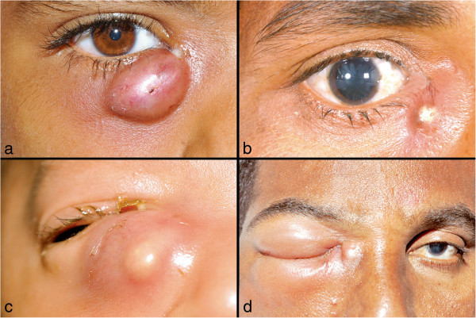
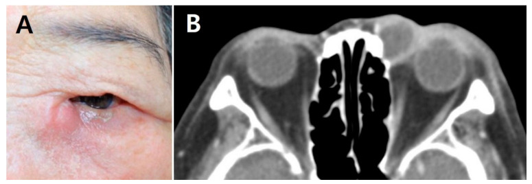
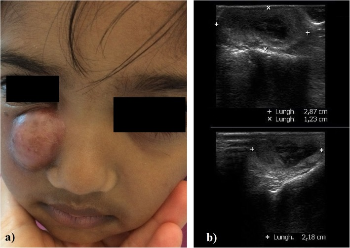
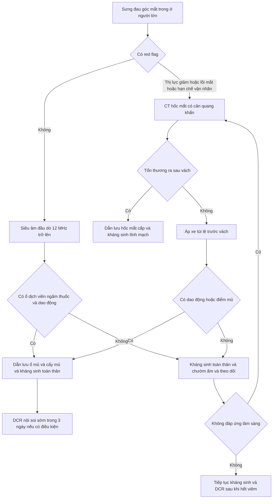
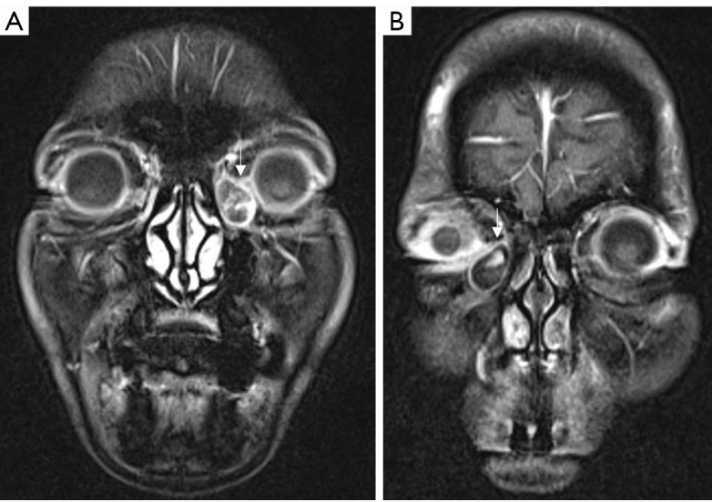
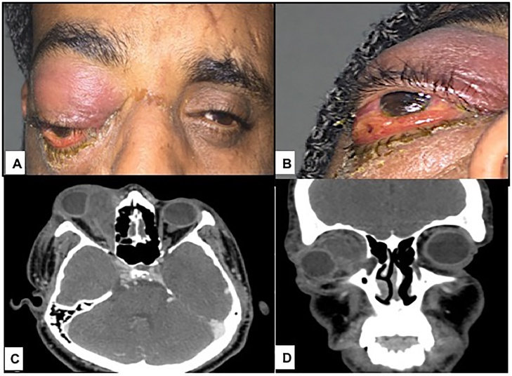
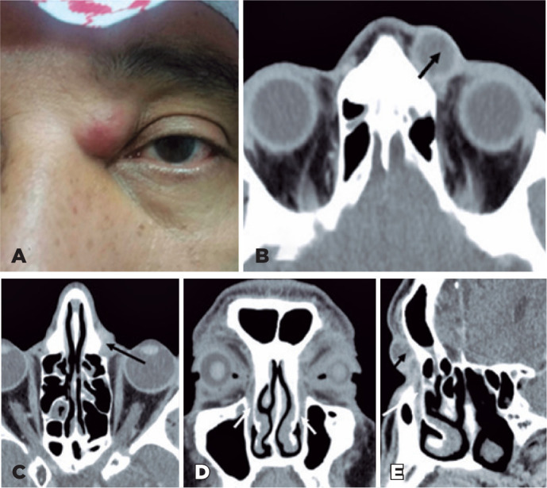

# 1485 — Viêm túi lệ cấp và áp-xe túi lệ ở người lớn / Acute dacryocystitis & lacrimal sac abscess

**Tags:** `pattern:ap-xe` `pattern:vien-ngam-thuoc` `pattern:phu-ne-mo-mem` `vung:mat` `vung:hoc-mat` `protocol:CT-hoc-mat` `protocol:MRI-hoc-mat` `incidentaloma:khong`
**Mức chắc chắn (certainty):** tổng hợp y văn (literature synthesis) — ghép các loạt mở: đoàn hệ **41 ca viêm túi lệ cấp (AD) mổ nội soi sớm** và **82 ca đối chứng** (*J Clin Med* 2021, **PMC8155898**, CC BY 4.0), **112 ổ áp-xe túi lệ trong 23 năm** (*J Ophthalmic Inflamm Infect* 2013, **PMC3750744**, CC BY 2.0), **212 ca viêm túi lệ** (*Oman J Ophthalmol* 2021, **PMC8597806**), các ca nguyên văn có **CT/MRI** (*Int J Surg Case Rep* 2018 **PMC6098209**; *Arq Bras Oftalmol* 2022 **PMC11826754**; *Ital J Pediatr* 2020 **PMC6998065**; *Quant Imaging Med Surg* 2026 **PMC13066861**) và một ca **nấm mucor giả dạng viêm túi lệ** (*Rom J Ophthalmol* 2025, **PMC12049641**). Phần lớn là **loạt hồi cứu đơn trung tâm**, không có thử nghiệm ngẫu nhiên; bài giữ dải số và ghi rõ bối cảnh. Ca trong quiz là **ca nguyên văn** của nguồn, giữ đúng mô tả gốc.

> **Câu chốt:** viêm túi lệ cấp là **ổ nhiễm khuẩn của một túi tịt** nằm **trước vách hốc mắt**. Vì vậy câu hỏi hình ảnh không phải "có dịch trong túi lệ không" mà là **"vách hốc mắt còn nguyên không, mủ đã ra sau vách chưa, và có khối thật hay không"** — ba câu trả lời quyết định kháng sinh đơn thuần, dẫn lưu, hay mổ hốc mắt cấp.

## 1. Tổng quan bệnh học – cơ chế hình ảnh

- **Giải phẫu quyết định bệnh cảnh.** Túi lệ là một **túi tịt** nằm trong hố lệ, giữa **van Rosenmüller** (phía ống lệ chung) và **màng Hasner** (đầu dưới ống lệ đạo). Khi ống lệ đạo tắc, nước mắt và chất tiết **không có đường ra**, ứ lại thành môi trường cho vi khuẩn; viêm túi lệ cấp hầu như luôn là biến chứng của **tắc ống lệ đạo mắc phải nguyên phát (PANDO)** — **96,23% (204/212)** ca trong loạt 212 người (*Oman J Ophthalmol* 2021, **PMC8597806**).
- **TẠI SAO vách hốc mắt là mốc sống còn.** Túi lệ nằm **trước vách hốc mắt (orbital septum)**, nên viêm túi lệ điển hình là **viêm mô tế bào trước vách**. Vách là hàng rào giải phẫu; khi mủ **thủng ra sau vách**, nhiễm trùng vào **khoang ngoài nón (extraconal)** — nơi có mỡ, cơ trực trong, thị thần kinh — và có thể lan tới **xoang hang**. Đây là lý do một khối "nhỏ ở góc mắt" có thể đe dọa thị lực trong vài ngày.
- **Dịch tễ (dải số).** Tại một trung tâm mắt tuyến cuối Ấn Độ, **tỉ lệ mắc 15/10.000 bệnh nhân**, **hiện mắc 19,5/10.000**; nữ **73,58% (156/212)**, tuổi trung bình **44,44 ± 18,95** (12–86), **50,94%** ở thập niên 30–60; thể **mạn tính 86,30%**, thể **cấp tính là thiểu số** (*Oman J Ophthalmol* 2021). Trong loạt mổ sớm 41 ca AD, tuổi trung bình **66,9** và **nữ:nam ≈ 20:1** (*J Clin Med* 2021) — nhóm mổ có tuổi cao hơn, phản ánh chọn bệnh tuyến cuối.
- **Vi sinh (loạt 112 ổ áp-xe, 23 năm).** **Gram dương 56,3% (63/112)**, trong đó **Staphylococcus aureus 25% (28/112)**; **Gram âm 30,4% (34/112)**, phổ biến nhất **Haemophilus influenzae** (**30,2%** các chủng Gram âm); **10,7% (12/112)** cấy vô khuẩn (*J Ophthalmic Inflamm Infect* 2013). Tỉ lệ vô khuẩn này nhắc: **đã dùng kháng sinh trước khi cấy làm giảm dương tính**, không được dùng cấy âm để loại nhiễm.
- **TẠI SAO hình ảnh trông như vậy (vật lý + mô bệnh).** Nội dung túi lệ là **dịch–mủ**, nên trên CT **giảm đậm độ so với cơ**, thường trong dải **khoảng 0–40 HU**; mủ đặc, giàu protein và tế bào có thể lên **20–40 HU**, trong khi dịch loãng có thể **0–15 HU** — **dải chồng lấp lớn, KHÔNG có ngưỡng HU nào phân biệt chắc dịch vô khuẩn với mủ**. Thứ giúp phân biệt là **hình thái**: ổ dịch **trung tâm không ngấm thuốc**, **viền ngấm thuốc** (thành túi lệ viêm tăng sinh mạch), **mỡ quanh viêm (fat stranding)** và **hiệu ứng choán chỗ**.
- **TẠI SAO phải có cản quang.** Thành túi lệ bình thường **mỏng, không thấy rõ** trên CT không cản quang; viêm làm thành dày và **ngấm thuốc**. Cản quang biến "khối mô mềm" thành hai thông tin: **có viền ngấm thuốc hay không** (ổ dịch/áp-xe) và **có phần đặc ngấm thuốc bên trong hay không** (u, tổ chức hạt). Đây cũng là cách phân biệt **áp-xe** với **nang nhầy đơn thuần**.
- **TẠI SAO mù.** Ca nguyên văn 35 tuổi cho thấy chuỗi sự kiện: mủ vỡ ra sau vách → **áp-xe ngoài nón 4,7 × 2,0 × 2,1 cm** chèn ép → **lồi mắt, liệt vận nhãn, nhãn áp 50 mmHg**, thị lực **không còn cảm nhận ánh sáng** (*Int J Surg Case Rep* 2018, **PMC6098209**). Cơ chế là **chèn ép + thiếu máu thị thần kinh**, không phải "viêm dây thần kinh" đơn thuần; vì vậy **giảm thị lực là cấp cứu**, không phải biến chứng muộn.
- **Diễn tiến tự nhiên và mốc thời gian.** Trong loạt 41 ca, **thời gian có triệu chứng trước chẩn đoán trung bình 7,9 ngày**; sau chẩn đoán, **giảm đau trung bình 5,0 ngày**, **hết sưng 9,2 ngày** nếu chỉ kháng sinh; mổ sớm rút xuống **2,4 ngày** và **6,5 ngày** (*J Clin Med* 2021). **2/41 ca** hình thành **rò da** do áp-xe tự vỡ trong lúc chờ mổ — một biến chứng "lành" nhưng để lại sẹo.
- **Yếu tố nguy cơ và bẫy bệnh nền.** Nữ, tuổi trung niên–cao, **đái tháo đường**, suy giảm miễn dịch, dị dạng vách mũi, tiền sử chấn thương/mổ vùng lệ đạo–xoang. Ở người **đái tháo đường**, viêm túi lệ "không đáp ứng kháng sinh" phải nghĩ **nấm mucor xâm lấn** — ca 52 tuổi trong *Rom J Ophthalmol* 2025 (**PMC12049641**) đã bị chẩn đoán nhầm, điều trị kháng sinh phổ rộng rồi mới phát hiện mucormycosis khi đã lan rộng hốc mắt.

## 2. Mẫu hình + chẩn đoán phân biệt theo vị trí (Gamut)

- **Mẫu hình kinh điển:** sưng–đau–đỏ **dưới dây chằng góc mắt trong (medial canthal tendon)**, kèm **chảy nước mắt**, **ấn túi lệ thấy mủ trào ra điểm lệ (ROPLAS)**, có thể sốt. Đau tăng khi ấn; da căng bóng khi đã áp-xe.
- **Ba trục đọc hình ảnh (thay cho mnemonic dài):**
  1. **Trước hay sau vách?** Trước vách = mỡ trước vách viêm, không lồi mắt, không hạn chế vận nhãn; sau vách = **mỡ hốc mắt viêm, lồi mắt, hạn chế vận nhãn, đau khi liếc**.
  2. **Dưới hay trên dây chằng góc mắt trong?** **Dưới** = túi lệ/áp-xe túi lệ; **trên** = u túi lệ, nang nhầy lan lên, nang xoang trán, thoát vị não–màng não, hoặc thể **viêm túi lệ ứ đọng**.
  3. **Dịch hay đặc?** Ổ dịch viền ngấm thuốc = áp-xe/nang; phần **đặc ngấm thuốc** = u, tổ chức hạt, hoặc nấm xâm lấn.
- **Gamut theo vị trí:**
  - **Góc mắt trong, dưới dây chằng:** viêm túi lệ cấp · áp-xe túi lệ · nang/nhầy túi lệ · **u túi lệ (SCC, lymphoma, melanoma)** · **viêm túi lệ ứ đọng**.
  - **Trên dây chằng:** u túi lệ lan lên · nang nhầy xoang trán · thoát vị não–màng não · nang bì · di căn/u hốc mắt trước.
  - **Sau vách, ngoài nón:** viêm mô tế bào hốc mắt · **áp-xe ngoài nón do túi lệ vỡ** · áp-xe dưới màng xương từ xoang sàng (bài 1461).
  - **Bờ mi/da trước vách:** viêm mô tế bào trước vách không do túi lệ · **mụn nhọt, nang bã, côn trùng đốt** · chốc lây.
  - **Xoang sàng trước:** viêm xoang sàng · nang nhầy xoang sàng · **nấm xâm lấn** (đái tháo đường, giảm miễn dịch).
- **Dấu hiệu báo động (red flags) — chụp CT khẩn, không chờ siêu âm:** thị lực giảm, **đau khi cử động mắt**, lồi mắt, hạn chế vận nhãn, **giãn đồng tử**, sốt cao ở người đái tháo đường/giảm miễn dịch, da hoại tử/đen, khí trong mô, hoặc **không đáp ứng kháng sinh** sau vài ngày.

*Bốn mức độ: (a) áp-xe khu trú có chảy mủ ở góc mắt trong; (b) điểm mủ; (c) áp-xe túi lệ ở trẻ sơ sinh; (d) áp-xe túi lệ kèm viêm mô tế bào hốc mắt. Nguồn: J Ophthalmic Inflamm Infect 2013, PMC3750744, Fig. 1, CC BY 2.0 (nguyên bản).*

## 3. Bảng so sánh phân biệt (ma trận đối chiếu)

| Thực thể (entity) | Hình ảnh điển hình (CT/MRI/US) | Chốt vào (rule-in) | Chốt loại (rule-out) | Gợi ý xác nhận |
|---|---|---|---|---|
| **Viêm túi lệ cấp chưa áp-xe** | Túi lệ căng dịch **0–40 HU**, thành **dày, ngấm thuốc đều**, mỡ quanh viêm nhẹ; không ổ dịch có vỏ | **Sưng dưới dây chằng + ấn có mủ ở điểm lệ + thành ngấm thuốc đều** | **Không có ổ dịch trung tâm**; không lồi mắt, không hạn chế vận nhãn | Kháng sinh toàn thân + chườm ấm; siêu âm theo dõi |
| **Áp-xe túi lệ** | **Ổ dịch trung tâm không ngấm thuốc + viền ngấm thuốc dày**, có thể **khí**; da căng, điểm mủ | **Viền ngấm thuốc + dao động + điểm mủ** | Viền mỏng đều, không dao động, không viêm mỡ quanh = chưa áp-xe | Siêu âm ≥ 12 MHz; **chọc/dẫn lưu + cấy mủ** |
| **Viêm mô tế bào trước vách không do túi lệ** | Dày da–mỡ trước vách, **không có ổ dịch trung tâm**, **túi lệ không căng**, không liên tục với ống lệ đạo | **Phù nề lan tỏa, không điểm đau khu trú trên túi lệ** | Có ổ dịch đúng vị trí túi lệ + ống lệ đạo giãn → do túi lệ | Lâm sàng + siêu âm; kháng sinh |
| **Viêm mô tế bào hốc mắt / áp-xe ngoài nón do túi lệ vỡ** | **Mỡ sau vách viêm**, lồi mắt, **ổ dịch ngoài nón** cạnh cơ trực trong; có thể chèn thị thần kinh | **Tổn thương sau vách + lồi mắt/hạn chế vận nhãn** | Chỉ thay đổi trước vách, không lồi mắt → chưa lan sau vách | **CT có cản quang khẩn**; MRI nếu nghi nội sọ; dẫn lưu |
| **Nang nhầy túi lệ** | Túi lệ giãn **dịch đồng nhất**, thành **mỏng, không viêm**, không mỡ quanh; có thể **vôi hóa** | **Dịch thuần, thành mỏng, không đau cấp** | Thành dày ngấm thuốc + viêm mỡ + đau cấp → viêm/áp-xe | CT/CT-DCG; mổ nếu chèn ép |
| **U túi lệ (SCC/lymphoma/melanoma)** | **Khối đặc ngấm thuốc** trong túi lệ, **lan lên trên dây chằng**, có thể **phá xương**, không đối xứng | **Khối đặc + lan trên dây chằng + phá xương** | Ổ dịch thuần, không phần đặc → không phải u | **MRI có cản quang + sinh thiết**; không DCR đơn thuần |
| **Viêm xoang sàng trước** | Mờ/xoang sàng trước, có thể **áp-xe dưới màng xương** hình thấu kính sát lamina papyracea | **Mờ xoang sàng cùng bên + ổ dịch dưới màng xương** | Xoang sàng trong, không ổ dịch dưới màng xương → ít khả năng | CT xoang ≤ 1 mm; phối hợp TMH |
| **Viêm túi lệ ứ đọng (ADR)** | Túi lệ căng dịch, **không có tắc thật**; sau đợt cấp **thông lệ đạo trở lại** | **Không tiền sử chảy nước mắt + hết sau điều trị nội + thông lệ đạo 1 tháng** | Tắc thật: vẫn tắc khi thử lại sau khi hết viêm | Thử thông/rửa lệ đạo sau khi hết viêm |
| **Nấm mucor xâm lấn** | **Phá xương, lan mô mềm ngoài xoang/túi lệ**, mờ xoang, có thể **khí**; ngấm thuốc không đồng nhất | **Đái tháo đường/giảm miễn dịch + không đáp ứng kháng sinh + phá xương/hoại tử** | Tổn thương khu trú trong túi lệ, không phá xương, đáp ứng kháng sinh → ít khả năng | **Sinh thiết cấp + nhuộm nấm**; không chờ |

*Bệnh nhân nữ 80 tuổi: (A) sưng–đỏ quanh túi lệ trái; (B) CT trục có cản quang — ổ dịch viền ngấm thuốc ở góc mắt trong trái, mô mềm quanh hốc mắt ngấm thuốc. Nguồn: J Clin Med 2021, PMC8155898, Fig. 1, CC BY 4.0 (nguyên bản).*

### Đọc ma trận theo thứ tự nào
- **Bước 1 — vạch vách:** tìm **mỡ sau vách viêm**, lồi mắt, hạn chế vận nhãn. Chỉ cần một dấu sau vách là **đổi phân loại và đổi điều trị**.
- **Bước 2 — tìm ổ dịch và vỏ:** ổ dịch **trung tâm không ngấm thuốc** + **viền ngấm thuốc** = áp-xe/nang; không có viền, chỉ có mô mềm dày = viêm mô tế bào.
- **Bước 3 — tìm phần đặc và xương:** khối **đặc ngấm thuốc**, **lan trên dây chằng**, **phá xương** = u hoặc nấm; đừng "thử DCR" trên khối u.
- **Bước 4 — đối chiếu lâm sàng:** đau khu trú đúng túi lệ, mủ ở điểm lệ, thời gian diễn tiến. Hình ảnh một mình không phân biệt được viêm túi lệ với viêm mô tế bào quanh túi lệ.

## 4. Protocol chụp + hệ phân độ/ngưỡng xử trí

- **Siêu âm là bước đầu tiên ở tuyến có đầu dò phù hợp.** Đầu dò **thẳng ≥ 12 MHz**, đặt dọc bờ trong ổ mắt, so hai bên; tìm **ổ echo trống/giảm âm**, **tăng hồi âm phía sau**, **không có phổ Doppler trong lòng** (khác khối đặc có mạch). Đo **3 chiều** và ghi nhận **dao động**. Ca 4 tuổi trong *Ital J Pediatr* 2020 (**PMC6998065**) có ổ dịch **2,87 × 1,23 cm** và **2,18 cm** trên siêu âm, đủ để chẩn đoán áp-xe túi lệ mà không cần CT.

*Bé gái 4 tuổi: (a) khối đỏ căng dưới góc mắt trong phải; (b) siêu âm — ổ echo trống bờ rõ, đo 2,87 × 1,23 cm và 2,18 cm, không có mạch trong lòng. Nguồn: Ital J Pediatr 2020, PMC6998065, Fig. 1, CC BY 4.0 (nguyên bản).*
- **CT hốc mắt–xoang có cản quang** khi có red flag, khi siêu âm không kết luận, hoặc trước mổ: **lát ≤ 1 mm**, **trục + đứng (coronal)**, **cửa sổ mô mềm + xương**, trường quét **từ trần hốc mắt đến khẩu cái cứng** để thấy toàn bộ ống lệ đạo. Cản quang **1,5–2 mL/kg** (theo cân nặng, chỉnh theo chức năng thận). Đo: **kích thước túi lệ, độ dày thành, chiều dài ổ dịch ngoài nón, mức lan ra sau vách, mờ xoang sàng, khuyết xương, khí trong mô**.
- **MRI hốc mắt** khi: nghi **u túi lệ**, nghi **lan nội sọ/xoang hang**, cần đánh giá **thị thần kinh**, hoặc trẻ cần tránh bức xạ lặp lại. Protocol tối thiểu: **T1 không mỡ + T2 fat-sat + T1 fat-sat sau tiêm**, thêm **DWI/ADC**; lớp **≤ 3 mm**, trường từ mắt tới giao thoa thị giác.
- **CT-DCG (chụp cản quang lệ đạo)** không dùng trong đợt cấp vì nguy cơ đẩy mủ; dành cho **đánh giá sau khi hết viêm** hoặc trước mổ DCR phức tạp.
- **Hệ phân độ Chandler** cho biến chứng hốc mắt (dùng chung nguyên lý với viêm xoang): **I** viêm mô tế bào trước vách; **II** viêm mô tế bào hốc mắt; **III** áp-xe dưới màng xương; **IV** áp-xe hốc mắt; **V** huyết khối xoang hang. Với viêm túi lệ, "Chandler" chỉ dùng để **mô tả mức lan**, không thay thế đánh giá ổ nguyên phát.

**Ngưỡng xử trí (theo bậc):**

| Bậc | Bối cảnh | Việc làm | Bằng chứng / số liệu |
|---|---|---|---|
| 1 | Viêm túi lệ cấp **chưa áp-xe**, không red flag | Kháng sinh toàn thân có phổ Gram dương + Gram âm, chườm ấm, giảm đau; theo dõi 24 giờ | Giảm đau **5,0 ngày**, hết sưng **9,2 ngày** (loạt 41 ca) |
| 2 | **Áp-xe túi lệ** (dao động/điểm mủ) | **Dẫn lưu ổ mủ** (qua da hoặc qua đường lệ đạo) + cấy mủ + kháng sinh; không nặn mạnh | Loạt 112 ổ áp-xe: dẫn lưu + kháng sinh, sau đó DCR |
| 3 | **Có chỉ định mổ triệt để** và điều kiện cho phép | **DCR nội soi sớm ≤ 3 ngày** (nếu không, DCR sau khi hết viêm) | Thành công giải phẫu **87,8%**, chức năng **82,9%** — không kém nhóm không AD (91,5%/84,1%) |
| 3b | So sánh thời điểm mổ sớm | **≤ 3 ngày** vs **4–7 ngày** | Nằm viện **4,6 vs 7,0 ngày** (p = 0,026); kháng sinh **9,8 vs 12,8 ngày** (p < 0,001); thành công như nhau |
| 4 | **Red flag sau vách** (lồi mắt, hạn chế vận nhãn, thị lực giảm) | **CT khẩn + dẫn lưu hốc mắt + kháng sinh tĩnh mạch**; phối hợp TMH/mắt | Ca 35 tuổi: ổ dịch **4,7 × 2,0 × 2,1 cm**, nhãn áp **50 mmHg**, mù vĩnh viễn |
| 5 | **Đái tháo đường/giảm miễn dịch, không đáp ứng kháng sinh** | Nghĩ **mucor**: sinh thiết cấp + nhuộm nấm + CT/MRI; không chờ | Ca 52 tuổi bị chẩn đoán nhầm, lan rộng hốc mắt |

- **Theo dõi sau dẫn lưu:** đau giảm trong **2–3 ngày**, sưng giảm trong **6–7 ngày** sau mổ sớm (*J Clin Med* 2021); sốt kéo dài, sưng tăng, hoặc xuất hiện lồi mắt = **chụp lại ngay**, không đổi kháng sinh mù.
- **Kháng sinh:** chọn theo cấy khi có; kinh nghiệm phải phủ **tụ cầu** và **Gram âm** (loạt 112 ổ: Gram dương 56,3%, Gram âm 30,4%). Không dùng corticoid toàn thân đơn thuần để "giảm sưng" khi chưa loại áp-xe.

## 5. Biến thể bình thường và cạm bẫy

- **"Trên dây chằng" là dấu hiệu vàng của u, không phải viêm túi lệ điển hình.** Trong loạt 9 u túi lệ so với nhóm nang nhầy, khối **lan lên trên dây chằng góc mắt trong** gặp **8/9 u** và **0 ca nang nhầy**; **ống lệ đạo sâu hơn** ở nhóm u (**5,08 ± 3,21 mm vs 2,85 ± 0,96 mm**, p = 0,042), còn **chiều rộng không khác** (p = 0,44). Vì vậy khối trên dây chằng → **MRI có cản quang + sinh thiết**, không DCR.

*(A) MRI T1 sau tiêm có bão hòa mỡ, mặt cắt trục: khối **đặc hoại tử ngấm thuốc viền** ở túi lệ trái, **lan lên trên dây chằng góc mắt trong** (mũi tên) — SCC hoại tử. (B) Mặt cắt tránh: nang nhầy túi lệ phải — ổ dịch **không ngấm thuốc**, thành mỏng, không có phần đặc. Nguồn: Quant Imaging Med Surg 2026, PMC13066861, Fig. 2, CC BY-NC-ND 4.0 (nguyên bản, không cắt/ghép).*

- **Viêm túi lệ ứ đọng (ADR) — đừng mổ oan.** Ca 61 tuổi đái tháo đường có sưng **trên dây chằng**, **không tiền sử chảy nước mắt**, CT giống viêm túi lệ cấp; điều trị nội khoa toàn bộ, **rửa lệ đạo 1 tháng sau thấy thông hoàn toàn** (*Arq Bras Oftalmol* 2022). ADR là **tắc tạm thời**, không phải PANDO; DCR ngay là can thiệp thừa.
- **Nấm mucor giả dạng viêm túi lệ.** Ở người **đái tháo đường hoặc giảm miễn dịch**, viêm túi lệ **không đáp ứng kháng sinh** phải chụp CT/MRI và **sinh thiết**; dấu **phá xương, lan ra ngoài túi lệ, hoại tử da/mi** là red flag. Chậm chẩn đoán làm tăng mức lan hốc mắt (*Rom J Ophthalmol* 2025).
- **Nang nhầy ≠ áp-xe.** Nang nhầy có **thành mỏng, dịch thuần, không viêm mỡ quanh**; áp-xe có **viền dày ngấm thuốc + mỡ quanh viêm + đau cấp**. Gọi nang nhầy là "áp-xe" dẫn tới dẫn lưu không cần thiết; gọi áp-xe là "nang" dẫn tới chậm dẫn lưu.
- **Đừng nặn/ấn mạnh túi lệ đang viêm.** Tăng áp lực trong túi tịt có thể làm mủ **vỡ ra sau vách** hoặc qua da; động tác nắn chỉ dành cho nang túi lệ bẩm sinh ở trẻ (bài 1483), không dành cho ổ áp-xe cấp.
- **Không nong/thông lệ đạo trong đợt cấp.** Các loạt kinh điển **dẫn lưu + kháng sinh rồi mới DCR**; thông lệ đạo khi đang viêm có thể đẩy mủ và làm bùng phát nhiễm. Sau khi hết viêm, **rửa/thông lại** để phân biệt tắc thật với ADR.
- **Đừng bỏ xoang sàng.** Túi lệ nằm sát **xoang sàng trước**; mờ xoang sàng cùng bên có thể là **ổ nguyên phát** hoặc đường lan. Chỉ dẫn lưu túi lệ mà bỏ xoang → tái phát; chỉ điều trị xoang mà bỏ áp-xe túi lệ → mủ tiếp tục.
- **Cạm bẫy sau mổ:** viền ngấm thuốc và mờ mỡ quanh có thể còn **vài tuần** sau dẫn lưu; đừng gọi "áp-xe tái phát" nếu lâm sàng đang cải thiện. Ngược lại, **sưng tăng sau 48 giờ** hoặc **mới xuất hiện lồi mắt** phải chụp lại.
- **Trẻ em:** viêm túi lệ ở trẻ thường gắn với **tắc lệ đạo bẩm sinh/nang túi lệ** — khung bệnh và xử trí khác, xem bài 1483.

## 6. Tự lượng giá — Blind Quiz

**Ca 1 — Nữ 80 tuổi, đau–đỏ–sưng quanh túi lệ trái 3 ngày, không lồi mắt, vận nhãn bình thường. CT có cản quang: ổ dịch viền ngấm thuốc ở góc mắt trong, mô mềm quanh ngấm thuốc. Hỏi chẩn đoán, mức lan, và bước tiếp theo?**

- Gợi ý: không sốt, không đái tháo đường, thị lực bình thường.
- Câu hỏi: ổ dịch nằm trước hay sau vách? Có cần mổ hốc mắt không? Chọn kháng sinh và thời điểm DCR thế nào?

<b>Bấm để hiện đáp án (findings + chẩn đoán)</b>

- Findings: ổ dịch **trung tâm không ngấm thuốc**, **viền ngấm thuốc**, nằm **trước vách** ở góc mắt trong trái; mô mềm quanh hốc mắt ngấm thuốc nhưng **không có ổ dịch sau vách**, không lồi mắt.
- Chẩn đoán: **viêm túi lệ cấp có ổ áp-xe nhỏ, còn trước vách** (Chandler I), chưa lan hốc mắt.
- Xử trí: kháng sinh toàn thân phủ tụ cầu/Gram âm + chườm ấm; nếu dao động → **dẫn lưu + cấy**. Trong loạt này, **DCR nội soi sớm ≤ 3 ngày** đạt thành công giải phẫu **87,8%**, chức năng **82,9%**, rút ngắn nằm viện còn **4,6 ngày** và kháng sinh **9,8 ngày**.
- Nguồn ảnh: *J Clin Med* 2021, PMC8155898, Fig. 1, CC BY 4.0.

**Ca 2 — Nam 35 tuổi, sưng góc mắt trong 3 ngày rồi lồi mắt, hạn chế vận nhãn, thị lực không còn cảm nhận ánh sáng, nhãn áp 50 mmHg. CT: túi lệ giãn, ổ dịch ngoài nón 4,7 × 2,0 × 2,1 cm cạnh cơ trực trong. Hỏi chẩn đoán và vì sao mù?**

- Gợi ý: trước đó được chẩn đoán viêm túi lệ cấp – viêm mô tế bào trước vách, uống kháng sinh nhưng nặng lên.
- Câu hỏi: ổ dịch ở khoang nào? Cơ chế mù? Xử trí trong bao lâu?

<b>Bấm để hiện đáp án (findings + chẩn đoán)</b>

- Findings: (C, D) **túi lệ và ống lệ đạo giãn**, **ổ dịch lớn không ngấm thuốc ở khoang ngoài nón** cạnh cơ trực trong, **đẩy lồi nhãn cầu**; thành túi lệ ngấm thuốc lan ra sau vách.
- Chẩn đoán: **viêm túi lệ cấp vỡ ra sau vách → áp-xe ngoài nón/hốc mắt** (Chandler IV), biến chứng **mù**.
- Vì sao mù: ổ dịch **4,7 × 2,0 × 2,1 cm** chèn ép thị thần kinh, kèm **nhãn áp 50 mmHg** — thiếu máu/chèn ép thị thần kinh, không hồi phục dù dẫn lưu ngay.
- Xử trí: **dẫn lưu cấp + kháng sinh tĩnh mạch**; đây là biến chứng hiếm — đến 2018 y văn chỉ có **7 ca** mù do viêm túi lệ, đến 2025 khoảng **10 ca**.
- Nguồn ảnh: *Int J Surg Case Rep* 2018, PMC6098209, Fig. 1, CC BY-NC-ND 4.0 (nguyên bản, không cắt/ghép).

**Ca 3 — Nam 61 tuổi đái tháo đường, sưng đau góc mắt trong 4 ngày, khối nằm TRÊN dây chằng, không có tiền sử chảy nước mắt. CT: túi lệ căng dịch, không phá xương, không ổ dịch sau vách. Điều trị nội khoa bệnh lui; 1 tháng sau rửa lệ đạo thấy thông. Hỏi đây là gì và vì sao KHÔNG mổ DCR ngay?**

- Gợi ý: không sốt, không lồi mắt; khối căng, đau.
- Câu hỏi: vì sao vị trí trên dây chằng lại quan trọng? Chẩn đoán? Theo dõi gì để chứng minh?

<b>Bấm để hiện đáp án (findings + chẩn đoán)</b>

- Findings: (A) khối sưng đỏ **trên dây chằng góc mắt trong**; (B–E) **túi lệ căng dịch**, bờ rõ, **không phá xương**, **không có ổ dịch sau vách**.
- Chẩn đoán: **viêm túi lệ ứ đọng (acute dacryocystitis retention, ADR)** — tắc **tạm thời**, không phải PANDO; khối trên dây chằng là điểm dễ nhầm với u/nang nhầy.
- Vì sao không DCR ngay: ADR có thể **thông tự nhiên**; ca gốc điều trị nội khoa toàn bộ và **rửa lệ đạo 1 tháng sau thấy thông hoàn toàn**. DCR ngay là can thiệp thừa.
- Theo dõi: **rửa/thông lệ đạo sau khi hết viêm** — còn tắc mới là PANDO và mới cần DCR.
- Nguồn ảnh: *Arq Bras Oftalmol* 2022, PMC11826754, Fig. 1, CC BY 4.0.

## Bài liên quan chéo
- [400 – Tổng quan Mắt & thị giác](../400-tong-quan-mat-thi-giac/lesson.md)
- [410 – Giải phẫu học mắt](../410-giai-phau-hoc-mat/lesson.md)
- [1483 – Nang túi lệ bẩm sinh & tắc lệ đạo ở trẻ](../1483-nang-tui-le-va-tac-le-dao-o-tre/lesson.md)
- [1461 – Áp-xe dưới màng xương hốc mắt ở trẻ](../1461-ap-xe-duoi-mang-xuong-hoc-mat-o-tre/lesson.md)
- [424 – Tuyến lệ: viêm vs u](../424-tuyen-le/lesson.md)
- [423 – Fistula xoang hang vs huyết khối](../423-fistula-xoang-hang/lesson.md)
- [422 – Viêm giả u hốc mắt](../422-viem-gia-u/lesson.md)

> Không dùng để chẩn đoán độc lập khi chưa có người hướng dẫn.
