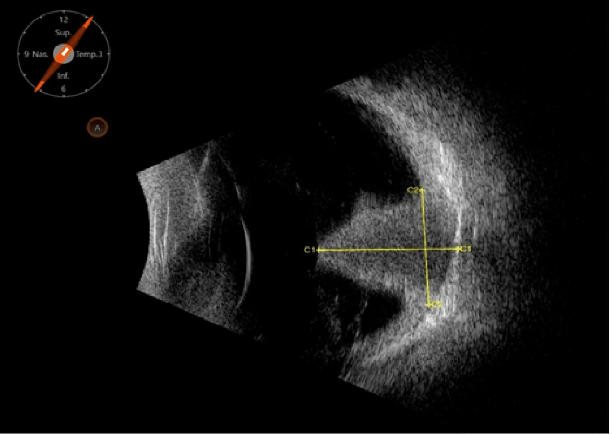
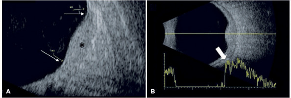
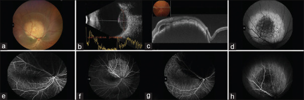
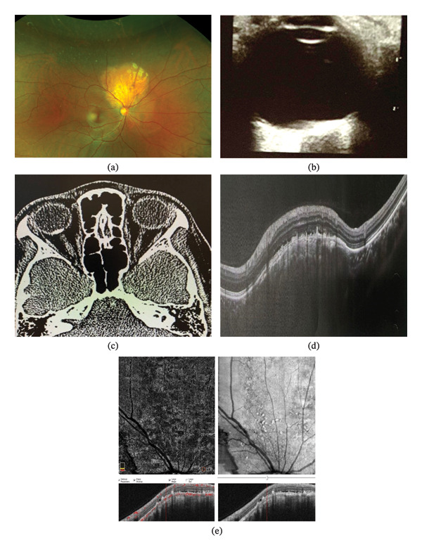
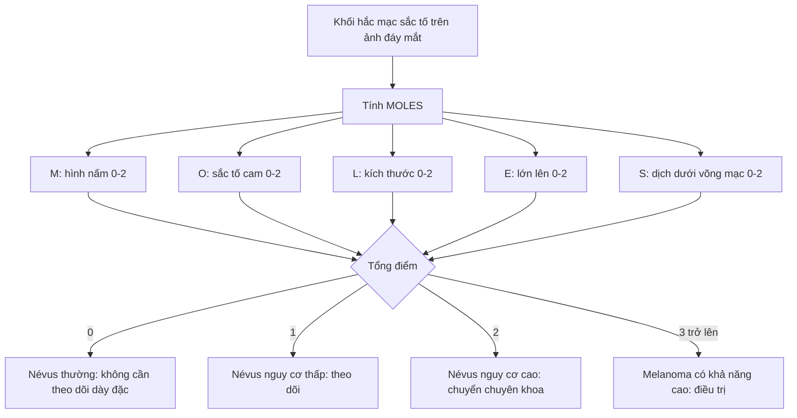
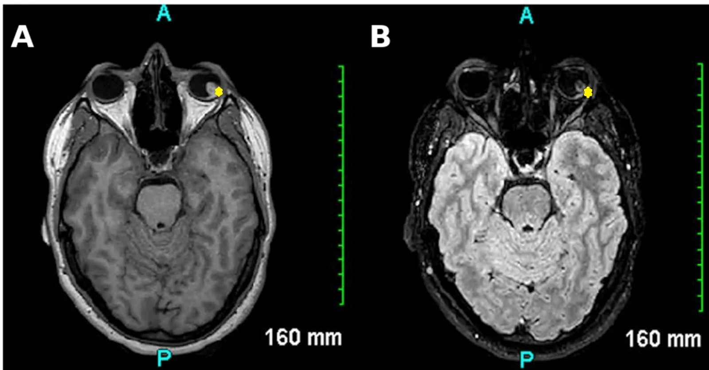

# 1486 — Khối hắc mạc trên siêu âm: melanoma – hemangioma – di căn – osteoma / Choroidal mass on ultrasound: melanoma, hemangioma, metastasis, osteoma

**Tags:** `pattern:khoi-hac-mac` `pattern:day-hac-mac` `pattern:u-noi-nhan` `pattern:hong-am-noi-bo` `pattern:voi-hoa` `pattern:bong-thanh-dich` `vung:hac-mac` `vung:nhan-cau` `vung:mat` `protocol:sieu-am-B-scan` `protocol:sieu-am-A-scan` `protocol:OCT` `protocol:MRI-hoc-mat` `protocol:CT-hoc-mat` `score:MOLES` `incidentaloma:khong`

**Mức chắc chắn (certainty):** tổng hợp y văn (literature synthesis) — dựng từ **45 melanoma/49 nghi ngờ/43 névus** siêu âm định lượng (*Ophthalmol Sci* 2025, **PMC12246935**), **439 u hắc mạc** phân loại hình dạng (*Front Med* 2025, **PMC12641273**), **67 mắt di căn hắc mạc** (*Taiwan J Ophthalmol* 2026, **PMC13082809**), **2.214 di căn/1.111 bệnh nhân** (*Middle East Afr J Ophthalmol* 2018, **PMC6071342**), **132 mắt u xương hắc mạc** (*Eye Vis* 2025, **PMC12400656**), thang **MOLES** (*Eye* 2023, **PMC9244298**), **8.606 u theo dõi** (*Taiwan J Ophthalmol* 2025, **PMC11981566**) và **42 mắt hoãn điều trị** (*Indian J Ophthalmol* 2018, **PMC6173014**). Nhóm **không có bệnh nhân của mình**; chỗ chưa đủ chắc ghi "chưa rõ". **Không ghi tên tác giả** — attribution dùng tạp chí + năm + PMCID.

> **Vị trí trong thư viện:** [448](../448-u-hac-mac/lesson.md) đã phủ **gamut khối hắc mạc + MRI + điều trị theo kích thước**; bài này đi sâu **một câu hỏi duy nhất — đọc siêu âm thế nào để phân loại khối**, nên hai bài **bổ sung**, không thay nhau.
>
> **Câu chốt:** Siêu âm **không trả lời "có khối không"** (B-scan thấy rất dễ) mà trả lời **"khối gì"** bằng **hồi âm nội bộ** và **hình dạng**. Ba con số phải thuộc: **(1)** melanoma hồi âm **thấp–trung bình** (45 mắt: thấp **26%**, thấp–trung bình **18%**, trung bình **38%**, **không ca nào hồi âm cao**) trong khi névus **41% trung bình–cao + 11% cao** (PMC12246935); **(2)** ngưỡng **MOLES** — dày **> 2,0 mm** và/hoặc đường kính **> 4 DD (6 mm)** = **2 điểm**, tổng **≥ 3 = melanoma có khả năng cao** (PMC9244298); **(3)** u xương hắc mạc **giảm canxi hoá 95,5%** với khởi phát trung bình **70,2 tuần**, nên "khối sáng đã xẹp" **không** phải khỏi bệnh (PMC12400656).

## 1. Tổng quan bệnh học – cơ chế hình ảnh

### 1.1 TẠI SAO bốn khối cùng "dày hắc mạc" lại cho bốn kiểu hồi âm khác nhau

Siêu âm mắt dùng đầu dò **10–15 MHz** (bước sóng trong mô **~0,1–0,15 mm**) — đủ để một chùm tia **xuyên qua cả khối dày 5–10 mm** và ghi **hồi âm từ bên trong** khối, không chỉ từ bề mặt. Hồi âm nội bộ phụ thuộc **số mặt phân cách trở kháng âm (acoustic impedance)** trên một đơn vị thể tích và **hệ số suy giảm** của mô:

- **Melanoma hắc mạc:** tế bào **hình thoi/hình biểu mô xếp thành phiến đặc**, ít mô đệm, mạch máu nhỏ → **rất ít mặt phân cách** trong lòng khối → hồi âm nội bộ **thấp–trung bình**. Âm thanh còn bị **suy giảm mạnh** khi đi qua khối nên đáy khối **tối hơn đỉnh** = **"rỗng âm" (acoustic hollowness)**. Đây là lý do ca melanoma điển hình có **đỉnh sáng, đáy tối** trên cùng một vector A-scan.
- **Hemangioma hắc mạc khu trú (CCH):** chùm **khoang mạch lớn thành nội mô** ngăn bởi **vách xơ** → **vô số mặt phân cách** trong lòng khối → hồi âm nội bộ **CAO, đồng nhất**, và vì mô mềm ít suy giảm nên **không rỗng** — hình ảnh gọi là **"đặc âm" (acoustic solidity)**, hồi âm gần bằng hắc mạc bình thường.
- **Di căn hắc mạc:** **ổ tế bào biểu mô** (tuyến vú, phổi) nằm trong **mô đệm xơ**, có thể hoại tử → hỗn hợp mặt phân cách → hồi âm **trung bình–cao (69%)** hoặc **trung bình–thấp (31%)**, cấu trúc **"lumpy–bumpy"**, bề mặt phẳng hơn (plateau) so với melanoma.
- **U xương hắc mạc (choroidal osteoma):** **bè xương trưởng thành** trong hắc mạc → **hồi âm cao nhất** trong các khối nội nhãn, thường có **bóng lưng (posterior shadowing)** vì xương phản xạ gần hết năng lượng; phải **hạ gain** mới thấy rõ bề dày thật.
- **Névus hắc mạc:** mô **melanocyte lành tính** thưa, thường có **drusen** phía trên (nhiều mặt phân cách nhỏ) → hồi âm **trung bình–cao đến cao**, chiều cao trung bình chỉ **1,6 mm** (so với **6,4 mm** ở melanoma; PMC12246935).

### 1.2 TẠI SAO "hình nấm" là dấu gần đặc hiệu của melanoma

Màng **Bruch–RPE** là một **tấm đàn hồi** liên tục. Melanoma lớn dần **phá vỡ** tấm này rồi **bung ra vào khoang dưới võng mạc**, tạo **"vai" (collar/overhang)** = **khối hình nấm (mushroom/collar-button)**. Hệ quả định lượng trên **439 u phẫu thuật**: nấm **37,4%**, vòm **29,4%**, thuỳ **14,1%**, lan toả **2,5%**, bất quy tắc **16,6%**; **nấm tiên lượng tốt nhất, bất quy tắc xấu nhất** — độc lập với kích thước và AJCC (PMC12641273). Lưu ý: hình nấm chỉ thấy khi **mặt cắt siêu âm đi qua đúng chỗ vỡ**; "nấm non" (RPE thủng nhưng chưa có vai) chỉ cho **1 điểm** trong MOLES.

### 1.3 Ngưỡng định lượng nằm lòng

| Chỉ số | Ngưỡng / giá trị | Nguồn |
|---|---|---|
| Hồi âm nội bộ melanoma (45 mắt) | thấp **26%**, thấp–trung bình **18%**, trung bình **38%**, trung bình–cao **18%**, cao **0%** | PMC12246935 |
| Hồi âm nội bộ névus (43 mắt) | thấp **5%**, thấp–trung bình **14%**, trung bình **40%**, trung bình–cao **30%**, cao **11%** | PMC12246935 |
| Chiều cao trung bình | névus **1,6 mm** · nghi ngờ **1,9 mm** · melanoma **6,4 mm** | PMC12246935 |
| MOLES — kích thước | dày **> 2,0 mm** và/hoặc đáy **> 4 DD (6 mm)** = **2 điểm**; **1,0–2,0 mm** hoặc **3–4 DD** = **1 điểm**; **< 1,0 mm** và **< 3 DD** = 0 | PMC9244298 |
| MOLES — tổng điểm | **0** névus thường · **1** nguy cơ thấp · **2** nguy cơ cao · **≥ 3** melanoma có khả năng cao | PMC9244298 |
| Số névus trên 1 melanoma theo độ dày | **125 : 1** (dày 1,5–2 mm) · **25 : 1** (2–2,5 mm) · **5 : 1** (2,5–3 mm) | PMC9244298 |
| Định nghĩa "lớn lên" | cao tăng **> 0,3 mm** hoặc đáy tăng **> 0,5 mm**; đo lại mới tính | PMC11981566, PMC7408899 |
| Tỷ lệ u "không xác định" lớn lên | **478/8.606 (5,6%)** trong 5 năm; từng nghiên cứu **2–55%** (trung bình 19%) | PMC11981566 |
| U "không xác định" (định nghĩa) | **≤ 2,5 mm** cao và **≤ 10 mm** LBD | PMC11981566 |
| Melanoma trung bình — tiêu chuẩn COMS | dày **2,5–10,0 mm**, LBD **≤ 16,0 mm** | PMC6173014 |
| Hoãn/không điều trị melanoma trung bình | tử vong 5 năm **~30% (18–47%)** vs COMS **18% (16–20%)**; HR hiệu chỉnh **1,54 (0,93–2,56)** | PMC6173014 |
| Di căn hắc mạc (51 mắt siêu âm) | **100% đặc**, **4/51 rỗng**; trung bình–cao **69%** vs trung bình–thấp **31%**; dày **3,9 mm**, đáy **9,9 mm**, **dày/đáy 0,38** (melanoma **~0,6**) | PMC13082809 |
| Di căn hắc mạc — dịch tễ | **2.214 u/1.111 bệnh nhân**; vú **37%**, phổi **26%**; **một bên 82%**; sống 5 năm **23%** | PMC6071342 |
| U xương hắc mạc | giảm canxi **95,5%**, khởi phát trung bình **70,2 tuần**; **FCE 46,2%**; nữ:nam **1,82 : 1** | PMC12400656 |
| U xương hắc mạc — CNV | **~1/3** mắt phát triển CNV | PMC13180048 |
| CCH | tuổi trung bình **53,8**, nam **60%** (238 bệnh nhân); hồi âm **CAO**, "acoustic solidity" | PMC6896540 |
| Sinh thiết hắc mạc sau (TSEB, 11 ca) | **73%** có chẩn đoán; **18%** không kết luận; 1 biến chứng (mất dịch kính + lỗ võng mạc, không bong) | PMC11733111 |

### 1.4 Vì sao "theo dõi" là một quyết định chứ không phải sự trì hoãn

- Ở dải dày **2–2,5 mm**, tỷ lệ névus/melanoma là **25 : 1** — nghĩa là **đa số là lành**, nên mổ ngay mọi khối > 2 mm là **mổ oan 24/25**.
- Nhưng ở **42 mắt melanoma trung bình được hoãn/không điều trị**, tử vong 5 năm **~30%** so với **18%** ở nhóm điều trị trong thử nghiệm COMS (khác biệt **không có ý nghĩa thống kê**, HR **1,54**, KTC **0,93–2,56**) — tức **"chờ cho chắc" không phải lựa chọn miễn phí**.
- Vì vậy mục tiêu của siêu âm là **phân tầng**: khối **MOLES 0–2** theo dõi bằng **ảnh màu + OCT**; khối **≥ 3** chuyển chuyên khoa u nội nhãn; khối **nấm/dày > 2 mm + triệu chứng** điều trị.

## 2. Mẫu hình + chẩn đoán phân biệt theo vị trí (gamut)

**Mẫu hình (pattern):** trên B-scan, **dày hắc mạc khu trú** (đo từ **mặt trong củng mạc tới đỉnh khối**), bờ **rõ** hoặc **không rõ**, bề mặt **vòm / phẳng (plateau) / thuỳ / nấm / bất quy tắc**, **hồi âm nội bộ** thấp → cao, **có/không bóng lưng**; kèm **dịch dưới võng mạc** (vòm nhẵn, không dính đĩa thị — khác bong có lỗ, xem [411](../411-sieu-am-nhan-cau/lesson.md)).

**Gamut theo hình dạng và hồi âm:**

- **Vòm, hồi âm CAO, đồng nhất, không rỗng** → **CCH** (u mạch hắc mạc khu trú), hắc mạc dày khu trú, u xương hắc mạc **chưa canxi hoá**.
- **Vòm/thuỳ, hồi âm THẤP–TRUNG BÌNH, rỗng âm** → **melanoma hắc mạc**; névus lớn (thường vẫn hồi âm cao hơn).
- **Nấm (có vai)** → gần như **chỉ melanoma** (dấu gần đặc hiệu, MOLES **2 điểm**).
- **Phẳng/plateau, hồi âm trung bình–cao, đáy rộng** → **di căn hắc mạc** (đáy **9,9 mm**, dày/đáy **0,38**), lymphoma nội nhãn, melanoma thể lan toả.
- **Hồi âm RẤT CAO + bóng lưng (giảm gain mới thấy bề dày)** → **u xương hắc mạc** (canxi hoá), mảnh xương/dị vật nội nhãn, vôi hoá hắc mạc.
- **Nhiều khối / hai bên** → **di căn** (một bên **82%** → **18%** hai bên), lymphoma, bệnh bạch cầu.
- **Khối đen sẫm, phẳng, hồi âm cao, không lớn** → **melanocytoma** (theo dõi suốt đời vì có thể ác hoá).
- **Lõm/excavation hắc mạc** → **u xương hắc mạc (FCE 46,2%)**, sẹo sau điều trị, bất thường bẩm sinh.

**Gamut theo tuổi/bối cảnh:** người trẻ nữ + tổn thương vàng cam cạnh đĩa → u xương hắc mạc; người lớn có ung thư nguyên phát đã biết → **di căn**; người lớn 50–70 tuổi khối sẫm màu → melanoma/névus; trẻ em → **retinoblastoma** (vôi hoá thô, < 5 tuổi — xem [412](../412-u-trong-nhan-cau/lesson.md)).

## 3. Bảng so sánh phân biệt (ma trận đối chiếu)

| Thực thể (entity) | Hình ảnh điển hình (B-scan + A-scan) | Chốt vào (rule-in) | Chốt loại (rule-out) | Gợi ý xác nhận |
|---|---|---|---|---|
| **Melanoma hắc mạc** | Vòm/nấm; **hồi âm thấp–trung bình**, **rỗng âm** (đỉnh sáng → đáy tối); dày **6,4 mm** trung bình; bong xuất tiết | **Hình nấm + rỗng âm + dày > 2 mm**; sắc tố cam trên FAF | Hồi âm **cao đồng nhất** không rỗng → nghĩ CCH/névus | MOLES **≥ 3**; MRI **T1 tăng/T2 giảm**; điều trị theo kích thước (plaque/PPV/enucleation) |
| **Névus hắc mạc** | Vòm thấp/dẹt; **hồi âm trung bình–cao đến cao**; dày **1,6 mm**; drusen trên bề mặt | **Dày < 2 mm + không lớn theo thời gian + không dịch** | Dày **> 2 mm** hoặc **lớn lên** hoặc **dịch/sắc tố cam** → không còn là névus thường | MOLES **0–2**; ảnh màu + OCT mỗi lần khám; **không** siêu âm thay ảnh màu |
| **Hemangioma khu trú (CCH)** | **Vòm, đồng nhất, hồi âm CAO**, "acoustic solidity"; bong thanh dịch quanh u; ICGA **wash-out** | **Hồi âm cao + màu cam-đỏ + ICGA tăng sớm/giảm muộn** | **Rỗng âm + hồi âm thấp** → melanoma | MRI thường **T1 đồng/tăng, T2 tăng**; **PDT** nếu có dịch/giảm thị lực; **không** sinh thiết |
| **Di căn hắc mạc** | **Plateau/vòm, đáy rộng (9,9 mm), dày/đáy 0,38**; hồi âm **trung bình–cao 69%**; có thể nhiều ổ/hai bên; màu kem-vàng | **Tiền sử ung thư + đáy rộng + hồi âm trung bình–cao** | Bờ nấm + rỗng âm → melanoma nguyên phát | Tìm u nguyên phát (vú **37%**, phổi **26%**); OCT "lumpy-bumpy"; điều trị toàn thân ± xạ |
| **U xương hắc mạc** | **Hồi âm rất cao**, **bóng lưng**, dày **2,44 mm/đáy 8,33 mm** (ca tiêu biểu); vôi hoá trên CT; **FCE 46,2%** | **CT tỉ trọng xương** + hồi âm cao + bóng lưng | Hồi âm thấp + rỗng → melanoma | CT hốc mắt (không cần cản quang); theo dõi **6 tháng/lần**; **CNV ~1/3** → anti-VEGF/PDT |
| **Melanocytoma** | Khối **sẫm đen**, phẳng, hồi âm **cao**, thường sát đĩa thị | **Sắc tố đen đậm + hồi âm cao + không lớn** | Lớn lên/rỗng âm → melanoma | Theo dõi **suốt đời** (nguy cơ ác hoá) |

*Melanoma hắc mạc **hình nấm**: phần "vai" nhô vào khoang dưới võng mạc sau khi màng Bruch vỡ; **hồi âm giảm dần từ đỉnh xuống đáy** = rỗng âm. Nguồn: **Cureus 2026 (PMC13505472), CC BY 4.0** — nguyên khung hình, chỉ chuyển webp → JPG.*

*CCH: **(A)** vòm hồi âm **cao, đồng nhất**, bong võng mạc quanh u (mũi tên mảnh); **(B)** vector A-scan qua u cho **đỉnh hồi âm cao** (mũi tên dày) — ngược hẳn kiểu "rỗng âm" của melanoma. Nguồn: **Arq Bras Oftalmol 2025 (PMC12997589), CC BY 4.0**.*

*Di căn hắc mạc ở nữ **40 tuổi** sau mổ vú: tổn thương **12,5 × 12 × 4,8 mm**, sát đĩa thị, **đặc âm**, hồi âm **trung bình–cao**; OCT "lumpy–bumpy" và bong thanh dịch. Nguồn: **Taiwan J Ophthalmol 2026 (PMC13082809), CC BY-NC-ND 4.0** — nguyên bản, không crop, không ghép.*

*U xương hắc mạc: **(b)** B-scan tăng hồi âm mạnh, dày **2,44 mm**, đáy **8,33 mm**; **(c)** CT hốc mắt thấy mảng **tỉ trọng xương** trong hắc mạc — đây là "chốt loại" rẻ nhất so với mọi khối mềm khác. Nguồn: **Case Rep Med 2026 (PMC13380033), CC BY 4.0**.*

### Dấu hiệu đọc chuẩn xác (đừng bỏ qua vector)

- **Vector A-scan phải đi qua điểm dày nhất**, vuông góc bề mặt khối; vector lệch qua bờ khối sẽ cho hồi âm **cao giả** (do hắc mạc lành) → gọi melanoma là "u máu".
- **Đo chiều dày từ mặt trong củng mạc đến đỉnh**, không tính võng mạc/dịch dưới võng mạc; đo **hai mặt cắt vuông góc** để lấy **LBD lớn nhất**.
- **Rỗng âm là dấu của melanoma, nhưng không có rỗng âm không loại melanoma** — 18% melanoma có hồi âm trung bình–cao và **0%** hồi âm cao chỉ là đặc điểm nhóm, không phải định luật tuyệt đối (PMC12246935).
- **Hình nấm cần đúng mặt cắt**: vai của khối chỉ lộ ra khi mặt cắt qua chỗ vỡ Bruch; xoay đầu dò 90° trước khi kết luận "không phải nấm".

## 4. Protocol chụp + hệ phân độ/điểm chuẩn hóa

**Protocol siêu âm (mắt):**

- Đầu dò **10–15 MHz** (15 MHz cho tổn thương < 3 mm), qua mi nhắn/trên mi; **gel + không đè** nếu nghi vỡ nhãn cầu.
- Quét **4 kinh tuyến + hoàng điểm**; đo **chiều dày, LBD, khoảng cách tới đĩa thị/hoàng điểm**; ghi **mm**.
- **A-scan vector** qua đỉnh khối; đánh giá **hồi âm nội bộ** (thấp/thấp–trung bình/trung bình/trung bình–cao/cao) và **rỗng âm**.
- **U xương hắc mạc**: **hạ gain** toàn cục để xác nhận **bóng lưng**; đo bề dày ở gain thấp.
- Kèm **OCT EDI** (đo bề dày hắc mạc, drusen, dịch dưới võng mạc, FCE) và **ảnh đáy mắt màu + FAF** (sắc tố cam).

**Thang MOLES (Eye 2023, PMC9244298)** — 5 mục × 0/1/2 điểm:

**Khi nào dùng thêm modality khác:**

- **MRI hốc mắt** (T1 + T2 fat-sat, ± sau tiêm): nghi **xâm lấn củng mạc/ra ngoài nhãn cầu**, u **thể mi**, môi trường đục (không soi/không siêu âm rõ), hoặc cần phân biệt **melanoma (T1 tăng/T2 giảm)** với CCH. **Bẫy:** CCH **có thể T2 giảm** và giả melanoma (PMC13486989) — MRI không thay được A-scan.
- **CT hốc mắt**: nghi **u xương hắc mạc** (tỉ trọng xương), **dị vật**, vôi hoá; **không cần cản quang** cho mục đích này.
- **Sinh thiết (FNAB/TSEB)**: chỉ khi **chẩn đoán thay đổi điều trị** (nghi lymphoma, di căn không rõ nguồn, giả u viêm) — **73%** có chẩn đoán, **18%** không kết luận, 1/11 biến chứng trong loạt TSEB (PMC11733111). **Melanoma điển hình trên hình ảnh thì KHÔNG sinh thiết**: chẩn đoán đã đủ, còn sinh thiết làm **tăng nguy cơ gieo tế bào ra củng mạc/hốc mắt** (kỹ thuật TSEB phải đóng vạt củng mạc + keo để "giam" tế bào tại chỗ).

**Theo dõi:** chưa có khoảng thời gian chuẩn hoá bằng RCT trong y văn đã đọc (**"chưa rõ"**); thực hành dựa trên **ảnh màu + FAF + OCT** lặp lại, chỉ thêm **siêu âm** khi cần đo bề dày — ảnh màu đơn thuần phát hiện tiến triển **97%** vs **99%** khi thêm siêu âm (PMC7408899). U xương hắc mạc: **6 tháng/lần** theo loạt ca (PMC13380033).

## 5. Biến thể bình thường và cạm bẫy

- **Névus có hồi âm cao là bình thường** — đừng lấy "hồi âm cao" để trấn an nếu khối **đang lớn lên**: tăng trưởng là tiêu chí mạnh nhất, và MOLES **cố ý loại "hollowness"** vì khó đo (PMC9244298).
- **Đo dày sai → "lớn giả"**: bao gồm **củng mạc/võng mạc** hoặc so với **OCT** (OCT cho số **nhỏ hơn**). Chỉ gọi là lớn khi **> 0,5 mm** và **đo lại xác nhận** (PMC7408899, PMC9244298).
- **Vector lệch** cho hồi âm cao giả → gọi melanoma là u máu; ngược lại, khối **nhỏ < 1,5 mm** không đủ mô để đánh giá hồi âm → **đừng kết luận**.
- **CCH T2 giảm tín hiệu** trên MRI: ca **65 tuổi** u mạch vòm, B-scan tăng hồi âm, A-scan **hồi âm cao**, nhưng MRI **T2 giảm** giống melanoma (PMC13486989) — **A-scan mới là chốt**.
- **U xương hắc mạc "xẹp dần"** không phải khỏi: **95,5% giảm canxi hoá** (trung bình **70,2 tuần**), để lại vùng teo **dễ bị gọi là "sẹo lành"**; đồng thời **46,2%** có **FCE** làm đo bề dày không chính xác (PMC12400656).
- **"Posterior acoustic enhancement"** thay vì bóng lưng đã được mô tả ở một ca u xương nhỏ (PMC13380033) → **không có bóng lưng không loại** u xương; CT mới là chốt.
- **Drusen vs sắc tố cam**: drusen cho **đốm vàng nhỏ, FAF tăng nhẹ**; sắc tố cam là **lipofuscin**, FAF **tăng mạnh** — nhầm hai thứ này làm MOLES lệch **1–2 điểm**.
- **Bong thanh dịch trên khối**: đừng chẩn đoán CSC rồi bỏ qua khối — **dịch hai bên/không tự hết ở người lớn tuổi = phải loại u hắc mạc** (xem [1479](../1479-bong-vong-mac-thanh-dich/lesson.md)).
- **Thấy khối rồi dừng**: hội chứng "thoả mãn tìm kiếm" — vẫn phải quét **toàn bộ 4 kinh tuyến** để không bỏ **u thứ hai** (di căn/lymphoma hay nhiều ổ).

## 6. Tự lượng giá — Blind Quiz

**Ca 1 — Nữ 27 tuổi, không triệu chứng, khám khúc xạ định kỳ phát hiện khối sẫm màu ở vùng thái dương dưới mắt trái.**

- Câu hỏi: Mô tả **hình dạng** và **hồi âm từ đỉnh xuống đáy**. Ba chẩn đoán phân biệt? Dấu nào trên A-scan củng cố chẩn đoán?

<b>Bấm để hiện đáp án (findings + chẩn đoán)</b>

- **Dấu hiệu:** khối **hình nấm** có "vai" nhô vào khoang dưới võng mạc; **hồi âm đỉnh cao hơn đáy** = **rỗng âm**; caliper đo **LBD 9,42 mm, dày đỉnh 10,74 mm**; kèm bong võng mạc xuất tiết và phù đĩa thị.
- **Chẩn đoán:** **melanoma hắc mạc** — vai = màng Bruch đã vỡ; rỗng âm = tế bào đặc, ít mặt phân cách.
- **Phân biệt:** CCH (hồi âm **cao**, không rỗng), di căn hắc mạc (đáy rộng, hồi âm trung bình–cao), névus lớn (dày < 2 mm, không nấm).
- **Phản biện nguồn:** ca này có **dày > đáy** (tỷ lệ **1,14**), **không điển hình** so với melanoma thường (**~0,6**) và di căn (**0,38**) — không dùng để suy ra tỷ lệ chung. Ảnh MRI cùng ca:

- **MRI:** **T1 tăng / T2 giảm** do melanin thuận từ + tế bào đặc — dấu hỗ trợ khi siêu âm không đủ.
- **Nguồn ảnh:** *Cureus* 2026 (PMC13505472), CC BY 4.0.

**Ca 2 — Nữ 40 tuổi, mổ vú cách 2 năm, nhìn mờ mắt phải 2 tuần. Tổn thương vàng kem sát đĩa thị, 12,5 × 12 × 4,8 mm.**

- Câu hỏi: Panel siêu âm **(b)** cho hồi âm gì? Vì sao bờ rộng và phẳng lại quan trọng hơn hồi âm?

<b>Bấm để hiện đáp án (findings + chẩn đoán)</b>

- **Dấu hiệu:** khối **đặc âm**, bề mặt **phẳng/vòm thoải**, **hồi âm trung bình–cao**; OCT **"lumpy–bumpy"** + dịch dưới võng mạc; các panel mạch máu cho **giảm huỳnh quang** (không phải khối mạch).
- **Chẩn đoán:** **di căn hắc mạc** từ ung thư vú — đáy **9,9 mm** và **dày/đáy 0,38** ở nhóm di căn, thấp hơn melanoma (**~0,6**).
- **Vì sao:** hồi âm **chồng lấp** giữa di căn (69% trung bình–cao) và CCH; **hình dạng + tiền sử ung thư** phân tầng tốt hơn.
- **Xử trí:** tìm/kiểm soát u nguyên phát (vú **37%**, phổi **26%**), điều trị toàn thân ± xạ; **không** enucleation vì "khối đơn độc".
- **Nguồn ảnh:** *Taiwan J Ophthalmol* 2026 (PMC13082809), CC BY-NC-ND 4.0 — nguyên bản, không crop/ghép.

**Ca 3 — Nam 65 tuổi, nhìn mờ–méo hình. Khối cam-đỏ vòm ở cực sau; MRI cho T2 giảm tín hiệu nên bị nghĩ melanoma.**

- Câu hỏi: Panel nào **loại** melanoma? Nếu chỉ có MRI T2 giảm thì sai ở đâu?

<b>Bấm để hiện đáp án (findings + chẩn đoán)</b>

- **Dấu hiệu:** **(A)** vòm **đồng nhất, hồi âm CAO**, bong thanh dịch quanh u; **(B)** biểu đồ A-scan có **đỉnh hồi âm cao** — không rỗng âm.
- **Chẩn đoán:** **hemangioma hắc mạc khu trú (CCH)**; điều trị **PDT** khi có dịch/giảm thị lực, **không sinh thiết**.
- **Bẫy:** CCH **có thể T2 giảm** trên MRI và giả melanoma (PMC13486989) — **A-scan hồi âm cao** mới là chốt; thêm ICGA **tăng sớm/giảm muộn**.
- **Nguồn ảnh:** *Arq Bras Oftalmol* 2025 (PMC12997589), CC BY 4.0.

**Ca 4 — Nữ 20 tuổi (lupus ban đỏ), nhìn mờ hai mắt. Tổn thương vàng-trắng cạnh đĩa thị.**

- Câu hỏi: Dấu nào trên CT **chốt** chẩn đoán? Vì sao "khối xẹp dần" không có nghĩa khỏi?

<b>Bấm để hiện đáp án (findings + chẩn đoán)</b>

- **Dấu hiệu:** B-scan **tăng hồi âm mạnh** (dày **2,44 mm**, đáy **8,33 mm**), CT có **mảng tỉ trọng xương** trong hắc mạc; OCT thấy tổn thương tăng phản xạ **dưới võng mạc**.
- **Chẩn đoán:** **u xương hắc mạc (choroidal osteoma)** — choristoma lành tính, nữ nhiều hơn (**1,82 : 1**), thường cạnh đĩa thị.
- **Vì sao "xẹp" không phải khỏi:** **95,5%** giảm canxi hoá (trung bình **70,2 tuần**) để lại vùng teo; **46,2%** có **FCE**; **~1/3** phát triển **CNV** → cần theo dõi **6 tháng/lần** và tìm CNV.
- **Nguồn ảnh:** *Case Rep Med* 2026 (PMC13380033), CC BY 4.0.

## Bài liên quan chéo
- [400 – Tổng quan Mắt & thị giác](../400-tong-quan-mat-thi-giac/lesson.md)
- [448 – U hắc mạc: melanoma vs nevus vs di căn — gamut + MRI + điều trị theo kích thước](../448-u-hac-mac/lesson.md) (bài tổng quan; 1486 là bài siêu âm chuyên sâu)
- [411 – Siêu âm nhãn cầu: bong võng mạc vs xuất huyết dịch kính](../411-sieu-am-nhan-cau/lesson.md) (màng dính đĩa thị, aftermovement)
- [1479 – Bong võng mạc thanh dịch KHÔNG có lỗ: phải loại khối u trước](../1479-bong-vong-mac-thanh-dich/lesson.md)
- [412 – U trong nhãn cầu ở trẻ: retinoblastoma vs Coats vs PHPV](../412-u-trong-nhan-cau/lesson.md) (vôi hoá thô, < 5 tuổi)
- [1441 – Bong võng mạc sau xạ trị u nội nhãn](../1441-bong-vong-mac-xa-sau-xa-tri-u-noi-nhan/lesson.md)
- [1484 – Bong hắc mạc sau mổ mắt: vòm dày KHÔNG dính đĩa thị](../1484-bong-hac-mac-sau-mo-mat/lesson.md)

## Ảnh
- Tên file: `1486_khoi-hac-mac_<Modality>_<PMCID>.jpg`; nguồn + giấy phép từng ảnh ở `images/CREDITS.md`.
- **Không** tải ảnh từ Radiopaedia/AuntMinnie; mọi ảnh trong bài đều từ **Europe PMC, open access** (3 ảnh **CC BY 4.0**, 1 ảnh **CC BY-NC-ND 4.0** dùng nguyên bản).

> Không dùng để chẩn đoán độc lập khi chưa có người hướng dẫn.
