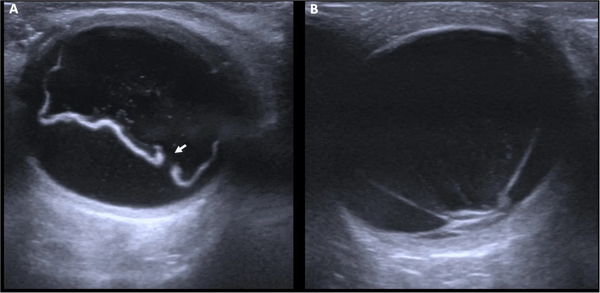
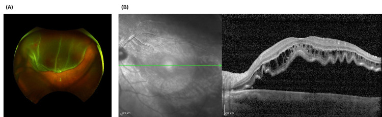
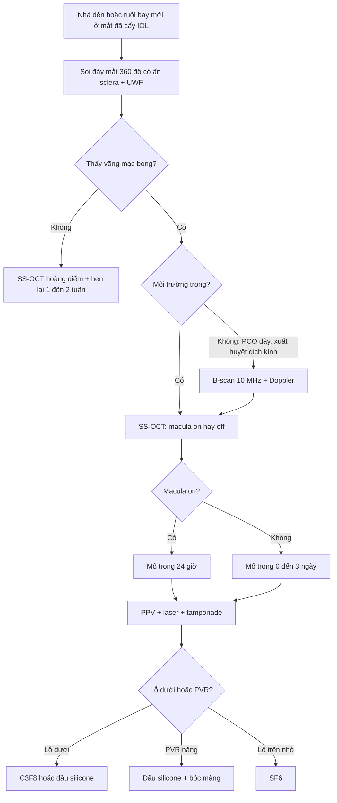
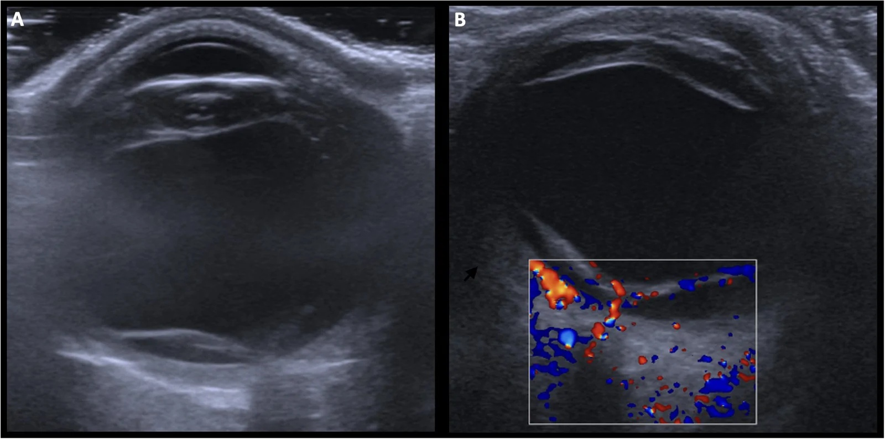
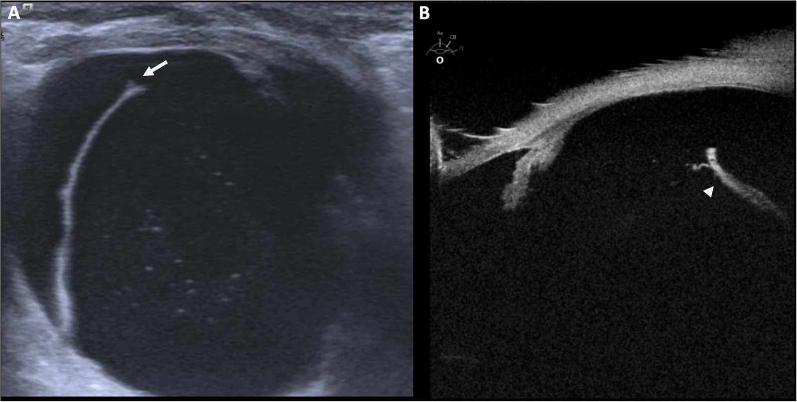

# 1487 — Bong võng mạc ở mắt giả thể thủy tinh sau phaco / Pseudophakic rhegmatogenous retinal detachment

**Tags:** `pattern:bong-vong-mac` `pattern:lo-rach-ngoai-vi` `pattern:lo-sat-ora` `pattern:pvd` `pattern:co-keo-pvr` `pattern:gia-the-thuy-tinh` `vung:vong-mac` `vung:ora-serrata` `vung:hoang-diem` `vung:mat` `score:nguy-co` `protocol:sieu-am-B-scan` `protocol:UWF` `protocol:OCT` `protocol:PPV` `protocol:phaco` `incidentaloma:khong`

**Mức chắc chắn (certainty):** tổng hợp y văn (literature synthesis) — dựng từ **IRIS Registry 3.177.195 mắt** (Ophthalmol Sci 2023, **PMC10239011**, CC BY-NC-ND 4.0), **phân tích gộp 21 nghiên cứu/3.352.094 mắt** (J Ophthalmol 2018, **PMC6282121**, CC BY 4.0), **đoàn hệ Đan Mạch 129.362 mắt** (Acta Ophthalmol 2026, **PMC13353704**, CC BY-NC-ND), **tổng quan RRD** (Wien Med Wochenschr 2025, **PMC12031774**, CC BY 4.0), **RCT VIPER** (Br J Ophthalmol 2017, **PMC5583681**, CC BY-NC; báo cáo 3, Graefes Arch Clin Exp Ophthalmol 2018, **PMC6208723**, CC BY 4.0), **đoàn hệ PCR** (J Ophthalmol 2015, **PMC4677226**, CC BY 4.0), **ca hai mắt sau phaco** (Cureus 2026, **PMC12950224**, CC BY 4.0) và **tổng quan B-scan** (Eur J Ophthalmol 2026, **PMC13672910**, CC BY 4.0). Nhóm **không có bệnh nhân của mình**; chỗ chưa đủ chắc ghi "chưa rõ". **Không ghi tên tác giả** — attribution dùng tạp chí + năm + PMCID.

> **Câu chốt:** Phaco là phẫu thuật phổ biến nhất của nhãn khoa, và **bong võng mạc (retinal detachment, RD)** là biến chứng mù không hồi phục của chính phẫu thuật đó. Ba con số phải thuộc: **(1)** nguy cơ bong trong **1 năm** sau phaco là **0,21% (6.690/3.177.195 mắt)** — khoảng **1/500 ca**, gộp 21 nghiên cứu là **1,167%**; **(2)** thời điểm trung vị **139 ngày**, **37,3% < 3 tháng**, **59,9% < 6 tháng**, nhưng đuôi rất dài (**90% trong 14 năm**); **(3)** **rách bao sau (posterior capsule rupture, PCR)** làm nguy cơ tăng **HR 12,83**, và ở nhóm PCR thì **9,4% bong**, trung bình **79,8 ± 81,6 tuần** sau mổ. Điều trị: **PPV (pars plana vitrectomy)** là lựa chọn chính; thêm **vòng đai (encircling band)** không cải thiện kết quả (**79,0% vs 73,5%, p = 0,558**), và **23/25G** không thua 20G (**87,7% vs 78,7%**).

## 1. Tổng quan bệnh học – cơ chế hình ảnh

### 1.1 TẠI SAO mắt đã cấy IOL lại dễ bong võng mạc hơn

- **Thay đổi giải phẫu – cơ học:** thủy tinh thể (crystalline lens) dày **~4,5 mm**, đường kính **9–10 mm**; IOL chỉ dày **~1 mm**. Lấy thể thủy tinh làm **thể tích buồng dịch kính phía trước tăng**, tiền phòng sâu hơn, **dịch kính trôi ra trước** và **mất "nắp chặn" phía trước** — màng hyaloid trước, bao sau và thể thủy tinh vốn là hàng rào cơ học giữ dịch kính tại chỗ. Dịch kính trở nên **di động hơn**, hóa lỏng (syneresis) nhanh hơn, và **bong dịch kính sau (posterior vitreous detachment, PVD)** xảy ra **sớm hơn** so với mắt còn thể thủy tinh.
- **TẠI SAO PVD sau phaco lại tạo lỗ ở ngoại vi:** khi hyaloid sau co và bóc khỏi võng mạc, chỗ dính chắc nhất còn lại là **đáy dịch kính (vitreous base)** — dải **360°** bám qua ora serrata. Lực kéo tập trung ở đó sinh ra **dialysis (rách dọc ora)** hoặc **lỗ có nắp nhỏ sát ora**; lỗ ở đây **nhỏ, bị IOL và đồng tử nhỏ che**, nên chỉ thấy khi **soi 360° có ấn sclera** (hoặc UBM). Đây là lý do hình thái "kinh điển" của bong võng mạc giả thể thủy tinh khác bong võng mạc ở người trẻ còn thể thủy tinh (thường lỗ có nắp ở xích đạo).
- **TẠI SAO PCR là yếu tố nguy cơ mạnh nhất trong mổ:** rách bao sau kèm **thoát dịch kính (vitreous loss)** tạo **cầu nối dịch kính–vết mổ**, đưa tế bào viêm và sắc tố vào buồng dịch kính, đồng thời làm mất liên tục hàng rào bao sau. Hệ quả: **HR 12,83** so với phaco thường; trong đoàn hệ 106 mắt PCR, **9,4% bong** và **trung bình 79,8 ± 81,6 tuần** sau mổ (PMC4677226). Thử nghiệm cryo dự phòng 360° sau PCR cho **giảm tương đối 68% / tuyệt đối 11%, NNT 9,4** nhưng **p = 0,087** (chưa đủ mạnh để thành chuẩn).
- **TẠI SAO YAG bao sau gây tranh cãi:** Nd:YAG tạo **sóng xung kích** phá màng bao sau, có thể làm **đứt màng hyaloid trước** và **kéo PVD** đột ngột. Bằng chứng **không đồng thuận**: phân tích gộp 11 nghiên cứu (309 RD/65.117 mắt) cho **RR 1,57 (1,17–2,12)**, nhưng **phân nhóm phacoemulsification p = 0,95**; đoàn hệ Phần Lan 17.688 mắt lại **không thấy liên quan (HR 1,03; 0,57–1,88)**; nghiên cứu quốc gia Pháp 6.210 bệnh nhân ghi **RD ≤ 0,5% trong 12 tháng**, tăng ở nhóm YAG **trong năm đầu**. Kết luận thực dụng: **YAG trong năm đầu sau phaco + mắt cận thị nặng/PCR là nhóm cần khám đáy mắt sau laser**.
- **Thời điểm là một phần của bệnh học:** tổn thương không xảy ra "một lần rồi hết". Nguy cơ **cao nhất trong 6 tháng đầu** nhưng **vẫn cao hơn dân số chung sau > 10 năm** — nên tư vấn bệnh nhân **nhá đèn/ruồi bay mới là cấp cứu, kể cả nhiều năm sau mổ**.

### 1.2 TẠI SAO hình ảnh trông như vậy (B-scan – UWF – OCT)

- **Siêu âm B-scan 10 MHz:** bước sóng **λ = 1.540 m/s ÷ 10 MHz ≈ 0,15 mm**, độ phân giải trục **~0,1 mm**, đủ tách **võng mạc dày 0,25 mm** khỏi dịch kính. Võng mạc là **nhiều lớp tế bào đặc + biểu mô sắc tố** nên **trở kháng âm cao** → trên B-scan là **màng tăng âm dày, sáng rõ**; dịch dưới võng mạc là nước trong → **giảm âm (anechoic)**.
- **Ba quy tắc định danh màng trên B-scan:** **(1)** võng mạc **luôn dính vào đĩa thị** (retina cố định ở bờ đĩa) — màng bong mà **đầu sau dừng ở đĩa thị = võng mạc**; **(2)** màng dịch kính **mỏng, tăng âm kém, không dính đĩa**, và **di động mạnh** khi mắt đảo; **(3)** bong hắc mạc **hình vòm, dày, không dính đĩa, lan tới thể mi**, có thể **"hôn nhau" (kissing choroid)**.
- **TẠI SAO Doppler giúp:** màng dịch kính **không có mạch**, võng mạc bong **còn tuần hoàn**; đặt cửa sổ Doppler màu lên màng nghi ngờ thấy **dòng chảy trong màng = võng mạc** (Hình 2B). Đây là mẹo hữu ích khi **không phân biệt được PVD không hoàn toàn với bong võng mạc**.
- **TẠI SAO B-scan không thấy lỗ:** độ phân giải ngang **~0,3–0,5 mm** và lớp cắt dày, nên **lỗ rách ngoại vi 0,2–0,5 mm gần như vô hình**; B-scan chỉ trả lời **"có bong hay không, bong bao nhiêu, có co kéo/PVR hay không"** — không thay thế soi đáy mắt ấn sclera.
- **OCT hoàng điểm:** dịch dưới võng mạc **giảm phản xạ** vì là nước trong (không có tế bào tán xạ); võng mạc bong **gấp nếp lớp ngoài**, và **dải ellipsoid zone (EZ)/màng giới hạn ngoài (ELM)** mất liên tục là dấu tổn thương tế bào cảm quang. **Macula-on hay macula-off** quyết định **mức khẩn** và tiên lượng thị lực — đây là câu hỏi OCT phải trả lời trong **mọi ca bong võng mạc**.
- **UWF (ultra-widefield) đáy mắt:** vùng bong **mất ánh hồng cam và mất hình ảnh mạch hắc mạc**, bề mặt **gấp nếp**, bờ bong có **đường phân giới (demarcation line)** với võng mạc còn dính; ảnh UWF cho **bản đồ toàn cảnh** để chọn đường vào mổ và theo dõi.
- **Vì sao mắt giả thể thủy tinh khó đọc hơn:** **IOL gây phản xạ dội (reverberation)** và bóng âm phía trước trên B-scan; **đục bao sau (PCO)** và **đồng tử nhỏ** làm mờ ảnh ngoại vi; lỗ **sát ora nằm sau bờ IOL**. Vì vậy UWF **phải kèm ấn sclera**, và khi PCO dày không soi được thì **B-scan + UBM** là đường duy nhất.

### 1.3 Ngưỡng định lượng nằm lòng

| Chỉ số | Ngưỡng / giá trị | Nguồn |
|---|---|---|
| Bong võng mạc trong **1 năm** sau phaco (≥ 40 tuổi) | **0,21% (6.690/3.177.195)**; rách võng mạc không bong **0,17%**; một trong hai **0,37%** | PMC10239011 |
| Nguy cơ gộp sau phaco | **1,167% (0,900–1,468)**, 21 nghiên cứu, 3.352.094 mắt | PMC6282121 |
| Tỉ lệ bong trong dân số phaco nói chung | **0,5–0,6%**, cao **10×** dân số chung; **tới 44%** người bong võng mạc là giả thể thủy tinh | PMC12031774 |
| Thời điểm (IRIS) | trung vị **139 ngày**; **15,9% < 30 ngày**, **37,3% < 90 ngày**, **59,9% < 180 ngày** | PMC10239011 |
| Thời điểm (gộp) | trung bình **23,12 tháng** (17,79–28,45); nội kiểm: **25% ≤ 0,7 năm, 50% ≤ 3,1 năm, 75% ≤ 6,8 năm, 90% ≤ 14 năm** | PMC6282121 |
| Tuổi lúc phaco (so > 70) | **40–50 tuổi OR 8,61**; 51–60 OR 5,87; 61–70 OR 2,59 | PMC10239011 |
| Giới nam | **OR 3,15** (IRIS); **HR 3,99** (đoàn hệ Phần Lan) | PMC10239011, 33423371 |
| Thoái hóa lattice | **OR 10,53** (bong); **OR 43,86** (rách) | PMC10239011 |
| Cận thị cao | **OR 1,20**; trục nhãn cầu **≥ 26 mm + nam: HR 16,3 (11,8–22,5)** | PMC10239011, PMC13353704 |
| Trục nhãn cầu ≥ 26 mm, nam 40–59 tuổi | nguy cơ tích lũy **5 năm 9,40% (7,10–12,50)** | PMC13353704 |
| Rách bao sau (PCR) | **HR 12,83**; bong **9,4%**, trung bình **79,8 ± 81,6 tuần** sau mổ | PMC12031774, PMC4677226 |
| Cryo 360° dự phòng sau PCR | giảm tương đối **68%**, tuyệt đối **11%**, **NNT 9,4**, p = 0,087 | PMC4677226 |
| YAG bao sau | gộp **RR 1,57 (1,17–2,12)** nhưng **phân nhóm phaco p = 0,95**; đoàn hệ Phần Lan **HR 1,03 (0,57–1,88)** | 34538778, 33423371 |
| Can thiệp: PPV ± vòng đai (VIPER, 257 ca) | **79,0% vs 73,5%**, p = 0,558; **23/25G 87,7% vs 20G 78,7%** (không thua) | PMC5583681 |
| Lỗ dưới (5h–7h) trong VIPER | **77,4% vs 57,1%**, p = 0,301 (thêm đai không có ý nghĩa) | PMC6208723 |
| Thời gian tan khí | **SF6: 1–2 tuần**; **C3F8: 6–8 tuần**; dầu silicone tháo sau **3–6 tháng** | PMC12031774 |

## 2. Mẫu hình + chẩn đoán phân biệt theo vị trí (gamut)

- **Mẫu hình (pattern):** mắt **đã cấy IOL**, bệnh nhân **nhá đèn/ruồi bay mới** rồi **mất thị trường**, đáy mắt có **võng mạc bong** với **một hoặc nhiều lỗ** — thường **nhỏ, ở ngoại vi/ora** — và **dịch dưới võng mạc** lan về hoàng điểm.
- **Gamut theo vị trí (location):**
  - **Ora serrata / dialysis:** lỗ dọc bờ ora, **do chấn thương hoặc sau phaco**, hay gặp ở người **cận thị trẻ**; chỉ thấy khi **ấn sclera** hoặc **UBM** — đây là "lỗ giấu mặt" số 1 ở mắt giả thể thủy tinh.
  - **Ngoại vi sát xích đạo (12h/6h):** lỗ có nắp nhỏ sau PVD; dễ bị **IOL che** khi đồng tử nhỏ.
  - **Vùng dưới (5h–7h):** dịch tích theo trọng lực, **khó tamponade**; trong VIPER có **100/257** ca có lỗ dưới.
  - **Nhiều lỗ (≥ 4):** **63/257** ca trong VIPER — lý do phải soi **360°**, không dừng ở lỗ đầu tiên.
  - **Cực sau / hoàng điểm:** lỗ hoàng điểm trên mắt **cận thị nặng** (myopic macular hole RD) là thực thể riêng — bong **do lỗ hoàng điểm**, xử trí **PPV + bóc màng + chèn ép**, không phải laser ngoại vi.
- **Gamut theo cơ chế (mechanism):** **(1)** PVD sau phaco (phần lớn); **(2)** PCR/thoát dịch kính; **(3)** YAG bao sau (tranh cãi); **(4)** cận thị trục dài/lattice; **(5)** chấn thương (dialysis).
- **Nhóm KHÔNG do lỗ rách (phải loại trừ trước khi mổ):** bong **co kéo (TRD)** do đái tháo đường/PVR; bong **thanh dịch (exudative)** do u hắc mạc, CSC, VKH; **bong hắc mạc**; **tách lớp võng mạc (retinoschisis)**.

*Hình A: bong võng mạc **bóng nước, gấp nếp**, mũi tên chỉ **lỗ rách nguyên nhân** ở ngoại vi; hình B: bong **co kéo** để đối chiếu. Ảnh minh họa hình thái chung, **không phải mắt giả thể thủy tinh** (bệnh nhân trong bài gốc có đục thể thủy tinh). Nguồn: Eur J Ophthalmol 2026 (PMC13672910), CC BY 4.0, nguyên bản.*

## 3. Bảng so sánh phân biệt (ma trận đối chiếu)

| Thực thể (entity) | Hình ảnh điển hình | Chốt vào (rule-in) | Chốt loại (rule-out) | Gợi ý xác nhận |
|---|---|---|---|---|
| **Bong võng mạc giả thể thủy tinh (PRD)** | Màng võng mạc **tăng âm, dính đĩa thị**, di động; lỗ **nhỏ sát ora/xích đạo**; có IOL + PCO | **Màng dính đĩa thị + lỗ thấy khi ấn sclera + có IOL** | Không có lỗ + màng dính đĩa nhưng **dày, cứng, hình phễu** → nghĩ PVR/TRD | UWF 360° ấn sclera, B-scan, SS-OCT hoàng điểm |
| **Bong võng mạc mắt còn thể thủy tinh** | Lỗ có nắp ở xích đạo, **thể thủy tinh trong**, PVD thường chưa hoàn toàn | **Còn thể thủy tinh + lỗ có nắp điển hình** | Có IOL + lỗ sát ora → PRD (bài này) | Soi đáy mắt; siêu âm sinh trắc nếu cần |
| **Bong co kéo (TRD/PVR)** | Màng **dày, cứng, hình phễu kín**, dính thành từng điểm, **không di động**; có màng xơ trên võng mạc | **Phễu kín + màng xơ + không di động + tiền sử ĐTĐ/PVR** | Bong **bóng nước, di động, dính đĩa** → RRD | B-scan động, OCT, lâm sàng |
| **Bong hắc mạc (choroidal detachment)** | **Vòm dày, trơn, không dính đĩa**, lan tới thể mi; có thể **"kissing"**; nhãn áp thấp | **Không dính đĩa + hình vòm + nhãn áp thấp + sau mổ** | Dính đĩa thị + gấp nếp → võng mạc | B-scan; phân biệt bằng vị trí bờ sau |
| **Tách lớp võng mạc (retinoschisis)** | Vòm **mỏng, nhẵn**, **không di động**, thường **thái dương dưới**; không có lỗ | **Vòm mỏng + bờ nhẵn + không lỗ + thị trường tương ứng** | Có lỗ + dịch lan tới hoàng điểm → RRD | OCT (tách lớp trong võng mạc), B-scan |
| **Bong thanh dịch (exudative)** | Dịch **lan rộng, không lỗ**, **không trọng lực**, có khối u/viêm bên dưới | **Không lỗ + khối hắc mạc/viêm + dịch thay đổi theo bệnh nền** | Có lỗ + bờ bong theo trọng lực → RRD | B-scan, OCT, FAF, siêu âm B |
| **Bong dịch kính sau (PVD) đơn thuần** | Màng **mỏng, tăng âm kém**, **không dính đĩa**, di động mạnh | **Không dính đĩa + màng mỏng + không dịch dưới võng mạc** | Màng **dày, dính đĩa** → võng mạc | B-scan + Doppler màu (có dòng trong màng) |

*Hình A: ảnh **ultra-widefield** mắt trái — bong võng mạc **bóng nước phía trên**, võng mạc phía dưới còn dính, có **đường phân giới** rõ. Hình B: **OCT hoàng điểm** — võng mạc cảm giác **nâng lên bởi dịch dưới võng mạc**, các lớp ngoài **gấp nếp**, xác nhận **đã bong hoàng điểm**. Bệnh nhân **giả thể thủy tinh** (72 tuổi, cận thị nặng, bong 94 ngày sau phaco mắt này). Nguồn: Cureus 2026 (PMC12950224), CC BY 4.0, nguyên bản.*

## 4. Protocol chụp + hệ phân độ/điểm chuẩn hóa

### 4.1 Quy trình hình ảnh khi nghi bong võng mạc ở mắt giả thể thủy tinh

1. **Đáy mắt 360° có ấn sclera + UWF** — bắt buộc, kể cả khi "chỉ nhá đèn". Ghi rõ **vị trí theo giờ**, **số lỗ**, **kích thước ước tính (mm)**, **bong hoàng điểm hay không**.
2. **SS-OCT hoàng điểm** — trả lời **macula-on/off** và đo **chiều cao dịch dưới võng mạc (µm)**; là cơ sở quyết định **mổ trong 24 giờ**.
3. **B-scan 10 MHz** — khi **PCO dày, xuất huyết dịch kính, đồng tử nhỏ** không soi được; đánh giá **bong, màng co kéo, bong hắc mạc**. Luôn dùng **Doppler** khi nghi PVD không hoàn toàn.
4. **UBM (ultrasound biomicroscopy)** — khi nghi **dialysis sát ora** mà soi không thấy (Hình 3B).
5. **Chụp lại sau 1–2 tuần** nếu **nhá đèn/ruồi bay mới mà chưa thấy lỗ** — không được kết luận "không có gì" chỉ sau một lần soi.

### 4.2 Ngưỡng thời gian và lựa chọn phẫu thuật

- **Macula-on = cấp cứu:** mổ **< 24 giờ** cho kết quả thị lực cuối tốt hơn rõ so với **> 24 giờ**.
- **Macula-off vẫn là cấp cứu:** mổ **ngày 0–3** tốt hơn **ngày 4–7**; **thời gian mất thị lực trung tâm** là yếu tố dự báo duy nhất trong một nghiên cứu **2.074 ca**.
- **PPV là lựa chọn chính ở mắt giả thể thủy tinh** (nhìn được ngoại vi, giải phóng co kéo, tìm lỗ sát ora). **Vòng đai không mặc định**: VIPER 257 ca cho **79,0% vs 73,5% (p = 0,558)**; nhóm **lỗ dưới 77,4% vs 57,1% (p = 0,301)**; nhóm **≥ 4 lỗ 68,2% vs 72,4%**.
- **Cỡ dụng cụ:** **23/25G không thua 20G** (87,7% vs 78,7%) → chọn theo thói quen phẫu thuật viên, không vì "nhỏ hơn thì kém hiệu quả".
- **Tamponade:** **SF6** cho lỗ trên nhỏ (**tan 1–2 tuần**); **C3F8** khi có **lỗ dưới** (**tan 6–8 tuần**); **dầu silicone** khi **PVR nặng**, tháo sau **3–6 tháng**.
- **Dự phòng sau PCR:** cryo/laser **360°** là lựa chọn hợp lý (giảm tương đối 68%, NNT 9,4) dù bằng chứng **chưa đạt ý nghĩa thống kê** — quyết định theo từng mắt.
- **YAG bao sau:** chỉ làm khi **PCO ảnh hưởng thị lực**, dùng **năng lượng tối thiểu**, và **khám đáy mắt sau laser** ở người **cận thị nặng, PCR cũ, hoặc YAG trong năm đầu**.

## 5. Biến thể bình thường và cạm bẫy

- **"Đục bao sau che lỗ" — cạm bẫy số 1:** PCO dày làm mờ ngoại vi; **không được kết luận không có lỗ** khi chưa soi 360° ấn sclera và chưa B-scan. Nếu vẫn không thấy lỗ mà võng mạc bong → **mổ thăm dò + soi nội nhãn toàn bộ**.
- **IOL và đồng tử nhỏ:** bờ IOL tạo **phản xạ lóa** và **bóng** che vùng 12h/6h sát ora; dùng **đèn khe ấn sclera**, **UWF**, hoặc **UBM**.
- **PVD không hoàn toàn vs bong võng mạc trên B-scan:** màng mỏng, không dính đĩa, di động mạnh = PVD; **Doppler màu** có dòng trong màng = võng mạc.
- **Bong hắc mạc "hôn nhau":** hình vòm hai bên gặp nhau giữa nhãn cầu, **không dính đĩa**; kèm **nhãn áp thấp** sau mổ — **không phải** bong võng mạc.
- **Tách lớp võng mạc thái dương dưới:** vòm mỏng, nhẵn, **không có lỗ**; điều trị khác hoàn toàn (theo dõi/laser bờ), mổ nhầm gây **mất thị trường** thêm.
- **Tìm được một lỗ rồi dừng:** **63/257** ca VIPER có **≥ 4 lỗ** — luôn soi **360°** trước khi kết luận.
- **"Đã bong hoàng điểm rồi nên chờ"** — sai: **0–3 ngày** tốt hơn **4–7 ngày**.
- **Nhá đèn/ruồi bay sau YAG vài tuần:** dễ bị coi là "viêm nhẹ sau laser"; phải **soi đáy mắt** tìm lỗ/PVD.
- **Bong võng mạc dưới dầu silicone:** khó thấy vì **dầu trong suốt + phản xạ**; dùng **OCT qua dầu** và **soi ấn sclera**, đừng tin "đáy mắt bình thường" trên ảnh UWF.

## 6. Tự lượng giá — Blind Quiz

**Ca 1 — Nam 72 tuổi, cận thị nặng, 3 tháng sau phaco hai mắt. Nhìn mờ dần mắt trái, không đau.**

- Gợi ý: mắt **đã cấy IOL**, **PVD không có trước mổ**; mắt phải đã bong **100 ngày** sau phaco, mắt trái **94 ngày**.
- Câu hỏi: mô tả **dấu hiệu chính**? Bong **hoàng điểm chưa**? 3 chẩn đoán phân biệt và **dấu hiệu chốt**?

<b>Bấm để hiện đáp án (findings + chẩn đoán)</b>

- **Dấu hiệu:** võng mạc **bóng nước phía trên**, **đường phân giới** với vùng còn dính ở dưới; OCT cho thấy **dịch dưới võng mạc dưới hoàng điểm**, lớp ngoài **gấp nếp** → **đã bong hoàng điểm**.
- **Chẩn đoán:** **bong võng mạc có lỗ rách ở mắt giả thể thủy tinh (pseudophakic RRD)** — cơ chế **PVD sau phaco** trên mắt **cận thị nặng**, không có PVD trước mổ.
- **Phân biệt:** bong **thanh dịch** (không lỗ, dịch không theo trọng lực) · **bong hắc mạc** (không dính đĩa, nhãn áp thấp) · **tách lớp võng mạc** (vòm mỏng, không lỗ).
- **Xử trí:** **PPV + laser + tamponade**; bong **hoàng điểm** nên mổ **trong 0–3 ngày**; mắt kia **đã bong** — khám mắt còn lại mỗi lần.
- **Nguồn ảnh:** Cureus 2026 (PMC12950224), CC BY 4.0.

**Ca 2 — Nữ 68 tuổi, đục bao sau dày sau phaco 6 tháng, đột ngột "màn che" từ trên xuống. Không soi được đáy mắt.**

- Câu hỏi: màng tăng âm này là **võng mạc hay dịch kính**? Dấu hiệu nào trên B-scan chốt? Doppler để làm gì?

<b>Bấm để hiện đáp án (findings + chẩn đoán)</b>

- **Dấu hiệu:** màng **tăng âm dày**, **đầu sau dừng ở đĩa thị** → **bong võng mạc toàn bộ**; hình B đặt **Doppler màu** thấy **dòng chảy trong màng** — chứng minh đây là **võng mạc có tuần hoàn**, không phải màng dịch kính.
- **Chẩn đoán:** **bong võng mạc** (ở mắt giả thể thủy tinh với PCO dày, đây là **cách duy nhất** để chẩn đoán).
- **Vì sao B-scan không thấy lỗ:** độ phân giải ngang **0,3–0,5 mm**; lỗ ngoại vi **0,2–0,5 mm** gần như vô hình → phải soi ấn sclera/UBM trong mổ.
- **Nguồn ảnh:** Eur J Ophthalmol 2026 (PMC13672910), CC BY 4.0.

**Ca 3 — Nam 24 tuổi, cận thị −6 D, tiền sử chấn thương bóng vào mắt 2 tháng trước; nhìn mờ nửa dưới thị trường.**

- Câu hỏi: tổn thương ở đâu? Vì sao **không thấy PVD**? Tại sao B-scan **không thấy lỗ rách kiểu thông thường**?

<b>Bấm để hiện đáp án (findings + chẩn đoán)</b>

- **Dấu hiệu:** hình A — võng mạc bong, **đứt tại ora serrata** (mũi tên) tạo **dialysis**, **không có màng dịch kính**; hình B — **UBM** xác nhận **dialysis ở ora** (đầu mũi tên).
- **Chẩn đoán:** **bong võng mạc do dialysis ora** sau chấn thương — hình thái hay gặp ở **người trẻ cận thị** và **sau phaco có chấn thương nhẹ**.
- **Vì sao không có PVD:** dialysis xảy ra ở **đáy dịch kính** do lực cơ học, **không cần PVD** — khác lỗ có nắp do PVD.
- **Điều trị:** **PPV + laser/cryo hàng rào + tamponade** (hoặc đai củng mạc ở ca chọn lọc); **không** chỉ laser bờ vì lỗ lớn sát ora.
- **Nguồn ảnh:** Eur J Ophthalmol 2026 (PMC13672910), CC BY 4.0.

## Bài liên quan chéo

- [400 – Tổng quan Mắt & thị giác](../400-tong-quan-mat-thi-giac/lesson.md)
- [1481 – Lỗ rách võng mạc cấp chưa bong: laser dự phòng hay theo dõi](../1481-lo-rach-vong-mac-laser-du-phong/lesson.md)
- [1469 – Bong võng mạc có lỗ sau tiêm nội nhãn (IVARD)](../1469-bong-vong-mac-co-lo-sau-tiem-noi-nhan/lesson.md)
- [1479 – Bong võng mạc thanh dịch (serous retinal detachment)](../1479-bong-vong-mac-thanh-dich/lesson.md)
- [1480 – Đục thể thủy tinh sau bóc màng trước võng mạc (ERM)](../1480-duc-the-thuy-tinh-sau-boc-mang-erm/lesson.md)
- [445 – Bong võng mạc](../445-bong-vong-mac/lesson.md)

## Ảnh

- Tên file theo quy ước `1487_..._Modality_SourceID.jpg`; nguồn + giấy phép từng ảnh ở `images/CREDITS.md`.
- Ảnh minh họa hình thái chung (không phải mắt giả thể thủy tinh) được ghi rõ trong chú thích để **không gán sai bệnh nhân**.
- Không dùng ảnh từ nguồn không rõ giấy phép; không crop/ghép ảnh CC BY-NC-ND.

> Không dùng để chẩn đoán độc lập khi chưa có người hướng dẫn.
