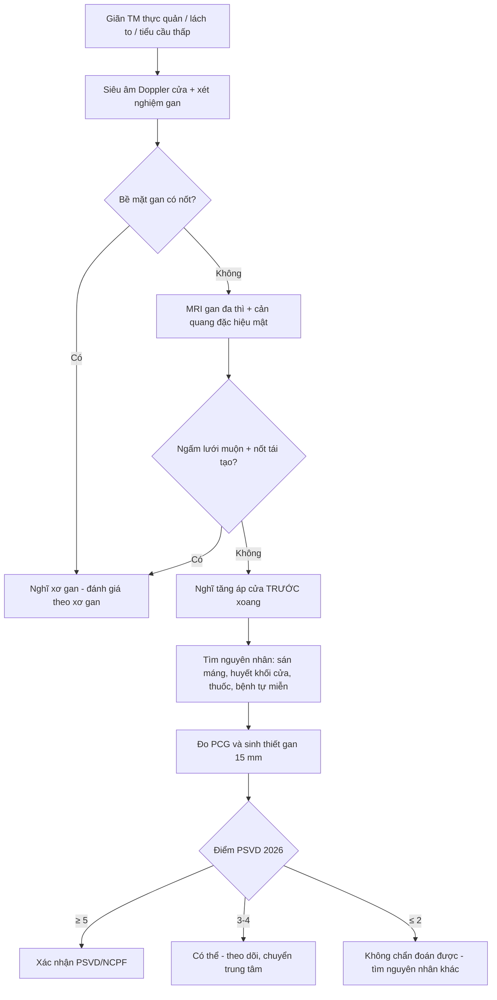
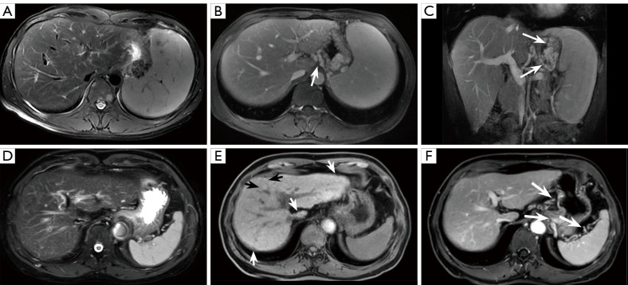
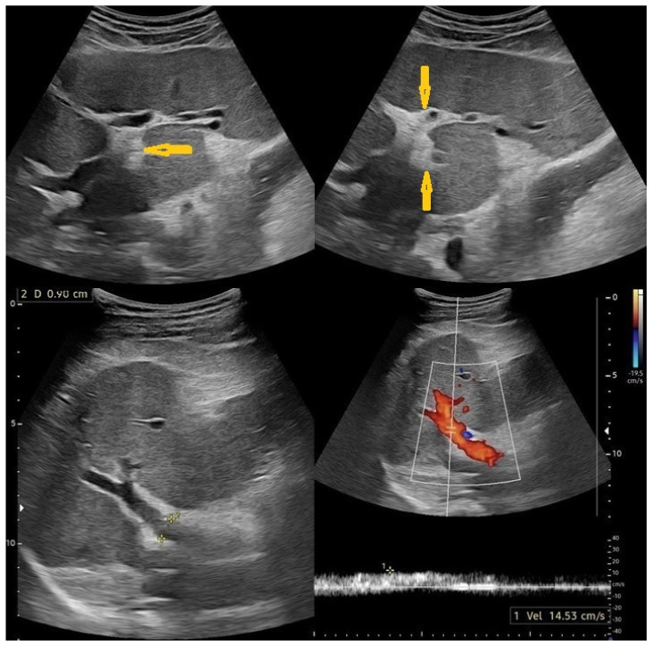
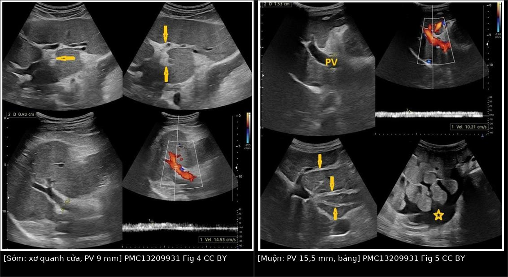
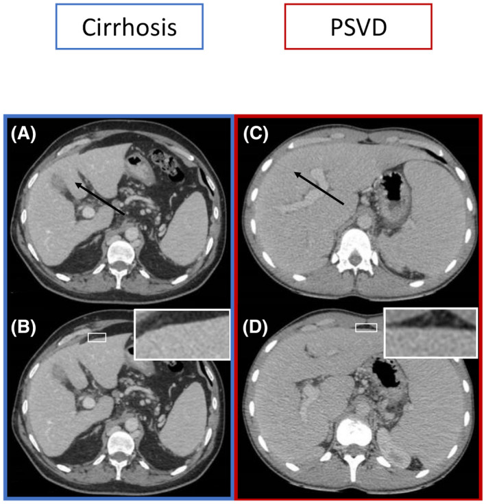
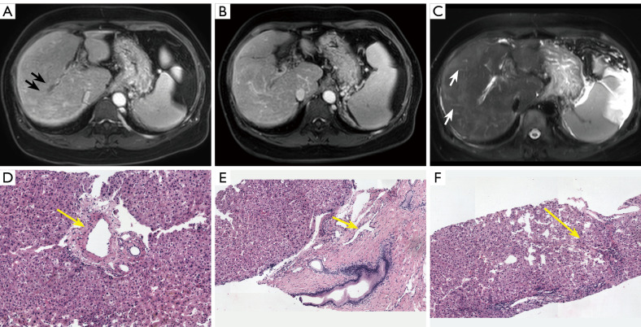

# 149 — Tăng áp cửa KHÔNG do xơ gan: PSVD/NCPF, sán máng và ba tầng tắc nghẽn / Non-cirrhotic portal hypertension: PSVD, schistosomiasis and the three tiers

**Tags:** `pattern:tang-ap-cua` `vung:gan` `vung:bung` `score:PSVD-2026` `protocol:MRI-gan-HBP` `protocol:Doppler-cua`
**Mức chắc chắn (certainty):** tổng hợp y văn (literature synthesis) — số liệu lấy từ đồng thuận đa hội 2026 về PSVD/NCPF (PMC13374651), nghiên cứu hình ảnh PSVD – xơ gan (PMC12971336, PMC9544289) và bài tổng quan hình ảnh sán máng (PMC13209931). Các ca trong quiz là **ca nguyên văn** theo đúng tuổi – số đo – chú thích gốc.

> **Vì sao bài này quan trọng:** cùng một hình ảnh "gan + lách to + giãn tĩnh mạch" nhưng **tầng tắc nghẽn quyết định chẩn đoán, điều trị và tiên lượng**. Bệnh nhân PSVD bị gắn nhãn "xơ gan" sẽ bị theo dõi tầm soát HCC suốt đời không cần thiết, có khi bị đưa vào danh sách ghép gan sai; ngược lại bệnh nhân xơ gan bị gọi "PSVD" sẽ bị bỏ tầm soát ung thư.

## 1. Tổng quan — ba tầng tắc nghẽn và vì sao HVPG có thể "bình thường"

- **Phân tầng theo vị trí tắc (cơ chế quyết định hình ảnh):**
  - **Trước xoang (pre-sinusoidal):** bệnh tĩnh mạch cửa nhỏ/tiểu thùy — **PSVD** (porto-sinusoidal vascular disorder, gồm các tên cũ: tăng áp lực cửa vô căn, xơ hóa cửa không xơ gan, hoại tử nang-tái tạo, bệnh tĩnh mạch cửa tắc nghẽn), **sán máng thể gan–lách**, **huyết khối tĩnh mạch cửa/lách**, **dò động–tĩnh mạch cửa**.
  - **Trong xoang (sinusoidal):** **xơ gan** các nguyên nhân, **hội chứng tắc nghẽn xoang (SOS)** sau ghép tủy.
  - **Sau xoang (post-sinusoidal):** **bệnh gan do tim**, **hội chứng Budd–Chiari**, tắc tĩnh mạch gan.
- **TẠI SAO HVPG đánh lừa:** HVPG = áp lực tĩnh mạch gan bít (wedged) − áp lực tĩnh mạch gan tự do. Phép đo này chỉ phản ánh chênh áp **từ xoang đến tĩnh mạch gan**; tổn thương **trước xoang** không được tính vào → **HVPG có thể bình thường hoặc thấp giả tạo dù bệnh nhân có giãn tĩnh mạch thực quản chảy máu**. Vì vậy **đo trực tiếp chênh áp cửa–chủ (porto-caval gradient, PCG) qua chọc qua da** được xem là đáng tin hơn trong PSVD.
- **Ngưỡng định lượng nằm lòng:**
  - **PCG hoặc HVPG ≥ 10 mmHg = bằng chứng chắc chắn của tăng áp lực cửa** (dấu hiệu **đặc hiệu** theo đồng thuận 2026).
  - **Dấu hiệu đặc hiệu** của tăng áp cửa: chảy máu do giãn tĩnh mạch, **giãn tĩnh mạch thực quản vừa/lớn**, giãn tĩnh mạch dạ dày, **shunt cửa–chủ tự phát**, **độ cứng lách > 40 kPa** (khi không có bệnh tăng sinh tủy).
  - **Dấu hiệu KHÔNG đặc hiệu:** báng, giãn tĩnh mạch thực quản **nhỏ**, **tiểu cầu < 150 G/L**, lách to.
  - **Sinh thiết gan để loại xơ gan:** chiều dài **15 mm**, có **ít nhất 1 mảnh ≥ 10 mm** là đủ tin cậy (đồng thuận 2026).
- **Thang điểm chẩn đoán PSVD/NCPF (đồng thuận đa hội 2026, sau khi đã loại xơ gan và không có tiêu chuẩn loại trừ):**
  - **Tăng áp cửa:** không có = **0 điểm**; chỉ dấu hiệu không đặc hiệu = **2 điểm**; ≥ 1 dấu hiệu đặc hiệu = **3 điểm**.
  - **Mô học:** gan bình thường = **0**; ≤ 2 tiêu chuẩn nhỏ = **2**; ≥ 1 tiêu chuẩn lớn **hoặc** đủ 3 tiêu chuẩn nhỏ = **5**.
  - **Bệnh kèm đã biết liên quan PSVD = +1**; **có nguyên nhân xơ gan = −1**.
  - **Tổng điểm:** **≤ 2 → không thể chẩn đoán**; **3–4 → "có thể" PSVD/NCPF** (theo dõi/chuyển trung tâm chuyên sâu); **≥ 5 → xác nhận**.
- **Cập nhật 2026 phải biết (dễ hỏi thi, dễ sai thực hành):** **sán máng**, **cavernoma tĩnh mạch cửa trong gan** và **SOS sau ghép tủy ≥ 6 tháng** **KHÔNG còn là tiêu chuẩn loại trừ**. Nghĩa là một bệnh nhân sán máng **vẫn có thể** đồng thời có PSVD — đừng dừng lại ở chẩn đoán đầu tiên.
- **Sán máng thể gan–lách (hepatosplenic schistosomiasis):** trứng ký sinh gây phản ứng viêm quanh khoảng cửa → **xơ hóa kiểu "ống điếu" Symmers (Symmers' pipe-stem fibrosis)** = **dày tăng âm thành tĩnh mạch cửa và các nhánh**. Tổn thương **quanh cửa, không phải trong xoang** → cũng là tăng áp cửa **trước xoang**, và **gan không bị xơ hóa lan tỏa** ở giai đoạn đầu.

## 2. Mẫu hình + chẩn đoán phân biệt theo tầng tắc nghẽn (Gamut)

**Theo tầng (câu hỏi duy nhất cần trả lời trước khi gọi tên bệnh):**

- **Trước xoang:** PSVD, sán máng, huyết khối TM cửa/lách, dò ĐM–TM cửa → **bề mặt gan nhẵn**, không nốt tái tạo, tĩnh mạch cửa bất thường, lách rất to.
- **Trong xoang:** xơ gan (rượu, virus, MASH), SOS → **bề mặt nốt**, nốt tái tạo, ngấm thuốc **dạng lưới thì muộn**.
- **Sau xoang:** gan tim, Budd–Chiari → **tĩnh mạch gan không thấy/không đều**, gan đuôi to, ngấm thuốc **"mosaic"** thì muộn.

**Gamut theo hình thái "gan không nốt + tăng áp cửa":**
1. **PSVD** (hay gặp nhất trong nhóm này, đặc biệt ở người trẻ, người dùng azathioprine/tiền sử ghép tạng, HIV, bệnh tự miễn).
2. **Sán máng thể gan–lách** (vùng dịch tễ; tiền sử tiếp xúc nước ngọt).
3. **Huyết khối tĩnh mạch cửa mạn/cavernoma** (kèm hoặc không kèm PSVD).
4. **Dò động–tĩnh mạch cửa** (thường sau chấn thương/sinh thiết; tĩnh mạch cửa giãn sớm, động mạch gan to).
5. **Tăng sinh tủy/thrombocythemia** gây huyết khối vi mạch trong gan (bệnh nền quan trọng vì **độ cứng lách > 40 kPa không còn đặc hiệu** trong nhóm này).

**Mnemonic "GAN NHẴN – LÁCH TO":** **G**iãn tĩnh mạch thực quản/dạ dày, **A**zathioprine/thuốc ức chế miễn dịch, **N**hẵn bề mặt gan (không nốt), **N**hánh cửa bất thường, **H**uyết khối TM lách/cửa, **Ẵ** (nhẵn) bề mặt = PSVD, **T**ủy tăng sinh (MPN), **O** (ổ) FNH-like trong gan.

## 3. Bảng so sánh phân biệt (ma trận đối chiếu)

| Thực thể (entity) | Hình ảnh điển hình | Chốt vào (rule-in) | Chốt loại (rule-out) | Gợi ý xác nhận |
|---|---|---|---|---|
| **PSVD/NCPF** | Gan **nhẵn**, có giãn TM + lách to; **không** nốt tái tạo, **không** ngấm lưới thì muộn; hay có **nhánh mạch nhỏ trong gan tăng** | **Tăng áp cửa nặng + bề mặt gan nhẵn + loại xơ gan trên sinh thiết đủ chuẩn** | Ngấm lưới thì muộn + nốt tái tạo + bề mặt nốt → **xơ gan**, không phải PSVD | MRI gan có cản quang đặc hiệu mật; sinh thiết 15 mm; đo PCG |
| **Xơ gan** | Bề mặt **nốt**, nốt tái tạo, **ngấm thuốc dạng lưới thì muộn**, teo phân thùy IV | **Ngấm lưới thì muộn (94,3%) + nốt tái tạo (54,7%)** | Bề mặt nhẵn + không có nốt tái tạo → nghĩ PSVD | MRI/CT đa thì; elastography; mô học |
| **Sán máng gan–lách** | **Dày tăng âm quanh khoảng cửa** ("ống điếu"), tĩnh mạch cửa giãn, lách to, báng giai đoạn muộn | **Xơ hóa quanh cửa kiểu Symmers + tiền sử dịch tễ** | Xơ hóa lan tỏa/bề mặt nốt → xơ gan; không có dày quanh cửa → loại | Siêu âm + ELISA/huyết thanh; tìm trứng |
| **Huyết khối TM cửa mạn** | Không thấy lòng TM cửa, **mạng mạch bàng hệ quanh cửa (cavernoma)**, teo gan phải | **Cavernoma: nhiều tĩnh mạch quanh đường mật/ thành túi mật > 2 mm** | Lòng TM cửa bình thường → loại | CT/MRI đa thì; Doppler |
| **Bệnh gan do tim** | Gan to, TM gan **giãn**, ngấm thuốc **mosaic thì muộn**, ứ ở TM chủ dưới | **TM gan giãn + bệnh tim phải** | TM gan bình thường → loại | Siêu âm tim; xem bài 127 |
| **Hội chứng Budd–Chiari** | TM gan **không thấy/hẹp**, gan đuôi to, **"flip-flop"** ngấm thuốc, nốt tái tạo ở ngoại vi | **Tắc TM gan có bằng chứng hình ảnh** | TM gan thông thoáng cả 3 nhánh → loại | Doppler TM gan + CT/MRI; xem bài 124 |

- **Con số để nhớ (nghiên cứu bệnh–chứng PSVD n = 106 vs xơ gan n = 104, PMC12971336):** bề mặt gan nốt **25,5%** ở PSVD so với **72,1%** ở xơ gan; ngấm lưới thì muộn **20,8%** vs **94,3%**; nốt tái tạo **6,3%** vs **54,7%**; nhánh mạch nhỏ trong gan tăng **74,5%** vs **39,4%**; **mức độ tăng áp cửa thì tương đương** (lách to 72,6% vs 64,4%; giãn TM 97,2% vs 90,4%; báng 33,0% vs 30,8% — đều p > 0,05).
- **Nghiên cứu CT thứ hai (PMC9544289):** độ nốt bề mặt gan (LSN) **2,4 vs 3,1** (p < 0,001); **LSN < 2,5** có **Se 59%, Sp 81%** cho PSVD; **LSN < 2,5 + phân thùy IV bình thường/to** → **Sp 90%, độ chính xác 84%**. Bề mặt nốt gặp **18%** ở PSVD vs **74%** ở xơ gan; **phì đại đuôi + teo phân thùy IV** gặp **26% vs 76%**; lách **16 cm vs 14 cm**.
- **Mô hình MRI (4 đặc điểm) phân biệt PSVD với xơ gan: AUC 0,970** (tập kiểm định nội bộ) và **0,988** (tập độc lập) — cao hơn hẳn mô hình CT (**0,825**). Kết luận thực hành: **MRI có cản quang là phương thức ưu tiên**, không phải CT.

## 4. Protocol chụp + hệ phân độ/điểm chuẩn hóa

**Protocol tối thiểu khi nghi tăng áp cửa không do xơ gan:**
1. **Siêu âm Doppler hệ cửa:** đường kính tĩnh mạch cửa (bình thường ≤ 13 mm), **chiều dòng** (hướng gan/phản hướng), **vận tốc**, lách (trục dài), báng, **độ dày tăng âm quanh khoảng cửa**. Đây là bước đầu rẻ, lặp lại được — và là nơi phát hiện sán máng.
2. **CT hoặc MRI bụng đa thì (nên là MRI):** đánh giá **bề mặt gan**, nốt tái tạo, **ngấm lưới thì muộn**, tĩnh mạch cửa (huyết khối/cavernoma), tĩnh mạch gan, lách, shunt cửa–chủ. Với MRI nên dùng **chất cản quang đặc hiệu mật (gadoxetate)** để tìm **FNH-like** và **tăng tín hiệu quanh cửa thì gan–mật** — hai dấu hiệu hỗ trợ PSVD.
3. **Elastography:** **độ cứng gan thấp + độ cứng lách cao** là tổ hợp gợi ý PSVD (gan "mềm" dù tăng áp cửa nặng vì xơ hóa quanh cửa, không phải xơ hóa cầu nối); **độ cứng lách > 40 kPa** là dấu hiệu **đặc hiệu** của tăng áp cửa.
4. **Nội soi tiêu hóa trên:** phân độ giãn tĩnh mạch, dấu hiệu đỏ, chỉ định thắt/thuốc.
5. **Đo áp lực:** HVPG khi nghi tầng xoang; **PCG qua chọc qua da** khi nghi **trước xoang** (HVPG có thể bình thường).
6. **Sinh thiết gan** khi còn chẩn đoán phân vân — **15 mm, ≥ 1 mảnh ≥ 10 mm**; đây là điều kiện **bắt buộc** trong đồng thuận 2026 trước khi kết luận PSVD.

**Flowchart chẩn đoán:**

**Điều trị khác nhau ở đâu (điểm người đọc hay hỏi):**
- **Kiểm soát tăng áp cửa giống nhau về nguyên tắc:** chẹn beta không chọn lọc/thắt tĩnh mạch, xử trí chảy máu cấp, **TIPS** đặt ra khi thất bại (xem [176](../176-tips-dips-theo-doi-shunt/lesson.md)).
- **PSVD:** tiên lượng **tốt hơn xơ gan** ở cùng mức tăng áp cửa; **nguy cơ HCC thấp hơn nhiều** → **không áp dụng lịch tầm soát HCC của xơ gan một cách máy móc** (quyết định cá thể hóa; ghi rõ đây là suy luận từ sinh bệnh học, cần tra thêm dữ liệu dài hạn).
- **Sán máng:** điều trị **praziquantel** + kiểm soát tăng áp cửa; **không** dùng TIPS như lựa chọn đầu.
- **Cavernoma/huyết khối cửa mạn:** chống đông **không** tự động; đánh giá bệnh tăng sinh tủy trước.

## 5. Biến thể bình thường và cạm bẫy

- **FNH-like trong PSVD** (nốt tăng tín hiệu T1, không thải thuốc) rất dễ bị gọi là **HCC** hoặc **di căn** — đây là bẫy "satisfaction of search" ngược: thấy nốt là chốt ung thư, bỏ qua bối cảnh gan nhẵn + tăng áp cửa. Dùng **chất cản quang đặc hiệu mật** để phân biệt.
- **Bề mặt gan nốt nhưng phân thùy IV bình thường/to** vẫn có thể là PSVD (đồng thuận 2026 nêu rõ tổ hợp này **hỗ trợ** PSVD) — đừng chỉ dựa vào một dấu hiệu.
- **Sán máng + xơ gan có thể cùng tồn tại**: dày quanh cửa **không** loại trừ xơ gan; ngược lại bề mặt nốt **không** loại trừ sán máng.
- **Đo HVPG bình thường không loại trừ tăng áp cửa trước xoang** — đây là cạm bẫy chết người nhất trong bài.
- **Tĩnh mạch cửa giãn ≥ 13 mm trên siêu âm** có thể do thở ra/thay đổi tư thế; đo 2 lần, đối chiếu CT.
- **Cavernoma trong gan không còn loại trừ PSVD** (2026) — trước đây nhiều nơi vẫn dạy ngược lại.
- **Shunt cửa–chủ tự phát lớn** có thể làm giảm mức độ giãn tĩnh mạch → đánh giá thấp mức nặng nếu chỉ nhìn nội soi.

## 6. Tự lượng giá — Blind Quiz

**Ca 1 — Nam 34 tuổi, giãn tĩnh mạch thực quản độ II, gan không nốt trên MRI.**

- Câu hỏi: Hàng trên và hàng dưới khác nhau ở **dấu hiệu nào**? Nếu chỉ có CT, có thể bỏ sót gì?

<b>Bấm để hiện đáp án</b>

- **Findings:** (A–C) nhu mô gan **đồng nhất**, **không nốt tái tạo**, không ngấm lưới thì muộn; thấy **nhiều quai giãn** quanh dạ dày/lách (mũi tên) và **lách to độ 2**. (D–F) xơ gan: **ngấm lưới thì muộn** (F), **nhiều nốt tái tạo** (E, đầu mũi tên), bề mặt nốt.
- **Chẩn đoán:** PSVD (hàng trên) — tăng áp cửa nặng **ngang** xơ gan nhưng thiếu các dấu hiệu xơ gan.
- **Ý nghĩa:** mô hình MRI (4 đặc điểm) có **AUC 0,970–0,988**, CT chỉ **0,825** → **MRI là lựa chọn ưu tiên**.
- Nguồn ảnh: Song F et al., Quant Imaging Med Surg 2026, PMC12971336, Fig. 2, CC BY-NC-ND 4.0 (nguyên bản).

**Ca 2 — Nam 40 tuổi vùng dịch tễ, gan to, lách to, chưa báng.**

- Câu hỏi: Dấu hiệu chính là gì? Có bằng chứng tăng áp cửa chưa?

<b>Bấm để hiện đáp án</b>

- **Findings:** **dày tăng âm thành tĩnh mạch cửa và nhánh** (mũi tên) = **xơ hóa kiểu ống điếu Symmers**; gan kích thước trung bình, **không tổn thương khu trú**; **PV 9 mm** (bình thường ≤ 13 mm), **vận tốc 14,5 cm/s** (giảm), **chưa thấy giãn tĩnh mạch bàng hệ**.
- **Chẩn đoán:** sán máng thể gan–lách **giai đoạn sớm** — đã có xơ quanh cửa nhưng **chưa** tăng áp cửa rõ.
- **Vì sao quan trọng:** đây là giai đoạn **còn điều trị praziquantel để chặn tiến triển**; chờ đến khi báng/lách to là đã muộn.
- Nguồn ảnh: Alshoabi SA et al., Pathogens 2026, PMC13209931, Fig. 4, CC BY 4.0.

**Ca 3 — Cùng bệnh, 8 năm sau.**

- Câu hỏi: Kể 3 thay đổi định lượng chứng minh bệnh tiến triển. Điều gì **không** thay đổi?

<b>Bấm để hiện đáp án</b>

- **Findings (phải):** **PV 15,5 mm** (so với 9 mm), **vận tốc giảm còn 10,2 cm/s**, **báng (sao)**, **lách to**, xơ quanh cửa dày hơn và lan rộng.
- **Không thay đổi:** bản chất tổn thương vẫn là **xơ hóa quanh khoảng cửa** — **không** phải xơ gan lan tỏa; gan vẫn giữ hình thái tương đối (không nốt rõ).
- **Bài học:** sán máng là mô hình "tăng áp cửa trước xoang" tiến triển **theo thời gian phơi nhiễm**, nên **theo dõi bằng siêu âm định kỳ** (đường kính cửa, vận tốc, lách, báng) rẻ và đủ.
- Nguồn ảnh: Alshoabi SA et al., Pathogens 2026, PMC13209931, Fig. 4 + Fig. 5, CC BY 4.0; ảnh ghép letterbox bằng `tools/make_composite.py`.

**Ca 4 — Cùng mức tăng áp cửa, hai bề mặt gan khác nhau.**

- Câu hỏi: Ảnh nào là PSVD? Dấu hiệu nào trên CT **âm thầm** nhất nhưng giá trị nhất?

<b>Bấm để hiện đáp án</b>

- **Findings:** (A) **teo phân thùy IV** (mũi tên) + (B) **bề mặt nốt** (khung) = **xơ gan**. (C) **phân thùy IV bình thường/to** (mũi tên) + (D) bề mặt **nhẵn** = **PSVD**.
- **Dấu hiệu giá trị nhất:** **phân thùy IV bình thường/to kèm LSN < 2,5** → **Sp 90%** cho PSVD (so với chỉ dùng LSN: Se 59%, Sp 81%).
- **Cạm bẫy:** bề mặt gan có thể **nốt giả** do lát cắt/artifact → luôn đo LSN trên thì tĩnh mạch cửa và đọc đa bình diện.
- Nguồn ảnh: Valainathan SR et al., Hepatology 2022, PMC9544289, Fig. 2, CC BY-NC 4.0.

**Ca 5 — PSVD có huyết khối tĩnh mạch cửa: vẫn không phải xơ gan.**

<b>Bấm để hiện đáp án</b>

- **Findings:** teo nhu mô ngoại vi + **phì đại bù trung tâm và phân thùy I**; **hẹp/huyết khối tĩnh mạch cửa phải** (mũi tên đen); nhiều **nhánh mạch nhỏ** trong gan (A,B); mô học: **thoát vị nhánh tĩnh mạch cửa vào nhu mô** (mũi tên vàng).
- **Chẩn đoán:** PSVD **có huyết khối tĩnh mạch cửa** — huyết khối **không** biến bệnh thành xơ gan, và **cavernoma trong gan từ 2026 không còn là tiêu chuẩn loại trừ**.
- Nguồn ảnh: Song F et al., Quant Imaging Med Surg 2026, PMC12971336, Fig. 5, CC BY-NC-ND 4.0 (nguyên bản).

## Bài liên quan chéo
- [124 – Bệnh mạch máu gan](../124-benh-mach-mau-gan/lesson.md) (Budd–Chiari, SOS, phân tầng tắc nghẽn)
- [127 – Gan tim & tăng áp cửa sau xoang](../127-gan-tim-suy-tim-phai/lesson.md)
- [166 – Tăng áp cửa ở xơ hóa gan bẩm sinh/Caroli](../166-tang-ap-luc-cua-xo-gan-bam-sinh-caroli/lesson.md)
- [163 – Pylephlebitis & huyết khối tĩnh mạch mạc treo](../163-pylephlebitis-huyet-khoi-tm-mac-treo/lesson.md)
- [176 – TIPS/DIPS: chỉ định & theo dõi shunt](../176-tips-dips-theo-doi-shunt/lesson.md)
- [128 – Ký sinh trùng đường mật (sán lá gan)](../128-ky-sinh-trung-duong-mat/lesson.md) (khác sán máng — phân biệt trong gamut ký sinh trùng)

## Ảnh
- Tên file: `149_psvd_*` / `149_san-mang_*`; nguồn + giấy phép từng ảnh ở `images/CREDITS.md`, danh mục nguồn ở `sources.md`.
- Ảnh **CC BY-NC-ND** (PMC12971336) giữ **nguyên bản**, không crop/ghép.
- Ảnh ghép `composite_149_san-mang_som-vs-muon_US.jpg` chỉ dùng 2 ảnh **CC BY 4.0** (PMC13209931).

> Không dùng để chẩn đoán độc lập khi chưa có người hướng dẫn.
