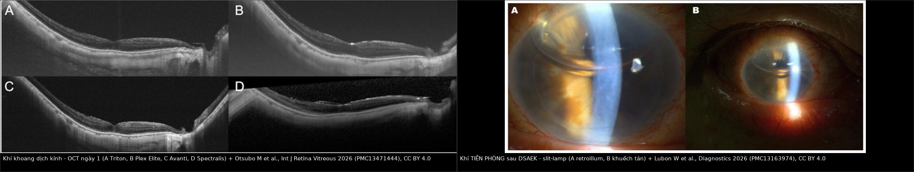
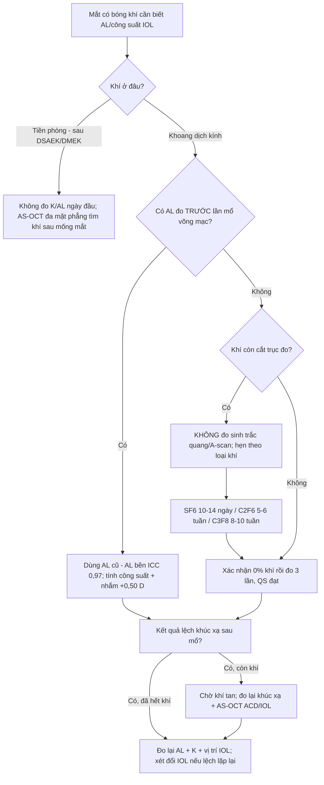
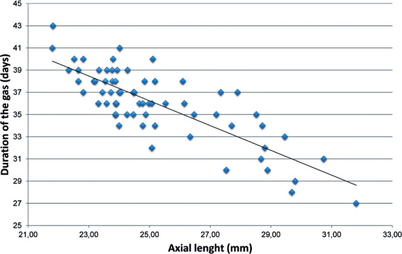
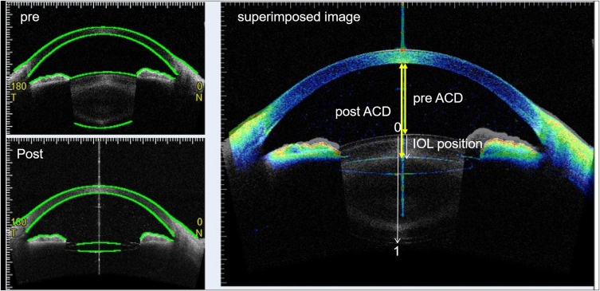
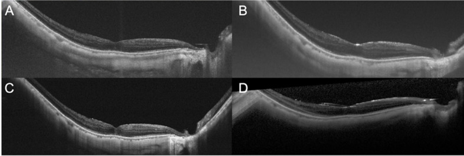
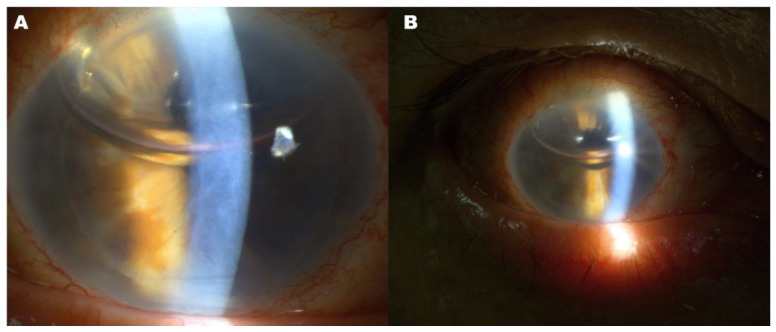

# 1490 — Sinh trắc và công suất IOL khi mắt còn bóng khí / Biometry and IOL power in the gas-filled eye

**Tags:** `pattern:al-gia` `pattern:lo-an-cau` `pattern:bong-khi` `vung:mat` `vung:dich-kinh` `vung:the-thuy-tinh` `anatomy:dich-kinh` `protocol:IOLMaster` `protocol:sinh-trac` `protocol:sieu-am-A-scan` `protocol:AS-OCT` `score:Barrett-Universal-II`
**Mức chắc chắn (certainty):** tổng hợp y văn (literature synthesis) — số liệu lấy từ các nghiên cứu đoàn hệ về phacovitrectomy có khí (**357 mắt**, **160 mắt**, **104 mắt**, **22 mắt**) và các loạt sinh trắc; các suy luận vật lý (vận tốc/chiết suất) được ghi **[suy luận]** ngay tại chỗ.

> **Vì sao bài này quan trọng:** [1477](../1477-sinh-trac-iol-mat-bom-dau-silicone/lesson.md) đã chốt nguyên tắc **môi trường trong mắt quyết định trục nhãn cầu (axial length, AL)** cho **dầu silicone**; [1863](../1863-duc-the-thuy-tinh-mat-bom-dau-silicone/lesson.md) chốt **thời điểm mổ một thì hay hai thì**. Bóng **khí (air, SF6, C3F8)** là môi trường thứ ba, nhưng **khác cả hai ở chỗ không thể hiệu chỉnh bằng công thức**: khí chắn trục quang, phản xạ gần toàn bộ siêu âm và **tự tan theo thời gian** — nghĩa là câu trả lời đúng phần lớn là **"chờ"**, và việc phải làm trước là **ghi lại AL trước khi bơm khí**. Đặt IOL dựa trên số đo trong khí = **lệch khúc xạ không dự báo, phải mổ lại đổi IOL**.

## 1. Tổng quan — vì sao một bóng khí làm mọi phép đo AL sai

- **Cùng một nguyên lý, ba môi trường.** Sinh trắc quang (partial coherence interferometry — PCI, hoặc swept-source OCT — SS-OCT) đo **quang trình**, rồi chia cho **chiết suất quy ước của dịch kính (n = 1,336)**; siêu âm A-scan đo **thời gian bay**, rồi nhân **vận tốc quy ước 1532 m/s**. Cả hai đều **giả định khoang sau thể thủy tinh chứa dịch kính**. Ba môi trường hay gặp: **dịch kính** (n = 1,336; v = 1532 m/s), **dầu silicone** (n = 1,403; v = 987 m/s ở dầu 1000 cSt — [1477](../1477-sinh-trac-iol-mat-bom-dau-silicone/lesson.md)), **khí** (n ≈ 1,0003 cho không khí, ≈ 1,0008 cho SF6/C3F8; v ≈ **343 m/s** cho không khí, **~136 m/s** cho SF6) [hằng số vật lý].
- **TẠI SAO sinh trắc quang đọc NGẮN ở mắt bơm khí (ngược hẳn mắt bơm dầu):** quang trình của đoạn khí là `1,000 × d`, nhưng máy vẫn chia cho `1,336`. Vì **1,000/1,336 = 0,749**, đoạn khí bị đọc **ngắn đi 25,1%** chiều dài hình học của nó [suy luận số học, cùng cách tính đã dùng cho dầu ở bài 1477]. Dầu (n cao hơn dịch kính) đọc **dài**; khí (n thấp hơn) đọc **ngắn** — hai sai số **ngược dấu**, nên "kinh nghiệm bù trừ" từ mắt dầu **không chuyển được** sang mắt khí.
- **Định lượng sai số:** ngưỡng lan truyền **0,1 mm AL ≈ 0,28 D** khúc xạ sau mổ. Một bóng khí chiếm **12 mm** trục nhãn cầu bị đọc ngắn **~3,0 mm** → **~8,4 D** [suy luận số học từ hai con số trên]. Đây không phải sai số "chỉnh kính được" — đây là **đặt sai công suất IOL**.
- **Vì sao máy thường không cho số nào cả:** bóng khí tạo **mặt phân cách khí–dịch** phản xạ rất mạnh; khi mặt phân cách **cắt ngang trục đo**, máy nhận **nhiều đỉnh/đỉnh giả** hoặc báo chất lượng tín hiệu (QS) không đạt. Khi bóng khí **đầy hoàn toàn** và bệnh nhân ngồi, khí nằm **phía trên** nên trục đo có thể **đi hoàn toàn trong khí** — vẫn sai, nhưng **sai một cách im lặng** (máy vẫn ra số) [suy luận].
- **TẠI SAO A-scan không cứu được:** trở kháng âm của khí thấp hơn mô **hàng nghìn lần**, nên tại mặt khí–võng mạc **gần như toàn bộ năng lượng bị phản xạ** và **không có hồi âm từ võng mạc**; giả sử có tín hiệu thì vận tốc khí **thấp hơn 4,5–11 lần** so với 1532 m/s, nên đoạn khí sẽ bị đọc **dài vô lý**. A-scan qua khí **không phải là phương án dự phòng** (khác hẳn mắt bơm dầu, nơi A-scan đặt vận tốc riêng vẫn dùng được).
- **Khí còn làm thay đổi khúc xạ của chính mắt:** khi khí nằm ngay sau IOL, **mặt sau IOL tiếp giáp khí (n ≈ 1,000) thay vì dịch (1,336)** → công suất khúc xạ của IOL tăng nhẹ, mắt **cận thị thêm trong thời gian bơm khí** [suy luận vật lý]. Vì vậy **khúc xạ đo được khi còn khí không dùng để tính lại công suất IOL**.
- **Vì sao đây là việc của CĐHA:** siêu âm B-scan và OCT là hai phương tiện hay được gọi khi "mắt đục/không đo được". Nhưng **qua khí**, B-scan cho **đường hồi âm cong rất mạnh kèm bóng lưng (shadowing)** — dễ bị đọc thành **bong võng mạc**; còn OCT qua khí **giảm chất lượng theo thiết bị**: trên **25 mắt lỗ hoàng điểm ngày 1**, điểm chất lượng trung vị (thang 5) là **5,0 (Triton)**, **5,0 (Plex Elite)**, **4,0 (Avanti)**, **2,0 (Spectralis)**, khác biệt **p < 0,001** (Int J Retina Vitreous 2026, PMC13471444). Cùng một mắt, cùng một ngày, "nhìn được hay không" **phụ thuộc máy** — nên kết luận "không thấy gì = không có bệnh" là sai logic.

## 2. Mẫu hình + chẩn đoán phân biệt theo vị trí bóng khí và thời điểm (gamut)

**Câu hỏi trung tâm không phải "đo bằng máy nào" mà "khí đang ở đâu và sẽ còn bao lâu".** Bốn bệnh cảnh quyết định khác nhau:

- **A. Mổ phối hợp phaco–cắt dịch kính (khí bơm SAU khi đặt IOL) — sinh trắc làm TRƯỚC mổ, khi chưa có khí.** Ở đây khí **không** làm hỏng phép đo; nó làm hỏng **kết quả**: IOL bị đẩy ra trước và mắt cận thị hơn dự kiến. Số liệu: **22 mắt** có khí → **ME −0,82 ± 0,64 D**, **MedAE 0,47 D**, so với **−0,07 ± 0,45 D (MedAE 0,20)** ở phacovitrectomy không khí và **+0,08 ± 0,39 D (MedAE 0,31)** ở phaco đơn thuần; mức ra trước của IOL **tương quan với độ cận thị (R = 0,53, p < 0,001)** (Ophthalmology 2020, PMID 31767435).
- **B. Mắt còn khí, cần biết AL để tính công suất (mổ hai thì, hội chẩn tuyến trước).** Đo trong khí **không dùng được** (mục 1). Cứu cánh: **AL đo trước lần mổ võng mạc vẫn còn giá trị**, vì AL **bền theo thời gian** — trên mắt bong võng mạc hoàng điểm còn nguyên, đo lặp lúc trước mổ, 1 năm và 2 năm: **ICC 0,97**, **CV 0,45%**, **TRTSD 0,114 mm**; sai số dự báo khúc xạ **−0,41 ± 0,67 D** và **do vị trí IOL, không do AL trôi** (Sci Rep 2018, PMC6203743).
- **C. Mắt còn khí + khúc xạ "trật" sau mổ.** Không đổi IOL trong lúc còn khí. Đo lại khúc xạ **sau khi khí tan hết**, rồi đánh giá **vị trí IOL** bằng AS-OCT. Lưu ý phản biện: giả thuyết "bóng khí đẩy IOL ra trước" **không giải thích được mọi ca** — có ca **−1,0 D** sau cắt dịch kính + khí mà **ACD lại SÂU đi (3,69 → 5,08 mm)**, tức cơ chế còn bàn cãi (Am J Ophthalmol Case Rep 2018, PMC5956725). Vì vậy **đừng mặc định "khí = IOL ra trước"** khi chưa đo.
- **D. Khí ở TIỀN PHÒNG (sau DSAEK/DMEK, bơm khí nội nhãn).** Đây là bóng khí **trên đường đo**: K và AL đều không đáng tin trong ngày đầu. Nguy hiểm hơn, bóng khí có thể **di chuyển ra sau mống mắt** mà slit-lamp **không thấy**: ca DSAEK dùng **SF6 25%**, ngày 1 slit-lamp "bình thường", **AS-OCT đa mặt phẳng** phát hiện khí ra sau → can thiệp lại ngay ngày 1 vì nguy cơ **góc đóng/secondary angle closure** (Diagnostics 2026, PMC13163974).

**Gamut "vì sao số đo vẫn sai" (theo cơ chế):**

| Cơ chế | Dấu hiệu nhận ra | Hướng sai |
|---|---|---|
| Chiết suất khí ≈ 1,000 thay vì 1,336 | Máy vẫn ra số nhưng AL **ngắn hơn** AL trước mổ; mắt **đục môi trường nhẹ** | **Ngắn giả** **−25,1%** đoạn khí |
| Mặt phân cách khí–dịch cắt ngang trục đo | Máy báo QS không đạt, nhiều đỉnh, đo 3 lần ra 3 số khác nhau | Không có số, hoặc số ngẫu nhiên |
| Trở kháng khí–mô chênh lớn (A-scan) | Không có đỉnh võng mạc; màn hình chỉ có đỉnh giác mạc/thể thủy tinh | **Không đo được** |
| Khí trong tiền phòng (DSAEK/DMEK) | Bóng khí lớn trong tiền phòng, có mức khí–dịch | K và AL đều sai; dễ bỏ sót khí sau mống mắt |
| Vị trí IOL thay đổi khi khí tan | ACD **nông hơn** trong 1–2 ngày đầu, **bằng nhau ở 6 tuần**; IOL ra trước **1,07 ± 0,20 mm** | Cận thị **−0,6 đến −0,8 D** (không phải AL sai) |
| Bóng khí "chỉ còn 10–20%" | Trên ảnh AS-OCT/slit-lamp thấy bóng khí nhỏ phía trên | Vẫn đủ để **cắt trục đo** nếu bệnh nhân ngồi/ngửa khác nhau |

## 3. Bảng so sánh phân biệt (ma trận đối chiếu)

*Trái: OCT ngày 1 qua khí ở mắt lỗ hoàng điểm (A Triton, B Plex Elite, C Avanti, D Spectralis) — chất lượng khác nhau rõ rệt, mép ảnh bị mặt phân cách khí cắt. Phải: khí TIỀN PHÒNG sau DSAEK (A retroillumination, B khuếch tán). Ảnh ghép letterbox, không crop/kéo giãn; nguồn + giấy phép trong `images/CREDITS.md`.*

| Thực thể (entity) | Hình ảnh/chỉ số điển hình | Chốt vào (rule-in) | Chốt loại (rule-out) | Gợi ý xác nhận |
|---|---|---|---|---|
| **Sinh trắc quang ở mắt còn khí** | AL ngắn hơn AL trước mổ; QS không đạt hoặc số dao động giữa 3 lần đo | **Tiền sử bơm khí + AL "ngắn đi" > 0,5 mm** mà không có lý do khúc xạ | AL khớp AL trước mổ **± 0,2 mm** + **0% khí** trên slit-lamp/AS-OCT | Chờ khí tan rồi đo lại 3 lần, QS đạt |
| **Sinh trắc quang ở mắt bơm dầu** ([1477](../1477-sinh-trac-iol-mat-bom-dau-silicone/lesson.md)) | AL **dài** hơn; hai máy quang học lệch **0,80 ± 0,08 mm** | **AL dài bất thường** + tiền sử dầu + chưa bật chế độ mắt bơm dầu | AL khớp AL sau lấy dầu ± 0,2 mm | Bật chế độ mắt bơm dầu; đo lại sau lấy dầu |
| **A-scan ở mắt còn khí** | Không có đỉnh võng mạc; đỉnh dày sát mặt khí; nếu có số thì AL **rất dài** | **Mất hồi âm võng mạc** trên một mắt đã biết bơm khí | Có đỉnh võng mạc rõ, lặp lại được → có thể đo | **Không dùng** A-scan qua khí; chuyển sang chờ tan |
| **B-scan qua khí (cạm bẫy giả bong võng mạc)** | **Đường hồi âm cong rất mạnh** + **bóng lưng** phía sau; cấu trúc sau khí **không thấy** | Đường cong **thay đổi theo tư thế**, trùng **mặt khí–dịch** trên slit-lamp | Đường cong **cố định**, dày, di động theo mắt → nghĩ bong võng mạc thật | Khám đáy mắt khi khí tan; OCT sau khi khí < 50% |
| **Lệch khúc xạ sau phacovitrectomy có khí** | ACD **nông 1–2 ngày đầu**, sâu dần khi khí tan; AS-OCT đo ACD/IOL | **Đo lại 6 tuần: ACD bằng nhóm không khí (p = 0,396)** nhưng PE **vẫn cao hơn** (p = 0,012 Barrett) | ACD/IOL không đổi mà khúc xạ lệch → tìm nguyên nhân khác (K, AL, công thức) | AS-OCT (CASIA2) đo ACD + vị trí IOL; so ảnh trước–sau |
| **Khí tiền phòng sau DSAEK/DMEK** | Bóng khí lớn tiền phòng; **AS-OCT đa mặt phẳng** thấy khí **sau mống mắt** | **Khí + IOP tăng/góc hẹp** sau ghép nội mô | Khí chỉ ở trung tâm, không ra sau mống mắt | AS-OCT dọc + ngang + xoay; đo lại K/AL khi hết khí |
| **AL trôi sau cắt dịch kính (giả thuyết sai thường gặp)** | AL 1–2 năm sau mổ **không đổi**: ICC 0,97, CV 0,45% | **AL ổn định** + khúc xạ vẫn lệch → do **vị trí IOL** | AL thay đổi **> 0,3 mm** → tìm nguyên nhân khác (băng/đai, tiến triển cận thị) | So AL nhiều mốc; đừng "trừ bù" AL |

### Ba con số cần nhớ của bài này

- **25,1%** — phần đoạn khí bị **đọc ngắn** trên sinh trắc quang (tỷ lệ **1,000/1,336**) [suy luận số học].
- **−0,6 đến −0,8 D** — độ **cận thị thêm** thực đo sau phacovitrectomy có khí (**−0,82 ± 0,64 D**; **−0,59 ± 0,34 D** với Barrett Universal II), lớn hơn hẳn nhóm không khí.
- **10–14 ngày / 5–6 tuần / 8–10 tuần** — thời gian khí tan của **SF6 / C2F6 / C3F8** (Int J Retina Vitreous 2024, PMC10840190), tức **lịch chờ tối thiểu** để đo lại.

## 4. Protocol + ngưỡng + sơ đồ quyết định

### 4.1. Trình tự (không nhảy bước)

1. **Xác nhận khí:** loại (không khí / SF6 / C2F6 / C3F8), **nồng độ**, **ngày bơm**, **% thể tích** còn lại (ước lượng trên slit-lamp hoặc AS-OCT: 100% / 50% / 0%), có **khí tiền phòng** hay không.
2. **Tìm AL cũ:** hồ sơ trước lần mổ võng mạc thường **đã có AL** (máy sinh trắc của khoa mổ). AL này **vẫn dùng được** vì AL bền (ICC 0,97 sau 2 năm) — đây là bước **rẻ nhất và bị bỏ qua nhiều nhất**.
3. **Không đo sinh trắc quang khi khí còn cắt trục đo.** Nếu vẫn đo (vì lý do hành chính), ghi rõ **QS + % khí** vào phiếu và **không dùng số đó để đặt IOL**.
4. **Chờ khí tan rồi đo lại:** tối thiểu **10–14 ngày (SF6)**, **5–6 tuần (C2F6)**, **8–10 tuần (C3F8)**; xác nhận **0% khí** trước khi đo. Với **C3F8 0,7 mL 100%**, thời gian khí trung bình **35,6 ± 3,9 ngày** và **tỉ lệ nghịch với AL**: `thời gian (ngày) = 69,14 − 1,33 × AL (mm)`, **r = −0,85**, **R² = 0,723** (Arq Bras Oftalmol 2025, PMC12818039) — **mắt càng ngắn, khí càng lâu tan**, nên mắt hyperope/AL 22 mm phải chờ lâu hơn mắt cận thị.
5. **Mổ phối hợp (khí bơm sau):** sinh trắc **trước mổ**, dùng công thức hiện đại (Barrett Universal II/Kane), và **nhắm dư hyperopia nhẹ +0,50 D** thay vì emmetropia (Clin Ophthalmol 2017, PMC5449115).
6. **Sau mổ, nếu khúc xạ lệch:** chờ **khí tan hết**, đo lại khúc xạ + AL + **AS-OCT vị trí IOL/ACD**; chỉ cân nhắc đổi IOL khi **số đo lặp lại được sau khi hết khí**.

### 4.2. Ngưỡng định lượng dùng để ra quyết định

| Chỉ số | Ngưỡng | Ý nghĩa thực hành |
|---|---|---|
| Sai số AL | **0,1 mm** | **0,28 D** khúc xạ — ngưỡng "không đáng kể" |
| Đoạn khí trên trục | **1 mm** | Đã gây **~0,25 mm** sai AL (**~0,7 D**) [suy luận] — tức **bóng khí nhỏ vẫn đủ sai** |
| Chênh AL với AL trước mổ | **> 0,5 mm** | Nghi số đo sai — không dùng để tính công suất |
| Thời gian chờ đo lại | **SF6 10–14 ngày · C2F6 5–6 tuần · C3F8 8–10 tuần** | Mốc tối thiểu; xác nhận **0% khí** |
| Khí C3F8 (0,7 mL, 100%) | **35,6 ± 3,9 ngày**; `69,14 − 1,33 × AL` | Mắt AL ngắn → chờ lâu hơn |
| PE nhóm có khí | **−0,82 ± 0,64 D**; MedAE **0,47 D** | Tư vấn trước mổ: **có thể lệch ~0,5 D** |
| PE khi dùng BUII + khí (RRD) | **−0,59 ± 0,34 D** | Cận thị hệ thống, **không do công thức** |
| Mức ra trước của IOL | **1,07 ± 0,20 mm** (khí) vs 0,94–0,95 mm | Giải thích cận thị; **không sửa bằng AL** |
| Khác biệt giữa công thức | **p = 0,546** (Hoffer Q/Holladay 1–2/SRK-T, **357 mắt**); **p = 0,531** (SRK/T, Hill-RBF, Kane, BUII ở nhóm khí) | **Đổi công thức không cứu được** — phải đổi **thời điểm đo** hoặc **đích khúc xạ** |
| Nhắm khúc xạ ở mắt có khí | **+0,50 D** | Bù cận thị hệ thống |

### 4.3. Sơ đồ quyết định

- **Không có hệ RADS cho sinh trắc.** Thước đo chất lượng là **tỷ lệ mắt trong ± 0,50 D và ± 1,00 D**, và với mắt có khí thì thước đo thực dụng là **"đã hết khí chưa"** — đừng so MAE giữa các quần thể khác bệnh cảnh.

*Đồ thị phân tán: **thời gian khí C3F8 (ngày)** theo **AL (mm)** sau bơm **0,7 mL C3F8 100%**; đường hồi quy `69,14 − 1,33 × AL`, **r = −0,85**, **R² = 0,723** — AL càng ngắn, khí càng lâu tan, nên lịch hẹn đo lại phải tính theo AL. Nguồn: Arq Bras Oftalmol 2025 (PMC12818039), CC BY 4.0 — ảnh nguyên bản.*

*AS-OCT (CASIA2) đo **ACD trước mổ** (pre), **ACD sau mổ** (post) và **vị trí IOL** trên ảnh chồng (superimposed). Đây là cách khách quan để phân biệt "khúc xạ lệch do **vị trí IOL**" với "do **AL**". Nguồn: Clin Ophthalmol 2025;19:2773–2783 (PMC12363976), CC BY-NC — ảnh nguyên bản.*

## 5. Biến thể bình thường và cạm bẫy

- **"Khí chỉ còn một ít" không có nghĩa là đo được.** Sai số tỷ lệ với **chiều dài đoạn khí nằm trên trục đo**; bóng khí **10–20%** ở phía trên vẫn cắt trục đo khi bệnh nhân **ngồi**, nhưng có thể **không cắt** khi **nằm** → **cùng một mắt, hai tư thế, hai con số**. Ghi tư thế khi đo.
- **B-scan qua khí giả bong võng mạc:** mặt khí–dịch cho **hồi âm cong rất mạnh** + **bóng lưng**; cấu trúc phía sau **không thấy được**. Đừng kết luận "võng mạc áp" hay "bong tái phát" từ ảnh này; **không thấy ≠ không có**. Đối chiếu tư thế và khám đáy mắt khi khí tan.
- **OCT qua khí phụ thuộc máy:** trên cùng **25 mắt**, điểm chất lượng trung vị **5,0** (Triton, Plex Elite), **4,0** (Avanti), **2,0** (Spectralis), **p < 0,001** (PMC13471444). Kết luận "không đánh giá được lỗ hoàng điểm" có thể chỉ là **kết luận của máy yếu**, không phải của mắt.
- **Bẫy "khí đẩy IOL ra trước" như một định luật:** đa số nghiên cứu thấy IOL ra trước và cận thị (**1,07 ± 0,20 mm**; **R = 0,53**), nhưng có ca **−1,0 D** với **ACD sâu thêm 3,69 → 5,08 mm** (PMC5956725). Cơ chế **chưa thống nhất** — hãy **đo** thay vì suy diễn.
- **Bẫy "AL dài ra sau cắt dịch kính":** AL **không trôi** (ICC 0,97; CV 0,45%), nên **đừng trừ bù** AL sau mổ; lệch khúc xạ là do **vị trí IOL**, và "sửa" bằng AL chỉ làm sai thêm.
- **Khí tiền phòng bị bỏ sót:** sau DSAEK, slit-lamp có thể "đẹp" trong khi **AS-OCT đa mặt phẳng** thấy khí **sau mống mắt** (PMC13163974) — vừa là nguy cơ **góc đóng**, vừa là lý do **K/AL ngày đầu không dùng được**.
- **Bẫy "đổi công thức cho đúng":** ở mắt có khí, **không công thức nào trội hơn** (p = 0,546 với 357 mắt; p = 0,531 trong nhóm khí). "Đổi công thức" là **thay đổi vô ích** khi nguồn sai nằm ở **thời điểm đo** và **đích khúc xạ**.
- **Cạm bẫy giao tiếp:** bệnh nhân nhớ "mổ xong nhìn mờ" và quy cho IOL. Cần nói trước: **khí còn thì khúc xạ chưa phải khúc xạ cuối**, và **cận thị nhẹ 0,5 D là kết quả được dự liệu**, không phải biến chứng.

## 6. Tự lượng giá — Blind Quiz

**Ca 1 — Nam 62 tuổi, 3 tuần sau cắt dịch kính + C3F8 vì bong võng mạc, nay đục thể thủy tinh, xin mổ phaco. Trên slit-lamp còn bóng khí chiếm khoảng 40% khoang dịch kính. Khoa mổ hỏi: "đo AL luôn được không?"**

- Gợi ý lâm sàng: mắt đã mổ võng mạc 1 lần, võng mạc đang áp, khí chưa tan hết.
- Câu hỏi: (1) Có đo sinh trắc quang được không, vì sao? (2) Nếu vẫn đo, số sẽ sai theo hướng nào và bao nhiêu? (3) Phương án nào dùng được **ngay hôm nay**?

<b>Bấm để hiện đáp án (findings + chẩn đoán)</b>

- **Không nên đo:** bóng khí cắt trục đo → mặt phân cách khí–dịch cho đỉnh giả/QS không đạt; và cả khi máy ra số, đoạn khí bị đọc **ngắn ~25,1%** (tỷ lệ **1,000/1,336**) [suy luận số học].
- **Hướng sai:** AL **ngắn giả** → công suất IOL tính ra **cao hơn thực** → sau mổ **cận thị**; **0,1 mm = 0,28 D**, nên đoạn khí **12 mm** ≈ **−3,0 mm** ≈ **~8,4 D** [suy luận].
- **Dùng ngay được:** **AL đo trước lần mổ võng mạc** trong hồ sơ — AL bền (**ICC 0,97**, **CV 0,45%** ở 2 năm, PMC6203743); nếu không có, hẹn đo lại khi **0% khí**: C3F8 thường **8–10 tuần**, và với **0,7 mL C3F8 100%** trung bình **35,6 ± 3,9 ngày**, mắt **AL ngắn còn lâu hơn** (`69,14 − 1,33 × AL`).
- **Nguồn số liệu:** Sci Rep 2018 (PMC6203743), Int J Retina Vitreous 2024 (PMC10840190), Arq Bras Oftalmol 2025 (PMC12818039), Ophthalmology 2020 (PMID 31767435).

**Ca 2 — Cùng một mắt lỗ hoàng điểm, ngày 1 sau mổ còn khí. Bốn máy OCT cho bốn ảnh khác nhau: hai ảnh đọc được, một ảnh mờ, một ảnh gần như không thấy võng mạc.**

- Gợi ý lâm sàng: mắt bơm khí 100%, chụp OCT ngày 1 để xác nhận lỗ đã đóng.
- Câu hỏi: (1) Vì sao cùng mắt mà chất lượng khác nhau? (2) Ảnh xấu có được dùng để kết luận "lỗ chưa đóng"? (3) Khi nào nên chụp lại?

<b>Bấm để hiện đáp án (findings + chẩn đoán)</b>

- **Dấu hiệu:** (A) Triton, (B) Plex Elite, (C) Avanti, (D) Spectralis — cùng mắt, cùng ngày. Điểm chất lượng trung vị (thang 5) lần lượt **5,0 / 5,0 / 4,0 / 2,0**, khác biệt **p < 0,001** trên **25 mắt**.
- **Chẩn đoán/ý nghĩa:** khí làm **giảm chất lượng ảnh theo đặc tính thu nhận của từng máy** (không chỉ do bước sóng). Ảnh xấu **không** đồng nghĩa lỗ chưa đóng.
- **Xử trí:** dùng máy cho ảnh tốt nhất sẵn có; nếu vẫn không kết luận được, chụp lại khi khí **giảm dưới 50%** (thực hành trong các nghiên cứu: chờ khí < 50% mới chụp OCT, với C3F8 trung bình **34,1 ± 11,6 ngày**, PMC12006618).
- **Nguồn ảnh:** Otsubo M et al., Int J Retina Vitreous 2026 (PMC13471444), **CC BY 4.0** — ảnh nguyên bản.

**Ca 3 — Nữ 68 tuổi, ngày 1 sau DSAEK (SF6 25%). Slit-lamp: bóng khí lớn ở tiền phòng "đúng vị trí", mảnh ghép áp. Kỹ thuật viên định đo sinh trắc để tính công suất cho lần phaco sau.**

- Gợi ý lâm sàng: mắt đã ghép nội mô, còn khí trong tiền phòng, IOP bình thường.
- Câu hỏi: (1) Vì sao **không** đo sinh trắc hôm nay? (2) Ngoài chuyện số đo, bóng khí tiền phòng còn nguy cơ gì? (3) Cần làm gì trước khi kết luận "ổn"?

<b>Bấm để hiện đáp án (findings + chẩn đoán)</b>

- **Vì sao không đo:** khí nằm **trên đường đo** → **K và AL** đều sai; kết quả không dùng được để tính công suất.
- **Nguy cơ thứ hai:** khí có thể **di chuyển ra sau mống mắt** mà slit-lamp **không thấy** — ca này **AS-OCT đa mặt phẳng** phát hiện khí sau mống mắt ngày 1, phải **can thiệp lại ngay** vì nguy cơ **góc đóng/secondary angle closure** (Diagnostics 2026, PMC13163974).
- **Việc cần làm:** **AS-OCT dọc + ngang + xoay** để xác định vị trí khí; đo lại K/AL khi **hết khí**; ghi rõ loại khí và nồng độ vào hồ sơ để lần sau không đo nhầm.
- **Nguồn ảnh:** Luboń W et al., Diagnostics 2026;16:1267 (PMC13163974), **CC BY 4.0** — ảnh nguyên bản.

## Bài liên quan chéo
- [400 – Tổng quan Mắt & thị giác](../400-tong-quan-mat-thi-giac/lesson.md)
- [1477 – Sinh trắc AL & công suất IOL ở mắt bơm dầu silicone](../1477-sinh-trac-iol-mat-bom-dau-silicone/lesson.md) (môi trường **dầu**: sai số ngược dấu với khí)
- [1863 – Đục thể thủy tinh ở mắt bơm dầu: một thì hay hai thì](../1863-duc-the-thuy-tinh-mat-bom-dau-silicone/lesson.md) (quyết định thời điểm)
- [1480 – Đục thể thủy tinh sau bóc màng ERM](../1480-duc-the-thuy-tinh-sau-boc-mang-erm/lesson.md) (phacovitrectomy không khí: PE −0,41 ± 0,85 D; IOL ra trước 0,94–1,07 mm)
- [1462 – Sinh trắc & công suất IOL sau ghép giác mạc](../1462-sinh-trac-iol-sau-ghep-giac-mac/lesson.md) (sai số phía **giác mạc**)
- [1410 – Lấy dầu silicone & biến chứng dầu tồn lưu](../1410-lay-dau-silicone-va-dau-ton-luu/lesson.md)
- [411 – Siêu âm nhãn cầu: bong võng mạc vs xuất huyết dịch kính](../411-sieu-am-nhan-cau/lesson.md) (đọc B-scan cơ bản)

## Ảnh
- `images/1490_bom-khi_Scatter_Duration-AL_ArqBrasOftalmol2025-F1.jpg` — thời gian khí C3F8 theo AL, Arq Bras Oftalmol 2025 (PMC12818039), CC BY 4.0.
- `images/1490_bom-khi_OCT_Day1-4-may_IJRetinaVitreous2026-F3.jpg` — OCT ngày 1 qua khí trên 4 máy, Int J Retina Vitreous 2026 (PMC13471444), CC BY 4.0.
- `images/1490_bom-khi_Slitlamp_Khi-tien-phong_Diagnostics2026-F2.jpg` — khí tiền phòng sau DSAEK, Diagnostics 2026 (PMC13163974), CC BY 4.0.
- `images/composite_1490_hai-vi-tri-bong-khi.jpg` — ảnh ghép letterbox từ hai ảnh CC BY 4.0 ở trên (không crop/kéo giãn).
- `images/1490_bom-khi_ASOCT_ACD-IOL_ClinOphthalmol2025-F1.jpg` — AS-OCT đo ACD/IOL, Clin Ophthalmol 2025 (PMC12363976), CC BY-NC — dùng nguyên bản, **không** đưa vào composite.
- Giấy phép từng file: `images/CREDITS.md`.

> Không dùng để chẩn đoán độc lập khi chưa có người hướng dẫn.
