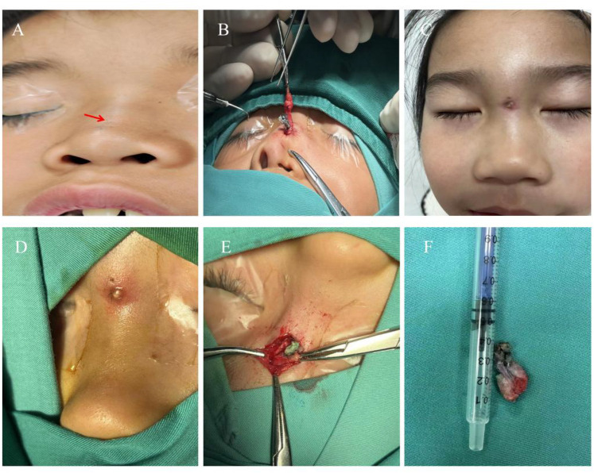
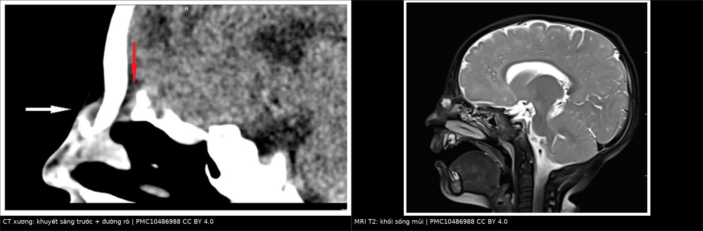
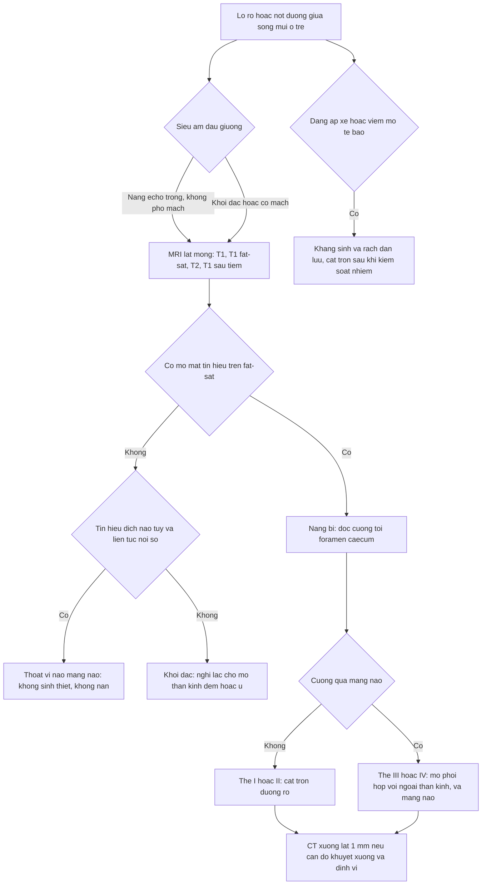
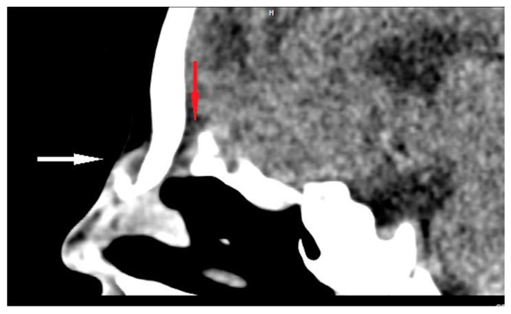
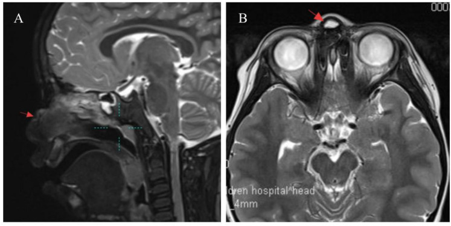

# 1491 — Nang bì và đường rò bẩm sinh sống mũi ở trẻ / Nasal dermoid sinus cyst (NDSC)

**Tags:** `pattern:nang-dich` `pattern:duong-ro` `pattern:khuyet-xuong` `vung:mat` `vung:hoc-mat` `vung:mui` `protocol:MRI-hoc-mat` `protocol:CT-xuong-lat-mong` `incidentaloma:khong`
**Mức chắc chắn (certainty):** tổng hợp y văn (literature synthesis) — bài ghép 1 tổng quan hệ thống có PRISMA (Front Pediatr 2025), 1 tổng quan chẩn đoán phân biệt (Diagnostics 2023), 1 loạt 24 trẻ (Indian J Otolaryngol 2022), 1 loạt 20 bệnh nhân/22 khối (Ann Otol Rhinol Laryngol 2025), 1 loạt 11 nhũ nhi (Medicine 2020) và 1 loạt 14 ca nhiễm (J Surg Case Rep 2021). Không có thử nghiệm ngẫu nhiên; các tỉ lệ dao động rộng giữa các loạt nên bài giữ **dải số**, không chốt một con số.

## 1. Tổng quan bệnh học – cơ chế hình ảnh

- **Phôi thai (embryology) — vì sao tổn thương luôn nằm ĐƯỜNG GIỮA và luôn có xu hướng chạy lên trên.** Trong thời kỳ phôi, giữa **sụn–xương mũi** phía trước và **màng não (dura)** phía sau có một **khoang trước mũi (prenasal space)**; phía trên khoang này thông với sọ qua **foramen caecum** và qua **fonticulus frontalis** (khe giữa xương trán và xương mũi). Ba giả thuyết chính được nêu trong tổng quan 2025: (1) **kẹt ngoại bì (ectodermal inclusion)** khi hai nửa mặt giữa áp vào nhau, (2) **túi màng não lồi ra (dural diverticulum)** thò xuống khoang trước mũi rồi mất cuống, (3) **khoang trước mũi không bịt kín** để lại đường rò. Dù theo giả thuyết nào, hệ quả hình ảnh giống nhau: một **cuống (tract) đi từ da sống mũi xuyên qua xương–sụn lên tới sàng trước**, có thể dừng ở mô dưới da, dừng trong xương, hoặc **chui qua màng não**.
- **TẠI SAO trên ảnh là "khối mỡ + đường rò" chứ không phải nang dịch đơn thuần.** Nang bì (dermoid) được lót **biểu mô lát tầng có nguồn gốc ngoại bì** nhưng trong thành có **tuyến bã, tuyến mồ hôi, nang lông** — khác nang biểu bì (epidermoid) chỉ có biểu mô mà **không có phần phụ da**. Các tuyến này tiết bã và mồ hôi vào lòng, tạo hỗn hợp **keratin + bã + lông**. Hệ quả vật lý:
  - **CT:** phần mỡ có tỷ trọng **−40 đến −120 HU**; keratin/bã đặc làm tỷ trọng tăng lên **0–40 HU**, nên "không thấy mỡ" **không loại trừ** nang bì. Xương mũi bị **ép, lõm hình cung (arc-shaped indentation)**, **không bị phá hủy** — vì đây là quá trình giãn chậm, giống nang túi lệ (bài 1483).
  - **MRI:** mỡ **tăng tín hiệu trên T1** và **mất tín hiệu khi bật xóa mỡ (fat-sat)** — đây là dấu chốt phân biệt với **máu/nhầy đặc** (vẫn sáng trên T1 fat-sat) và với **dịch não tủy** (T1 tối, T2 rất sáng, không đổi trên fat-sat). T2 thường **tăng tín hiệu**; thành nang và mô viêm quanh **ngấm thuốc** khi có nhiễm. **DWI không hạn chế khuếch tán** ở nang bì, trong khi **nang biểu bì hạn chế khuếch tán rõ** — đây là mẹo phân biệt hai thực thể gần như trùng hình ảnh.
- **Vì sao có "sợi lông nhô ra lỗ rò" là dấu đặc hiệu.** Nang lông nằm trong thành đường rò sản xuất lông; lông bị đẩy ra theo dòng bã → **một sợi lông nhìn thấy ở lỗ rò da được coi là dấu gần như đặc hiệu (pathognomonic)** cho nang bì mũi. Nhưng dấu này **chỉ có ở một phần bệnh nhân**, vắng mặt không loại trừ gì.
- **Dịch tễ và các con số phải nhớ.** U/bất thường đường giữa mũi bẩm sinh ước tính **1/20.000–1/40.000 trẻ sinh sống**; **nang bì chiếm ≥ 60%** các khối đường giữa mũi bẩm sinh. Bất thường sọ mặt đi kèm (hẹp sọ, loạn sản nửa mặt, nang lệ đạo, khe hở môi–vòm, dị dạng vành tai, giãn não thất, tăng khoảng cách hai mắt) gặp **0–41%**. Khoảng **một nửa** trẻ có **tăng khoảng cách hai mắt (hypertelorism)** và sống mũi bè rộng; **30%** sờ thấy khối dưới da, thường ngay **mốc xương–sụn**.
- **Mức độ lan nội sọ — con số quyết định cách mổ.** Tổng quan 2025 nêu **~10%** nang bì đường giữa có lan nội sọ; tổng quan 2023 và loạt 2022 nêu **~20%**, dao động **4–57%** giữa các loạt. Điểm quan trọng hơn con số trung bình: **không thể đoán lan nội sọ bằng vị trí lỗ rò hay kích thước khối** — nhiều nghiên cứu **không tìm thấy tương quan** giữa vị trí lỗ rò/nang và lan nội sọ. Vì vậy **mọi** nang bì mũi đều phải đánh giá đường rò tới sàng trước bằng hình ảnh, không dựa vào cảm giác "khối nhỏ, ngoài da".
- **Vì sao phải mổ sớm, không "chờ lớn".** Lỗ rò là cửa vào của vi khuẩn: nguy cơ nhiễm ước tính **7%/năm** suốt thời thơ ấu; **50%** trẻ đã có ít nhất một đợt nhiễm tại chỗ **trước 4 tuổi** và **> 90% trước sinh nhật thứ 9**. Nhiễm không chỉ gây áp-xe da: mủ đi theo đúng đường rò lên màng não → **viêm màng não, áp-xe não, viêm mô tế bào quanh ổ mắt, huyết khối xoang hang**.
- **Tái phát — con số phản ánh chất lượng lần mổ đầu.** Tái phát chung **5,5–12%**; nhưng khi **cắt không trọn** (bỏ cuống, cắt "một phần khối"), tái phát **50–100%**. Loạt 24 trẻ: tái phát **8,3% (2/24)**, cả hai trong **12–18 tháng** đầu; loạt 20 bệnh nhân: **20% (4/20) phải mổ lại**, trung vị **6 tháng** (3–45 tháng) sau mổ đầu. Nói cách khác: **phần lớn tái phát là do cuống còn lại, không phải do bệnh "ác tính" hay "cơ địa"**.

## 2. Mẫu hình + chẩn đoán phân biệt theo vị trí (Gamut)

- **Mẫu hình chốt — "lỗ rò + cuống" (pit-and-tract).** Trên **cùng một đường**: (1) **lỗ rò/nốt nhỏ ở đường giữa sống mũi** (từ nhân trung tới vùng glabella), có thể có **lông nhô ra** hoặc tiết bã; (2) **dải mô mềm** chạy lên trên, xuyên qua **mốc xương–sụn** hoặc qua **khe xương mũi**; (3) đích đến là **foramen caecum/sàng trước**, nơi có thể có **khuyết xương + màng não**. Thấy đủ (1)+(2) là đã đủ chỉ định **MRI trước mổ**; thấy (3) là đổi **đường mổ**.
- **Gamut theo vị trí**
  - **Đường giữa sống mũi/glabella:** nang bì – đường rò bẩm sinh · **nang biểu bì (epidermoid)** · **thoát vị não–màng não (encephalocele, EPHC)** · **lạc chỗ mô thần kinh đệm mũi (nasal glial heterotopia, NGH)** · **u quái (teratoma)** · u mỡ (lipoma) · u sợi thần kinh (neurofibroma).
  - **Góc mắt trong:** nang túi lệ bẩm sinh (bài 1483) · nang bì góc mắt · thoát vị não–màng não thể mũi–ổ mắt (nasoorbital EPHC).
  - **Quanh hốc mắt (trên–ngoài):** nang bì góc ngoài (angular dermoid) ở **mốc trán–gò má** — khác hẳn nhóm đường giữa về đường mổ và nguy cơ nội sọ.
  - **Trong hốc mũi:** NGH thể trong mũi · EPHC thể trong mũi · nang túi lệ thể nang mũi · u quái.
- **Mnemonic "D-E-G-I-T" cho khối đường giữa mũi:** **D**ermoid (nang bì/đường rò) · **E**ncephalocele · **G**lial heterotopia (glioma mũi) · **I** (epidermoid, nang biểu bì) · **T**eratoma (u quái). Năm nhóm này chiếm gần như toàn bộ khối đường giữa mũi bẩm sinh; **nang bì là nhóm đông nhất (≥ 60%)** nhưng **không được là chẩn đoán mặc định** vì hai nhóm nguy hiểm nhất (EPHC, NGH) trông gần giống.

*(A) Lỗ rò ở sống mũi (mũi tên đỏ). (B) Mở lỗ rò: keratin trắng + lông. (C, D) Nhiễm tái diễn tại chỗ với đỏ–nề da. (E) Lấy trọn đường rò có đánh dấu màu. (F) Bệnh phẩm cắt trọn. Nguồn: Front Pediatr 2025, PMC12827512, Fig. 1, CC BY 4.0.*

## 3. Bảng so sánh phân biệt (ma trận đối chiếu)

| Thực thể (entity) | Hình ảnh điển hình | Chốt vào (rule-in) | Chốt loại (rule-out) | Gợi ý xác nhận |
|---|---|---|---|---|
| **Nang bì/đường rò sống mũi** (NDSC) | Lỗ rò/nốt đường giữa + dải mô mềm lên foramen caecum; mỡ **−40…−120 HU**, **T1 sáng, mất tín hiệu trên fat-sat**, T2 tăng; xương mũi **ép lõm**, foramen caecum rộng, **crista galli chẻ đôi (bifid)** | **Lỗ rò + lông nhô ra**; **T1 sáng mất tín hiệu khi fat-sat**; dải mô mềm liên tục tới sàng trước | Không có mỡ, không có cuống về sàng trước, tổn thương **đặc ngấm thuốc mạnh** → nghĩ NGH/u khác | MRI + CT xương lát mỏng; cắt trọn + mô bệnh |
| **Thoát vị não–màng não** (EPHC) | Khối **mềm, đập theo mạch, bóp xẹp, soi sáng**; khuyết xương + **liên tục khoang dưới nhện**; tín hiệu **dịch não tủy** (T1 tối, T2 rất sáng), có thể thấy mô não trong khối | **Furstenberg dương tính** (khối to lên khi khóc/ép tĩnh mạch cổ) + **khuyết xương + liên tục nội sọ** | Khối cứng, không xẹp, **Furstenberg âm**, có mỡ trong khối → loại EPHC | MRI T1/T2 + CT xương; **tuyệt đối không sinh thiết, không nặn** |
| **Lạc chỗ mô thần kinh đệm mũi** (NGH) | Khối **đặc, chắc, không bóp xẹp**, không soi sáng; thể ngoài mũi **60%**, trong mũi **30%**, hỗn hợp **10%**; đường kính **1–7 cm** (trung bình **2,4 cm**) | **Khối đặc, Furstenberg âm**, không có mỡ, không liên tục dịch não tủy | Có mỡ (nang bì), có liên tục nội sọ (EPHC) → loại NGH | MRI; mô bệnh (không có cuống màng não thực sự) |
| **Nang biểu bì** (epidermoid) | Khối **dịch 0–20 HU** (không mỡ), T1 tối, T2 sáng, **hạn chế khuếch tán** | **DWI hạn chế + không có mỡ + không có phần phụ da** | Có mỡ và mất tín hiệu fat-sat → nang bì | MRI DWI/ADC; mô bệnh phân biệt |
| **Nang túi lệ bẩm sinh** (bài 1483) | Nang **góc mắt trong** + **ống lệ đạo giãn** + **nang ngách mũi dưới**, 0–20 HU, **không khuyết xương** | **Bộ ba + không khuyết xương + không mỡ** | Có cuống lên sàng trước, có mỡ, khuyết xương → không phải nang túi lệ | Siêu âm/CT; **cấm nong/massage nếu chưa loại EPHC** |
| **Nang bì quanh hốc mắt** (angular dermoid) | Khối **trên–ngoài hốc mắt**, sát **mốc trán–gò má**, thường vành khuyết xương nhỏ, mỡ trong khối | **Vị trí mốc trán–gò má + mỡ** | Ở **đường giữa** → nghĩ NDSC/EPHC, không phải angular | CT xương; MRI khi khối lớn/lan sâu |
| **U quái** (teratoma) | Khối **hỗn hợp**: mỡ + **vôi hóa** + thành phần đặc + nang, có thể chui vào sọ | **Nhiều thành phần + vôi hóa trong khối** | Thuần dịch/mỡ một thành phần → ít nghĩ u quái | CT + MRI + AFP; mô bệnh (nguy cơ ác tính **< 1%**) |

*Trái: CT sagittal cửa sổ xương — mũi tên trắng chỉ đường rò ở sống mũi, mũi tên đỏ chỉ **khuyết xương ngay trước crista galli**. Phải: MRI T2 sagittal — khối tăng tín hiệu ở sống mũi. Nguồn: Diagnostics 2023, PMC10486988, Fig. 4–5, CC BY 4.0. Ảnh ghép letterbox giữ nguyên tỷ lệ.*

### Ba dấu hiệu phải đọc đúng thứ tự
- **Dấu 1 — "mỡ có thật không?"**: bật **T1 fat-sat** (hoặc STIR). Nang bì **mất tín hiệu**; máu/nhầy đặc **vẫn sáng**. Trên CT, mỡ **−40…−120 HU** nhưng **keratin làm tăng tỷ trọng**, nên CT **không đủ** để loại nang bì.
- **Dấu 2 — "cuống đi đâu?"**: đọc **mặt cắt sagittal qua đường giữa** từ lỗ rò lên tới **foramen caecum**. Đây là mặt cắt **bắt buộc**, vì cuống chạy **thẳng đứng** — mặt cắt trục/tránh cắt ngang cuống sẽ chỉ thấy một chấm nhỏ.
- **Dấu 3 — "sàng trước còn nguyên không?"**: **foramen caecum rộng** và **crista galli chẻ đôi** là **dấu gián tiếp** của lan nội sọ trên CT; nhưng chốt thật vẫn là **MRI thấy mô/dải đi qua màng não**. Tổng quan 2025 dẫn một nghiên cứu cho **độ nhạy 100%, độ đặc hiệu 95,7%** của MRI cho lan nội sọ — cao hơn CT; đổi lại MRI **kém nhạy với khuyết xương rất nhỏ (< 1–2 mm)**, nên hai phương thức **bổ sung**, không thay thế nhau.

## 4. Protocol chụp + phân loại và ngưỡng xử trí

- **Bước 1 — siêu âm đầu giường (bedside ultrasound).** Đầu dò **≥ 12 MHz**: khối **echo trống/giảm âm**, bờ rõ, có thể thấy **echo trong lòng do mỡ/bã**; **không có phổ mạch** trong khối. Siêu âm trả lời nhanh "nang hay khối đặc" và "có phải mạch máu không", nhưng **không đủ để loại lan nội sọ**.
- **Bước 2 — MRI là phương thức chốt (modality of choice).** Tối thiểu: **T1W + T1W fat-sat (hoặc STIR) + T2W + T1 sau tiêm fat-sat**, lát mỏng **≤ 3 mm** (lý tưởng **1–2 mm**), đủ **3 bình diện**; **sagittal đường giữa** là mặt cắt không được thiếu; chuỗi **3D high-resolution** khi nghi cuống xuyên sàng. Trẻ **< 6 tuổi** hoặc không hợp tác thường cần **an thần/gây mê** — phải tính vào kế hoạch, không phải "chụp nhanh rồi về".
- **Bước 3 — CT xương lát mỏng (thin-slice bone window) khi cần đo xương.** Lát **≤ 1 mm**, dựng **sagittal + 3D**: đo **chiều rộng foramen caecum**, tìm **crista galli chẻ đôi**, xác định **khuyết xương sàng trước** và mức **ép–lõm xương mũi**. CT cũng là bộ dữ liệu cho **định vị thần kinh trong mổ (navigation)** ở ca phức tạp/tái phát.
- **Bước 4 — nội soi mũi (endoscopy)** khi cần nhìn lỗ rò, đánh giá vách mũi và hỗ trợ đường mổ nội soi; **không thay** hình ảnh học.

**Phân loại Hartley (dùng để chọn đường mổ)** — 4 thể, và đây là ngôn ngữ chung với phẫu thuật:

| Thể | Tổn thương tới đâu | Ca mổ cần gì | Số ca trong loạt 24 trẻ |
|---|---|---|---|
| **I — Ngoài da/dưới da (superficial)** | Chỉ mô dưới da sống mũi, không xuyên xương | Cắt ellipse da + khối, đóng trực tiếp | **11** |
| **II — Trong xương (intraosseous)** | Xuyên giữa sụn–xương mũi, dừng trước màng não | Cắt trọn đường rò, **có thể cần cắt xương chỉnh hình (osteotomy)** và tái tạo khung mũi | **7** |
| **III — Nội sọ ngoài màng não (intracranial extradural)** | Qua khuyết sàng trước, nằm **ngoài màng não** | **Đường mổ phối hợp** (mũi + nội soi ± sọ) | **6** |
| **IV — Nội sọ trong màng não (intracranial intradural)** | **Xuyên màng não**, có cuống dính dura | **Phối hợp với ngoại thần kinh**, vá màng não | 0 (loạt 24); **1/11** ở loạt nhũ nhi |

- **Ngưỡng xử trí (bảo tồn → can thiệp).** Không có "theo dõi dài hạn" cho nang bì mũi có lỗ rò, vì nhiễm là quy luật thời gian:

| Bậc | Tình huống | Việc làm | Bằng chứng / con số |
|---|---|---|---|
| 1 | Lỗ rò chưa nhiễm, trẻ nhỏ | **Không nặn, không chọc, không cắt "thử" ở tuyến trước**; chuyển chuyên khoa, **MRI trước mổ** | Nhiễm **7%/năm**; **50%** nhiễm trước 4 tuổi, **> 90%** trước 9 tuổi |
| 2 | Đang có **áp-xe/viêm mô tế bào** tại chỗ | **Kháng sinh ± rạch dẫn lưu (I&D)**, kiểm soát nhiễm **rồi mới cắt trọn** | Loạt 14 ca: **3/7** ca nhiễm cần I&D trước khi cắt trọn; **28,5% (4/14)** còn nhiễm tái phát phải mổ thêm |
| 3 | Thể I–II | **Cắt trọn cuống tới đáy** (kèm màng xương/mảnh xương bám), tái tạo khung mũi | Tái phát **5,5–12%**; cắt không trọn **50–100%** |
| 4 | Thể III–IV | **Đường phối hợp** với ngoại thần kinh, vá màng não; có thể cần **mảnh ghép sụn sườn** tái tạo | Rò dịch não tủy trong mổ **8,3% (2/24)**; mổ lại **20% (4/20)**, trung vị **6 tháng** |

## 5. Biến thể bình thường và cạm bẫy

- **Cạm bẫy số 1 — "u nhỏ ở sống mũi, cắt ở tuyến trước rồi tái phát".** Đây là kịch bản kinh điển: khối được gọi là "nang bã/atheroma", cắt **không lấy cuống**, vài tháng sau **áp-xe tái phát cùng chỗ**. Hình ảnh lúc này chỉ thấy **viêm mô mềm**, che mất cuống; nếu không hỏi **tiền sử mổ** và không chụp MRI đường giữa, rất dễ **dẫn lưu lần nữa** thay vì cắt trọn. Luôn hỏi: *đã cắt ở đâu, có lấy được "sợi dây" bên dưới không, mô bệnh là gì?*
- **Cạm bẫy số 2 — nang biểu bì "đội lốt" nang bì.** Hai tổn thương **giống nhau trên lâm sàng và gần giống trên MRI thường quy**; khác biệt nằm ở **mỡ (nang bì) vs không mỡ + hạn chế khuếch tán (nang biểu bì)** và ở **mô bệnh** (phần phụ da). Loạt 20 bệnh nhân có **1 ca** được chẩn đoán ban đầu là "atheroma" nhưng mô bệnh là **nang biểu bì**, **1 ca** là **u quái trưởng thành**, **2 ca** là **hamartoma thần kinh đệm** — tức **20% (4/20)** khối đường giữa mũi **không phải** nang bì dù hình ảnh gợi ý. Đừng bỏ mô bệnh.
- **Cạm bẫy số 3 — bóp/nặn/ sinh thiết trước khi loại thoát vị não–màng não.** Nếu khối thực ra là **EPHC**, sinh thiết hay nặn có thể gây **rò dịch não tủy và viêm màng não**. Dấu lâm sàng phân biệt rẻ tiền nhất: **Furstenberg** (khối to lên khi khóc/ép tĩnh mạch cổ), **bóp xẹp được**, **soi sáng được**, **đập theo mạch** — nang bì **âm tính với tất cả**.
- **Cạm bẫy số 4 — đọc "crista galli chẻ đôi" như một bệnh.** Đây là **dấu gián tiếp** của lan nội sọ, **không phải chẩn đoán**; và ngược lại, **không có dấu này không loại trừ** cuống xuyên sàng. Chốt vẫn là **MRI thấy dải mô mềm/mô qua màng não**.
- **Cạm bẫy số 5 — chỉ chụp mặt cắt trục.** Cuống chạy **thẳng đứng**; trên mặt cắt trục nó chỉ là **một chấm**, rất dễ bị bỏ qua hoặc bị đọc là "mô mềm bình thường trước sụn mũi". Bắt buộc có **sagittal đường giữa**.
- **Biến thể bình thường cần biết:** (1) **foramen caecum** có thể hơi rộng ở trẻ nhỏ và **thu hẹp dần** — đo đơn thuần không đủ, phải xem **có mô đi qua hay không**; (2) một **lõm nhỏ ở sống mũi** không có lỗ, không tiết bã, không có cuống trên MRI thường chỉ là **biến thể tạo hình**, theo dõi lâm sàng; (3) **tuyến bã ở mặt trẻ** rất nhỏ, nên "nang bã" ở đường giữa trẻ em **phải mặc định coi là nang bì** cho tới khi chứng minh ngược lại.

## 6. Tự lượng giá — Blind Quiz

**Ca 1 — Bé gái 2 tuổi, lỗ nhỏ ở sống mũi từ lúc sinh, thỉnh thoảng tiết chất bã trắng, có sợi lông nhô ra; 3 tháng nay đỏ–nề tái diễn đúng chỗ đó. Hỏi: 3 chẩn đoán phân biệt, và việc KHÔNG được làm?**

- Gợi ý: không chấn thương, không sốt, không lồi mắt.
- Câu hỏi: mô tả tổn thương? Vì sao lông ở lỗ rò có giá trị? Bước tiếp theo?

<b>Bấm để hiện đáp án (findings + chẩn đoán)</b>

- Findings: **lỗ rò đường giữa sống mũi**, tiết bã, **có lông**, kèm đỏ–nề tái diễn tại chỗ = **nhiễm tái phát theo đường rò**.
- Chẩn đoán: **nang bì/đường rò bẩm sinh sống mũi (NDSC)**. **Lông nhô ra lỗ rò là dấu gần như đặc hiệu**; nhưng thiếu lông **không loại trừ**.
- Phân biệt: **nang biểu bì** (không mỡ, DWI hạn chế), **thoát vị não–màng não** (bóp xẹp, Furstenberg dương, khuyết xương + liên tục nội sọ), **lạc chỗ mô thần kinh đệm** (khối đặc, không mỡ), **u quái** (vôi hóa, nhiều thành phần).
- Việc **KHÔNG** được làm: **nặn/chọc/sinh thiết** trước khi loại EPHC; **không cắt "một phần"** ở tuyến không chuyên khoa.
- Việc nên làm: **MRI lát mỏng 3 bình diện + T1 fat-sat** (tìm cuống tới sàng trước), **CT xương ≤ 1 mm** nếu cần đo khuyết xương; kiểm soát nhiễm rồi **cắt trọn đường rò**.
- Nguồn ảnh: *Front Pediatr* 2025, PMC12827512, Fig. 1, CC BY 4.0.

**Ca 2 — Bé trai 4 tuổi, áp-xe sống mũi tái phát 3 lần, đã "nặn mủ" hai lần ở phòng khám. CT sagittal cửa sổ xương: khuyết xương ngay trước crista galli. Hỏi: dấu hiệu này nghĩa là gì, cần thêm gì trước mổ, và đường mổ thay đổi ra sao?**

- Gợi ý: bạch cầu bình thường, không co giật, không dấu màng não.

<b>Bấm để hiện đáp án (findings + chẩn đoán)</b>

- Findings: **khuyết xương sàng trước** (mũi tên đỏ) + **dải mô mềm từ sống mũi chạy lên** (mũi tên trắng) = đường rò **xuyên sàng trước**, tức **lan nội sọ** (thể III/IV theo Hartley).
- Vì sao quan trọng: **không thể đoán lan nội sọ bằng vị trí lỗ rò hay kích thước khối** — phải thấy cuống trên hình ảnh. Khuyết xương + **foramen caecum rộng/crista galli chẻ đôi** là dấu gián tiếp; **MRI** mới xác định **ngoài màng não hay trong màng não**.
- Cần thêm trước mổ: **MRI T1 + T1 fat-sat + T2 + T1 sau tiêm fat-sat**, sagittal đường giữa; nếu **xuyên màng não** → mời **ngoại thần kinh**, chuẩn bị **vá màng não**.
- Đường mổ: **phối hợp** (đường mũi ± nội soi + đường sọ) thay vì chỉ rạch dọc sống mũi; **rò dịch não tủy trong mổ 8,3% (2/24)** trong loạt tương tự.
- Nguồn ảnh: *Diagnostics* 2023, PMC10486988, Fig. 4, CC BY 4.0.

**Ca 3 — Bé gái 3 tuổi, khối 1,5 cm ở gốc mũi, không lỗ rò. MRI: T1 tăng tín hiệu, **mất tín hiệu hoàn toàn trên T1 fat-sat**, T2 tăng, **không thấy dải mô mềm qua màng não**; CT: xương mũi lõm hình cung, foramen caecum không rộng. Hỏi: chẩn đoán, vì sao fat-sat là chốt, và thái độ xử trí?**

- Gợi ý: khối mềm, không đập theo mạch, bóp không xẹp, không soi sáng.

<b>Bấm để hiện đáp án (findings + chẩn đoán)</b>

- Findings: khối **có mỡ** (T1 sáng, **mất tín hiệu trên fat-sat**), **T2 tăng**, **xương bị ép lõm** chứ không bị phá hủy, **không có cuống xuyên màng não** = **nang bì thể I–II (ngoài da/trong xương)**, đúng hình thái **NDSC không lan nội sọ**.
- Vì sao fat-sat là chốt: mỡ **mất tín hiệu** khi xóa mỡ, còn **máu/nhầy đặc vẫn sáng** và **dịch não tủy** thì T1 tối sẵn — fat-sat phân biệt được ba chất lỏng "trông na ná" này chỉ trong một chuỗi xung.
- Vì sao **không** phải EPHC: khối **không bóp xẹp, không soi sáng, không đập theo mạch**, **Furstenberg âm**, không liên tục khoang dưới nhện.
- Xử trí: **vẫn phải cắt trọn** (không theo dõi dài hạn) vì nguy cơ nhiễm **7%/năm**, **> 90% nhiễm trước 9 tuổi**; cắt kèm **màng xương/mảnh xương bám** ở đáy để tránh tái phát **50–100%** khi bỏ sót cuống.
- Nguồn ảnh: *Front Pediatr* 2025, PMC12827512, Fig. 3, CC BY 4.0.

## Bài liên quan chéo
- [400 – Tổng quan Mắt & thị giác](../400-tong-quan-mat-thi-giac/lesson.md)
- [410 – Giải phẫu hốc mắt](../410-giai-phau-hoc-mat/lesson.md)
- [1483 – Nang túi lệ bẩm sinh và tắc lệ đạo ở trẻ](../1483-nang-tui-le-va-tac-le-dao-o-tre/lesson.md) (nang ở góc mắt trong, **không** khuyết xương)
- [1972 – Hẹp lỗ hình lê bẩm sinh](../1972-hep-lo-hinh-le-bam-sinh/lesson.md) (chẩn đoán phân biệt tắc mũi sơ sinh)
- [1461 – Áp-xe dưới màng xương hốc mắt ở trẻ](../1461-ap-xe-duoi-mang-xuong-hoc-mat-o-tre/lesson.md) (nhiễm lan vào hốc mắt)
- [249 – Rò động mạch cảnh–xoang hang do chấn thương](../249-ro-dong-mach-canh-xoang-hang-chan-thuong/lesson.md) (biến chứng huyết khối xoang hang của nhiễm vùng mũi–mặt)

> Không dùng để chẩn đoán độc lập khi chưa có người hướng dẫn.
