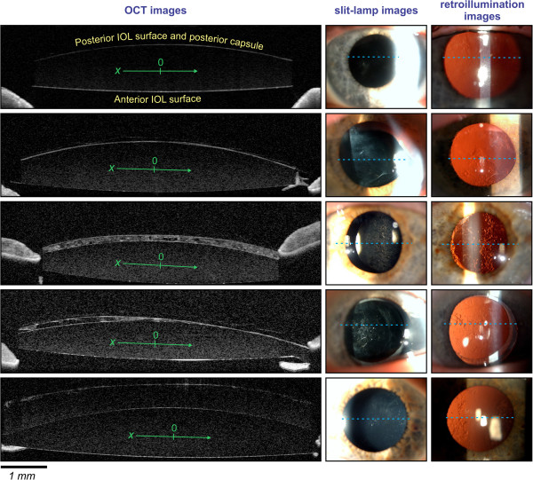
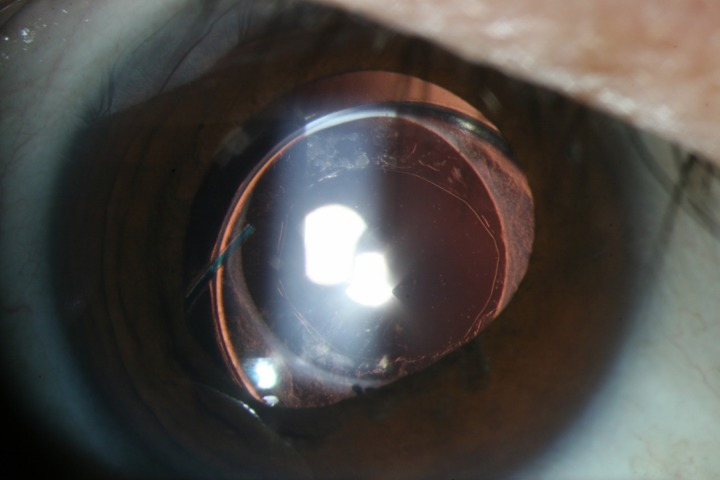
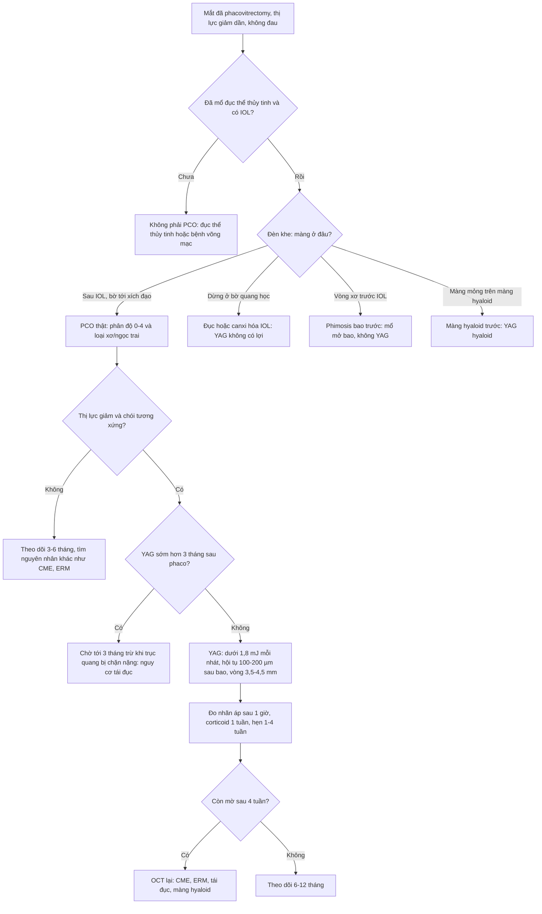
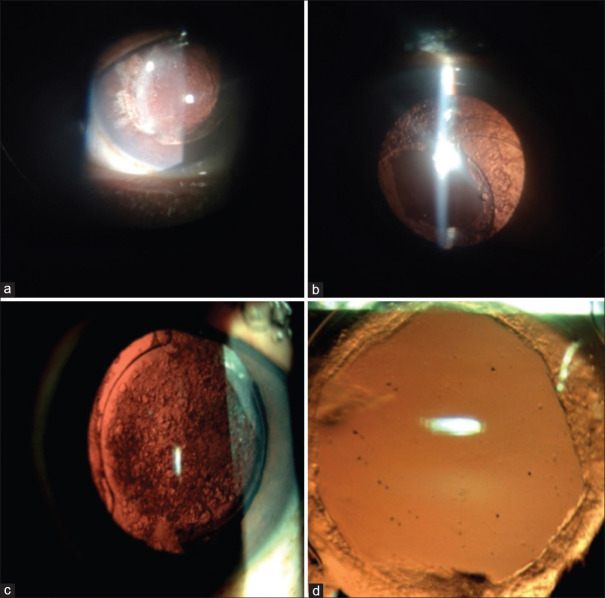
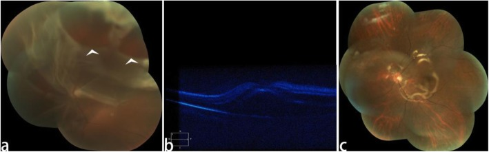
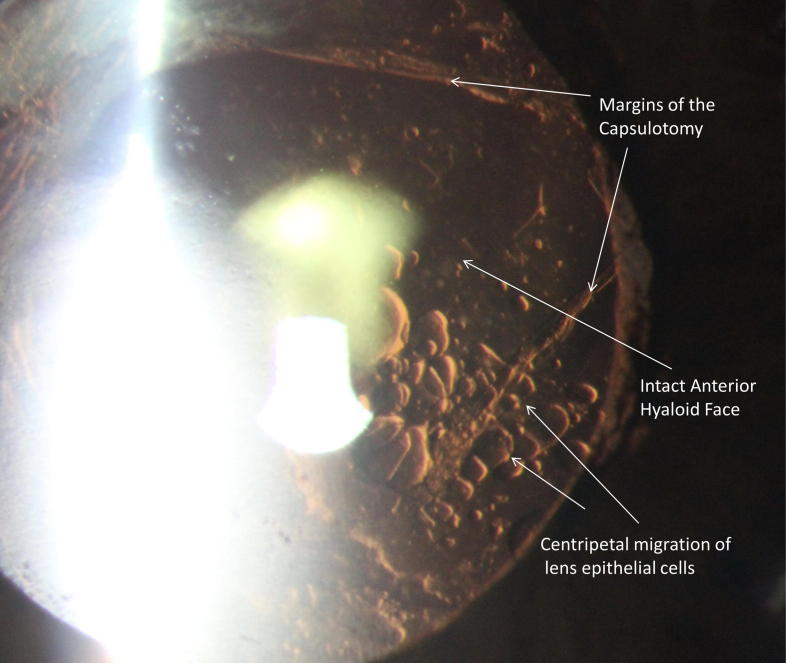
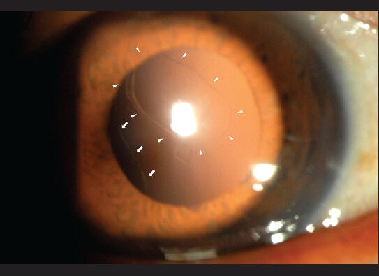

# 1492 — Đục bao sau nhân tạo (PCO) sau phaco ở mắt đã cắt dịch kính: YAG lúc nào, năng lượng bao nhiêu, nguy cơ bong võng mạc / PCO after phaco in the previously vitrectomized eye

**Tags:** `pattern:duc-bao-sau` `pattern:ngoc-trai-elschnig` `pattern:tai-duc-truc-quang` `pattern:duc-iol` `pattern:phimosis-bao-truoc` `vung:the-thuy-tinh` `vung:mat` `vung:dich-kinh` `protocol:den-khe` `protocol:retro-illumination` `protocol:AS-OCT` `protocol:YAG` `score:PCO-grade` `score:YAG-capsulotomy` `incidentaloma:khong`

**Mức chắc chắn (certainty):** tổng hợp y văn (literature synthesis) — dựng từ **197 mắt phacovitrectomy, theo dõi 72 tháng** (*Int Ophthalmol* 2026, **PMC12979282**, CC BY 4.0), **408 mắt** so thời gian tới YAG (phacovitrectomy vs phaco đơn thuần; *J Ophthalmol* 2014, **PMC4020170**, CC BY 3.0), **47 mắt** chụp OCT phân loại PCO + đo khoảng cách IOL–bao sau (*BMC Ophthalmol* 2014, **PMC4273457**, CC BY 2.0), **80 mắt** đo năng lượng YAG theo độ (*Indian J Ophthalmol* 2023, **PMC10229945**, CC BY-NC-SA 4.0), **107 mắt** mở bao sau thì đầu trong phacovitrectomy bong võng mạc (*PLoS One* 2019, **PMC6407776**, CC BY 4.0), **34 mắt đã cắt dịch kính** làm YAG (Ther Clin Risk Manag 2009, **PMC2697513**), **53 bài** về tổn thương IOL do YAG (*Cureus* 2025, **PMC12375400**, CC BY 4.0), **11 nghiên cứu / 65.117 mắt** về bong võng mạc sau YAG (J Cataract Refract Surg 2022, **PMID 34538778**), **17.688 mắt** đoàn hệ Phần Lan (**PMID 33423371**), cùng 2 ca tái đục trục quang (**PMC5161819**, **PMC6943285**) và 1 ca bong võng mạc cấp sau YAG (**PMC7168856**). Nhóm **không có bệnh nhân của mình**; chỗ suy luận ghi **[suy luận]**. **Không ghi tên tác giả** — attribution dùng tạp chí + năm + PMCID (đối chiếu `authorString` Europe PMC ngày 2026-11-17).

> **Ranh giới với bài đã có:** [1873](../1873-bao-sau-duc-thu-phat-mat-bom-dau-yag/lesson.md) trả lời **"YAG khi mắt CÒN dầu silicone hay chờ lấy dầu"**; [1480](../1480-duc-the-thuy-tinh-sau-boc-mang-erm/lesson.md) trả lời **"mổ phối hợp hay hai thì, và tính công suất IOL"**. Bài này trả lời câu hỏi còn lại, của **mắt đã cắt dịch kính KHÔNG còn dầu**: **"trục quang mờ lại — có phải PCO thật không, YAG bây giờ hay chờ, bắn bao nhiêu năng lượng, và có làm bong võng mạc / hỏng IOL không"**.

> **Câu chốt — bốn con số phải thuộc:** **(1)** sau phacovitrectomy **27,41% (54/197) mắt phải YAG trong 6 năm**, và **chỉ 5/54 ca phải YAG trong năm đầu, 35/54 sau năm đầu** (14 ca không ghi thời điểm; PMC12979282); **(2)** PCO ở mắt đã cắt dịch kính **xuất hiện sớm hơn**: **29,1 ± 23,1 tháng** so với **36,3 ± 26,4 tháng** ở phaco đơn thuần (**P = 0,006**; **HR 1,337**, 95% CI 1,100–1,625) (PMC4020170), và ở nhóm ERM chỉ **10,00 tháng** so với **15,33 tháng** ở nhóm lỗ hoàng điểm (**P = 0,001**) (PMC2697513); **(3)** loại PCO quyết định năng lượng: **màng xơ 14,20 mJ/mm²** (khe IOL–bao **25,4 µm**) so với **ngọc trai 5,75 mJ/mm²** (khe **112,1 µm**) — khe càng hẹp càng tốn năng lượng và **càng dễ khía IOL** (PMC4273457); **(4)** YAG **không** làm tăng bong võng mạc rõ rệt ở phaco hiện đại: gộp **65.117 mắt** cho **RR 1,57** nhưng **phân nhóm phaco p = 0,95** (PMID 34538778), và **17.688 mắt** cho **HR 1,03** (PMID 33423371) — nghĩa là **nguy cơ thật nằm ở mắt nền bệnh võng mạc**, không ở bản thân tia laser.

## 1. Tổng quan bệnh học – cơ chế hình ảnh

### 1.1 Bệnh học: PCO không phải "màng bẩn" mà là tế bào biểu mô thể thủy tinh di cư

- **Tế bào biểu mô thể thủy tinh (lens epithelial cell, LEC)** còn lại ở **xích đạo bao trước** sau khi hút chất nhân. Chúng **tăng sinh → chuyển dạng trung mô–biểu mô (epithelial–mesenchymal transition, EMT)** → nguyên bào sợi cơ, **lắng collagen** → **màng xơ trắng** (fibrous PCO). Nhánh thứ hai: LEC xích đạo **tái biệt hóa thành sợi thể thủy tinh**, tạo **ngọc trai Elschnig** (Elschnig pearls) và **vòng Soemmering**.
- **Hệ quả hình ảnh:** màng xơ **dày, đục, dính sát IOL**, thường trung tâm; ngọc trai **trong, vàng–xám, xếp chuỗi/chùm nho**, bờ tới xích đạo và **cách IOL xa hơn**. Hai kiểu này **không chỉ khác hình dạng** — chúng khác **năng lượng YAG cần** và **nguy cơ hỏng IOL** (mục 1.3).
- **Dịch tễ:** PCO gặp **20,7% ở 2 năm** và **28,5% ở 5 năm** sau phaco (PMC10229945, trích dẫn trong bài); tổng quan 2025 ghi **20–40% trong 2–5 năm**, **33,0% được YAG trong 2 năm**, **gần 10% trong năm đầu** (PMC12375400). Sau **phacovitrectomy**, tỉ lệ dao động **10–76%** tùy theo định nghĩa PCO và thời gian theo dõi (PMC12979282).

### 1.2 TẠI SAO mắt đã cắt dịch kính đục bao sau sớm hơn — bốn cơ chế cộng lại

1. **Mất "nén" cơ học của dịch kính và mất thanh thải.** Dịch kính là **kho dự trữ chất chống oxy hóa** và **hàng rào khuếch tán**; sau cắt dịch kính, **oxy và cytokine vào khoang sau tự do**, LEC **tăng sinh nhanh** hơn. Đây là lý do đục thể thủy tinh nói chung xuất hiện ở **tới 80% mắt còn thể thủy tinh trong 2 năm** sau cắt dịch kính (bài [1480](../1480-duc-the-thuy-tinh-sau-boc-mang-erm/lesson.md), PMC11688671).
2. **Màng hyaloid trước trở thành giá đỡ thứ hai.** Bao sau **không còn áp vào dịch kính**, và **màng hyaloid trước** có thể **xơ hóa, tạo màng** cho LEC bò lên. Ca nguyên văn cho thấy **trục quang tái đục sau YAG** do LEC tăng sinh **theo màng hyaloid trước**, phải **YAG màng hyaloid** chứ không phải mở bao lại (PMC5161819). Đây là điểm **khác hẳn mắt không cắt dịch kính**.
3. **Viêm mạn mức thấp → xơ hóa qua TGF-β/IL-6.** Bong võng mạc, bóc màng, lấy dầu đều tạo **đáp ứng viêm mạnh**; TGF-β đẩy LEC sang **EMT** (PMC12979282). Vì vậy PCO ở nhóm **ERM (aOR 9,91)**, **bong võng mạc (aOR 25,44)**, **lấy dầu (aOR 22,44)** nặng hơn nhóm **lỗ hoàng điểm** (tham chiếu), và **đái tháo đường type 2 aOR 6,72** (PMC12979282).
4. **Khe IOL–bao sau (IOL/PC distance) rộng hơn → LEC có "đường đi" và YAG khó hơn.** Đo trên OCT ở **47 mắt**: khe này **11,5 µm ở mắt không PCO**, **25,4 µm ở màng xơ**, **83,1 µm ở thể hỗn hợp**, **112,1 µm ở ngọc trai**, **104,6 µm ở hội chứng căng bao muộn** (PMC4273457). Khe rộng là dấu hiệu **bao sau đã tách khỏi IOL** — tức **hàng rào cơ học đã mất**.

- **Số liệu "sớm hơn" bao nhiêu:** **408 mắt**, so tuổi: thời gian từ mổ đục tới YAG là **36,3 ± 26,4 tháng** (phaco đơn thuần) so với **29,1 ± 23,1 tháng** (phaco + PPV, **P = 0,006**); phối hợp **29,5 ± 24,4**, thì hai **28,8 ± 22,2** (PMC4020170). Trong **34 mắt phacovitrectomy**, PCO phát triển sau **10,00 tháng** ở nhóm ERM và **15,33 tháng** ở nhóm lỗ hoàng điểm (**P = 0,001**) (PMC2697513).
- **Phản biện nguồn (bắt buộc):** nhóm phacovitrectomy trong PMC4020170 **trẻ hơn** (57,1 so với 65,1 tuổi) và **nhiều đái tháo đường hơn** (113/83 so với 43/169) — hai yếu tố **ngược chiều** với PCO. Tác giả đã **so khớp tuổi**, nhưng **đái tháo đường không khớp** → **HR 1,337** là **hiệu ứng tối thiểu**, không phải con số tuyệt đối.

### 1.3 TẠI SAO "màng xơ" cần năng lượng gấp 2,5 lần "ngọc trai" — vật lý quang đập vỡ

- YAG (Nd:YAG, **1.064 nm**) cắt bao bằng **quang đập vỡ (photodisruption)**: hội tụ tạo **plasma** → **sóng xung kích + bọng khí** làm đứt mô. Hiệu quả phụ thuộc **mật độ năng lượng tại tiêu điểm** và **khoảng trống để plasma bung ra**.
- **Khe IOL–bao càng hẹp → càng khó tạo plasma đủ lớn** (không gian hẹp, mô đặc sát IOL), nên phải **tăng năng lượng trên mỗi diện tích**. Đúng như đo được: **màng xơ cần 14,20 mJ/mm²** (khe **25,4 µm**), **ngọc trai 5,75 mJ/mm²** (khe **112,1 µm**), hỗn hợp **8,35**, căng bao muộn **5,85** (PMC4273457). Hồi quy cho **−36 mJ/mm³** theo khe (**p = 0,028**; khoảng tin cậy [−68; 5]) — tức **khe càng rộng, năng lượng càng ít**.
- **Hệ quả lâm sàng:** màng xơ **không chỉ khó mở** mà **dễ khía IOL nhất**, vì phải bắn **sát mặt IOL**. Ngọc trai **dễ mở nhưng dễ tái phát** (mục 1.5). Vì vậy câu "YAG màng xơ hay ngọc trai" **không phải chuyện học thuật** — nó quyết định **năng lượng khởi đầu** và **số nhát**.

### 1.4 TẠI SAO không được "bắn mạnh cho nhanh" — ngưỡng năng lượng và bằng chứng hỏng IOL

- **Ngưỡng thực nghiệm:** **> 2 mJ** → **lõm sâu, nứt, bong lớp** bề mặt IOL; **≥ 10 mJ** → **phá liên kết polymer**; chỉ **5 nhát ở 1,8 mJ** đã làm **mờ ảnh đo trên bảng USAF**; khuyến nghị **< 1,8 mJ/pulse**, **hội tụ 100–200 µm SAU bao sau**, dùng **kính tiếp xúc** để giảm năng lượng (PMC12375400).
- **Tần suất:** **khía IOL gặp 20–40%** các mắt sau YAG; **9,3%** IOL phải **thay** vì tổn thương do YAG trong loạt hồi cứu (PMC12375400). IOL **acrylic ưa nước** dễ **canxi hóa**, **acrylic kỵ nước** dễ **lõm sâu > 600 µm** và **giảm tương phản** — nên **không** suy ra "IOL nào cũng như nhau".
- **Tổng năng lượng thực tế theo độ PCO (80 mắt):** trung bình **46,95 ± 25,92 mJ**; **độ 2: 22,30 mJ**, **độ 3: 41,62 mJ**, **độ 4: 79,52 mJ** (PMC10229945). Nghĩa là **độ 4 cần gấp 3,6 lần độ 2** — càng **chờ lâu, bao càng dày, càng tốn năng lượng**; đây là lý do **không "chờ thật lâu cho chắc"**.
- **TẠI SAO tổng năng lượng ít quan trọng hơn năng lượng mỗi nhát:** tổn thương IOL do **sóng xung kích cục bộ**, không phải tổng liều; cùng **50 mJ** nhưng **50 nhát × 1 mJ** an toàn hơn **2 nhát × 25 mJ**. Vì vậy nguyên tắc là **năng lượng thấp nhất có hiệu quả, tăng từng bước 0,2–0,4 mJ**, không nhảy cóc.

### 1.5 TẠI SAO "YAG có gây bong võng mạc không" có hai đáp án — và cách đọc cho đúng

| Nguồn | Thiết kế | Kết quả |
|---|---|---|
| J Cataract Refract Surg 2022 (**PMID 34538778**) | Gộp **11 nghiên cứu**, **309 ca bong / 65.117 mắt**, **8.232 mắt có YAG** | **RR 1,57** (95% CI 1,17–2,12; **P = 0,003**); **HR 1,64**; **nhưng phân nhóm phaco p = 0,95**, chỉ **ECCE RR 2,97** và **châu Á RR 4,54** |
| Acta Ophthalmol 2021 (**PMID 33423371**) | **17.688 mắt**, theo dõi **4,3 ± 2,7 năm**, **83 bong** | **0,11%/năm**; YAG **đa biến HR 1,03** (0,57–1,88; **p = 0,919**) — **không** tăng nguy cơ |
| Ther Clin Risk Manag 2009 (**PMC2697513**) | **34 mắt đã cắt dịch kính** làm YAG | **Không** ca nào bong võng mạc, lệch IOL, tăng nhãn áp kéo dài |
| BMC Ophthalmol 2020 (**PMC7168856**) | Ca: nữ **58 tuổi cận thị**, YAG mở bao **+ YAG vitreolysis** cùng lúc | **Bong võng mạc cấp có hoàng điểm sau 7 ngày** |

- **Cách đọc:** YAG **không phải nguyên nhân độc lập** gây bong ở mắt phaco hiện đại; **nguy cơ thật** đến từ **cận thị cao, mắt đã cắt dịch kính, tiền sử bong, vỡ bao**. Ca PMC7168856 là **cận thị + làm thêm vitreolysis**, không phải YAG đơn thuần — **không được trích để dọa bệnh nhân**.
- **Nhưng trong mắt đã cắt dịch kính, "không thấy bong trong 34 mắt" không phải bằng chứng an toàn tuyệt đối** (quá nhỏ, theo dõi **11,05 tháng**) — chỉ là **không có tín hiệu**. Bài giữ **thái độ thận trọng**, không hứa "YAG an toàn 100%".

## 2. Mẫu hình + chẩn đoán phân biệt theo bối cảnh (gamut)

**Mắt đã phacovitrectomy, thị lực giảm dần không đau — đọc theo "mờ ở tầng nào".**

- **Tầng 1 — bao sau (phổ biến nhất):** **màng xơ trung tâm**, **ngọc trai Elschnig** ở chu vi, **thể hỗn hợp**; **PCO tái phát** sau YAG.
- **Tầng 2 — bao trước:** **xơ co bao trước (anterior capsule phimosis)** — vòng xơ dày, **đường kính mở bao nhỏ dần**, có thể **ép IOL nghiêng**; **YAG không chữa được**, cần **mở bao bằng phẫu thuật** nếu trục quang bị chặn.
- **Tầng 3 — IOL:** **canxi hóa/đục IOL** (mảng trắng **dừng ở bờ quang học**, haptic sạch), hay gặp **IOL acrylic ưa nước**, trung bình **20,5 ± 18,6 tháng** sau cắt dịch kính (bài [1873](../1873-bao-sau-duc-thu-phat-mat-bom-dau-yag/lesson.md)). **YAG trên IOL đục = vô ích + hỏng IOL** (PMC12375400).
- **Tầng 4 — khoang bao:** **hội chứng căng bao muộn (late postoperative capsular bag distension syndrome, CBDS)** — dịch đục như sữa giữa IOL và bao sau, khe **104,6 µm** (tới **543,7 µm** ở ca ngoại lai), **YAG mở bao là điều trị** (PMC4273457).
- **Tầng 5 — màng hyaloid/dịch kính:** **màng hyaloid trước xơ hóa** sau cắt dịch kính; đục **theo màng hyaloid** chứ không theo bao → **YAG bao sau thất bại**, phải **YAG màng hyaloid** (PMC5161819).
- **Tầng 6 — hoàng điểm:** **phù hoàng điểm dạng nang (CME)** sau phaco ở mắt đã cắt dịch kính: **13,8%** khi cắt dịch kính vì **ERM** so với **2%** khi vì **bong võng mạc** (**P = 0,0055**); CME sau cắt dịch kính làm tăng nguy cơ CME sau phaco **OR 13,6** (PMC11753465); **ERM tái phát** (bài [1467](../1467-mang-truoc-vong-mac-erm/lesson.md)).
- **Bốn câu hỏi trước mọi chỉ định YAG** (dùng như checklist): **(1) mắt đã mổ đục thủy tinh chưa?** (chưa mổ thì **không có PCO**, chỉ có đục thể thủy tinh); **(2) màng nằm SAU hay TRƯỚC/TRONG IOL?**; **(3) có phải màng hyaloid không?**; **(4) thị lực giảm có tương xứng với độ đục, và có nguyên nhân hoàng điểm/võng mạc song hành không?**

## 3. Bảng so sánh phân biệt (ma trận đối chiếu)

| Thực thể (entity) | Hình ảnh điển hình | Chốt vào (rule-in) | Chốt loại (rule-out) | Gợi ý xác nhận |
|---|---|---|---|---|
| **PCO màng xơ (fibrous PCO)** | Màng **trắng, dày, trung tâm**, sát mặt sau IOL; **chặn sáng khi retroillumination**; khe IOL–bao **25,4 µm**, cần **14,20 mJ/mm²** (PMC4273457) | **Tiền sử phacovitrectomy + màng trung tâm dày + thị lực giảm dần + OCT thấy màng dính sát IOL** | Màng **mỏng, trong, bờ tới xích đạo** + hạt cầu → ngọc trai, không phải màng xơ | Đèn khe + retroillumination; **OCT đo khe IOL–bao**; dự trù **năng lượng cao hơn** |
| **Ngọc trai Elschnig (pearl PCO)** | Chùm **cầu trong, vàng–xám** ở chu vi/giữa; khe IOL–bao **112,1 µm**, chỉ cần **5,75 mJ/mm²** (PMC4273457) | **Hạt cầu xếp chuỗi, tăng dần theo tháng, bờ tới xích đạo** | Mảng đặc trung tâm, dính sát IOL → màng xơ | So ảnh cũ; retroillumination; **không cần năng lượng cao** |
| **PCO thể hỗn hợp (mixed)** | Cả mảng xơ trung tâm + hạt cầu; khe **83,1 µm**, **8,35 mJ/mm²** (PMC4273457) | **Hai hình thái cùng tồn tại**, thường **sau bong võng mạc/lấy dầu** | Chỉ một hình thái đơn thuần | OCT + đèn khe; dự trù năng lượng **trung bình** |
| **Hội chứng căng bao muộn (CBDS)** | **Dịch đục như sữa** giữa IOL và bao sau, **IOL đẩy ra trước**, tiền phòng nông; khe **104,6 µm** (tới **543,7 µm**) (PMC4273457) | **Mắt phacovitrectomy + tiền phòng nông + dịch đục sau IOL + thị lực giảm** | Dịch **trong**, không đục, khe bình thường → không phải CBDS | Đèn khe hẹp; **OCT tiền phòng**; **YAG mở bao là điều trị** |
| **Xơ co bao trước (capsule phimosis)** | **Vòng xơ dày, nếp co**, đường kính mở bao nhỏ dần, **IOL nghiêng** | **Vòng xơ ở MẶT TRƯỚC IOL + đường kính mở bao giảm theo tháng** | Mở bao **rộng, bờ mỏng**, màng ở **mặt sau** → PCO | AS-OCT tiền phòng; đo đường kính; **YAG không có chỉ định** |
| **Canxi hóa/đục IOL** | Mảng trắng **trong diện quang học, dừng ở bờ haptic**; **20,5 ± 18,6 tháng** sau cắt dịch kính (bài 1873) | **Đục nằm TRONG/TRÊN IOL, haptic sạch, không phải màng bao** | Đục **sau** IOL, di động theo màng → PCO | Đèn khe đảo chiều; **YAG sẽ không cải thiện** (PMC12375400) |
| **Tái đục trục quang sau YAG (visual axis re-opacification)** | **Bờ lỗ mở cũ thấy rõ** nhưng **màng mới phủ qua lỗ**, có thể **LEC bò trên màng hyaloid trước** (PMC5161819, PMC6943285) | **Lỗ mở từng thông rồi mờ lại**, mắt **đã cắt dịch kính**, IOL ưa nước, đái tháo đường | **Mờ do giác mạc/IOL/dầu** → không phải tái đục bao | So ảnh **ngay sau YAG**; AS-OCT xác định **màng hyaloid**; **YAG lần 2 / YAG hyaloid** |
| **Phù hoàng điểm dạng nang (CME)** | OCT: **nang nội võng mạc**, CMT tăng; **13,8% (ERM) vs 2% (bong võng mạc)** sau phaco (PMC11753465) | **Nang + CMT tăng trong 1–6 tháng sau phaco**, đáp ứng NSAID/corticoid | **Co kéo + màng mặt trên** → ERM, không phải CME | OCT hoàng điểm; **đừng quy mờ mắt cho PCO khi OCT có nang** |
| **ERM tái phát** | Dải tăng phản xạ **trên ILM** + CMT tăng + nếp en face (bài 1467) | **Màng mới trên ILM + CMT tăng so mốc 1–3 tháng** | **Tín hiệu OCT kém do PCO** → **không kết luận** | YAG mở bao rồi **OCT lại**; không mổ màng trên mắt chưa mở trục quang |

*Bốn hàng: **không PCO** (hàng 1), **PCO màng xơ** (hàng 2), **PCO ngọc trai** (hàng 3), **PCO thể hỗn hợp** (hàng 4). Cột: **OCT** (đo khe IOL–bao sau) – **đèn khe** – **retroillumination**. Lưu ý **màng xơ dính sát IOL** (khe hẹp) trong khi **ngọc trai cách xa** — đây là lý do **màng xơ cần năng lượng gấp ~2,5 lần**. Nguồn: *BMC Ophthalmol* 2014, PMC4273457, Fig. 1, CC BY 2.0 (nguyên bản, không crop).*

### Dấu hiệu quyết định — đọc theo thứ tự
1. **Xác nhận đã mổ đục thể thủy tinh:** chưa mổ thì **không gọi PCO**, và **không YAG**.
2. **Đèn khe + retroillumination:** màng **sau IOL**, bờ **tới xích đạo** = PCO; màng **dừng ở bờ quang học** = IOL; vòng xơ **trước** = phimosis.
3. **OCT/AS-OCT:** đo **khe IOL–bao** (dự báo năng lượng) và **phân biệt màng hyaloid**; nếu **OCT hoàng điểm mờ vì PCO** → **ghi "không đánh giá được"**, không kết luận ERM/CME.

## 4. Protocol chụp – đo – mổ + hệ phân độ

### 4.1 Phân độ PCO (bắt buộc ghi trước khi YAG)
- **Độ 0:** không thấy đục. **Độ 1:** nhăn nhẹ bao sau + lớp LEC mỏng. **Độ 2:** PCO **dạng tổ ong nhẹ** + lớp LEC dày, **xơ hóa**. **Độ 3:** **ngọc trai Elschnig điển hình** + lớp LEC rất dày. **Độ 4:** **đục nặng, làm tối ảnh** (PMC10229945).
- **Năng lượng trung bình theo độ:** **độ 2 = 22,30 mJ**, **độ 3 = 41,62 mJ**, **độ 4 = 79,52 mJ**; toàn bộ **46,95 ± 25,92 mJ** (PMC10229945). Ghi **độ + loại** (xơ/ngọc trai/hỗn hợp) vì **cùng độ 3 nhưng màng xơ cần nhiều năng lượng hơn ngọc trai**.
- **Ngưỡng chỉ định:** đục **đủ che trục quang**, **thị lực giảm + chói** tương xứng, **bệnh nhân thấy ảnh hưởng** — không YAG chỉ vì "thấy màng".

### 4.2 Kỹ thuật YAG (số cụ thể)
1. **Giãn đồng tử tối đa** (tropicamide 0,5% + phenylephrine 10%); **kính tiếp xúc Abraham/YAG** để **giảm năng lượng** và **ổn định mắt** (PMC10229945, PMC12375400).
2. **Hội tụ 100–200 µm SAU bao sau** — không đặt tiêu điểm **trên mặt IOL** (PMC12375400).
3. **Khởi đầu 1,0–1,5 mJ/pulse** (khuyến nghị **< 1,8 mJ**); **tăng 0,2–0,4 mJ** mỗi bước cho tới khi mở; **không vượt 2 mJ** trừ màng xơ rất dày (PMC12375400).
4. **Mở vòng 3,5–4,5 mm** đồng tâm (đủ rộng hơn vùng đồng tử trong điều kiện sáng); bắt đầu **từ ngoại vi vào trung tâm** hoặc **hình chữ thập**, tránh **bắn lặp vào một điểm trung tâm** (PMC12375400).
5. **Với IOL cao cấp (đa tiêu điểm/pinhole):** cân nhắc **mở vòng ngoại vi, giữ trung tâm** theo khuyến cáo tác giả — **chưa có RCT**, phải **cân nhắc với bệnh nhân** [suy luận].
6. **Sau bắn:** kiểm tra **IOL có khía không**, **lỗ mở có thông**, **không sót mảnh**; đo **nhãn áp sau 1 giờ**; cho **corticoid tại chỗ 1 tuần**; hẹn **1–4 tuần** và **đo lại OCT hoàng điểm** nếu trước đó bị mờ.

### 4.3 Thời điểm — "chờ 3 tháng" là sàn, không phải đích
- **Sàn 3 tháng:** bao và IOL cần **dính ổn định**; YAG quá sớm trên bao **chưa co** dễ **tái đục** — ca nguyên văn: YAG **2 tháng** sau phaco, **tái đục sau 3 tháng**, phải **YAG hyaloid** (PMC5161819); ca khác: YAG **8 tháng**, **tái đục 7 tháng sau** (PMC6943285).
- **Thực tế:** YAG thường được làm **18–36 tháng** sau mổ; **33% trong 2 năm**, **~10% trong năm đầu** (PMC12375400).
- **Mắt đã cắt dịch kính:** đục **sớm hơn** — **29,1 tháng** so với **36,3 tháng** (PMC4020170), **10–15 tháng** ở nhóm ERM/lỗ hoàng điểm (PMC2697513) → **không chờ tới 18 tháng một cách máy móc** nếu **trục quang đã chặn**.
- **Bảng thời gian tham chiếu:**

| Bối cảnh | Thời gian tới YAG (tháng) | Nguồn |
|---|---|---|
| Phaco đơn thuần | **36,3 ± 26,4** | PMC4020170 |
| Phacovitrectomy (một thì) | **29,5 ± 24,4** | PMC4020170 |
| Phaco thì hai sau PPV | **28,8 ± 22,2** | PMC4020170 |
| PPV + bóc màng ERM | **10,00** | PMC2697513 |
| PPV vì lỗ hoàng điểm | **15,33** | PMC2697513 |
| YAG sau phacovitrectomy (phân bố) | **5 ca ≤ 1 năm / 20 ca 1–3 năm / 15 ca > 3 năm** | PMC12979282 |

### 4.4 Phòng PCO ở mắt nguy cơ cao — mở bao sau thì đầu
- Trong **107 mắt phacovitrectomy vì bong võng mạc**, **mở bao sau thì đầu bằng đầu cắt 23G**: PCO **4,4% (3/68)** so với **28,2% (11/39)** khi không mở bao (**p < 0,001**); **không có biến chứng** của thủ thuật; thị lực **12 tháng** tốt hơn ở nhóm mở bao (**0,21 vs 0,47 logMAR, p = 0,014**), rõ nhất ở **nhóm hoàng điểm còn** (PMC6407776).
- **Chỉ định cân nhắc:** **bong võng mạc**, **ERM**, **lấy dầu silicone**, **đái tháo đường type 2**, **IOL có nguy cơ PCO cao** — đúng nhóm **aOR 6,7–25,4** (PMC12979282). **Không** làm thường quy cho mọi phacovitrectomy.

*Ảnh tiền phòng **12 tháng** sau phacovitrectomy 23G **có mở bao sau thì đầu** vì bong võng mạc: **không thấy PCO**, vùng quang học trung tâm **trong**. So sánh: nhóm không mở bao có PCO **28,2%**. Nguồn: *PLoS One* 2019, PMC6407776, Fig. 2, CC BY 4.0 (nguyên bản).*

## 5. Biến thể bình thường và cạm bẫy

- **Cạm bẫy 1 — YAG trên mắt CHƯA mổ đục thể thủy tinh.** "PCO" chỉ tồn tại **sau khi còn bao sau**. Mắt còn thể thủy tinh bị **đục nhân** làm OCT mờ: **YAG mở bao không có chỉ định** và có thể **làm vỡ bao trước, tăng nhãn áp, đục nặng thêm**. Đây chính là bẫy đã nêu ở [1480](../1480-duc-the-thuy-tinh-sau-boc-mang-erm/lesson.md) — **đèn khe trước, OCT sau**.
- **Cạm bẫy 2 — gọi đục IOL là PCO.** Màng trắng **dừng ở bờ quang học**, **haptic sạch**, không di động theo bao → **canxi hóa IOL**; YAG **không cải thiện**, còn **thêm khía**. Tổng quan ghi rõ **chẩn đoán nhầm IOL đục thành PCO dẫn tới YAG không cần thiết** (PMC12375400).
- **Cạm bẫy 3 — bỏ sót màng hyaloid.** Ở mắt đã cắt dịch kính, **màng hyaloid trước** có thể là **nơi LEC bò lên**; mở bao sau xong **vẫn mờ**, và **YAG lần hai vào bao** vô ích — cần **YAG màng hyaloid** (PMC5161819). Dấu hiệu: **bờ lỗ mở cũ còn nguyên** nhưng **màng phủ qua lỗ**.
- **Cạm bẫy 4 — "chờ cho bao dày rồi bắn một lần".** Năng lượng cần tăng theo độ: **22,30 → 41,62 → 79,52 mJ** (độ 2→3→4) (PMC10229945), và **năng lượng mỗi nhát cao** mới là thứ **khía IOL** (PMC12375400). Chờ quá lâu **không an toàn hơn**.
- **Cạm bẫy 5 — hứa "YAG không ảnh hưởng võng mạc".** Ở mắt **cận thị cao/đã cắt dịch kính/tiền sử bong**, nguy cơ **bong võng mạc** là **nền có sẵn**; ca **bong cấp 7 ngày sau YAG + vitreolysis** (PMC7168856) là lời nhắc **không làm thêm thủ thuật không cần thiết cùng lúc**.
- **Cạm bẫy 6 — YAG ở mắt có IOL trong bao nhưng bao đã rách.** Có thể **mất hàng rào**, **IOL lệch** hoặc **đục theo đường rách**; ca **IOL lệch sau YAG** cho thấy **vết rách bao sau dọc** là **đường di chuyển của IOL** (PMC3959091). Trước YAG, **soi kỹ bao sau** và **ghi nhận IOL trong bao hay sulcus**.
- **Cạm bẫy 7 — quy mờ mắt sau YAG cho "PCO tái phát" khi thực ra là CME.** Ở mắt đã cắt dịch kính vì ERM, CME sau phaco **13,8%** (PMC11753465); **OCT hoàng điểm 4–6 tuần sau YAG** là bắt buộc nếu thị lực **không cải thiện như mong đợi**.
- **Biến thể bình thường:** **vòng Soemmering** và **mảnh bao mỏng** ở chu vi **không phải PCO trục quang**; **màng mỏng vài tuần đầu** sau phaco **chưa đủ gọi PCO**; **Elschnig pearls** có thể **nhỏ, không ảnh hưởng thị lực** → **không YAG**.
- **Phản biện về IOL:** nghiên cứu **197 mắt** cho thấy **một IOL acrylic ưa nước** có tỉ lệ YAG **thấp nhất**, **thấp hơn acrylic kỵ nước** (aOR **5,85** so với IOL đó) — **ngược với niềm tin "kỵ nước luôn tốt hơn"**; tác giả tự nêu **hạn chế: phân bố IOL lệch, hồi cứu** (PMC12979282). Vì vậy **không hứa với bệnh nhân "đặt IOL X là không bị PCO"**.

*Ảnh đèn khe: (a) PCO trên mắt đã viêm màng bồ đào; (b) mắt **IOL lệch** sau YAG; (c) **mảng xơ dày** độ 4. Hình này cho thấy **cùng gọi "PCO" nhưng độ dày khác hẳn** — và năng lượng cần khác hẳn (**22,30 vs 79,52 mJ**). Nguồn: *Indian J Ophthalmol* 2023, PMC10229945, Fig. 1, CC BY-NC-SA 4.0 (nguyên bản, không crop).*

## 6. Tự lượng giá — Blind Quiz

**Ca 1 — Nữ 58 tuổi, cận thị; được YAG mở bao + YAG vitreolysis cách đây 7 ngày; hôm nay đau nhẹ, nhìn mờ nhanh, thấy "màn che" từ trên xuống.**

- Câu hỏi: Dấu hiệu chính? Chẩn đoán? YAG có phải nguyên nhân? Làm gì tiếp?

<b>Bấm để hiện đáp án (findings + chẩn đoán)</b>

- **Bong võng mạc có hoàng điểm (macula-off)** ở **phần trên–mũi**, **2 lỗ lớn** trong vùng võng mạc đã bong — ca nguyên văn xảy ra **7 ngày** sau **YAG mở bao + YAG vitreolysis** ở nữ **58 tuổi cận thị** (PMC7168856).
- **YAG đơn thuần không phải nguyên nhân chắc chắn:** nền **cận thị** + **vitreolysis cùng lúc** là yếu tố nguy cơ; gộp 65.117 mắt cho thấy **phân nhóm phaco p = 0,95** (PMID 34538778).
- **Xử trí:** **cắt dịch kính + bơm dầu** cấp cứu; ca này **lấy dầu sau 6 tháng**, thị lực **10/20**, ổn định **1 năm**.
- Nguồn: *BMC Ophthalmol* 2020, PMC7168856, Fig. 3, CC BY 4.0.

**Ca 2 — Nam 60 tuổi, phacovitrectomy + lấy dầu; YAG mở bao 2 tháng sau mổ đã thông tốt, nhưng 3 tháng sau YAG mờ lại. Đèn khe: bờ lỗ mở còn thấy, nhưng có màng phủ qua lỗ.**

- Câu hỏi: Vì sao tái đục? Có phải "PCO tái phát" thông thường? YAG lần hai vào đâu?

<b>Bấm để hiện đáp án</b>

- **Tái đục trục quang do LEC bò trên màng hyaloid trước** — bờ lỗ mở cũ vẫn thấy, màng mới **phủ qua lỗ**, không phải màng bao dày lại (PMC5161819). Cơ chế được tác giả nêu: **sau lấy dầu, áp lực dầu lên bao sau mất** → LEC từ xích đạo **di chuyển dễ và sớm hơn**; **tăng sinh theo màng hyaloid**.
- **YAG lần hai phải nhắm màng hyaloid** (anterior hyaloidotomy), không chỉ "bắn rộng lỗ bao" — ca nguyên văn cải thiện thị lực và duy trì.
- **Bài học:** ở mắt đã cắt dịch kính, **tái đục sau YAG** có cơ chế riêng; **so ảnh ngay sau YAG** và **OCT/AS-OCT tìm màng hyaloid** trước khi bắn lại.
- Nguồn: *Saudi J Ophthalmol* 2016, PMC5161819, Fig. 2, CC BY-NC-ND 4.0 (nguyên bản, không crop).

**Ca 3 — Nam 55 tuổi, IOL đa tiêu (WIOL-CF) đặt trong bao; 10 tháng sau phaco bị bong võng mạc → cắt dịch kính + khí C₃F₈; 9 tháng sau cắt dịch kính được YAG mở bao ở cơ sở khác, rồi đột ngột nhìn kém. IOL lệch xuống dưới.**

- Câu hỏi: Dấu hiệu nào giải thích IOL lệch? YAG gây ra hay chỉ làm lộ ra? Phòng thế nào?

<b>Bấm để hiện đáp án</b>

- **Vị trí mở bao (đầu mũi tên) + một đường rách bao sau dọc (mũi tên)** ở **phía dưới–thái dương** — đường rách được cho là **đường IOL di chuyển** sau YAG ở mắt đã cắt dịch kính (PMC3959091).
- **YAG không tạo ra "lỗ" nhưng làm mất liên tục bao đã có**; ở mắt **đã cắt dịch kính**, **IOL không có dịch kính đỡ**, nên **bao rách + mở bao rộng** dễ dẫn tới **lệch**.
- **Phòng:** trước YAG **soi bao sau tìm rách/đứt**, ghi **IOL trong bao hay sulcus**, **năng lượng thấp**, **lỗ vừa đủ**; cảnh báo bệnh nhân **IOL cao cấp** dễ **giảm chất lượng quang học** nếu bị khía (PMC12375400, PMC3959091).
- Nguồn: *Indian J Ophthalmol* 2013, PMC3959091, Fig. 4, CC BY-NC-SA 3.0 (nguyên bản).

## Bài liên quan chéo
- [400 – Tổng quan Mắt & thị giác](../400-tong-quan-mat-thi-giac/lesson.md)
- [1480 – Đục thể thủy tinh sau bóc màng ERM: một thì hay hai thì, công suất IOL](../1480-duc-the-thuy-tinh-sau-boc-mang-erm/lesson.md) (bối cảnh trước khi có PCO)
- [1873 – PCO sau phaco trên mắt bơm dầu: YAG khi còn dầu hay chờ lấy dầu](../1873-bao-sau-duc-thu-phat-mat-bom-dau-yag/lesson.md) (bệnh cảnh có dầu)
- [1487 – Bong võng mạc giả thể thủy tinh](../1487-bong-vong-mac-gia-the-thuy-tinh/lesson.md) (nguy cơ bong và YAG)
- [1467 – Màng trước võng mạc (ERM) và 4 giai đoạn Govetto](../1467-mang-truoc-vong-mac-erm/lesson.md)
- [1478 – Dự phòng phù hoàng điểm sau phaco bằng NSAID](../1478-du-phong-phu-hoang-diem-sau-phaco/lesson.md)
- [1442 – Mảnh thể thủy tinh còn sót](../1442-manh-the-thuy-tinh-con-sot/lesson.md)
- [1490 – Sinh trắc & công suất IOL ở mắt bơm khí](../1490-sinh-trac-iol-mat-bom-khi/lesson.md)

> Không dùng để chẩn đoán độc lập khi chưa có người hướng dẫn.
