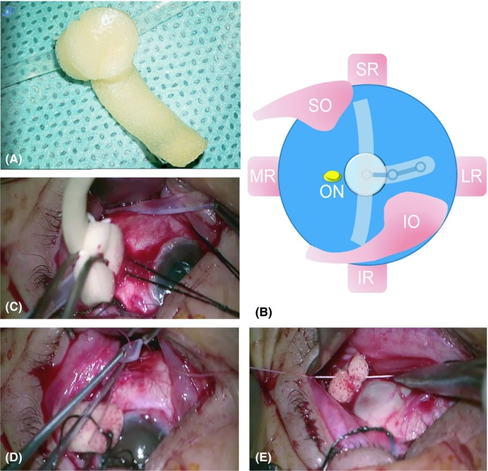
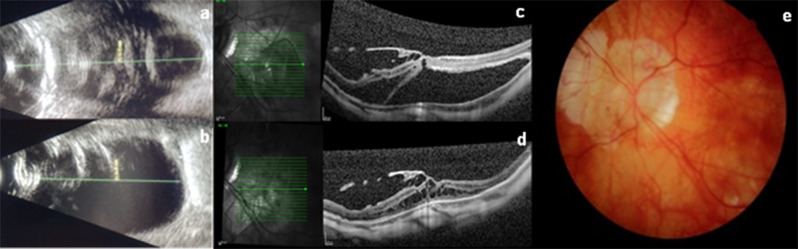
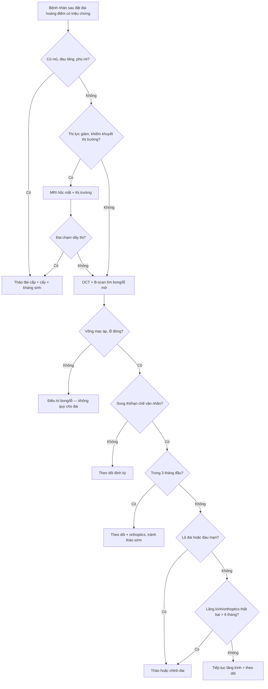
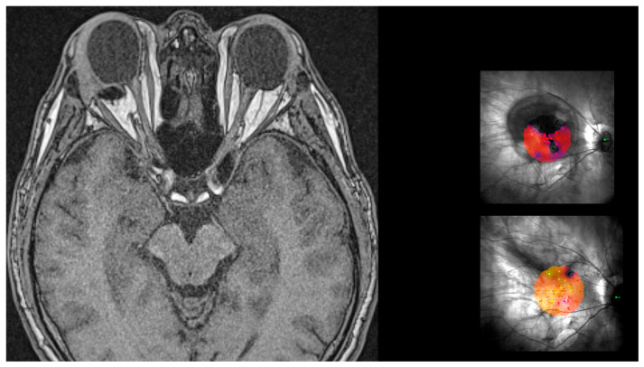
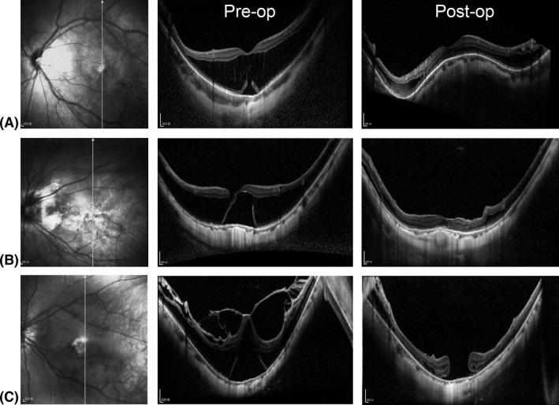

# 1493 — Biến chứng đai hoàng điểm (macular buckle): song thị, lộ đai, chèn ép thị thần kinh — và khi nào phải tháo

**Tags:** `pattern:nhin-doi` `pattern:han-che-van-nhan` `pattern:lo-vat-lieu` `pattern:lom-hac-mac` `pattern:bong-vong-mac` `vung:mat` `vung:hoang-diem` `vung:hoc-mat` `protocol:MRI` `protocol:CT` `protocol:B-scan` `protocol:OCT` `protocol:macular-buckle`

**Mức chắc chắn (certainty):** tổng hợp y văn (literature synthesis). Số liệu biến chứng lấy từ **các loạt đai hoàng điểm (MB) có ảnh/số cụ thể** (RCT 40 mắt, **PMC7216842**, CC BY 4.0; loạt NPB **40 mắt**, *Eur J Ophthalmol* 2025, DOI 10.1177/11206721241310471; **42 bệnh nhân** đánh giá vận nhãn, *J Pediatr Ophthalmol Strabismus* 2026, DOI 10.3928/01913913-20260317-02; **155 mắt**, **PMC9129984**, CC BY 4.0; **50 mắt** đai chữ L, *Retina* 2015, DOI 10.1097/IAE.0000000000000613). Phần **"khi nào tháo"** là **tổng hợp có suy luận**: bằng chứng trực tiếp cho MB chỉ gồm **một ca tháo đai** (**PMC10583029**, DOI 10.1136/bcr-2023-254978) và các loạt nhỏ; nguyên tắc thời điểm mượn từ **hai loạt tháo đai củng mạc** (35/2.375 mắt, **PMC13326349**, CC BY 4.0; 50 mắt, *Ophthalmic Surg Lasers Imaging Retina* 2021, DOI 10.3928/23258160-20210302-04) — chỗ nào suy luận đều ghi rõ.

> **Câu chốt:** đai hoàng điểm chữa bong bằng **độn ép cơ học từ ngoài vào** (ab externo), nên **biến chứng của nó cũng là biến chứng cơ học**: dải đai luồn dưới **cơ chéo dưới – cơ chéo trên – cơ trực** và bản đai nằm sau cực → **hạn chế vận nhãn, lệch trục, song thị**, và muộn hơn là **lộ đai/nhiễm**. Trong loạt NPB **40 mắt**, **32,5%** phải **mổ chỉnh vị trí đai** vì lệch tâm (decentration), nhưng **0% phải tháo** (DOI 10.1177/11206721241310471); trong loạt **155 mắt**, **97,42%** áp võng mạc ngay lần mổ đầu, **100% ở 2 năm**, còn rối loạn vận nhãn/song thị **giảm dần và hết trong 2 năm** ở "gần như tất cả" (**PMC9129984**). Nghĩa là: **đa số song thị sau đai là tạm thời — tháo đai là quyết định đánh đổi, phải có ngưỡng**.

> **Phân vai với bài khác:** [1878](../1878-bong-vong-mac-lo-hoang-diem-can-thi-nang/lesson.md) trả lời **"đai hay cắt dịch kính"** và cách đặt đai; [1879](../1879-mang-dut-hoang-diem-sau-mo-bong-vong-mac/lesson.md) phủ **lỗ hoàng điểm mới sau mổ bong**; [445](../445-bong-vong-mac/lesson.md) phủ bong có lỗ ngoại vi; [429](../429-do-truc-nhan-cau-bang-mri-ct/lesson.md) phủ **đo trục nhãn cầu bằng MRI/CT** (nền tảng cho mục 4.1); [449](../449-chan-thuong-mat-dich-vat/lesson.md) phủ chấn thương/dị vật. Bài này chỉ trả lời **một câu**: *sau đặt đai hoàng điểm, bệnh nhân nhìn đôi/lộ đai/chèn ép thị thần kinh — cơ chế nào, phân biệt với gì, và tháo đai lúc nào mà không làm mất võng mạc.*

## 1. Tổng quan bệnh học – cơ chế hình ảnh (TẠI SAO đai gây song thị, và TẠI SAO tháo đai lại nguy hiểm)

### 1.1 Đai hoàng điểm là gì — ba con số giải phẫu quyết định mọi biến chứng

Đai hoàng điểm (macular buckle, MB) là **vật liệu độn đặt ngoài củng mạc** tại cực sau, ép **lõm hắc mạc (posterior staphyloma)** phẳng lại để **hạ lực trước–sau** — lực mà cắt dịch kính **không** sửa được (bài [1878](../1878-bong-vong-mac-lo-hoang-diem-can-thi-nang/lesson.md)). Ba đặc điểm giải phẫu biến nó thành nguồn biến chứng:

1. **Đường đi của dải đai (band):** dải luồn **dưới cơ trực ngoài (lateral rectus)**, rồi vòng qua **cơ chéo dưới (inferior oblique)**, **cơ trực dưới**, **cơ trực trên** và **cơ chéo trên** để ra phía mũi (sơ đồ **PMC7216842 Fig 2B**; kỹ thuật tương tự trong **PMC8917523**). Mỗi cơ bị dải đai **nâng lên khỏi nhãn cầu** một khoảng cố định → **đổi vector kéo** của cơ đó.
2. **Bản đai (plate/wedge) nằm sau cực**, sát **hoàng điểm**, đẩy nhãn cầu **vào trong** → **giảm thể tích hốc mắt sau** và **rút ngắn trục nhãn cầu (AL)**. AL giảm **1,21 mm** (50 mắt, đai chữ L, *Retina* 2015), **2,3 mm** (28,5 → 26,2 mm, đai chữ T, **PMC8917523**), **1,5 mm** (31,5 → 30,0 mm, NPB, DOI 10.1177/11206721241310471).
3. **Vật liệu nằm dưới kết mạc – Tenon**, chỉ được che bởi **kết mạc mỏng** ở vùng rìa phía trên–thái dương → **lộ đai (exposure)** là biến chứng muộn đặc trưng (5–15%).

*Đai chữ T: (A) silicone sponge + tấm titanium + dải silicon vòng; (B) **sơ đồ nhìn từ sau**: ba nhánh đai nằm **dưới các cơ trực** (SR, IR, LR, MR), **dưới cơ chéo trên (SO) và chéo dưới (IO)**, đầu đai hướng về **hoàng điểm**, cách **thị thần kinh (ON)**; (C–E) thì đặt đai vào khoang dưới Tenon. Nguồn: *Acta Ophthalmol* 2020 (**PMC7216842**), CC BY 4.0.*

> **Tại sao điều này quan trọng:** bất kỳ triệu chứng **nhìn đôi** nào sau MB cũng phải được đọc theo **đường đi của dải đai**, không phải theo "tổn thương thần kinh". Cơ bị vướng → **hạn chế cơ học (restriction)**; cơ bị cắt/khâu lệch → **lệch trục thật (strabismus)**; đầu đai quá dài ra sau → **chạm thị thần kinh**.

### 1.2 Năm cơ chế — mỗi cơ chế có một kiểu hình ảnh và một cách xử lý khác nhau

| Cơ chế | Vì sao xảy ra (vật lý/mô học) | Kiểu lâm sàng | Chìa khóa xác nhận |
|---|---|---|---|
| **1. Vướng cơ học do dải đai** (restriction) | Dải đai nâng cơ khỏi nhãn cầu + xơ hóa quanh đai trong hốc mắt → **chiều dài hiệu dụng của cơ giảm** | **Hạn chế nâng mắt (elevation deficit)**, **lác dưới (hypotropia)**, song thị khi nhìn lên/ngang; thường **không đau** | **Forced duction dương tính**; cover test; không có dấu thần kinh khu trú |
| **2. Lệch trục do cắt/khâu cơ** | Cắt cơ trực ngoài/chéo trên để đặt đai (**PMC6256907**) hoặc khâu cơ lệch vị trí | **Lác ngang (esotropia)**, song thị ngay sau mổ, đầu lệch tư thế | Tiền sử mổ; đo độ lác trước–sau; **không hạn chế** khi kéo thụ động |
| **3. Phù/nề mô mềm cấp** | Chấn thương cơ học + phù quanh đai trong **2–8 tuần**; độn đai **cao** lúc đầu rồi **giảm dần** | Song thị nhẹ, **hạn chế vận nhãn thoáng qua**, cải thiện theo tuần | Theo dõi **3–6 tháng**; hình ảnh không có lộ đai/nhiễm |
| **4. Lộ đai – nhiễm** | Kết mạc mỏng trên nhánh thái dương; đầu đai **quá dài** (DLN < 11 mm) hoặc cọ xát | **Lộ trắng vật liệu**, chảy nước mắt, đỏ; nhiễm → **mủ, đau, tiết dịch** | Đèn khe + **cấy dịch**; phân biệt **lộ không nhiễm** vs **nhiễm** |
| **5. Chèn ép thị thần kinh** (hiếm) | Đầu đai quá dài/ra sau, **cọ vào dây thị** hoặc vòng xơ quanh dây | **Giảm thị lực, khiếm khuyết thị trường**, đĩa thị phù/nhợt; **không** song thị đơn thuần | **MRI hốc mắt** thấy đai **chạm/chèn dây thị**; OCT RNFL; thị trường |

### 1.3 Số liệu biến chứng theo từng loạt — bảng để nhớ, không để đoán

| Loạt (nguồn) | n | Song thị | Rối loạn vận nhãn | Lộ đai | Nhiễm | Tháo đai | Ghi chú |
|---|---|---|---|---|---|---|---|
| **RCT đai vs cắt dịch kính** (**PMC7216842**) | 40 đai / 38 PPV | **5%** (2/40) | **Lác trong 2,5%** (1/40) | **2,5%** (1/40) | 0 | **1 mắt** (lộ tái diễn) | Tăng IOP thoáng qua **37,5%**; đục thủy tinh thể **7,5% vs 28,9%** |
| **NPB** (DOI 10.1177/11206721241310471) | 40 | **7,5%** (3) | **Hạn chế nâng 5%** (2) | **7,5%** muộn (tháng 6) | 0 | **0%** | **32,5%** mổ **chỉnh vị trí** vì lệch tâm |
| **Đánh giá vận nhãn NPB** (DOI 10.3928/01913913-20260317-02) | 30 (42 − 12 loại trừ) | **30%** (9) | **Hạn chế nâng 43%**, **lác dưới 33%** | 0 | 0 | **0%** | 7/9 đeo **lăng kính**; 2 từ chối điều trị |
| **Loạt 155 mắt** (**PMC9129984**) | 155 | "Gần như tất cả" | "Gần như tất cả" | — | **0** | 0 (2 **chỉnh đai**) | Áp **97,42%** lần đầu, **100%** ở 2 năm; hết trong **2 năm** |
| **Đai chữ L** (*Retina* 2015) | 50 | **7,7%** | — | **15%** (conjunctival erosion) | — | — | **30%** (6/20) phải **rút ngắn** đai vì lộ nhánh (mẫu đai đầu) |
| **Đai chữ T** (**PMC8917523**) | 25 | — | — | — | 0 | 0 | Xuất huyết dưới võng mạc **3**; bong hắc mạc xuất huyết **2**; **1** cơn glaucoma góc đóng hai mắt |

### 1.4 TẠI SAO đa số song thị lại **hết** — và vì sao điều đó đổi hoàn toàn cách xử trí

Ba lý do vật lý khiến triệu chứng giảm dần:

- **Độ cao của độn giảm theo thời gian.** Đai silicon/titanium **không "xẹp"**, nhưng **phù quanh đai giảm** và **mô xơ co lại** → lực căng lên cơ giảm; loạt **155 mắt** ghi rõ "triệu chứng giảm dần và hết trong 2 năm" khi **độ cao độn giảm** (**PMC9129984**).
- **Hiện tượng dung nạp trung ương (sensory adaptation).** Ở người còn thị lực hai mắt, não **ức chế** ảnh lệch; song thị chỉ tồn tại khi **chênh lệch đủ lớn** hoặc **không còn khả năng ức chế**.
- **Trương lực cơ thích nghi:** cơ bị nâng lên vẫn co được; nếu **không có xơ hóa cố định**, độ lệch giảm.

Ngược lại, ba lý do khiến **một số ít không hết**: (a) **xơ hóa dày quanh đai** (đặc biệt nếu đai **quá cao/quá dài**); (b) **tổn thương cơ trực tiếp** khi cắt/khâu; (c) **lệch tâm đai** làm đai không nằm dưới hoàng điểm — vừa **mất tác dụng điều trị**, vừa **tạo lực lệch**.

> **Hệ quả thực hành:** không tháo đai vì song thị trong **3 tháng đầu** nếu **võng mạc đang áp và không có lộ/nhiễm** — vì khả năng tự hồi phục cao và vì **tháo đai = bỏ tác dụng cơ học** (xem 1.5).

### 1.5 TẠI SAO tháo đai là quyết định **đánh đổi**: bài học từ đai củng mạc

Đai hoàng điểm **không có** dữ liệu lớn về tháo; nhưng nguyên lý thì giống đai củng mạc (scleral buckle):

- Loạt **2.375 mắt** đặt đai củng mạc: **1,5%** (35 mắt) phải tháo; **nhiễm 34%**, **đau 31%**, **lộ không nhiễm 14%**, **lác/song thị 8,6%**; **thời gian trung vị tới tháo: 2,4 tháng** (nhiễm) so với **12,6 tháng** (không nhiễm) (p = 0,006) (**PMC13326349**).
- **Tái bong võng mạc sau tháo: 11%** (4/35), trong đó **3/4 ca tái bong xảy ra khi tháo trong tháng đầu**; **tất cả tái bong trong 3 tháng**; thị lực vẫn cải thiện (**0,70 → 0,30 logMAR**).
- Loạt **50 mắt** tháo đai: lộ đai **54%**, nhiễm **26%**, song thị **16%**, tái bong **4%**; biến chứng sau tháo: **tái bong 12%**, tăng IOP thoáng qua **6%**, **song thị dai dẳng 4%**; thời gian trung vị **30 tháng**; thị lực **không đổi** (*Ophthalmic Surg Lasers Imaging Retina* 2021).

→ **Ba bài học chuyển sang MB:** (1) **tháo sớm (< 1 tháng) nguy hiểm nhất** vì chưa có dính hắc–võng mạc vững; (2) **nhiễm là chỉ định tháo sớm**, không chờ; (3) **tháo đai không làm thị lực xấu đi** ở phần lớn mắt — nhưng **có thể tái bong**, nên phải chuẩn bị phương án.

## 2. Mẫu hình + chẩn đoán phân biệt theo thời điểm và theo triệu chứng (gamut)

### 2.1 Mẫu hình chốt — "song thị + hạn chế nâng mắt sau đai, đáy mắt ổn định"

Bộ ba gợi ý **biến chứng cơ học của đai** (không phải bệnh mới):

1. **Tiền sử đặt đai hoàng điểm** trong **6 tháng–nhiều năm** (thường mắt cận thị nặng, AL > 26,5 mm);
2. **Song thị ở tư thế nhìn lên/ngang** ± **lác dưới**; đo **hạn chế nâng mắt** rõ hơn hạn chế hạ;
3. **Đáy mắt/OCT: võng mạc áp, hõm được độn** — nếu **võng mạc bong lại** thì triệu chứng do **bong**, không phải do đai.

### 2.2 Gamut theo **thời điểm** — cùng một triệu chứng, cơ chế khác nhau

| Thời điểm | Nguyên nhân hay gặp | Vì sao | Hướng xử lý |
|---|---|---|---|
| **≤ 1 tháng** | Phù/nề mô mềm, đau, **tăng IOP**, phản ứng với vật liệu | Chấn thương mổ + độn cao | **Theo dõi + giảm đau/hạ IOP**; không tháo nếu không nhiễm/lộ |
| **1–6 tháng** | **Xơ hóa quanh đai**, cắt cơ, **lệch tâm đai** | Mô xơ co → **tethering**; đai trượt khỏi hoàng điểm | **Chỉnh vị trí đai** nếu lệch; lăng kính/orthoptics |
| **> 6 tháng** | **Lộ đai**, **nhiễm mạn**, **chèn ép thị thần kinh**, **song thị cố định** | Kết mạc mỏng dần; xơ dày; đầu đai cọ dây thị | **Tháo/ chỉnh đai** theo ngưỡng mục 4.3 |

### 2.3 Gamut theo **triệu chứng chính** — bốn cửa vào, bốn nhóm bệnh

**A. Nhìn đôi (diplopia) sau đai:**

- **Vướng cơ học do đai** (hay nhất — 5–30% tuỳ loạt, và **43% hạn chế nâng** trong loạt đánh giá vận nhãn);
- **Lác do cắt/khâu cơ** (esotropia **2,5%**);
- **Liệt dây IV sẵn có bị mất bù** (bệnh nhân cận thị nặng lớn tuổi có thể đã có **lác trong–lác dọc nhẹ** từ trước — **29%** bị loại khỏi nghiên cứu vận nhãn vì **đã có rối loạn vận nhãn trước mổ**, DOI 10.3928/01913913-20260317-02);
- **Song thị do lệch khúc xạ/aniseikonia** sau khi AL giảm **1,2–2,3 mm** (hiếm, nhưng phải đo khúc xạ hai mắt);
- **Song thị trung ương do tổn thương hoàng điểm** (nhìn đôi một mắt — "diplopia monocularis") — **không phải** song thị hai mắt, đừng tháo đai.

**B. Nhìn mờ/giảm thị lực sau đai:**

- **Bong võng mạc tái phát** hoặc **lỗ hoàng điểm mở lại** (phải loại trừ **trước** khi quy mọi thứ cho đai);
- **Chèn ép thị thần kinh** (hiếm; khiếm khuyết thị trường, đĩa phù);
- **Đục thủy tinh thể** (7,5% trong RCT; nhiều hơn nếu kèm cắt dịch kính);
- **Bệnh võng mạc cận thị tiến triển/CNV** (không liên quan đai).

**C. Đỏ – chảy nước mắt – lộ vật liệu:**

- **Lộ đai không nhiễm** (conjunctival erosion — **15%** loạt đai chữ L);
- **Nhiễm đai/áp-xe hốc mắt** (mủ, đau nhiều, phù mi);
- **Dị ứng vật liệu** (hiếm);
- **Viêm kết mạc – khô mắt** (không liên quan trực tiếp).

**D. Đau sâu/hốc mắt:**

- **Đau do độn ép** (thường giảm dần);
- **Nhiễm**;
- **Chèn ép thần kinh**;
- **Tăng IOP** (37,5% tăng thoáng qua trong RCT).

### 2.4 Phân biệt "vướng cơ học" với "liệt thần kinh" — ba nghiệm pháp tại giường

| Nghiệm pháp | Vướng cơ học do đai | Liệt dây IV | Liệt dây VI |
|---|---|---|---|
| **Forced duction** (kéo thụ động) | **Dương tính** (cơ căng, không cho mắt lên) | Âm tính | Âm tính |
| **Cover test** | Lác dưới/ngang **ổn định**, không tăng khi nhìn về phía cơ liệt | **Hypertropia** tăng khi **nghiêng đầu về bên tổn thương**, giảm khi nghiêng bên đối diện | **Esotropia** tăng khi nhìn sang bên liệt |
| **Bielschowsky** | Không điển hình | **Dương tính** | Không áp dụng |
| **Đáp ứng lăng kính** | Có thể giảm khi đeo lăng kính | Cần lăng kính lớn | Cần lăng kính lớn |

> **Cạm bẫy:** bệnh nhân **cận thị nặng một mắt** có thể **không có song thị** dù lác rõ — vì **mất thị lực một mắt** từ trước. Luôn hỏi "nhìn đôi khi **che một mắt** hay **hai mắt**?" (monocular vs binocular).

## 3. Bảng so sánh phân biệt (ma trận đối chiếu)

| Thực thể | Hình ảnh/lâm sàng điển hình | Chốt vào (rule-in) | Chốt loại (rule-out) | Gợi ý xác nhận |
|---|---|---|---|---|
| **Vướng cơ học do đai** (bài này) | Song thị khi nhìn lên/ngang, **hạn chế nâng 43%**, lác dưới 33%; **OCT: võng mạc áp**, hõm độn | **Tiền sử MB + forced duction dương + đáy mắt ổn định** | **Võng mạc bong/lỗ mở** → nguyên nhân là bệnh, không phải đai | Cover test + forced duction; OCT |
| **Lác do cắt/khâu cơ** | **Esotropia 2,5%**, song thị ngay sau mổ, không hạn chế thụ động | **Lác xuất hiện ngay sau mổ + không restriction** | Hạn chế thụ động rõ → do đai/xơ | So góc lác trước–sau; ghi nhận cơ đã cắt |
| **Liệt dây IV sẵn có** | Hypertropia, **nghiêng đầu**, Bielschowsky (+) | **Bielschowsky dương + tiền sử** | Forced duction dương + không đáp ứng nghiêng đầu | Nghiệm pháp nghiêng đầu; MRI nếu cần |
| **Lộ đai không nhiễm** | **Đốm trắng vật liệu** dưới kết mạc, không mủ, không đau nhiều | **Thấy vật liệu + cấy âm** | **Mủ/đau/phù mi** → nhiễm | Đèn khe; **cấy trước khi dùng kháng sinh** |
| **Nhiễm đai/áp-xe hốc mắt** | Đau tăng, mủ, phù mi, có thể **lồi mắt/hạn chế vận nhãn nặng** | **Mủ + cấy (+) + hình ảnh tụ dịch quanh đai** | Chỉ đỏ kết mạc, không mủ → lộ đơn thuần | **CT/MRI hốc mắt**; cấy; kháng sinh |
| **Chèn ép thị thần kinh** | Giảm thị lực, **khiếm khuyết thị trường**, đĩa phù/nhợt; **MRI thấy đai chạm dây thị** | **MRI: đai tiếp xúc/chèn dây thị + thị trường tương ứng** | MRI: đai **cách dây thị** (như ca 11 năm, **PMC11270332 Fig 11**) | MRI T1 hốc mắt; OCT RNFL; thị trường |
| **Tái bong võng mạc** | Bong lại, **OCT: mất áp**, có thể lỗ mở | **OCT/B-scan: bong + lỗ** | Võng mạc áp, hõm độn tốt | **B-scan + OCT** trước mọi quyết định tháo |
| **Song thị một mắt (monocular)** | Nhìn đôi **khi che một mắt**, do hoàng điểm/bệnh võng mạc | **Che một mắt vẫn đôi** | Hai mắt đôi, che một mắt hết → cơ học/lác | Hỏi bệnh + Amsler; OCT hoàng điểm |
| **Lệch khúc xạ/aniseikonia** | Nhìn mờ/nhức, **không lác**, AL giảm sau đai | **Đo khúc xạ hai mắt chênh > 2 D** | Lác thật/restriction | Khúc xạ + sinh trắc |

*(a) B-scan trước mổ: **lõm hắc mạc lớn + bong hoàng điểm** (mũi tên); (b) sau mổ: **lõm phẳng lại** do đai; (c) OCT trước: lỗ tầng trong + bong + schisis; (d) sau: phẳng lõm, hết lỗ tầng/bong; (e) fundus: võng mạc áp. Đây là **bằng chứng cơ học** rằng đai đang tác động đúng chỗ — cũng là thứ **mất đi nếu tháo đai**. Nguồn: *Int J Retina Vitreous* 2024 (**PMC11350928**), CC BY 4.0.*

## 4. Protocol chụp + ngưỡng và quy trình tháo đai

### 4.1 Protocol hình ảnh và đánh giá chức năng

**Trước mổ (baseline bắt buộc — vì 29% đã có rối loạn vận nhãn từ trước):**

1. **Đo thị lực từng mắt + khúc xạ**; ghi rõ **song thị hai mắt hay một mắt**.
2. **Đánh giá vận nhãn – lác:** cover/uncover, alternate cover, **9 hướng nhìn**, đo độ lác bằng lăng kính, **Worth 4 chấm**, **stereopsis** (Titmus/TNO).
3. **OCT hoàng điểm EDI/SS-OCT** (raster 6 × 6 mm hoặc 12 mm): lỗ, SRF, schisis, màng trước võng mạc; **độ cao độn** sau mổ.
4. **B-scan 10 MHz:** độ sâu lõm hắc mạc, **vị trí đầu đai so với hoàng điểm**, áp võng mạc khi OCT bị chặn.
5. **Sinh trắc AL** (IOLMaster/Lenstar): **AL > 26,5 mm**; đai làm AL giảm **1,2–2,3 mm** → **đừng dùng AL trước mổ để tính IOL sau mổ** (bài [1490](../1490-sinh-trac-iol-mat-bom-khi/lesson.md) cho nguyên lý tương tự với khí).
6. **MRI hốc mắt T1 (± fat-sat), không cần gadolinium:** thấy **profile đầu đai**, **khoảng cách tới dây thị**, hình dạng nhãn cầu; dùng được với **silicon/titanium** (loạt NPB theo dõi **11 năm** bằng MRI — **PMC11270332 Fig 11**). **CT** chỉ khi **chống chỉ định MRI** hoặc cần xương: đai **tăng đậm độ**, **artifact beam-hardening** che mô xung quanh.
7. **Đo DLN (distance from limbus to needle)** theo nomogram AL: giữ **DLN ≥ 11 mm** để tránh **lộ nhánh thai dương** (khuyến cáo của loạt NPB).

**Sau mổ:**

| Mốc | Việc phải làm |
|---|---|
| **Ngày 1** | Thị lực, IOP (tăng tới 37,5%), đèn khe tìm **lộ đai sớm**, OCT/B-scan nếu nghi bong |
| **Tuần 1–2** | Đo lại vận nhãn; **hướng dẫn tập nhìn 9 hướng** để giảm xơ hóa quanh đai (khuyến cáo NPB) |
| **Tháng 1** | Cover test + OCT; phân loại **song thị sớm** (thường tự hồi phục) |
| **Tháng 3–6** | Đánh giá **song thị tồn tại**; B-scan/MRI nếu nghi lệch đai/chèn thị thần kinh |
| **Hằng năm** | OCT, B-scan, AL, MRI nếu có triệu chứng thần kinh thị; theo dõi **lộ đai muộn** |

### 4.2 Ba ngưỡng định lượng cần nhớ

| Đại lượng | Ngưỡng | Ý nghĩa |
|---|---|---|
| **AL** | **> 26,5 mm** (hoặc SE < −8 D) | Định nghĩa cận thị nặng; tiêu chuẩn vào RCT đai (**PMC7216842**; xem thêm bài 1878) |
| **AL giảm sau đai** | **1,2–2,3 mm** | Tương đương **~+3 đến +6 D** (quy đổi gần đúng **1 mm ≈ 2,5–3 D**) → **hyperopic shift**, ảnh hưởng tính IOL |
| **DLN** | **≥ 11 mm** | Dưới ngưỡng → nguy cơ **lộ nhánh đai** (khuyến cáo NPB) |
| **Độ cao độn** | Đủ để **phẳng lõm hắc mạc** trên B-scan/OCT | Không đo bằng mm tuyệt đối; đánh giá **hình dạng** (phẳng, không gồ) |
| **Song thị tồn tại** | **> 6 tháng** dù đã lăng kính/orthoptics | Ngưỡng **cân nhắc can thiệp** (suy luận từ diễn tiến tự nhiên 2 năm — **PMC9129984**) |

> **Lưu ý trung thực:** con số **1 mm ≈ 2,5–3 D** là **quy đổi gần đúng** dùng trong sinh trắc, không phải số đo từ loạt MB; các loạt MB chỉ báo **AL giảm**, không báo khúc xạ. Ghi rõ để không "bịa" ngưỡng.

### 4.3 Khi nào **tháo** — bảng quyết định (có mức chắc chắn)

| Chỉ định | Mức ưu tiên | Thời điểm | Căn cứ |
|---|---|---|---|
| **Nhiễm đai/áp-xe hốc mắt** (mủ, đau, phù mi, cấy +) | **Cấp** | **Tháo ngay** + cấy + kháng sinh | Nhiễm đai là chỉ định tháo sớm; trung vị **2,4 tháng** ở loạt đai củng mạc (**PMC13326349**) |
| **Lộ đai có nguy cơ thủng/nhiễm**, đau nhiều | **Cấp/ sớm** | Tháo hoặc **chỉnh/thay đai** | Lộ đai **54%** chỉ định tháo trong loạt 50 mắt (*OSLIR* 2021) |
| **Chèn ép thị thần kinh** (thị trường + MRI) | **Sớm** | Tháo/ rút ngắn đai | MRI thấy đai chạm dây thị; ca 11 năm **không chạm** là hình mẫu bình thường (**PMC11270332**) |
| **Song thị dai dẳng > 6 tháng**, thất bại lăng kính/orthoptics | **Bán cấp** | Cân nhắc **tháo** hoặc **mổ cơ** | 7/9 ca dùng lăng kính, **không ca nào tháo** (DOI 10.3928/01913913-20260317-02) → tháo chỉ khi thất bại |
| **Đau mạn không kiểm soát** | **Bán cấp** | Tháo | Đau **31%** chỉ định tháo ở loạt đai củng mạc (**PMC13326349**) |
| **Lệch tâm đai + không đạt mục tiêu** | **Bán cấp** | **Chỉnh vị trí trước**, tháo nếu không chỉnh được | **32,5%** phải chỉnh vị trí; **0%** tháo (DOI 10.1177/11206721241310471) |
| **Tái bong/lỗ mở do đai không còn tác dụng** | **Sớm** | **Tháo + cắt dịch kính/đặt lại** | Không có lợi giữ đai nếu đã mất tác dụng |

**Nguyên tắc thời điểm (quan trọng nhất):**

- **Không nhiễm:** nếu có thể, **chờ ≥ 3 tháng** sau đặt đai — vì **3/4 ca tái bong sau tháo xảy ra khi tháo trong tháng đầu**, và **mọi tái bong trong 3 tháng** (**PMC13326349**). Trong thực tế các loạt tháo đai có **trung vị 12,6–30 tháng**.
- **Nhiễm:** **không chờ** — tháo sớm + cấy + kháng sinh; nguy cơ nhiễm lan toả (viêm mô hốc mắt, viêm nội nhãn) lớn hơn nguy cơ tái bong.
- **Ca MB duy nhất được báo tháo đai:** nam 70 tuổi, MHRD, đặt đai thành công; **tuần 10** xuất hiện **song thị + lộ đai** → **tháo đai**; **6 tháng sau: võng mạc áp, lỗ đóng, thị lực 20/250** (**PMC10583029**). Đây là bằng chứng **tháo đai ở MB có thể giữ được võng mạc**, nhưng **n = 1**.

## 5. Biến thể bình thường và cạm bẫy

### 5.1 Biến thể bình thường dễ nhầm

- **Hõm độn (indentation dome) trên OCT** sau đai: **vồi lồi hắc mạc–võng mạc** đúng vị trí đai, **không phải u hắc mạch/hemangioma**. Dấu phân biệt: **bờ đối xứng theo hình đai**, **không có mạch nuôi**, **không lớn dần**, và **có tiền sử đặt đai**. Nếu nghi ngờ: **MRI thấy vật liệu đai**.
- **Dày hắc mạc khu trú** do độn: giảm dần theo thời gian; **không ngấm thuốc bất thường** trên MRI.
- **Lác nhẹ/ hạn chế vận nhãn nhẹ** trong **3 tháng đầu**: gặp ở **gần như tất cả** mắt trong loạt 155 mắt (**PMC9129984**) — **không phải biến chứng cố định**.

### 5.2 Cạm bẫy (pitfall)

1. **Quy mọi giảm thị lực cho "đai"** mà không chụp OCT/B-scan → bỏ sót **tái bong/lỗ mở**. **Luôn chụp trước khi quyết định tháo.**
2. **Song thị một mắt** (monocular diplopia) do bệnh hoàng điểm — **không phải** chỉ định tháo đai; hỏi "che một mắt còn đôi không?".
3. **Nhầm hạn chế nâng do đai với liệt dây IV**: Bielschowsky và **forced duction** phân biệt; bệnh nhân **29%** đã có rối loạn vận nhãn **trước** mổ nên **không có baseline** là bẫy lớn.
4. **Tháo đai quá sớm vì song thị**: nguy cơ **tái bong** cao nhất **< 1 tháng**; đa số song thị tự hồi phục trong **2 năm**.
5. **Bỏ qua lộ đai "nhỏ"**: kết mạc mỏng trên nhánh thái dương có thể **thủng dần**; chụp/đo **DLN**, xem xét **rút ngắn/chỉnh đai** trước khi nhiễm.
6. **Cấy muộn sau khi đã dùng kháng sinh** → cấy âm giả; **cấy trước** khi bắt đầu kháng sinh.
7. **Tính IOL bằng AL trước mổ** ở mắt đã đặt đai: AL đã giảm **1,2–2,3 mm** → **hyperopic surprise**; cân nhắc **phaco sau khi đai ổn định** (khuyến cáo trong **PMC6256907**).
8. **MRI ở mắt có đai kim loại cũ** (Ando wire): artifact lớn; **titanium/silicon** dùng MRI được nhưng vẫn có artifact → đọc cùng **B-scan/CT**.

## 6. Tự lượng giá — Blind Quiz

**Ca 1 — Nam 70 tuổi, mắt phải cận thị nặng đã đặt đai hoàng điểm 11 năm, thị lực tốt. MRI hốc mắt được chỉ định vì lý do khác.**

- Câu hỏi: (1) Cấu trúc nằm sau nhãn cầu phải là gì? (2) Nó có chạm thị thần kinh không? (3) Hai bản đồ vi đa giác (microperimetry) cho biết gì?

<b>Bấm để hiện đáp án (findings + chẩn đoán)</b>

- **Findings:** trên T1 axial, **đầu đai hoàng điểm** nằm sát thành sau–thái dương nhãn cầu phải, **không chạm dây thị giác**; nhãn cầu giữ hình cầu, không có khối trong nón cơ.
- **Chẩn đoán:** **đai hoàng điểm đúng vị trí, không chèn thị thần kinh** — đây là **hình mẫu bình thường** để so sánh khi nghi chèn ép.
- **Microperimetry:** trên = **ám điểm lớn trước mổ**; dưới = **hết ám điểm sau mổ** → chức năng hoàng điểm hồi phục, phù hợp với mục tiêu của đai.
- **Nguồn ảnh:** *Vision* 2024 (**PMC11270332**), Fig. 11, CC BY 4.0.

**Ca 2 — Nữ 52 tuổi, myopic traction maculopathy, đặt đai đơn thuần. Siêu âm B-scan trước và sau mổ, OCT tương ứng.**

- Câu hỏi: (1) B-scan trước mổ cho thấy gì? (2) Sau mổ thay đổi ra sao? (3) Vì sao đây là "bằng chứng cơ học" của đai?

<b>Bấm để hiện đáp án</b>

- **Findings:** (a) **lõm hắc mạc lớn + bong hoàng điểm** (mũi tên); (b) sau mổ **lõm phẳng lại**, võng mạc áp; (c) OCT trước: **lỗ tầng trong + bong + schisis mũi**; (d) sau: **phẳng lõm, hết lỗ tầng và bong**, schisis giảm; (e) fundus: võng mạc áp.
- **Chẩn đoán:** **đai hoàng điểm tác động đúng** — độn ngoài củng mạc làm phẳng lõm hắc mạc, hạ lực trước–sau; đây là thứ **mất đi nếu tháo đai**.
- **Nguồn ảnh:** *Int J Retina Vitreous* 2024 (**PMC11350928**), Fig. 3, CC BY 4.0.

**Ca 3 — Bệnh nhân sau đặt đai hoàng điểm 4 tháng: nhìn đôi khi nhìn lên và sang phải, không đau, không mủ, OCT võng mạc áp, lỗ đóng. Ảnh OCT 12 tháng của một mắt đặt đai điển hình:**

- Câu hỏi: (1) Hình OCT sau mổ mô tả gì? (2) Cơ chế song thị khả dĩ nhất? (3) Có nên tháo đai ngay không?

<b>Bấm để hiện đáp án</b>

- **Findings:** (A) cột trái = ảnh hồng ngoại; giữa = OCT trước mổ (**schisis/bong**); phải = sau 12 tháng: **võng mạc áp, hõm được độn lồi lên**, không còn khoang dịch.
- **Cơ chế:** **vướng cơ học do dải đai** (hạn chế nâng/lác dưới) — phù hợp với **43% hạn chế nâng** và **33% lác dưới** trong loạt đánh giá vận nhãn; **không** phải nhiễm (không mủ/đau) và **không** phải chèn thị thần kinh (thị lực không giảm, không khiếm khuyết thị trường).
- **Xử trí:** **không tháo ngay** — trong **3–6 tháng đầu**, đa số giảm dần; cho **lăng kính/orthoptics**, theo dõi **6 tháng**. Chỉ cân nhắc tháo/chỉnh đai nếu **song thị dai dẳng > 6 tháng** hoặc có **lộ đai/đau/chèn ép**. Tháo sớm < 1 tháng làm tăng **tái bong** (3/4 ca tái bong xảy ra khi tháo trong tháng đầu — **PMC13326349**).
- **Nguồn ảnh:** *Acta Ophthalmol* 2020 (**PMC7216842**), Fig. 3, CC BY 4.0.

## Bài liên quan chéo

- [1878 – Bong võng mạc do lỗ hoàng điểm ở mắt cận thị nặng (MHRD): chọn đai hay cắt dịch kính](../1878-bong-vong-mac-lo-hoang-diem-can-thi-nang/lesson.md)
- [1879 – Lỗ hoàng điểm mới sau mổ bong võng mạc](../1879-mang-dut-hoang-diem-sau-mo-bong-vong-mac/lesson.md)
- [445 – Bong võng mạc có lỗ ngoại vi](../445-bong-vong-mac/lesson.md)
- [429 – Đo trục nhãn cầu bằng MRI/CT](../429-do-truc-nhan-cau-bang-mri-ct/lesson.md)
- [1490 – Sinh trắc & công suất IOL ở mắt bơm khí](../1490-sinh-trac-iol-mat-bom-khi/lesson.md)
- [400 – Tổng quan Mắt & thị giác](../400-tong-quan-mat-thi-giac/lesson.md)

## Ảnh

- 4 ảnh gốc, **không crop/ghép**, giấy phép từng file trong `images/CREDITS.md`.
- **Không tạo ảnh ghép** trong bài này: ba hình là **hình nhiều ô có nhãn nội bộ (a–e / A–E)** do tạp chí đặt; cắt/ghép sẽ làm mất nhãn và sai ngữ cảnh (MRI + microperimetry, B-scan + OCT + fundus, implant + sơ đồ + thì mổ).

> **Disclaimer y tế:** bài học dùng cho đào tạo và tra cứu; **không dùng để chẩn đoán độc lập** khi chưa có người hướng dẫn. Mọi ngưỡng tháo đai phải cá thể hoá theo tình trạng võng mạc, thị lực và nguyện vọng bệnh nhân.
