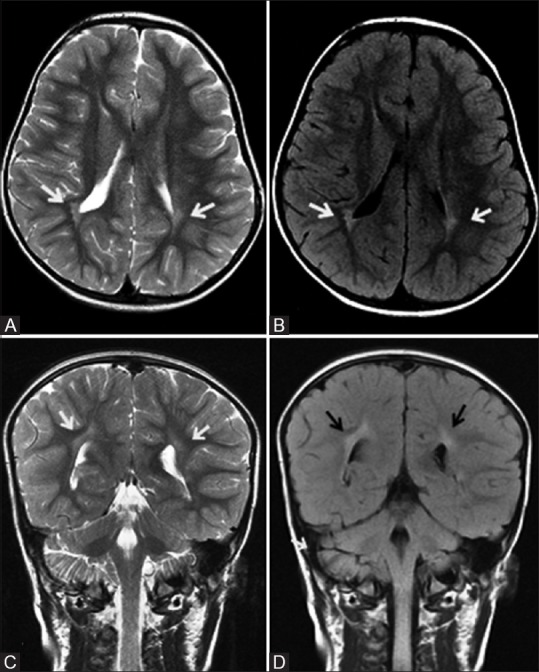
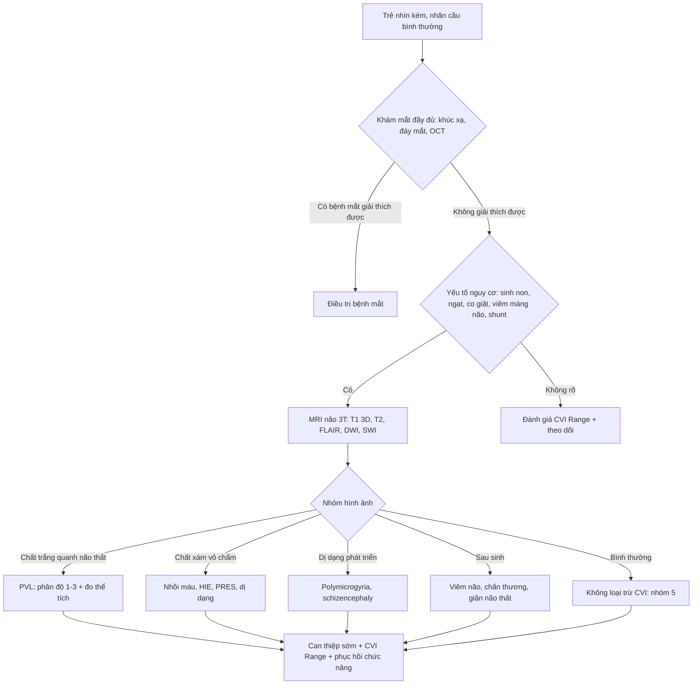
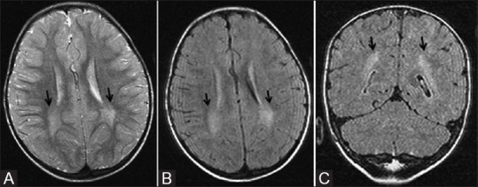
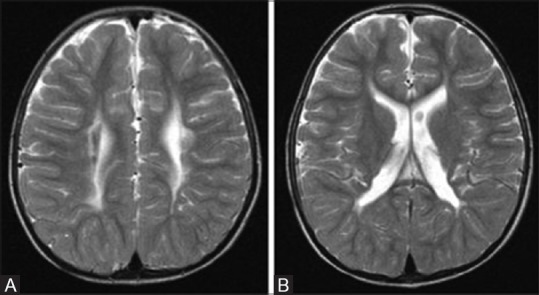
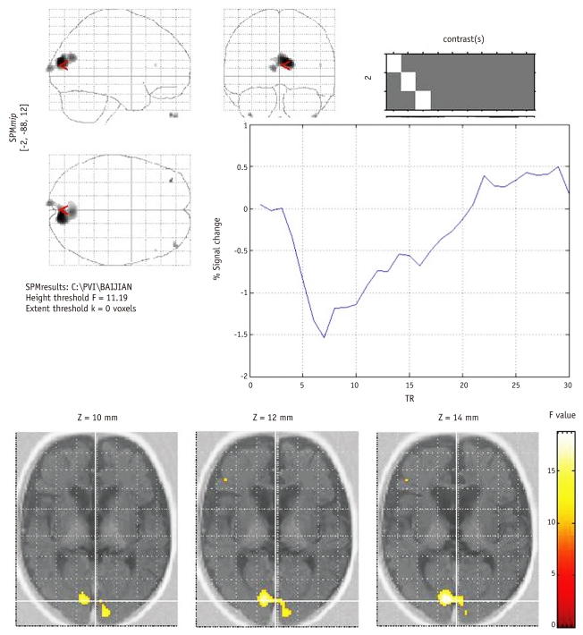

# 1494 — Mù vỏ não & suy giảm thị giác vỏ não ở trẻ / Cortical & cerebral visual impairment (CVI) in children

**Tags:** `pattern:giam-thi-luc-trung-uong` `pattern:ton-thuong-chat-trang-quanh-nao-that` `pattern:teo-vo-cham` `pattern:gian-nao-that` `pattern:giam-myelin` `vung:mat` `vung:vo-nao` `vung:chat-trang` `vung:duong-thi-giac` `anatomy:duong-thi-giac` `protocol:MRI-so-nao` `protocol:DTI` `protocol:fMRI-thi-giac` `score:CVI-Range` `score:PVL-grade` `incidentaloma:khong`

**Mức chắc chắn (certainty):** tổng hợp y văn (literature synthesis) — mọi con số lấy từ bài gốc open access có PMCID; mô tả ảnh bám **caption gốc**, không suy diễn thêm tuổi/giới ngoài caption.

## 1. Tổng quan bệnh học – cơ chế hình ảnh

- **Định nghĩa (CVI — cortical/cerebral visual impairment):** rối loạn phát triển thần kinh gây **thiếu hụt chức năng thị giác và “thị giác chức năng” (functional vision)** do tổn thương **đường thị và vùng xử lý thị giác trong não** (Indian J Ophthalmol 2026, **PMC13485087**). **“Cortical”** chỉ vỏ não; **“cerebral”** bao gồm cả dưới vỏ — trong thực hành dùng **CVI/cerebral** vì tổn thương hầu như không khu trú một tầng.
- **Vì sao nhãn cầu bình thường mà trẻ không nhìn:** tổn thương nằm **sau giao thoa (retrochiasmal)** — tia thị, thể gối ngoài, đồi thị, vỏ chẩm V1 và vỏ liên hợp. Vì vậy **đồng tử còn phản xạ ánh sáng** (đường phản xạ đi qua trung não trước, không qua vỏ) và **đáy mắt/OCT có thể bình thường**; đây chính là lý do **hình ảnh não là xét nghiệm quyết định định khu**.
- **Tần suất — CVI là nguyên nhân hàng đầu gây suy giảm thị giác ở trẻ tại các nước phát triển** (Ophthalmic Physiol Opt 2025, **PMC12682082**); ở Anh **khoảng một nửa** số trẻ đủ tiêu chuẩn khiếm thị là do CVI (Dev Med Child Neurol 2024, **PMC11875522**); tại Ấn Độ, CVI chiếm **33%** trẻ khiếm thị nặng đến khám tuyến cuối (Indian J Ophthalmol 2026, **PMC13485087**). Trong **bại não (cerebral palsy)**, **60–70%** trẻ có CVI (Neuroimage Clin 2020, **PMC7519396**).
- **Loạt 72 trẻ bại não + PVL** (tuổi thị lực trung bình **5,6 tuổi**, tuổi thai trung bình **32,4 tuần**): **21%** không rối loạn thị giác, **5%** chỉ có bệnh ngoại vi, **21%** thuần thị giác trung ương, **53%** phối hợp cả hai (**PMC7519396**). Các mục bị tổn hại nhiều nhất: **cố định (fixation) 71%**, **theo dõi (following) 77,7%**, **liếc nhanh (saccades) 80,5%**, **thị lực 65,3%**, **lập thể (stereopsis) 74%**.
- **Loạt 75 trẻ PVL có bằng chứng hình ảnh** (tuổi trung bình **2,3 tuổi**; **43% sinh non**): **46% suy giảm thị lực**, tăng theo độ nặng — **độ 3: 74%** so với **độ 2: 15%**; **lác 80%**; **tật khúc xạ 71%** (cận–loạn thị) (Indian J Ophthalmol 2022, **PMC9023957**).
- **Chẩn đoán thường muộn:** tuổi chẩn đoán trung bình **4,6 ± 4,7 tuổi**, trễ **1,0 ± 1,9 năm** kể từ lần khám mắt đầu; **CVI càng nhẹ càng dễ bị trễ** (194 trẻ, **PMC12682082**).
- **TẠI SAO tổn thương quanh não thất lại đánh vào thị giác:** tia thị (optic radiation) chạy sát sừng chẩm và sừng thái dương não thất bên — đúng **vùng phân thủy (watershed)** của não non tháng. Thiếu máu–tưới máu chọn lọc **tế bào tiền thân ít nhánh (oligodendrocyte precursor)** → hoại tử → tạo nang → xẹp nang → **mô sẹo thần kinh đệm (gliosis) + mất chất trắng quanh não thất** (Indian J Radiol Imaging 2016, **PMC5036328**).
- **TẠI SAO tín hiệu đổi theo thời gian (vật lý):**
  - **24 giờ – 5–7 ngày:** phù độc tế bào (cytotoxic edema) → **hạn chế khuếch tán (DWI sáng, ADC tối)**; sau **5–7 ngày** hiện tượng này **giả (pseudonormalize)** nên **DWI âm không loại trừ** tổn thương đã xảy ra.
  - **3–4 ngày:** **T1 tăng tín hiệu** do **tăng sinh tế bào hình sao (reactive astrogliosis)**, **không kèm T2 tối** — đây **không phải máu**; muốn loại máu phải xem **SWI/T2\*** (xuất huyết tối ngay từ đầu + bắt màu “blooming”).
  - **2–6 tuần:** **nang quanh não thất**; **6 tháng:** PVL giai đoạn cuối.
  - **Giai đoạn cuối:** mất myelin + gliosis làm **tăng nước tự do → T2/FLAIR tăng tín hiệu**, **thể tích chất trắng giảm** → **giãn não thất “ex vacuo”** với **bờ lượn sóng**, **thể chai mỏng** (thân sau và lồi chai).
- **TẠI SAO hình ảnh khớp với mức thị giác:** điểm tổn thương **toàn cục (p = 0,000)**, **bán cầu (p = 0,001)**, **dưới vỏ (p = 0,000)** tương quan với tổng điểm thị giác; trong các thùy, **chỉ thùy chẩm** tương quan; trong cấu trúc dưới vỏ, **đồi thị** (chứa thể gối ngoài) tương quan mạnh (**PMC7519396**). Vì **thể gối ngoài–đồi thị là cửa ngõ**, tổn thương đồi thị giải thích rối loạn **cố định/liếc nhanh** nhiều hơn cả tổn thương vỏ.
- **Bằng chứng chức năng (fMRI BOLD 3T, 24 trẻ PVL so 12 trẻ chứng):** **4/24 không có điểm hoạt hóa** vỏ chẩm, **6/24 hoạt hóa nhỏ–yếu**, **7/24 hoạt hóa lệch vị trí**, **3/24 vừa nhỏ vừa lệch**; **số voxel hoạt hóa tương quan với thị lực Teller (p < 0,001)** và **thời gian đạt đỉnh (time to peak) kéo dài** (Korean J Radiol 2011, **PMC3150674**).
- **Bằng chứng vi cấu trúc:** ở **10 người CVI so 17 chứng**, nhóm **CVI do PVL** giảm **thể tích bó chất trắng** của các đường thị giác (ILF, IFOF, VOF, SLF) (J Integr Neurosci 2024, **PMC12434583**) — nghĩa là tổn thương **không chỉ tại ổ não thất mà lan theo bó sợi**.
- **Hệ quả muộn “thoái hóa ngược–qua synapse”:** mất nơ-ron phía sau làm **mỏng lớp sợi thần kinh võng mạc (RNFL)** và **đĩa thị lõm nhợt** nhiều năm sau — dễ bị chẩn đoán nhầm **glôcôm** (Radiol Case Rep 2022, **PMC9474285**).

## 2. Mẫu hình + chẩn đoán phân biệt theo vị trí (gamut)

- **Câu thần chú định khu:** **PREterm → PERIventricular** (sinh non → chất trắng quanh não thất); **TERM → cortex/basal ganglia** (đủ tháng → vỏ não vùng tưới máu hoặc đồi thị–hạch nền). Đây là quy luật chọn lọc theo **tuổi thai tại thời điểm tổn thương**, không phải theo tuổi lúc chụp.
- **Theo vị trí tổn thương (từ sau ra trước):**
  1. **Tia thị quanh não thất:** PVL, nhồi máu–xuất huyết quanh não thất (periventricular hemorrhagic infarction), giãn não thất kéo căng tia thị, u/hạch dọc tia thị.
  2. **Thể gối ngoài – đồi thị:** HIE nặng, xuất huyết đồi thị, bệnh chuyển hóa (bài [477](../477-benh-ty-the-thi-giac-tai/lesson.md)).
  3. **Vỏ chẩm V1:** nhồi máu vùng tưới máu đủ tháng (parasagittal), nhồi máu động mạch não sau, PRES, dị dạng vỏ não.
  4. **Vỏ liên hợp (dorsal/ventral stream):** tổn thương chu sinh lan rộng, viêm não, chấn thương — biểu hiện **simultanagnosia, optic ataxia, apraxia of gaze** (dorsal) và **agnosia/prosopagnosia** (ventral).
- **5 nhóm hình ảnh theo hướng dẫn đa chuyên khoa (Front Hum Neurosci 2022, PMC9280621):** (1) **dị dạng phát triển não**, (2) **tổn thương chất trắng**, (3) **tổn thương chất xám**, (4) **tổn thương mắc phải sau sinh**, (5) **MRI bình thường**. Nhóm (5) là lý do **MRI bình thường không loại trừ CVI**.
- **Gamut theo bệnh cảnh lâm sàng:**
  - **Sinh non + bại não + nhìn kém, đáy mắt bình thường** → PVL (thể nang hoặc không nang), nhồi máu quanh não thất.
  - **Đủ tháng + ngạt chu sinh + co giật** → HIE thể vùng tưới máu (kể cả vỏ chẩm) hoặc thể đồi thị–hạch nền.
  - **Đột ngột mất thị lực một bên + đau đầu** → nhồi máu ổ chẩm (động mạch não sau).
  - **Động kinh kéo dài, tăng huyết áp, thuốc ức chế miễn dịch** → PRES vùng chẩm.
  - **Trẻ có shunt, đầu to, nôn** → giãn não thất cấp (phù quanh não thất do dòng xuyên màng nội tủy).
  - **Dị tật mặt–sọ, co giật sớm, chậm phát triển** → dị dạng vỏ não (schizencephaly, polymicrogyria).
- **Mnemonic định khu CVI — “R-O-T-A”:** **R**adiation (tia thị/PVL) → **O**ccipital (nhồi máu/HIE/PRES) → **T**halamus (HIE nặng) → **A**ssociation cortex (nhận thức thị giác).

## 3. Bảng so sánh phân biệt (ma trận đối chiếu)

| Thực thể (entity) | Hình ảnh điển hình | Chốt vào (rule-in) | Chốt loại (rule-out) | Gợi ý xác nhận |
|---|---|---|---|---|
| **PVL giai đoạn cuối** (sinh non) | T2/FLAIR **tăng tín hiệu quanh não thất**, **giảm thể tích chất trắng**, giãn não thất **bờ lượn sóng**, thể chai mỏng phía sau | **Tăng tín hiệu chạm tới màng nội tủy** + **giảm thể tích chất trắng** + tiền sử sinh non | Tăng tín hiệu **còn dải tối myelin** giữa ổ sáng và màng nội tủy → **vùng myelin tận (TZM)**, không phải PVL | So phim cũ, đo thể tích chất trắng, phân độ 1–3 |
| **Nhồi máu–xuất huyết quanh não thất** (PVHI) | Ổ **T1 sáng/T2 tối + blooming trên SWI**, hình **tam giác**, thường **một bên**, thông với não thất | **SWI blooming + hang hóa (encephalomalacia) cùng bên** | Không có blooming, đối xứng, không thông não thất → PVL | SWI/T2\*, so với xuất huyết mầm |
| **HIE đủ tháng thể vùng tưới máu** | Vỏ **cạnh đường giữa (parasagittal)** — kể cả **vỏ chẩm** — T1 sáng/T2 sáng, giới hạn theo vùng tưới máu | **Tổn thương đối xứng dọc đường giữa, bờ theo mạch máu** + tiền sử ngạt | Tổn thương **một thùy, không đối xứng** → nhồi máu động mạch | DWI 24 giờ đầu, T1/T2 ngày 3–7 |
| **Nhồi máu ổ chẩm (PCA)** | Vùng **hình nêm** vỏ–dưới vỏ chẩm, **hạn chế khuếch tán cấp**, teo/hang hóa muộn | **Hình nêm theo lãnh thổ + DWI sáng/ADC tối** | Đối xứng hai bên, không theo lãnh thổ → HIE/PRES | MRA/CTA, siêu âm tim nếu trẻ |
| **PRES vùng chẩm** | **Phù T2/FLAIR đối xứng vỏ–dưới vỏ chẩm–đỉnh**, thường **hồi phục** | **Đối xứng, hồi phục sau kiểm soát huyết áp**, bối cảnh thuốc/thận | Hoại tử/hang hóa không hồi phục → nhồi máu | Chụp lại 1–2 tuần |
| **Dị dạng vỏ não** (polymicrogyria, schizencephaly) | **Bề mặt vỏ không đều, dày vỏ bất thường, khe thông não thất** | **Bất thường vỏ từ bào thai, không tiến triển** | Vỏ bình thường, tổn thương mới → mắc phải | MRI 3D T1 lát mỏng ≤ 1 mm |
| **Di chứng viêm màng não/viêm não** | **Hang hóa vỏ–dưới vỏ, giãn não thất, tụ dịch dưới màng cứng**, canxi hóa | **Tiền sử viêm màng não + tổn thương não thất không đối xứng** | Tổn thương đối xứng quanh não thất → PVL | So phim trong đợt cấp, PCR/CSF |
| **Giãn não thất do shunt** | Não thất **căng tròn**, **phù quanh não thất do dòng xuyên màng nội tủy**, thể chai căng | **Não thất căng + phù quanh não thất giảm sau dẫn lưu** | Giãn **không căng**, bờ lượn sóng, chất trắng mất thể tích → PVL | So não thất trước/sau, siêu âm qua thóp |
| **Vùng myelin tận (TZM — bình thường)** | T2/FLAIR tăng tín hiệu **quanh sừng chẩm**, **dải tối myelin** ngăn với màng nội tủy, **hình tam giác đỉnh hướng lên** trên lát vành | **Dải tối ngăn cách + đối xứng + trẻ nhỏ** | Tăng tín hiệu **liền màng nội tủy**, có mất thể tích → PVL | So lát vành, theo dõi tới khi myelin hóa hoàn tất |
| **CVI với MRI bình thường** | Không ổ tổn thương rõ trên T1/T2/DWI thường quy | **Lâm sàng CVI + MRI thường quy bình thường** (nhóm 5) | Có ổ tổn thương giải thích được → nhóm 2–4 | DTI/fMRI (nghiên cứu), đánh giá chức năng CVI Range |

Ảnh đối chiếu **PVL thật** (Hình 7 gốc): tăng tín hiệu quanh sừng chẩm **lan tới màng nội tủy** trên T2 (A, C) và FLAIR (B, D) — xem mục 5 để so với **vùng myelin tận** (Hình 8 gốc).

*Trẻ 4 tuổi sinh non, chậm phát triển. T2 (A, C) và FLAIR (B, D): tăng tín hiệu chất trắng quanh sừng chẩm **chạm màng nội tủy** (mũi tên). Nguồn: Indian J Radiol Imaging 2016, PMC5036328, Hình 7 — CC BY-NC-SA 4.0, nguyên bản.*

## 4. Protocol chụp + phân độ/điểm chuẩn hóa

- **Chỉ định MRI não:** trẻ **nhìn kém không giải thích được bằng khám mắt** (khúc xạ, đáy mắt, OCT bình thường hoặc không tương xứng), có **yếu tố nguy cơ** (sinh non, cân nặng lúc sinh thấp, Apgar 5 phút < 5, ngạt, co giật sơ sinh, viêm màng não, shunt) — theo hướng dẫn đa chuyên khoa (**PMC9280621**).
- **Thời điểm:**
  - Trẻ sinh non: **MRI lúc tuổi chỉnh 40 tuần (term-equivalent age, TEA)** để đánh giá chất trắng; đây là mốc chuẩn của các nghiên cứu.
  - Nghi CVI cần đối chiếu chức năng: chụp **sau 3 tuổi** (loạt 72 trẻ có MRI trung bình **5,8 tuổi**) vì lúc đó mới **myelin hóa đủ** để đọc “tăng tín hiệu = bệnh”.
- **Trình tự tối thiểu (3T, coil đầu trẻ sơ sinh):**
  - **3D T1 MPRAGE vành–dọc 1 mm** (thể chai, tia thị, bất thường vỏ).
  - **T2 axial 3 mm**, **T2 vành 3 mm** (chất trắng quanh não thất, vỏ chẩm).
  - **FLAIR 3–4 mm** (chỉ hữu ích sau khi myelin hóa; trước 2 tuổi dễ âm giả).
  - **DWI b = 1.000 + ADC** (nhồi máu cấp, viêm não, PRES).
  - **SWI/T2\*** (loại máu cũ, canxi hóa, phân biệt PVHI với PVL).
  - **DTI 30 hướng** khi cần đo **tia thị/FA** — công cụ nghiên cứu, không bắt buộc lâm sàng.
- **Đo và báo cáo (định lượng):** thể tích chất trắng quanh não thất; **tỷ lệ não thất/não**; **độ dày thể chai (mm)**; mức độ lan của tăng tín hiệu **tới màng nội tủy**; tín hiệu/FA **tia thị**; thể tích **vỏ chẩm**; điểm tổn thương theo thang bán định lượng (sqMRI).
- **Phân độ hình ảnh PVL trên MRI (3 bậc — Indian J Ophthalmol 2022, PMC9023957):**
  - **Độ 1 (nhẹ):** tăng tín hiệu T2 chất trắng quanh não thất, thường **hai bên vùng sừng chẩm**, chưa mất thể tích.
  - **Độ 2 (vừa):** **mất chất trắng quanh não thất** + tăng tín hiệu + **giãn não thất**.
  - **Độ 3 (nặng):** **thay đổi dạng nang khu trú và lan rộng** trong chất trắng.
  - Liên hệ kết cục: **độ 3 → suy giảm thị lực 74%** so với **độ 2 → 15%** (**PMC9023957**).
- **Thang chức năng (bắt buộc đi kèm hình ảnh):** **CVI Range** (0–10; 3 giai đoạn I–III, **điểm càng thấp càng nặng**) — bản **CVI Range-CR** đã được kiểm định độ tin cậy cho nghiên cứu (Ophthalmol Sci 2026, **PMC13273872**); trong một mẫu nghiên cứu, điểm trung bình **3,4–3,5** tương ứng **đầu giai đoạn II**.
- **CT não** chỉ khi: **rối loạn shunt cấp**, giãn não thất cấp, chấn thương, dị tật xương sọ — **không dùng CT để chẩn đoán CVI** (kém tương phản nhu mô non tháng + bức xạ).
- **Khi nào KHÔNG cần chụp lại:** CVI đã định kết luận, không có dấu hiệu thần kinh mới, không có shunt → **tránh lặp MRI/dùng an thần** vô ích; theo dõi bằng **CVI Range + khám thị lực chức năng**.

## 5. Biến thể bình thường và cạm bẫy

- **Vùng myelin tận (TZM) — bình thường, không phải PVL.** Trẻ 2 tuổi sinh non trong Hình 8 gốc có **tăng tín hiệu quanh sừng chẩm**, nhưng lát vành cho thấy **dải tối của myelin đã hình thành** nằm giữa ổ sáng và **màng nội tủy**; ổ sáng có **hình tam giác, đỉnh hướng lên**. PVL thì **không có dải tối ngăn cách** và tăng tín hiệu **lan tới màng nội tủy** (Hình 7 gốc). Đây là **cạm bẫy số 1** khi đọc MRI trẻ 1–3 tuổi.

*Trẻ 2 tuổi sinh non, **không có bệnh** — T2 (A), FLAIR (B) và FLAIR vành (C): tăng tín hiệu quanh sừng chẩm nhưng có **dải tối myelin** ngăn với màng nội tủy. Nguồn: Indian J Radiol Imaging 2016, PMC5036328, Hình 8 — CC BY-NC-SA 4.0, nguyên bản.*

- **Đảo tương phản ở não sơ sinh:** trước khi myelin hóa, **chất trắng non T1 tối/T2 sáng** (ngược người lớn). Vì vậy “tăng tín hiệu T2 chất trắng” chỉ có nghĩa bệnh **sau khi myelin hóa tương ứng**; đọc theo **bảng mốc myelin hóa**, không theo cảm giác “trắng/xám”.
- **T1 sáng ngày 3–4 không phải máu:** đó là **tăng sinh tế bào hình sao**; nếu gọi là xuất huyết sẽ đi sai hướng. **SWI/T2\*** âm mới loại máu.
- **Giãn não thất do shunt vs PVL:** phù quanh não thất do **dòng xuyên màng nội tủy** sẽ **giảm sau dẫn lưu**, não thất **căng tròn**; PVL giãn **không căng**, **bờ lượn sóng** + mất thể tích chất trắng + thể chai mỏng.
- **Đĩa thị lõm nhợt do thoái hóa ngược (giả glôcôm):** PVL gây **lõm đĩa thị kiểu glôcôm** nhiều năm sau; phân biệt bằng **nhãn áp bình thường, không tiến triển theo dõi, bối cảnh sinh non + bại não** (Radiol Case Rep 2022, **PMC9474285**). Đừng điều trị hạ nhãn áp cho trẻ không có glôcôm.
- **Bệnh mắt phối hợp làm mờ bức tranh:** trong loạt 72 trẻ, **53%** có rối loạn **hỗn hợp** (trung ương + ngoại vi) và **1 trẻ phải loại vì mù do ROP độ III** — luôn khám **ROP, khúc xạ, lác** trước khi quy tất cả cho “não”.
- **Thị lực bình thường không loại trừ CVI:** trẻ có thể **đo được thị lực tốt** nhưng mất **thị trường/thị giác nhận thức**; và ngược lại MRI đẹp không bảo đảm thị giác tốt (**PMC3150674**, **PMC9280621**).
- **Sai số do cử động/an thần:** fMRI và DTI ở trẻ rất nhạy cử động; **kết quả âm trên fMRI không phải bằng chứng không có CVI** — chỉ dùng trong nghiên cứu.

## 6. Tự lượng giá — Blind Quiz

**Ca 1 — Trẻ 3,5 tuổi, sinh non nhẹ cân, bại não, nhìn kém nhưng đáy mắt bình thường. Đọc lát T2 ngang não thất.**

- Gợi ý lâm sàng: sinh non, nhẹ cân, bại não; không có bệnh mắt giải thích mức nhìn kém.
- Câu hỏi: (1) Mô tả bất thường chất trắng và não thất. (2) Ba chẩn đoán phân biệt. (3) Dấu hiệu nào chốt nguyên nhân do ngạt chu sinh?

<b>Bấm để hiện đáp án (findings + chẩn đoán)</b>

- **Dấu hiệu:** giảm thể tích + **tăng tín hiệu T2 chất trắng quanh não thất**; **giãn nhẹ não thất bên với bờ lượn sóng** (mũi tên) — tương ứng **PVL giai đoạn cuối** sau tổn thương thiếu máu–tưới máu.
- **Chẩn đoán:** **PVL giai đoạn cuối (end-stage PVL)** — mất myelin + gliosis làm tăng nước tự do (T2 sáng) và mất thể tích (giãn ex vacuo).
- **Phân biệt:** vùng myelin tận (bình thường), nhồi máu–xuất huyết quanh não thất (có blooming trên SWI), giãn não thất do shunt (não thất căng, phù giảm sau dẫn lưu).
- **Chốt:** **bờ não thất lượn sóng + mất thể tích chất trắng đối xứng** ở trẻ sinh non bại não = PVL, không phải giãn não thất đơn thuần.
- Nguồn ảnh: Indian J Radiol Imaging 2016, **PMC5036328**, Hình 5 — CC BY-NC-SA 4.0.

**Ca 2 — Trẻ 4 tuổi sinh non, chậm phát triển, tăng tín hiệu quanh sừng chẩm. Bệnh hay bình thường?**

- Câu hỏi: (1) Tăng tín hiệu **có chạm màng nội tủy** không? (2) Ba khả năng. (3) Một dấu hiệu trên lát vành giúp loại “bình thường”.

<b>Bấm để hiện đáp án</b>

- **Dấu hiệu:** T2 (A, C) và FLAIR (B, D) — tăng tín hiệu chất trắng quanh sừng chẩm **lan tới màng nội tủy**, không có dải tối myelin ngăn cách.
- **Chẩn đoán:** **PVL** (thể quanh sừng chẩm).
- **Phân biệt:** vùng myelin tận (bình thường), giãn não thất do shunt, di chứng viêm não.
- **Chốt loại “bình thường”:** ở **vùng myelin tận**, lát vành cho thấy **dải tối myelin** giữa ổ sáng và màng nội tủy, ổ sáng **hình tam giác đỉnh hướng lên** — xem ảnh đối chiếu dưới đây.
- Nguồn ảnh: Indian J Radiol Imaging 2016, **PMC5036328**, Hình 7 — CC BY-NC-SA 4.0.

*Cùng bài, Hình 8: trẻ 2 tuổi sinh non **không bệnh** — dải tối myelin ngăn ổ sáng với màng nội tủy.*

**Ca 3 — Trẻ sinh non có PVL, thị lực Teller kém. Ảnh fMRI thị giác (BOLD 3T) nói gì?**

- Câu hỏi: (1) Vùng hoạt hóa nằm ở đâu, to hay nhỏ? (2) So với trẻ chứng thì khác gì? (3) Có dùng fMRI để chẩn đoán CVI trong thực hành không?

<b>Bấm để hiện đáp án</b>

- **Dấu hiệu:** vùng hoạt hóa vỏ chẩm **rất nhỏ và lệch vị trí**; đường cong đáp ứng huyết động (HRF) **đỉnh kéo dài**.
- **Chẩn đoán:** **CVI do PVL** — trong loạt 24 trẻ PVL: **4 không hoạt hóa**, **6 nhỏ–yếu**, **7 lệch**, **3 vừa nhỏ vừa lệch**; số voxel hoạt hóa **tương quan với thị lực Teller (p < 0,001)**.
- **Trả lời câu 3:** **không** — fMRI là **công cụ nghiên cứu** (cần an thần, nhạy cử động); chẩn đoán lâm sàng dựa **tiền sử + hành vi thị giác + MRI cấu trúc + CVI Range**. fMRI âm **không loại trừ** CVI.
- Nguồn ảnh: Korean J Radiol 2011, **PMC3150674**, Hình 4 — CC BY-NC 3.0 (nguyên bản).

## Bài liên quan chéo
- [400 – Tổng quan Mắt & thị giác](../400-tong-quan-mat-thi-giac/lesson.md)
- [430 – Đường thị giác: viêm vs thiếu máu vs chèn ép](../430-duong-thi-giac/lesson.md)
- [477 – Bệnh ty thể có biểu hiện thị giác & tai](../477-benh-ty-the-thi-giac-tai/lesson.md)
- [210 – Giải phẫu sọ não](../210-giai-phau-so-nao/lesson.md)
- [224 – Chấn thương sọ não nhi](../224-chan-thuong-so-nao-nhi/lesson.md)
- [1484 – Bong hắc mạc sau mổ mắt](../1484-bong-hac-mac-sau-mo-mat/lesson.md)

## Ảnh
- Ảnh lấy từ **Europe PMC/PMC** (open access), giấy phép **từng file** trong `images/CREDITS.md`; dùng **nguyên bản**, **không cắt/ghép** (một bài CC BY-NC-SA, một bài CC BY-NC).
- Tên file theo quy ước `NNN_slug_Modality_SourceID.jpg`.

> Không dùng để chẩn đoán độc lập khi chưa có người hướng dẫn.
