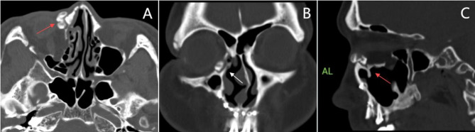
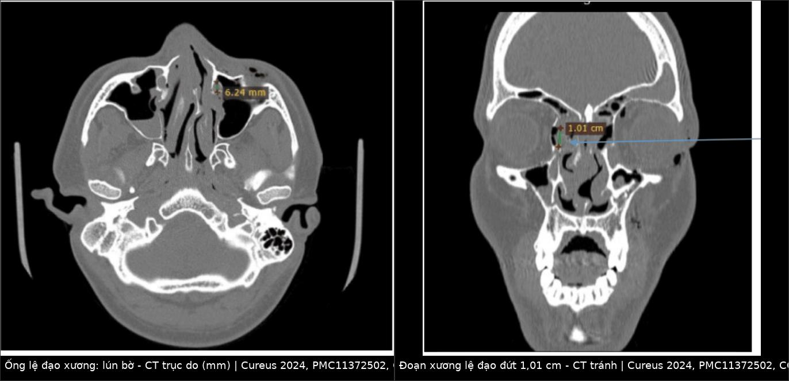
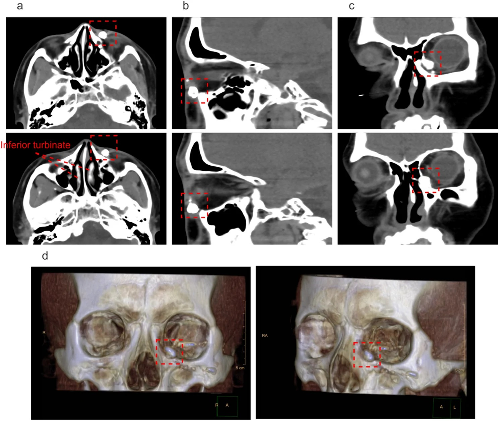
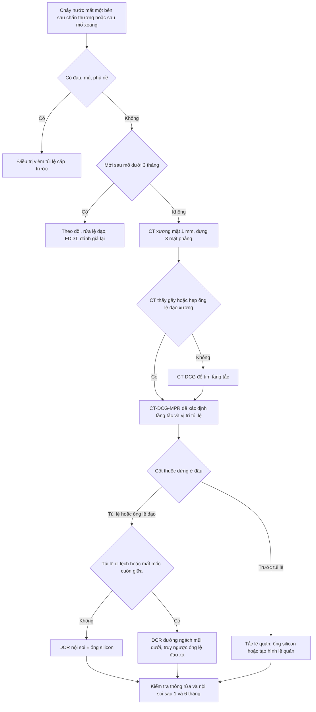
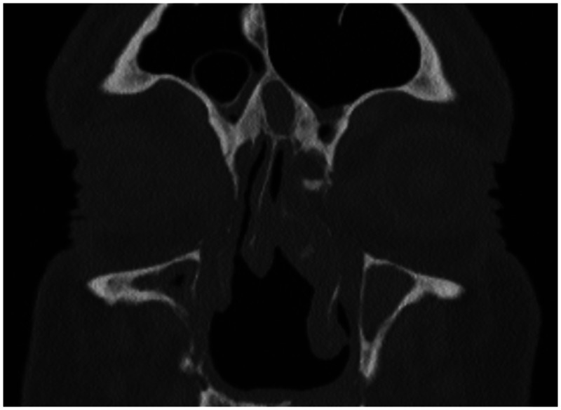

# 1496 — Tắc lệ đạo mắc phải sau chấn thương mặt và sau mổ xoang / Acquired nasolacrimal duct obstruction after midface trauma and sinonasal surgery

**Tags:** `pattern:tac-le-dao` `pattern:hep-ong` `pattern:di-lech` `pattern:khuyet-xuong` `vung:mat` `vung:hoc-mat` `vung:mui` `protocol:CT-xoang-lat-mong` `protocol:CT-DCG` `incidentaloma:khong`
**Mức chắc chắn (certainty):** tổng hợp y văn (literature synthesis) — ghép **322 phim CT xương mặt** của chấn thương giữa mặt (*Cureus* 2024, **PMC11372502**, CC BY 4.0), **16 bệnh nhân/18 mắt tắc lệ đạo do chấn thương** được mổ DCR nội soi có CT-DCG-MPR (*Clin Ophthalmol* 2025, **PMC12184688**, CC BY-NC 4.0), **79 ca tắc lệ đạo thứ phát** trong 236 ca DCR (*Am J Rhinol Allergy* 2026, **PMC12831806**, CC BY-NC 4.0), loạt **65 + 65 ca** sau mổ mũi (osteotomy) (*Medicina* 2025, **PMC12654125**, CC BY 4.0), **54 ca CT-DCG** định lượng (*Quant Imaging Med Surg* 2025, **PMC12290749**, CC BY-NC-ND 4.0), loạt **2 ca túi lệ di lệch** mổ theo đường ngách mũi dưới dưới hướng dẫn 3D CT-DCG (*BMC Ophthalmol* 2026, **PMC13643978**, CC BY-NC-ND 4.0) và tổng quan hệ thống **21 nghiên cứu/7.998 người** về biến chứng mắt sau chấn thương hàm mặt (*Maxillofac Plast Reconstr Surg* 2026, **PMC13106098**, CC BY 4.0). Không có thử nghiệm ngẫu nhiên nào về **thời điểm** mổ sau chấn thương — phần đó ghi rõ "chưa rõ". Ca trong quiz là **ca nguyên văn** của nguồn, giữ đúng mô tả gốc.

> **Câu chốt:** sau một cú đập vào giữa mặt hoặc một cuộc mổ xoang, chảy nước mắt **một bên** không phải "chảy nước mắt do viêm" mà là **tắc lệ đạo mắc phải (secondary NLDO)**: ống lệ đạo **bị gãy, bị đẩy lệch hoặc mất mốc giải phẫu**. Ba câu hỏi quyết định: **tắc ở tầng nào** (lệ quản – túi lệ – ống lệ đạo), **túi lệ còn đúng chỗ hay đã di lệch**, và **xương đã vững chưa**. Trả sai tầng thì mổ DCR vẫn chảy nước mắt; bỏ sót di lệch thì mổ DCR "đúng kỹ thuật" mà không tìm thấy túi lệ.

## 1. Tổng quan bệnh học – cơ chế hình ảnh

- **Giải phẫu là nguyên nhân.** Ống lệ đạo chạy trong **ống lệ đạo xương (bony nasolacrimal canal)**, tạo bởi **mỏm trán xương hàm trên**, **xương lệ** và liên quan **ngách mũi dưới**. Vì vậy mọi đường gãy đi qua **mỏm trán xương hàm trên** hay khối **mũi–ổ mắt–sàng (NOE)** đều có thể làm hẹp, gấp hoặc đứt ống này; còn mọi cuộc mổ bóc **cuốn mũi giữa/xoang hàm** đều có thể lấy mất **mốc giải phẫu của túi lệ**.
- **Tần suất tổn thương XƯƠNG rất cao, tần suất TRIỆU CHỨNG rất thấp — đây là cặp số quan trọng nhất của bài.** Trong **322 phim CT xương mặt** của chấn thương giữa mặt, **37,6% (121/322)** có bằng chứng tổn thương bộ máy lệ đạo trên phim: **gãy đường thẳng ống lệ đạo 32,0% (103/322)**, **bong hố lệ 2,5% (8/322)**, **thông hố lệ–ống 2,8% (9/322)**; nhiều nhất ở **gãy phức hợp gò má–hàm trên (ZMC) 70,8% (228/322)** (*Cureus* 2024, **PMC11372502**). Ngược lại, trong tổng quan **3.693 người** có biến chứng mắt sau chấn thương hàm mặt, **tổn thương bộ máy lệ đạo chỉ được ghi nhận 14 ca (0,4%)** (*Maxillofac Plast Reconstr Surg* 2026, **PMC13106098**). Khoảng cách **37,6% vs 0,4%** là lý do **không được mổ vì một dòng chữ trên phim**, và cũng là lý do **không được bỏ qua** khi bệnh nhân phàn nàn chảy nước mắt.
- **Vì sao tắc thường ở chỗ nối túi lệ – ống lệ đạo.** Đây là nơi ống xương hẹp nhất và là nơi đường gãy **mỏm trán xương hàm trên** cắt ngang. Trong loạt 18 mắt tắc lệ đạo do chấn thương, **vị trí tắc/gãy thường gặp nhất chính là chỗ nối túi lệ – ống lệ đạo**; mổ ra thấy **túi lệ di lệch 66,7% (12/18 mắt)**, **rách túi lệ 22,2% (4/18)**, **đứt dây chằng góc mắt trong 18,8% (3/16 người)**, **lệch vách mũi 50,0% (9/18)** (*Clin Ophthalmol* 2025, **PMC12184688**).
- **TẠI SAO hình ảnh trông như vậy (vật lý).** Xương đặc chặn tia X, nên trên **cửa sổ xương** ống lệ đạo hiện thành **đường hầm sáng viền xương trắng**; khi gãy, **bờ ống mất liên tục, khẩu kính hẹp lại và bờ bị đẩy vào lòng**. Cái mà CT **cửa sổ xương** không thấy là **lòng ống có thông hay không** — mô mềm, niêm mạc, máu cục đều cùng đậm độ mỡ/mô mềm và không phân biệt được. Vì vậy phải có **CT-DCG (CT dacryocystography)**: bơm thuốc cản quang vào lệ quản, cột thuốc **dừng ở đâu thì tắc ở đó**; thuốc có iod nên **đậm độ cao gần xương**, thấy rõ cả khi ống chỉ còn vài mm.
- **Số đo định lượng để không đọc cảm tính.** Trong 322 phim trên, khi bộ máy lệ đạo **có tổn thương**, mức lún đo được ở **mặt cắt trục trung vị 2,60 mm (IQR 1,30–3,10)** so với **0,00 mm (0,00–0,00)** ở nhóm không tổn thương (p < 0,0001); ở **mặt cắt tránh trung vị 7,00 mm (6,00–8,00)**; gãy **NOE** có mức lún tránh lớn nhất, **trung vị 9,00 mm (8,00–10,00)** (*Cureus* 2024). Nói cách khác: **một ống lệ đạo bị bóp hẹp ≥ 1,3 mm trên trục / ≥ 6 mm trên tránh là bất thường**, không phải biến thể.
- **Kích thước túi lệ bình thường để so sánh.** Trên CT-DCG ở nhóm **tắc lệ đạo mắc phải nguyên phát (PANDO)**, túi lệ đo được **cao 13,74 ± 1,66 mm**, **đường kính ngang tối đa 3,89 ± 1,08 mm**, **trước–sau 5,39 ± 1,69 mm**, và thuốc lấp gần đầy túi **80,14 ± 15,46%** (*Quant Imaging Med Surg* 2025, **PMC12290749**). Túi lệ **phình to > 8 mm ngang** là dấu hiệu của **nang túi lệ** chứ không phải tắc đơn thuần (nhóm nang: **8,81 ± 2,40 mm**, p < 0,01).
- **TẠI SAO chấn thương lại khác tắc nguyên phát.** PANDO là quá trình **xơ hóa mạn, hai bên theo thời gian, nữ nhiều**; tắc sau chấn thương là **một bên, có nguyên nhân rõ, kèm di lệch giải phẫu**. Điều này đổi cả **đường mổ** (phải tìm túi lệ đang nằm lệch, không dựa vào cuốn mũi giữa) và **tiên lượng** (mô đã chấn thương, có thể có sẹo xương).
- **TẠI SAO sau mổ xoang cũng tắc.** Cuốn mũi giữa là **mốc để định vị túi lệ** khi mổ nội soi; sau **cắt cuốn giữa, cắt xoang hàm bán phần, cắt sàng** (đặc biệt trong **u xoang, xạ trị, mổ lại**), mốc này mất và **đoạn xa ống lệ đạo có thể bị cắt vào**. Trong loạt 236 ca DCR, **33,5% (79/236)** là **tắc lệ đạo thứ phát** do bệnh xoang: **ung thư xoang/mặt 46,8%**, **bệnh viêm mạn 24,1%**, **chấn thương 16,5%**, **xạ trị vùng 31,6%** (các nhóm chồng lấp) (*Am J Rhinol Allergy* 2026, **PMC12831806**).
- **TẠI SAO phải chờ trước khi gọi là "tắc".** Sau mổ mũi, **phù nề** làm nghẹt lệ đạo tạm thời rồi tự hết: ở 130 bệnh nhân mổ mũi, chảy nước mắt **tuần 1 là 46,1%** (osteotomy kinh điển) và **32,3%** (osteotomy bằng Piezo); đến **tháng 1 còn 24,6% vs 13,8%**, **tháng 3 còn 7,7% vs 4,6%**, **tháng 6 còn 15,1% vs 4,6%** (p = 0,031); **tắc khi bơm rửa** ở tuần 1 là **21,5% vs 7,6%** nhưng **hội tụ về 12,3% vs 15,4% ở tháng 1** (*Medicina* 2025, **PMC12654125**). Kết luận thực hành: **đánh giá lại sau khi hết phù, không mổ trong vài tuần đầu vì "chảy nước mắt sau mổ"**.
- **Mốc thời gian trong ca chấn thương thật.** Ca nguyên văn 33 tuổi bị đập vùng ổ mắt phải, gãy thành ổ mắt ngoài + mỏm trán xương hàm trên, **viêm túi lệ mạn tiến triển trong 1 năm** rồi mới được chẩn đoán; CT-DCG-MPR thấy **túi lệ chứa thuốc bị đẩy ra ngoài** và **đường gãy ống lệ đạo thấy được trên cả 3 mặt phẳng**; mổ ra xác nhận **di lệch 8 mm** (*Clin Ophthalmol* 2025).

## 2. Mẫu hình + chẩn đoán phân biệt theo vị trí (Gamut)

- **Mẫu hình lâm sàng:** chảy nước mắt **một bên**, khởi phát **sau chấn thương giữa mặt / sau mổ xoang / sau xạ trị**, kèm **chảy mủ, đỏ góc mắt trong, ấn túi lệ có mủ**. Không đau, không phù nề lan tỏa thì thường là tắc đơn thuần; đau + phù + sốt là **viêm túi lệ cấp** (bài 1485) và phải xử lý nhiễm trước.
- **Ba trục đọc hình ảnh:**
  1. **Tầng tắc:** **lệ quản/điểm lệ (proximal)** → **túi lệ** → **ống lệ đạo** → **van Hasner/ngách mũi dưới**. Tầng quyết định mổ: tầng ống lệ đạo = **DCR**; tầng lệ quản = **DCR không giải quyết**, cần tạo hình lệ quản/ống silicon hoặc nối lệ quản–túi lệ.
  2. **Cơ chế:** **chèn ép xương** (gãy lún, di lệch) · **rách/đứt** (mô mềm, dây chằng góc mắt trong) · **sẹo xơ** (sau xạ, sau mổ lại) · **mất mốc giải phẫu** (sau cắt cuốn giữa/ medial maxillectomy).
  3. **Tính chất:** **một bên + có nguyên nhân** (thứ phát) vs **hai bên + tiến triển** (PANDO) vs **tạm thời do phù** (sau mổ mũi, tự hết trong 1–3 tháng).
- **Gamut theo vị trí:**
  - **Đường gãy NOE / mỏm trán xương hàm trên:** tắc lệ đạo do chấn thương · rách túi lệ · đứt dây chằng góc mắt trong (telecanthus) · giả phình/động mạch sàng trước (chảy máu) · rò dịch não tủy.
  - **Sau mổ xoang / medial maxillectomy:** tắc lệ đạo thứ phát · **hẹp lỗ thông DCR cũ** · **hội chứng mũi rỗng (empty nose)** · **hẹp van mũi** · **dính mũi (synechiae)** · tái phát u.
  - **Sau xạ trị vùng mũi–hốc mắt:** hẹp lệ đạo do xạ · **hoại tử xương (ORN)** · **hẹp ống lệ đạo + khô mắt** · tái phát u.
  - **Không liên quan chấn thương:** PANDO · **viêm túi lệ ứ đọng (ADR)** · **sỏi lệ đạo (dacryolith)** · **nang túi lệ** · **u túi lệ/lymphoma** · **viêm xoang sàng** · **bệnh IgG4**.
  - **Trẻ em:** **tắc lệ đạo bẩm sinh/nang túi lệ** (bài 1483) — khung bệnh hoàn toàn khác, không có chấn thương.
- **Dấu hiệu báo động (red flags):** chảy mủ + đau + sốt (viêm túi lệ cấp/áp-xe) · **lồi mắt, hạn chế vận nhãn, giảm thị lực** (lan hốc mắt) · **telecanthus mới** (đứt dây chằng góc mắt trong) · **chảy dịch trong, một bên** (rò dịch não tủy) · **khối cứng, phá xương** (u).

*Nam 33 tuổi, chấn thương đụng dập ổ mắt phải, viêm túi lệ mạn 1 năm. (A) Trục: **túi lệ chứa cản quang bị đẩy ra ngoài** (mũi tên đỏ). (B) Tránh: **gãy mỏm trán xương hàm trên, di lệch 8 mm** (mũi tên trắng), lệch vách mũi 15°. (C) Đứng dọc: **đường gãy ống lệ đạo** (mũi tên đỏ). Lát cắt 1 mm, thuốc cản quang iopromide. Nguồn: Clin Ophthalmol 2025, PMC12184688, Fig. 1, CC BY-NC 4.0 (nguyên bản).*

## 3. Bảng so sánh phân biệt (ma trận đối chiếu)

| Thực thể (entity) | Hình ảnh điển hình (CT / CT-DCG / MRI) | Chốt vào (rule-in) | Chốt loại (rule-out) | Gợi ý xác nhận |
|---|---|---|---|---|
| **Tắc lệ đạo sau chấn thương (traumatic NLDO)** | **Gãy mỏm trán xương hàm trên/NOE**, ống lệ đạo xương hẹp hoặc gián đoạn; **túi lệ chứa thuốc bị đẩy lệch**; cột thuốc dừng ở chỗ nối túi–ống | **Một bên + tiền sử chấn thương + cột thuốc dừng đúng chỗ gãy + túi lệ lệch** (tương quan với mổ **94,7%**) | Túi lệ đúng vị trí, ống lệ đạo thông suốt trên CT-DCG, không có đường gãy | **CT-DCG-MPR** (không phải CT thường); độ nhạy phát hiện di lệch túi lệ **100% vs 58,3%** so với CT thường |
| **Tắc lệ đạo thứ phát sau mổ xoang / medial maxillectomy** | **Mất cuốn giữa, mất mốc thành mũi bên**, có thể **thiếu đoạn xa ống lệ đạo**; dính mũi; xoang đã mổ rộng | **Tiền sử mổ xoang + mất mốc giải phẫu + tắc một bên** | Còn đủ cuốn giữa và thành mũi bên, ống lệ đạo liên tục → nghĩ nguyên nhân khác | CT xoang ≤ 1 mm; **nội soi mũi** trước mổ; phối hợp TMH–mắt |
| **PANDO (tắc mắc phải nguyên phát)** | Túi lệ **không di lệch**, ống lệ đạo hẹp/xơ từ đoạn xa; túi **cao 13,74 ± 1,66 mm**, ngang **3,89 ± 1,08 mm**, thuốc lấp **80,14 ± 15,46%** | **Nữ trung niên, hai bên, tiến triển, không chấn thương, không mất mốc** | Có gãy xương/di lệch túi lệ hoặc mất mốc sau mổ → thứ phát | CT-DCG; đối chiếu triệu chứng; thử thông/rửa lệ đạo |
| **Hẹp hoặc đứt lệ quản (canalicular stenosis/laceration)** | Tắc **trước túi lệ**: thuốc không vào được túi, túi lệ **không căng**; có thể thấy đầu lệ quản co kéo | **Chảy nước mắt + bơm rửa trào ngược ngay ở điểm lệ + tiền sử rách mi/góc mắt** | Cột thuốc vào tới túi lệ rồi mới dừng → tắc ở túi/ống, không phải lệ quản | Thăm dò + rửa lệ đạo; **DCR đơn thuần thất bại** nếu bỏ tầng này |
| **Tắc lệ đạo do xạ trị** | Hẹp **dài, đều** ống lệ đạo, không đường gãy; niêm mạc mũi teo, dính; có thể kèm khô mắt | **Tiền sử xạ vùng mũi–hốc mắt + hẹp dài + khô mắt** | Không tiền sử xạ, hẹp khu trú đúng chỗ gãy → chấn thương | CT/MRI; đánh giá phim xạ; tiên lượng kém: thành công **68,0%** |
| **Viêm túi lệ cấp / áp-xe túi lệ (bài 1485)** | Túi lệ **căng dịch, thành dày ngấm thuốc**, mỡ quanh viêm, có thể ổ dịch viền ngấm thuốc; **không có ngưỡng HU phân biệt dịch/mủ** | **Đau, đỏ, sưng dưới dây chằng + ấn có mủ ở điểm lệ** | Không đau, không phù nề, chỉ chảy nước mắt → tắc đơn thuần | Siêu âm ≥ 12 MHz; chọc/dẫn lưu nếu dao động |
| **Viêm túi lệ ứ đọng (ADR)** | Túi lệ căng dịch **không có tắc thật**; hết sau điều trị nội, **rửa lệ đạo thông lại sau ~1 tháng** | **Không tiền sử chảy nước mắt + hết triệu chứng + thông lại khi thử** | Vẫn tắc khi thử lại sau khi hết viêm → tắc thật | Rửa/thông lệ đạo sau khi hết viêm |
| **U túi lệ / lymphoma** | **Khối đặc ngấm thuốc**, lan **trên dây chằng góc mắt trong**, có thể **phá xương**; không đối xứng | **Khối đặc + phá xương + lan trên dây chằng** | Ổ dịch thuần, không phần đặc → không phải u | **MRI có cản quang + sinh thiết**; không DCR đơn thuần |

*Trái: mặt cắt trục — **bờ ống lệ đạo xương bị lún**, đo bằng thước trên phần mềm DICOM. Phải: mặt cắt tránh — **đoạn xương lệ đạo bị gián đoạn đo được 1,01 cm**. Cùng bệnh nhân gãy trán–mũi–ổ mắt–sàng. Nguồn: Cureus 2024, PMC11372502, Fig. 3 và Fig. 4, CC BY 4.0 (ghép letterbox, nguyên tỷ lệ).*

### Đọc ma trận theo thứ tự nào
- **Bước 1 — xác định tầng tắc bằng cột thuốc, không bằng cảm giác.** Thuốc dừng **trước** túi lệ = lệ quản; **trong** túi lệ = túi; **dưới** túi lệ = ống lệ đạo. Mổ DCR chỉ chữa được hai tầng sau.
- **Bước 2 — túi lệ có đúng chỗ không.** So vị trí túi lệ với **cuốn mũi giữa** và **thành mũi bên**; lệch ra ngoài/ra trước là dấu hiệu chấn thương, và là lý do phải đổi đường mổ.
- **Bước 3 — xương đã vững chưa.** Đường gãy còn di động, còn mảnh rời hoặc chưa cố định = **mổ DCR dễ thất bại**; cần phối hợp phẫu thuật hàm mặt cố định trước.
- **Bước 4 — loại trừ u và nhiễm.** Khối đặc, phá xương, lan trên dây chằng = **MRI + sinh thiết**, không "thử DCR". Đau + mủ = điều trị nhiễm trước (bài 1485).

## 4. Protocol chụp + hệ phân độ/ngưỡng xử trí

- **CT xương mặt là phim đầu tiên, nhưng phải đọc cả 3 mặt phẳng.** Lát **≤ 1 mm**, cửa sổ xương + mô mềm, dựng **trục – tránh – đứng dọc**; đo **khẩu kính ống lệ đạo xương** và **mức lún** ở cả trục và tránh (ngưỡng bất thường từ loạt 322 phim: **≥ 1,3 mm trục / ≥ 6 mm tránh**); ghi **vị trí gãy so với chỗ nối túi lệ–ống lệ đạo**, **vị trí chèn của dây chằng góc mắt trong**, và **mức lệch vách mũi**. Đây là phim **sàng lọc**, không phải phim quyết định mổ.
- **CT-DCG-MPR là phim quyết định khi đã có triệu chứng.** Bơm **thuốc cản quang có iod** qua lệ quản, chụp **lát 1 mm**, dựng đa mặt phẳng. So với CT thường, CT-DCG-MPR có **độ đặc hiệu xác định tầng tắc 92,3% vs 69,2%** (p = 0,032), **độ nhạy phát hiện di lệch túi lệ 100% vs 58,3%** (p = 0,002), **giá trị tiên đoán dương 94,7% vs 63,2%** (p = 0,002) và **tương quan với thực tế mổ 94,7%**; riêng đánh giá **mức lan đường gãy** thì hai cách tương đương (**94,1% vs 82,4%**, p = 0,125) (*Clin Ophthalmol* 2025).
- **Khi nào thêm MRI:** nghi **u túi lệ/lymphoma**, nghi **lan hốc mắt/nội sọ**, cần đánh giá **thị thần kinh**, hoặc trẻ cần tránh bức xạ. Tối thiểu **T1 không mỡ + T2 fat-sat + T1 fat-sat sau tiêm**, lớp **≤ 3 mm**.
- **Nội soi mũi là một phần của protocol,** không phải bước phụ: nó xác nhận **mốc cuốn mũi giữa còn hay mất**, **đoạn xa ống lệ đạo còn hay đã bị cắt**, và tìm **dính mũi/hẹp van** — những thứ quyết định đường vào mổ.
- **Siêu âm B-scan/đầu dò ≥ 12 MHz** dùng khi cần phân biệt **nang/nang nhầy** với **túi lệ đặc**, hoặc khi không chụp được CT; không thay thế CT-DCG để xác định tầng tắc.

**Ngưỡng xử trí (theo bậc):**

| Bậc | Bối cảnh | Việc làm | Bằng chứng / số liệu |
|---|---|---|---|
| 1 | **Mới chảy nước mắt sau mổ mũi/xoang < 3 tháng**, không mủ, không đau | **Theo dõi + rửa lệ đạo + FDDT**; không mổ | Chảy nước mắt **46,1% ở tuần 1 → 24,6% tháng 1 → 7,7% tháng 3**; tắc khi bơm rửa hội tụ về **12,3% vs 15,4%** ở tháng 1 (phù nề là cơ chế chính) |
| 2 | **Tắc thật ở ống lệ đạo, xương đã vững, không di lệch túi lệ** | **DCR nội soi ± ống silicon** | DCR nội soi ở tắc do chấn thương: **thành công giải phẫu 94,4% (17/18)**, **chức năng 88,9% (16/18)**, theo dõi **55,4 ± 10,9 tháng** |
| 3 | **Túi lệ di lệch / mất mốc cuốn mũi giữa** | **DCR đường ngách mũi dưới, truy ngược ống lệ đạo xa lên túi lệ dưới hướng dẫn 3D CT-DCG** | 2/2 ca thông ngay lần đầu, không rò dịch não tủy/tổn thương hốc mắt; theo dõi **6 tháng** không tái tắc |
| 4 | **Có hẹp/đứt lệ quản kèm theo** | **Đặt ống silicon** hoặc tạo hình lệ quản; **không chỉ DCR** | Trong 18 mắt chấn thương, **2 mắt (11,1%)** có hẹp lệ quản phải đặt ống silicon; tắc lệ đạo thứ phát có **29,0%** kèm bệnh lệ quản (vs **8,3%** ở PANDO, p < 0,01) |
| 5 | **Sau xạ trị hoặc sau mổ lại** | Tư vấn **tiên lượng thấp hơn**, cân nhắc **DCR + ống silicon lâu hơn**, phối hợp TMH–mắt | Thành công chức năng: toàn bộ tắc thứ phát **79,7%** vs PANDO **87,9%**; **xạ trị 68,0%**; **u xoang 70,3%**; **mổ lại 66,7%**; **chấn thương 84,6% (11/13)** |
| 6 | **Đau + mủ + phù nề** | Điều trị **viêm túi lệ cấp/áp-xe trước** (dẫn lưu nếu dao động), **DCR sau khi hết viêm** | Xem bài 1485; DCR sớm ≤ 3 ngày đạt **87,8%/82,9%** nhưng chỉ khi đã kiểm soát nhiễm |

*Túi lệ di lệch sau chấn thương. (a) Trục, (b) đứng dọc, (c) tránh: **vùng tăng đậm độ trong khung đỏ là túi lệ đã bơm cản quang**; (d) **dựng 3D** cho thấy quỹ đạo di lệch của túi lệ, dùng để chọn đường vào ngách mũi dưới và truy ngược ống lệ đạo xa. Mũi tên đỏ: cuốn mũi dưới. Nguồn: BMC Ophthalmol 2026, PMC13643978, Fig. 3, CC BY-NC-ND 4.0 (nguyên bản, không cắt/ghép).*

- **Theo dõi sau mổ:** kiểm tra **thông rửa + nội soi** ở **1 tháng** và **6 tháng**; trong loạt 18 mắt, **dính mũi 16,7% (3/18)** và **mô hạt 11,1% (2/18)**, đều xử lý khỏi; lỗ thông đạt **3,5 mm đường kính** sau 12 tháng ở ca nguyên văn. Chảy nước mắt tái phát + **tắc khi rửa** = hẹp lỗ thông, không phải "tắc mới".
- **Thời điểm mổ sau chấn thương: chưa rõ — cần tra.** Không có thử nghiệm ngẫu nhiên so sánh mổ sớm với mổ muộn; dữ liệu hiện có chỉ cho thấy **phù nề tự giảm trong 1–3 tháng** và ca chấn thương thật được chẩn đoán muộn **1 năm**. Cách làm hợp lý: **chờ xương vững + hết phù, xác nhận tắc bằng CT-DCG rồi mới mổ**, không dựa vào một mốc ngày cố định.

## 5. Biến thể bình thường và cạm bẫy

- **Gãy xương ống lệ đạo KHÔNG đồng nghĩa tắc.** **37,6%** phim chấn thương giữa mặt có tổn thương xương, nhưng biến chứng lệ đạo được ghi nhận chỉ **0,4%**. Mổ dựa trên phim mà bệnh nhân không chảy nước mắt là can thiệp oan.
- **Chảy nước mắt sau mổ mũi thường là phù nề, không phải tắc.** **46,1%** ở tuần 1 giảm còn **7,7%** ở tháng 3 (nhóm osteotomy kinh điển). Gọi là "tắc lệ đạo" và đặt ống silicon ngay trong tháng đầu là can thiệp thừa.
- **Bỏ sót tầng lệ quản.** Nếu tắc ở **lệ quản**, DCR mở một cửa thông từ túi lệ ra mũi nhưng **nước mắt vẫn không tới được túi lệ**: bệnh nhân vẫn chảy nước mắt dù lỗ thông rộng. Luôn đánh giá **điểm lệ – lệ quản** trước khi hẹn mổ.
- **Mốc cuốn mũi giữa mất sau mổ xoang.** Ở bệnh nhân đã **cắt cuốn giữa, cắt xoang hàm bán phần, medial maxillectomy**, dò túi lệ theo cuốn giữa là dò mù; hình ảnh CT cho thấy **mất thành mũi bên và mất đoạn xa ống lệ đạo**. Đường vào phải dựa trên **3D CT-DCG**, không dựa vào mốc giải phẫu đã mất.
- **Cạm bẫy "xương lành = hết tắc".** Đường gãy liền xương vẫn để lại **hẹp lòng ống và sẹo xơ**; bệnh nhân đến khám **nhiều tháng–nhiều năm** sau chấn thương với viêm túi lệ mạn. Hỏi tiền sử chấn thương là bước rẻ nhất.
- **Telecanthus mới sau chấn thương NOE = đứt dây chằng góc mắt trong (18,8%)**, không chỉ là "sẹo xấu": cần cố định dây chằng, và nếu bỏ qua thì DCR dễ thất bại vì túi lệ bị kéo lệch.
- **Không nong/thông mạnh trong chấn thương cấp.** Niêm mạc đang rách và xương còn di động; thao tác mạnh tạo **đường giả** và làm sẹo hẹp nặng hơn.
- **Sau xạ trị, đừng hứa kết quả như PANDO.** Thành công **68,0%** và mô xơ hóa kém lành; cần tư vấn trước mổ và theo dõi lâu hơn (thời gian lưu ống trung bình ở nhóm thứ phát **124,67 ngày** vs **81,90 ngày** ở PANDO).
- **Sỏi lệ đạo có thể bị bỏ sót nếu chỉ đọc CT thường.** Trong 18 ca sỏi lệ đạo, **chỉ 27,8% (5/18)** thấy được trên CT không bơm thuốc; CT-DCG thấy **khuyết thuốc bề mặt 82,4%** và **vôi hóa ngoại vi 64,7%**. Chảy nước mắt tái phát sau DCR ở người trẻ phải nghĩ sỏi.

## 6. Tự lượng giá — Blind Quiz

**Ca 1 — Nam 33 tuổi, chấn thương đụng dập ổ mắt phải 1 năm trước, nay chảy nước mắt + chảy mủ góc mắt trong, ấn túi lệ có mủ. CT-DCG-MPR: túi lệ chứa thuốc bị đẩy ra ngoài, đường gãy ống lệ đạo thấy trên cả 3 mặt phẳng, gãy mỏm trán xương hàm trên di lệch 8 mm. Hỏi chẩn đoán, tầng tắc, và kế hoạch mổ?**

- Gợi ý: không lồi mắt, không hạn chế vận nhãn, thị lực bình thường.
- Câu hỏi: Túi lệ có đúng vị trí không? Vì sao CT thường không đủ? Mổ đường nào và tiên lượng bao nhiêu?

<b>Bấm để hiện đáp án (findings + chẩn đoán)</b>

- Findings: (A) **túi lệ ngấm cản quang, di lệch ra ngoài**; (B) **gãy mỏm trán xương hàm trên, di lệch 8 mm**, lệch vách mũi 15°; (C) **đường gãy ống lệ đạo** ở mặt phẳng đứng dọc.
- Chẩn đoán: **tắc lệ đạo do chấn thương, tầng chỗ nối túi lệ–ống lệ đạo, kèm di lệch túi lệ** — biến chứng của gãy NOE/mỏm trán xương hàm trên.
- Vì sao cần CT-DCG: CT thường chỉ thấy xương; CT-DCG-MPR có **độ nhạy phát hiện di lệch túi lệ 100% vs 58,3%** và **tương quan với mổ 94,7%**.
- Xử trí: **DCR nội soi** (trong loạt này **94,4% giải phẫu / 88,9% chức năng**); nếu túi lệ lệch nhiều hoặc mất mốc cuốn giữa → **đường ngách mũi dưới truy ngược ống lệ đạo xa**.
- Nguồn ảnh: *Clin Ophthalmol* 2025, PMC12184688, Fig. 1, CC BY-NC 4.0.

**Ca 2 — Nam 41 tuổi, gãy trán–mũi–ổ mắt–sàng sau tai nạn giao thông, chưa chảy nước mắt. CT xương mặt: ống lệ đạo xương bờ mất liên tục. Hỏi có phải mổ lệ đạo không, và đo gì để mô tả tổn thương?**

- Gợi ý: bệnh nhân được mổ cố định xương, không phàn nàn chảy nước mắt.
- Câu hỏi: Dấu hiệu trên phim là gì? Vì sao không mổ? Ngưỡng đo nào gọi là bất thường?

<b>Bấm để hiện đáp án (findings + chẩn đoán)</b>

- Findings: trục — **bờ ống lệ đạo xương bị lún**, đo bằng thước DICOM; tránh — **đoạn xương lệ đạo gián đoạn đo được 1,01 cm**.
- Chẩn đoán: **tổn thương bộ máy lệ đạo trên CT do chấn thương giữa mặt** — có thể chỉ là tổn thương **hình ảnh**, chưa tắc.
- Vì sao không mổ: **37,6%** phim chấn thương giữa mặt có tổn thương xương, nhưng biến chứng lệ đạo có triệu chứng chỉ **0,4%**. Mổ khi không có triệu chứng là can thiệp oan.
- Ngưỡng đo: khi có tổn thương, mức lún **trung vị 2,60 mm trên trục** (so với **0,00 mm** ở nhóm không tổn thương) và **7,00 mm trên tránh**; gãy NOE lún tránh tới **9,00 mm**.
- Theo dõi: hẹn **đánh giá lại sau khi xương vững**, hỏi triệu chứng chảy nước mắt, làm **FDDT**; chỉ chụp CT-DCG khi có triệu chứng.
- Nguồn ảnh: *Cureus* 2024, PMC11372502, Fig. 3 + Fig. 4, CC BY 4.0.

**Ca 3 — Nữ 58 tuổi, đã mổ u xoang hàm trên phải + xạ trị 2 năm trước, nay chảy nước mắt phải liên tục, chảy mủ khi ấn. CT tránh: mất cuốn mũi giữa phải, mất thành mũi bên, dính mũi; không thấy đường gãy mới. Hỏi chẩn đoán, vì sao tiên lượng khác PANDO, và cần gì trước mổ?**

- Gợi ý: không chấn thương; đã phẫu thuật nội soi mũi xoang + xạ.
- Câu hỏi: Mốc giải phẫu nào mất? Tầng tắc dự đoán? Tỉ lệ thành công và cách chuẩn bị?

<b>Bấm để hiện đáp án (findings + chẩn đoán)</b>

- Findings: **mất cuốn mũi giữa và mất mốc thành mũi bên phải**, dính mũi, xoang đã mổ rộng, **không có đường gãy mới**.
- Chẩn đoán: **tắc lệ đạo thứ phát sau mổ xoang + xạ trị** (nhóm chiếm **33,5%** các ca DCR ở trung tâm tuyến cuối; **xạ trị 31,6%**, **u xoang 46,8%**).
- Vì sao khác PANDO: mô đã xạ xơ hóa, mốc giải phẫu mất, thường kèm **bệnh lệ quản (29,0% vs 8,3%)**; thành công chức năng **79,7%** toàn nhóm, **68,0%** nếu có xạ, **66,7%** nếu mổ lại — so với **87,9%** ở PANDO.
- Chuẩn bị: **nội soi mũi + CT-DCG/3D** để định vị túi lệ, **phối hợp TMH–mắt** (70,9% ca thứ phát được mổ phối hợp), chuẩn bị **ống silicon lưu lâu** (trung bình **124,67 ngày**).
- Nguồn ảnh: *Am J Rhinol Allergy* 2026, PMC12831806, Fig. 1, CC BY-NC 4.0.

## Bài liên quan chéo
- [400 – Tổng quan Mắt & thị giác](../400-tong-quan-mat-thi-giac/lesson.md)
- [410 – Giải phẫu học mắt](../410-giai-phau-hoc-mat/lesson.md)
- [1483 – Nang túi lệ bẩm sinh & tắc lệ đạo ở trẻ](../1483-nang-tui-le-va-tac-le-dao-o-tre/lesson.md)
- [1485 – Viêm túi lệ cấp và áp-xe túi lệ](../1485-viem-tui-le-cap-va-ap-xe-tui-le/lesson.md)
- [1461 – Áp-xe dưới màng xương hốc mắt ở trẻ](../1461-ap-xe-duoi-mang-xuong-hoc-mat-o-tre/lesson.md)
- [1473 – Viêm xoang nấm xâm lấn cấp hốc mắt](../1473-viem-xoang-nam-xam-lan-cap-hoc-mat/lesson.md)
- [424 – Tuyến lệ: viêm vs u](../424-tuyen-le/lesson.md)

## Ảnh
- `1496_tac-le-dao_CT_Cureus2024-F3.jpg`, `1496_tac-le-dao_CT_Cureus2024-F4.jpg`, `composite_ong-le-dao-xuong-chan-thuong.jpg` — *Cureus* 2024, **PMC11372502**, Fig. 3–4, **CC BY 4.0**.
- `1496_tac-le-dao_CT-DCG_ClinOphthalmol2025-F1.jpg` — *Clin Ophthalmol* 2025, **PMC12184688**, Fig. 1, **CC BY-NC 4.0**.
- `1496_tac-le-dao_CT-DCG_BMCOphthalmol2026-F3.jpg` — *BMC Ophthalmol* 2026, **PMC13643978**, Fig. 3, **CC BY-NC-ND 4.0** (nguyên bản).
- `1496_tac-le-dao_CT_AmJRhinolAllergy2026-F1.jpg` — *Am J Rhinol Allergy* 2026, **PMC12831806**, Fig. 1, **CC BY-NC 4.0**.
- Giấy phép và nguồn từng ảnh: `images/CREDITS.md`; link gốc: `sources.md`.

> Không dùng để chẩn đoán độc lập khi chưa có người hướng dẫn.
