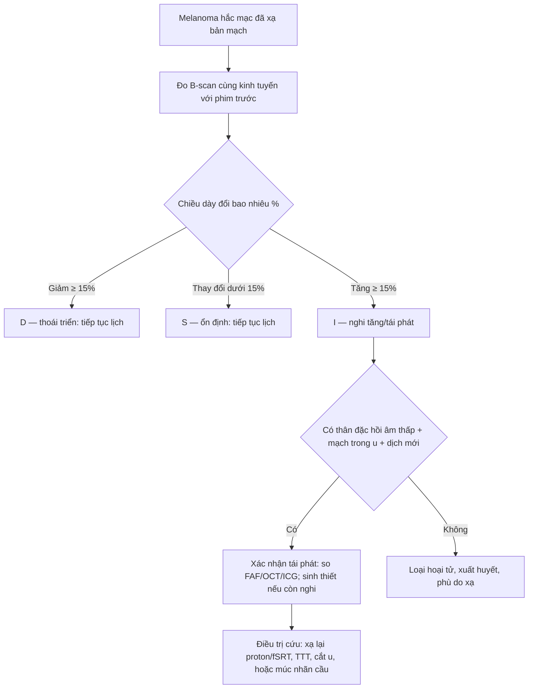
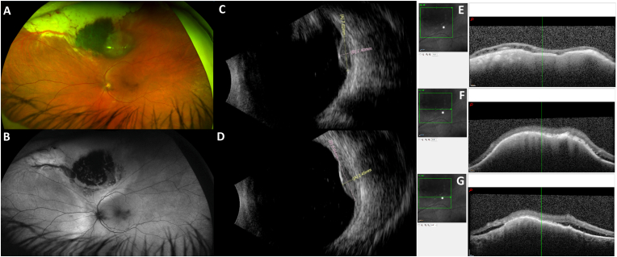
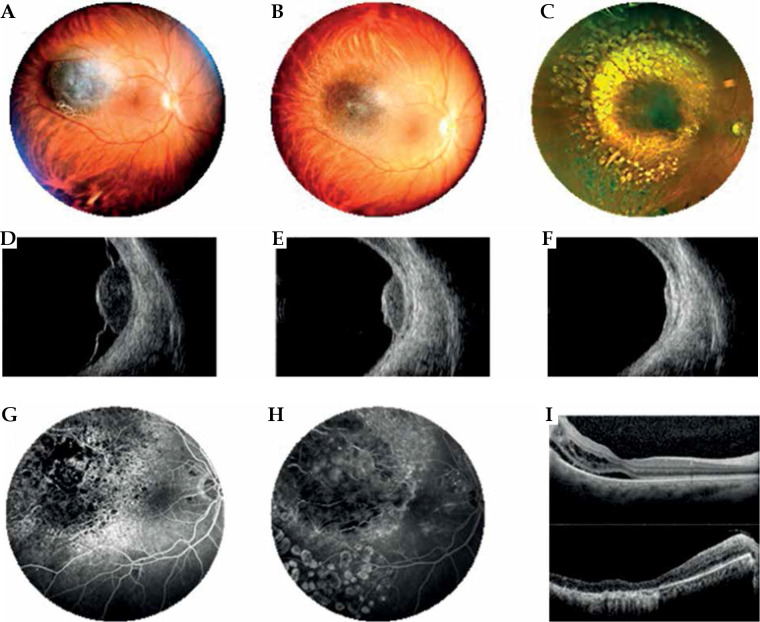
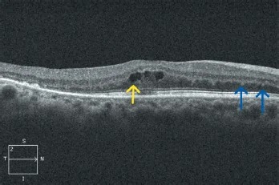

# 1497 — Tái phát bờ sau xạ bản mạch melanoma hắc mạc: đọc đáp ứng – tái phát – thay đổi do xạ / Marginal recurrence after plaque brachytherapy for choroidal melanoma

**Tags:** `pattern:khoi-hac-mac` `pattern:tai-phat-bo` `pattern:day-hac-mac` `pattern:bong-thanh-dich` `vung:hac-mac` `vung:nhan-cau` `vung:mat` `protocol:sieu-am-B-scan` `protocol:sieu-am-A-scan` `protocol:OCT` `protocol:FAF` `protocol:MRI-hoc-mat` `score:Abramson-response` `incidentaloma:khong`

**Mức chắc chắn (certainty):** tổng hợp y văn (literature synthesis) — dựng từ đoàn hệ **719 mắt Ru-106** (*Clin Transl Radiat Oncol* 2025, **PMC11919603**), **310 mắt** xạ bản mạch/proton (*BMJ Open Ophthalmol* 2026, **PMC12778298**), **192 bệnh nhân** phân loại đáp ứng theo Abramson (*Sci Rep* 2025, **PMC12749780**), **135 mắt** với OCT sớm của bệnh hoàng điểm do xạ (*J Contemp Brachytherapy* 2026, **PMC13662462**), tổng quan **20 nghiên cứu/4.979 người** (*Heliyon* 2024, **PMC11414481**), ca tái phát bờ **13 năm** (*Am J Ophthalmol Case Rep* 2026, **PMC13254904**), ca tái phát **51,5 năm** (*Klin Monbl Augenheilkd* 2026, **PMC13095370**) và atlas đáp ứng sau xạ (*J Contemp Brachytherapy* 2022, **PMC8867240**). Nhóm **không có bệnh nhân của mình**; chỗ chưa đủ chắc ghi "chưa rõ". **Không ghi tên tác giả** — attribution dùng tạp chí + năm + PMCID.

> **Vị trí trong thư viện:** [1486](../1486-khoi-hac-mac-sieu-am/lesson.md) phủ **khối hắc mạc trước điều trị** (phân loại bằng hồi âm); [448](../448-u-hac-mac/lesson.md) phủ **gamut + điều trị theo kích thước**; [1409](../1409-benh-vong-mac-do-xa-sau-xa-tri/lesson.md) phủ **bệnh võng mạc do xạ**; [1441](../1441-bong-vong-mac-xa-sau-xa-tri-u-noi-nhan/lesson.md) phủ **bong võng mạc sau xạ**. Bài này trả lời **một câu duy nhất**: *sau khi u đã được xạ, chiều dày và hình thái thay đổi thế nào thì gọi là thoái triển, đâu là tái phát, đâu là di chứng do xạ?*
>
> **Câu chốt:** Đừng hỏi "khối còn hay hết" — hỏi **"chiều dày đổi bao nhiêu % so với cùng kinh tuyến, và khối mới có phải mô u sống không"**. Ba con số phải thuộc: **(1)** tái phát **6,6% trong 5 năm**, **90,5% tái phát xảy ra trong 5 năm**, trung vị **18 tháng**, **57,1% ở BỜ** (PMC13254904); **(2)** ngưỡng đáp ứng Abramson — **giảm ≥ 15% = thoái triển**, **thay đổi < 15% = ổn định**, **tăng ≥ 15% = nghi tăng** (PMC12749780); **(3)** vị trí **cạnh đĩa thị** làm tái phát **20% so với 6%** (HR **4,91**) và liều đỉnh **< 110 Gy-eq** làm tái phát **32% so với 8%** (PMC11919603).

## 1. Tổng quan bệnh học – cơ chế hình ảnh

### 1.1 Vì sao tái phát lại nằm ở BỜ nhiều hơn trong lòng u

Xạ bản mạch (plaque brachytherapy) đặt nguồn phóng xạ áp sát củng mạc; liều được **kê tại đỉnh u** chứ không phải tại bờ. Hai hậu quả vật lý:

- **Gradient liều dốc từ củng mạc ra đỉnh:** liều củng mạc thường **260–604 Gy** trong khi liều đỉnh chỉ **85–100 Gy** (các ca trong PMC8867240). Nghĩa là **đáy u nhận liều rất cao, đỉnh u vừa đủ**, còn **vành hắc mạc ngoài bờ u** nhận liều giảm nhanh — đây là vùng "nửa tối" của bản đồ liều.
- **Ru-106 phát tia beta có quãng chạy hữu hạn trong mô**, nên chỉ cần **plaque lệch/tilt hoặc không phủ quá bờ u 1–2 mm** là vành bờ **thiếu liều thật**, không phải "tái phát muộn bí ẩn". Với I-125 (tia gamma xuyên sâu hơn) hiện tượng này ít hơn nhưng vẫn có **penumbra** ở rìa plaque.
- Hệ quả định lượng: trong **52 ca thất bại tại chỗ** của đoàn hệ 719 mắt, **30 ca (58%) ở bờ**, **22 ca (42%) trong trường** (PMC11919603); một chuỗi khác ghi **57,1% ở bờ** (PMC13254904). **Tái phát bờ là kiểu thất bại điển hình**, không phải ngoại lệ.

### 1.2 Vì sao "khối mới" trên B-scan có thể là u sống, sẹo xơ, hay chỉ là dịch

Siêu âm 10–15 MHz ghi hồi âm từ **bên trong** khối, nên tín hiệu nội bộ phản ánh **số mặt phân cách trở kháng âm** trên một đơn vị thể tích:

| Mô | Cấu trúc | Hồi âm nội bộ | Hệ quả trên B-scan |
|---|---|---|---|
| **Melanoma sống** | tế bào hình thoi/biểu mô xếp đặc, ít mô đệm, mạch nhỏ | **thấp–trung bình** | khối **hồi âm thấp**, đáy tối hơn đỉnh (**rỗng âm** do suy giảm) |
| **Sẹo xơ – teo hắc mạc sau xạ** | collagen dày, RPE tăng sinh, có thể canxi hóa | **cao** | vùng **dẹt, hồi âm cao**, không có "thân" khối |
| **Hoại tử u / khoang hóa** | mô chết, dịch, fibrin | hỗn hợp, có vùng trống âm | **lõm/hang trong khối**, không phải gồ lên |
| **Dịch dưới võng mạc** | dịch trong | **trống âm** | dải **không hồi âm** giữa võng mạc và hắc mạc, không có mô đặc |

Vì vậy **"khối mới" phải có mô đặc hồi âm thấp**; một **dải trống âm** chỉ là bong thanh dịch, và một **vùng hồi âm cao dẹt** là sẹo. Đây là lý do câu hỏi đầu tiên không phải "có gồ không" mà **"gồ bằng mô gì"**.

### 1.3 Vì sao OCT dễ đánh lừa: "lumpy-bumpy" không phải chữ ký của tái phát

Sau xạ, **RPE mất đều, tăng sinh và di chuyển**, lớp Bruch có thể gấp nếp, và **dịch dưới võng mạc** làm bề mặt hắc mạc gồ ghề. Trên OCT, hình ảnh **"lumpy-bumpy" (gồ ghề từng múi)** xuất hiện ở cả:

- **di căn hắc mạc** (khối không sắc tố, bờ không đều);
- **tái phát melanoma** (ca 13 năm: bề mặt hắc mạc không đều + dịch dưới võng mạc, PMC13254904);
- **sẹo xơ–teo sau xạ** có co kéo RPE.

Nghĩa là **OCT trả lời "có dịch/dày hắc mạc không", không trả lời "mô gì"**. Chốt mô học nằm ở **B-scan (hồi âm thấp + mạch trong u)** và, khi còn nghi, **sinh thiết xuyên võng mạc**.

### 1.4 Ngưỡng định lượng nằm lòng

| Chỉ số | Ngưỡng / giá trị | Nguồn |
|---|---|---|
| Tái phát tại chỗ sau xạ bản mạch hậu đoạn | **6,6% trong 5 năm**; **90,5% tái phát trong 5 năm**; trung vị **18 tháng**; **57,1% ở bờ** | PMC13254904 |
| Thất bại tại chỗ Ru-106 (719 mắt) | **8% (6–11%) trong 5 năm**; **58% ở bờ / 42% trong trường** | PMC11919603 |
| Kiểm soát tại chỗ (310 mắt) | **95,8%**; tái phát **4,0% Ru-106 · 4,2% I-125 · 4,8% proton** | PMC12778298 |
| Kiểm soát tại chỗ (gộp 20 nghiên cứu) | **94% I-125**; **96% proton**; giữ mắt **91%** | PMC11414481 |
| Đáp ứng chiều dày (Abramson) | **giảm ≥ 15% = D**; **< 15% = S**; **tăng ≥ 15% = I**; còn lại là thể hỗn hợp DS/DI/ID/SD/zigzag | PMC12749780 |
| Đáp ứng ở 1 năm (719 mắt) | **6% lui hoàn toàn · 60% lui một phần · 31% ổn định không hoạt động · 1% ổn định còn hoạt động · 2% tiến triển** | PMC11919603 |
| Yếu tố nguy cơ thất bại tại chỗ | **cạnh đĩa thị 20% vs 6%** (HR **4,91**); **liều đỉnh < 110 Gy-eq: 32% vs 8%** (HR **0,971/Gy**); **T3–4 HR 4,54** | PMC11919603 |
| Liều kê | **I-125 85 Gy đỉnh** (COMS); **Ru-106 ≥ 80 Gy đỉnh và/hoặc 350 Gy củng mạc**; **proton 53,1 Gy × RBE 1,1 = 58,5 Gy** | PMC8867240, PMC12778298 |
| Di chứng tại mắt (719 mắt) | **bệnh hoàng điểm do xạ 35%**, **bệnh thần kinh thị 11%**, **đục thể thủy tinh 58%** | PMC11919603 |

## 2. Mẫu hình + chẩn đoán phân biệt theo vị trí (gamut)

Mẫu hình trung tâm: **mắt đã xạ bản mạch vì melanoma hắc mạc, xuất hiện gồ/dày mới hoặc dịch mới trong vùng u cũ**. Gamut chia theo **vị trí tương đối với bờ u** — đây là cách chia có giá trị quyết định:

- **NHÓM 1 — Ở BỜ (marginal):** tái phát bờ; **u thứ phát/di căn** cạnh sẹo; **tăng sinh RPE–xơ** ở rìa; **màng tân mạch dưới võng mạc** ở bờ sẹo.
- **NHÓM 2 — TRONG TRƯỜNG (in-field):** tái phát trong lòng u; **hoại tử u** (giả tiến triển); **xuất huyết trong u**; **nang hóa** sau xạ.
- **NHÓM 3 — NGOÀI TRƯỜNG:** melanoma nguyên phát mới ở mắt đối bên (hiếm); **di căn hắc mạc**; **hemangioma hắc mạc**; **melanocytoma**.
- **NHÓM 4 — KHÔNG CÓ KHỐI:** **bệnh hoàng điểm do xạ** (phù/dịch hoàng điểm); **bệnh thần kinh thị do xạ** (phù đĩa thị, teo); **bong thanh dịch do xạ**; **hoại tử củng mạc/viêm củng mạc**; **xuất huyết dịch kính**; **glôcôm tân mạch**.

Gợi nhớ **"BỜ – TRƯỜNG – NGOÀI – KHÔNG KHỐI"**: câu hỏi 1 là **có mô đặc không** (loại nhóm 4), câu hỏi 2 là **vị trí so với bờ u** (phân nhóm 1–3), câu hỏi 3 là **có dấu hoạt tính không** (mạch trong u, dịch dưới võng mạc, tăng ≥ 15%).

## 3. Bảng so sánh phân biệt (ma trận đối chiếu)

| Thực thể (entity) | Hình ảnh điển hình | Chốt vào (rule-in) | Chốt loại (rule-out) | Gợi ý xác nhận |
|---|---|---|---|---|
| **Tái phát BỜ** | Khối **dome hồi âm thấp** mọc sát bờ sẹo; OCT gồ ghề + dịch dưới võng mạc; FAF vùng giảm huỳnh quang mới | **Khối mô đặc hồi âm thấp + tăng chiều dày ≥ 15% so với cùng kinh tuyến + mạch trong u** | Sẹo dẹt hồi âm cao, không có thân khối → không phải tái phát | B-scan A+B cùng kinh tuyến, so phim cũ; sinh thiết xuyên võng mạc khi còn nghi |
| **Tái phát TRONG TRƯỜNG** | Dày lại **trung tâm** khối cũ, có thể kèm hoại tử/dịch | **Tăng ≥ 15% ở đúng vị trí đỉnh cũ**, mạch trong u tái xuất | Hoại tử trung tâm (hồi âm hỗn hợp, lõm) không làm tăng đường kính ngoài | So A-scan đỉnh–đáy, ICG/OCTA tìm mạch trong u |
| **Sẹo xơ–teo sau xạ** | **Dẹt, hồi âm cao**, RPE mất đều, có thể canxi hóa; không có dịch | **Chiều dày giảm dần ≥ 15%/năm đầu**, hồi âm tăng dần, không mạch trong u | Khối còn "thân" hồi âm thấp + dịch mới → không phải sẹo đơn thuần | B-scan + FAF + OCT; theo dõi 6–12 tháng |
| **Hoại tử u / khoang hóa** | **Lõm/hang trong khối**, hồi âm hỗn hợp, có thể có mảnh vôi | **Đường kính ngoài không tăng**, bờ ngoài ổn định, không mạch mới | Bờ ngoài phình ra + nốt đặc ở rìa → nghi tái phát | MRI T1 fat-sat + tiêm; theo dõi ngắn |
| **Bệnh hoàng điểm do xạ** | Phù/dịch **hoàng điểm**, xuất tiết cứng, vi phình mạch; OCT: nang nội võng mạc + **HRF** | **Tổn thương ở hoàng điểm, KHÔNG nối với khối hắc mạc**; OCT có nang/HRF | Khối hắc mạc dày lên + dịch dưới võng mạc → không quy cho maculopathy | OCT macula; FA/OCTA; đáp ứng anti-VEGF |
| **Bệnh thần kinh thị do xạ** | **Phù đĩa thị** rồi teo; giảm thị lực; có thể kèm thiếu máu võng mạc | **Đĩa thị là tâm điểm**, khối u không đổi; liều đĩa thị cao | Khối u tiến sát đĩa thị gây chèn ép → không phải RON đơn thuần | OCT RNFL/GCC, thị trường, MRI loại chèn ép |
| **Di căn hắc mạc** | Khối **không sắc tố, bờ không đều, "lumpy-bumpy"**, thường nhiều ổ/bilateral | **Tiền sử ung thư (vú/phổi) + khối mới ngoài bờ + OCT gồ ghề** | Melanoma tái phát thường **một ổ, sát bờ sẹo, hồi âm thấp** | Siêu âm, OCT, CT ngực–bụng; sinh thiết nếu cần |
| **Hemangioma hắc mạc** | Khối **dome, hồi âm CAO đồng nhất**, không rỗng âm | **Hồi âm nội bộ cao + không có rỗng âm** | Tái phát melanoma hồi âm **thấp** | A-scan đỉnh cao, OCT, ICG |

### Ba bước đọc một "khối mới" sau xạ

1. **Cùng kinh tuyến, cùng gain:** đo chiều dày tại **điểm dày nhất trên đúng kinh tuyến đã đo lần trước**, ghi mm và % thay đổi. Một lần đo khác kinh tuyến có thể lệch **> 1 mm** giả tạo.
2. **Hỏi mô:** khối có **thân đặc hồi âm thấp** không? Có **mạch trong u** trên A-scan/ICG/OCTA không? Có **dịch dưới võng mạc mới** không?
3. **Áp ngưỡng 15%:** **tăng ≥ 15%** mới là "I" (nghi tăng) theo Abramson; **< 15%** là "S" — nhưng **S kéo dài kèm mạch trong u** vẫn phải theo dõi sát, vì ngưỡng 15% là công cụ **theo dõi xu hướng**, không phải chốt mô học.

## 4. Protocol chụp + hệ phân độ/điểm chuẩn hóa

### 4.1 Lịch theo dõi sau xạ bản mạch

| Thời điểm | Việc làm | Mục tiêu |
|---|---|---|
| **2–4–8–12 tháng** | BCVA, ảnh đáy mắt màu + widefield, **FAF**, **OCT hoàng điểm**, **B-scan A+B cùng kinh tuyến** | Bắt tái phát sớm và di chứng hoàng điểm |
| **6 tháng/lần đến năm 3** | Như trên + đo lại chiều dày, so ảnh | Phát hiện tái phát bờ/trong trường |
| **Hằng năm sau năm 3** | Như trên; **không ngừng theo dõi** | Tái phát rất muộn (13 năm; **51,5 năm**) |
| **Mỗi 6 tháng** | **Siêu âm gan** (hoặc MRI gan theo nguy cơ) | Di căn gan là ổ di căn đầu tiên ở **~90%** ca |

- **B-scan:** đầu dò **10–15 MHz**, đo chiều dày từ **mặt trong củng mạc đến đỉnh u** theo **hai kinh tuyến vuông góc**, ghi cả **đường kính đáy lớn nhất** và **khoảng cách tới đĩa thị/hoàng điểm** — vì **cạnh đĩa thị** là yếu tố nguy cơ tái phát mạnh nhất (HR 4,91).
- **UBM 35–50 MHz** cho u thể mi/mống mắt; **MRI T1 fat-sat + tiêm** khi cần đánh giá lan thể mi, xuyên củng mạc hoặc chèn ép thị thần kinh; **CT** chỉ để tìm canxi hóa/dị vật, không dùng thay B-scan.
- **OCT hoàng điểm** mỗi lần khám: **nang nội võng mạc + hyperreflective foci (HRF)** là dấu **sớm nhất** của bệnh hoàng điểm do xạ (PMC13662462), và cũng là thứ dễ bị đọc nhầm thành "u lan tới hoàng điểm".
- **Sinh thiết xuyên võng mạc (27-gauge, vitrector-assisted)** khi khối mới **không điển hình** (không sắc tố, bờ không rõ, chẩn đoán phân biệt với di căn): mô học + **SOX-10**, và xét gen (**BAP1, GNA11, mất NST 3, tăng 8q**) để tiên lượng di căn (PMC13254904).

### 4.2 Phân loại đáp ứng Abramson (dùng cho mọi lần đo)

- **Thể hỗn hợp** (DS, DI, ID, SD, zigzag) phải ghi rõ **thứ tự thời gian**, vì **DI (giảm rồi tăng)** là kiểu hay bị bỏ sót nhất: u teo một đợt rồi mọc lại ở bờ.
- **Sau điều trị cứu**, vẫn dùng cùng thang: 5 năm sau can thiệp, **38% lui hoàn toàn · 51% lui một phần · 10% ổn định · 1% tiến triển** (PMC11919603).

### 4.3 Điều trị cứu (salvage) — chọn theo vị trí và chức năng

| Lựa chọn | Khi nào | Số liệu chính |
|---|---|---|
| **Múc nhãn cầu** | Tái phát lan rộng, u thể mi, mắt mù đau, không còn thị lực hữu ích | Là can thiệp cứu phổ biến thứ hai (**40%** trong 84 can thiệp) |
| **Xạ lại proton** | Tái phát khu trú, còn thị lực, đủ điều kiện gây mê | **Kiểm soát tại chỗ 92,1% sau 10 năm** (trích trong PMC13254904) |
| **Xạ bản mạch lặp** | Tái phát bờ khu trú, liều tích lũy còn chấp nhận | **18%** các can thiệp cứu (PMC11919603) |
| **fSRT / CyberKnife** | Không mổ được, u sát đĩa thị | **9 ca: giữ mắt 78%**, đục thể thủy tinh **55,6%**, không glôcôm thứ phát (PMC13389751) |
| **TTT bổ trợ** | U nhỏ, tái phát nông, không lan thể mi | **44%** các can thiệp cứu; không thay thế xạ lại khi u dày |
| **Cắt u nội nhãn (endoresection)** | Chọn lọc, u khu trú | **4%** các can thiệp cứu; nguy cơ gieo tế bào, cần chọn kỹ |

## 5. Biến thể bình thường và cạm bẫy

- **Đo khác kinh tuyến/khác gain:** đây là "tái phát giả" số 1. Luôn đo **đúng kinh tuyến đã ghi trong phim trước**, cùng gain, cùng đầu dò; ghi cả **hai chiều vuông góc**.
- **Một lần đo không đủ:** ngưỡng 15% chỉ có nghĩa khi **so với phim trước cùng vị trí**; xu hướng **3 lần liên tiếp** mạnh hơn một lần nhảy bậc.
- **Hoại tử trung tâm** làm khối **lõm xuống**, không phải "u nhỏ đi rồi to lại"; đừng gọi lõm là tái phát — nhưng **bờ ngoài phình ra** mới là dấu đáng lo.
- **Bong thanh dịch do xạ** cho dải **trống âm** dưới võng mạc, không phải thân khối; OCT phân biệt trong vài giây.
- **Bệnh hoàng điểm do xạ** (35% trong 5 năm) làm **dày hoàng điểm** — nếu đọc là "u lan tới hoàng điểm" sẽ chuyển sang múc nhãn cầu oan; OCT cho thấy nang/HRF **không nối với khối hắc mạc**.
- **Bệnh thần kinh thị do xạ** (11%) gây **phù đĩa thị** rồi teo, **không điều trị hồi phục**; phòng bằng quy hoạch liều, không phải bằng "mổ lại".
- **Tái phát không sắc tố trên sẹo sắc tố:** ca 13 năm có khối **amelanotic** bên cạnh sẹo sắc tố; ảnh màu dễ bỏ qua — **FAF** phát hiện vùng giảm huỳnh quang mới.
- **"Lumpy-bumpy" không đặc hiệu:** di căn hắc mạc cũng gồ ghề; cần **tiền sử ung thư + vị trí ngoài bờ + không có hồi âm thấp điển hình** để phân biệt.
- **Đừng cho "hết bệnh" sau 5 năm:** đã có tái phát bờ **13 năm** và **51,5 năm**; lịch theo dõi là **suốt đời** (PMC13254904, PMC13095370).
- **Canxi hóa sẹo** cho bóng lưng mạnh trên B-scan, dễ che khối nhỏ phía sau — hạ gain và đổi góc.

## 6. Tự lượng giá — Blind Quiz

**Ca 1 — Nam 70 tuổi, 13 năm sau xạ I-125 vì melanoma hắc mạc; mắt không đau, thị lực còn 20/30. Nhìn ảnh, mô tả trước khi đọc đáp án.**

- Câu hỏi: (1) Khối mới nằm ở đâu so với sẹo cũ? (2) B-scan cho hồi âm nội bộ gì? (3) Ba chẩn đoán phân biệt và dấu nào chốt?

<b>Bấm để hiện đáp án</b>

- **Vị trí:** khối **không sắc tố** nằm sát **bờ sau của sẹo hắc mạc teo** (A: ảnh màu; B: FAF vùng giảm huỳnh quang mới). Đây là **tái phát bờ**, không phải u mới xa.
- **B-scan (C, D):** khối **dome, hồi âm nội bộ THẤP**, đo **9,5 × 7,0 mm**, dày **2,4 mm**, cách đĩa thị **6,05 mm**.
- **OCT (E–G):** bề mặt hắc mạc **gồ ghề ("lumpy-bumpy")** + **dịch dưới võng mạc** — không đặc hiệu, nhưng phù hợp khối đặc.
- **Phân biệt:** tái phát melanoma; di căn hắc mạc (khối không sắc tố, gồ ghề — nhưng thường ngoài bờ, tiền sử ung thư); màng tân mạch/xơ ở bờ sẹo.
- **Chốt:** **hồi âm thấp + sát bờ sẹo + tăng chiều dày theo thời gian**. Ca này sinh thiết xuyên võng mạc xác nhận melanoma (**SOX-10 dương**, BAP1/GNA11, mất NST 3, tăng 8q) và được **xạ proton cứu**; sau 8 tháng dày còn **1,8 mm**, thị lực giữ 20/30.
- **Bài học:** tái phát có thể đến **13 năm** và **không sắc tố** — đừng loại trừ vì "đã quá 5 năm" hay "khác màu u cũ".
- Nguồn: *Am J Ophthalmol Case Rep* 2026, **PMC13254904**, CC BY-NC-ND 4.0 (nguyên bản, không crop/ghép).

**Ca 2 — Nam 42 tuổi, melanoma hắc mạc 4,65 mm, xạ Ru-106 100 Gy. Ảnh A–C là đáy mắt lúc chẩn đoán, 1 năm và 3 năm; D–F là B-scan tương ứng. Đây là tái phát hay thoái triển?**

- Câu hỏi: (1) Chiều dày thay đổi bao nhiêu? (2) Hồi âm nội bộ thay đổi thế nào? (3) Vì sao thị lực giảm dù u nhỏ đi?

<b>Bấm để hiện đáp án</b>

- **Chiều dày:** **4,65 mm → 2,6 mm (1 năm) → 2,1 mm (3 năm)** — giảm **44%** rồi **55%** so với ban đầu, tức **D (decrease)** theo Abramson.
- **Hồi âm:** khối ban đầu **hồi âm thấp** (D); sau xạ **dẹt dần và hồi âm tăng** (E, F) — thay thế mô u bằng **xơ–teo**, đúng kỳ vọng.
- **Thị lực giảm (20/20 → 20/32 → 20/100)** vì **bệnh hoàng điểm do xạ**, không phải tái phát; ảnh G–H (FA) và I (OCT) cho thấy **phù nang nội võng mạc/dịch dưới võng mạc** rồi **teo hắc mạc–võng mạc sau laser**.
- **Chốt:** u **nhỏ đi + hồi âm tăng + không có thân khối mới** = thoái triển. Đừng nhầm vùng teo trắng quanh sẹo với "u lan".
- Nguồn: *J Contemp Brachytherapy* 2022, **PMC8867240**, CC BY-NC-SA 4.0.

**Ca 3 — Bệnh nhân đã xạ Ru-106 vì melanoma hắc mạc, khám định kỳ thấy OCT dưới. Có phải u đã lan tới hoàng điểm?**

- Câu hỏi: (1) Mô tả hai loại tổn thương trên OCT (mũi tên vàng và xanh). (2) Chẩn đoán? (3) Xử trí và vì sao không phải tái phát?

<b>Bấm để hiện đáp án</b>

- **Mũi tên vàng:** **phù nang hoàng điểm (cystoid macular oedema)** — các khoang giảm phản xạ nội võng mạc. **Mũi tên xanh:** **hyperreflective spots/foci (HRF)** — dấu viêm/tiết dịch.
- **Chẩn đoán:** **bệnh hoàng điểm do xạ** (radiation maculopathy), xảy ra ở **46,7%** bệnh nhân trong đoàn hệ 135 mắt, trung vị **24 tháng** sau xạ; **HRF + nang** là dấu **sớm nhất** trên OCT (PMC13662462).
- **Không phải tái phát vì:** tổn thương nằm ở **võng mạc/hoàng điểm**, **không nối với khối hắc mạc**, và khối hắc mạc không tăng chiều dày. Điều trị: **anti-VEGF nội nhãn** và/hoặc **corticoid nội nhãn**; theo dõi sát.
- **Cạm bẫy:** nếu chỉ nhìn "dày hoàng điểm" mà gọi là u lan → chỉ định múc nhãn cầu oan. Luôn đặt OCT cạnh B-scan của khối.
- Nguồn: *J Contemp Brachytherapy* 2026, **PMC13662462**, CC BY-NC-SA 4.0.

## Bài liên quan chéo
- [1486 – Khối hắc mạc trên siêu âm: hồi âm thấp = melanoma, hồi âm cao = hemangioma, MOLES](../1486-khoi-hac-mac-sieu-am/lesson.md)
- [448 – U hắc mạc: melanoma vs nevus vs di căn — siêu âm A/B & MRI](../448-u-hac-mac/lesson.md)
- [1409 – Bệnh võng mạc do xạ: phân biệt tổn thương do xạ với tái phát u](../1409-benh-vong-mac-do-xa-sau-xa-tri/lesson.md)
- [1441 – Bong võng mạc sau xạ trị u nội nhãn](../1441-bong-vong-mac-xa-sau-xa-tri-u-noi-nhan/lesson.md)
- [400 – Tổng quan Mắt & thị giác](../400-tong-quan-mat-thi-giac/lesson.md)

## Ảnh
- `images/1497_melanoma-hac-mac_tai-phat-bo_Fundus-Bscan-OCT_PMC13254904.jpg` — Fig. 1, *Am J Ophthalmol Case Rep* 2026, **PMC13254904**, **CC BY-NC-ND 4.0** (nguyên bản, không crop/ghép).
- `images/1497_melanoma-hac-mac_thoai-trien_Fundus-Bscan-FA-OCT_PMC8867240.jpg` — Fig. 5, *J Contemp Brachytherapy* 2022, **PMC8867240**, **CC BY-NC-SA 4.0**.
- `images/1497_melanoma-hac-mac_Benh-hoang-diem-xa_OCT_PMC13662462.jpg` — Fig. 1, *J Contemp Brachytherapy* 2026, **PMC13662462**, **CC BY-NC-SA 4.0** (chuyển định dạng webp → JPG, giữ nguyên khung).

> Không dùng để chẩn đoán độc lập khi chưa có người hướng dẫn.
