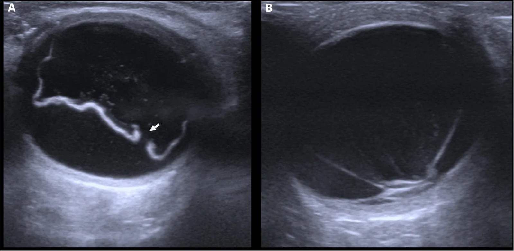
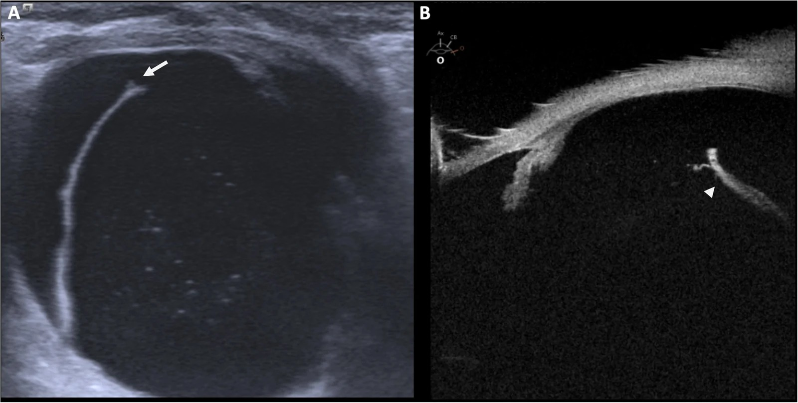
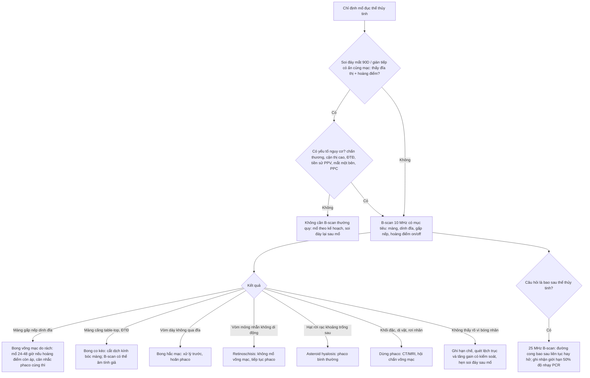
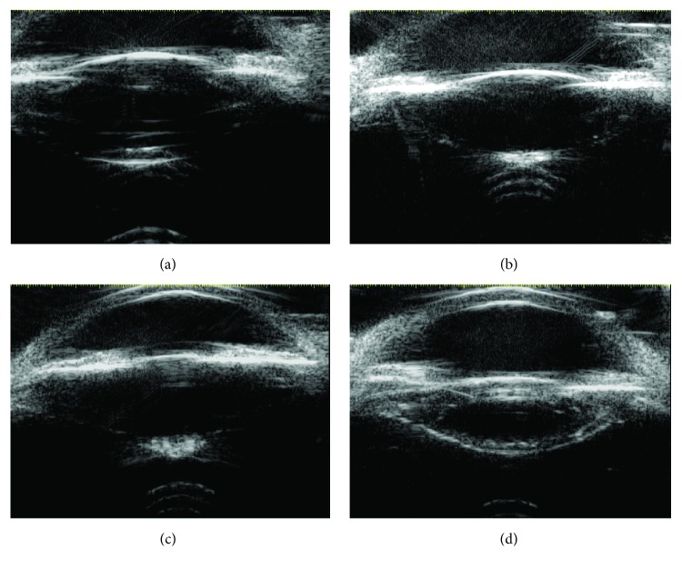
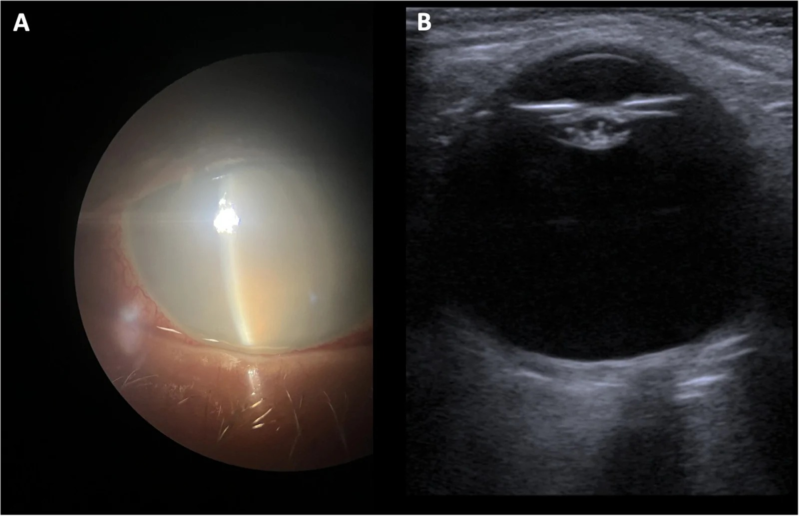
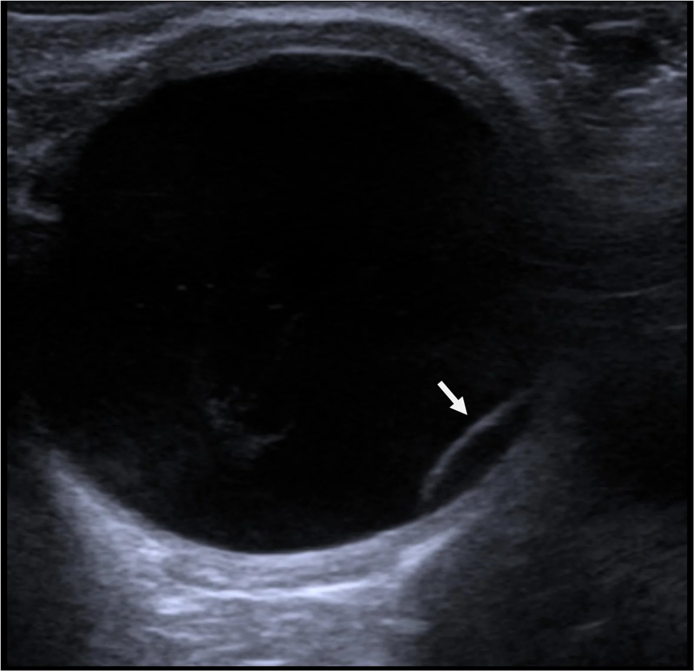
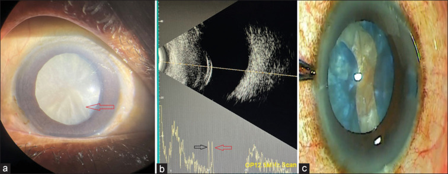

# 1498 — Siêu âm B-scan trước phẫu thuật đục thể thủy tinh: khi nào phải xem hậu đoạn, khi nào bỏ qua / B-scan before cataract surgery: when the posterior segment must be seen

**Tags:** `pattern:mang-dich-kinh` `pattern:bong-vong-mac` `pattern:gia-bong` `pattern:duc-day` `pattern:double-peak` `pattern:khong-thay-day-mat` `vung:mat` `vung:hau-doan` `vung:the-thuy-tinh` `protocol:sieu-am-B-scan` `protocol:sieu-am-25MHz` `protocol:UBM` `anatomy:hau-doa` `score:khong` `incidentaloma:bong-vong-mac-an`

**Mức chắc chắn (certainty):** tổng hợp y văn (literature synthesis) — dựng từ **750 mắt** đục thể thủy tinh được B-scan trước mổ (*Int J Health Sci (Qassim)* 2010, **PMC3068804**), **9.820 bệnh nhân** mổ đục thể thủy tinh ở trại (*Indian J Ophthalmol* 2023, **PMC10391503**, CC BY-NC-SA 4.0), **115 mắt** đục thể thủy tinh chín không soi được đáy mắt (*PLoS One* 2022, **PMC8803149**, CC BY 4.0), **21 mắt** đục thể thủy tinh cực sau chụp **25 MHz** (*J Ophthalmol* 2018, **PMC5896256**, CC BY 4.0), **1 kỹ thuật** dấu **hai đỉnh** (*Indian J Ophthalmol* 2024, **PMC11338405**, CC BY-NC-SA 4.0), tổng quan **B-scan trong bệnh dịch kính–võng mạc** (*Eur J Ophthalmol* 2026, **PMC13672910**, CC BY 4.0), **58 mắt** xuất huyết dịch kính che đáy mắt (*Clin Ophthalmol* 2017, **PMC5538682**), hướng dẫn **ESCRS 2024** (*J Cataract Refract Surg* 2026, **PMC13528843**, CC BY 4.0) và gộp **8 nghiên cứu / 2.826 mắt** cận thị cao (*Clin Ophthalmol* 2025, **PMC12266058**). Nhóm **không có bệnh nhân của mình**; chỗ suy luận ghi **[suy luận]**. **Không ghi tên tác giả** — attribution dùng tạp chí + năm + PMCID.

> **Ranh giới với bài đã có:** [411](../411-sieu-am-nhan-cau/lesson.md) dạy **đọc một ảnh B-scan** (bong võng mạc vs xuất huyết dịch kính); [429](../429-do-truc-nhan-cau-bang-mri-ct/lesson.md) trả lời **khi không đo được trục nhãn cầu**; [1484](../1484-bong-hac-mac-sau-mo-mat/lesson.md) lo **bong hắc mạc sau mổ**. Bài này trả lời câu hỏi **tiền phẫu**: **mắt nào phải B-scan, mắt nào không cần, tìm gì, và kết quả ấy đổi kế hoạch mổ thế nào**.

> **Câu chốt — năm con số phải thuộc:** **(1)** B-scan phát hiện **90/750 (12%)** mắt có tổn thương hậu đoạn; nhóm **chấn thương 39/71 (55%)** so với **không chấn thương 51/679 (7,5%)** (PMC3068804); **(2)** trong **9.820** bệnh nhân trại, đánh giá hậu đoạn **đổi ngay kế hoạch mổ ở 154 ca (1,57%)**, can thiệp võng mạc **86 ca (0,88%)** (PMC10391503); **(3)** đục thể thủy tinh chín **che đáy mắt ở 100% mắt**, và **32,2% (37/115)** có bệnh hậu đoạn chỉ phát hiện **sau mổ** — **bệnh ở mắt bên kia là yếu tố dự báo mạnh nhất: OR 47,72** (PMC8803149); **(4)** B-scan **không loại trừ** mọi thứ: độ nhạy phát hiện **bong võng mạc co kéo chỉ 72,4%** (đặc hiệu 96,6%; 88 mắt) (PMC13672910), trong khi với **quy trình chuẩn + người làm siêu âm chuyên trách** độ nhạy bong võng mạc do rách đạt **100%** ở 58 mắt, khớp hoàn toàn **78%** (PMC5538682); **(5)** ESCRS 2024 khuyến cáo **GRADE +**: dùng **siêu âm (A và/hoặc B) khi không nhìn rõ hậu đoạn**, như đục thể thủy tinh chín/đậm đặc (PMC13528843).

## 1. Tổng quan bệnh học – cơ chế hình ảnh

### 1.1 Vì sao phải là siêu âm: ánh sáng bị chặn, âm thanh thì không

- **Đục thể thủy tinh chín/trắng/sậm màu** tán xạ và hấp thụ ánh sáng tới mức **mất phản xạ đỏ (no red reflex)** và **không còn đường nhìn tới đáy mắt** — đèn khe, soi đáy trực tiếp, **chụp đáy mắt và OCT hoàng điểm đều thất bại** (OCT còn bị **suy giảm tín hiệu do tán xạ**, không chỉ "mờ").
- **Siêu âm không phụ thuộc độ trong suốt quang học.** Đầu dò **10 MHz** phát sóng âm xuyên qua giác mạc – thể thủy tinh – dịch kính; hình ảnh sinh ra từ **chênh lệch trở kháng âm (acoustic impedance)** giữa các mô. Mặt phân cách **dịch kính (dịch, trở kháng thấp) – võng mạc/hắc mạc/củng mạc (mô đặc, trở kháng cao)** cho **hồi âm rất mạnh** dù lớp võng mạc chỉ dày **~0,2–0,25 mm** — đó là lý do một màng mỏng vẫn "sáng" trên màn hình.
- **Tần số đánh đổi lấy độ phân giải:** ở **10 MHz**, bước sóng trong mô mềm ≈ **0,15 mm** (tính từ v = 1.540 m/s), độ phân giải trục thực tế **~0,2 mm**, đủ xuyên tới cực sau; ở **20–25 MHz** bước sóng ≈ **0,06 mm** nhưng **độ xuyên kém**, chỉ dùng cho **cấu trúc sát đầu dò**: **bao sau thể thủy tinh, thể mi, pars plana**; **35–50 MHz (UBM)** chỉ dành cho **tiền phòng/góc**. Đây là **lý do vật lý** khiến "B-scan 10 MHz bình thường" **không nói được gì** về một **khiếm khuyết bao sau 10–20 µm**.
- **Vì sao không dùng CT/MRI thay thế:** CT cho **nhãn cầu đồng nhất ~20–40 HU**, chỉ thấy được vôi hóa/dị vật cản quang và hình dạng nhãn cầu; MRI tốt cho **khối u, máu, dầu** nhưng **không phân giải màng võng mạc mỏng** và **không làm được tại giường, tức thời, không xạ**. B-scan là **thăm khám 5–10 phút, không xạ, tại phòng khám** [suy luận từ bản chất kỹ thuật].

### 1.2 Bệnh học: mắt đục thể thủy tinh chín KHÔNG phải mắt "chỉ có đục thể thủy tinh"

- **Đục thể thủy tinh là bệnh của tuổi và của mắt**, không phải bệnh cô lập: cùng một mắt thường có **bệnh võng mạc đái tháo đường, thoái hóa cận thị, tắc tĩnh mạch võng mạc, glôcôm, lỗ hoàng điểm, u hắc mạc**. Ở **115 mắt** đục chín, **32,2%** có bệnh hậu đoạn lộ ra sau mổ (drusen **6,1%**, thoái hóa cận thị **5,2%**, bệnh võng mạc đái tháo đường **4,3%**) (PMC8803149).
- **Yếu tố dự báo mạnh nhất không phải tuổi mà là MẮT BÊN KIA:** bệnh hậu đoạn ở mắt đối diện làm **OR 47,72** (**p < 0,001**) cho bệnh hậu đoạn ở mắt đục chín (PMC8803149). Đây là **mẹo lâm sàng miễn phí**: soi đáy mắt bên lành trước khi quyết định "không cần B-scan".
- **Nhóm nguy cơ cao phải xem hậu đoạn:** **chấn thương** (55% có tổn thương hậu đoạn, PMC3068804), **cận thị cao** (bong võng mạc **1,97%** và rách võng mạc **1,89%** sau mổ đục thể thủy tinh; gộp 2.826 mắt, PMC12266058), **đái tháo đường có bệnh võng mạc**, **tiền sử cắt dịch kính/bơm dầu**, **mắt một bên**, **đục thể thủy tinh cực sau**, và **không đo được sinh trắc quang**.

### 1.3 Vì sao B-scan có thể "âm tính giả" — giới hạn vật lý, không phải lỗi người đọc

- **Độ phân giải > kích thước tổn thương:** **lỗ teo võng mạc (atrophic round hole)** đường kính **< 0,2–0,5 mm** **không thấy được** trên B-scan 10 MHz; ngược lại **dialysis võng mạc ở ora serrata** (một đoạn bong theo chu vi) **thấy được** (PMC13672910). Vì vậy câu "B-scan không thấy bong" **không** đồng nghĩa "không có rách".
- **Màng căng, dính, mỏng:** trong **bong võng mạc co kéo (TRD)** trên mắt đái tháo đường có xuất huyết dịch kính, độ nhạy trước mổ chỉ **72,4%** (đặc hiệu **96,6%**, 88 mắt) — tức **1/4 TRD bị bỏ sót** nếu chỉ dựa vào B-scan (PMC13672910). Con số **100%** của PMC5538682 đạt được nhờ **quy trình quét chuẩn hóa + kỹ thuật viên siêu âm mắt chuyên trách** — chứng minh **kết quả phụ thuộc quy trình**, không phải phụ thuộc máy đắt tiền.
- **Bóng lưng của nhân thể thủy tinh đục:** nhân đục đậm **hấp thụ và phản xạ mạnh** → **bóng lưng (shadowing)** che vùng võng mạc ngay sau nhân. Người đọc thiếu kinh nghiệm kết luận "dịch kính trong" trong khi thực chất **không nhìn thấy gì** — đây là **bẫy "không thấy = không có"** kinh điển [suy luận].

## 2. Mẫu hình + chẩn đoán phân biệt theo vị trí (gamut)

**Mẫu hình trung tâm:** *một màng hồi âm cao trong khoang dịch kính, trên mắt không soi được đáy mắt* — câu hỏi luôn là **màng ấy dính vào đâu, dày bao nhiêu, có di động không**.

- **Màng dính ĐĨA THỊ + ora serrata, gấp nếp (corrugated), di động theo mắt** → **bong võng mạc do rách (rhegmatogenous RD)**.
- **Màng căng, phẳng, KHÔNG gấp nếp, rất ít di động, dính vào các "chốt" xơ mạch** → **bong võng mạc co kéo (tractional RD)** — bệnh cảnh đái tháo đường tăng sinh/xuất huyết dịch kính.
- **Vòm dày, nhẵn, nhiều múi, KHÔNG đi qua đĩa thị, giới hạn ở trung ngoại vi (nơi hắc mạc dính chắc ở tĩnh mạch vortex)** → **bong hắc mạc / xuất huyết dưới hắc mạc** (bài [1484](../1484-bong-hac-mac-sau-mo-mat/lesson.md)).
- **Vòm MỎNG, nhẵn, hình vòm, hầu như không di động, không xẹp khi ấn củng mạc** → **retinoschisis** (giả bong võng mạc).
- **Chấm hồi âm rời rạc, đồng nhất, di động, có "khoảng trống" sáng giữa khối và võng mạc, lấp lánh khi quét động** → **thoái hóa dạng sao (asteroid hyalosis)** — không phải viêm/máu.
- **Đám hồi âm màng/ổ trong dịch kính + dày hắc mạc** ở mắt đỏ đau sau mổ → **viêm dịch kính/viêm nội nhãn**; **không có viêm dịch kính** trên mắt thể thủy tinh **quá chín phù phép (phacolytic)** giúp **loại trừ viêm nội nhãn** (PMC13672910).
- **Cấu trúc hồi âm cao, bờ tròn, nằm trong dịch kính hoặc tiền phòng, có bóng lưng** → **nhân/tinh thể bị rơi (dropped nucleus)**, **IOL lệch**, hoặc **dị vật nội nhãn (IOFB)** — sau chấn thương/bục nhãn cầu.
- **Khối đặc trong nhãn cầu ± vôi hóa, có mạch trên Doppler** → **u hắc mạc (melanoma)**, **u nguyên bào võng mạc (retinoblastoma)** ở trẻ.
- **Nhãn cầu méo, lồi ra sau (posterior staphyloma)** hoặc **khuyết củng mạc/hắc mạc (coloboma)** → thay đổi giải phẫu, ảnh hưởng công suất IOL và tiên lượng.
- **Thể thủy tinh:** **hai đỉnh hồi âm sát nhau 80–90%** trên A-scan chồng B-scan → **vỏ hóa lỏng sau nhân** (nguy cơ **tăng áp lực nội thể thủy tinh**, capsulorhexis xé rộng — "cờ Argentina"); **một đỉnh** → không hóa lỏng phía sau (PMC11338405). **Bao sau đứt** chỉ thấy được bằng **25 MHz** (mục 4.3).

## 3. Bảng so sánh phân biệt (ma trận đối chiếu)

| Thực thể (entity) | Hình ảnh điển hình | Chốt vào (rule-in) | Chốt loại (rule-out) | Gợi ý xác nhận |
|---|---|---|---|---|
| **Bong võng mạc do rách (RRD)** | Màng hồi âm cao **gấp nếp**, dính **đĩa thị + ora**, di động theo mắt, có thể thấy **lỗ/rách** trong màng | **Dính đĩa thị + gấp nếp + di động**; hoàng điểm **on/off** ghi rõ | Vòm dày nhẵn **không qua đĩa** → bong hắc mạc; vòm mỏng **không gấp nếp** → schisis | Soi đáy khi mổ; **mổ trong 24–48 giờ nếu hoàng điểm còn áp** (bài 411) |
| **Bong võng mạc co kéo (TRD)** | Màng **căng, phẳng/table-top**, dính vào **chốt xơ mạch**, ít di động, kèm xuất huyết dịch kính | **Màng căng + chốt dính + đái tháo đường tăng sinh** | Gấp nếp + dính đĩa + di động → RRD | **Cảnh báo: độ nhạy B-scan chỉ 72,4%** (PMC13672910) — nghi cao thì vẫn phải mổ thăm dò |
| **Bong hắc mạc / xuất huyết dưới hắc mạc** | **Vòm dày, nhiều múi**, bờ nhẵn, **dừng ở trung ngoại vi**, **T-sign**; hồi âm trong **trống** (dịch) hoặc **dày không đều** (máu) | **Vòm dày + không qua đĩa + sau mổ/hạ nhãn áp** | Qua đĩa thị, gấp nếp → võng mạc | Theo dõi **chuỗi B-scan**; "kissing choroidals" → can thiệp (bài 1484) |
| **Retinoschisis (giả bong)** | **Vòm mỏng, nhẵn, hình vòm**, **không gấp nếp**, **không xẹp khi ấn củng mạc** | **Mỏng + nhẵn + không di động + không xẹp khi ấn** | Dày, gấp nếp, xẹp một phần khi ấn → RRD | **UBM**: tách lớp **72%**, trụ nội võng mạc **64%**, nang **36%**; **không có** ở mắt bong thật (PMC13672910) |
| **Dialysis võng mạc ở ora** | **Bong hình liềm sát ora serrata**, phần sau của màng **dính vitreous base** | **Bong sát ora + không PVD** | Bong lan tới hậu cực → RRD thông thường | **UBM** xác nhận điểm tách; đây là tổn thương **thấy được** khác với **lỗ teo nhỏ** |
| **Thoái hóa dạng sao (asteroid hyalosis)** | **Hạt hồi âm rời rạc, đồng nhất**, di động, **khoảng trống sáng** giữa khối và võng mạc, lấp lánh khi quét động | **Hạt rời + khoảng trống sau + lấp lánh** | Đám màng dày, dính, có dày hắc mạc → viêm dịch kính | **Không** cần điều trị; **đừng** chẩn đoán viêm nội nhãn (PMC13672910) |
| **Viêm dịch kính / viêm nội nhãn** | **Đám hồi âm màng (70%) hoặc ổ (36%)** trong dịch kính, **dày hắc mạc 16,7%**, dịch dưới Tenon **13%** | **Màng/ổ trong dịch kính + dày hắc mạc + mắt đỏ đau sau mổ** | Hạt rời rạc + khoảng trống → asteroid hyalosis | Chọc dịch kính cấy; **B-scan trước và sau tiêm** (bong võng mạc gặp **8%** viêm nội nhãn) |
| **Thể thủy tinh quá chín + phù phép (phacolytic)** | **Đục dày toàn bộ**, tiền phòng **đục như sữa**, B-scan **không có viêm dịch kính**, có thể **lệch thể thủy tinh** | **Dịch tiền phòng đục + thể thủy tinh dày + KHÔNG viêm dịch kính** | Có màng/ổ trong dịch kính → viêm nội nhãn | **Loại trừ viêm nội nhãn** trước khi mổ; chuẩn bị **yếu dây chằng zinn** (PMC13672910, Fig. 14) |
| **Rơi nhân / IOL lệch / dị vật** | **Cấu trúc bờ tròn hồi âm cao** trong dịch kính/tiền phòng, **bóng lưng**; IOL nghiêng thấy khi **nằm ngửa** | **Tiền sử chấn thương/mổ phức tạp + cấu trúc lạ** | Không có cấu trúc lạ → không phải | **CT** nếu nghi kim loại; B-scan **trước khi** quyết định mổ |
| **U trong nhãn cầu** | **Khối đặc** ± **vôi hóa** (trẻ), ± **mạch trên Doppler** (người lớn) | **Khối đặc + vôi hóa ở trẻ < 5 tuổi** hoặc **mạch trong khối** | Máu tụ/màng không có mạch → không phải u | **MRI** (u hắc mạc), **CT** (vôi hóa); **không chọc** khi nghi u |

*(A) **Bong võng mạc do rách** — màng **gấp nếp (corrugated)**, dính đĩa thị, **tình cờ phát hiện trên mắt đục thể thủy tinh sậm màu (brunescent)**; lát cắt ngang 12 giờ thấy **lỗ rách nguyên nhân** (mũi tên). (B) Mắt đái tháo đường có xuất huyết dịch kính: **bong võng mạc co kéo kiểu "mặt bàn" (table-top)** — màng căng, phẳng, **không gấp nếp**. Cùng là "màng trong dịch kính", **hai kế hoạch mổ khác hẳn**. Nguồn: *Eur J Ophthalmol* 2026, PMC13672910, Fig. 6, CC BY 4.0 (nguyên bản, chuyển định dạng webp→jpg).*

*(A) **Dialysis võng mạc** — võng mạc tách khỏi **ora serrata** (mũi tên) và bong ra phía sau; **không thấy PVD**. (B) **UBM** xác nhận điểm tách ở ora (đầu mũi tên). Điểm cần nhớ: **dialysis thấy được**, còn **lỗ teo nhỏ thì không** — nên "B-scan sạch" không loại trừ rách nhỏ. Nguồn: *Eur J Ophthalmol* 2026, PMC13672910, Fig. 11, CC BY 4.0.*

## 4. Protocol chụp – đọc – quyết định + ngưỡng xử trí

### 4.1 Ai cần B-scan tiền phẫu (chỉ định)

- **Bắt buộc (không soi được đáy mắt):** đục thể thủy tinh **chín/trắng/sậm màu**, **mất phản xạ đỏ**, **không thấy đĩa thị và hoàng điểm** bằng đèn khe + kính 90D hoặc soi đáy gián tiếp. ESCRS 2024: **siêu âm (A và/hoặc B) khi không nhìn rõ hậu đoạn**, đặc biệt đục thể thủy tinh chín/đậm đặc khi sinh trắc quang không làm được (**GRADE +**) (PMC13528843).
- **Chỉ định theo nguy cơ (dù còn nhìn một phần):** **chấn thương** (55% có tổn thương hậu đoạn, PMC3068804), **cận thị cao** (bong **1,97%**, rách **1,89%** sau mổ, PMC12266058), **đái tháo đường có bệnh võng mạc**, **tiền sử cắt dịch kính/bơm dầu/bơm khí**, **tiền sử bong võng mạc mắt bên kia**, **mắt một bên**, **đục thể thủy tinh cực sau** (xem 4.3), **không giải thích được thị lực kém bằng độ đục**.
- **Có thể bỏ qua:** đục thể thủy tinh **nhẹ–trung bình còn soi rõ đĩa thị và hoàng điểm** bằng 90D/soi đáy gián tiếp **có ấn củng mạc**, sinh trắc quang đo được, **không có yếu tố nguy cơ** — B-scan thêm **không đổi kế hoạch** mà chỉ tăng thời gian/chi phí [suy luận; phù hợp thực hành "chỉ B-scan khi không thấy đáy mắt" của PMC10391503].
- **Không thay thế được:** B-scan **không** thay **soi đáy mắt sau mổ** và **không** thay **OCT hoàng điểm** khi trục quang đã trong; tổn thương **32,2%** ở mắt đục chín chỉ lộ ra sau mổ (PMC8803149).

### 4.2 Kỹ thuật 10 MHz — 6 bước, có số

1. **Đầu dò 10 MHz**, **gel + mi nhắm** (hoặc mở mi có đệm); **KHÔNG ấn** khi nghi **vỡ nhãn cầu** (nguy cơ bục thêm) — dùng kỹ thuật **đặt nhẹ/qua mi**.
2. **Ba hướng cắt:** **axial** (qua đĩa thị — dùng để đo khoảng cách và so hoàng điểm), **transverse** (vuông góc kinh tuyến), **longitudinal** (song song kinh tuyến) — **mỗi mắt ≥ 6 hướng**, đánh dấu vị trí trên ảnh (PMC13672910, Fig. 1).
3. **Quét động (dynamic):** bảo bệnh nhân **đảo mắt** rồi giữ yên — phân biệt **màng cứng/ít di động** (võng mạc) với **hạt di động** (máu/asteroid) và **màng trôi** (hyaloid).
4. **Tăng gain có kiểm soát** khi nhân đục gây **bóng lưng**: dịch chuyển đầu dò **lệch trục** để nhìn võng mạc **quanh bóng nhân**, **không** chỉ tăng gain (tăng gain làm "đầy" dịch kính bằng nhiễu giả).
5. **Ghi rõ 4 câu trả lời bắt buộc** trong phiếu: **(a) có màng không? (b) dính đĩa thị không? (c) có gấp nếp/table-top không? (d) hoàng điểm còn áp hay đã bong?** — thiếu (d) là thiếu dữ liệu để hẹn mổ.
6. **Luôn quét mắt bên kia** nếu chưa soi được: bệnh hậu đoạn mắt đối diện **OR 47,72** cho bệnh hậu đoạn mắt đục chín (PMC8803149).

### 4.3 Khi câu hỏi là BAO SAU thể thủy tinh — phải lên 25 MHz

- **10 MHz không đủ** phân giải bao sau (**~10–20 µm**); **25 MHz** (đầu dò chuyên dụng) thấy **đường cong bao sau liên tục** và **khiếm khuyết bao sau** ở **đục thể thủy tinh cực sau (posterior polar cataract, PPC)** (PMC5896256).
- **Số liệu thực:** **21 mắt PPC** — trước mổ 25 MHz đọc **19 bao sau nguyên / 2 hở**; trong mổ **17 nguyên / 4 rách bao sau (PCR)**; **2 ca PCR bị bỏ sót** là các ca có **hồi âm cao giữa đục cực sau và bao sau** (chỉ điểm **dính (synechia)** PPC–bao sau) (PMC5896256). **Kết luận trung thực:** 25 MHz giúp **lập kế hoạch** nhưng **không loại trừ** PCR — độ nhạy cho PCR trong loạt này chỉ **2/4 = 50%**.
- **Hệ quả kế hoạch:** có hở bao sau → **không thủy phân tách nhân mạnh**, **hạ thấp thông số phaco**, chuẩn bị **sẵn van nhớt (viscoelastic) và màng bao**; **không** đặt IOL vào bao nếu bao mất liên tục lớn.

### 4.4 Dấu "hai đỉnh" (double peak sign) — đọc áp lực nội thể thủy tinh trước mổ

- Bật **A-scan chồng trên B-scan**, quét **trục** qua thể thủy tinh, nhìn **đỉnh hồi âm của bao sau** rồi tìm **đỉnh thứ hai sát ngay** (bờ sau nhân) — hai đỉnh **cùng biên độ 80–90%**, **vùng trống giữa hai đỉnh** = **vỏ hóa lỏng** (PMC11338405).
- **Ý nghĩa:** vỏ hóa lỏng sau nhân → **tăng áp lực nội thể thủy tinh** → khi mở bao, **dịch phụt ra** và **capsulorhexis xé rộng** tới xích đạo → **dấu cờ Argentina**, nguy cơ **rách bao sau**. Có **hai đỉnh** → **chuẩn bị**: chọc hút dịch trước, **van nhớt**, **mở bao bằng kim nhỏ** hoặc **capsulotomy chủ động** [suy luận từ cơ chế trong bài gốc; bài gốc nêu kinh nghiệm cá nhân, **không có cỡ mẫu**].
- **Một đỉnh** → vỏ sau không hóa lỏng → nguy cơ thấp hơn (cùng nguồn).

### 4.5 Quyết định sau B-scan — ngưỡng và hành động

| Kết quả B-scan | Hành động | Thời gian |
|---|---|---|
| **RRD hoàng điểm còn áp** | **Mổ bong võng mạc cấp** ± phaco cùng thì | **24–48 giờ** (bài 411) |
| **RRD hoàng điểm đã bong** | Mổ sớm, tư vấn **tiên lượng thị lực kém hơn** | trong **vài ngày** |
| **TRD** | **Cắt dịch kính ± bóc màng**; nếu phaco cùng thì cân nhắc **mở bao sau thì đầu** (bài 1492: PCO **4,4% vs 28,2%**) | theo lịch mổ |
| **Bong hắc mạc/xuất huyết dưới hắc mạc** | Hoãn phaco, xử lý hắc mạc trước (bài 1484) | tùy mức độ |
| **Xuất huyết dịch kính KHÔNG bong** | Có thể phaco; **tư vấn** không thấy rõ đáy mắt sau mổ; cân nhắc **siêu âm lại** nếu đục thêm | theo lịch |
| **Nghi u / dị vật / rơi nhân** | **Ngừng phaco**, chuyển **CT/MRI** hoặc **hội chẩn võng mạc** | ngay |
| **Chỉ asteroid hyalosis** | Tiến hành phaco bình thường | theo lịch |
| **Không thấy gì (nhưng bóng nhân)** | **Ghi rõ "hạn chế do bóng nhân"**, không ghi "bình thường" | — |

*(a) **Đường cong bao sau liên tục (CPCC)** bình thường, hồi âm giữa bao sau và đục cực sau **rất ít**. (b) CPCC bình thường nhưng **hồi âm cao** giữa PPC và bao sau — **chỉ điểm dính**, đây là 2 ca **PCR bị bỏ sót** trong loạt 21 mắt. (c) **Bao sau hở**: hồi âm **lồi vào dịch kính**. (d) Đục dưới bao sau **có bao sau nguyên**. Nguồn: *J Ophthalmol* 2018, PMC5896256, Fig. 1, CC BY 4.0.*

## 5. Biến thể bình thường và cạm bẫy

- **Cạm bẫy 1 — "B-scan bình thường" vì bóng lưng của nhân đục.** Nhân đục đậm tạo **bóng sau**; vùng tối đó **không phải dịch kính trong**. Cách tránh: **quét lệch trục** để thấy võng mạc **quanh bóng**, **tăng gain có kiểm soát**, và **ghi rõ hạn chế** thay vì kết luận âm tính.
- **Cạm bẫy 2 — asteroid hyalosis bị đọc thành viêm nội nhãn/viêm dịch kính.** Khác biệt: **hạt rời rạc, đồng nhất, có khoảng trống sáng sát võng mạc, lấp lánh khi quét động**; **viêm** cho **màng/ổ dính, dày hắc mạc**. Gọi nhầm → **chọc dịch kính và tiêm kháng sinh không cần** (PMC13672910).
- **Cạm bẫy 3 — retinoschisis bị đọc thành bong võng mạc.** Schisis **mỏng, nhẵn, không gấp nếp, không xẹp khi ấn củng mạc**; bong thật **dày, gấp nếp, xẹp một phần**. Gọi nhầm → **mổ võng mạc oan**. UBM giúp: **tách lớp 72%, trụ 64%, nang 36%** (PMC13672910).
- **Cạm bẫy 4 — bong hắc mạc bị đọc thành bong võng mạc.** Vòm **dày, nhiều múi, không qua đĩa thị, dừng ở trung ngoại vi**; **T-sign**. Điều trị khác hẳn (bài [1484](../1484-bong-hac-mac-sau-mo-mat/lesson.md)).
- **Cạm bẫy 5 — tin tuyệt đối "B-scan không có bong".** **Lỗ teo < 0,2–0,5 mm không thấy**; **TRD độ nhạy 72,4%**; **PCR trên PPC bỏ sót 2/4** dù dùng 25 MHz. Trong nhóm nguy cơ cao, **âm tính không loại trừ**.
- **Cạm bẫy 6 — bỏ qua mắt bên kia.** Bệnh hậu đoạn mắt đối diện **OR 47,72** — nếu mắt bên kia có bệnh võng mạc đái tháo đường/bong/thoái hóa, **hạ ngưỡng** chỉ định B-scan (PMC8803149).
- **Cạm bẫy 7 — mắt có dầu silicone/bơm khí.** Dầu silicone cho **hồi âm mạnh + đa hồi âm (reverberation)** và **sai lệch trục đo**; bơm khí cho **đường cong giả bong** (bài [1490](../1490-sinh-trac-iol-mat-bom-khi/lesson.md), [1416](../1416-glaucom-do-dau-silicone/lesson.md)). Đọc "bong" trên mắt bơm dầu/bơm khí **phải đối chiếu tư thế và khám khi môi trường trong lại**.
- **Cạm bẫy 8 — "thỏa mãn tìm kiếm" (satisfaction of search).** Tìm ra bong võng mạc rồi **quên** tìm **dị vật, u, rơi nhân, khuyết củng mạc** — nhất là mắt chấn thương, nơi **55%** có tổn thương hậu đoạn và có thể **nhiều tổn thương cùng lúc**.
- **Cạm bẫy 9 — coi B-scan là "khám đáy mắt thay thế".** Ở mắt đục chín, **32,2%** bệnh hậu đoạn chỉ lộ ra **sau mổ** (11,8 ± 13,9 ngày) — phải **hẹn soi đáy sau mổ** và **tư vấn trước**.
- **Biến thể bình thường:** **màng hyaloid trước mỏng, trôi nhẹ** (không dính đĩa), **dịch kính hóa lỏng** ở người lớn tuổi, **bờ trong của củng mạc sau** (hồi âm kép ở cực sau) — **không gọi bong**. **Bờ thể mi/pars plana** trên lát cắt **rất trước** dễ tạo **vòm giả**; luôn quét **qua đĩa thị** trước.

## 6. Tự lượng giá — Blind Quiz

**Ca 1 — Nam 72 tuổi, thể thủy tinh trắng đục hoàn toàn, tiền phòng đục như sữa, nhãn áp 34 mmHg, đau nhẹ. Trước mổ, B-scan được chỉ định.**

- Câu hỏi: Ảnh (A) và (B) cho biết gì? Có cần tiêm kháng sinh nội nhãn vì nghi viêm nội nhãn không? Kế hoạch mổ?

<b>Bấm để hiện đáp án (findings + chẩn đoán)</b>

- (A) **Tiền phòng đục như sữa** do **rò protein thể thủy tinh** ở thể thủy tinh **quá chín** — bệnh cảnh **glôcôm phù phép (phacolytic glaucoma)**. (B) B-scan: **thể thủy tinh dày, đục**, và **KHÔNG có viêm dịch kính** — đây là dữ kiện **loại trừ viêm nội nhãn** trước khi mổ (PMC13672910, Fig. 14).
- **Không** tiêm kháng sinh nội nhãn: hình ảnh **không có màng/ổ viêm trong dịch kính**, bạch cầu tiền phòng là do **phản ứng với protein thể thủy tinh**, không phải nhiễm khuẩn. Tiêm kháng sinh khi không có nhiễm là **dùng thuốc sai** và **làm mờ** đánh giá sau mổ.
- **Kế hoạch:** phaco + **kiểm soát áp lực nội thể thủy tinh** (thể thủy tinh căng, dây chằng zinn có thể yếu) — cân nhắc **van nhớt, mở bao có kiểm soát**, và **theo dõi nhãn áp**; nếu B-scan thấy **lệch thể thủy tinh** → chuẩn bị **phương án khác** (mục 2, hàng "thể thủy tinh quá chín").
- Nguồn: *Eur J Ophthalmol* 2026, PMC13672910, Fig. 14, CC BY 4.0.

**Ca 2 — Nữ 65 tuổi, đục thể thủy tinh sậm màu, không soi được đáy mắt, không triệu chứng. B-scan (lát cắt ngang 5 giờ) cho hình dưới.**

- Câu hỏi: Mô tả vòm hồi âm. Đây có phải bong võng mạc? Dấu hiệu nào phân biệt? Thái độ xử trí?

<b>Bấm để hiện đáp án</b>

- **Vòm mỏng, nhẵn, hình vòm, không gấp nếp**, hồi âm **yếu và đều**, **không xẹp khi ấn củng mạc** → **retinoschisis**, không phải bong võng mạc (PMC13672910, Fig. 10).
- Phân biệt: bong võng mạc **dày hơn, gấp nếp, di động**, **xẹp một phần** khi ấn củng mạc; schisis **tách lớp** — **UBM** thấy **tách lớp 72%**, **trụ nội võng mạc 64%**, **nang 36%**, **không có** ở mắt bong thật.
- **Xử trí:** tiếp tục **phaco theo kế hoạch**, **không** mổ võng mạc; **soi đáy lại sau mổ** và theo dõi vì schisis **có thể tiến triển** — nhưng **mổ võng mạc dự phòng là sai**.
- Nguồn: *Eur J Ophthalmol* 2026, PMC13672910, Fig. 10, CC BY 4.0.

**Ca 3 — Nam 68 tuổi, thể thủy tinh chín trắng, bật A-scan chồng B-scan khi quét trục: hai đỉnh hồi âm cao sát nhau, biên độ tương đương. Trong mổ, khi rạch bao trước, dịch trắng phụt ra và vết rách lan ra hai bên.**

- Câu hỏi: Hai đỉnh ấy là gì? Vì sao vết rạch lan? Có thể dự báo trước bằng cách nào?

<b>Bấm để hiện đáp án</b>

- (a) Thể thủy tinh chín có **túi dịch dưới bao trước** (mũi tên đỏ). (b) A-scan chồng B-scan: **hai đỉnh 80–90%** — một của **bao sau**, một của **bờ sau nhân**, **vùng trống giữa hai đỉnh** là **vỏ hóa lỏng**. (c) **Dấu cờ Argentina** — capsulorhexis **xé rộng** do **áp lực nội thể thủy tinh cao** (PMC11338405, Fig. 1).
- **Dự báo trước:** có **dấu hai đỉnh** → chuẩn bị **hút dịch trước khi mở bao**, **van nhớt**, mở bao **nhỏ, có kiểm soát**; **một đỉnh** → nguy cơ thấp hơn. Bài gốc là **kinh nghiệm kỹ thuật, không có cỡ mẫu/đối chứng** — dùng như **dấu gợi ý**, không phải tiêu chuẩn tuyệt đối.
- Nguồn: *Indian J Ophthalmol* 2024, PMC11338405, Fig. 1, CC BY-NC-SA 4.0 (nguyên bản, phi thương mại).

## Bài liên quan chéo
- [400 – Tổng quan Mắt & thị giác](../400-tong-quan-mat-thi-giac/lesson.md)
- [411 – Siêu âm nhãn cầu: bong võng mạc vs xuất huyết dịch kính](../411-sieu-am-nhan-cau/lesson.md) (đọc ảnh B-scan cơ bản)
- [429 – Đo trục nhãn cầu bằng MRI/CT khi sinh trắc quang thất bại](../429-do-truc-nhan-cau-bang-mri-ct/lesson.md) (khi B-scan/A-scan cũng không đo được)
- [449 – Chấn thương mắt và dị vật](../449-chan-thuong-mat-dich-vat/lesson.md) (dị vật nội nhãn trên B-scan/CT)
- [1484 – Bong hắc mạc thanh dịch & xuất huyết dưới hắc mạc sau mổ mắt](../1484-bong-hac-mac-sau-mo-mat/lesson.md) (giả bong võng mạc)
- [1480 – Đục thể thủy tinh sau bóc màng ERM: một thì hay hai thì](../1480-duc-the-thuy-tinh-sau-boc-mang-erm/lesson.md) (khi đã biết trước bệnh hậu đoạn)
- [1487 – Bong võng mạc giả thể thủy tinh](../1487-bong-vong-mac-gia-the-thuy-tinh/lesson.md)
- [1490 – Sinh trắc & công suất IOL ở mắt bơm khí](../1490-sinh-trac-iol-mat-bom-khi/lesson.md) (B-scan qua khí: giả bong)
- [1492 – Đục bao sau nhân tạo (PCO) sau phacovitrectomy](../1492-duc-bao-sau-iol-yag-sau-cat-dich-kinh/lesson.md) (mở bao sau thì đầu khi mổ phối hợp)
- [1416 – Glôcôm do dầu silicone](../1416-glaucom-do-dau-silicone/lesson.md) (dầu silicone: hồi âm giả, sai trục)
- [1496 – Tắc lệ đạo sau chấn thương và mổ xoang](../1496-tac-le-dao-sau-chan-thuong-va-mo-xoang/lesson.md)

> Không dùng để chẩn đoán độc lập khi chưa có người hướng dẫn.
