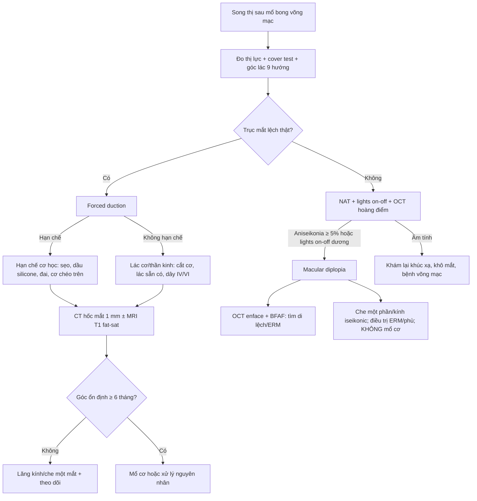
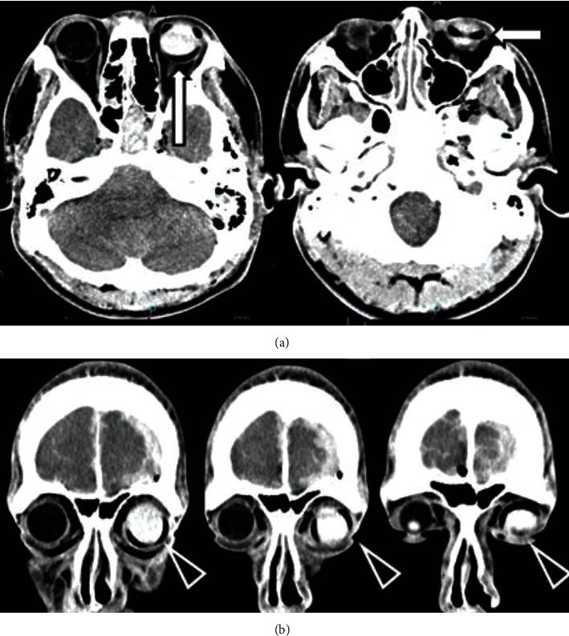
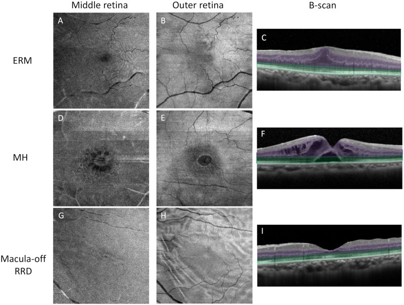
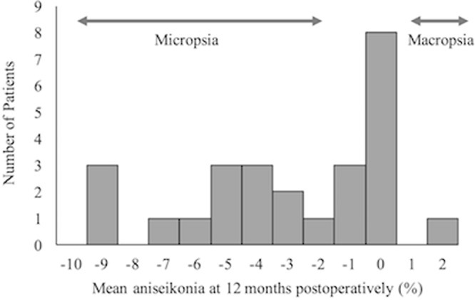
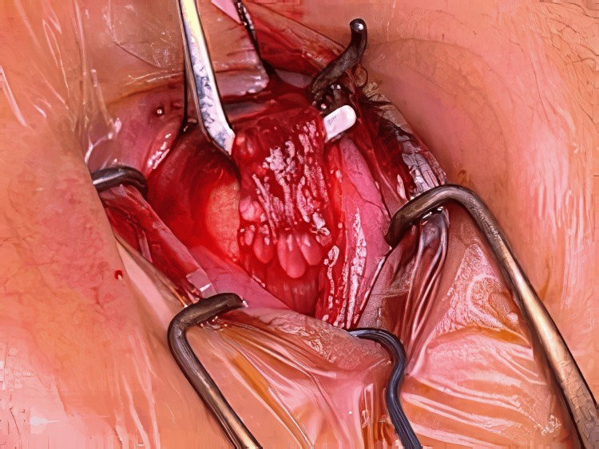

# 1499 — Song thị và lác sau mổ bong võng mạc KHÔNG do đai: cơ chế, phân biệt, khi nào lăng kính, khi nào mổ cơ / Diplopia and strabismus after retinal detachment repair without a buckle

**Tags:** `pattern:nhin-doi` `pattern:lac` `pattern:aniseikonia` `pattern:di-lech-vong-mac` `vung:mat` `vung:hoang-diem` `vung:hoc-mat` `anatomy:co-van-nhan` `protocol:OCT` `protocol:CT-hoc-mat` `protocol:MRI-hoc-mat` `protocol:do-goc-lac` `score:goc-lac-PD` `incidentaloma:dau-silicone`

**Mức chắc chắn (certainty):** tổng hợp y văn (literature synthesis) — dựng từ **sổ đăng ký 25.169 mắt** sau mổ bong võng mạc (*J AAPOS* 2025, **PMC12185234**), **tổng quan song thị sau mổ mắt** (*J Binocul Vis Ocul Motil* 2021, PMID 34752180), **26 mắt** đo aniseikonia sau bong hoàng điểm (*Sci Rep* 2019, **PMC6690871**, CC BY 4.0), **42 mắt** bong hoàng điểm đo metamorphopsia/aniseikonia (*PLoS One* 2020, **PMC7209121**, CC BY 4.0), **98 mắt** chụp huỳnh quang đáy mắt tìm di lệch võng mạc (*Medicina* 2026, **PMC12943232**, CC BY 4.0), **45 bệnh nhân** đo thị giác hai mắt sau cắt dịch kính (*Ophthalmol Ther* 2026, **PMC12976278**, CC BY 4.0), **25 bệnh nhân** mổ cơ sau đai (*J AAPOS* 2013, **PMC3870881**), **47 bệnh nhân** mổ cơ có/không tháo đai (*Acta Ophthalmol* 2022, DOI 10.1111/aos.14888), **40 mắt** tháo đai (*Korean J Ophthalmol* 2020, **PMC7738227**), **31 bệnh nhân** đeo lăng kính (*Indian J Ophthalmol* 2022, **PMC9023992**), tổng quan **macular diplopia** (*Cureus* 2026, **PMC13157677**, CC BY 4.0) và **2 ca dầu silicone trong cơ/hốc mắt** (*Cureus* 2023 **PMC10369194**; *Int J Surg Case Rep* 2026 **PMC13747450**, CC BY-SA 4.0). Nhóm **không có bệnh nhân của mình**; chỗ suy luận ghi **[suy luận]**.

> **Ranh giới với bài đã có:** [1493](../1493-bien-chung-dai-hoang-diem-khi-nao-thao/lesson.md) trả lời **biến chứng của đai hoàng điểm** và **khi nào tháo đai**; [1878](../1878-bong-vong-mac-lo-hoang-diem-can-thi-nang/lesson.md) chọn **đai hay cắt dịch kính**; [1879](../1879-mang-dut-hoang-diem-sau-mo-bong-vong-mac/lesson.md) phủ **màng đứt hoàng điểm sau mổ**; [1498](../1498-sieu-am-bscan-truoc-phaco-hau-doan/lesson.md) phủ **B-scan trước mổ**. Bài này trả lời câu hỏi **hay bị gộp nhầm**: *sau khi võng mạc đã áp — mà bệnh nhân nhìn đôi hoặc lác — nguyên nhân nào là **cảm giác (macular/sensory)** và nguyên nhân nào là **cơ học/thần kinh**, cận lâm sàng nào phân biệt, và **khi nào chỉ cần lăng kính, khi nào mới mổ cơ**.*

> **Câu chốt — năm con số phải thuộc:** **(1)** Song thị sau mổ bong võng mạc **không hiếm nhưng thường nhẹ**: **1,54%** sau bơm khí (PR), **2,28%** sau cắt dịch kính ± đai (PPV±SB), **2,73%** sau đai đơn thuần; mổ cơ chỉ **0,22–0,27%** (sổ đăng ký **25.169 mắt**, **PMC12185234**). **(2)** Sau bong **hoàng điểm**, **aniseikonia** vẫn còn **−3,1 ± 3,2%** ở 12 tháng (từ **−5,3%** ở 3 tháng); **54%** micropsia, **4%** macropsia, khoảng **−9% đến +2%** (**PMC6690871**) — đây là song thị **khi trục mắt bình thường**, nên **lăng kính và mổ cơ đều không sửa được**. **(3)** Bong hoàng điểm là yếu tố của **di lệch võng mạc**: **16,3%** mắt có di lệch, **81,25%** di lệch xuống dưới; trong nhóm di lệch **81,2%** là macula-off so với **51,2%** nhóm không di lệch (p = 0,027) — nhưng **0/98 bệnh nhân than song thị**, nên **di lệch không đồng nghĩa song thị** (**PMC12943232**). **(4)** Khi đã mổ cơ, thành công vận động **72%** (định nghĩa **< 10Δ ngang + < 4Δ dọc**, sau **1,8 ± 0,9** lần mổ) và **62%** hết song thị (**PMC3870881**); định nghĩa chặt **≤ 6 PD** cho **76%** (giữ đai) và **71%** (tháo đai), hết song thị **79%** và **93%** (DOI 10.1111/aos.14888). **(5)** Tháo đai để chữa lác là **đánh đổi**: tái bong **10%** chung, **25%** nếu đai vòng so với **0%** đai đoạn (p = 0,020) (**PMC7738227**); trong **2.375 mắt** đặt đai, chỉ **35 (1,5%)** phải tháo, tái bong **11%**, **3/4** ca tái bong xảy ra khi tháo **trong tháng đầu** (**PMC13326349**).

## 1. Tổng quan bệnh học – cơ chế hình ảnh

### 1.1 Hai loại song thị hoàn toàn khác nhau — và vì sao phải phân biệt trước khi kê đơn

- **Song thị cơ học/thần kinh (motor):** hai mắt **lệch trục thật**, ảnh rơi lên **hai điểm võng mạc không tương ứng**. Đo được bằng **cover test + lăng kính**, thay đổi theo hướng nhìn, và **giảm khi che một mắt**. Nguyên nhân: **hạn chế cơ học** (sẹo, dầu silicone trong cơ, đai), **mất cân bằng cơ** sau mổ, **liệt dây IV/VI**.
- **Song thị cảm giác (sensory/macular):** **trục mắt gần như thẳng hàng**, nhưng **một điểm vàng bị kéo lệch** (macular heterotopia) hoặc **kích thước ảnh hai mắt khác nhau** (aniseikonia). Não nhận **ảnh trung tâm không tương ứng** trong khi **hợp thị ngoại vi vẫn còn** — gọi là **central-peripheral rivalry (CPR)**. Đây là **macular diplopia / dragged-fovea diplopia syndrome (DFDS)**.
- **TẠI SAO phải phân biệt:** hai loại **điều trị ngược nhau**. Motor → **lăng kính** hoặc **mổ cơ**. Sensory → **lăng kính thường thất bại**, **mổ cơ không giúp** (thậm chí làm nặng thêm vì tạo lệch trục thật trên mắt đã có bất tương ứng trung tâm); điều trị là **che một phần, chỉnh kính, xử lý bệnh hoàng điểm** và **chờ thích nghi vỏ não**.

### 1.2 Vì sao "không đai" vẫn bị song thị — bốn cơ chế và con số

**(a) Bong hoàng điểm làm thay đổi khoảng cách tế bào cảm quang → aniseikonia.**
Khi võng mạc bong rồi áp lại, lớp tế bào cảm quang có thể **dãn ra hoặc co lại không đều**; cùng một vật ở hai mắt cho **hai kích thước ảnh** khác nhau. Đo bằng **New Aniseikonia Test (NAT)**: sau bong hoàng điểm, aniseikonia trung bình **−5,3 ± 4,2%** ở 3 tháng, **−4,4 ± 4,4%** ở 6 tháng, **−3,1 ± 3,2%** ở 12 tháng; **54%** micropsia, **4%** macropsia, **42%** không còn; biên độ **−9% đến +2%** (26 mắt, **PMC6690871**). Aniseikonia **giảm dần nhưng không về 0** — đúng với lâm sàng "nhìn đôi mãi dù mắt đã áp".

**(b) Di lệch võng mạc (retinal displacement) làm lệch điểm vàng.**
Trên **huỳnh quang đáy mắt xanh (blue-fundus autofluorescence, BFAF)**, mạch võng mạc bị **kéo lệch** so với vị trí giải phẫu ban đầu. Trong **98 mắt**, **16,3%** có di lệch, **81,25%** lệch xuống dưới (dịch dưới võng mạc di chuyển theo trọng lực dưới bóng khí), **18,75%** lệch lên; nhóm di lệch có **81,2% macula-off** so với **51,2%** nhóm không di lệch (p = 0,027) (**PMC12943232**). **Nhưng 0/98 bệnh nhân báo song thị** — nghĩa là **di lệch là điều kiện cần, không phải điều kiện đủ**: phần lớn não **bù trừ** được, chỉ một số ít có **aniseikonia vượt ngưỡng dung nạp** mới thành song thị.

**(c) Bệnh hoàng điểm thứ phát sau mổ.**
Màng trước võng mạc (epiretinal membrane, ERM) sau bong võng mạc **co kéo điểm vàng** theo phương tiếp tuyến. Trong **42 mắt bong hoàng điểm**, ở 6 tháng **35,7%** có metamorphopsia đáng kể và **52,3%** micropsia (**PMC7209121**). ERM là nguyên nhân **thường gặp nhất** của macular diplopia nói chung: trong **56 bệnh nhân ERM**, **21%** có song thị kiểu CPR; trong **50 bệnh nhân** ERM, **44% (11/25)** ca có song thị là do **bất tương ứng võng mạc**, **28% (7/25)** do lác thực sự, và **60% (15/25)** ca **không song thị** vẫn có bất tương ứng (trích trong tổng quan **PMC13157677**).

**(d) Thay đổi cơ học/viêm quanh cơ do dầu silicone.**
Dầu silicone có thể **thấm ra dưới kết mạc và vào cơ trực**, tạo **nang dầu + xơ hóa** quanh chỗ bám cơ — vừa gây **hạn chế**, vừa làm **mổ cơ khó hơn** (chảy máu, khó tách cơ). Ca **58 tuổi** sau nhiều lần mổ bong võng mạc có **nang dầu trong cơ trực ngoài**, mô học là **hoại tử mỡ + dầu silicone** (**PMC10369194**); ca **26 tuổi** có **nang dầu dưới kết mạc quanh cơ trực**, xơ hóa làm **thì mổ cơ kéo dài và chảy máu nhiều** (**PMC13747450**).

### 1.3 TẠI SAO hình ảnh lại quan trọng — nhưng không phải hình ảnh nào cũng trả lời cùng câu hỏi

- **CT/MRI hốc mắt** trả lời **cơ học**: đai củng mạc nằm đâu, có **dầu silicone trong hốc mắt/cơ** không, cơ có **to, lệch, dính** không, có **dị vật** không. Đây là phần **X-quang/CT/MRI** của bài.
- **OCT hoàng điểm (enface + B-scan) và BFAF** trả lời **cảm giác**: điểm vàng có **lệch**, **màng co kéo**, **mất lớp ellipsoid zone** không. Không thấy được trên CT/MRI thường quy.
- **Hai bẫy vật lý của CT:** **dầu silicone tăng đậm độ 106–139 HU**, **máu tụ 50–90 HU**, có ca dầu đo **~89 HU** nên **chồng lấp**; dầu nhẹ hơn nước (tỷ trọng 0,97) nhưng **giàu nguyên tử silic** nên vẫn **sáng hơn dịch kính** (PMC11883950). Ngược lại, **dải silicone vòng đai** là **cấu trúc giảm đậm độ** chạy dọc củng mạc — **không phải khí, không phải mảnh xương** (**PMC8238605**).

## 2. Mẫu hình + chẩn đoán phân biệt theo vị trí và theo thời điểm (gamut)

### 2.1 Mẫu hình chốt

**Bệnh nhân đã mổ bong võng mạc (PPV ± khí/dầu, hoặc bơm khí), võng mạc áp, đến khám vì "nhìn một thành hai" hoặc "mắt lác ra".** Ba câu hỏi theo thứ tự:

1. **Trục mắt có lệch thật không?** (cover test, đo góc bằng lăng kính, 9 hướng nhìn)
2. **Nếu lệch: có hạn chế cơ học không?** (forced duction; so sánh hai mắt)
3. **Nếu trục gần thẳng: có bất tương ứng võng mạc/aniseikonia không?** (NAT, M-CHARTS, lights on-off test, OCT/BFAF)

### 2.2 Gamut theo cơ chế — mnemonic **SILO**

- **S — Sensory (macular diplopia/DFDS):** trục thẳng, song thị **dọc nhiều hơn ngang** (biên độ hợp thị dọc hẹp hơn), **không đáp ứng lăng kính**, **giảm khi che một mắt hoặc trong ánh sáng mờ** (giảm hợp thị ngoại vi). Nguyên nhân: bong hoàng điểm, ERM sau mổ, di lệch võng mạc, phù hoàng điểm.
- **I — Incarceration/restriction (hạn chế cơ học):** hạn chế một hướng nhìn, **forced duction dương tính**, góc **không đổi theo thời gian**; do **sẹo xơ**, **dầu silicone trong cơ**, **đai củng mạc**, **dính cơ chéo trên** (đặc biệt sau đai: hạn chế nhìn xuống → nghi **giam giữ cơ chéo trên**).
- **L — Lệch trục do can thiệp (muscle imbalance):** lác **ngang** hoặc **dọc** xuất hiện ngay sau mổ, **không hạn chế** khi kéo thụ động; do **cắt/khâu cơ**, **chùng cơ**, hoặc **lác sẵn có bộc lộ** sau khi thị lực hồi phục.
- **O — Ophthalmoplegia (liệt thần kinh):** **dây IV** (song thị dọc, nặng khi nhìn xuống–vào trong, đầu nghiêng bù trừ), **dây VI** (song thị ngang khi nhìn xa, mắt quay vào trong); có thể **sẵn có** hoặc do **chấn thương/gây mê**. Đây là nhóm **hiếm** sau PPV đơn thuần.

**Ngoài SILO — hai bệnh cảnh "bắt chước":**
- **Lác do mất thị lực (sensory exotropia):** mắt kém thị lực lâu năm **lác ra ngoài**, **không song thị** vì đã **ức chế**; mổ cơ chỉ để thẩm mỹ, **không phải để hết song thị**.
- **Tái bong võng mạc:** thị lực **giảm mới**, ám điểm, **không giải thích bằng lác**; phải soi đáy mắt/B-scan **trước khi** quy mọi triệu chứng cho cơ vận nhãn.

### 2.3 Gamut theo thời điểm

| Thời điểm | Cơ chế hay gặp | Hướng xử lý |
|---|---|---|
| **0–6 tuần** | Phù nề cơ/kết mạc sau mổ, bóng khí, dầu silicone còn trong mắt, **lác do phù tạm thời** | Theo dõi; đo lại sau khi hết phù; **chưa mổ cơ** |
| **6 tuần – 6 tháng** | **Bộc lộ lác sẵn có**, **aniseikonia** sau bong hoàng điểm, **ERM sớm**, **xơ hóa quanh cơ** | Đo lặp lại; lăng kính/che một mắt; OCT hoàng điểm; **chưa vội mổ** |
| **> 6 tháng** | **Hạn chế cơ học cố định**, **lác ổn định**, **đai/dầu silicone di chuyển**, **ERM tiến triển** | Cân nhắc **mổ cơ** hoặc **xử lý nguyên nhân**; chụp CT/MRI nếu nghi cơ học |

## 3. Bảng so sánh phân biệt (ma trận đối chiếu)

| Thực thể (entity) | Hình ảnh/lâm sàng điển hình | Chốt vào (rule-in) | Chốt loại (rule-out) | Gợi ý xác nhận |
|---|---|---|---|---|
| **Macular diplopia (DFDS)** | Trục gần thẳng; song thị **dọc**, hằng định; thị lực có thể tốt; OCT: **lệch điểm vàng, ERM, mất hõm** | **Lights on-off test dương** (hết song thị khi loại hợp thị ngoại vi); **aniseikonia ≥ 5%**; **prism không cải thiện** | Lác đo được **> 10Δ** và đáp ứng lăng kính → không phải DFDS đơn thuần | NAT + M-CHARTS + OCT enface/BFAF; hỏi "nhìn đôi khi đọc sách" |
| **Aniseikonia do bất tương ứng kích thước ảnh** | Nhìn đôi + **méo hình**, đau đầu khi đọc; hai mắt khác khúc xạ/IOL | **NAT ≥ 5%**; song thị **giảm khi che một mắt**; **không đổi theo hướng nhìn** | Đo góc lác thay đổi theo hướng → lác cơ học | NAT; thử **kính iseikonic**; OCT tìm nguyên nhân hoàng điểm |
| **Hạn chế cơ học do sẹo/dầu silicone/đai** | Hạn chế **một hướng**, góc lớn, không tiến triển; tiền sử **tháo dầu/mổ lại**; CT/MRI: **dầu trong cơ/hốc mắt**, đai **giảm đậm độ**, cơ dày/dính | **Forced duction dương tính**; **CT/MRI thấy vật liệu hoặc cơ dính**; góc **không đổi sau 6 tháng** | Forced duction âm + góc thay đổi → lác do cơ/thần kinh | CT hốc mắt **≤ 1 mm** + MRI T1 fat-sat; so sánh cơ hai bên |
| **Lác do cắt/khâu cơ hoặc lác sẵn có** | Lác **ngang** (hay gặp) hoặc dọc, xuất hiện **ngay sau mổ**; không hạn chế | **Forced duction âm**; đo góc **ổn định ≥ 6 tháng**; tiền sử **cắt cơ/chỉnh cơ** | Hạn chế rõ + đau/đỏ → nghĩ sẹo/dầu | Đo 9 hướng + lăng kính; Hess/Lancaster |
| **Liệt dây IV (trochlear)** | Song thị **dọc**, nặng khi **nhìn xuống–vào trong**, **nghiêng đầu về bên đối diện**; có thể **bẩm sinh bù trừ** | **Parks 3 bước** dương; **tour torsion**; độ lệch **tăng khi nghiêng đầu** | Không đổi theo tư thế đầu → không phải liệt IV | Đo độ xoắn (Maddox đôi); MRI sọ chỉ khi nghi nguyên nhân trung ương |
| **Liệt dây VI (abducens)** | Song thị **ngang**, nặng khi **nhìn xa**; mắt **quay vào trong** ở thì nhìn ngang | **Hạn chế dạng**; góc **lớn hơn khi nhìn về bên liệt** | Góc như nhau mọi hướng → lác cơ học/comitant | Cover test xa–gần; đo dạng; theo dõi 6 tháng |
| **Lác do mất thị lực (sensory exotropia)** | Mắt **lác ngoài**, thị lực kém, **không song thị** | **Không có song thị**; góc lớn, ổn định; tiền sử thị lực kém lâu năm | Bệnh nhân **than nhìn đôi** → không phải đơn thuần sensory exotropia | Soi đáy mắt; đo thị lực; OCT |
| **Tái bong võng mạc** | Thị lực **giảm mới**, ám điểm, có thể **lác mới**; B-scan/OCT bất thường | **Bong trên OCT/B-scan**; thị lực giảm **không tương xứng** với lác | Đáy mắt áp, OCT ổn định → loại trừ | Soi đáy mắt + B-scan khi không thấy đáy; chụp lại OCT |

## 4. Protocol chụp – đọc – quyết định + ngưỡng xử trí

### 4.1 Thăm khám chức năng (làm trước mọi hình ảnh)

- **Đo thị lực từng mắt + khúc xạ** (không có ngưỡng hình ảnh nào thay được bước này).
- **Cover test xa và gần**, **đo góc lác bằng lăng kính** ở **9 hướng nhìn**, ghi **PD** (prism diopter); đo **góc nguyên phát** và **góc ở hướng chức năng** (đọc sách, lái xe).
- **Forced duction test** (kéo thụ động): **dương tính = hạn chế cơ học**; **âm tính = lác do cơ/thần kinh**. Đây là **nghiệm pháp rẻ nhất** phân đôi hai nhóm.
- **Đo xoắn** bằng **Maddox đôi** khi nghi dây IV; **Parks 3 bước** khi song thị dọc.
- **NAT** (aniseikonia) và **M-CHARTS** (metamorphopsia) khi trục gần thẳng; **lights on-off test** khi nghi DFDS.

### 4.2 Hình ảnh — chọn theo câu hỏi, không chụp tràn lan

| Câu hỏi lâm sàng | Modality đầu tay | Ngưỡng/thông số cần ghi | Ghi chú |
|---|---|---|---|
| **Có đai, dầu silicone, dị vật trong hốc mắt/cơ không?** | **CT hốc mắt không cản quang, lát ≤ 1 mm**, axial + coronal, cửa sổ xương và mô mềm | **Dầu 106–139 HU** (chồng lấp máu **50–90 HU**); **dải đai giảm đậm độ** | Không chẩn đoán "xuất huyết" chỉ vì đậm độ cao khi có tiền sử bơm dầu |
| **Cơ có to, lệch, dính, thiếu không?** | **MRI hốc mắt T1 fat-sat ± gadolinium + T2 fat-sat**, lát ≤ 2 mm | Độ dày cơ so với bên đối diện; vị trí chỗ bám; tín hiệu xơ (T2 thấp) | T1 fat-sat giúp tách cơ khỏi mỡ; gadolinium cho viêm/u |
| **Điểm vàng có lệch/co kéo?** | **OCT hoàng điểm (B-scan + enface)**; **BFAF** | Lệch mạch/điểm vàng; mất lớp ellipsoid zone; ERM | OCT là **chuẩn** cho DFDS; BFAF thấy di lệch |
| **Không nhìn được đáy mắt?** | **B-scan 10 MHz** (bài 1498) | Bong võng mạc, màng, dầu | Không loại trừ rách nhỏ < 0,2–0,5 mm |
| **Nghi liệt dây IV/VI trung ương** | **MRI sọ + hốc mắt** có gadolinium | Đường đi dây thần kinh, ổ tổn thương | Chỉ khi **không giải thích được bằng cơ học** hoặc có dấu thần kinh khác |

### 4.3 Ba ngưỡng định lượng quyết định điều trị

| Ngưỡng | Con số | Ý nghĩa thực hành |
|---|---|---|
| **Aniseikonia** | **≥ 5%** được xem là đáng kể trong loạt DFDS (**5–18%** ở 7 ca) | **≥ 5% + trục thẳng** → nghĩ sensory; **không mổ cơ**; thử kính/che một phần |
| **Góc lác mổ cơ thành công** | **< 10Δ ngang + < 4Δ dọc** (PMC3870881) hoặc **≤ 6 PD** (DOI 10.1111/aos.14888) | Nói với bệnh nhân **"thành công" phụ thuộc định nghĩa**; đừng hứa hết song thị 100% |
| **Thời điểm mổ cơ** | **≥ 6 tháng** sau mổ bong võng mạc, khi góc **ổn định** | Chờ để **phù/xơ ổn định** và **aniseikonia giảm**; ngoại lệ: **hạn chế cơ học rõ**, **đai lộ/nhiễm**, **song thị không dung nạp** |

**Số liệu để tư vấn (không phải lời hứa):**
- **Lăng kính:** 31 bệnh nhân, liều trung bình **13,3 PD**, **87%** hết song thị hoàn toàn, **96,8%** tiếp tục dùng; hiệu quả cao ở **lác mất bù, liệt dây VI và IV** (**PMC9023992**). Đây là **bước đệm** hợp lý trong 6 tháng chờ.
- **Mổ cơ:** **72%** thành công vận động, **62%** hết song thị, trung bình **1,8 lần mổ** (25 bệnh nhân, **PMC3870881**); **76%/71%** thành công vận động và **79%/93%** hết song thị khi **giữ/tháo đai** (47 bệnh nhân, DOI 10.1111/aos.14888). **Góc ngang nhỏ** và **hạn chế tối thiểu** là yếu tố tiên lượng tốt.
- **Tháo đai:** **không** cải thiện kết quả mổ cơ trong loạt 25 bệnh nhân (**PMC3870881**); **tái bong 10%** chung, **25%** với đai vòng (**PMC7738227**); trong **2.375 mắt**, **1,5%** phải tháo, tái bong **11%**, **3/4** xảy ra khi tháo **< 1 tháng** (**PMC13326349**). Vì vậy **chỉ tháo đai khi có lý do riêng** (lộ, nhiễm, đau, đai di chuyển ra trước gây hạn chế), **không tháo "để chữa lác"**.

## 5. Biến thể bình thường và cạm bẫy

### 5.1 Biến thể bình thường dễ nhầm

- **Song thị thoáng qua sau mổ:** phù kết mạc/cơ, bóng khí, dầu silicone còn trong mắt trong **6 tuần đầu**; **không** chẩn đoán lác cố định.
- **Lác sẵn có bị "bộc lộ":** bệnh nhân có **lác ẩn (phoria)** hoặc **vi lác** từ trước; khi mắt kém **bị che/băng** hoặc khi **thị lực hai mắt chênh** sau mổ, lác **mất bù** — hỏi **ảnh cũ, tiền sử lác, tiền sử đeo kính**.
- **Lệch trục nhẹ do kính mới:** thay đổi khúc xạ/IOL sau mổ gây **aniseikonia nhẹ**; đo lại khúc xạ trước khi quy cho cơ.
- **Dầu silicone "tăng đậm độ" trên CT:** **không phải máu tụ**; dầu nhẹ hơn nước nhưng **106–139 HU** do nguyên tử silic (**PMC11883950**), có ca **~89 HU**. **Dải đai silicone** lại **giảm đậm độ** (**PMC8238605**) — hai vật liệu **ngược tín hiệu**, dễ đọc sai nếu không hỏi tiền sử.

### 5.2 Cạm bẫy (pitfall)

- **Gọi macular diplopia là "lác" rồi mổ cơ:** trục gần thẳng, prism không cải thiện, **mổ cơ không giúp** và có thể **làm song thị nặng hơn**. Dấu hiệu gợi ý: song thị **dọc**, **hằng định**, **giảm khi che một mắt/ánh sáng mờ**, có **ERM/di lệch điểm vàng** trên OCT.
- **Bỏ sót tái bong võng mạc:** bệnh nhân "lác mới + nhìn mờ" — **soi đáy mắt/B-scan trước**, đừng chỉ đo góc lác.
- **Đo góc quá sớm rồi mổ:** trong **6 tháng đầu**, phù/xơ còn thay đổi; mổ sớm dễ **quá chỉnh** hoặc **tái phát**.
- **Tháo đai "cho nhanh":** tái bong **10%** (đai vòng **25%**), và **không** cải thiện kết quả mổ cơ trong loạt 25 bệnh nhân — **chỉ tháo khi có chỉ định riêng**.
- **Quên dầu silicone trong cơ:** nang dầu + xơ hóa làm **mổ cơ khó**, chảy máu, không tìm thấy cơ; **CT/MRI trước mổ** giúp lập kế hoạch (**PMC10369194**, **PMC13747450**).
- **Satisfaction of search:** thấy lác là dừng, **bỏ sót ERM/phù hoàng điểm** — luôn **OCT hoàng điểm** khi có song thị sau bong hoàng điểm.
- **"Di lệch võng mạc = song thị":** **sai**. **16,3%** mắt có di lệch nhưng **0/98** than song thị (**PMC12943232**); di lệch chỉ thành triệu chứng khi **aniseikonia vượt ngưỡng**.

## 6. Tự lượng giá — Blind Quiz

**Ca 1 — Nam 18 tuổi, chấn thương đầu, CT sọ–mắt được chụp tại cấp cứu. Nhìn ảnh trước, mô tả hai cấu trúc bất thường.**

- Gợi ý lâm sàng: bệnh nhân **hôn mê sau tai nạn**, không khai thác được tiền sử mắt; CT được đọc ban đầu là "xuất huyết nội nhãn".
- Câu hỏi: (1) Cấu trúc **tăng đậm độ** trong nhãn cầu trái là gì? (2) Đường **giảm đậm độ** chạy dọc củng mạc là gì? (3) Câu hỏi nào phải hỏi người nhà trước khi kết luận xuất huyết?

<b>Bấm để hiện đáp án (findings + chẩn đoán)</b>

- **Findings:** (a) axial: nhãn cầu trái **tăng đậm độ toàn bộ** (đầu mũi tên đen) + **đường giảm đậm độ mảnh** chạy theo củng mạc (mũi tên trắng); (b) coronal: **vòng đai giảm đậm độ** quanh củng mạc (đầu mũi tên).
- **Chẩn đoán:** **dầu silicone nội nhãn** (tăng đậm độ, **106–139 HU**, dễ nhầm máu tụ **50–90 HU**) + **đai silicone vòng** (giảm đậm độ) sau mổ bong võng mạc. **Không phải xuất huyết**, **không phải khí**.
- **Vì sao:** dầu silicone nhẹ hơn nước (0,97) nhưng **giàu silic** → **tăng đậm độ** trên CT; dải đai silicone **giảm đậm độ**. **Tiền sử mổ mắt** là chốt.
- **Nguồn ảnh:** *Case Rep Emerg Med* 2021, **PMC8238605**, Fig. 1, **CC BY 4.0** (nguyên bản).

**Ca 2 — Nữ 67 tuổi, 6 tháng sau cắt dịch kính + khí vì bong hoàng điểm; võng mạc áp, thị lực 0,5. Nhìn đôi khi đọc sách, không nhìn đôi khi lái xe. Ảnh OCT enface và B-scan.**

- Gợi ý: **hai mắt thẳng hàng** trên cover test; đo góc **2Δ dọc**; **NAT 6%**; **prism 3Δ không đỡ**.
- Câu hỏi: (1) Tổn thương trên OCT thuộc nhóm nào? (2) Vì sao lăng kính và mổ cơ **không** giải quyết song thị? (3) Bước tiếp theo?

<b>Bấm để hiện đáp án (findings + chẩn đoán)</b>

- **Findings:** hàng dưới (macula-off RRD) — **enface lớp giữa/ngoài**: nếp và **mất hõm hoàng điểm**; B-scan: **võng mạc áp nhưng bề mặt không đều**, không có lỗ.
- **Chẩn đoán:** **macular diplopia/DFDS** sau bong hoàng điểm — **bất tương ứng võng mạc + aniseikonia 6%**, không phải lác thật. **Prism không sửa được vì ảnh khác kích thước**, không phải lệch trục; **mổ cơ càng sai**.
- **Bước tiếp theo:** **che một phần/che luân phiên**, **kính iseikonic** nếu dung nạp, điều trị **ERM/phù** nếu có; **không mổ cơ**; theo dõi thích nghi 3–6 tháng.
- **Nguồn ảnh:** *PLoS One* 2020, **PMC7209121**, Fig. 3, **CC BY 4.0** (nguyên bản).

**Ca 3 — Nữ 58 tuổi, 12 tháng sau mổ bong hoàng điểm; than "hình nhỏ bên mắt mổ". Biểu đồ aniseikonia 12 tháng của một loạt 26 mắt.**

- Gợi ý: thị lực **0,8**; cover test **1Δ**; **NAT −4%**; không có ERM.
- Câu hỏi: (1) Trục hoành ghi gì và đơn vị? (2) Bao nhiêu % bệnh nhân còn **micropsia** ở 12 tháng? (3) Có nên mổ cơ **1Δ** không?

<b>Bấm để hiện đáp án (findings + chẩn đoán)</b>

- **Findings:** trục hoành = **aniseikonia trung bình ở 12 tháng (%)**, từ **−10% đến +2%**; cột cao nhất ở **0%**, nhưng **14/26 (54%)** ở phía **micropsia**, **1/26 (4%)** macropsia; **42%** không còn.
- **Chẩn đoán:** **aniseikonia tồn dư sau bong hoàng điểm** — **micropsia** ở mắt mổ. **Không mổ cơ** cho góc **1Δ**; giải thích **giảm dần nhưng có thể còn** (trung bình **−3,1%** ở 12 tháng).
- **Vì sao:** khoảng cách tế bào cảm quang thay đổi sau bong → **kích thước ảnh** khác; **lăng kính chỉ dịch ảnh**, không **đổi kích thước ảnh**.
- **Nguồn ảnh:** *Sci Rep* 2019, **PMC6690871**, Fig. 2, **CC BY 4.0** (nguyên bản).

**Ca 4 — Nữ 58 tuổi, nhiều lần mổ bong võng mạc + dầu silicone, lác ngoài mắt trái. Ảnh trong mổ.**

- Gợi ý: **không hạn chế** khi kéo thụ động; CT trước mổ **không thấy bất thường trong cơ** (cửa sổ mô mềm).
- Câu hỏi: (1) Nang trong cơ là gì? (2) Vì sao CT có thể **âm tính**? (3) Điều này thay đổi kế hoạch mổ thế nào?

<b>Bấm để hiện đáp án (findings + chẩn đoán)</b>

- **Findings:** nhiều **nang nhỏ, trong, bám chắc vào cơ trực ngoài**; mô học **hoại tử mỡ + dầu silicone**.
- **Chẩn đoán:** **dầu silicone thấm vào cơ trực ngoài**. CT có thể **âm tính** vì **lượng dầu nhỏ, nằm trong cơ** và **cửa sổ mô mềm** không đủ tương phản; MRI T1/T2 fat-sat nhạy hơn với **dầu trong mô mềm** [suy luận].
- **Kế hoạch:** cảnh báo **mổ cơ khó, chảy máu, dính**; có thể cần **MRI trước mổ**; trong mổ **lấy nang, cầm máu kỹ**, rồi **recession/resection** như ca này đã thành công.
- **Nguồn ảnh:** *Cureus* 2023, **PMC10369194**, Fig. 1, **CC BY 4.0** (nguyên bản).

## Bài liên quan chéo
- [400 – Tổng quan Mắt & thị giác](../400-tong-quan-mat-thi-giac/lesson.md)
- [1493 – Biến chứng đai hoàng điểm: song thị, lộ đai, khi nào tháo](../1493-bien-chung-dai-hoang-diem-khi-nao-thao/lesson.md)
- [1878 – Bong võng mạc lỗ hoàng điểm: đai hay cắt dịch kính](../1878-bong-vong-mac-lo-hoang-diem-can-thi-nang/lesson.md)
- [1879 – Màng đứt hoàng điểm sau mổ bong võng mạc](../1879-mang-dut-hoang-diem-sau-mo-bong-vong-mac/lesson.md)
- [445 – Bong võng mạc](../445-bong-vong-mac/lesson.md)
- [1497 – Tái phát bờ sau xạ melanoma hắc mạc](../1497-tai-phat-bo-sau-xa-ban-mach-melanoma-hac-mac/lesson.md)
- [1498 – B-scan trước phẫu thuật đục thể thủy tinh](../1498-sieu-am-bscan-truoc-phaco-hau-doan/lesson.md)

## Ảnh
- Tên file theo quy ước `1499_slug_Modality_SourceID.jpg`; nguồn + giấy phép từng ảnh trong [`images/CREDITS.md`](images/CREDITS.md).
- **4 ảnh CC BY 4.0**: **PMC8238605** (CT), **PMC7209121** (OCT enface + B-scan), **PMC6690871** (biểu đồ aniseikonia), **PMC10369194** (ảnh trong mổ). Tất cả dùng **nguyên bản**, không crop/ghép.

> Không dùng để chẩn đoán độc lập khi chưa có người hướng dẫn.
