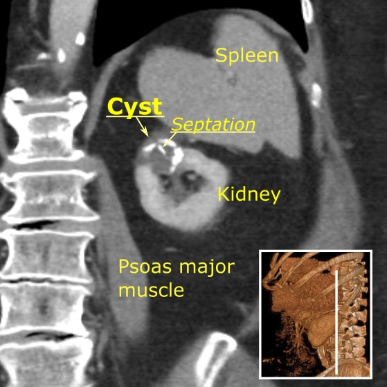
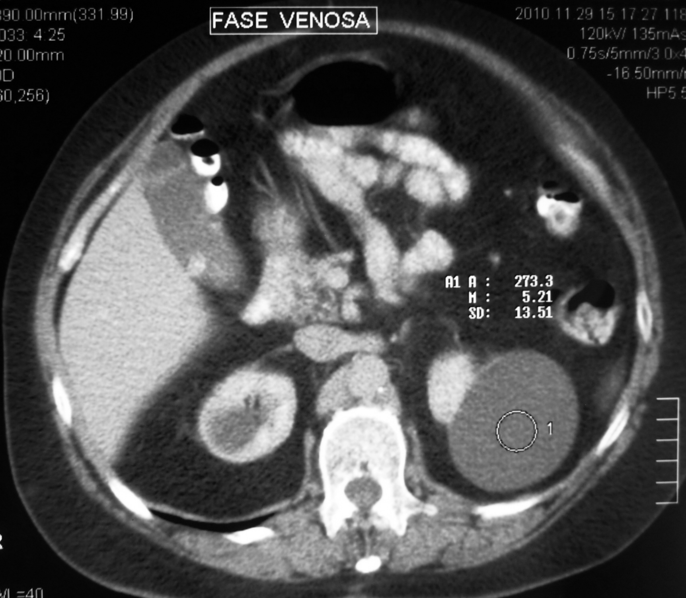

# 150 — Nang thận Bosniak v2019 & u thận / Bosniak cysts & Renal masses

**Tags:** `pattern:nang-than` `vung:than` `score:Bosniak`
**Mức chắc chắn (certainty):** tổng hợp y văn (literature synthesis) — nhóm tự biên từ y văn mở, chưa gắn ca nguyên văn đơn lẻ.

## 1. Tổng quan — ngấm thật đo bằng HU + thì thận 90–100s

- **Ngấm thật (true enhancement):** tăng **≥ 20 HU** khi đo ROI cùng vị trí trước tiêm vs thì ống thận (**nephrographic 90–100s**); tăng < 10 HU = giả ngấm (pseudoenhancement); MRI ≥ 15%.
- TẠI SAO thì thận mới chuẩn: nhu mô ngấm đều nhất, vách/nốt ngấm lộ rõ; thì ĐM sớm dễ bỏ sót, thì muộn loãng thuốc.
- U đặc thận: ung thư tế bào sáng (clear cell — giàu mạch, hoại tử) vs nhú (kém ngấm) vs kỵ màu vs u cơ mỡ mạch (AML — mỡ đại thể).

## 2. Thang Bosniak v2019 (số nhớ nằm lòng)

| Bosniak | Tiêu chí | Ác tính | Xử trí |
|---|---|---|---|
| I | Nang đơn thuần, thành mỏng, không vách/vôi/ngấm | ~0% | Bỏ qua |
| II | Vách mỏng ≤ 3 + vôi nhỏ + **nang đặc ≥ 70 HU không tiêm** (xuất huyết/protein) | ~0% | Bỏ qua |
| IIF | Nhiều vách (≥ 4) hoặc vách dày nhẵn **3 mm** ngấm; theo dõi | 5–10% | **CT/MRI 6–12 tháng** |
| III | Thành/vách dày **≥ 4 mm** ngấm hoặc gồ ghề ≤ 3 mm (góc tù) | ~50% | **Cắt bán phần / theo dõi sát** |
| IV | **Nốt đặc ngấm thuốc** (lồi ≥ 4 mm hoặc góc nhọn) | ~90% | **Phẫu thuật** |

*Bosniak IIF: nang 3 cm + vôi hóa thành/vách, không ngấm. Nguồn: Häggström, CC0.*

*Nguồn: SCiardullo, CC BY-SA 4.0.*

## 3. Bảng u đặc thận

| U | Hình ảnh | Chốt |
|---|---|---|
| RCC tế bào sáng | Giàu mạch + hoại tử + huyết khối TM thận | Ngấm mạnh không đều + huyết khối TM |
| RCC nhú | Kém ngấm, đồng nhất | Kém mạch + đa ổ 2 bên |
| AML | **Mỡ đại thể** trong u | Mỡ = u cơ mỡ mạch (AML) (trừ TSC chảy máu/Wunderlich) |
| Oncocytoma | Sẹo trung tâm + ngấm đều | Không phân biệt chắc với RCC → mổ/sinh thiết |

## 4. Protocol CT thận

- Trước tiêm (đo HU nền + vôi/mỡ/máu) + thận 90–100s (đo ngấm) + muộn (bài tiết, u đường niệu).
- ROI cùng vị trí 3 thì, tránh vôi/vùng hoại tử khi đo.

## 5. Cạm bẫy

- **Giả ngấm nang nhỏ (< 1 cm)** do trung bình thể tích — lát mỏng + MRI xác nhận.
- **RCC nang hóa** giả Bosniak III — nốt ngấm dù nhỏ cũng lên IV.
- **AML nghèo mỡ** giả RCC — MRI chemical-shift (mỡ vi thể) + sinh thiết.

## 6. Tự lượng giá — Blind Quiz

**Ca 1 — Nang 3 cm + vôi hóa thành/vách, đo không ngấm. Bosniak mấy?**

- Hỏi: vôi hóa có nâng Bosniak không? Ngấm không? Xử trí?

<b>Bấm để hiện đáp án</b>

- **Bosniak IIF:** vôi hóa + vách nhưng **không ngấm** — theo dõi 6–12 tháng (vôi hóa đơn độc không lên III).
- Nguồn: Häggström, CC0.

**Ca 2 — Nang + nốt đặc ngấm lồi 5 mm góc nhọn:** Bosniak mấy? Xử trí? *(Bảng mục 2.)*

<b>Bấm để hiện đáp án</b>

- **Bosniak IV (~90% ác):** nốt đặc ngấm — phẫu thuật (đối chiếu ảnh IV trong CREDITS).

## Bài liên quan chéo
- [100 – Tổng quan hệ Bụng](../100-tong-quan-he-bung/lesson.md)
- [110 – Giải phẫu bụng](../110-giai-phau-bung/lesson.md) (khoang quanh thận)
- [152 – Sỏi/ứ nước (dự kiến)](../152-soi-nieu/lesson.md)

> Không dùng để chẩn đoán độc lập khi chưa có người hướng dẫn.
