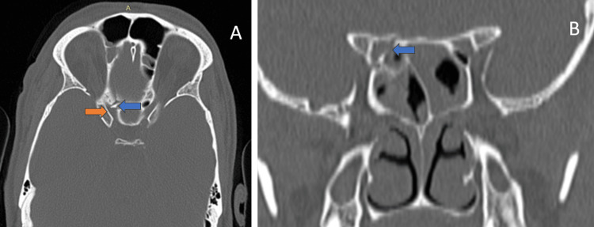
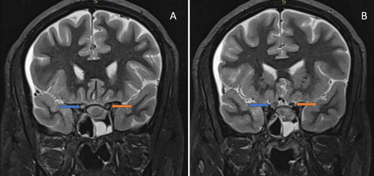
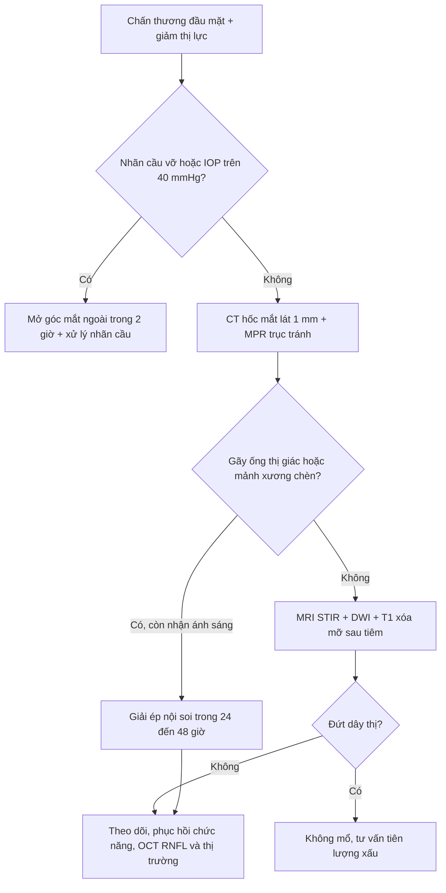
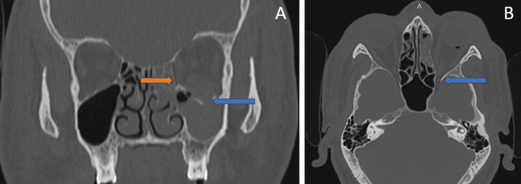
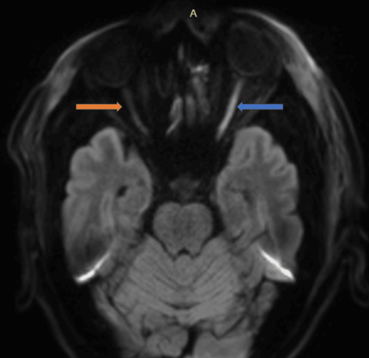
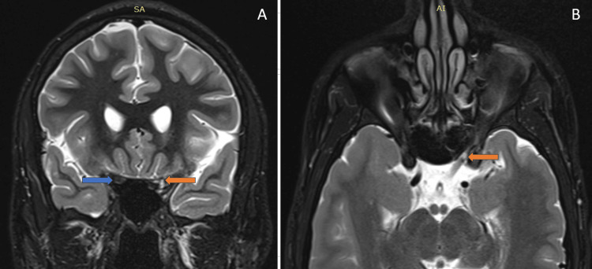

# 1501 — Chấn thương thị thần kinh: CT tìm gãy ống thị giác, MRI STIR/DWI tìm phù – đứt dây, khi nào giải ép / Traumatic optic neuropathy

**Tags:** `pattern:gay-ong-thi-giac` `pattern:phu-day-thi` `pattern:han-che-khuech-tan` `pattern:dut-day-thi` `pattern:mat-thi-luc-sau-chan-thuong` `vung:than-kinh-thi` `vung:mat` `vung:hoc-mat` `vung:giao-thoa-thi` `anatomy:ong-thi-giac` `protocol:CT-hoc-mat` `protocol:MRI-hoc-mat` `protocol:OCT-RNFL` `protocol:thi-truong` `score:khong` `incidentaloma:khong`

**Mức chắc chắn (certainty):** tổng hợp y văn (literature synthesis) — ghép **loạt 5 ca nguyên văn** có CT + MRI (*Cureus* 2024;16(12):e75546 — **PMC11722660**, CC BY 4.0), **phân tích gộp 23 nghiên cứu / 1.851 bệnh nhân** (*Arch Acad Emerg Med* 2025 — **PMC11635542**, CC BY-NC 4.0), **tổng quan hệ thống điều trị** (*Eye (Lond)* 2024 — **PMC11306366**, CC BY 4.0) và **tổng quan hệ thống TON** (*J Ophthalmol* 2021 — **PMC7935564**, CC BY 4.0). Nhóm **không có bệnh nhân của mình**; chỗ suy luận ghi **[suy luận]**.

> **Ranh giới với bài đã có:** [449](../449-chan-thuong-mat-dich-vat/lesson.md) phủ **vỡ nhãn cầu & dị vật nội nhãn**; [420](../420-vo-san-hoc-mat/lesson.md) phủ **gãy sàn hốc mắt, kẹt cơ và hội chứng khoang (OCS)**; [1461](../1461-ap-xe-duoi-mang-xuong-hoc-mat-o-tre/lesson.md) phủ **áp-xe dưới màng xương hốc mắt**; [1458](../1458-benh-than-kinh-thi-do-xa-o-tre/lesson.md) phủ **bệnh thị do xạ**. Bài này trả lời câu hỏi hẹp hơn nhưng hay bị bỏ sót: **sau chấn thương đầu–mặt, thị lực giảm mà nhãn cầu còn nguyên — chụp gì, tìm dấu gì, và khi nào can thiệp**.

> **Câu chốt — năm con số phải thuộc:** **(1)** TON chiếm **0,7–2,5%** chấn thương đầu–mắt (**PMC7935564**) và tới **8%** ở chấn thương sọ não (TBI, **PMC11306366**). **(2)** Tổn thương nằm **trong ống thị giác 71,4%**, đỉnh hốc mắt **16,7%**, cả hai **11,9%** (n = 42, bài gốc) — nơi lòng ống chỉ **~4–5 mm**. **(3)** Cải thiện thị lực gộp **50,6%** (23 nghiên cứu, **1.851** bệnh nhân): corticoid **56,2%**, corticoid + giải ép **42,9%**, theo dõi đơn thuần **47,8%**, I² **89,9%** → **không phương thức nào trội** (**PMC11635542**). **(4)** **Ba RCT** (methylprednisolone, erythropoietin, levodopa–carbidopa) **không** chứng minh lợi ích; liều cao IVMP còn **tăng tử vong** trong TBI (**PMC11306366**). **(5)** Ca trực tiếp có **mảnh xương 5 mm** chèn dây thị: giải ép nội soi + corticoid → thị lực từ **không nhận ánh sáng** lên **6/60** (bài gốc).

## 1. Tổng quan bệnh học – cơ chế hình ảnh (TẠI SAO)

### 1.1 Giải phẫu: 50 mm, bốn đoạn, một "eo" không có dự trữ

- Dây thị dài **50 mm**: đoạn trong nhãn cầu **1 mm**, trong ổ mắt **24 mm**, **trong ống thị giác 9 mm**, nội sọ **16 mm** (bài gốc). Lòng ống thị giác chỉ **~4–5 mm** cho dây thị **~3–4 mm** + vỏ myelin + màng não → gần như **không còn khoảng đệm**.
- **Điểm yếu cơ học:** chỗ nối **đoạn động (trong ổ mắt)** với **đoạn cố định (trong ống)**. Lực xoay–cắt (**shear**) dồn đúng vào đây, đồng thời **mạch màng mềm (pial vessels)** nuôi dây thị bị kéo giãn.
- Dây thị là **chất trắng của hệ thần kinh trung ương** (myelin do tế bào ít nhánh tạo), **không tái sinh**. Vỏ xương kín biến **phù thành chèn ép**, khác hẳn phù ở mô mềm tự do.

### 1.2 Hai cơ chế — và vì sao tiên lượng khác nhau

- **Trực tiếp (direct TON):** mảnh xương hoặc gãy ống thị giác **đâm, chèn, rách** dây thị. Tổn thương **cấu trúc** → ít hồi phục; nhưng **nếu còn chèn ép cơ học thì giải ép mới có ý nghĩa** (ca 1: mảnh **5 mm**).
- **Gián tiếp (indirect TON):** lực truyền qua xương mặt–sọ → **cắt sợi trục + tổn thương mạch pial → thiếu máu**, **không** có mảnh xương. Đây là thể **thường gặp nhất**; CT có thể **hoàn toàn bình thường**.
- **Vòng xoắn bệnh lý:** chấn thương → phù sợi trục + chảy máu nhỏ → trong ống xương kín **áp lực mô tăng** → giảm tưới máu mao mạch → thiếu máu → phù thêm. Tế bào hạch võng mạc (retinal ganglion cells) chết **thứ phát** trong nhiều tuần (apoptosis) → **lớp sợi thần kinh võng mạc (RNFL) mỏng dần** dù thị lực đã ổn định.
- Vì vậy **thời điểm** quan trọng hơn "liều thuốc": dây thị thiếu máu **không hồi phục sau 60–90 phút** — cùng nguyên lý hội chứng khoang ở bài [420](../420-vo-san-hoc-mat/lesson.md).

### 1.3 TẠI SAO CT thấy xương mà KHÔNG thấy dây thị

- Xương đặc **~1.000–2.000 HU**, mô mềm hốc mắt **~30–40 HU**, mỡ sau nhãn cầu **−60 đến −100 HU**: trên **cửa sổ xương**, dây thị **biến mất** trong mỡ. Câu hỏi của CT **không phải** "dây thị có phù không" mà là "**có gãy ống thị giác, có mảnh xương chèn, có máu trong xoang bướm**".
- Mảnh xương **1–2 mm** nằm trong mặt phẳng lát cắt → **hiệu ứng thể tích riêng phần (partial volume)** vừa **che mất** mảnh thật, vừa **tạo giả gãy**. Bắt buộc **lát ≤ 1 mm + dựng đa bình diện (MPR)** trục/tránh/đứng dọc.
- **CT là chuẩn để lập kế hoạch mổ** (bài gốc): thấy **gãy thành ống**, **mảnh xương di lệch bao nhiêu mm**, và **đường vào nội soi** qua xoang bướm/sàng.

### 1.4 TẠI SAO MRI mới thấy dây thị — và giới hạn vật lý của nó

- **Phù** làm tăng nước tự do → **T2/STIR tăng tín hiệu** + **phì đại** dây thị. **STIR** (thời gian đảo **TI ~150 ms** ở 1,5 T) **xóa mỡ sau nhãn cầu** nên dây thị **nổi rõ**; **T1 không xóa mỡ** thì mỡ sáng át dây thị — đây là lý do mọi protocol chấn thương thị giác đều có **STIR hoặc T2 fat-sat**.
- **Thiếu máu tế bào** → nước chuyển nội bào → **hạn chế khuếch tán**: **DWI sáng, ADC tối**. Nhưng dây thị chỉ **3–4 mm**, nằm sát xoang khí và xương → **artifact nhạy cảm từ trường** ở đỉnh hốc mắt. Chỉ đọc DWI khi **khớp STIR** và **so bên đối diện**.
- **Đứt dây thị (avulsion):** mất liên tục + **tín hiệu dịch lấp chỗ đứt** trong ống — dấu hiệu **quyết định không mổ** (ca 3).

### 1.5 Ngưỡng và hằng số phải nhớ

| Đại lượng | Giá trị | Nguồn |
|---|---|---|
| Tỉ lệ TON trong chấn thương đầu–mắt | **0,7–2,5%**; tới **8%** ở TBI | PMC7935564; PMC11306366 |
| Vị trí tổn thương (n = 42) | **trong ống 71,4%** > đỉnh hốc mắt 16,7% > cả hai 11,9% | bài gốc |
| Chiều dài dây thị / đoạn trong ống | **50 mm** / **9 mm** | bài gốc |
| Cải thiện thị lực gộp | **50,6%** (1.851 ca) | PMC11635542 |
| Corticoid đơn thuần / theo dõi | **56,2%** / **47,8%** (I² 89,9%) | PMC11635542 |
| Cửa sổ giải ép | **< 24–48 giờ**, khi còn nhận ánh sáng | bài gốc |
| OCS — mở góc mắt ngoài | IOP **> 40 mmHg**, trong **2 giờ** | bài 420 |

## 2. Mẫu hình + chẩn đoán phân biệt theo vị trí (gamut)

**Mẫu hình:** sau chấn thương đầu–mặt, **giảm thị lực một bên (hoặc hai bên) + nhãn cầu còn nguyên + RAPD dương tính bên tổn thương** → nghĩ TON. Hình ảnh phải trả lời **ba câu**:

1. Có **gãy ống thị giác / mảnh xương chèn** không? (CT ≤ 1 mm)
2. Dây thị **phù, hạn chế khuếch tán hay đứt** — ở đoạn nào? (MRI STIR/DWI)
3. Có **chèn ép ngoài dây thị** không — máu tụ sau nhãn cầu/OCS, huyết khối xoang hang? (CT + MRI + lâm sàng)

### 2.1 Gamut theo vị trí giải phẫu

- **Trong ống thị giác (intracanalicular) — ~71%:** gãy ống ± mảnh xương (**trực tiếp**) · lực truyền không gãy xương (**gián tiếp**) · máu tụ trong ống.
- **Đoạn trong ổ mắt (intraorbital):** máu tụ sau nhãn cầu/OCS · mảnh xương sàn–thành trong chèn · dây thị **căng** khi lồi nhãn nặng.
- **Đoạn nội sọ + giao thoa thị:** hội chứng **giao thoa chấn thương** — **bán manh hai thái dương (bitemporal hemianopia)**, thường kèm gãy sàn sọ trước, rò dịch não tủy.
- **Xoang hang:** TON + **huyết khối xoang hang** — giãn **tĩnh mạch mắt trên**, có thể liệt dây III/IV/V1/V2.
- **Toàn dây thị:** **đứt/avulsion** tại chỗ nối ống–nội sọ — **không hồi phục, không mổ được**.

### 2.2 Gamut "giả TON" — phải loại trước khi gọi TON

- **Vỡ nhãn cầu** ([449](../449-chan-thuong-mat-dich-vat/lesson.md)): tiền phòng nông, giảm thị lực, **không ấn nhãn cầu**, **không MRI khi nghi dị vật kim loại**.
- **OCS do máu sau nhãn cầu** ([420](../420-vo-san-hoc-mat/lesson.md)): lồi mắt căng, IOP **> 40 mmHg** → **mở góc mắt ngoài trước, CT sau**.
- **Bệnh thị do thiếu máu không do viêm động mạch (NAION/AION):** cùng "RAPD + giảm thị lực" nhưng **không chấn thương**, đĩa thị phù.
- **Tổn thương võng mạc** (commotio retinae), xuất huyết dịch kính, bong võng mạc — **soi đáy mắt** là chốt.
- **Tổn thương vỏ não/thị giác:** thị lực giảm nhưng **RAPD âm tính**, thị trường và chụp não bất thường.

## 3. Bảng so sánh phân biệt (ma trận đối chiếu)

| Thực thể (entity) | Hình ảnh điển hình | Chốt vào (rule-in) | Chốt loại (rule-out) | Gợi ý xác nhận |
|---|---|---|---|---|
| **TON trực tiếp — gãy ống + mảnh xương** | CT cửa sổ xương: **gãy thành ống thị giác**, mảnh xương **di lệch vào lòng ống**; MRI STIR tăng tín hiệu đoạn trong ống | **Mảnh xương chèn dây thị trên MPR ≤ 1 mm + RAPD (+) + còn nhận ánh sáng** | Không thấy mảnh xương trên MPR trục/tránh → chuyển nhóm gián tiếp | CT ≤ 1 mm + coronal; MRI STIR để xác nhận phù; hội chẩn mổ trong **24–48 giờ** |
| **TON gián tiếp — không gãy ống** | CT: gãy sàn/thành trong ổ mắt nhưng **ống thị giác nguyên**; MRI **STIR tăng tín hiệu**, DWI hạn chế khuếch tán | **Phù/hạn chế khuếch tán dọc dây thị mà không có chèn ép cơ học** | Có mảnh xương chèn hoặc máu tụ chèn → xử lý theo nguyên nhân | MRI 1,5–3 T, lát **< 3 mm**, STIR + DWI + T1 fat-sat sau tiêm |
| **Đứt dây thị (avulsion)** | MRI STIR: **mất liên tục** dây thị + **tín hiệu dịch** lấp chỗ đứt tại chỗ nối ống–nội sọ | **Gián đoạn thấy rõ + mất thị lực hoàn toàn ngay** | Dây thị còn liên tục dù phù nặng → còn cửa sổ theo dõi | MRI trục + tránh; **không mổ**, tư vấn tiên lượng |
| **Máu tụ sau nhãn cầu / OCS** | CT: khối **tăng đậm độ 50–90 HU** sau nhãn cầu, **lồi nhãn**, dây thị bị đẩy/căng | **Lồi mắt căng + IOP > 40 mmHg + RAPD (+)** | Không lồi, IOP bình thường, không khối sau nhãn cầu | **Canthotomy/cantholysis trong 2 giờ**, không chờ CT |
| **TON + huyết khối xoang hang** | MRI STIR: **xoang hang tăng tín hiệu một bên**; T2: **giãn tĩnh mạch mắt trên** | **Giãn TM mắt trên + tăng tín hiệu xoang hang cùng bên mất thị lực** | Xoang hang đối xứng, TM mắt trên không giãn → không nghĩ huyết khối | MRI + MRV; kháng đông theo chỉ định huyết khối |
| **Hội chứng giao thoa chấn thương** | MRI STIR: **tăng tín hiệu giao thoa**, mảnh/gãy sàn sọ trước | **Bán manh hai thái dương + tăng tín hiệu giao thoa** | Thị trường một mắt hoặc không đối xứng → nghĩ dây thị, không phải giao thoa | Thị trường Humphrey 24-2; MRI trục/tránh giao thoa |
| **NAION/AION (giả TON)** | Đĩa thị **phù**, không gãy xương, không phù dây thị đoạn ống | **Không chấn thương + đĩa phù + yếu tố mạch máu** | Có chấn thương + phù dây thị trên STIR → TON | Soi đáy mắt, OCT RNFL, bối cảnh lâm sàng |
| **Vỡ nhãn cầu** | CT: **mất thể tích nhãn cầu**, bờ méo, tăng đậm độ dịch kính, khí/dị vật nội nhãn | **Tiền phòng nông + giảm thị lực + chấn thương xuyên** | Nhãn cầu tròn đều, tiền phòng bình thường → loại vỡ | Khám mắt trước, CT có cản quang; **không MRI nếu nghi dị vật kim loại** |

### 3.1 Dấu hiệu trên CT — đọc theo thứ tự

- **Gãy ống thị giác:** bắt đầu từ **trần/thành trong ống** (sát xoang bướm–sàng), đo **độ di lệch mảnh xương** theo mm; mảnh **5 mm** trong ca 1 là ngưỡng chèn ép rõ.
- **Gãy xương bướm, sàn sọ trước, xoang bướm có máu** → dấu gián tiếp của lực tác động lên đỉnh hốc mắt.
- **Dây thị "căng"/thẳng bất thường** ở bệnh nhân **lồi nhãn** (dây bị kéo trên ổ mắt) — dấu hiệu cơ học, không phải phù.
- **Máu tụ sau nhãn cầu** (50–90 HU), **khí nội nhãn**, **dị vật** — các dấu hiệu đổi ngay kế hoạch xử trí.

*Ca 1 — nam 32 tuổi, mất thị lực hoàn toàn mắt phải sau chấn thương đầu–mặt. Nguồn: Naik SN, Nayak DV — *Cureus* 2024;16(12):e75546, PMC11722660, Fig. 1, CC BY 4.0.*

### 3.2 Dấu hiệu trên MRI — STIR là chuỗi chủ lực

- **STIR tránh:** so **hai dây thị cùng lát** — bên tổn thương **sáng hơn, dày hơn**; mức độ sáng tương quan với **phù**, không tương quan tuyến tính với thị lực.
- **DWI/ADC:** **hạn chế khuếch tán** ở đoạn trong ổ mắt/trong ống gợi ý **thiếu máu cấp**; luôn đối chiếu ADC để loại **T2 shine-through**.
- **Đứt dây thị:** **mất liên tục + dịch lấp** — dấu hiệu **tiên lượng tuyệt đối xấu**, không mổ.
- **Giao thoa:** tăng tín hiệu **phần bắt chéo** → giải thích bán manh hai thái dương.
- **Xoang hang:** tăng tín hiệu STIR một bên + **giãn tĩnh mạch mắt trên** trên T2.

*Ca 1 — cùng bệnh nhân với ảnh CT trên; tổn thương lan tới giao thoa. Nguồn: Naik SN, Nayak DV — *Cureus* 2024;16(12):e75546, PMC11722660, Fig. 2, CC BY 4.0.*

## 4. Protocol chụp + phân loại và quyết định

### 4.1 CT — chuỗi đầu tay, làm trước mọi thứ khác

- **Chỉ định:** mọi chấn thương đầu–mặt có **giảm thị lực không giải thích được**, **RAPD (+)**, hoặc **không đánh giá được thị lực** (hôn mê, phù mi).
- **Kỹ thuật:** **lát ≤ 1 mm**, trục, **dựng MPR tránh + đứng dọc** dọc ống thị giác; **cửa sổ xương và mô mềm**; không cản quang cho mục tiêu xương, cản quang khi nghi **máu tụ mạch/tổn thương mạch**.
- **Đo và ghi:** vị trí gãy (thành nào), **độ di lệch mm**, có **mảnh xương trong lòng ống**, có **máu xoang bướm**, có **tràn khí nội sọ**.
- **Trước CT:** khám **thị lực, RAPD, IOP, soi đáy mắt, vận nhãn** — nếu IOP **> 40 mmHg** + lồi mắt căng thì **canthotomy trước**, không để máy CT làm trễ (bài 420).

### 4.2 MRI — khi CT không giải thích được, hoặc cần tiên lượng

- **Chỉ định:** CT âm tính mà vẫn giảm thị lực; CT có gãy ống nhưng cần xác định **phù/đứt**; nghi **huyết khối xoang hang**; **hội chứng giao thoa**.
- **Kỹ thuật:** **1,5–3 T**, lát **< 3 mm**, gồm **T1 trục + tránh không xóa mỡ**, **STIR trục + tránh**, **DWI trục (b = 1.000) + ADC**, **T1 xóa mỡ sau tiêm**; phủ **đỉnh hốc mắt đến xoang hang** (bài gốc).
- **Chống chỉ định:** nghi **vỡ nhãn cầu** hoặc **dị vật kim loại nội nhãn/hốc mắt** → CT trước, MRI sau khi loại trừ (bài 449).
- **Theo dõi chức năng:** **OCT RNFL** (mỏng dần sau nhiều tuần), **thị trường** (giao thoa), **VEP** khi cần khách quan hóa.

### 4.3 Phân loại — không có RADS cho TON, dùng 3 trục

| Trục | Lựa chọn | Ý nghĩa điều trị |
|---|---|---|
| Cơ chế | Trực tiếp (mảnh xương, gãy ống) / gián tiếp (lực truyền) | Trực tiếp **có thể giải ép**; gián tiếp **không có gì để giải ép** |
| Vị trí | Trong ống / trong ổ mắt / nội sọ / giao thoa / toàn dây | Quyết định đường mổ và tiên lượng |
| Cấu trúc | Còn liên tục (phù) / đứt (avulsion) / chèn ép ngoài dây | Đứt = **không mổ**; chèn ép = **mổ sớm** |

### 4.4 Đường đi quyết định

- **Giải ép (optic canal decompression):** chỉ đặt ra khi **có chèn ép cơ học rõ** + **còn nhận ánh sáng**; cửa sổ tốt nhất **< 24–48 giờ** (bài gốc). Bằng chứng **không** chứng minh lợi ích thống kê của giải ép nói chung (**PMC11306366**) → quyết định **cá thể hóa**, không "mổ vì có gãy ống".
- **Corticoid:** trong loạt ca, **methylprednisolone 1 g/ngày chia 4 lần × 5 ngày**, sau đó **prednisolone uống 1 mg/kg/ngày × 3 ngày**, giảm liều trong **9 ngày** (bài gốc) — nhưng bằng chứng hiện tại **không** ủng hộ thường quy, và **liều cao ở TBI tăng tử vong** (**PMC11306366**; **PMC11635542** không cho thấy trội hơn theo dõi). **Không** dùng corticoid liều cao như "phác đồ mặc định".
- **Huyết khối xoang hang:** **LMWH 100 IU/kg dưới da × 2 lần/ngày** + kháng sinh khi nghi nhiễm + corticoid (bài gốc); theo dõi **MRV** và thị lực.
- **Đứt dây thị/giao thoa nặng:** **không mổ**, tư vấn tiên lượng, phục hồi chức năng và hỗ trợ tâm lý.

## 5. Biến thể bình thường và cạm bẫy

- **Vách xương mỏng 1–2 mm** giữa ống thị giác và xoang bướm/sàng: trên lát dày dễ tạo **giả gãy**; luôn xem **MPR tránh** và **so bên đối diện**.
- **Dây thị bình thường hơi cong và có thể hơi sáng** ở đoạn trong ống do mỡ thưa; chỉ gọi bệnh khi **bất đối xứng rõ + phì đại**.
- **RAPD âm tính không loại trừ TON hai bên**; **thuốc co đồng tử** (opioid, pilocarpine) làm RAPD khó đọc — ghi rõ trong phiếu.
- **Thỏa mãn tìm kiếm (satisfaction of search):** thấy **gãy sàn/thành trong ổ mắt** rồi dừng, bỏ qua **ống thị giác** — đúng ca 2 (Hình 4A có gãy sàn + thành trong, Hình 4B **không** gãy ống).
- **Artifact DWI ở đỉnh hốc mắt** (gần xoang khí/xương) → không chẩn đoán trên một chuỗi; cần **ADC + STIR**.
- **CT/MRI có thể bình thường** trong TON gián tiếp — **TON là chẩn đoán lâm sàng**, hình ảnh để tìm cơ chế và tiên lượng.
- **Đừng nhầm phù dây thị với u/thâm nhiễm:** TON **theo trục dây thị, không có khối, có bối cảnh chấn thương**; u/thâm nhiễm thường **lan ra ngoài vỏ**, ngấm thuốc dạng khối.
- **Ảnh sau mổ:** thay đổi tín hiệu có thể tồn tại nhiều tuần — so với ảnh nền nếu có, đừng gọi "tiến triển".

## 6. Tự lượng giá — Blind Quiz

**Ca 1 — Nam 32 tuổi, mất thị lực hoàn toàn mắt phải ngay sau chấn thương đầu–mặt; RAPD (+) phải, IOP 18 mmHg.**

- Gợi ý: nhãn cầu còn nguyên, không lồi căng.
- Câu hỏi: Dấu hiệu chính trên CT? Đây là TON trực tiếp hay gián tiếp? Có chỉ định mổ không, vì sao?

<b>Bấm để hiện đáp án (findings + chẩn đoán)</b>

- **Dấu hiệu:** gãy **thành trong ống thị giác phải**, **mảnh xương 5 mm** chèn vào dây thị (mũi tên xanh); tránh (B) thấy gãy trần/thành trong ống.
- **Chẩn đoán:** **TON trực tiếp** do mảnh xương chèn — có **nguyên nhân cơ học** nên **giải ép nội soi có ý nghĩa**, kèm corticoid; thị lực cải thiện lên **6/60** sau mổ.
- **Vì sao mổ:** còn **chèn ép cơ học** trên ảnh + **không có đứt dây**; cửa sổ **24–48 giờ**.
- Đối chiếu MRI cùng bệnh nhân:

- **STIR:** tăng tín hiệu + phì đại **đoạn trong ống và đoạn nội sọ** dây thị phải, lan tới giao thoa.
- Nguồn: Naik SN, Nayak DV — *Cureus* 2024;16(12):e75546, PMC11722660, Fig. 1–2, CC BY 4.0.

**Ca 2 — Nam 55 tuổi, mất thị lực mắt trái sau chấn thương mặt; RAPD (+) trái; CT có gãy sàn và thành trong ổ mắt.**

- Gợi ý: không có mảnh xương trong ống thị giác.
- Câu hỏi: Vì sao vẫn gọi là TON? Chuỗi nào xác nhận tổn thương dây thị? Điều trị nào có bằng chứng?

<b>Bấm để hiện đáp án (findings + chẩn đoán)</b>

- **Dấu hiệu:** gãy **sàn** (mũi tên xanh) và **thành trong** (mũi tên cam) ổ mắt trái; **ống thị giác trái không gãy** (B).
- **Chẩn đoán:** **TON gián tiếp** — lực truyền, không chèn ép cơ học; MRI cho thấy **hạn chế khuếch tán** đoạn trong ổ mắt dây thị trái.
- **Điều trị:** corticoid liều cao trong loạt ca; bằng chứng gộp **không** cho thấy trội hơn theo dõi (**47,8%**), và **3 RCT** âm tính → **không mặc định** truyền liều cao.
- Đối chiếu DWI:

- Nguồn: Naik SN, Nayak DV — *Cureus* 2024;16(12):e75546, PMC11722660, Fig. 3–4, CC BY 4.0.

**Ca 3 — Nam 18 tuổi, mất thị lực hoàn toàn mắt trái ngay sau chấn thương; không cải thiện dù điều trị.**

- Gợi ý: hình dạng dây thị hai bên khác nhau rõ.
- Câu hỏi: Dấu hiệu chốt? Vì sao không mổ? Tiên lượng?

<b>Bấm để hiện đáp án (findings + chẩn đoán)</b>

- **Dấu hiệu:** **mất liên tục** dây thị trái tại **chỗ nối đoạn trong ống–nội sọ**, ổ **tín hiệu dịch** lấp chỗ đứt (mũi tên cam); bên phải liên tục (mũi tên xanh).
- **Chẩn đoán:** **đứt/avulsion dây thị** — tổn thương cấu trúc không hồi phục; **không mổ** vì không có gì để nối/giải ép, thị lực **không cải thiện** sau theo dõi.
- **Bài học:** hình ảnh quyết định **từ chối mổ**, tránh can thiệp vô ích; tư vấn tiên lượng sớm.
- Nguồn: Naik SN, Nayak DV — *Cureus* 2024;16(12):e75546, PMC11722660, Fig. 5, CC BY 4.0.

## Bài liên quan chéo
- [449 – Chấn thương mắt & dị vật nội nhãn](../449-chan-thuong-mat-dich-vat/lesson.md) — vỡ nhãn cầu, chống chỉ định MRI/ấn nhãn cầu
- [420 – Vỡ sàn hốc mắt, kẹt cơ và hội chứng khoang](../420-vo-san-hoc-mat/lesson.md) — IOP > 40 mmHg, canthotomy trong 2 giờ
- [1461 – Áp-xe dưới màng xương hốc mắt ở trẻ](../1461-ap-xe-duoi-mang-xuong-hoc-mat-o-tre/lesson.md) — chèn ép thị thần kinh không do chấn thương
- [1458 – Bệnh thần kinh thị do xạ](../1458-benh-than-kinh-thi-do-xa-o-tre/lesson.md) — phù/ngấm thuốc dây thị không do chấn thương
- [410 – Giải phẫu học mắt cắt lớp](../410-giai-phau-hoc-mat/lesson.md) — mốc giải phẫu ống thị giác, đỉnh hốc mắt

> Không dùng để chẩn đoán độc lập khi chưa có người hướng dẫn.
