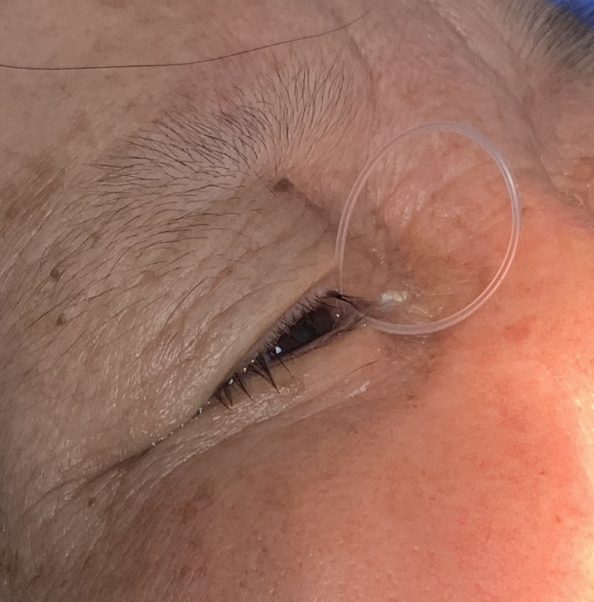
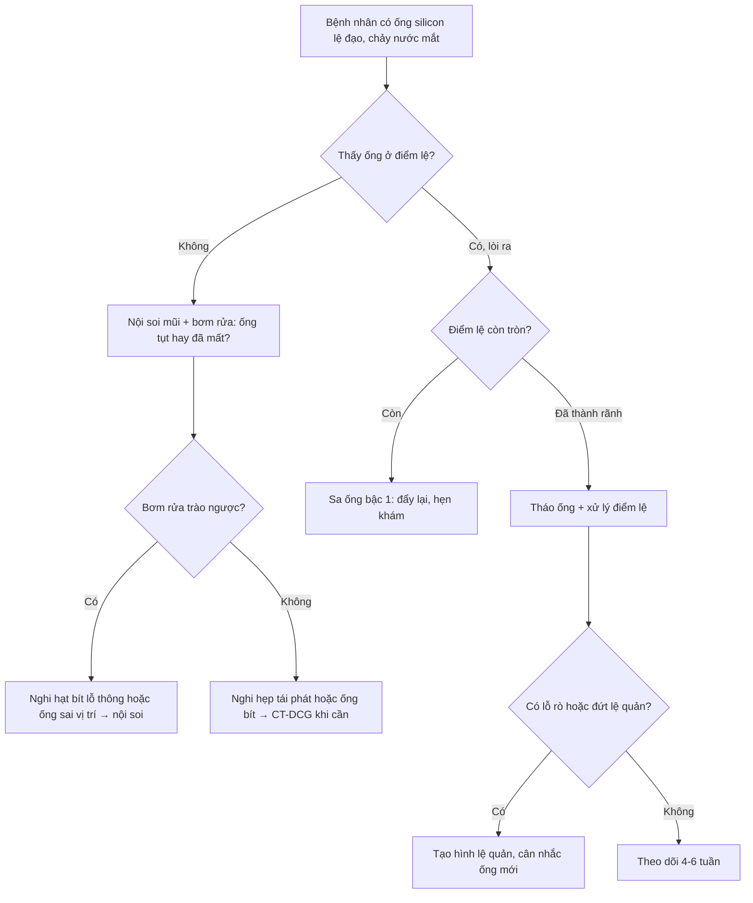
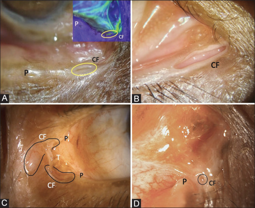
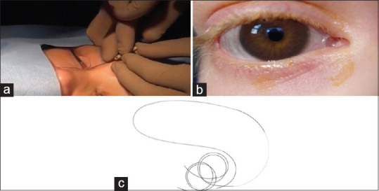
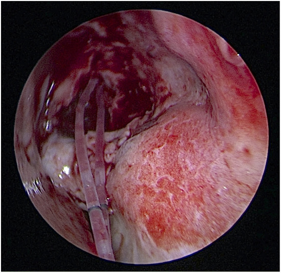

# 1502 — Ống silicon lệ đạo: biến chứng và khi nào tháo / Lacrimal silicone intubation: complications and timing of removal

**Tags:** `pattern:ong-silicon` `pattern:bien-chung-dung-cu` `vung:mat` `vung:le-dao` `protocol:noi-soi-mui` `protocol:CT-DCG` `incidentaloma:khong`
**Mức chắc chắn (certainty):** tổng hợp y văn (literature synthesis) — ghép số liệu từ **166 mắt/129 trẻ** đặt ống Crawford (*Saudi J Ophthalmol* 2025, **PMC12578414**, CC BY-NC-SA 4.0), **99 mắt** Monoka/Masterka ở người lớn (*J Ophthalmol* 2021, **PMC8428989**, CC BY 4.0), **80 ống** cấy vi sinh sau DCR (*Turk J Ophthalmol* 2021, **PMC8411290**, CC BY-NC-ND 4.0), **13 ống** nuôi cấy – màng sinh học (*Cureus* 2024, **PMC11014746**, CC BY 4.0), **45 mắt** so sánh thời gian lưu 1 tháng vs 4 tháng (*Front Med* 2022, **PMC9367212**, CC BY 4.0), **60 bệnh nhân** có/không đặt ống (*Cureus* 2023, **PMC9875549**, CC BY 4.0), **56 ca ngẫu nhiên** (*Int Ophthalmol* 2024, **PMC11213761**, CC BY 4.0), **11 ca** sa ống (*J Laryngol Otol* 2024, **PMC11063663**, CC BY 4.0) và **4 ca** rò lệ quản sau đặt ống (*Indian J Ophthalmol* 2025, **PMC12448500**, CC BY-NC-SA 4.0). Ca trong quiz là **ca nguyên văn** của nguồn, giữ đúng mô tả gốc.

> **Câu chốt:** ống silicon lệ đạo là **một dị vật mềm nằm vắt qua điểm lệ** — chỗ hẹp nhất của hệ thống lệ đạo chỉ **~0,3 mm** — và chịu **~2 vạn lần mi chớp/ngày**. Vì vậy câu hỏi lâm sàng không phải "có ống hay không" mà là **"ống còn đúng vị trí không, có đang cắt vào điểm lệ không, và lòng ống có bị bít/màng sinh học không"**. Ba biến chứng đổi cách xử trí: **sa ống (prolapse)** — thường chỉ cần đẩy lại, không phải mổ; **cắt điểm lệ (punctal cheese-wiring)** — phải tháo và xử lý tổn thương lệ quản; **bít lỗ thông do hạt/màng sinh học** — tháo ống thôi là chưa đủ.

## 1. Tổng quan bệnh học – cơ chế hình ảnh (TẠI SAO)

### 1.1 Ống silicon lệ đạo là gì và có mấy loại

- **Ống một lệ quản (monocanalicular):** một đầu có **bản chặn (flange/collarette)** nằm ở bờ mi, đầu kia xuống ngách mũi dưới. Hai kiểu đặt: **kéo (pulled — Monoka)** phải luồn qua mũi; **đẩy (pushed — Masterka)** tự giữ nhờ đầu kim loại móc vào thành lệ quản, không cần buộc. Ưu điểm: **không cần thủ thuật lấy ống lần hai** vì ống thường tự ra hoặc tháo ở phòng khám.
- **Ống hai lệ quản (bicanalicular):** ống chữ U đi qua **cả lệ quản trên và dưới**, hai đầu nối nhau trong ngách mũi dưới — **buộc lại (tied)** thành vòng kín, hoặc **để rời (untied)** và dán ở tiền đình mũi. Kiểu buộc giữ ống tốt hơn nhưng **nút buộc là chỗ trẻ dễ sờ, kéo**.
- **Vật liệu:** silicon (silastic) — trơ sinh học, mềm, **không tự tiêu**, **không phải kim loại**. Chính đặc tính "trơ" này là gốc của cả hai mặt: không gây phản ứng dữ dội, nhưng **không có cơ chế tự đào thải** khi ống sai vị trí hoặc nhiễm màng sinh học.

### 1.2 Ba cơ chế gây biến chứng — và vì sao hình ảnh/lâm sàng trông như vậy

1. **Cơ chế cơ học (quan trọng nhất):** ống là một sợi căng giữa **điểm lệ** và **ngách mũi dưới**. Mỗi lần chớp mắt, mỗi lần dụi mắt, mỗi lần ống bị kéo, sợi ống **cưa qua bờ điểm lệ** như dây cắt phô-mai — đúng nghĩa thuật ngữ **"cheese-wiring"** mà Bothra và Ali dùng khi mô tả **rò lệ quản sau đặt ống** (*Indian J Ophthalmol* 2025, **PMC12448500**). Điểm lệ bình thường chỉ **~0,3 mm**, trong khi thân ống dày hơn — nên ống **luôn tì vào thành** chứ không "nằm tự do" trong lòng ống.
   - Hệ quả theo thứ tự nặng dần: **giãn điểm lệ → rãnh điểm lệ (slit punctum) → ống tụt vào lệ quản → cắt đứt thành lệ quản → rò lệ quản (canalicular fistula)**. Ở ca nặng, lỗ rò có thể **to hơn điểm lệ** và nước mắt thoát ra ngoài da mí thay vì vào mũi.
2. **Cơ chế sinh học:** silicon kỵ nước → protein của nước mắt phủ thành màng → vi khuẩn bám và tạo **màng sinh học (biofilm)**. Màng sinh học **không gây sốt, không gây mủ ồ ạt** mà gây **tiết nhầy mạn, viêm nhẹ, hạt quanh điểm lệ** — nên rất dễ bị đọc là "viêm kết mạc tái phát".
3. **Cơ chế giải phẫu – chỗ hẹp:** ống phải đi qua **lệ quản (~10 mm: 2 mm đoạn dọc + 8 mm đoạn ngang)**, **túi lệ**, rồi **ống lệ đạo xương (~12 mm)**. Ba chỗ đổi hướng gấp khúc là ba chỗ ống dễ **gập, xoắn, hoặc chọc vào niêm mạc** (tạo đường hầm giả) — và cũng là ba chỗ **hạt (granuloma)** mọc.

### 1.3 Vì sao trẻ khác người lớn

- **Trẻ chạm được vào nút buộc ở góc mắt trong**, và nút buộc nằm ngay tầm tay khi dụi mắt → **sa ống** thường gặp hơn hẳn. Trong loạt **166 mắt/129 trẻ**, ống **buộc** có **thời gian lưu trung bình 3,74 tháng** (SD ± 0,36) so với **2,51 tháng** (SD ± 0,35) ở ống **không buộc** (p < 0,05); tỉ lệ **còn ống đúng vị trí tại mốc 4 tháng là 92% (89/97)** với ống buộc và **32% (22/69)** với ống không buộc (*Saudi J Ophthalmol* 2025, **PMC12578414**).
- **Nhưng "giữ được ống" không đồng nghĩa "ít rắc rối":** ống buộc làm trẻ **khó chịu** và phải **khám nhiều hơn** — trung bình **1,9 lần** so với **1,1 lần** (p < 0,05); trong **32 lần khám sớm** của nhóm buộc có **15 lần là cấp cứu** vì sa ống, còn nhóm không buộc **0/9 lần** (*Saudi J Ophthalmol* 2025). Đây là con số ít được nói: **cái giá của việc giữ ống là các chuyến cấp cứu**.
- **Tỉ lệ tiết ống ở trẻ trong y văn: 14,8%–41,4%**; ở người lớn sau DCR, các thử nghiệm ngẫu nhiên báo **1,5%–16,7%** (*Saudi J Ophthalmol* 2025 dẫn lại). Con số này giải thích vì sao **sa ống là biến chứng hay gặp nhất**, không phải biến chứng hiếm.

### 1.4 Vì sao ống "bẩn" mà mắt không đỏ rực

- Trong **80 ống** lấy ra sau DCR, **cấy dương tính 96,2% (77/80)**, với **109 chủng**: Gram dương **57,8%**, Gram âm **34,0%**, nấm **8,2%**; **S. aureus chiếm 66,6%** các chủng Gram dương; **48,8% ống chỉ có 1 loài**, nhưng **15% có 3 loài** (*Turk J Ophthalmol* 2021, **PMC8411290**). **Không có triệu chứng nhiễm trùng** ở phần lớn bệnh nhân — tức đây là **cộng sinh/màng sinh học**, không phải viêm mủ.
- **Ống lưu càng lâu càng nhiều loài:** nhóm lấy ống **≥ 12 tuần** có tỉ lệ **mọc 3 loài** cao hơn nhóm lấy sớm (p = 0,04) (*Turk J Ophthalmol* 2021). Trên **13 ống** lấy ở tháng thứ 6, **10 ống mọc vi khuẩn**, và **8/10 là sinh màng sinh học trung bình–mạnh** (*Cureus* 2024, **PMC11014746**). Một nghiên cứu dẫn trong bài đó ghi **90% mảnh ống lấy ở tuần 8 có vi khuẩn trong khung màng sinh học**.
- **Vì sao điều này quan trọng với nhà hình ảnh:** màng sinh học và hạt quanh ống **không tạo khối cản quang, không tạo ổ dịch** — chúng chỉ làm **hẹp lòng, bít lỗ thông**. Trên mọi phương tiện hình ảnh, dấu hiệu là **gián tiếp**: ứ nước mắt, giãn túi lệ nhẹ, hoặc **không thấy cột cản quang đi qua** trên CT-DCG.

### 1.5 Ống silicon trên hình ảnh: thấy gì, không thấy gì

- **Siêu âm:** không dùng để đánh giá ống (không có cửa sổ âm tốt cho lệ quản).
- **CT:** ống silicon **không phải kim loại, không cản quang mạnh**; trên cửa sổ xương nó chỉ là **cấu trúc đậm độ mô mềm mảnh** chạy trong ống lệ đạo xương, **gần như trùng đậm độ niêm mạc** — **không thể dùng CT để khẳng định ống còn nguyên, đứt, hay đúng vị trí**. Điều CT làm tốt: **xương ống lệ đạo, lamina papyracea, xoang sàng, khối trong hốc mắt, mảnh xương/dị vật cản quang**.
- **CT-DCG (bơm cản quang vào lệ quản):** đây là bài kiểm tra **chức năng–giải phẫu**: cột thuốc **dừng ở đâu thì tắc ở đó**, và thuốc có iod nên **rất cản quang**. Khi ống còn lưu, cột thuốc chạy **quanh** ống — nên **đừng nhầm "không thấy cột thuốc" với "không có ống"**.
- **Nội soi mũi:** là **chuẩn vàng để nhìn ống** ở ngách mũi dưới — thấy ống chạy qua lỗ thông, thấy nút buộc, thấy mô hạt. Trong mổ DCR nội soi, ống đẩy kiểu **Nunchaku** được đưa qua cả hai điểm lệ vào mũi **không cần nút buộc** (*Front Med* 2022, **PMC9367212**).
- **Đèn khe + nhuộm fluorescein + bơm rửa:** ba động tác **rẻ nhất và quyết định nhất**; hình ảnh chỉ để trả lời câu hỏi giải phẫu khi ba động tác này không giải thích được.

### 1.6 Số liệu định lượng nằm lòng

| Đại lượng | Con số | Nguồn |
|---|---|---|
| Đường kính điểm lệ bình thường | **~0,3 mm** | giải phẫu kinh điển |
| Chiều dài lệ quản | **~10 mm** (2 mm dọc + 8 mm ngang) | giải phẫu kinh điển |
| Chiều dài ống lệ đạo xương | **~12 mm** | giải phẫu kinh điển |
| Tần số chớp mắt | **~15–20 lần/phút** (≈ 2 vạn lần/ngày) | sinh lý |
| Tiết/sa ống ở trẻ | **14,8%–41,4%** | **PMC12578414** (dẫn lại) |
| Tiết ống ở người lớn sau DCR (RCT) | **1,5%–16,7%** | **PMC12578414** (dẫn lại) |
| Còn ống đúng vị trí ở 4 tháng: buộc vs không buộc | **92% (89/97) vs 32% (22/69)** | **PMC12578414** |
| Thời gian lưu trung bình: buộc vs không buộc | **3,74 vs 2,51 tháng** | **PMC12578414** |
| Cấy dương tính trên ống lấy ra | **96,2% (77/80)** | **PMC8411290** |
| S. aureus trong các chủng Gram dương | **66,6%** | **PMC8411290** |
| Mọc 3 loài khi lưu ≥ 12 tuần | cao hơn có ý nghĩa (p = 0,04) | **PMC8411290** |
| Màng sinh học trên mảnh ống tuần 8 | **90%** | **PMC11014746** (dẫn lại) |
| Thành công DCR có ống vs không ống (6 tháng) | **90% vs 93,3%** (p = 0,64) | **PMC9875549** |
| Thành công DCR có ống vs không ống (12 tháng) | **80% vs 76,6%** (p = 0,71) | **PMC9875549** |
| Thành công khi lưu 1 tháng (BCI) vs 4 tháng (MCI) | **100/87/87% vs 95/91/82%** (lúc tháo/1 tháng/3 tháng sau tháo) | **PMC9367212** |
| Đẩy lại ống sa thành công | **9/11 ca (81,8%)** | **PMC11063663** |

## 2. Mẫu hình + chẩn đoán phân biệt theo vị trí và thời điểm (Gamut)

- **Trục 1 — Vị trí tổn thương (đọc theo dòng chảy nước mắt):**
  1. **Điểm lệ / góc mắt trong:** sa ống, rãnh điểm lệ, hạt quanh điểm lệ, rò lệ quản.
  2. **Lệ quản:** ống cắt qua thành, đứt lệ quản, hẹp lệ quản do xơ sau tháo ống.
  3. **Túi lệ – lỗ thông:** hạt bít lỗ thông sau DCR, ống không đi qua lỗ thông (đặt sai), hẹp tái phát.
  4. **Ngách mũi dưới:** nút buộc gây kích thích, dính niêm mạc, ống nằm ngoài lỗ thông.
  5. **Giác mạc:** đầu ống cứng/lòi ra cọ xước giác mạc (đau, chói, sợ ánh sáng).
- **Trục 2 — Thời điểm:**
  - **Sớm (< 6 tuần):** sa ống, cọ xước giác mạc, khó chịu, chảy máu mũi nhẹ, nhiễm khuẩn cấp.
  - **Trung bình (6 tuần – 3 tháng):** hạt quanh điểm lệ, rãnh điểm lệ tiến triển, tiết nhầy.
  - **Muộn (> 3 tháng):** hẹp tái phát, rò lệ quản, ống "hằn" vào lệ quản, nhiều loài vi khuẩn/biofilm.
- **Gamut "ống còn lưu, bệnh nhân vẫn chảy nước mắt":**
  - **Ống bít/màng sinh học** · **hạt bít lỗ thông** · **ống không nằm trong lỗ thông** · **hẹp tái phát phía dưới ống** · **dính niêm mạc mũi** · **chảy nước mắt do bơm lệ (functional epiphora)** — thông thủy nhưng bơm lệ yếu.
- **Gamut "ống đã mất/không thấy ống":**
  - **Sa ra ngoài** (trẻ kéo, dụi mắt) · **tụt vào trong lệ quản** · **đứt ống, còn mảnh** · **ống bị cắt cụt sát điểm lệ** (thủ thuật viên cắt ngắn) · **đã tháo đúng hẹn nhưng hồ sơ không ghi**.
- **Mnemonic 3 chữ P khi khám ống:** **P**osition (đúng chỗ?) — **P**atency (thông?) — **P**unctum (điểm lệ còn nguyên?). Trả lời sai một chữ là xử trí sai.

## 3. Bảng so sánh phân biệt (ma trận đối chiếu)

| Thực thể (entity) | Hình ảnh/lâm sàng điển hình | Chốt vào (rule-in) | Chốt loại (rule-out) | Gợi ý xác nhận |
|---|---|---|---|---|
| **Sa ống (prolapse/extrusion)** | Vòng ống silicon lòi ở góc mắt trong, bệnh nhân/cha mẹ than "có sợi dây"; mắt không đỏ | **Nhìn thấy ống ngoài điểm lệ**, kéo nhẹ thấy ống trượt ra | Điểm lệ còn nguyên, không rãnh, ống không lòi → không phải sa | Đèn khe; đẩy lại bằng kỹ thuật thì thứ hai nếu mới sa; ghi nhận thời điểm |
| **Rãnh/cắt điểm lệ (punctal slitting, cheese-wiring)** | Điểm lệ **biến thành rãnh dài**, ống nằm lệch ra ngoài bờ mi; tiết nhầy | **Rãnh điểm lệ > bình thường + ống nằm trong rãnh**, thấy rõ khi kéo nhẹ | Điểm lệ tròn, ống đi đúng trục → chưa tổn thương | Đèn khe; nếu rãnh lan → **tháo ống**, cân nhắc tạo hình điểm lệ |
| **Rò lệ quản (canalicular fistula)** | Lỗ rò ở da mí/góc mắt, **to hơn điểm lệ**, nước mắt + fluorescein thoát ra ngoài; tiền sử đặt ống "khó" | **Lỗ rò + ROPLAS từ lỗ rò** + đầu ngoài lệ quản bít | Chỉ là điểm lệ giãn đơn thuần (không có lỗ rò phụ) | Nhuộm fluorescein, thăm dò; đôi khi CT-DCG |
| **Hạt quanh điểm lệ (peripunctal granuloma)** | Nốt đỏ thịt mềm sát điểm lệ, chảy máu khi chạm, tiết nhầy | **Nốt mô hạt quanh ống**, tái phát sau khi tháo | Nốt đặc, không liên quan ống → nghĩ u/viêm khác | Đèn khe; sinh thiết nếu không điển hình |
| **Bít lỗ thông do hạt/màng sinh học** | Chảy nước mắt **tái phát sau DCR "thành công"**, ống vẫn còn; bơm rửa trào ngược | **Bơm rửa trào qua điểm lệ đối diện** khi ống còn lưu | Bơm thông tự do, không trào → không phải bít | Nội soi mũi: thấy mô hạt che lỗ thông |
| **Cọ xước giác mạc do ống** | Đau, chói, chảy nước mắt nhiều, sợ ánh sáng; **ống lòi sát giác mạc** | **Sẹo giác mạc dạng đường + ống chạm bờ mi/giác mạc** | Giác mạc trong, ống không chạm → không phải | Nhuộm fluorescein, đèn khe |
| **Nhiễm khuẩn ống (colonization/biofilm)** | Tiết nhầy mạn, mùi nhẹ, mắt không đỏ nhiều; **cấy ống (+) ở 96,2%** | **Tiết nhầy tái phát + ống lưu > 12 tuần** | Không tiết nhầy, ống mới → chưa đủ gọi | Cấy ống sau khi lấy (không cấy dịch kết mạc) |
| **Mảnh ống đứt/dị vật tồn lưu** | Đầu ống cụt ở điểm lệ; bơm rửa vẫn trào; đau khi ấn | **Thấy đầu ống cụt + sờ thấy sợi trong lệ quản** | Không thấy ống, không tiền sử đặt → nghĩ sỏi lệ đạo | Đèn khe; **CT không đủ** (silicon không cản quang), nội soi/thăm dò |
| **Hẹp tái phát sau tháo ống** | Chảy nước mắt trở lại **1–6 tháng** sau tháo, bơm rửa khó | **Hẹp đúng vị trí cũ**, không hạt, không ống | Có hạt/ống sai vị trí → xử lý nguyên nhân khác | Bơm rửa, CT-DCG nếu cần mổ lại |

*Sa ống (prolapse) — ống silicon lòi hẳn ra khỏi góc mắt trong, đây là biến chứng hay gặp nhất và **không phải chỉ định mổ**. Nguồn: *J Laryngol Otol* 2024, **PMC11063663**, Fig. 1, CC BY 4.0 (nguyên bản).*

### Đọc ảnh theo 3 bước
1. **Ống còn nằm trong lệ quản hay đã ra ngoài?** Nếu lòi ra ngoài → **sa ống**, không phải "viêm kết mạc".
2. **Điểm lệ còn tròn hay đã thành rãnh?** Rãnh = tổn thương cơ học đã xảy ra → **tháo ống**, đừng đẩy lại rồi chờ.
3. **Có lỗ rò phụ không?** Có = tổn thương lệ quản không hồi phục bằng cách đặt lại ống.

## 4. Protocol chụp + hệ phân độ/điểm chuẩn hóa + khi nào tháo

### 4.1 Khám và chụp: đúng thứ tự, đừng bắt đầu bằng CT

- **Bước 1 — đèn khe:** vị trí ống, tình trạng điểm lệ, hạt, sẹo giác mạc.
- **Bước 2 — test biến mất fluorescein (dye disappearance test) 5 phút:** còn thuốc ở túi kết mạc = tắc/ứ.
- **Bước 3 — bơm rửa lệ đạo:** thông tự do / trào ngược qua điểm lệ đối diện / trào qua lỗ rò / đau + cứng = tắc.
- **Bước 4 — nội soi mũi:** nhìn ống ở ngách mũi dưới, mô hạt, dính.
- **Bước 5 — CT/CT-DCG chỉ khi:** nghi tổn thương xương – hốc mắt, nghi khối/u, cần mổ lại, hoặc không giải thích được bằng 4 bước trên.
  - **CT xoang–hốc mắt lát ≤ 1 mm, cửa sổ xương** (đúng chuẩn mục 2 phụ lục Mắt của `PROMPT_SYNTHESIZER.md`).
  - **CT-DCG:** bơm cản quang vào lệ quản; cột thuốc dừng ở đâu = tắc ở đó; **không dùng CT thường để "tìm ống"** vì silicon không cản quang.
  - **MRI** chỉ khi nghi u/hốc mắt, không dùng để đánh giá ống.

### 4.2 Phân độ biến chứng ống (thang thực hành 4 bậc)

| Bậc | Tổn thương | Xử trí |
|---|---|---|
| **0** | Ống đúng vị trí, không triệu chứng, điểm lệ nguyên | Giữ đến hẹn tháo |
| **1** | Sa ống nhưng **điểm lệ còn nguyên**, ống chưa tổn thương | **Đẩy lại** (hoặc tháo nếu tái phát nhiều lần) |
| **2** | Rãnh điểm lệ / hạt quanh điểm lệ / cọ xước giác mạc | **Tháo ống**, điều trị tại chỗ; cân nhắc đặt lại kiểu khác |
| **3** | Đứt lệ quản, rò lệ quản, ống gãy còn mảnh | **Tháo + tạo hình lệ quản**; có thể cần đặt ống mới loại phù hợp |

### 4.3 Khi nào tháo — và vì sao "để lâu" không miễn phí

- **Tháo ngay (không chờ hẹn):** cọ xước giác mạc, rãnh điểm lệ tiến triển, rò lệ quản, nhiễm khuẩn có triệu chứng, ống sai vị trí/gãy, trẻ đau nhiều.
- **Tháo đúng hẹn:** ống không triệu chứng, sau DCR hoặc sau khâu lệ quản.
- **Thời gian lưu hợp lý:**
  - **Người lớn sau DCR:** bằng chứng **không ủng hộ "càng lâu càng tốt"**. So sánh trực tiếp: ống hai lệ quản đẩy **~1 tháng** đạt thành công **100% / 87% / 87%** (lúc tháo / 1 tháng / 3 tháng sau tháo), ống một lệ quản kéo **~4 tháng** đạt **95% / 91% / 82%** (*Front Med* 2022, **PMC9367212**). Thử nghiệm ngẫu nhiên **56 ca** có/không đặt ống: **không khác biệt** về chảy nước mắt (p > 0,10) và độ thông (p > 0,16) ở 24 tuần (*Int Ophthalmol* 2024, **PMC11213761**). Loạt **60 bệnh nhân**: 6 tháng **90% vs 93,3%**, 12 tháng **80% vs 76,6%** (*Cureus* 2023, **PMC9875549**).
  - **Kết luận thực hành:** **1–3 tháng** là đủ cho đa số; **4–8 tuần** chấp nhận được với ống đẩy không buộc; **> 3 tháng** chỉ khi có lý do (DCR lại, hẹp lệ quản phức tạp, sau chấn thương) — vì **càng lâu càng nhiều loài vi khuẩn** (p = 0,04) và **90% ống đã có màng sinh học ở tuần 8**.
  - **Trẻ sau đặt ống Crawford:** mốc **4 tháng** là mốc hay dùng trong loạt 166 mắt; **không để quá 6 tháng** nếu không có chỉ định đặc biệt.
- **Chỉ định giữ ống lâu (có bằng chứng yếu–trung bình):** **DCR lại** (nhóm có ống có tỉ lệ thành công cao hơn, thời gian nằm viện **3 vs 4 ngày**, p = 0,042 — *Int Arch Otorhinolaryngol* 2026, **PMC13132629**), **hẹp lệ quản chung**, **khâu lệ quản sau chấn thương**, **túi lệ xơ**.

### 4.4 Đẩy lại ống sa: kỹ thuật và giới hạn

- Ống sa **mới (< 3 tháng)**, **chưa đứt**, **không nhiễm trùng hoạt động** → có thể đẩy lại. Trong **11 ca** sa ống được đẩy lại bằng probe có dây dẫn ghi nhớ + chỉ 4-0: **9 ca (81,8%)** ống về đúng vị trí, bơm rửa thông (*J Laryngol Otol* 2024, **PMC11063663**).
- **Không đẩy lại khi:** ống đã rách/cắt vào lệ quản, có lỗ rò, chảy máu mũi hoạt động, ống đứt, hoặc đã sa tái phát nhiều lần — lúc đó **tháo là điều trị**, không phải thất bại.

## 5. Biến thể bình thường và cạm bẫy

- **Biến thể bình thường:**
  - **Vòng ống ở góc mắt trong** với ống buộc là **bình thường** — không phải "sa" nếu ống vẫn nằm trong lệ quản và điểm lệ tròn.
  - **Bọt khí nhỏ trong lòng ống** trên đèn khe; **thuốc fluorescein đọng nhẹ** ở bờ mi.
  - **Đầu ống thấy ở ngách mũi dưới** khi nội soi — bình thường, không phải "dị vật".
  - **Chảy nước mắt nhẹ 1–2 tuần đầu sau đặt ống** do phù niêm mạc — không phải thất bại.
- **Cạm bẫy (pitfall):**
  1. **Gọi sa ống là "viêm kết mạc"** ở trẻ — điều trị nhỏ mắt nhiều tuần trong khi chỉ cần đẩy lại ống.
  2. **Kéo thử vòng ống "để xem có chắc không"** — mỗi lần kéo là một lần **cưa thêm điểm lệ** (cheese-wiring).
  3. **Cắt ống sát điểm lệ khi tháo** — để lại **mảnh ống trong lệ quản**, gây tiết nhầy và hẹp; phải rút **toàn bộ** ống.
  4. **Tin CT âm tính là "không có ống"** — silicon **không cản quang**; muốn chứng minh phải **nội soi / thăm dò**.
  5. **Bơm rửa mạnh qua ống đang tụt** — tạo **đường hầm giả** và đau; bơm nhẹ, đánh giá trào ngược.
  6. **Cho rằng "DCR thất bại" khi bệnh nhân còn chảy nước mắt** — kiểm tra **hạt bít lỗ thông/ống sai vị trí** trước khi nghĩ đến mổ lại.
  7. **Để ống "vô thời hạn" vì bệnh nhân không tái khám** — màng sinh học và nhiều loài vi khuẩn tăng theo thời gian; cần **hẹn tháo rõ ràng bằng văn bản**.
  8. **Nhầm ống silicon với sỏi lệ đạo (dacryolith)** trên hình ảnh: sỏi có thể **cản quang nhẹ/vôi hóa**, ống thì không; nhưng cả hai đều gây tắc — **tiền sử đặt ống** là chìa khóa.

*Bốn ca rò lệ quản sau DCR có đặt ống: (A) lỗ rò nhỏ + điểm lệ còn; (B) **lỗ rò lớn** ở trẻ 10 tuổi sau đặt ống 5 năm, kèm **bất sản điểm lệ trên**; (C) ống silicon bắc qua cả hai lỗ rò; (D) lỗ rò bít tận. Nguồn: *Indian J Ophthalmol* 2025, **PMC12448500**, Fig. 1, CC BY-NC-SA 4.0 (nguyên bản, không crop/ghép).*

*(a) Đặt ống hai lệ quản; (b) sau mổ — ống nằm gọn giữa hai điểm lệ, **đây là hình ảnh bình thường** để phân biệt với sa ống; (c) ống xoắn trong túi. Nguồn: *Oman J Ophthalmol* 2025, **PMC12258858**, Fig. 3, CC BY-NC-SA 4.0 (nguyên bản).*

## 6. Tự lượng giá — Blind Quiz

**Ca 1 — người lớn, "có sợi dây ở góc mắt"**

- Gợi ý lâm sàng: bệnh nhân được đặt ống lệ đạo vài tuần trước, đến khám vì **vướng và chảy nước mắt**; mắt không đỏ, không mủ.
- Câu hỏi: (1) Dấu hiệu chính? (2) Ba chẩn đoán phân biệt? (3) Dấu hiệu nào quyết định **đẩy lại** thay vì **tháo**?

<b>Bấm để hiện đáp án (findings + chẩn đoán)</b>

- **Dấu hiệu:** vòng ống silicon lòi ra ngoài góc mắt trong, **điểm lệ chưa bị rãnh**, không có lỗ rò, giác mạc trong.
- **Chẩn đoán:** **sa ống (prolapse)** — ống trượt ra khỏi lệ quản nhưng chưa gây tổn thương điểm lệ.
- **Phân biệt:** (a) viêm kết mạc (đỏ, tiết, nhưng không có ống lòi); (b) rãnh điểm lệ (điểm lệ đã biến dạng); (c) rò lệ quản (có lỗ rò phụ).
- **Chốt xử trí:** điểm lệ **còn tròn + ống mới sa + chưa đứt** → **đẩy lại** (thành công ~**81,8%** trong loạt 11 ca, **PMC11063663**); nếu đã thành rãnh hoặc sa tái phát → **tháo**.
- **Nguồn ảnh:** *J Laryngol Otol* 2024, **PMC11063663**, Fig. 1, CC BY 4.0.

**Ca 2 — trẻ 10 tuổi, chảy nước mắt tái phát sau mổ 5 năm**

- Gợi ý lâm sàng: trẻ được mổ DCR + đặt ống lúc 5 tuổi; nay chảy nước mắt lại, ấn góc mắt trong thấy **trào dịch từ một lỗ ở mí**; điểm lệ trên không thấy rõ.
- Câu hỏi: (1) Tổn thương là gì? (2) Vì sao ống silicon gây ra được tổn thương này? (3) Xử trí?

<b>Bấm để hiện đáp án (findings + chẩn đoán)</b>

- **Dấu hiệu:** **lỗ rò lệ quản lớn** ở mí dưới, **ROPAS dương** từ lỗ rò, **bất sản điểm lệ trên**; ống silicon (nếu còn) bắc qua lỗ rò.
- **Chẩn đoán:** **rò lệ quản sau đặt ống** — biến chứng của **"cheese-wiring"**: ống tì và cắt dần qua thành lệ quản trong nhiều năm.
- **Vì sao:** ống là dị vật căng giữa điểm lệ và mũi, chịu lực mỗi lần chớp/dụi mắt; khi ống bị kéo hoặc đặt quá căng, nó **cắt qua thành lệ quản** thay vì nằm trong lòng.
- **Xử trí:** **tháo ống**, đánh giá lệ quản còn nối với túi lệ không; nếu mất liên tục → **tạo hình lệ quản** hoặc **DCR + ống mới**; trường hợp nặng có thể phải **CDCR** (dẫn lưu nước mắt ra mũi bằng ống thủy tinh) — như ca 1 và 4 trong nguồn.
- **Nguồn ảnh:** *Indian J Ophthalmol* 2025, **PMC12448500**, Fig. 1, CC BY-NC-SA 4.0.

**Ca 3 — sau mổ DCR 3 tuần, ống "có vẻ bình thường"**

- Gợi ý lâm sàng: bệnh nhân vừa mổ DCR nội soi có đặt ống hai lệ quản, đến kiểm tra định kỳ; mắt còn chảy nước mắt nhẹ.
- Câu hỏi: (1) Hình ảnh này bình thường hay bất thường? (2) Cần kiểm tra gì tiếp theo? (3) Khi nào hẹn tháo?

<b>Bấm để hiện đáp án (findings + chẩn đoán)</b>

- **Dấu hiệu:** ống silicon nằm **gọn giữa hai điểm lệ**, không lòi ra ngoài, không rãnh điểm lệ — **hình ảnh bình thường**.
- **Kiểm tra tiếp:** bơm rửa lệ đạo (thông/trào), nội soi mũi nhìn ống qua lỗ thông, hỏi tiết nhầy.
- **Hẹn tháo:** đa số **1–3 tháng**; bằng chứng cho thấy lưu **~1 tháng** không kém lưu **~4 tháng** (*Front Med* 2022, **PMC9367212**), và lưu lâu hơn làm tăng số loài vi khuẩn trên ống (p = 0,04, **PMC8411290**).
- **Cạm bẫy:** chảy nước mắt nhẹ 3 tuần sau mổ **chưa phải thất bại** — phù niêm mạc còn; đánh giá lại sau 6–8 tuần.
- **Nguồn ảnh:** *Oman J Ophthalmol* 2025, **PMC12258858**, Fig. 3, CC BY-NC-SA 4.0.

**Ca 4 — nội soi mũi trong lúc đặt ống**

- Gợi ý lâm sàng: trong mổ DCR nội soi, sau khi mở lỗ thông, ống hai lệ quản được đẩy từ hai điểm lệ xuống mũi.
- Câu hỏi: (1) Cấu trúc đang thấy là gì? (2) Vì sao kiểu ống "đẩy" không cần nút buộc? (3) Lợi ích và giá phải trả?

<b>Bấm để hiện đáp án (findings + chẩn đoán)</b>

- **Dấu hiệu:** hai nhánh ống silicon chạy qua lỗ thông vào ngách mũi dưới, tựa vào niêm mạc.
- **Vì sao không cần buộc:** ống đẩy (Nunchaku) có cơ cấu tự giữ ở đầu trong (kim loại móc vào lệ quản), nên **không tạo vòng kín** ở góc mắt.
- **Lợi ích:** không có nút buộc để trẻ sờ/kéo → ít sa ống hơn; **thời gian lưu ngắn (~1 tháng)** cho kết quả không kém 4 tháng (**PMC9367212**).
- **Giá phải trả:** vẫn có **sa ống muộn**, **rãnh điểm lệ** và **màng sinh học** — không có loại ống nào miễn nhiễm; theo dõi vẫn phải theo lịch.
- **Nguồn ảnh:** *Front Med* 2022, **PMC9367212**, Fig. 2, CC BY 4.0.

## Bài liên quan chéo
- [1496 – Tắc lệ đạo mắc phải sau chấn thương và sau mổ xoang](../1496-tac-le-dao-sau-chan-thuong-va-mo-xoang/lesson.md)
- [1485 – Viêm túi lệ cấp và áp-xe túi lệ](../1485-viem-tui-le-cap-va-ap-xe-tui-le/lesson.md)
- [1483 – Nang túi lệ và tắc lệ đạo ở trẻ](../1483-nang-tui-le-va-tac-le-dao-o-tre/lesson.md)
- [1461 – Áp-xe dưới màng xương hốc mắt ở trẻ](../1461-ap-xe-duoi-mang-xuong-hoc-mat-o-tre/lesson.md)

## Ảnh
- Tên file theo chuẩn `1502_ong-silicon_le-dao_<Modality>_<SourceID>.jpg`; nguồn + giấy phép từng ảnh trong `images/CREDITS.md`.
- Cả 4 ảnh đều là **ảnh nguyên bản** của bài mở, **không crop, không ghép** (CC BY-NC-SA cho phép tái sử dụng phi thương mại có ghi nguồn; repo giữ nguyên bản để tôn trọng điều kiện).

> Không dùng để chẩn đoán độc lập khi chưa có người hướng dẫn.
