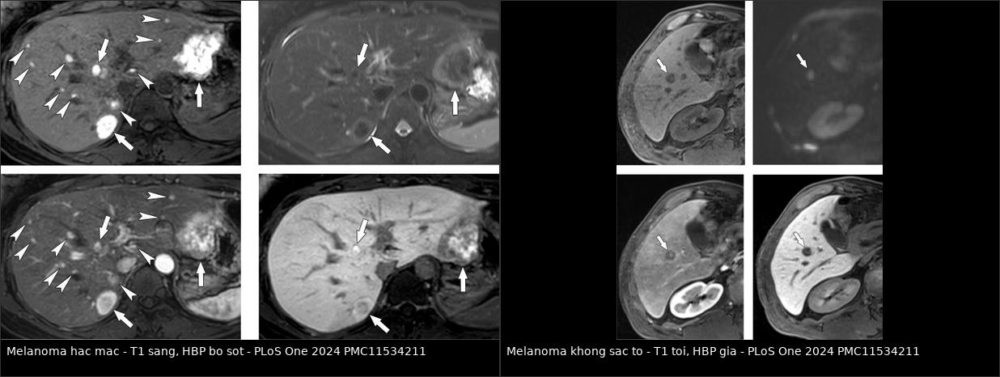
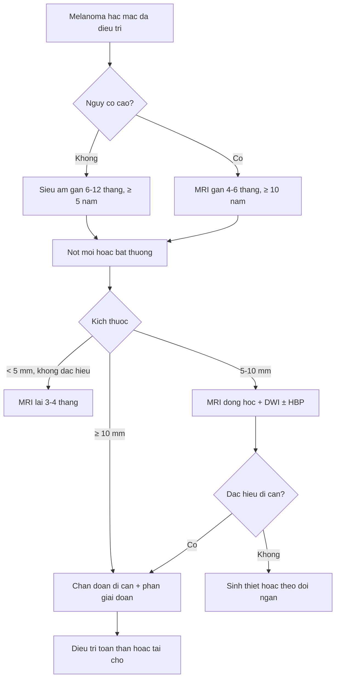
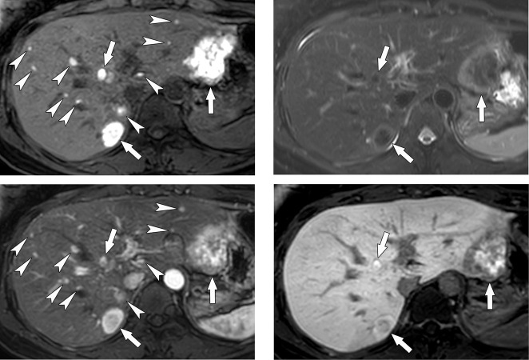
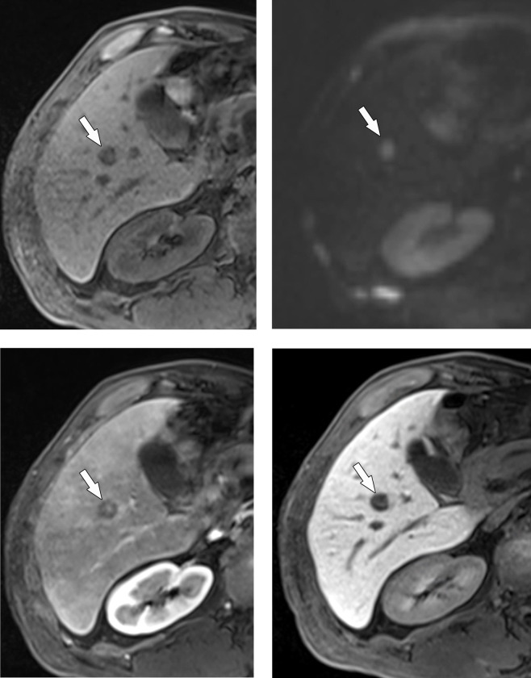
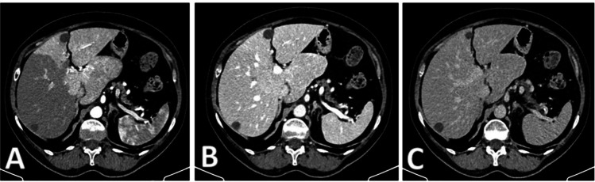
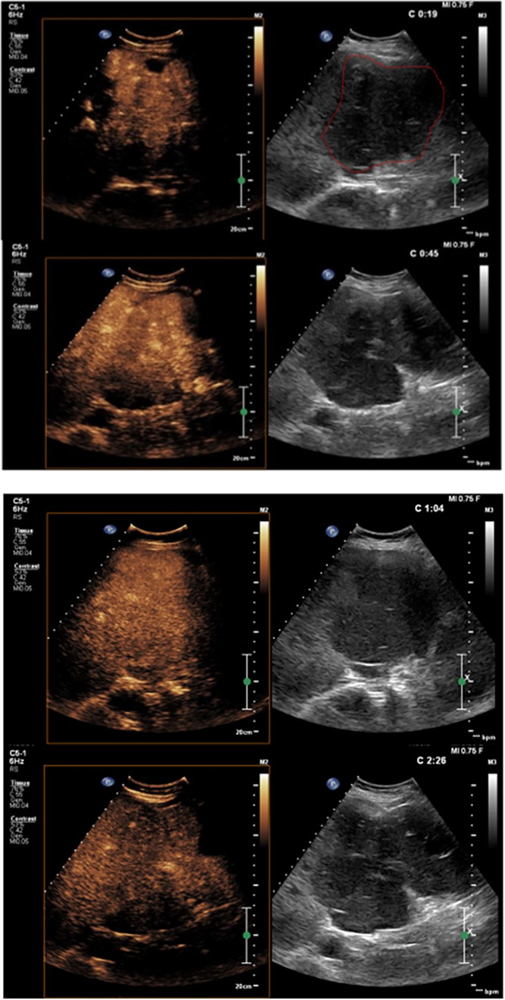
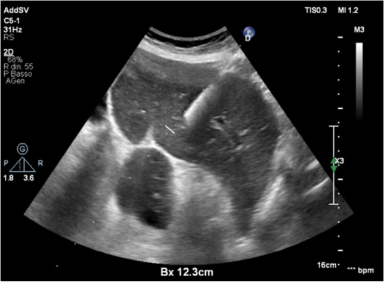

# 1503 — Di căn gan của melanoma hắc mạc: theo dõi thế nào, nốt 8 mm làm gì, khi nào MRI/PET và sinh thiết / Hepatic metastases from uveal melanoma: surveillance, small nodules and when to biopsy

**Tags:** `pattern:not-gan` `pattern:nhieu-o` `pattern:t1-sang` `pattern:di-can` `pattern:ngam-dong-mach` `vung:gan` `vung:mat` `protocol:MRI-gan-DWI` `protocol:MRI-gan-gadoxetat` `protocol:CT-bung-co-can-quang` `protocol:sie-u-am-gan` `protocol:PET-FDG` `score:RECIST-1.1` `incidentaloma:u-mau-gan`

**Mức chắc chắn (certainty):** tổng hợp y văn (literature synthesis) — số liệu đọc trực tiếp từ toàn văn: hướng dẫn **ESMO–EURACAN 2026** (PMC13131131), đoàn hệ theo dõi **1.086 bệnh nhân** của Anh (PMC13270131), nghiên cứu **67 bệnh nhân/254 di căn** trên MRI gadoxetate (PMC11534211), **65 bệnh nhân** MRI gan mật tiên lượng (PMC13124272), tổng quan điều trị (PMC12485227), định lượng melanin trên MRI (PMC8198670), nomogram **224 bệnh nhân** (PMC6627813), ca lâm sàng có sinh thiết dưới siêu âm (PMC11496420), PET/CT (PMC12553292), thể tích gan sau HAI (PMC11604257). Nhóm **không có bệnh nhân của mình**; chỗ chưa đủ chắc ghi "chưa rõ". **Không ghi tên tác giả** — attribution dùng tạp chí + năm + PMCID.

> **Vị trí trong thư viện:** [1497](../1497-tai-phat-bo-sau-xa-ban-mach-melanoma-hac-mac/lesson.md) phủ **tái phát tại chỗ sau xạ**; [448](../448-u-hac-mac/lesson.md) và [1486](../1486-khoi-hac-mac-sieu-am/lesson.md) phủ **khối hắc mạc ban đầu**; bài này trả lời câu hỏi **sau khi mắt đã yên**: *theo dõi gan bằng gì, bao lâu, và một nốt 8 mm nghĩa là gì?*
>
> **Câu chốt:** Melanoma hắc mạc không di căn theo kiểu "rải khắp nơi" — **87–90% ca di căn có gan là ổ đầu tiên**, và **93% ca di căn xuất hiện trong 5 năm đầu**. Ba con số phải thuộc: **(1)** siêu âm gan **nhạy 96% nhưng PPV chỉ 45%** → mọi nốt nghi ngờ phải chuyển **MRI**; **(2)** MRI gadoxetate phát hiện **98,8%** bằng chuỗi hình thái nhưng **pha gan mật chỉ 76,0%** — **bỏ sót 98,4% là di căn melanoma hắc mạc, ≤ 1 cm, T1-sáng**; **(3)** khi đã có di căn, sống trung vị **~1 năm**, sống 2 năm **8%**, và **tăng thể tích gan ≥ 10%** sau điều trị tương ứng sống **6,6 vs 15,9 tháng**.

## 1. Tổng quan bệnh học – cơ chế hình ảnh

### 1.1 Vì sao gan là ổ đầu tiên — và vì sao "mắt yên" không có nghĩa là "bệnh yên"

- Melanoma hắc mạc (uveal melanoma) là ung thư nội nhãn nguyên phát thường gặp nhất ở người lớn; **~90%** xuất phát từ hắc mạc, **6%** thể mi, **4%** mống mắt. U không có mạch bạch huyết trong nhãn → lan **theo đường máu** ngay từ đầu.
- Dù kiểm soát tại chỗ **> 90%**, **gần một nửa** bệnh nhân vẫn xuất hiện di căn; trong số có di căn, **~87%** có gan là ổ đầu tiên (PMC11496420), một số chuỗi ghi **~90%** (PMC12485227).
- **Thời điểm:** đoàn hệ 1.086 bệnh nhân (Sheffield 2006–2021): **29%** (315 người) di căn, **93%** trong số đó được phát hiện **trong 5 năm** sau điều trị mắt; "số ca cần chụp để tìm 1 ca" tăng mạnh **sau mốc 5 năm** (PMC13270131). Di căn muộn vẫn có nhưng hiếm và gắn với kiểu gen đặc thù (NST 3 bình thường, thêm bản sao 8q, GEP class 1, PRAME dương).
- **Sinh học phân tử quyết định nhịp theo dõi:** nguy cơ cao gắn với **mất một bản sao/isodisomy NST 3**, **đa bản sao 8q**, **GEP class 2**, **bất hoạt BAP1** (PMC13131131). Đây là lý do cùng một "melanoma hắc mạc" mà lịch chụp khác nhau hoàn toàn.
- **Tiên lượng khi đã di căn:** sống trung vị **~1 năm**, sống 2 năm **8%**; các chuỗi ghi **3–30 tháng** (PMC12485227, PMC12896752). Nomogram 224 bệnh nhân: sống **6/12/24 tháng = 88% / 68% / 26%**; bốn yếu tố xấu độc lập: khoảng không bệnh **< 6 tháng** (HR 3,39), **> 10 ổ di căn** (HR 3,95), tổng diện tích u lớn nhất **> 1.200 mm²** (HR 2,47), **LDH > 1,5 × giới hạn trên** (HR 3,72); C-statistic 0,71 (PMC6627813).

### 1.2 TẠI SAO di căn melanoma lại T1-SÁNG — và vì sao điều đó phá vỡ mọi "quy tắc di căn"

- **Melanin là chất thuận từ (paramagnetic):** các gốc tự do bền trong melanin rút ngắn **T1** của mô → trên chuỗi T1 không cản từ, khối **sáng hơn gan**. Máu bán cấp (methemoglobin) trong u cũng rút ngắn T1, nên u **xuất huyết** cũng sáng.
- Định lượng được: trong **254 di căn**, **68,9%** T1 cao; riêng nhóm có nguồn gốc **mắt** là **72,1%** (158/219) so với melanoma niêm mạc/da **48,6%** (PMC11534211). Hệ quả trực tiếp: **"di căn gan = giảm tín hiệu T1" không đúng với melanoma hắc mạc**.
- **Melanin cũng làm T2 thay đổi hai chiều:** hiệu ứng thuận từ làm giảm T2, còn hoại tử/dịch làm tăng T2 → tín hiệu T2 **không đồng nhất**. Trong 254 di căn: T2 cao **55,5%**, T2 thấp **16,1%**; nhóm mắt T2 cao **50,2%**, T2 thấp **17,4%** (PMC11534211). Vì vậy **T2 một mình không loại trừ và không chốt**.
- **Kích thước nhỏ là đặc trưng:** trung bình **1,7 cm**, **43,7%** ≤ 1 cm. U nhỏ + T1 sáng + ít hoại tử = tổn thương "hòa vào gan" trên nhiều chuỗi — đây là gốc của mọi bẫy trong bài.

### 1.3 TẠI SAO pha gan mật (hepatobiliary phase, HBP) lại BỎ SÓT chính di căn melanoma

- Gadoxetate disodium là chất cản quang **lưỡng tính**: một phần được **tế bào gan** bắt qua OATP1B1/B3 rồi thải vào đường mật; pha gan mật chụp **~20 phút** sau tiêm. Mô **không có tế bào gan** (di căn, nang, máu tụ) không bắt thuốc → **giảm tín hiệu** so với nhu mô gan sáng.
- Nhưng HBP vẫn là **chuỗi T1**: một tổn thương **đã T1-sáng vì melanin** có thể **đồng tín hiệu** hoặc **tăng tín hiệu** trên nền gan sáng, nhất là khi **nhỏ** và ít hoại tử. Số liệu: trong 254 di căn, HBP **giảm tín hiệu 55,5%**, **tăng 15,4%**, **đồng tín hiệu 5,1%**, **không thấy 24,0%**.
- **61 tổn thương không thấy trên HBP:** **98,4%** là melanoma hắc mạc, **90,2%** ≤ 1 cm, **98,4%** T1-sáng, **90,2%** không hạn chế khuếch tán (PMC11534211). Nói cách khác, HBP bỏ sót **đúng nhóm bệnh nhân của bài này**.
- Độ nhạy phát hiện: **hình thái 98,8%**, **động học 97,6%**, **HBP 76,0%**, **DWI 65,7%**. Kết luận của chính nhóm tác giả: HBP **ít lợi thế** trong phát hiện di căn melanoma. **Không được dùng HBP để loại trừ.**

### 1.4 TẠI SAO ngấm mạnh thì động mạch (arterial hyperenhancement) — và vì sao dễ bị gọi là HCC

- Di căn tạo mạng mạch nuôi tân tạo, phần lớn nhận máu **động mạch gan** (25% cung cấp máu gan nhưng là nguồn chính của u) → **ngấm mạnh ở thì động mạch**, sau đó **thải thuốc** khi nhu mô gan ngấm ở thì cửa/muộn.
- Số liệu: **80,3%** di căn ngấm mạnh thì động mạch; **14,6%** lại **giảm tín hiệu** — tức khoảng 1/7 ca "đi ngược quy tắc" (PMC11534211). Vì vậy **không có tín hiệu động mạch nào là bắt buộc**.
- **Cạm bẫy:** ngấm động mạch + thải thuốc là bộ ba của **HCC**. Ở bệnh nhân melanoma **không xơ gan**, tổn thương mới ngấm động mạch + thải thuốc phải được coi là **di căn** cho đến khi chứng minh ngược; **LI-RADS không dành cho di căn** và không được áp vào bệnh cảnh này.
### 1.5 TẠI SAO DWI hữu ích nhưng "teo" ở nốt nhỏ

- Di căn đặc, mật độ tế bào cao → nước **khuếch tán hạn chế** → **DWI sáng, ADC thấp**. Nhưng với ổ **≤ 1 cm**, độ nhạy DWI chỉ **50,5%** so với **86,7%** ở ổ > 1 cm (P < 0,001); toàn bộ là **65,7%** (PMC11534211). DWI là chuỗi **bổ trợ**, không phải chuỗi sàng lọc.

### 1.6 TẠI SAO siêu âm "nhạy 96%" mà vẫn không đủ

- Siêu âm bụng rẻ, không bức xạ, nhưng **PPV chỉ 45%**: trong 100 nốt bị gọi là nghi ngờ, hơn một nửa lành (u máu, nang, FNH, vùng gan thoái hóa mỡ). Độ đặc hiệu được trích **~85%** (PMC13131131, PMC13270131). Hệ quả thực hành: **siêu âm là cửa vào, MRI là cửa chốt** — không bao giờ kết luận "không di căn" chỉ bằng siêu âm, và cũng **không sinh thiết một nốt chỉ vì nó "echo bất thường"**.
- Trong gan nhiễm mỡ, nốt di căn có thể **đồng âm** hoặc **tăng âm giả u máu**; siêu âm càng kém tin cậy.

### 1.7 TẠI SAO PET/CT không phải công cụ theo dõi

- FDG-PET/CT có độ nhạy **41–88%** cho di căn gan, tụt còn **11%** với ổ nhỏ mà MRI phát hiện được; **bỏ sót tới 65%** tổn thương gan (PMC13131131). Trong 55 bệnh nhân, phát hiện **103/128 (80,5%)** ổ gan, nhưng **100%** ổ xương, hạch, phổi — tức PET mạnh ở **ngoài gan**, yếu ở **trong gan** (PMC12553292).
- Vai trò hợp lý: **phân giai đoạn ngoài gan** khi đang cân nhắc mổ/can thiệp, không dùng thay MRI gan.

## 2. Mẫu hình + chẩn đoán phân biệt theo vị trí (Gamut)

- **Mẫu A — nhiều nốt nhỏ T1-sáng, rải hai thùy, ngấm động mạch, HBP đồng/giảm tín hiệu.** Gamut: **di căn melanoma hắc mạc** · di căn melanoma khác · **xuất huyết cũ trong u/nang** · **Lipiodol tồn lưu sau TACE** · **nốt gan thoái hóa mỡ đảo ngược** (vùng gan lành trong gan nhiễm mỡ). Chốt: bối cảnh + nhiều ổ + ngấm động mạch + so phim.
- **Mẫu B — nốt T1-tối, T2-sáng, hạn chế khuếch tán, ngấm viền/vành, HBP giảm.** Gamut: **di căn melanoma không sắc tố/niêm mạc** · di căn đại trực tràng/tụy/vú · **HCC** · **cholangiocarcinoma trong gan** · **áp-xe**. Chốt: bối cảnh ung thư + DWI + HBP; **HCC chỉ đặt ra khi có gan xơ**.
- **Mẫu C — "bia bắn" (target sign): viền ngấm + trung tâm hoại tử.** Gamut: di căn (mọi nguồn) · áp-xe · cholangiocarcinoma · **di căn đã điều trị**. Chốt: viền **mỏng đều** + nhiều ổ + bối cảnh = di căn; khí trong ổ + sốt = áp-xe.
- **Mẫu D — gan to, bờ nốt, co kéo bao, teo thùy sau nhiều đợt điều trị.** Gamut: **giả xơ gan sau điều trị di căn** (pseudocirrhosis) · xơ gan thật · **bệnh gan do thuốc**. Chốt: **không có xơ gan trước đó** + tiền sử di căn đã teo; xem [1648](../1648-di-can-gan-ung-thu-vu/lesson.md).
- **Mẫu E — một khối lớn không đồng nhất, hoại tử trung tâm, xâm lấn.** Gamut: di căn lớn · HCC thể khối · cholangiocarcinoma · sarcoma. Chốt: sinh thiết nếu hình ảnh không đặc hiệu (ca nguyên văn bên dưới).
- **Mnemonic "MELANIN":** **M**elanin → T1 sáng · **E**nhancing arterial · **L**iver-only (87–90%) · **A**typical nhỏ < 1 cm · **N**odules nhiều ổ hai thùy · **I**maging = MRI + DWI · **N**ever rule out bằng HBP.

## 3. Bảng so sánh phân biệt (ma trận đối chiếu)

| Thực thể (entity) | Hình ảnh điển hình | Chốt vào (rule-in) | Chốt loại (rule-out) | Gợi ý xác nhận |
|---|---|---|---|---|
| **Di căn melanoma hắc mạc (sắc tố)** | Nhiều nốt **T1 sáng** (72,1%), T2 cao hoặc thấp, ngấm động mạch **80,3%**, HBP **đồng/giảm**, DWI hạn chế **61,6%** | **Bối cảnh melanoma hắc mạc + nhiều nốt + T1 sáng + ngấm động mạch**; nốt mới so với phim cũ | **T2 rất sáng + ADC cao + ngấm nốt ngoại vi hướng tâm** → u máu; **giảm tín hiệu HBP đơn thuần** không loại trừ | MRI động học + DWI; so phim; sinh thiết nếu đơn độc/không điển hình |
| **Di căn melanoma không sắc tố/niêm mạc** | **T1 tối**, T2 cao, **hạn chế khuếch tán 91,4%**, ngấm động mạch, **HBP giảm** | **T1 tối + T2 cao + DWI hạn chế + HBP giảm** ở bệnh nhân ung thư | T1 sáng + HBP đồng tín hiệu → nghĩ melanotic/không phải nhóm này | MRI + sinh thiết nếu cần mô học |
| **U máu gan (hemangioma)** | Siêu âm **tăng âm**, T2 **rất sáng**, **ADC cao**, ngấm **nốt ngoại vi → lấp đầy**, không thải thuốc | **T2 "bóng đèn" + ADC cao + fill-in hướng tâm** | **T1 sáng + hạn chế khuếch tán + thải thuốc** → không phải u máu | MRI; theo dõi ổn định nhiều năm |
| **Nang gan** | **0–15 HU**, trống âm, T1 tối/T2 rất sáng, **không ngấm**, ADC rất cao | **Không ngấm hoàn toàn + ADC cao + bờ mỏng** | Ngấm viền/dày thành → không phải nang đơn thuần | Siêu âm/CT đủ |
| **FNH / nốt FNH-like sau hóa trị** | Ngấm động mạch mạnh, **không thải thuốc**, **HBP đồng/tăng tín hiệu**, sẹo trung tâm | **HBP tăng/đồng tín hiệu** (khác di căn) | T1 sáng + HBP giảm + nhiều ổ mới → không phải FNH | MRI gadoxetate; xem [1733](../1733-not-tai-tao-fnh-like-sau-hoa-tri/lesson.md) |
| **HCC** | **Chủ yếu trên nền gan xơ**: ngấm động mạch + thải thuốc + vỏ, có thể T1 sáng do mỡ/máu | **Nền gan xơ + APHE + washout + vỏ** (LI-RADS) | **Gan không xơ + bối cảnh melanoma** → không áp LI-RADS | CT/MRI 4 thì; AFP không đủ |
| **Áp-xe gan** | Ổ dịch **vỏ dày ngấm viền**, khí trong ổ, phù quanh | **Sốt + CRP cao + khí trong ổ + phù quanh** | Không sốt, nhiều ổ nhỏ, bờ mỏng → nghĩ di căn | Chọc hút/cấy; theo dõi |
| **Lipiodol/máu tụ sau can thiệp** | **Tăng đậm độ trên CT không cản quang**, **T1 sáng**, **không ngấm**, bờ theo vùng đã điều trị | **Không ngấm + hình dạng khớp vùng can thiệp cũ** | Ngấm động mạch + to ra → không phải Lipiodol | So CT không cản quang với MRI; theo dõi |

*Trái: nhiều ổ T1-sáng (đầu mũi tên) chỉ thấy một phần trên T2 và pha gan mật — HBP bỏ sót. Phải: một ổ melanoma niêm mạc điển hình T1-tối, DWI sáng, HBP giảm. Nguồn: PLoS One 2024, PMC11534211, CC BY 4.0; ảnh ghép letterbox.*

### Đọc đúng "nốt T1 sáng" trong gan

- **Ba câu hỏi theo thứ tự:** (1) nốt **ngấm động mạch** không? (2) trên **ADC** có thật sự hạn chế khuếch tán không (loại T2 shine-through)? (3) trên **HBP** nốt **giảm tín hiệu** hay **đồng tín hiệu**? Câu trả lời "T1 sáng + ngấm động mạch + ADC thấp" nghiêng mạnh về **di căn melanotic**; "T1 sáng + không ngấm + ADC cao" nghiêng về **máu tụ/Lipiodol**.
- **Không có "nốt T1 sáng lành tính" mặc định.** Trong bối cảnh melanoma hắc mạc, nốt T1 sáng **mới** là di căn cho đến khi có bằng chứng khác.

## 4. Protocol chụp + hệ phân độ/điểm chuẩn hóa

### 4.1 Theo dõi: ai, bằng gì, bao lâu

| Nguồn | Nguy cơ thấp | Nguy cơ cao |
|---|---|---|
| **ESMO–EURACAN 2026** (PMC13131131) | **Siêu âm gan 6–12 tháng/lần, ≥ 5 năm**; bất kỳ bất thường → **MRI gan** | **MRI gan 4–6 tháng/lần, ≥ 10 năm** |
| NCCN (dẫn qua PMC13270131) | Theo nguy cơ | **3–6 tháng/lần trong 5 năm đầu** |
| Melanoma Focus (Anh) | — | **10 năm**: 6 tháng/lần trong 5 năm đầu, sau đó hằng năm |
| Scotland | — | **MRI gan 6 tháng/lần × 10 năm** |

- **Nguy cơ cao** = mất/isodisomy NST 3, đa bản sao 8q, **GEP class 2**, bất hoạt **BAP1**, giai đoạn T cao, u thể mi (PMC13131131, PMC13270131).
- **Vì sao không "chụp mãi":** 93% di căn xảy ra trong 5 năm; sau mốc này hiệu suất giảm rõ. Chi phí tham khảo: **MRI ~150 £ vs siêu âm ~38 £** (PMC13270131) — lý do các nước chọn siêu âm cho nhóm thấp.
- **Xét nghiệm máu không thay hình ảnh:** LDH và men gan **độ nhạy thấp**, không phát hiện sớm (PMC13131131); LDH chỉ có giá trị **tiên lượng** khi đã có di căn.

### 4.2 Giao thức MRI gan "đúng việc" cho melanoma

- **T2 fat-sat** (bắt tổn thương nang/hoại tử, u máu), **DWI b = 50/400/800 + ADC**, **T1 3D động học** trước/động mạch/cửa/muộn, **± pha gan mật 20 phút** nếu dùng gadoxetate (0,025 mmol/kg).
- **Bắt buộc đọc động học + hình thái trước, HBP sau.** Nếu chỉ nhìn HBP, bạn sẽ bỏ **24%** tổn thương và **98,4%** trong số bỏ sót là đúng bệnh nhân melanoma hắc mạc (PMC11534211).
- **CT:** chỉ hữu ích khi MRI không có; độ phân giải mô mềm kém hơn, nốt < 1 cm dễ đồng tỷ trọng. Nếu CT bụng có nốt "không rõ", **đừng kết luận — chuyển MRI**.
- **Siêu âm:** cửa vào cho nhóm nguy cơ thấp; **không dùng để loại trừ**. Bất kỳ nốt mới/echo bất thường → MRI.

### 4.3 Nốt mới trên MRI: ngưỡng và hành động

- **< 5 mm:** MRI là giới hạn; tổn thương dưới ngưỡng này **không đủ để chẩn đoán**, kể cả với DWI (độ nhạy ≤ 1 cm chỉ 50,5%). Hành động: **MRI lặp 3–4 tháng**; nếu to lên/lên tín hiệu → điều trị.
- **5–10 mm:** MRI động học + DWI quyết định; **sinh thiết** nếu tổn thương **đơn độc**, **không điển hình**, hoặc cần mô học cho thử nghiệm lâm sàng.
- **≥ 10 mm hoặc nhiều ổ điển hình:** chẩn đoán di căn trên hình ảnh; **không sinh thiết thường quy** nếu đã đủ tiêu chuẩn và đang cân nhắc điều trị toàn thân.
- **Phân giai đoạn khi xác nhận di căn:** CT/MRI **ngực–bụng–chậu**; PET/CT khi cần tìm ổ ngoài gan trước mổ/can thiệp (mạnh ở xương/hạch/phổi, yếu ở gan nhỏ).
- **Sinh thiết:** lõi 18G dưới siêu âm là cách chuẩn (ca PMC11496420); giá trị nhất khi **CT và MRI đều không kết luận**. Cạm bẫy: mẫu hoại tử, mẫu không đại diện, và **gieo tế bào theo đường kim** (hiếm nhưng có) — chỉ làm khi kết quả **thay đổi điều trị**.

### 4.4 Đánh giá đáp ứng: RECIST không đủ cho gan "di căn lan"

- **RECIST 1.1:** tổn thương đích ≥ 10 mm (hạch ≥ 15 mm trục ngắn); với bệnh lan tỏa nhiều ổ nhỏ, RECIST dễ **ổn định giả**.
- **Thể tích gan:** trong 143 bệnh nhân điều trị HAI, **tăng thể tích gan ≥ 10%** phân biệt rõ nhóm sống ngắn: **6,6 tháng (PD) vs 15,9 tháng (SD)**; sống trung vị toàn nhóm 13,5 tháng (PMC11604257). Với gan "phình ra vì u", **thể tích** nhạy hơn đường kính.
- **Đừng ngừng thuốc chỉ vì ảnh không teo:** tebentafusp cải thiện sống **HR 0,51** (21,7 vs 16,9 tháng) **dù tổn thương gần như không nhỏ** (PMC13131131). Đáp ứng hình ảnh và lợi ích sống có thể **lệch pha**.
- **Sau TACE/TARE:** hoại tử trung tâm + Lipiodol **tăng đậm độ trên CT**; đánh giá đáp ứng bằng **MRI** hoặc CT có trừ Lipiodol; đừng gọi vùng hoại tử là "u sống".

## 5. Biến thể bình thường và cạm bẫy

- **Điểm mù HBP (quan trọng nhất):** nốt nhỏ T1-sáng có thể **đồng tín hiệu trên HBP** → đọc là "không có tổn thương". Đây là lý do **24%** di căn không thấy trên HBP. **Luôn đọc T1 trước tiêm + động học + DWI.**
- **Siêu âm dương tính giả:** u máu, FNH, nang, vùng thoái hóa mỡ; **PPV 45%**. Không chọc/sinh thiết chỉ vì siêu âm "có nốt".
- **PET âm không loại trừ:** ổ < 1 cm có thể **không bắt FDG**; PET bỏ sót tới **65%** tổn thương gan. PET dương cũng có thể là **nhiễm trùng** hoặc **ung thư thứ hai**.
- **Gan nhiễm mỡ:** nhu mô gan < 40 HU làm nốt **đồng tỷ trọng** trên CT; chuyển MRI.
- **Giả xơ gan sau điều trị:** gan bờ nốt + teo thùy + cổ trướng ở người **không xơ gan trước đó** — đừng chẩn đoán xơ gan mới; xem [1648](../1648-di-can-gan-ung-thu-vu/lesson.md).
- **Lipiodol/máu tụ sau can thiệp:** T1 sáng + **không ngấm** → không phải tổn thương mới; so với CT không cản quang và bản đồ điều trị cũ.
- **Sinh thiết sai chỗ:** ổ lớn thường có **hoại tử trung tâm** — lấy **phần viền sống**; một mẫu âm không loại trừ di căn.
- **"Satisfaction of search":** một khối lớn che mắt khỏi các ổ nhỏ đối bên — đọc **toàn bộ thể tích gan** theo từng thùy, đối chiếu phim cũ.
- **Đo đạc:** đo **cùng mặt phẳng, cùng thì, cùng mốc**; với nhiều ổ, ghi **tổng đường kính** và **thể tích gan** vì RECIST cá thể dễ nhiễu.

## 6. Tự lượng giá — Blind Quiz

**Ca 1 — Nữ 53 tuổi, đã xạ bản mạch melanoma hắc mạc 3 năm, MRI gan tầm soát. Ảnh dưới gồm T1 trước tiêm, T2 fat-sat, thì động mạch và pha gan mật.**

- Câu hỏi: (1) Chuỗi nào phát hiện **nhiều** tổn thương nhất? (2) Vì sao pha gan mật **không** thấy hết? (3) Kết luận và bước tiếp theo?

<b>Bấm để hiện đáp án (findings + chẩn đoán)</b>

- **Findings:** T1 trước tiêm (góc trên-trái) có **nhiều nốt tăng tín hiệu** (đầu mũi tên) rải hai thùy; thì động mạch (dưới-trái) nhiều nốt **ngấm mạnh**; T2 fat-sat (trên-phải) chỉ thấy một phần; **pha gan mật** (dưới-phải) chỉ còn **3 ổ** rõ.
- **Vì sao:** melanin rút ngắn T1 → nốt **T1-sáng**; trên HBP (cũng là T1) các nốt nhỏ **hòa vào gan** hoặc chỉ còn viền. Trong nghiên cứu gốc, HBP chỉ phát hiện **76,0%** trong khi hình thái **98,8%**; **98,4%** ổ bị bỏ sót là melanoma hắc mạc, **90,2%** ≤ 1 cm, **98,4%** T1-sáng.
- **Chẩn đoán:** **di căn gan đa ổ của melanoma hắc mạc**. Bước tiếp: phân giai đoạn ngoài gan, đánh giá chỉ định điều trị toàn thân/tại chỗ; **không** dùng HBP để loại trừ.
- Nguồn: *PLoS One* 2024, **PMC11534211**, CC BY 4.0.

**Ca 2 — Nam 59 tuổi, melanoma niêm mạc miệng, một nốt gan phải. Ảnh gồm T1 trước tiêm, DWI, thì động mạch và pha gan mật.**

- Câu hỏi: (1) Mô tả tín hiệu của nốt trên 4 chuỗi. (2) Ba chẩn đoán phân biệt? (3) Dấu hiệu nào chốt di căn?

<b>Bấm để hiện đáp án (findings + chẩn đoán)</b>

- **Findings:** nốt **T1-tối**, **DWI sáng**, **ngấm thì động mạch**, **giảm tín hiệu mạnh trên pha gan mật** — kiểu "target" với viền khác trung tâm.
- **Phân biệt:** di căn melanoma không sắc tố · di căn ung thư khác (đại trực tràng/tụy/vú) · HCC (chủ yếu khi có gan xơ) · áp-xe (nếu sốt).
- **Chốt:** **T1-tối + T2/DWI hạn chế + HBP giảm** ở bệnh nhân ung thư = di căn; khác hẳn nhóm melanotic T1-sáng. Nếu đơn độc và không điển hình → **sinh thiết lõi**.
- **Đối chiếu:** melanoma không sắc tố hạn chế khuếch tán **91,4%** và HBP giảm **82,9%**, cao hơn rõ nhóm mắt (PMC11534211).
- Nguồn: *PLoS One* 2024, **PMC11534211**, CC BY 4.0.

**Ca 3 — Bệnh nhân melanoma hắc mạc, gan to, CT có khối lớn; CT và MRI không kết luận được bản chất.**

- Câu hỏi: (1) Mô tả khối trên 3 thì. (2) Vì sao cần sinh thiết? (3) Siêu âm cản quang (CEUS) và sinh thiết dưới siêu âm cho thêm gì?

<b>Bấm để hiện đáp án (findings + chẩn đoán)</b>

- **Findings:** gan to; khối **~10 cm** vùng đuôi và các phân thùy phải lân cận, **không đồng nhất**, ngấm thuốc **không đều**, có vùng hoại tử trung tâm.
- **Vì sao sinh thiết:** khối lớn, hình ảnh **không đặc hiệu** (không điển hình cho di căn melanoma), cần **mô học** trước điều trị toàn thân. CT/MRI không đủ để chốt.
- **CEUS:** tổn thương **giảm âm trên B-mode**, **ngấm mạnh thì động mạch** rồi **đồng/giảm âm thì cửa** — phù hợp u ác; **sinh thiết lõi 18G dưới siêu âm** lấy đúng phần viền sống; mô **màu sẫm** gợi ý melanin.

- **Chẩn đoán:** di căn melanoma hắc mạc — xác nhận bằng mô học; **không** chẩn đoán chỉ bằng "khối lớn ngấm thuốc".
- Nguồn: *J Ultrasound* 2024, **PMC11496420**, CC BY 4.0.

## Bài liên quan chéo
- [1497 – Tái phát bờ sau xạ bản mạch melanoma hắc mạc: đọc đáp ứng, tái phát và thay đổi do xạ](../1497-tai-phat-bo-sau-xa-ban-mach-melanoma-hac-mac/lesson.md)
- [1486 – Khối hắc mạc trên siêu âm: melanoma – hemangioma – di căn – osteoma](../1486-khoi-hac-mac-sieu-am/lesson.md)
- [448 – U hắc mạc: melanoma vs nevus vs di căn — siêu âm A/B & MRI](../448-u-hac-mac/lesson.md)
- [1648 – Di căn gan ở ung thư vú: u máu, gan nhiễm mỡ do điều trị và gan "giả xơ"](../1648-di-can-gan-ung-thu-vu/lesson.md)
- [1733 – Nốt FNH-like sau hóa trị: "di căn giả" trên MRI gan mật](../1733-not-tai-tao-fnh-like-sau-hoa-tri/lesson.md)
- [100 – Tổng quan hệ Bụng: bảng chẩn đoán phân biệt bắt buộc](../100-tong-quan-he-bung/lesson.md)
- [400 – Tổng quan Mắt & thị giác](../400-tong-quan-mat-thi-giac/lesson.md)

## Ảnh
- `images/1503_di-can-gan-melanoma-hac-mac_MRI-gadoxetat_PMC11534211.jpg` — Fig. 2, *PLoS One* 2024, **PMC11534211**, **CC BY 4.0**.
- `images/1503_di-can-gan-melanoma-hac-mac_MRI-target_PMC11534211.jpg` — Fig. 3, *PLoS One* 2024, **PMC11534211**, **CC BY 4.0**.
- `images/1503_di-can-gan-melanoma-hac-mac_CT-3thi_PMC11496420.jpg` — Fig. 1, *J Ultrasound* 2024, **PMC11496420**, **CC BY 4.0**.
- `images/1503_di-can-gan-melanoma-hac-mac_CEUS_PMC11496420.jpg` — Fig. 3, *J Ultrasound* 2024, **PMC11496420**, **CC BY 4.0**.
- `images/1503_di-can-gan-melanoma-hac-mac_Sinh-thiet-sieu-am_PMC11496420.jpg` — Fig. 4, *J Ultrasound* 2024, **PMC11496420**, **CC BY 4.0**.
- `images/composite_melanin-vs-khong-sac-to.jpg` — ảnh ghép letterbox từ Fig. 2 + Fig. 3, *PLoS One* 2024, **PMC11534211**, **CC BY 4.0**.

> Không dùng để chẩn đoán độc lập khi chưa có người hướng dẫn.
