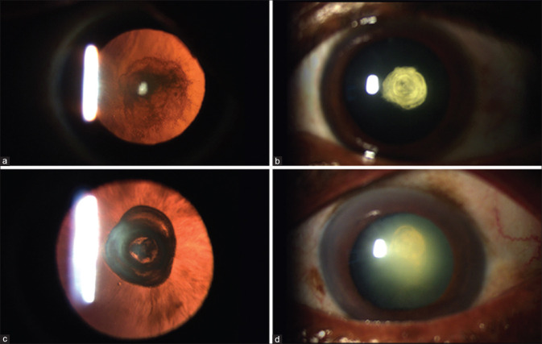
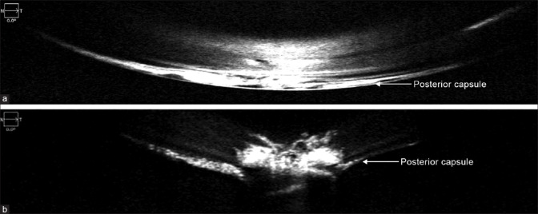
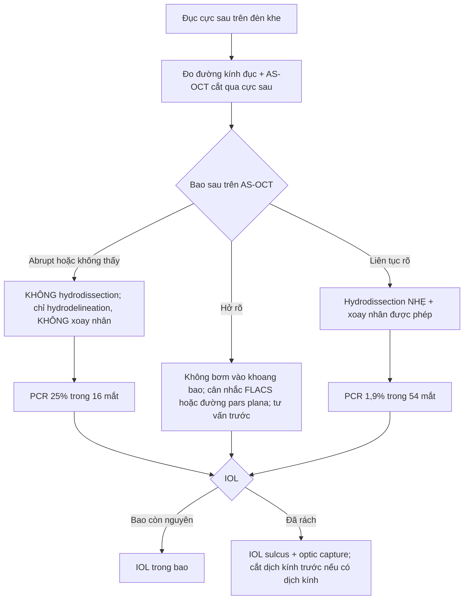
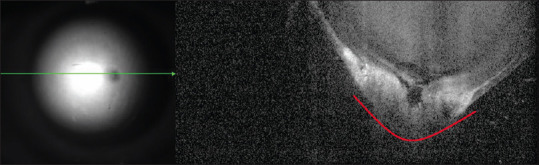
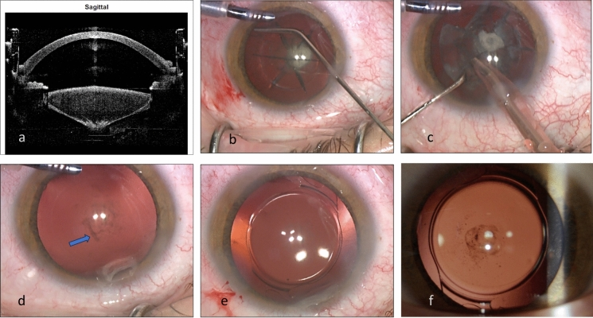
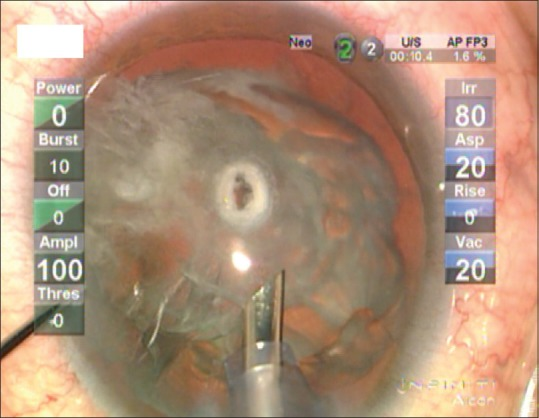

# 1504 — Đục thể thủy tinh cực sau (posterior polar cataract): dự báo rách bao sau TRƯỚC mổ và chiến lược mổ

**Tags:** `pattern:duc-cuc-sau` `pattern:vong-dong-tam` `pattern:ho-bao-sau` `pattern:pseudohole` `vung:mat` `vung:the-thuy-tinh` `vung:tien-phau` `protocol:AS-OCT` `protocol:SS-AS-OCT` `protocol:25MHz-B-scan` `protocol:retro-illumination` `score:Daljit-Singh` `incidentaloma:khong`

**Mức chắc chắn (certainty):** tổng hợp y văn (literature synthesis) — dựng từ **388 mắt** đục thể thủy tinh cực sau (PPC) phân độ theo **Daljit Singh**, mổ phaco tại một trung tâm Ấn Độ 2016–2019 (*Indian J Ophthalmol* 2022, **PMC9426121**, CC BY-NC-SA 4.0); **100 mắt** có **AS-OCT** trước mổ (*Indian J Ophthalmol* 2023, **PMC10391387**, CC BY-NC-SA 4.0); **44 mắt** AS-OCT đối chiếu tình trạng bao sau trong mổ (*Oman J Ophthalmol* 2023, **PMC10433076**, CC BY-NC-SA 4.0); **70 mắt** phân nhóm bằng **SS-AS-OCT** rồi mổ theo nhóm (*Indian J Ophthalmol* 2025, **PMC12707404**, CC BY-NC-ND 4.0); **21 mắt** chụp **25 MHz B-scan** trước mổ (*J Ophthalmol* 2018, **PMC5896256**, CC BY 4.0); tổng quan kỹ thuật **mổ PPC** (*Indian J Ophthalmol* 2017, **PMC5742963**, CC BY-NC-SA 3.0); **80 mắt** phaco "V/λ nucleofractis + viscodissection" (*Indian J Ophthalmol* 2020, **PMC7210840**, CC BY-NC-SA 4.0); **24 mắt** hydrodelineation + hydrodissection có OVD (*BMC Ophthalmol* 2018, **PMC6038186**, CC BY 4.0); **10 mắt** femtosecond + hydrodissection (*Int Ophthalmol* 2024, **PMC11377625**, CC BY 4.0); **100 bệnh nhân** giải trình tự toàn exome (*Indian J Ophthalmol* 2026, **PMC13422898**, CC BY-NC-ND 4.0); **1 ca** PPC + posterior lenticonus ở trẻ 5 tuổi (*Front Med* 2026, **PMC13616654**, CC BY 4.0). Nhóm **không có bệnh nhân của mình**; chỗ suy luận ghi **[suy luận]**. **Không ghi tên tác giả** — attribution dùng tạp chí + năm + PMCID (đối chiếu `authorString` Europe PMC ngày 2026-11-18).

> **Ranh giới với bài đã có:** [1498](../1498-sieu-am-bscan-truoc-phaco-hau-doan/lesson.md) trả lời **"mắt đục không soi được đáy — có phải B-scan?"** và đã dạy **đọc một ảnh B-scan**; [1492](../1492-duc-bao-sau-iol-yag-sau-cat-dich-kinh/lesson.md) trả lời **PCO sau phaco**; [6211](../6211-duc-truc-quang-vao-sau-mo-duc-thuy-tinh-bam-sinh/lesson.md) trả lời **đục trục quang sau mổ đục bẩm sinh**; [6213](../6213-duc-thuy-tinh-chan-thuong-tre/lesson.md) trả lời **đục do chấn thương ở trẻ**. Bài này trả lời câu hỏi **tiền phẫu hẹp hơn**: **đục cực sau — bao sau còn nguyên, mỏng hay đã hở? đo bằng gì, ngưỡng nào đổi kế hoạch mổ, và làm gì trong từng bước để không rách bao**.

> **Câu chốt — năm con số phải thuộc:** **(1)** rách bao sau (posterior capsule rupture, **PCR**) trong PPC **không phải một con số**: **3,4% (3/89) ở type 1 → 10,4% (14/135) type 2 → 75% (6/8) type 3**, PCR chung **9,3% (35/388)**, rơi nhân/vỏ **1,3%** (PMC9426121); **(2)** **AS-OCT** thấy **hở bao sau 14/100** trước mổ và **12/13 ca PCR** đã có hở từ trước — **độ nhạy 92,3%, đặc hiệu 97,7%, NPV 98,8%** (PMC10391387); **(3)** nếu **SS-AS-OCT thấy bao sau LIÊN TỤC** dưới đục cực sau thì **hydrodissection nhẹ + xoay nhân cho PCR 1,9% (1/54)**, còn bao **"abrupt" (cụt, không thấy liên tục)** thì dù chỉ **hydrodelineation + không xoay nhân** vẫn **25% (4/16)** (PMC12707404); **(4)** **25 MHz B-scan** chỉ thấy **2/21 bao hở** và **bỏ sót 2/4 PCR** — hồi âm cao giữa đục và bao sau (**dính**) cũng là dấu nguy cơ (PMC5896256); **(5)** hai yếu tố nguy cơ **đo được trên đèn khe**: đường kính đục **> 4 mm** và **tuổi < 40** (tổng quan PMC5742963).

## 1. Tổng quan bệnh học – cơ chế hình ảnh

### 1.1 Bệnh học: không phải "đục thể thủy tinh ở vị trí lạ" mà là **khiếm khuyết bao sau + dính**

- **PPC** là đục **khu trú ở cực sau**, thường **bẩm sinh**, với **nhiều lớp đồng tâm** quanh một **mảng trung tâm** ("bull's-eye"/**dấu bia — target sign**). Tổng quan mô tả **2 thể**: **ổn định (stationary)** — mảng trung tâm + vòng đồng tâm, thị lực tốt; và **tiến triển (progressive)** — các **tia đục lan ra vỏ sau** ("radiating rider opacities") làm triệu chứng tăng dần (PMC5742963).
- **Mấu chốt không nằm ở độ đục mà ở bao sau.** Mảng đục **dính chắc** vào bao sau và bao sau ở đó **mỏng hoặc khuyết bẩm sinh**; tổng quan chia 3 bệnh cảnh: **(1) hở bao sau sắp xảy ra (imminent dehiscence)**, **(2) hở bao sau có sẵn (preexisting dehiscence)**, **(3) thể thủy tinh tự di lệch (spontaneous dislocation)**. Trong **79 mắt** của chính nhóm tổng quan: **77/79 (97%) là "sắp hở"**, **2/79 (3%) hở thật** (PMC5742963) — nghĩa là **đa số bao sau còn liên tục nhưng mỏng**, và **cái mỏng ấy không nhìn thấy bằng mắt**.
- **Vì sao mổ dễ rách đến thế:** mọi thao tác **bơm nước vào khoang bao** (hydrodissection) hoặc **xoay nhân** đều tạo **áp lực thủy lực** đúng vào chỗ bao **mỏng nhất và đang dính** — bao **vỡ từ trong ra** trước khi phẫu thuật viên kịp thấy. Tổng quan ghi nhận **PCR tới 36%** ở các loạt cũ, **26%**, rồi **6–7%** và **4%** ở loạt mới — cải thiện là nhờ **kỹ thuật**, không nhờ máy (PMC5742963).
- **Di truyền và tính hai bên:** phần lớn **lẻ tẻ (sporadic)**, nhưng **di truyền trội nhiễm sắc thể thường** đã được chứng minh trong nhiều gia hệ — **PITX3** (đột biến **542delC**, liên kết **10q**, LOD **3,10**) (PMC3103741), **CRYBA1/A3** (đột biến điểm cắt nối intron 3, **17p12–21.2**) (PMC2817011), **CRYGD p.R140X** (đục nhân + cực sau) (PMC3894400). Loạt **100 bệnh nhân** giải trình tự toàn exome 2026: **58% hai bên**, **61% lẻ tẻ**, **39% có tiền sử gia đình**; biến thể **CRYBG3** và **GJA3** gặp nhiều hơn ở nhóm **PCR**, và **không** tìm thấy biến thể **PITX3** — tức **dị hợp di truyền, không có "điểm nóng"** (PMC13422898). **Phản biện nguồn:** tổng quan cũ ghi **hai bên 90%** (và trích một loạt khác **70%**) trong khi loạt 2026 chỉ **58%** — chênh lệch do **cách chọn bệnh** (phòng khám chuyên sâu vs sàng lọc), không nên lấy một số làm chuẩn.

### 1.2 TẠI SAO ảnh trông như vậy — vật lý của ba phương thức

- **Đèn khe + soi ngược sáng (retroillumination):** ánh sáng phản xạ từ đáy mắt đi **xuyên qua thể thủy tinh**; chỗ **đục** tán xạ ánh sáng → hiện **khối tối trên nền đỏ cam**. Vì đục cực sau được **các lớp vỏ sau xếp nếp** bao quanh, bờ đục **lượn sóng nhiều vòng** → **dấu bia/vòng đồng tâm**. Đây là **dấu thị giác rẻ nhất** để phân độ, nhưng nó **không nói gì về bao sau** bên dưới [suy luận từ bản chất kỹ thuật].
- **AS-OCT (chụp cắt lớp quang học tiền đoạn):** dùng ánh sáng **~1.300 nm**, bước sóng **dưới 1 µm** → phân giải **cỡ µm**, đủ vẽ **một đường bao sau dày 5–20 µm**. Vì vậy nó trả lời đúng câu hỏi "**đường bao còn liên tục hay đã đứt**", và **vị trí đứt** (dưới mảng đục). Giới hạn: **đục dày cản ánh sáng** → có ca **không thấy bao** hoặc **giả hở** (mục 5).
- **Siêu âm 25 MHz (25 MHz B-scan):** vận tốc âm trong mô mềm **~1.540 m/s** → bước sóng **≈ 62 µm** ở **25 MHz** (so với **≈ 154 µm** ở 10 MHz). Nghĩa là **khuyết bao 10–20 µm nằm dưới ngưỡng phân giải**; chỉ **hở lớn, bờ lật vào dịch kính** mới thấy. Đây là **lý do vật lý** khiến 25 MHz **bỏ sót 2/4 PCR** trong loạt 21 mắt (PMC5896256) — **không phải máy kém**, mà là **giới hạn bước sóng**.
- **CT/MRI:** không dùng để đánh giá bao sau — CT cho **nhãn cầu đồng nhất ~20–40 HU**, MRI phân giải **mm**, không thể thấy **màng 10 µm**; MRI chỉ có ích khi nghi **u/dị vật** phối hợp [suy luận].

### 1.3 Bốn thang số liệu để không nói "nguy cơ cao" chung chung

| Bối cảnh | n | PCR | Nguồn |
|---|---|---|---|
| Phaco PPC, phân độ Daljit Singh | 388 mắt | **9,3% (35/388)**; **type 3 = 75%** | PMC9426121 |
| Phaco, nhiều phẫu thuật viên | 80 mắt | **7,5% (6/80)**; **"trên bàn" 2,6% (2/76)** | PMC7210840 |
| Hydrodelineation + hydrodissection có OVD | 24 mắt | **16,7% (4/24)** | PMC6038186 |
| Phaco vs MSICS | 164 mắt | **10,3% vs 14,0%** (p = 0,506) | PMC9907252 |
| AS-OCT trước mổ | 100 mắt | **13% (13/100)** | PMC10391387 |
| SS-AS-OCT: bao **liên tục** + hydrodissection | 54 mắt | **1,9% (1/54)** | PMC12707404 |
| SS-AS-OCT: bao **abrupt** + chỉ hydrodelineation | 16 mắt | **25% (4/16)** | PMC12707404 |
| FLACS + hydrodissection nhẹ | 10 mắt | **1/10** (trong lúc rửa vỏ) | PMC11377625 |

- **Dịch nghĩa lâm sàng:** **7–10%** là con số của **trung tâm lớn, mổ có quy trình**; **hở bao có sẵn** đẩy lên **hàng chục %**. Vì vậy câu hỏi không phải "PPC nguy hiểm không" mà **"mắt này thuộc nhóm nào"**.

## 2. Mẫu hình + chẩn đoán phân biệt theo vị trí (gamut)

**Mẫu hình trung tâm:** *một đám đục tròn, bờ nhiều vòng, nằm đúng cực sau thể thủy tinh, trên mắt còn trong* — ba câu hỏi luôn theo thứ tự: **(1) đường kính bao nhiêu mm? (2) có dấu hiệu hở bao chưa? (3) đục này là PPC, giả hở (pseudohole), hay đục dưới bao sau thường?**

### 2.1 Phân độ Daljit Singh — thang dùng được ngay trên đèn khe

| Độ | Hình thái | PCR trong loạt 388 mắt | Nguồn |
|---|---|---|---|
| **Type 1** | Đục cực sau **kèm đục dưới bao** | **3,4% (3/89)** | PMC9426121 |
| **Type 2** | Đám đục tròn/bầu dục **rõ bờ, các vòng kiểu "củ hành"**, có/không chấm xám ở rìa | **10,4% (14/135)** | PMC9426121 |
| **Type 3** | Đám đục trắng đục rõ bờ + **chấm trắng đặc ở rìa (dấu Daljit Singh)**, thường **bao sau mỏng/không có** | **75% (6/8)** | PMC9426121 |
| **Type 4** | **Phối hợp các thể trên + đục nhân** | **7,7% (12/156)** — xem phản biện dưới | PMC9426121 |

> **Phản biện nguồn (bắt buộc):** **phần tóm tắt** của PMC9426121 ghi type 4 là **17,7%**, nhưng **bảng 2** của chính bài ghi **12/156 = 7,7%** (và 12/156 mới khớp với tổng 35 PCR). Bài này dùng **số trong bảng** và **ghi rõ** chỗ lệch — đúng quy tắc "trung thành nguồn + phản biện", không lặng lẽ chọn số đẹp.

### 2.2 Gamut theo hình thái (cùng một "đốm trắng ở cực sau")

- **PPC type 1–4** — như trên; **hai bên 58–90%** (PMC13422898, PMC5742963) → **luôn soi mắt bên kia**, vì nó vừa là chẩn đoán, vừa là **kiểu hình tham chiếu** cho mắt sẽ mổ.
- **Hở bao sau có sẵn (preexisting dehiscence)** — đục cực sau **kèm một vùng bao mất liên tục**, đôi khi thấy **dịch kính lấp vào** ("**fish-mouthing**" — dấu đã rách, không phải "sắp rách") (PMC5742963).
- **Giả hở (pseudohole)** — **vỏ sau có khuyết tròn như lỗ nhưng bao sau bên dưới còn nguyên**; đây là **bẫy ngược**: thấy "lỗ" mà **không được** hành động như đã rách, nhưng cũng **không được** mặc định an toàn (mục 5) (PMC5742963).
- **Đục dưới bao sau (posterior subcapsular cataract, PSC)** — mảng đục **sát bao sau nhưng không có vòng đồng tâm**, bờ **xốp, lan tỏa**, thường **do corticoid/đái tháo đường/xạ**; bao sau **không có khiếm khuyết bẩm sinh** → **mổ như đục thường**, nguy cơ PCR thấp hơn nhiều.
- **Mảng xơ bao sau (posterior capsular plaque)** — mảng trắng **đặc, dính bao sau**, thường **sau chấn thương/viêm**; không phải PPC; **để lại** và **YAG sau 4–6 tuần** nếu cần (PMC5742963).
- **Posterior lenticonus** — **cực sau phình ra sau** thành hình nón, soi ngược sáng có **"giọt dầu" (oil droplet sign)**; đục thường **khu trú trong chỗ phình**, hay **một bên ở trẻ**; ca trẻ **5 tuổi**: quang sai bậc cao **1,426 µm**, **DLI 0,34**, mổ lấy IOL → **0,3 → 0,8** thị lực (PMC13616654).
- **Di tích màng hyaloid trước/Mittendorf dot** — **một chấm nhỏ ở cực sau**, không vòng đồng tâm, **không tiến triển** → không phải chỉ định mổ.
- **Thể thủy tinh tự di lệch (spontaneous dislocation)** — hiếm; PPC có thể **trượt vào tiền phòng** do đứt dây chằng; bệnh cảnh cấp cứu khác hẳn (PMC5742963).

*Hình: (a) type 1 — đục cực sau kèm đục dưới bao; (b) type 2 — các vòng đồng tâm kiểu "củ hành"; (c) type 3 — đám trắng đặc bờ rõ, bao sau mỏng/khuyết; (d) type 4 — phối hợp + đục nhân. Nguồn: Indian J Ophthalmol 2022, PMC9426121, CC BY-NC-SA 4.0 (nguyên bản, giữ nhãn a–d).*

## 3. Bảng so sánh phân biệt (ma trận đối chiếu)

| Thực thể (entity) | Hình ảnh điển hình | Chốt vào (rule-in) | Chốt loại (rule-out) | Gợi ý xác nhận |
|---|---|---|---|---|
| **PPC type 3 (nguy cơ cao nhất)** | Đám trắng đặc bờ rõ + **chấm trắng ở rìa**, **không thấy đường bao sau** dưới đục | **Dấu Daljit Singh + đường kính > 4 mm + AS-OCT không vẽ được bao sau** | Bao sau **liên tục rõ** trên SS-AS-OCT dưới đục → hạ nguy cơ (nhóm 1,9%) | AS-OCT/SS-AS-OCT; **không hydrodissection**; cân nhắc **FLACS/femtodelineation** |
| **PPC type 2 (củ hành)** | Vòng đồng tâm nhiều lớp, rìa có chấm xám | **Vòng đồng tâm + mảng trung tâm** | Không có vòng, bờ xốp lan tỏa → **PSC thường** | Đèn khe soi ngược sáng + **AS-OCT** |
| **Hở bao sau có sẵn** | Khe bao **mất liên tục**, có thể **dịch kính lấp** | **AS-OCT: đứt đoạn dưới đục**; **fish-mouthing** trong mổ | Đường bao **liên tục** suốt dưới đục = chưa hở | AS-OCT **cắt đúng trục đục**; 25 MHz chỉ khi hở lớn |
| **Giả hở (pseudohole)** | "Lỗ" tròn ở vỏ sau nhưng **không có dòng dịch kính**, không đổi theo thì | **Đáy "lỗ" có vỏ sau phủ**; **bao sau liên tục trên AS-OCT** | Bao **mất liên tục + hồi âm dịch kính** → hở thật | AS-OCT; trong mổ: **không thấy dịch kính chui lên** |
| **Đục dưới bao sau (PSC)** | Plaque xốp sát bao sau, **không vòng đồng tâm** | **Bờ lan tỏa + tiền sử corticoid/ĐTĐ/xạ** | Bờ đanh, có vòng → PPC | Soi ngược sáng; LOCS III |
| **Mảng xơ bao sau** | Mảng trắng **đặc, dày** dính bao | **Dày đặc + tiền sử chấn thương/viêm** | Không vòng, không chấm rìa | Để lại, **YAG sau 4–6 tuần** |
| **Posterior lenticonus** | Cực sau **lồi hình nón**; **giọt dầu** khi soi ngược sáng | **Đường bao phình ra sau** trên AS-OCT/OCT máy laser | Đường bao **cong bình thường** | Ca trẻ: **quang sai + DLI** giúp quyết định mổ (PMC13616654) |
| **Mittendorf dot** | **Chấm nhỏ** đúng cực sau, không vòng | **Không tiến triển, không mờ dần** | Đám đục **có vòng + dày lên** → PPC | Theo dõi, không mổ |

*Hình: (a) **bao sau liên tục** dưới đục cực sau (mũi tên "Posterior capsule"); (b) **bao sau hở** — đường bao **mất liên tục** đúng dưới mảng đục. Nguồn: Indian J Ophthalmol 2023, PMC10391387, CC BY-NC-SA 4.0 (nguyên bản).*

## 4. Protocol chụp + hệ phân độ & chiến lược mổ

### 4.1 Tiền phẫu — bốn bước, theo thứ tự

1. **Đèn khe, đồng tử giãn tối đa, soi ngược sáng:** ghi **hình thái (type 1–4)**, **đường kính đục (mm)** — **> 4 mm là ngưỡng nguy cơ** (PMC5742963), và **tìm dấu hở**: khe bao, dịch kính lấp, mống mắt rung khi di chuyển mắt.
2. **AS-OCT / SS-AS-OCT cắt qua đúng trục đục:** phân **3 nhóm** — **bao liên tục**, **bao "abrupt" (cụt, mất liên tục kiểu bậc)**, **bao hở rõ** (PMC12707404). Đây là **bước đổi kế hoạch mổ nhiều nhất**.
3. **Siêu âm 25 MHz** khi **AS-OCT không xuyên qua được** (đục dày) hoặc khi cần xác nhận **hở lớn**: đường bao **lồi vào dịch kính** = hở; **hồi âm cao giữa đục và bao** = **dính chắc** — dấu nguy cơ dù bao còn liền (PMC5896256).
4. **Sinh trắc quang + soi đáy mắt + soi mắt bên kia**; **tư vấn bằng số**: mắt type 3 nguy cơ **~75%**, mắt bao liên tục **~2%** (PMC9426121, PMC12707404), và nói rõ **phương án nếu rách** (IOL sulcus, cắt dịch kính trước, theo dõi võng mạc).

### 4.2 Luồng quyết định (dùng đúng ba nhóm SS-AS-OCT)

### 4.3 Sáu luật trong phòng mổ

- **Mở bao trước (capsulorhexis) ~5 mm:** nhỏ quá thì **khó đẩy nhân ra**, to quá thì **mất chỗ đỡ IOL** nếu phải đặt sulcus (PMC5742963).
- **Không hydrodissection cổ điển** (bơm tách vỏ toàn chu vi) — đây là **thao tác gây vỡ thủy lực** kinh điển; thay bằng **hydrodelineation** tạo **"đệm" epinucleus** (PMC5742963, PMC7210840).
- **Kỹ thuật "inside-out delineation":** rãnh trung tâm → cannula góc phải bơm **từ trong ra**, tạo **vòng vàng (golden ring)** xác nhận đã tách lõi; **epinucleus còn lại làm đệm che bao sau** cho tới khi hút hết nhân (PMC5742963).
- **Không xoay nhân, không "rock" thể thủy tinh**, **áp lực chai thấp, vacuum thấp, buồng kín**; **không đánh bóng bao sau** dù bao còn nguyên (PMC5742963).
- **Lấy epinucleus bằng viscodissection** (bơm OVD tách epinucleus khỏi bao), rồi **hút**; loạt 24 mắt vẫn **16,7% PCR**, trong đó **2 ca rách khi lấy epinucleus** và **2 ca khi rút OVD sau khi đã đặt IOL trong bao** → **giai đoạn cuối nguy hiểm không kém giai đoạn đầu** (PMC6038186).
- **Femtosecond (femtodelineation):** chia nhân thành **3 trụ đồng tâm, trụ ngoài Ø 5,5 mm**, mỗi lớp lấy đi trong khi lớp ngoài **còn làm đệm** (PMC5742963); loạt **10 mắt** FLACS + hydrodissection nhẹ: **1 rách khi rửa vỏ**, không rơi nhân (PMC11377625). **FLACS không thay thế được đánh giá bao sau.**

### 4.4 Phân độ nguy cơ để tư vấn (thang thực dụng)

| Nhóm | Tiêu chí | PCR kỳ vọng | Thái độ |
|---|---|---|---|
| **Thấp** | Bao sau **liên tục** trên SS-AS-OCT, đục **≤ 4 mm** | **~2%** | Phaco thường, hydrodissection nhẹ được phép |
| **Trung bình** | Bao **abrupt**/không thấy, đục **> 4 mm**, **tuổi < 40** | **~10%** | Không hydrodissection; hydrodelineation; **không xoay nhân** |
| **Cao** | **Hở bao rõ** hoặc **fish-mouthing** trước mổ, **type 3** | **25–75%** | Tư vấn **trước**; cân nhắc **FLACS**/**pars plana**; chuẩn bị **IOL sulcus** |

*Hình: bên trái là ảnh định hướng với đường cắt; bên phải AS-OCT — **vùng bao sau mất liên tục** (viền đỏ) ở bệnh nhân **rơi nhân trong mổ**. Nguồn: Oman J Ophthalmol 2023, PMC10433076, CC BY-NC-SA 4.0 (nguyên bản).*

*Hình: (a) OCT trục dọc của máy laser — cực sau **phình/lồi ra sau** tại chỗ đục, buộc phải **hạ mặt phẳng cắt** khi femtodelineation; (b–f) các thì hydrodissection nhẹ và lấy nhân. Nguồn: Int Ophthalmol 2024, PMC11377625, CC BY 4.0 (nguyên bản).*

## 5. Biến thể bình thường và cạm bẫy

- **Giả hở (pseudohole)** — khuyết tròn ở **vỏ sau**, bao sau **còn nguyên**; nếu đọc thành "đã rách" thì **mổ quá tay** (đặt sulcus oan, bỏ hydrodelineation), còn nếu đọc thành "lành" mà **bỏ AS-OCT** thì **bỏ sót hở thật** ở ca khác. Chốt bằng **AS-OCT** và **quan sát trong mổ**: hở thật có **dịch kính chui lên** (PMC5742963).
- **"Fish-mouthing" = đã rách, không phải sắp rách.** Thấy **dịch kính qua mảng đục** thì **dừng ngay** thao tác bơm/xoay, bơm OVD giữ buồng, chuyển kế hoạch (PMC5742963).
- **Satisfaction of search:** **type 4** có **đục nhân dày** che mất đục cực sau → **đọc "đục nhân già" rồi mổ như thường**. Phòng tránh: **soi mắt bên kia** và **chụp ảnh tiền phẫu** trước khi đồng tử co (hai bên **58–90%**).
- **AS-OCT âm tính giả:** đục **quá dày** cản ánh sáng → **không thấy bao**; trong loạt 44 mắt, **2 mắt** AS-OCT báo hở nhưng **bao nguyên trong mổ**, và **1 mắt** AS-OCT báo liền nhưng **rách thật** (bao cực mỏng/dính) (PMC10433076). Vì vậy **"liền" trên AS-OCT không phải giấy miễn trách**.
- **25 MHz âm tính giả:** **bỏ sót 2/4 PCR**; **hồi âm cao giữa đục và bao** lại là dấu **dính** — đọc đúng thì **tăng** chứ không giảm cảnh giác (PMC5896256).
- **Nhầm PSC với PPC:** PSC **không có vòng đồng tâm**, **không có khiếm khuyết bao bẩm sinh** → nếu gọi PSC là PPC thì **mổ quá thận trọng** (bỏ hydrodissection, mổ chậm) nhưng nếu gọi PPC là PSC thì **hydrodissection đầy đủ → vỡ bao**.
- **Trẻ một bên:** PPC **một bên** thường kèm **nhược thị** → tiên lượng thị lực **dè dặt** dù mổ kỹ thuật tốt; ca lenticonus 5 tuổi cho thấy **quang sai/DLI** giúp quyết định **thời điểm** (PMC13616654).
- **YAG quá sớm:** màng xơ bao sau để lại nên **YAG sau ≥ 4–6 tuần** (hàng rào máu–thủy dịch ổn định), không bắn trong vài tuần đầu (PMC5742963).

*Hình: trong mổ — **khuyết tròn ở vỏ sau** giống một lỗ, nhưng **bao sau bên dưới còn nguyên** (pseudohole). Nguồn: Indian J Ophthalmol 2017, PMC5742963, CC BY-NC-SA 3.0 (nguyên bản, giữ nguyên ảnh chụp kèm thông số máy).*

## 6. Tự lượng giá — Blind Quiz

**Ca 1 — Bốn mắt đục cực sau, cùng một buổi khám. Nhìn hình trước, đừng đọc chú thích.**

- Gợi ý lâm sàng: người lớn, thị lực giảm dần, đồng tử giãn tốt; cả bốn mắt đều "đục ở giữa".
- Câu hỏi: Phân độ theo Daljit Singh? Mắt nào **nguy cơ rách bao sau cao nhất** và vì sao? Hai yếu tố nào **đo được** làm tăng nguy cơ?

<b>Bấm để hiện đáp án (findings + chẩn đoán)</b>

- **Findings:** (a) đục cực sau **kèm đục dưới bao** = **type 1**; (b) **vòng đồng tâm kiểu củ hành** = **type 2**; (c) **đám trắng đặc bờ rõ + chấm trắng ở rìa** = **type 3**; (d) **phối hợp + đục nhân** = **type 4**.
- **Nguy cơ cao nhất: (c) type 3** — **75% (6/8)** rách bao sau trong loạt 388 mắt, vì **bao sau mỏng/khuyết** ngay dưới mảng đặc.
- **Hai yếu tố đo được:** đường kính đục **> 4 mm** và **tuổi < 40** (tổng quan PMC5742963).
- Nguồn ảnh: Indian J Ophthalmol 2022, PMC9426121, CC BY-NC-SA 4.0.

**Ca 2 — Hai mắt đục cực sau, chụp AS-OCT trước mổ. Mắt nào phải đổi kế hoạch?**

- Gợi ý lâm sàng: cùng một bác sĩ, cùng một máy; câu hỏi duy nhất là **bao sau**.
- Câu hỏi: Mô tả đường bao sau ở (a) và (b)? Nếu chỉ có một mắt được **hydrodissection**, chọn mắt nào? Độ nhạy/đặc hiệu của AS-OCT cho hở bao sau là bao nhiêu?

<b>Bấm để hiện đáp án</b>

- **Findings:** (a) **bao sau liên tục** — đường hồi âm mảnh chạy liên tục dưới mảng đục (mũi tên); (b) **bao sau hở** — đường bao **mất liên tục**, mép cụt đúng dưới đục.
- **Đổi kế hoạch: (b)** — **không hydrodissection**, chỉ **hydrodelineation**, **không xoay nhân**; nếu hở rõ: cân nhắc **FLACS/pars plana**, tư vấn trước.
- **Hiệu năng AS-OCT:** **độ nhạy 92,3%, đặc hiệu 97,7%, PPV 85,7%, NPV 98,8%** (100 mắt; **12/13 ca PCR** đã có hở từ trước) — PMC10391387.
- **Lưu ý phản biện:** bài PMC10433076 (44 mắt) **ghi nhãn độ nhạy/đặc hiệu ngược nhau trong tóm tắt**; đếm lại từ số ca cho **nhạy 87,5% (7/8), đặc hiệu 94,4% (34/36), PPV 77,8%, NPV 97,1%**. Khi trích, dùng **số đếm được**, không chép nhãn.
- Nguồn ảnh: Indian J Ophthalmol 2023, PMC10391387, CC BY-NC-SA 4.0.

**Ca 3 — Trong mổ, sau khi bóc vỏ, thấy "một lỗ" ở cực sau. Xử trí?**

- Gợi ý lâm sàng: đục cực sau, đang ở thì lấy vỏ; **không thấy dịch kính** trào lên, tiền phòng vẫn giữ.
- Câu hỏi: Đây là hở bao thật hay giả hở? Dấu hiệu nào phân biệt **ngay trong mổ**? Bước tiếp theo?

<b>Bấm để hiện đáp án</b>

- **Findings:** **khuyết tròn ở VỎ sau** với **bao sau còn phủ bên dưới** = **pseudohole**; **không có dịch kính chui qua**.
- **Chốt trong mổ:** hở thật có **"fish-mouthing"** — **dịch kính nhìn thấy qua mảng đục**; giả hở thì **không**. Nếu còn nghi: **AS-OCT** trước mổ hoặc **thử bơm OVD nhẹ** xem có rò dịch kính (không bơm mạnh).
- **Bước tiếp:** tiếp tục **viscodissection lấy epinucleus**, **không đánh bóng bao sau**, đặt **IOL trong bao**, hẹn **YAG sau ≥ 4–6 tuần** nếu mảng xơ còn.
- Nguồn ảnh: Indian J Ophthalmol 2017, PMC5742963, CC BY-NC-SA 3.0.

## Bài liên quan chéo

- [400 – Tổng quan Mắt & thị giác](../400-tong-quan-mat-thi-giac/lesson.md)
- [1498 – B-scan trước phẫu thuật đục thể thủy tinh](../1498-sieu-am-bscan-truoc-phaco-hau-doan/lesson.md) (đọc B-scan; 25 MHz; bao sau)
- [1492 – Đục bao sau nhân tạo (PCO) sau phaco ở mắt đã cắt dịch kính](../1492-duc-bao-sau-iol-yag-sau-cat-dich-kinh/lesson.md) (YAG sau mổ)
- [1480 – Đục thể thủy tinh sau bóc màng ERM](../1480-duc-the-thuy-tinh-sau-boc-mang-erm/lesson.md) (mổ phối hợp, tính công suất IOL)
- [6211 – Đục trục quang sau mổ đục thể thủy tinh bẩm sinh](../6211-duc-truc-quang-vao-sau-mo-duc-thuy-tinh-bam-sinh/lesson.md)
- [6213 – Đục thể thủy tinh do chấn thương ở trẻ](../6213-duc-thuy-tinh-chan-thuong-tre/lesson.md)
- [1425 – Viêm nội nhãn sau tiêm nội nhãn](../1425-viem-noi-nhan-sau-tiem-noi-nhan/lesson.md) (biến chứng nhiễm sau thủ thuật nội nhãn)

> Không dùng để chẩn đoán độc lập khi chưa có người hướng dẫn.
