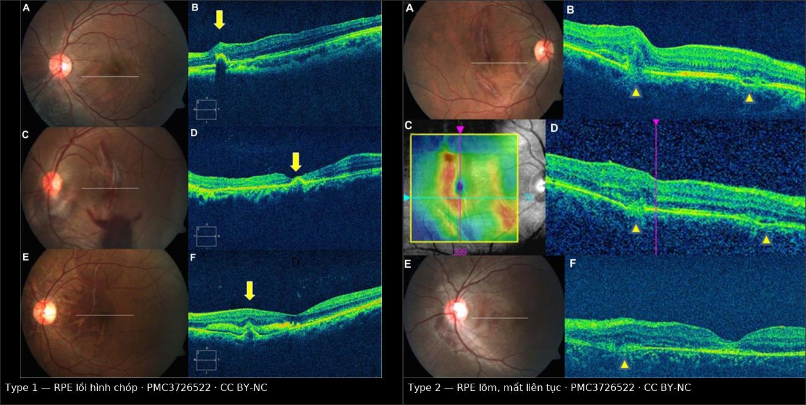
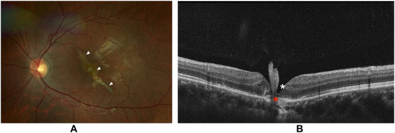
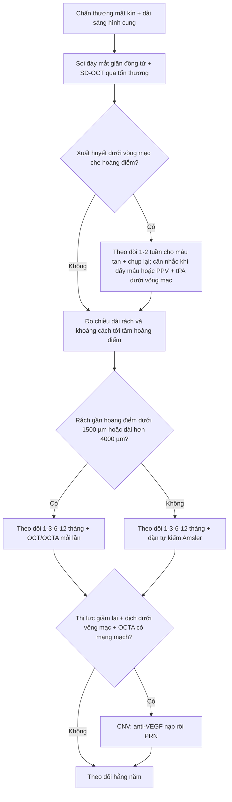
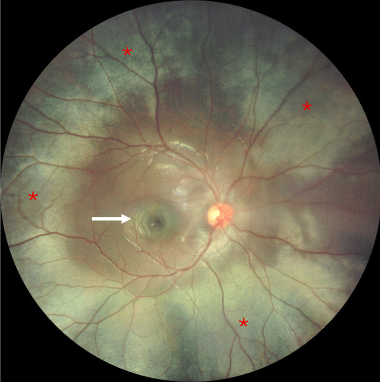
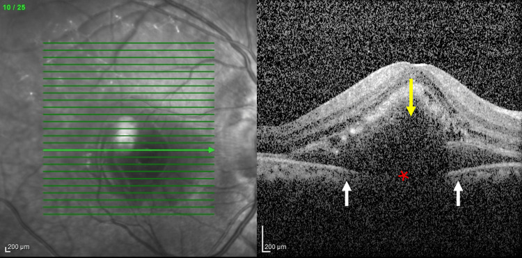
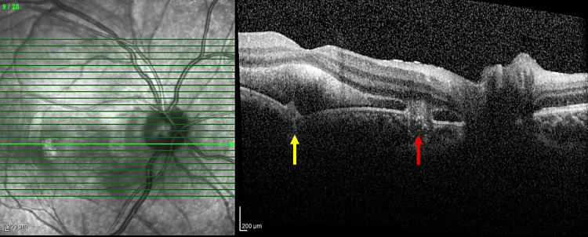
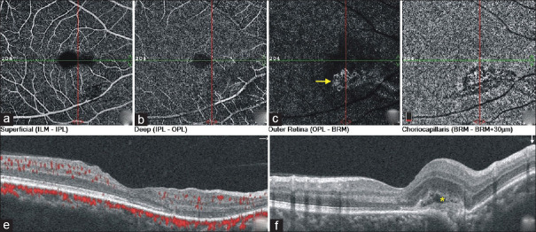

# 1505 — Rách hắc mạc do chấn thương: dải sáng hình cung quanh đĩa thị, xuất huyết dưới võng mạc và CNV muộn / Traumatic choroidal rupture

**Tags:** `pattern:rach-hac-mac` `pattern:dai-sang-hinh-cung` `pattern:xuat-huyet-duoi-vong-mac` `pattern:mat-lien-tuc-RPE-Bruch` `vung:hac-mac` `vung:mat` `vung:hoang-diem` `vung:dia-thi` `vung:hau-cuc` `anatomy:mang-Bruch` `anatomy:ruong-mach-hac-mac` `protocol:OCT-hoang-diem` `protocol:FA-OCTA` `protocol:sieu-am-Bscan` `score:khong` `incidentaloma:khong`

**Mức chắc chắn (certainty):** tổng hợp y văn (literature synthesis) — ghép **bài tổng quan** (*Indian J Ophthalmol* 2023 — **PMC10417958**, CC BY-NC-SA), **loạt 18 mắt** phân type trên SD-OCT (*Clin Ophthalmol* 2013 — **PMC3726522**, CC BY-NC), **loạt 4 ca** chụp SS-OCT mô tả **sinh lý bệnh tại chỗ** (*Indian J Ophthalmol* 2020 — **PMC7728025**), **33 mắt rách hắc mạc** trong 853 ca chấn thương kín (*Ther Adv Ophthalmol* 2019 — **PMC6537082**, CC BY-NC), **54 ca** với 11 CNV (*BMC Ophthalmol* 2019 — **PMC6878647**, CC BY 4.0), loạt ca **tPA dưới võng mạc** (*Int Med Case Rep J* 2026 — **PMC13496125**), ca trẻ 12 tuổi (*Cureus* 2026 — **PMC13440916**, CC BY 4.0), ca đa chấn thương (*Open Access Emerg Med* 2023 — **PMC9983613**), ca OCTA (*Taiwan J Ophthalmol* 2021 — **PMC8493985**), và **71 mắt sclopetaria** (*Am J Ophthalmol Case Rep* 2019 — **PMC6384308**). Nhóm **không có bệnh nhân của mình**; chỗ suy luận ghi **[suy luận]**.

> **Vị trí trong thư viện:** [1501](../1501-chan-thuong-thi-than-kinh-ton/lesson.md) phủ **chấn thương dây thị** (giảm thị lực + RAPD, CT/MRI); [449](../449-chan-thuong-mat-dich-vat/lesson.md) phủ **vỡ nhãn cầu & dị vật nội nhãn**; [1479](../1479-bong-vong-mac-thanh-dich/lesson.md) phủ **bong võng mạc thanh dịch**; [1486](../1486-khoi-hac-mac-sieu-am/lesson.md) phủ **khối hắc mạc trên siêu âm**. Bài này trả lời mặt còn trống: **nhãn cầu còn nguyên, không RAPD, nhưng đáy mắt có dải sáng hình cung — đó là gì, đọc trên OCT thế nào, và theo dõi bao lâu**.

> **Câu chốt — năm con số phải thuộc:** **(1)** **5–10%** chấn thương mắt kín có rách hắc mạc, và **~80%** là **gián tiếp** — hình cung đồng tâm đĩa thị (PMC10417958). **(2)** Trong **111 mắt**, tổn thương ở **hoàng điểm 68%** (**37% xuyên hoàng điểm**, **31% ngoài hoàng điểm**) (Ament, dẫn trong PMC10417958). **(3)** **CNV 5–10%** là con số kinh điển, nhưng các loạt hiện đại ghi **12%** (4/33), **20%** (11/54) và **16,6%** (3/18) — **82% xuất hiện trong năm đầu**, trung vị **230 ngày** (PMC6537082, PMC6878647, PMC3726522). **(4)** SS-OCT: khe hở **màng Bruch 103–465 µm**, **Sattler/Haller còn nguyên**, máu tụ **dưới võng mạc** chứ không dưới RPE (PMC7728025). **(5)** Yếu tố dự báo CNV: rách **gần hoàng điểm** và **dài** — nhóm có CNV dài trung vị **4.504 vs 3.054 µm** (p = 0,03) (Secretan, dẫn trong PMC6537082).

## 1. Tổng quan bệnh học – cơ chế hình ảnh (TẠI SAO)

### 1.1 Giải phẫu: năm lớp chồng nhau, một lớp "giòn" nhất

- Từ trong ra ngoài ở hậu cực: **võng mạc thần kinh** (dày **~250–300 µm** quanh hoàng điểm) → **biểu mô sắc tố võng mạc (RPE)** → **màng Bruch (Bruch membrane)** → **lớp mao mạch hắc mạc (choriocapillaris)** → **lớp Sattler** rồi **lớp Haller** (mạch hắc mạc lớn) → củng mạc.
- **Màng Bruch** là màng đàn hồi **5 lớp**, dày **2–4 µm**, giàu elastin. Võng mạc **đàn hồi tốt**, củng mạc **dày và đàn hồi**, còn Bruch **cứng và giòn nhất** trong chuỗi này → khi nhãn cầu bị ép rồi bung ra, **Bruch là nơi rách trước tiên** (PMC10417958, PMC3726522).
- **RPE và choriocapillaris đều nằm trên màng đáy là một phần của Bruch** — nên Bruch rách thì **RPE và mao mạch hắc mạc rách theo**, đúng như mô tả SS-OCT: ổ rách **RPE–Bruch**, còn **Sattler/Haller nguyên vẹn** (PMC7728025).

### 1.2 Cơ chế: lực cắt tỏa tròn từ đĩa thị — vì sao "hình cung"

- Chấn thương kín ép nhãn cầu theo trục **trước–sau** → nhãn cầu **phình ra ở xích đạo** → mô bị kéo **theo phương tiếp tuyến**, và **lực cắt (shear) lan tỏa đồng tâm từ dây thị** ra sau. Vì vậy rách **gián tiếp** nằm **sau xích đạo, đồng tâm đĩa thị, hình cung/vệt**, hay gặp ở **hoàng điểm – thái dương** — nơi ứng suất lớn nhất và cũng là nơi thị lực bị đe dọa nhất (PMC10417958).
- **Rách trực tiếp (coup)** nằm **ngay điểm va đập**, thường **trước xích đạo, song song với ora serrata** — vị trí phản ánh **điểm tác động**, không phải hướng lực cắt.
- **Màng Bruch giòn bệnh lý** thì rách vì chấn thương rất nhẹ: **pseudoxanthoma elasticum (PXE)**, và cả bệnh huyết sắc tố/tăng canxi [suy luận từ cơ chế elastin — PMC10417958 nêu PXE].

### 1.3 TẠI SAO máu nằm DƯỚI VÕNG MẠC mà không dưới RPE

- Mao mạch hắc mạc vỡ → máu thoát ra **ngay dưới lớp tế bào cảm thụ sáng**, bóc võng mạc thần kinh khỏi RPE → **xuất huyết dưới võng mạc (subretinal hemorrhage)**, tạo mảng đỏ che mất chính đường rách trong **1–4 tuần đầu** (PMC7728025 mô tả đúng đường đi này: "blood … dissected under the photoreceptor layer to lift it off the RPE").
- Khác với **CNV của AMD** (mạch mới mọc **dưới RPE** → xuất huyết dưới RPE, hình vòm): ở rách hắc mạc, **lớp mao mạch bị rách cùng Bruch**, nên máu vào **khoang dưới võng mạc** — đây là lý do đáy mắt thấy **mảng đỏ phẳng, che bờ rách**, và OCT thấy **võng mạc bị đẩy lên hình vòm nhưng dải RPE–Bruch vẫn ở dưới** (ảnh Ca 2).
- **Xuất huyết tiêu đi** để lại **dải xơ trắng–vàng co kéo**, có thể **bộc lộ củng mạc**; tế bào RPE **tăng sinh ở bờ** trong **3–4 tuần** (mô bệnh học, dẫn trong PMC10417958).

### 1.4 TẠI SAO OCT là chuẩn — và đọc đúng hai kiểu

- Trên OCT, **dải RPE–Bruch là đường tăng phản xạ mảnh**; rách = **mất liên tục đường này** + **đường viền hắc mạc lõm xuống** hoặc **lồi lên**, kèm **mất liên tục ellipsoid zone (EZ)** và **màng giới hạn ngoài (ELM)**.
- **Phân type theo Nair (2013)** — khác biệt không chỉ để mô tả mà để **tiên lượng** (PMC3726522):
  - **Type 1:** **RPE–choriocapillaris lồi ra trước** thành hình chóp/dom, **khe hở nhỏ** hoặc **RPE–choriocapillaris nâng lên** kèm **nhiều máu dưới võng mạc** — "Bruch rách nhưng màng còn căng".
  - **Type 2:** **vùng mất liên tục rộng** của RPE–choriocapillaris + EZ + ELM, **bờ lõm xuống**, mô **trượt xuống theo ổ rách** — "mất mô thật".
- Trong **18 mắt** của Nair: **10 type 1, 8 type 2**; CNV xuất hiện **1/10 type 1** và **2/8 type 2** — type 2 có xu hướng nặng hơn nhưng **số quá nhỏ để chốt** [suy luận] (PMC3726522).
- **Khe hở Bruch đo được 103–465 µm** trên SS-OCT — tức **nhỏ hơn độ phân giải của mọi máy CT/MRI lâm sàng**, nên **không có "rách hắc mạc trên CT"**.

### 1.5 TẠI SAO tự phát huỳnh quang (AF) và FA lại "vẽ" được đường rách

- **AF (fundus autofluorescence):** vùng rách **giảm huỳnh quang** vì **mất RPE** (mất lipofuscin) **và** vì máu/RPE chắn; **bờ rách tăng huỳnh quang** do **RPE tăng sinh** ở mép — dấu hiệu xuất hiện sau **3–4 tuần** và thấy rõ khi máu đã tan (PMC10417958).
- **FA:** thì sớm **giảm huỳnh quang** (máu chắn + mất mao mạch hắc mạc tại chỗ), thì muộn **bắt màu nhẹ** ở bờ xơ. Khi có CNV: **mạng mạch tăng huỳnh quang lan rộng dần và rò (leakage)** ở thì muộn — đúng hình thái "classic" mà loạt ca mô tả (PMC6537082, Hình 2).
- **OCTA** cho thấy **mạng mạch nối (anastomotic network) ở lớp võng mạc ngoài và choriocapillaris**, **không có ở lớp nông/sâu của võng mạc** — chốt CNV mà **không cần tiêm thuốc** (PMC8493985).

### 1.6 Vì sao CT/MRI hốc mắt "bình thường" không loại trừ

- CT lát **≤ 1 mm** trả lời câu hỏi **xương**: gãy sàn/thành ổ mắt, máu xoang, dị vật. Võng mạc + hắc mạc dày **< 1 mm** → **dưới ngưỡng phân giải**, lại nằm sát xương nên **nhiễu beam-hardening**. MRI bị **artifact chuyển động nhãn cầu** và **không phân giải được màng 2–4 µm**. Chẩn đoán là **lâm sàng + OCT**; CT chỉ để **loại trừ nguyên nhân khác và lập kế hoạch mổ xương** (PMC9983613 — bệnh nhân đa chấn thương được mổ sàn ổ mắt **trước khi** ai soi đáy mắt).

### 1.7 Bảng hằng số phải nhớ

| Đại lượng | Giá trị | Nguồn |
|---|---|---|
| Rách hắc mạc trong chấn thương mắt kín | **5–10%**; **~80%** là gián tiếp | PMC10417958 |
| Vị trí (111 mắt) | hoàng điểm **68%** (xuyên hoàng điểm **37%**, ngoài **31%**) | Ament, dẫn trong PMC10417958 |
| Khe hở màng Bruch trên SS-OCT | **103–465 µm** | PMC7728025 |
| CNV sau rách hắc mạc | **5–10%** kinh điển; **12%** (4/33), **20%** (11/54), **16,6%** (3/18) | PMC10417958; PMC6537082; PMC6878647; PMC3726522 |
| Thời điểm CNV | **82% trong năm đầu**; trung vị **230 ngày**; loạt khác **5,7 tháng (2–12)** | PMC6537082; PMC6878647 |
| Rách có CNV dài hơn | **4.504 vs 3.054 µm** (p = 0,03) | Secretan, dẫn trong PMC6537082 |
| Ngưỡng "gần hoàng điểm" | **< 1.500 µm** từ vùng không mạch hoàng điểm | Secretan, dẫn trong PMC6537082 |
| Anti-VEGF cho CNV chấn thương | **4,2 mũi** (1–8), **100% thoái triển**; loạt khác **1,5 mũi** (1–3) | PMC6878647; PMC6537082 |
| Sclopetaria (71 mắt) | nam **88,1%**, tuổi trung vị **19,5**; cải thiện **64,6%**, **16,4%** đạt 20/20 | PMC6384308 |

## 2. Mẫu hình + chẩn đoán phân biệt theo vị trí (gamut)

**Mẫu hình:** sau **chấn thương mắt kín** (bóng, vợt, nắm đấm, tay lái, chổi/đũa, tai nạn xe), bệnh nhân **nhìn mờ một bên**, **nhãn cầu còn nguyên**, **không RAPD**, đáy mắt có **dải sáng vàng–trắng hình cung/vệt**, thường **đồng tâm đĩa thị**, có thể bị **mảng xuất huyết dưới võng mạc** che. Câu hỏi hình ảnh gồm **ba lớp**:

1. **Có rách thật không** — dải sáng đó là **rách hắc mạc**, **commotio retinae**, **vết nứt cận thị**, hay **angioid streaks**?
2. **Rách ở đâu và dài bao nhiêu** — có **xuyên hoàng điểm** không? (quyết định tiên lượng thị lực và tần suất theo dõi)
3. **Đã có CNV chưa** — dịch dưới võng mạc, xuất huyết mới, mạng mạch trên OCTA?

### 2.1 Gamut theo vị trí và hướng

- **Hậu cực – hoàng điểm – thái dương đĩa thị (gián tiếp, ~80%):** hình cung/vệt đồng tâm, **1–3 đường kính đĩa** cách bờ đĩa; hay **xuyên hoàng điểm**; kèm **xuất huyết dưới võng mạc**; đây là nhóm **CNV và mất thị lực trung tâm**.
- **Quanh đĩa thị (peripapillary):** do **cú đấm** (punch) — vị trí sát bờ đĩa, có thể **kèm tổn thương dây thị** (nối [1501](../1501-chan-thuong-thi-than-kinh-ton/lesson.md)).
- **Chu biên trước xích đạo (trực tiếp):** song song ora serrata, tại **điểm va đập**; dễ **kèm rách võng mạc/dialysis → bong võng mạc**; khám **360° ấn củng mạc**.
- **Nhiều đường rách:** 5/18 mắt trong loạt Nair; **nhiều rách không đồng nghĩa tiên lượng xấu** nếu **không xuyên hoàng điểm** (PMC3726522).
- **Rách + vỡ nhãn cầu:** khác hoàn toàn — xử trí cấp cứu theo [449](../449-chan-thuong-mat-dich-vat/lesson.md), **không ấn nhãn cầu**, **CT trước MRI** nếu nghi dị vật kim loại.

### 2.2 Gamut "dải sáng/dải trắng ở đáy mắt" — bắt buộc loại trừ

- **Commotio retinae (Berlin edema):** trắng đục **lan tỏa, bờ mờ**, **không có đường rách**, tự tan **3–4 tuần**; hay **đi kèm** rách hắc mạc (22% trong loạt 37 mắt — PMC6537082) nên **thấy commotio không được dừng lại**.
- **Chorioretinitis sclopetaria:** vỡ **cả võng mạc và hắc mạc**, mô xơ trắng **co kéo bộc lộ củng mạc**, do **đạn/vật tốc độ cao** đi sát nhãn cầu; **71 mắt** trong y văn; **theo dõi là chính**, mổ chỉ khi bong võng mạc/xuất huyết dịch kính không tan (PMC6384308).
- **Angioid streaks (PXE, bệnh huyết sắc tố):** dải **xám–nâu, hai bên, đối xứng, tỏa nan hoa quanh đĩa**, **không tiền sử chấn thương**; dễ **CNV** và dễ **rách do chấn thương rất nhẹ**.
- **Vết nứt hắc mạc ở cận thị nặng (lacquer cracks):** dải **ngắn, thẳng/gấp khúc**, ở **hậu cực mắt trục dài > 26,5 mm**, nhiều vết, kèm **teo hắc mạc**.
- **Sẹo hắc võng mạc cũ / vệt toxocara / dải myelin:** bờ rõ, **không thay đổi theo thời gian**, **không xuất huyết**.
- **Xuất huyết dưới võng mạc không do rách:** **Terson** (sau xuất huyết dưới nhện), **Valsalva**, **PCV/AMD**, **bệnh máu** — hỏi bối cảnh, soi hai mắt, OCT tìm **dải RPE–Bruch còn liên tục**.

## 3. Bảng so sánh phân biệt (ma trận đối chiếu)

| Thực thể (entity) | Hình ảnh điển hình (AF/FA/OCT) | Chốt vào (rule-in) | Chốt loại (rule-out) | Gợi ý xác nhận |
|---|---|---|---|---|
| **Rách hắc mạc gián tiếp (indirect CR)** | Dải sáng **hình cung/vệt, đồng tâm đĩa thị**, cách đĩa **1–3 DD**; AF: **giảm huỳnh quang trong rách + viền tăng huỳnh quang** sau 3–4 tuần; OCT: **mất liên tục dải RPE–Bruch**, bờ **lõm (type 2)** hoặc **lồi hình chóp (type 1)**, mất EZ/ELM | **Tiền sử chấn thương kín + hướng đồng tâm đĩa thị + OCT mất liên tục RPE–Bruch, Sattler/Haller còn nguyên** | Dải **hai bên đối xứng** không chấn thương → angioid streaks; dải **ngắn gấp khúc** + mắt cận thị nặng → lacquer crack | SD-OCT raster/cube **qua toàn bộ chiều dài** + AF; đo chiều dài và khoảng cách tới tâm hoàng điểm |
| **Rách hắc mạc trực tiếp (direct CR)** | Ở **đúng điểm va đập**, **trước xích đạo**, **song song ora serrata**, thường đơn độc | **Vị trí khớp điểm tác động + hướng song song ora** | Vị trí **sau cực, hình cung quanh đĩa** → gián tiếp | Soi **360°** ấn củng mạc; OCT vùng rìa |
| **Chorioretinitis sclopetaria** | **Mất mô hắc võng mạc**, mô xơ trắng **co kéo**, bộc lộ củng mạc, **đường đạn**; hay kèm **bong võng mạc** | **Đường đạn/vật tốc độ cao + mất mô + co kéo** | Rách **mảnh, không mất mô**, không đường đạn → rách hắc mạc đơn thuần | CT hốc mắt tìm dị vật; **không thăm dò ổ rách**; theo dõi (PMC6384308) |
| **Commotio retinae** | Trắng đục **lan tỏa, bờ mờ**; OCT: **tăng phản xạ EZ/OPL**, **không mất liên tục RPE–Bruch**; tan **3–4 tuần** | **Trắng mờ + tự tan + OCT không có khe RPE–Bruch** | Có **dải sáng sắc nét** + **khe RPE–Bruch** → rách thật | OCT ngay và **lặp sau 2–4 tuần** |
| **Angioid streaks (PXE)** | Dải **xám–nâu, hai bên, đối xứng**, tỏa quanh đĩa; AF: dải giảm huỳnh quang; hay CNV | **Hai bên + đối xứng + không chấn thương + bệnh da PXE** | **Một bên + đúng hướng lực + xuất huyết khu trú** → rách chấn thương | Khám **da – cổ – mạch**, Hb điện di; AF/ICGA |
| **Lacquer cracks (cận thị nặng)** | Dải **vàng nhạt, ngắn, thẳng/gấp khúc**, hậu cực, nhiều vết, teo hắc mạc quanh | **AL > 26,5 mm + nhiều vết + teo hắc mạc** | Dải **dài, hình cung, đơn độc**, có chấn thương → rách | Đo trục nhãn cầu; OCT; AF |
| **CNV sau rách hắc mạc** | **Dịch dưới võng mạc**, xuất huyết mới, lipid tại **bờ rách**; FA **rò thì muộn**; OCTA **mạng mạch ở võng mạc ngoài/choriocapillaris** | **Rách hắc mạc + thị lực giảm lại + dịch dưới võng mạc + OCTA có mạng mạch** | **Sẹo phẳng, không dịch**, OCTA **không mạng mạch** → sẹo lành, không tiêm | OCTA (không cần thuốc) hoặc FA; **anti-VEGF theo PRN** (PMC6878647) |

*Trái: **Type 1** — RPE–choriocapillaris **lồi ra trước** thành hình chóp, khe hở nhỏ (mũi tên vàng). Phải: **Type 2** — **mất liên tục rộng** RPE–choriocapillaris, bờ **lõm xuống**, mô trượt vào ổ rách (đầu tam giác vàng). Nguồn: *Clin Ophthalmol* 2013 (PMC3726522), CC BY-NC. Ảnh ghép letterbox, không crop.*

### 3.1 Đọc OCT theo trình tự cố định (tránh "thấy máu là dừng")

1. **Xác định dải RPE–Bruch** — đây là "xương sống" của chẩn đoán; đứt ở đâu, đứt **bao nhiêu µm**.
2. **Nhìn bờ:** **lồi lên** = type 1; **lõm/mất mô** = type 2.
3. **Nhìn lớp võng mạc ngoài:** EZ và ELM còn hay mất; mất EZ **tại chỗ** dự báo **thị lực không hồi phục** dù máu tan.
4. **Nhìn khoang dưới võng mạc:** máu (tăng phản xạ, có bóng) hay **dịch trong** (giảm phản xạ) — dịch trong ở bờ rách nhiều tháng sau = nghi **CNV**.
5. **Đo:** chiều dài rách (mm) và **khoảng cách ngắn nhất tới tâm hoàng điểm (µm)** — hai con số này là **yếu tố nguy cơ CNV** đã được chứng minh.

### 3.2 Dấu hiệu trên từng modality

| Modality | Thấy gì | Không thấy gì |
|---|---|---|
| **Soi đáy mắt giãn đồng tử** | Dải sáng, mảng xuất huyết, commotio, vị trí tương quan đĩa thị | Độ sâu tổn thương, màng Bruch |
| **SD-OCT / SS-OCT** | **Chuẩn**: khe RPE–Bruch, type 1/2, EZ/ELM, dịch dưới võng mạc | Vùng **bị máu dày che** (tín hiệu bị chặn) |
| **AF** | Dải **giảm huỳnh quang** + viền **tăng huỳnh quang**; theo dõi tiến triển | Ở thì cấp khi máu còn nhiều |
| **FA** | Rò thì muộn của **CNV**, vùng mất mao mạch | Khe hở nhỏ **< 100 µm** |
| **OCTA** | **Mạng mạch CNV** không xâm lấn, theo dõi đáp ứng anti-VEGF | Máu/xuất huyết gây **artifact** |
| **B-scan** | Khi **đục thể thủy tinh/dịch kính** không soi được: mảng hồi âm dày dưới võng mạc, bong võng mạc kèm | Không phân giải màng Bruch |
| **CT hốc mắt ≤ 1 mm** | **Gãy xương**, máu xoang, **dị vật** | **Không bao giờ** thấy rách hắc mạc |

*(A) Đáy mắt: vệt sáng chéo qua hoàng điểm (đầu mũi tên trắng). (B) OCT: mất liên tục dải RPE–Bruch (dấu hoa thị đỏ) và tổ chức thoát ra (dấu hoa thị trắng). Nguồn: *Open Access Emerg Med* 2023 (PMC9983613), CC BY-NC.*

## 4. Protocol chụp + theo dõi (không có RADS — có lịch)

### 4.1 Ai phải soi đáy mắt

- **Mọi chấn thương đầu–mặt có gãy xương ổ mắt/hàm trên**, đặc biệt **đa chấn thương**: khám mắt **giãn đồng tử** phải làm **trước khi** bệnh nhân ra viện, kể cả khi **không có dấu thương tích bên ngoài** — ca đa chấn thương trong PMC9983613 chỉ được phát hiện **sau khi đã mổ sàn ổ mắt**, thị lực **6/30**, lác trong và hạn chế dạng.
- **Trẻ em:** không mô tả được cơ chế và triệu chứng → **luôn soi đáy mắt giãn đồng tử** khi có chấn thương kín (ca 12 tuổi bị đũa: **6/60**).

### 4.2 Trình tự hình ảnh

1. **SD-OCT hoàng điểm + raster qua toàn bộ chiều dài rách** (nếu máu dày: chụp vùng lân cận và **lặp sau 1–2 tuần**).
2. **AF** cơ bản — dễ so sánh về sau, thấy rõ viền tăng huỳnh quang.
3. **FA** nếu **nghi CNV** (thị lực giảm lại, dịch dưới võng mức trên OCT, xuất huyết mới) — **không làm FA thường quy** ở mọi ca.
4. **OCTA** ở các lần theo dõi: không thuốc, phát hiện mạng mạch **trước khi** có dịch.
5. **B-scan** khi **không soi được** hậu đoạn (đục thể thủy tinh, xuất huyết dịch kính) — nối [1498](../1498-sieu-am-bscan-truoc-phaco-hau-doan/lesson.md).
6. **CT hốc mắt ≤ 1 mm + MPR** khi có chấn thương hàm mặt, **nghi dị vật**, hoặc cần mổ xương; **MRI chỉ khi đã loại trừ dị vật kim loại**.

### 4.3 Lịch theo dõi (dựa trên thời điểm CNV)

- **1 tuần, 1 tháng, 3 tháng, 6 tháng, 12 tháng**, sau đó **hằng năm** — vì **82% CNV xuất hiện trong năm đầu**, trung vị **230 ngày**; nhưng CNV **muộn sau nhiều năm** vẫn có, nên dặn bệnh nhân **tự kiểm Amsler** và quay lại nếu **nhìn méo/thị lực giảm**.
- **Theo dõi sát hơn** (3 tháng/lần trong năm đầu) nếu rách **< 1.500 µm từ hoàng điểm** hoặc **dài > 4.000 µm** — nhóm nguy cơ cao (Secretan, dẫn trong PMC6537082).

### 4.4 Điều trị

- **Bản thân đường rách: không có điều trị phục hồi.** Không corticoid toàn thân kéo dài, không laser dự phòng lên đường rách (laser chỉ đặt cho **vùng võng mạc không tưới máu/vết rách võng mạc** kèm theo).
- **Xuất huyết dưới võng mạc dày đặc che hoàng điểm:** cân nhắc **bơm khí đẩy máu (pneumatic displacement)** hoặc **cắt dịch kính + tPA dưới võng mạc** — loạt 3 ca dùng **rtPA 12,5 µg/0,1 mL** (tối đa **0,15 mL**) qua cannula **41 G**, nằm ngửa **30–40 phút**, mổ vào **ngày 2 / ngày 10 / ngày 19**; cả 3 ca cải thiện thị lực và OCT (PMC13496125). **Bằng chứng là loạt ca, không có RCT** — phải giải thích với bệnh nhân.
- **CNV:** **anti-VEGF** (bevacizumab **1,25 mg** hoặc ranibizumab **0,5 mg**) theo **nạp rồi PRN**; trung bình **4,2 mũi** (1–8), **100% thoái triển** trong loạt 5 mắt, **ít mũi hơn AMD** (PMC6878647); loạt 6 mắt khác dùng **1,5 mũi** (PMC6537082). **Laser** chỉ cho CNV **ngoài hoàng điểm** — CNV dưới hoàng điểm **không laser** (sẹo hóa trung tâm).
- **Sclopetaria:** **theo dõi**, mổ khi **bong võng mạc** hoặc **xuất huyết dịch kính không tan**; **không thăm dò/mổ ổ rách** (PMC6384308).

## 5. Biến thể bình thường và cạm bẫy

- **Máu che đường rách (1–4 tuần đầu).** Đây là cạm bẫy số một: OCT "qua vùng máu" chỉ thấy **vòm xuất huyết**, đọc là "không rách" → hẹn **chụp lại sau 1–2 tuần**. Ca trẻ 12 tuổi: lúc đầu OCT chỉ thấy **máu dưới hoàng điểm**, đến **tuần 2** mới lộ rõ **hai ổ rách** (hoàng điểm + quanh đĩa) (PMC13440916, Hình 4).
- **Đường rách có thể RỘNG RA trong vài tuần.** Ca 15 tuổi: thị lực **16/20** lúc đầu → **đếm ngón tay 30 cm sau 3 tuần**, rách **mở rộng** và vùng võng mạc ngoài lân cận **biến đổi muộn** (PMC3764958). Vì vậy **không hứa "ổn định"** ở lần khám đầu.
- **CNV không chỉ xuất hiện trong năm đầu.** Phần lớn trong **12 tháng**, nhưng CNV **"thức giấc"** sau nhiều năm vẫn được báo cáo (PMC6878647) — **theo dõi dài hạn**, đừng đóng hồ sơ sau 1 năm.
- **Chẩn đoán nhầm hay gặp nhất ở người trẻ:** gọi là **angioid streaks** khi rách **quanh đĩa thị hai bên**; và gọi là **"xuất huyết do AMD/PCV"** ở người trẻ không nghĩ tới chấn thương. Luôn hỏi **cơ chế chấn thương** (thể thao, đũa, bóng) — bệnh nhân thường **không coi đó là chấn thương**.
- **Bỏ sót trong đa chấn thương:** không có dấu ngoài, bệnh nhân nằm bất động, đội mổ xương hàm — **thị lực không được đo**. Ca PMC9983613 là bài học: **soi đáy mắt trước khi ra viện**.
- **Rách chu biên + rách võng mạc:** rách hắc mạc **ngoại vi** hay đi kèm **rách võng mạc/bong võng mạc** (PMC6537082) — **khám 360° ấn củng mạc**, không chỉ nhìn hậu cực.
- **Đừng chọc/ấn nhãn cầu** khi chưa loại trừ **vỡ nhãn cầu** ([449](../449-chan-thuong-mat-dich-vat/lesson.md)).
- **OCTA artifact do máu:** mảng xuất huyết tạo **vùng tín hiệu giả** — chỉ chẩn CNV khi **mạng mạch nằm ngoài vùng máu** và **khớp với OCT B-scan/dịch**.

## 6. Tự lượng giá — Blind Quiz

**Ca 1 — Nam đa chấn thương sau tai nạn xe, đã mổ sàn ổ mắt, than "có sợi tóc che mắt trái". Thị lực 6/6 và 6/30.**

- Hỏi: dải sáng đi theo hướng nào so với đĩa thị? OCT qua tổn thương mất liên tục lớp nào? Vì sao CT hốc mắt đã chụp mà không phát hiện?

<b>Bấm để hiện đáp án (findings + chẩn đoán)</b>

- **Dấu hiệu:** vệt sáng **chéo qua hoàng điểm**, hướng **không song song ora** mà **chạy ngang hậu cực**; OCT: **mất liên tục dải RPE–Bruch** kèm **tổ chức võng mạc thoát ra** tại chỗ rách.
- **Chẩn đoán:** **rách hắc mạc do chấn thương** (gián tiếp) — vì lực cắt lan đồng tâm từ dây thị làm rách **màng Bruch** (lớp giòn nhất), RPE và choriocapillaris rách theo.
- **Vì sao CT "âm":** màng Bruch dày **2–4 µm**, không modality nào ngoài OCT phân giải được; CT chỉ trả lời câu hỏi **xương**.
- Nguồn ảnh: *Open Access Emerg Med* 2023 (PMC9983613), CC BY-NC.

**Ca 2 — Bé trai 12 tuổi, đũa quệt vào mắt phải khi chơi, thị lực 6/60, đáy mắt có mảng đỏ lớn ở hoàng điểm.**

- Hỏi: mảng trắng lan tỏa ở chu biên là gì? OCT qua hoàng điểm cho thấy gì **dưới** vòm xuất huyết?

<b>Bấm để hiện đáp án (findings + chẩn đoán)</b>

- **Dấu hiệu:** **commotio retinae 360°** (dấu hoa thị đỏ) + **xuất huyết dưới võng mạc lớn xuyên hoàng điểm** (mũi tên trắng).
- **OCT:**

  Khối **xuất huyết dưới võng mạc** (mũi tên vàng) đẩy võng mạc lên; **dải RPE–Bruch mất liên tục** (dấu hoa thị) và **đường viền hắc mạc lõm ra ngoài** (mũi tên trắng) = **rách hắc mạc**.
- **Diễn tiến:** đến **tuần 2** máu bớt, lộ **hai ổ rách** (hoàng điểm và quanh đĩa); thị lực cuối **6/36** sau 6 tháng, **teo võng mạc ngoài** tại chỗ rách.

- **Bài học:** máu che rách — **phải chụp lại**; trẻ em cần **soi đáy mắt giãn đồng tử** dù không có dấu ngoài.
- Nguồn ảnh: *Cureus* 2026 (PMC13440916), CC BY 4.0.

**Ca 3 — Hai mắt cùng chấn thương bóng, OCT qua đường rách. Phân biệt hai hình thái.**

- Hỏi: kiểu nào là **type 1**, kiểu nào là **type 2**? Kiểu nào có **khe hở mô thật** và mô **trượt xuống**? Kiểu nào hay gặp **máu dưới võng mạc** hơn?

<b>Bấm để hiện đáp án (findings + chẩn đoán)</b>

- **Trái = type 1:** **RPE–choriocapillaris lồi ra trước**, hình **chóp/dom**, khe hở **nhỏ** — hay kèm **nhiều máu dưới võng mạc** (RPE–choriocapillaris bị đẩy lên).
- **Phải = type 2:** **mất liên tục rộng** RPE–choriocapillaris + **EZ + ELM**, bờ **lõm xuống**, mô **trượt vào ổ rách**.
- Trong 18 mắt: **10 type 1 / 8 type 2**; CNV **1/10** và **2/8** — type 2 nặng hơn về giải phẫu nhưng **số nhỏ, chưa chốt tiên lượng**.
- Nguồn ảnh: *Clin Ophthalmol* 2013 (PMC3726522), CC BY-NC. Ảnh ghép letterbox.

**Ca 4 — Nữ 25 tuổi, 3 tháng sau chấn thương vợt cầu lông, thị lực từ 20/30 xuống 20/80, ấn Amsler thấy méo.**

- Hỏi: vì sao thị lực **giảm lại sau 3 tháng** dù đã "ổn định"? OCTA thấy gì ở lớp võng mạc ngoài (c, dấu mũi tên vàng) mà lớp nông (a) **không** có? Điều trị gì?

<b>Bấm để hiện đáp án (findings + chẩn đoán)</b>

- **Dấu hiệu:** **mạng mạch nối tăng tín hiệu ở võng mạc ngoài (c) và choriocapillaris (d)**, **không có ở lớp nông/sâu (a, b)**; OCT B-scan (e, f) có **dịch trong võng mạc** cạnh khối tăng phản xạ.
- **Chẩn đoán:** **CNV thứ phát sau rách hắc mạc** — màng Bruch đứt tạo cửa cho mạch hắc mạc mọc lên; **82% xuất hiện trong năm đầu**, trung vị **230 ngày**.
- **Điều trị:** **một mũi ranibizumab 0,5 mg** → thị lực **20/30** sau 6 tháng, OCTA mất tín hiệu mạng mạch. Loạt lớn hơn: **4,2 mũi** (1–8), **100% thoái triển**.
- **Điểm cần nhớ:** **thị lực giảm lại sau chấn thương = nghĩ CNV**, không phải "di chứng cố định".
- Nguồn ảnh: *Taiwan J Ophthalmol* 2021 (PMC8493985), CC BY-NC-SA.

## Bài liên quan chéo

- [1501 – Chấn thương thị thần kinh](../1501-chan-thuong-thi-than-kinh-ton/lesson.md): cùng cơ chế chấn thương đầu–mặt, nhưng tổn thương ở **dây thị** — **RAPD dương**, CT tìm gãy ống thị giác, MRI STIR/DWI.
- [449 – Chấn thương mắt & dị vật nội nhãn](../449-chan-thuong-mat-dich-vat/lesson.md): **vỡ nhãn cầu** — tiền phòng nông, không ấn nhãn cầu, CT trước MRI.
- [1479 – Bong võng mạc thanh dịch](../1479-bong-vong-mac-thanh-dich/lesson.md): phân biệt **dịch dưới võng mạc** với **máu dưới võng mạc**; nghiệm pháp tư thế và OCT.
- [1486 – Khối hắc mạc trên siêu âm](../1486-khoi-hac-mac-sieu-am/lesson.md): khi rách hắc mạc **dày lên bất thường** phải loại trừ **melanoma/hemangioma**.
- [1409 – Bệnh võng mạc do xạ sau xạ trị](../1409-benh-vong-mac-do-xa-sau-xa-tri/lesson.md): dải sáng **không chấn thương** ở mắt đã xạ — bối cảnh khác, cùng câu hỏi "mạch máu võng mạc còn tưới máu không".
- [1498 – B-scan trước phẫu thuật đục thể thủy tinh](../1498-sieu-am-bscan-truoc-phaco-hau-doan/lesson.md): dùng **B-scan** khi máu/đục không cho soi hậu đoạn.

## Ảnh

- Tên file theo `NNN_slug_Modality_SourceID.jpg`; nguồn + giấy phép từng ảnh ở `images/CREDITS.md`.
- 6 ảnh gốc + 1 ảnh ghép (`composite_type1-vs-type2.jpg`, tạo bằng `tools/make_composite.py` — letterbox, không crop/kéo giãn).

> Không dùng để chẩn đoán độc lập khi chưa có người hướng dẫn.
