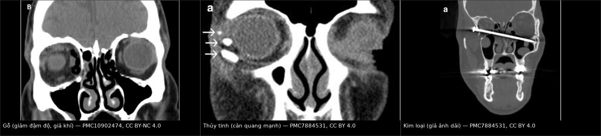
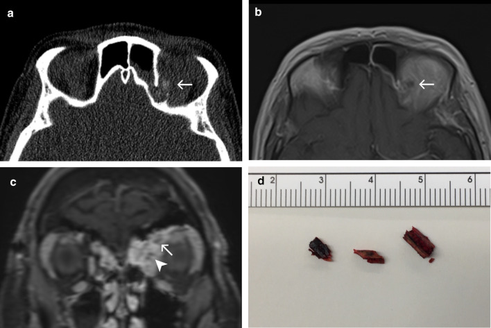
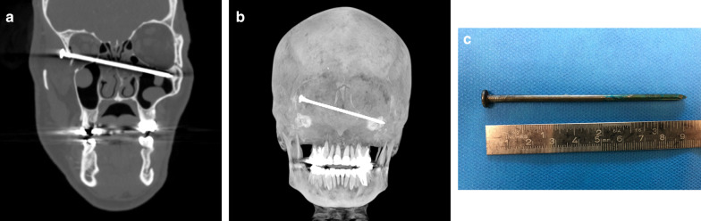
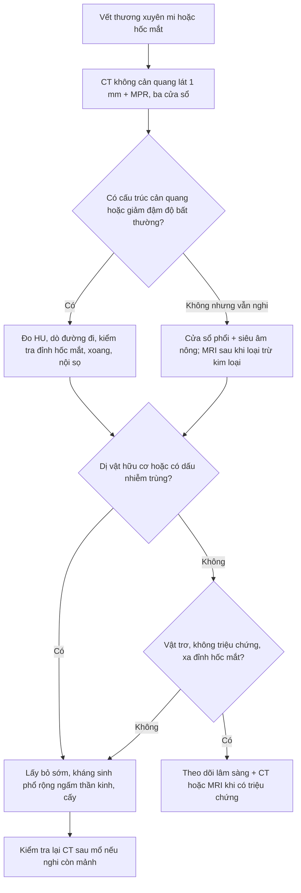
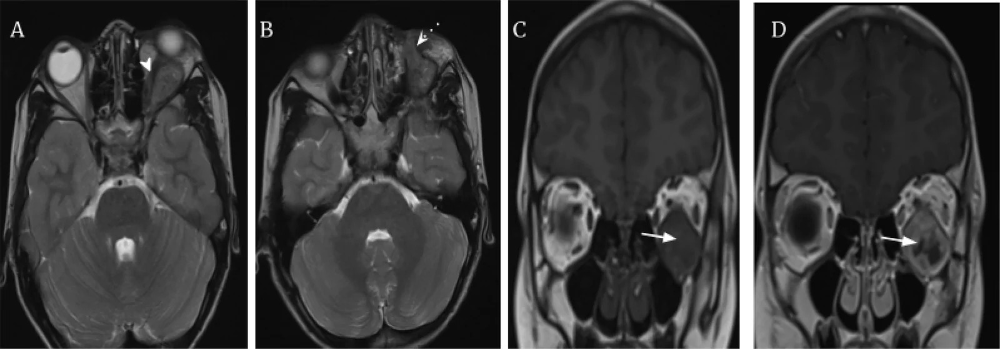
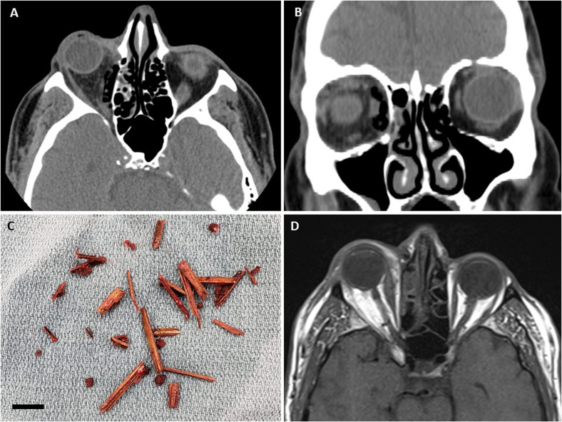
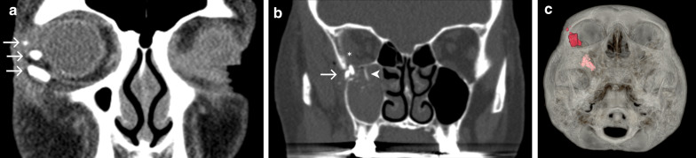

# 1506 — Dị vật hốc mắt tồn lưu: gỗ giả khí, thủy tinh cản quang, kim loại giả ảnh — và khi nào TUYỆT ĐỐI không chụp MRI / Retained intraorbital foreign body

**Tags:** `pattern:di-vat` `pattern:giam-dam-do` `pattern:gia-anh-dai` `pattern:khi-mo-mem` `vung:hoc-mat` `vung:mat` `vung:non-co` `vung:dinh-hoc-mat` `anatomy:thanh-o-mat` `protocol:CT-1mm` `protocol:MRI-hoc-mat` `protocol:sieu-am-hoc-mat` `score:khong` `incidentaloma:khong`

**Mức chắc chắn (certainty):** tổng hợp y văn (literature synthesis) — ghép **bài tổng quan hình ảnh** về dị vật đầu–mặt–cổ (*Insights Imaging* 2021 — **PMC7884531**, CC BY 4.0), **loạt 30 ca dị vật gỗ hốc mắt** (*Indian J Ophthalmol* 2026 — **PMC42241355**, CC BY-NC-ND; chỉ đọc số liệu), **bài tổng quan tiếp cận chấn thương xuyên hốc mắt** (*Healthcare* 2025 — **PMC11765369**, CC BY 4.0), **loạt 15 ca chẩn đoán sót** (*Exp Ther Med* 2017 — **PMC5377438**, CC BY-NC-ND; chỉ đọc), **ca "near miss" trên CT** (*Plast Surg* 2024 — **PMC10902474**, CC BY-NC 4.0), và **ca dị vật gỗ ở trẻ bị đọc thành u hốc mắt trên MRI** (*Radiol Case Rep* 2026 — **PMC13499104**, CC BY-NC-ND). Nhóm **không có bệnh nhân của mình**; chỗ suy luận ghi **[suy luận]**.

> **Vị trí trong thư viện:** [449](../449-chan-thuong-mat-dich-vat/lesson.md) phủ **vỡ nhãn cầu & dị vật NỘI nhãn**; [1501](../1501-chan-thuong-thi-than-kinh-ton/lesson.md) phủ **chấn thương dây thị**; [1505](../1505-rach-hac-mac-chan-thuong/lesson.md) phủ **rách hắc mạc**; [1461](../1461-ap-xe-duoi-mang-xuong-hoc-mat-o-tre/lesson.md) phủ **viêm mô tế bào hốc mắt**. Bài này trả lời mặt còn trống: **nhãn cầu lành, vết thương ngoài "nhỏ như không có", nhưng bên trong hốc mắt còn dị vật — đậm độ nào, đọc trên cửa sổ nào, có được chụp MRI không, và lấy hay để**.

> **Câu chốt — năm con số phải thuộc:** **(1)** CT chỉ phát hiện **42–72%** dị vật gỗ, và tới **42%** dị vật **không kim loại** bị bỏ sót ở lần đọc CT đầu (PMC10902474, PMC11765369). **(2)** Trong **30 ca** dị vật gỗ hốc mắt, CT **chỉ thấy 17 ca và 10 ca bị chẩn đoán sai** ở lần đọc đầu; **14/30 (47%)** đến với hình ảnh **viêm mô tế bào hốc mắt**, **7/30 (23%)** có **rò da–hốc mắt** (PMC42241355). **(3)** **Gỗ khô nhẹ hơn nước (độ đậm < 1 g/cm³ ≈ 0 HU)** — có thể **giả khí**; **thủy tinh +300 đến +600 HU** (PMC7884531, PMC5377438). **(4)** **Kim loại → giả ảnh dải (streak)**, làm mất chi tiết và **che dị vật thứ hai**; **MRI chống chỉ định khi chưa loại trừ dị vật kim loại/nhiễm từ** (PMC11765369). **(5)** Dị vật **hữu cơ (gỗ, tre, gai)** phải **lấy bỏ sớm**; mổ nên trong **3–12 giờ** nếu có tổn thương nội sọ/mạch máu (PMC11765369).

## 1. Tổng quan bệnh học – cơ chế hình ảnh (TẠI SAO)

### 1.1 Giải phẫu: hốc mắt là hình tháp, mọi vật xuyên vào đều bị "dồn" về đỉnh

- Hốc mắt là **tháp 4 thành** với **7 xương**, **thể tích ~30 mL** ở người lớn, **thành trong (lamina papyracea) và sàn/trần rất mỏng (0,5–1 mm)**. Vật xuyên qua mi hoặc kết mạc bị **hình tháp dẫn hướng về đỉnh hốc mắt** — nơi có **dây thị, động mạch mắt, hạch thể mi, khe ổ mắt trên** (PMC11765369).
- Vì vậy **vị trí lỗ vào không dự báo được độ sâu**: một **vết rách 1,5 cm ở mi dưới** vẫn có thể kèm **dị vật nằm sát trần hốc mắt** (PMC10902474), và vật đi qua **thành trong** có thể vào **xoang sàng, nội sọ** (PMC7884531, Fig. 8).
- Hệ quả thực hành: mọi vết thương xuyên mi/kết mạc phải được mô tả **trong nón (intraconal) hay ngoài nón (extraconal)**, **trước hay sau vách hốc mắt (orbital septum)**, và **cách đỉnh hốc mắt bao nhiêu mm** — ba câu này quyết định đường mổ.

### 1.2 Vật lý đậm độ: vì sao "gỗ" không phải một con số HU

- **Gỗ = cellulose + khí + nước.** Tỷ trọng gỗ khô **0,35–0,9 g/cm³**, tức **dưới 1 g/cm³ ≈ dưới 0 HU** — chỉ một số gỗ rất cứng (lignum vitae, ebony) mới **> 0 HU** (PMC7884531). Vì thế **gỗ khô nằm trong hốc mắt có thể có đậm độ gần khí (−1.000 HU) hoặc mỡ (−40…−120 HU)** và **bị đọc là khí trong mô (emphysema)**.
- **Gỗ tươi hoặc gỗ đã nằm lâu trong cơ thể** hút dịch, viêm xơ quanh → **đậm độ tăng dần lên mô mềm (+20…+80 HU)**, thậm chí **thành "bóng tăng đậm độ không đều"** sau nhiều tháng (PMC5377438, PMC7884531). **Loạt 10 ca có mổ xác nhận (2025)** định lượng đúng diễn tiến này: giai đoạn **cấp** gỗ có đậm độ **−252,77 HU** (giữa mỡ và khí); **ngày 15** đậm độ **cao hơn cơ 97,28 HU**; giai đoạn **mạn** gỗ **+ viền mô hạt** đo **79,08 HU** và **212,95 HU**, và **5/5 ca chụp MRI đều giảm tín hiệu trên T1 và T2/T2 fat-sat** (DOI 10.1016/j.crad.2025.106859). **[suy luận]** Đây là lý do cùng một miếng gỗ có thể **âm tính lúc cấp** (bị đọc là khí) và **dương tính giả u lúc mạn** — nên **thời điểm chụp** là một biến số chẩn đoán, không chỉ vật liệu.
- **Thủy tinh** cản quang mạnh: **+300 đến +600 HU**, bờ rõ (PMC5377438). **Kim loại** thường **> 1.000 HU**, gây **giả ảnh dải do beam hardening + photon starvation** — càng dày càng nhiều dải, và **dải có thể che một mảnh thứ hai nhỏ hơn** (PMC7884531).
- **Nhựa (plastic)** là nhóm **không đồng nhất**: từ **giảm đậm độ như mỡ** đến **cản quang nhẹ**, có loại **không thấy được trên CT** (PMC7884531). **Đá/sỏi** cản quang, đậm độ **tương đương hoặc hơn xương**. **Mảnh xương** cùng đậm độ xương nhưng **bờ thẳng, khớp với ổ khuyết xương**; **răng/mão răng** rất cản quang, dễ nhầm kim loại.

| Vật liệu | Đậm độ CT điển hình | Dấu hiệu nhận diện | Nguồn |
|---|---|---|---|
| Gỗ khô | **≈ 0 HU hoặc âm** (tỷ trọng < 1 g/cm³) | **Ổ giảm đậm độ "hình học"**, bờ phẳng, có thể có cấu trúc bên trong | PMC7884531 |
| Gỗ tươi / gỗ nằm lâu | **+20…+80 HU**, có thể cao hơn | Tăng đậm độ không đều + viêm xơ quanh | PMC5377438 |
| Gỗ **cấp** (loạt 10 ca) | **−252,77 HU** (trung bình) | Nằm giữa mỡ và khí → dễ bị đọc là **khí** | DOI 10.1016/j.crad.2025.106859 |
| Gỗ **ngày 15** | **+97,28 HU so với cơ** | Đậm độ tăng nhanh sau khi hút dịch | DOI 10.1016/j.crad.2025.106859 |
| Gỗ **mạn** + mô hạt | **79,08 HU** và **212,95 HU** | Bóng tăng đậm độ không đều, giả u | DOI 10.1016/j.crad.2025.106859 |
| Thủy tinh | **+300…+600 HU** | Mảnh sắc cạnh, bờ rõ, không giả ảnh | PMC5377438 |
| Kim loại | **> 1.000 HU** | **Giả ảnh dải (streak)**, ảnh hưởng cả lát cắt lân cận | PMC7884531 |
| Nhựa | **Rất thay đổi: âm → dương** | Có thể **không thấy** trên CT; dựa vào gián tiếp | PMC7884531 |
| Đá / sỏi | **Tương đương xương trở lên** | Bờ đa giác, thường ngoài nón | PMC7884531 |
| Khí trong mô | **−1.000 HU** | Bóng tròn, **không có cấu trúc bên trong**, thay đổi theo tư thế | PMC7884531 |

### 1.3 Vì sao CT vẫn bỏ sót — ba cơ chế

1. **Hiệu ứng thể tích riêng phần (partial volume averaging):** mảnh gỗ **1–3 mm** nằm cạnh khí/xương/mỡ bị "pha loãng" đậm độ; trên lát **2–3 mm** nó gần như biến mất. Lát **≤ 1 mm** làm giảm hiệu ứng này (PMC7884531, PMC10902474).
2. **Chọn sai cửa sổ:** ban đầu đọc trên **cửa sổ mô mềm**, nơi **khí và gỗ cùng đen**; **cửa sổ phổi (W 1.500 / L −600)** cho thấy **cấu trúc bên trong của gỗ**, phân biệt với **bóng khí đồng nhất** — đây chính là mẹo của ca "near miss" (PMC7884531 Case 1; PMC10902474).
3. **Bỏ qua dấu hiệu gián tiếp:** **khí hình học (geometric air pocket)**, **khí – dịch**, **dày mô mềm không giải thích**, **viêm xơ quanh một "hạt" nhỏ"**. Trong ca near miss, **ổ khí hình chữ nhật** nằm **dọc thành trong** chính là **hình dạng của miếng tre** — không phải bóng khí tự do (PMC10902474).
4. **Người đọc và cách đọc:** trong **23 ca** gỗ hốc mắt (Wills Eye + Mass Eye and Ear), lần đọc phim đầu **khẳng định** dị vật chỉ **61%**, **"có thể" 22%**, **không thấy 13%**; **43%** bệnh nhân đến trong 24 giờ đầu, thời gian đến khám **24 giờ – 17 tháng** (trung vị **3 ngày**) (PMID 20523259). Đây là lý do phải **ghi rõ nghi ngờ dị vật hữu cơ lên phiếu chỉ định** và **đọc lại trên MPR + cửa sổ phổi**, không chỉ dựa vào báo cáo đầu.

### 1.4 Vì sao MRI thấy gỗ nhưng lại NGUY HIỂM

- Gỗ **không có proton linh động** → **giảm tín hiệu trên T1 và T2** ("signal void"); mô hạt/áp-xe quanh **ngấm thuốc viền** → hình **"ổ khuyết tín hiệu trong khối ngấm thuốc"** (PMC7884531 Case 3, PMC13499104).
- Nhưng **MRI không phân biệt được gỗ với mảnh xương, khí, hay vôi hóa**, và **một miếng gỗ khô nhỏ có thể "tàng hình"** trên MRI (nghiên cứu thực nghiệm: gỗ **< 3 mm** khó thấy) (PMC7884531).
- **Số liệu thực nghiệm mâu thuẫn nhau — đừng coi "MRI nhạy hơn CT" là chân lý:** mô hình **hốc mắt cừu + 3 T** cho **CT đồng thuận 94,4%** giữa 3 phẫu thuật viên, còn MRI chỉ **66,7% (T1 MPRAGE)**, **50% (T1 TSE)**, **88,9% (T2 TSE)** và **72,2% (T2 TSE fat-sat)**; **vật càng nhỏ càng khó thấy**, và **nhựa** khó nhất (DOI 10.1080/02713683.2021.1945108). Ngược lại, phantom gelatin đầu–cổ cho **MR 97,1% > CT 86,0% > X-quang 61,8%**, nhưng **nhận đúng vật liệu** chỉ **33,3% (MR) / 25,5% (CT) / 16,7% (XR)** (DOI 10.1016/j.ejrad.2020.109505). **[suy luận]** Khác biệt do **vị trí (mô mỡ hốc mắt vs gelatin), kích thước mảnh, chuỗi xung và người đọc** — vì vậy **hai modality bổ sung nhau**, không thay thế nhau.
- **Chống chỉ định tuyệt đối khi chưa loại trừ dị vật kim loại/nhiễm từ:** từ trường có thể **kéo lệch vật** trong hốc mắt gây **mù, xuất huyết, rách nhãn cầu**. Vì vậy **CT luôn đứng trước MRI** trong chấn thương hốc mắt cấp (PMC11765369).
- **Cạm bẫy đã được báo cáo:** ở trẻ **không có tiền sử chấn thương**, MRI cho **khối ngoài nón ngấm thuốc viền, trung tâm không ngấm** → **đọc thành u (schwannoma hốc mắt)**; 5 tháng sau mới lộ **dị vật gỗ + áp-xe + rò** (PMC13499104).

### 1.5 Sinh lý bệnh nhiễm trùng: vì sao gỗ khác kim loại

- Gỗ **xốp, mao dẫn**, mang **hệ vi khuẩn hỗn hợp** (*Escherichia coli*, *E. vulneris*, *Bacillus cereus*, liên cầu tan máu gamma, *Enterococcus durans*, *Clostridium perfringens*) → **viêm mô tế bào, áp-xe, rò da, viêm mô hoại tử** (PMC7884531).
- Trong **30 ca gỗ**, **47%** đến với **viêm mô tế bào hốc mắt**, **23%** có **rò da–hốc mắt**, **8 ca phải mổ ≥ 2 lần**, **2 ca mổ 3 lần** (PMC42241355). Thời gian từ chấn thương đến lần khám đầu: **1 ngày – 7 năm**.
- Kim loại/thủy tinh **trơ** hơn: có thể nằm yên nhiều năm; **chỉ lấy khi có triệu chứng hoặc nằm ở vị trí nguy hiểm** (PMC5377438).

| Đại lượng | Giá trị | Nguồn |
|---|---|---|
| Chấn thương xuyên hốc mắt trong tổng số chấn thương hốc mắt | **30–50%**; **24%** chấn thương sọ xuyên ở người lớn, **45%** ở trẻ; **~0,4%** mọi chấn thương đầu | PMC11765369 |
| Giới / tuổi | Nam:nữ **4:1**; đỉnh **3–9 tuổi** | PMC11765369 |
| CT phát hiện dị vật gỗ | **42–72%** (các loạt khác nhau) | PMC10902474 |
| Dị vật **không kim loại** bỏ sót ở CT đầu | tới **42%** | PMC11765369 |
| Loạt 30 ca gỗ: CT thấy / đọc sai | **17/30 (56,6%)** thấy; **10 ca** chẩn đoán sai (đọc là **khí**); MRI **13 ca** | PMC42241355 |
| Loạt 30 ca gỗ: biến chứng khi đến | viêm mô tế bào **14/30 (47%)**, rò **7/30 (23%)**; **8/30** mổ nhiều lần (**2 ca 3 lần, 5 ca 2 lần**) | PMC42241355 |
| Loạt 32 ca gỗ: CT đọc | **khẳng định 72%**, **gợi ý 28%**; thị lực cải thiện sau mổ **69%** | PMID 24639316 |
| Loạt 23 ca gỗ: đọc phim đầu | **khẳng định 61%**, **"có thể" 22%**, **không thấy 13%**; **43%** đến trong 24 giờ | PMID 20523259 |
| Gỗ cấp / ngày 15 / mạn (10 ca) | **−252,77 HU** / **+97,28 HU so với cơ** / **79,08 & 212,95 HU** | DOI 10.1016/j.crad.2025.106859 |
| Thời gian chấn thương → khám | **1 ngày – 7 năm**; **16/30 trong tuần đầu** | PMC42241355 |
| Thủy tinh trên CT | **+300…+600 HU** | PMC5377438 |
| Gỗ khô | tỷ trọng **< 1 g/cm³ ≈ 0 HU** | PMC7884531 |
| Cửa sổ giúp thấy cấu trúc trong gỗ | **cửa sổ phổi W 1.500 / L −600** | PMC7884531 |
| Cửa sổ mổ khi có tổn thương nội sọ/mạch | **3–12 giờ** | PMC11765369 |

## 2. Mẫu hình + chẩn đoán phân biệt theo vật liệu và vị trí (gamut)

**Mẫu hình:** bệnh nhân sau **tai nạn "nhỏ"** (cành cây, bút, kính vỡ, đũa, móc, đạn, tai nạn xe) có **vết thương mi/kết mạc**, đau – sưng – **lồi mắt**, **hạn chế vận nhãn**, **nhìn đôi**, **giảm thị lực**; hoặc đến **muộn** với **viêm mô tế bào tái phát, rò mủ, sẹo co kéo**. Câu hỏi hình ảnh gồm **bốn lớp**:

1. **Có dị vật không** — và **vật liệu gì** (quyết định đậm độ + có được MRI).
2. **Ở đâu** — ngoài nón / trong nón / đỉnh / xoang / nội sọ / trong nhãn cầu.
3. **Có biến chứng chưa** — áp-xe, khí, máu tụ, giả phình, dò động mạch – xoang hang, tổn thương dây thị.
4. **Lấy hay để** — hữu cơ luôn lấy; trơ, không triệu chứng có thể theo dõi.

### 2.1 Gamut theo vật liệu

- **Hữu cơ (gỗ, tre, gai, củi, tăm):** **giảm đậm độ hoặc mô mềm**, **dấu khí hình học**, **phản ứng viêm mạnh**, **áp-xe/rò**; **CT âm không loại trừ**.
- **Thủy tinh:** **cản quang mạnh, nhiều mảnh**, thường kèm **rách mi, gãy sàn ổ mắt**; nhìn thấy cả trên **X-quang**.
- **Kim loại:** **cản quang cực mạnh + giả ảnh dải**; nguy cơ **nhiễm trùng thấp hơn nhưng tổn thương mô do tốc độ cao**; **không MRI**.
- **Đá / sỏi / cát:** cản quang, thường ở **mô mềm ngoài nón**, ít phản ứng.
- **Nhựa:** **có thể tàng hình trên CT/X-quang**; tiền sử vật liệu là chìa khóa.
- **Mảnh xương / răng:** cùng đậm độ xương/răng; **khớp với ổ khuyết xương** hoặc **ổ răng**.
- **Dị vật do phẫu thuật (lông mi, gạc, silicone, mảnh dụng cụ):** bờ đều, **không có đường vào do chấn thương**, tiền sử mổ.

### 2.2 Gamut theo vị trí — vị trí quyết định biến chứng

- **Ngoài nón trước vách:** dễ sờ/thấy, thường do vật nhỏ; **nguy cơ thấp**, nhưng có thể **di chuyển vào trong**.
- **Trong nón:** nguy cơ **dây thị, động mạch mắt, cơ vận nhãn**; đau + **hạn chế vận nhãn + RAPD**.
- **Đỉnh hốc mắt:** **hội chứng đỉnh** (mù, liệt III–IV–VI, giảm cảm giác V1); **mổ rất nguy hiểm** — cân nhắc **theo dõi nếu vật trơ, không triệu chứng** (PMC5377438).
- **Trần hốc mắt → nội sọ:** **dò dịch não tủy, máu tụ, áp-xe não**; cần **CT/CTA + hội chẩn ngoại thần kinh**.
- **Thành trong → xoang sàng/mũi:** dễ **bỏ sót**, biểu hiện **chảy máu mũi, viêm xoang một bên**.
- **Sàn → xoang hàm:** thường kèm **gãy sàn ổ mắt**, khí xoang.
- **Thành ngoài → hố thái dương:** nguy cơ **động mạch thái dương nông**, **cơ thái dương**.
- **Trong nhãn cầu:** chuyển sang [449](../449-chan-thuong-mat-dich-vat/lesson.md) — **khác hoàn toàn** về tiên lượng và thời điểm mổ.

### 2.3 Thể "kín đáo" (occult) — nhóm bị bỏ sót nhiều nhất

- Bài tổng quan mô tả: thể **không kín đáo** thường có **vết rách bờ ổ mắt trong hoặc mi trong**; thể **kín đáo** hay chỉ có **vết thương nhỏ ở mi ngoài** — **dễ bị xem là "xước nhẹ"** (PMC11765369).
- Trẻ em **không kể được cơ chế**, người **say/nhiễm độc**, bệnh nhân **đa chấn thương** là nhóm **không có bệnh sử** → chỉ còn **chỉ số nghi ngờ** và **hình ảnh** (PMC5377438, PMC11765369).

## 3. Bảng so sánh phân biệt (ma trận đối chiếu)

| Thực thể (entity) | Hình ảnh điển hình (CT/MRI/US) | Chốt vào (rule-in) | Chốt loại (rule-out) | Gợi ý xác nhận |
|---|---|---|---|---|
| **Dị vật gỗ (wood)** | **Giảm đậm độ ≈ 0 HU hoặc mô mềm**, **ổ khí hình học**, bờ phẳng; MRI **giảm tín hiệu T1/T2**, viền ngấm thuốc | **Tiền sử vật hữu cơ + ổ giảm đậm độ có hình dạng + khí/viêm quanh** | **Bóng khí tròn, không cấu trúc, mất khi đổi tư thế** → khí đơn thuần; **bờ xương liên tục** → mảnh xương | **Cửa sổ phổi**, đo HU, **MRI sau khi loại trừ kim loại**, siêu âm đầu dòng |
| **Dị vật thủy tinh** | **+300…+600 HU**, nhiều mảnh sắc cạnh, không giả ảnh; X-quang thấy | **Cản quang mạnh + nhiều mảnh + cơ chế kính vỡ** | **Kim loại** (giả ảnh dải, > 1.000 HU); **mảnh xương** (khớp ổ khuyết) | CT cửa sổ xương, đối chiếu X-quang |
| **Dị vật kim loại** | **> 1.000 HU + giả ảnh dải**, ảnh hưởng lát lân cận; 3D MIP cho đường đi | **Giả ảnh dải + cản quang cực mạnh + 3D thấy trục vật** | **Không có giả ảnh** → thủy tinh/xương; **giả ảnh do răng/mão** ở người không chấn thương | **Cửa sổ xương**, MIP 3D; **không MRI** |
| **Đá / cát / sỏi** | Cản quang **≥ xương**, bờ đa giác, thường ngoài nón | **Nhiều hạt nhỏ + cơ chế ngã/va đập đất đá** | **Một mảnh lớn có cấu trúc** → gỗ/xương | CT, hỏi môi trường tai nạn |
| **Nhựa / silicone** | **Có thể âm hoặc dương nhẹ**, bờ đều | **Tiền sử vật liệu + ổ dịch/viêm quanh** | **Có cấu trúc gỗ** → hữu cơ | Siêu âm (tăng âm), MRI |
| **Mảnh xương hốc mắt** | Cùng đậm độ xương, **bờ khớp ổ khuyết**, thường cạnh gãy | **Ổ khuyết xương tương ứng + bờ gãy khớp** | **Không có ổ khuyết + bờ tròn nhẵn** → dị vật | CT cửa sổ xương, MPR |
| **Răng / mão / amalgam** | **Rất cản quang + giả ảnh**, ở vùng hàm trên/xoang hàm | **Ổ răng khuyết + tiền sử chấn thương hàm mặt** | **Nằm trong hốc mắt, không liên quan ổ răng** → dị vật | CT hàm mặt, khám răng |
| **Khí trong mô (emphysema)** | **−1.000 HU**, bóng tròn, có thể **thay đổi theo tư thế** | **Sau chấn thương xoang/mũi, bóng khí nhiều ổ** | **Ổ khí có hình dạng "vật thể", bờ phẳng, không đổi tư thế** → nghĩ gỗ | **Cửa sổ phổi**, so sánh 2 tư thế |
| **Áp-xe / mô hạt do dị vật** | Khối ngấm thuốc viền, **trung tâm không ngấm**, có thể **giống u** | **Viền dày + khí/dị vật bên trong + rò** | **Không có cấu trúc trung tâm, không rò, không tiền sử chấn thương** → u thật | MRI, **không sinh thiết mù** trước khi loại trừ dị vật |

*Trái: **gỗ** trong hốc mắt phải — ổ **giảm đậm độ hình chữ nhật** dọc thành trong, khác bóng khí tròn xung quanh (PMC10902474, CC BY-NC 4.0). Giữa: **thủy tinh** — nhiều mảnh **cản quang mạnh** ở hốc mắt phải, kèm gãy sàn (PMC7884531 Fig. 12a, CC BY 4.0). Phải: **kim loại** — đinh xuyên qua thành ngoài hốc mắt phải sang xoang hàm trái, **giả ảnh dải** dọc trục (PMC7884531 Fig. 8a, CC BY 4.0). Ảnh ghép letterbox, không crop nội dung chẩn đoán.*

### 3.1 Trình tự đọc CT — 6 bước cố định

1. **Cửa sổ mô mềm:** tìm **khối/ổ bất thường**, **khí**, **máu tụ**, **dày mô mềm không giải thích**.
2. **Cửa sổ xương (W 2.000 / L 400):** **gãy thành**, **mảnh xương**, **dị vật cản quang**, **giả ảnh dải**.
3. **Cửa sổ phổi (W 1.500 / L −600):** **cấu trúc bên trong của gỗ** — đây là bước **hay bị bỏ nhất** (PMC7884531).
4. **Đo HU tại 3 điểm** của tổn thương (trung tâm + 2 bờ) — **âm ≈ gỗ khô/khí**, **+300…+600 ≈ thủy tinh**, **> 1.000 ≈ kim loại**.
5. **Dò đường đi (trajectory):** từ **lỗ vào** → **thành nào** → **có vào xoang/nội sọ/đỉnh không**; dựng **MPR coronal/sagittal** và **3D MIP** nếu kim loại.
6. **Tìm dị vật thứ hai:** **giả ảnh dải có thể che** mảnh nhỏ; xem **lát cắt xa ổ giả ảnh** và **cửa sổ khác**.

### 3.2 Dấu hiệu trên từng modality

| Modality | Thấy gì | Không thấy gì |
|---|---|---|
| **X-quang** | Thủy tinh, kim loại, đá; **gãy xương lớn** | **Gỗ, nhựa, dị vật < 2 mm**; không định vị 3D |
| **CT ≤ 1 mm + MPR** | **Chuẩn**: vị trí, đường đi, gãy xương, khí, máu tụ; **cửa sổ phổi** cho gỗ | Gỗ **rất khô, < 3 mm**; **dị vật bị giả ảnh dải che** |
| **MRI** | **Gỗ giảm tín hiệu T1/T2**, viền ngấm thuốc của áp-xe/mô hạt; tổn thương dây thị | **Kim loại (chống chỉ định)**; **gỗ khô < 3 mm**; **mảnh xương** |
| **Siêu âm** | Dị vật nông **tăng âm + bóng lưng**, kiểm tra ngay sau lấy | Vật sâu sau xương; **không dùng khi nghi vỡ nhãn cầu** |
| **CTA / DSA** | **Giả phình, dò động mạch – xoang hang, chảy máu hoạt động** | Bản thân dị vật nhỏ, vật liệu hữu cơ |

*(a) CT trục: cấu trúc **tăng đậm độ nhẹ** sát trần hốc mắt trái, kèm **khuyết xương thành trước xoang trán**. (b) T1 sau tiêm: cấu trúc **giảm tín hiệu**. (c) T1 fat-sat coronal sau tiêm: **ba ổ giảm tín hiệu** và mô hốc mắt ngấm thuốc mạnh. (d) Ba mảnh gỗ lấy ra. Nguồn: *Insights Imaging* 2021 (PMC7884531), CC BY 4.0.*

## 4. Protocol chụp + thuật toán lấy/để (không có RADS — có quy tắc)

### 4.1 Ai phải chụp

- **Mọi vết thương xuyên mi, kết mạc, bờ ổ mắt**, kể cả **vết nhỏ**; **mọi chấn thương đầu–mặt có gãy xương ổ mắt**; **trẻ không kể được cơ chế** (PMC11765369).
- **Nghi ngờ cao** khi: **đau/sưng kéo dài > 1 tuần** sau "vết xước", **viêm mô tế bào tái phát cùng bên**, **rò mủ**, **hạn chế vận nhãn mới**, **RAPD mới** — trong ca near miss, **RAPD xuất hiện ngày thứ 2** mới thúc đẩy xem lại CT (PMC10902474).

### 4.2 Thông số

- **CT hốc mắt/hàm mặt không cản quang, lát ≤ 1 mm**, **axial + coronal MPR**, **3 cửa sổ: mô mềm, xương, phổi**; **FOV nhỏ**, **không nhiễu kim loại nếu có thể**.
- **CTA** khi nghi **chảy máu, giả phình, dò động mạch – xoang hang, bóc tách** (PMC11765369).
- **MRI hốc mắt** chỉ **sau khi CT loại trừ kim loại/nhiễm từ**: **T1, T2 fat-sat, T1 fat-sat sau tiêm, DWI**; mục đích là **áp-xe, mô hạt, tổn thương dây thị**, không phải "tìm dị vật" đơn thuần.
- **Siêu âm** cho **dị vật nông vùng mi/kết mạc**; **không ấn đầu dò** khi nghi **vỡ nhãn cầu** (chuyển [449](../449-chan-thuong-mat-dich-vat/lesson.md)).

### 4.3 Lấy hay để — quy tắc thực hành

- **Lấy bỏ:** **mọi dị vật hữu cơ** (gỗ, gai, tre, cỏ); **mọi dị vật có triệu chứng** (đau, viêm, hạn chế vận nhãn, chèn ép thị thần kinh); **dị vật gần đỉnh/ống thị gây RAPD**; **dị vật trong nhãn cầu**.
- **Có thể theo dõi:** **kim loại/thủy tinh/cát nhỏ, trơ, không triệu chứng, xa đỉnh hốc mắt** — theo dõi lâm sàng + CT/MRI khi có triệu chứng (PMC5377438).
- **Thời điểm:** **3–12 giờ** nếu có **tổn thương nội sọ/mạch máu** hoặc **chèn ép thị thần kinh**; còn lại **sớm, trong 24–48 giờ** — vì **gỗ càng để lâu càng dính, càng nhiều mủ** (PMC11765369, PMC42241355).
- **Kháng sinh:** **phổ rộng, ngấm tốt vào hệ thần kinh trung ương** (ceftriaxone ± ciprofloxacin ± metronidazole), **uốn ván** theo lịch, **cấy dị vật + mô** khi lấy (PMC11765369).
- **Không sinh thiết mù** một "khối hốc mắt" khi chưa loại trừ dị vật: ca trẻ 10 tuổi bị đọc là **u**, chọc/sinh thiết sẽ **gieo mủ ra đường rò** (PMC13499104).

*(a) CT coronal: đinh **cản quang cực mạnh** đi từ thành ngoài hốc mắt phải, xuyên qua hốc mắt và xoang sàng sang xoang hàm trái; **giả ảnh dải** dọc thân đinh. (b) **3D MIP** cho thấy toàn bộ trục vật. (c) Đinh sau lấy. Nguồn: *Insights Imaging* 2021 (PMC7884531), CC BY 4.0.*

## 5. Biến thể bình thường và cạm bẫy

- **"Khí trong hốc mắt" không đồng nghĩa khí:** sau chấn thương xoang, khí vào hốc mắt là **bình thường**; nhưng **ổ khí có hình dạng** (chữ nhật, que, bờ phẳng) là **dị vật gỗ** — phải xem **cửa sổ phổi** (PMC10902474, PMC7884531).
- **Giả ảnh dải "xóa" dị vật thứ hai:** ở ca nhiều mảnh kim loại, **dải sáng–tối** có thể che mảnh nhỏ; đọc **source images** và **cửa sổ xương**, không chỉ ảnh tái tạo (PMC7884531).
- **Phần mềm giảm giả ảnh (metal artifact reduction) có thể "xóa" luôn kim loại** — luôn đọc **cả ảnh gốc** (PMC7884531).
- **Mảnh xương ≠ dị vật:** mảnh xương có **bờ khớp ổ khuyết** và **đậm độ xương**; nếu không chắc, **MRI** giúp (xương có tủy/vỏ, gỗ giảm tín hiệu đồng nhất) — nhưng **chỉ sau khi loại trừ kim loại**.
- **Dị vật gỗ "thành u":** sau nhiều tháng, mô hạt + áp-xe tạo **khối ngấm thuốc viền**; trên MRI **trung tâm giảm tín hiệu** dễ bị đọc là **schwannoma/lymphoma** — **tiền sử chấn thương** và **dấu hiệu viêm/rò** là chìa khóa (PMC13499104).
- **"CT âm tính" là câu trả lời sai:** CT chỉ thấy **42–72%** dị vật gỗ; nếu **cơ chế gợi ý gỗ** mà CT âm, phải **siêu âm/MRI hoặc chụp lại sau 1–2 tuần** (PMC10902474, PMC11765369).
- **Sót mảnh khi mổ:** gỗ dễ **gãy vụn** khi gắp; **lấy nguyên khối**, **rửa sạch ổ áp-xe**, và **chụp kiểm tra** nếu nghi còn mảnh (PMC42241355).
- **Di chuyển muộn:** dị vật có thể **di chuyển vào xoang, hố thái dương, nội sọ** theo thời gian — triệu chứng mới ở bệnh nhân có tiền sử chấn thương cũ phải **chụp lại**, không giả định "vật đã lấy hết".

*MRI trẻ 10 tuổi: (A, B) T2 axial — khối ngoài nón có **ổ giảm tín hiệu trung tâm** (mũi tên) và phù mô xung quanh; (C, D) T1 sau tiêm coronal — **viền ngấm thuốc dày**, trung tâm không ngấm. Lần đầu đọc là "u hốc mắt, nghĩ schwannoma"; 5 tháng sau lộ **dị vật gỗ + áp-xe + rò**. Nguồn: *Radiol Case Rep* 2026 (PMC13499104), CC BY-NC-ND 4.0 — ảnh nguyên bản, không chỉnh sửa.*

## 6. Tự lượng giá — Blind Quiz

**Ca 1 — Nam 61 tuổi, cành tre đập vào mắt phải khi làm vườn. CT lần 1 chỉ ghi "khí và phù mô mềm hốc mắt trong, có thể gãy thành trong". Ngày hôm sau: đau tăng, liệt vận nhãn hoàn toàn, thị lực 20/50, nhãn áp 42 mmHg, xuất hiện RAPD.**

- Gợi ý: hai lần CT đều **không báo dị vật**; nhãn áp tăng và RAPD mới là lý do xem lại hình.
- Câu hỏi: (1) Cấu trúc bất thường nằm ở khoang nào và có hình dạng gì? (2) Vì sao báo cáo CT ban đầu gọi đó là "khí"? (3) Cửa sổ nào và thao tác nào giúp nhận ra?

<b>Bấm để hiện đáp án (findings + chẩn đoán)</b>

- **Findings:** (A) CT trục, (B) CT coronal — **ổ giảm đậm độ hình chữ nhật**, bờ phẳng, nằm **dọc thành trong hốc mắt phải (ngoài nón)**, **khác** các bóng khí tròn đồng nhất xung quanh; có **khí mô mềm** và phù. (C) Nhiều **mảnh tre** lấy ra. (D) MRI T1 sau tiêm: ổ **giảm tín hiệu** tương ứng.
- **Chẩn đoán:** **dị vật gỗ (tre) hốc mắt tồn lưu** + **hội chứng khoang hốc mắt** (nhãn áp 42 mmHg). Vì gỗ khô có **đậm độ gần khí** và **hiệu ứng thể tích riêng phần**, CT đầu đọc thành **emphysema**.
- **Chốt:** **hình dạng "vật thể" của ổ khí** + **cửa sổ phổi** + **đo HU**; **CT âm không loại trừ**. Bệnh nhân cần **giải ép hốc mắt** (đã mổ mở xương bờ dưới) và **lấy dị vật**.
- **Nguồn ảnh:** Farahvash A và cs., *Plast Surg (Oakv)* 2024 (PMC10902474), **CC BY-NC 4.0**.

**Ca 2 — Bé trai 10 tuổi, sưng và đau hốc mắt trái tăng dần 3 tuần, không rõ chấn thương, không thấy vết thương ngoài. MRI: khối ngoài nón, viền ngấm thuốc, trung tâm không ngấm — chẩn đoán ban đầu "u, nghĩ schwannoma".**

- Gợi ý: trẻ, không có bệnh sử, khối "giống u" nhưng có **trung tâm không ngấm thuốc**.
- Câu hỏi: (1) Dấu hiệu nào không điển hình cho u? (2) Vì sao không được sinh thiết mù? (3) Nếu nghi dị vật gỗ mà không có kim loại, modality nào bổ sung?

<b>Bấm để hiện đáp án (findings + chẩn đoán)</b>

- **Findings:** T2 axial — khối ngoài nón trái, **ổ giảm tín hiệu trung tâm** (đầu mũi tên), phù mô mỡ quanh; T1 sau tiêm coronal — **viền dày ngấm thuốc**, trung tâm **không ngấm**. Lần chụp sau: **ổ khuyết tín hiệu rõ hơn + đường rò ra da**.
- **Chẩn đoán:** **dị vật gỗ hốc mắt + áp-xe**, bị đọc nhầm thành **u hốc mắt**. Mô hạt/áp-xe tạo viền ngấm thuốc, còn gỗ **không có proton linh động** nên **giảm tín hiệu**.
- **Chốt:** **trung tâm giảm tín hiệu + viêm/rò + tiền sử có thể bị bỏ qua** → **không sinh thiết mù**, mà **hỏi lại kỹ cơ chế** và **mổ thăm dò có kiểm soát**; lấy được nhiều mảnh gỗ.
- **Nguồn ảnh:** Ayene H và cs., *Radiol Case Rep* 2026 (PMC13499104), **CC BY-NC-ND 4.0**.

**Ca 3 — Nữ 76 tuổi, ngã khi đang cầm ly thủy tinh, rách mi trên phải. CT hàm mặt: nhiều mảnh cản quang trong hốc mắt, kèm gãy sàn ổ mắt.**

- Gợi ý: vật liệu **trong suốt**, cơ chế **kính vỡ**.
- Câu hỏi: (1) Đậm độ của thủy tinh trên CT? (2) Vì sao nhìn thấy trên X-quang nhưng gỗ thì không? (3) Mảnh nằm sát cơ trực trong — có cần lấy ngay không?

<b>Bấm để hiện đáp án (findings + chẩn đoán)</b>

- **Findings:** (a) CT coronal mô mềm — **nhiều mảnh cản quang mạnh** ở hốc mắt phải (mũi tên), mảnh lớn nhất **18 mm**; (b) cửa sổ xương — **gãy sàn ổ mắt**; (c) 3D — định vị các mảnh.
- **Chẩn đoán:** **dị vật thủy tinh trong hốc mắt** + gãy sàn ổ mắt. Thủy tinh **+300…+600 HU** nên **cản quang** trên cả X-quang và CT; gỗ khô **≈ 0 HU** nên **thường không thấy** trên X-quang.
- **Chốt:** **cản quang mạnh, nhiều mảnh, không giả ảnh** = thủy tinh; **giả ảnh dải** mới là kim loại. Mảnh thủy tinh **trơ** nhưng **nhiều mảnh + gần cơ vận nhãn** → **lấy** để tránh viêm/xơ và hạn chế vận nhãn; kết hợp **sửa sàn ổ mắt**.
- **Nguồn ảnh:** Voss JO và cs., *Insights Imaging* 2021 (PMC7884531), **CC BY 4.0**.

## 7. Câu hỏi nghiên cứu & điểm chưa đồng thuận (tính đến 11/2026)

1. **[Tranh cãi] Ở bệnh nhân nghi dị vật hữu cơ hốc mắt, CT hay MRI là khảo sát đầu tay tốt hơn để phát hiện và định vị dị vật?**
   - **Đã biết:** mô hình hốc mắt cừu 3 T: **CT đồng thuận 94,4%** vs MRI **50–88,9%** tùy chuỗi xung (DOI 10.1080/02713683.2021.1945108); phantom đầu–cổ lại cho **MR 97,1% > CT 86,0%** (DOI 10.1016/j.ejrad.2020.109505); loạt bệnh nhân: CT chỉ thấy **56,6–72%** (PMC13674916; PMID 24639316).
   - **Chưa rõ:** chưa có so sánh trực tiếp trên bệnh nhân với **chuẩn mổ**; kết quả phụ thuộc **kích thước mảnh, thời điểm chụp, loại gỗ và người đọc**.
   - **Hướng nghiên cứu:** nghiên cứu **diagnostic accuracy tiền cứu, đọc mù**, phân tầng theo kích thước/vật liệu/thời gian, so CT đa năng lượng với các chuỗi MRI.
   - **Nguồn:** DOI 10.1080/02713683.2021.1945108; DOI 10.1016/j.ejrad.2020.109505; PMC13674916.

2. **[Khác biệt thực hành] Sau khi lấy dị vật gỗ, có nên chụp CT/MRI kiểm tra thường quy hay chỉ chụp khi có triệu chứng?**
   - **Đã biết:** **8/30 ca** phải mổ lại vì sót mảnh (**2 ca mổ 3 lần, 5 ca mổ 2 lần**) (PMC13674916); ca tre ở mũi hầu chỉ lộ đủ đường đi nhờ **CT đa bình diện lặp lại ngày 5** (PMC13008974).
   - **Chưa rõ:** không có lịch thống nhất (**24–48 giờ, 1–2 tuần hay 6 tuần**), không rõ CT hay MRI, và **không có ngưỡng "mảnh còn lại đủ nhỏ để theo dõi"**.
   - **Hướng nghiên cứu:** đoàn hệ có **protocol chụp lại cố định**, kết cục **mổ lại, nhiễm, rò, thị lực**; so sánh chiến lược "chụp tất cả" với "chụp theo triệu chứng".
   - **Nguồn:** PMC13674916; PMC13008974.

3. **[Khoảng trống] Có ngưỡng HU/kích thước nào đủ tin cậy để phân biệt gỗ với khí hoặc mỡ trong hốc mắt không?**
   - **Đã biết:** gỗ **cấp** trung bình **−252,77 HU**, **ngày 15** cao hơn cơ **97,28 HU**, **mạn** **79,08–212,95 HU**; MRI **giảm tín hiệu T1 và T2 ở 5/5 ca** nhưng không đặc hiệu (DOI 10.1016/j.crad.2025.106859).
   - **Chưa rõ:** chưa có **ROC/ngưỡng tiền cứu**; chưa rõ ảnh hưởng của **loài gỗ, độ ẩm, thời gian lưu** và của **thuật toán giảm giả ảnh** lên đậm độ.
   - **Hướng nghiên cứu:** phantom đa loại gỗ + đo HU theo thời gian, đối chiếu mô học; kiểm chứng **CT đa năng lượng** và **cửa sổ phổi** trong nghiên cứu lâm sàng.
   - **Nguồn:** DOI 10.1016/j.crad.2025.106859; DOI 10.1080/02713683.2021.1945108.

## Bài liên quan chéo
- [449 – Chấn thương mắt & dị vật nội nhãn: BETT, 5 dấu CT, chống chỉ định MRI](../449-chan-thuong-mat-dich-vat/lesson.md)
- [1501 – Chấn thương thị thần kinh: CT ≤ 1 mm + MPR, MRI STIR/DWI](../1501-chan-thuong-thi-than-kinh-ton/lesson.md)
- [1505 – Rách hắc mạc do chấn thương: dải sáng hình cung, OCT](../1505-rach-hac-mac-chan-thuong/lesson.md)
- [1461 – Viêm mô tế bào hốc mắt & áp-xe dưới màng xương ở trẻ](../1461-ap-xe-duoi-mang-xuong-hoc-mat-o-tre/lesson.md)
- [410 – Giải phẫu học mắt và hốc mắt](../410-giai-phau-hoc-mat/lesson.md)

## Ảnh
- `images/1506_di-vat-hoc-mat_CT-4panel_PMC10902474.jpg` — CT + MRI + mảnh gỗ lấy ra, ca near miss.
- `images/1506_di-vat-hoc-mat_CT-MRI_PMC7884531.jpg` — gỗ nằm 3 tháng, CT và MRI.
- `images/1506_di-vat-hoc-mat_CT-thuy-tinh_PMC7884531.jpg` — nhiều mảnh thủy tinh trong hốc mắt.
- `images/1506_di-vat-hoc-mat_CT-kim-loai_PMC7884531.jpg` — đinh kim loại, 3D MIP.
- `images/1506_di-vat-hoc-mat_MRI_PMC13499104.jpg` — dị vật gỗ ở trẻ, đọc nhầm thành u.
- `images/composite_vat-lieu-CT.jpg` — ảnh ghép đối chiếu ba vật liệu.
- Nguồn, giấy phép từng ảnh: `images/CREDITS.md`.

> Không dùng để chẩn đoán độc lập khi chưa có người hướng dẫn.
