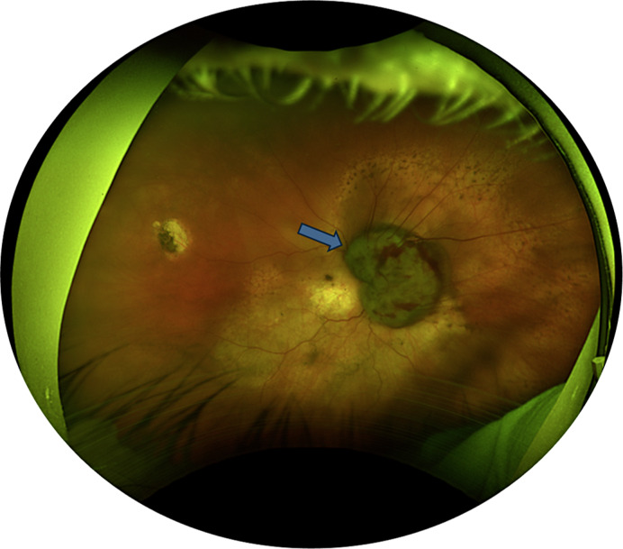
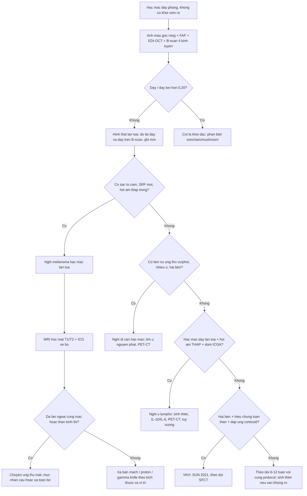
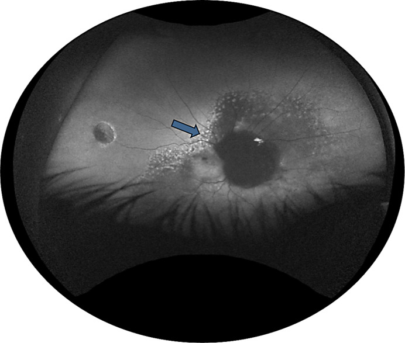
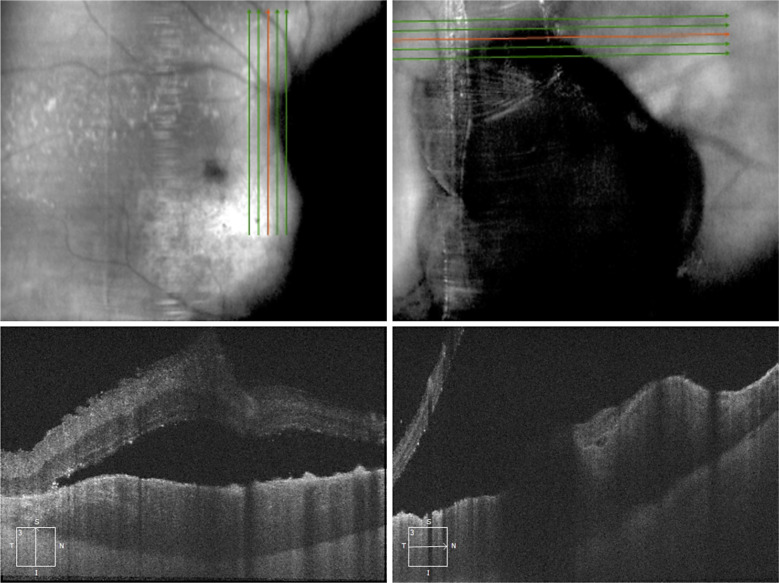
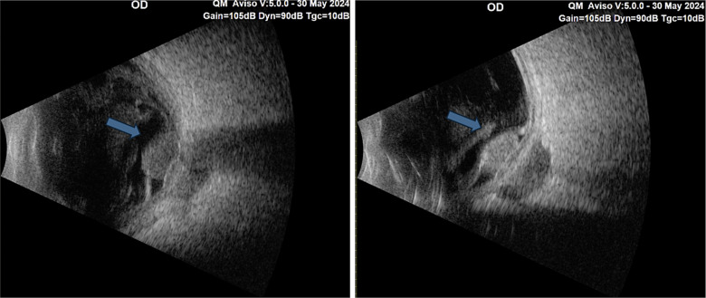
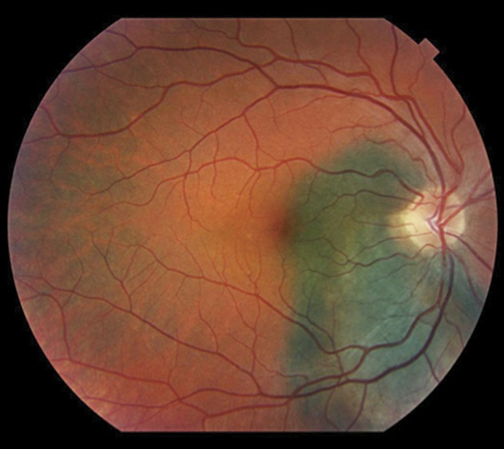

# 1507 — Melanoma hắc mạc thể LAN TỎA: khối dẹt lan rộng đánh lừa mọi "u nhỏ" / Diffuse choroidal melanoma

**Tags:** `pattern:hac-mac-day-lan-toa` `pattern:khoi-hac-mac` `pattern:dich-duoi-vong-mac` `pattern:sac-to-cam` `vung:hac-mac` `vung:nhan-cau` `vung:mat` `protocol:sieu-am-B-scan` `protocol:sieu-am-A-scan` `protocol:OCT-EDI` `protocol:FAF` `protocol:FA-ICGA` `protocol:MRI-hoc-mat` `score:AJCC-8` `score:MOLES` `incidentaloma:khong`

**Mức chắc chắn (certainty):** tổng hợp y văn (literature synthesis) — dựng từ đoàn hệ **111 bệnh nhân melanoma hắc mạc lan tỏa** trong **3.500 u** (*Arch Ophthalmol* 1996, PMID **8694731**; chỉ dùng abstract), ca nguyên văn **không sắc tố** (*Case Rep Oncol* 2026, **PMC13399952**), ca **névus → melanoma lan tỏa 6 năm** điều trị Gamma Knife (*Retin Cases Brief Rep* 2016, **PMC5051521**), **1.021 u hắc mạc** phân loại hình thái B-scan (*Ophthalmol Retina* 2025, PMID **39326547**), **1.780 u ≤ 3 mm** (*JAMA Ophthalmol* 2018, PMID **30267070**), 2 tổng quan u hắc mạc (**PMC4399142**, **PMC4399118**), tổng quan phân tử–lâm sàng (**PMC7910016**) và đoàn hệ siêu âm di căn hắc mạc **51 mắt** (**PMC13082809**). Nhóm **không có bệnh nhân của mình**; chỗ chưa đủ chắc ghi "chưa rõ". **Không ghi tên tác giả** — attribution dùng tạp chí + năm + PMCID/PMID.

> **Vị trí trong thư viện:** [1486](../1486-khoi-hac-mac-sieu-am/lesson.md) phủ **khối hắc mạc trên siêu âm** (phân loại bằng hồi âm, MOLES); [448](../448-u-hac-mac/lesson.md) phủ **gamut + điều trị theo kích thước**; [1497](../1497-tai-phat-bo-sau-xa-ban-mach-melanoma-hac-mac/lesson.md) phủ **tái phát sau xạ**; [1503](../1503-di-can-gan-melanoma-hac-mac/lesson.md) phủ **di căn gan**; [493](../493-u-lympho-nguyen-phat-hac-mac/lesson.md) phủ **u lympho hắc mạc** — "kẻ bắt chước" số một của thể lan tỏa. Bài này trả lời **một câu duy nhất**: *khi hắc mạc chỉ "dày ra" mà không có khối, làm sao phân biệt melanoma với di căn – u lympho – VKH – hemangioma, và vì sao u phẳng lại nguy hiểm?*
>
> **Câu chốt:** U **phẳng không có nghĩa là u nhỏ.** Ba con số phải thuộc: **(1)** melanoma lan tỏa là **3%** u hắc mạc (111/3.500) nhưng **di căn 24% trong 5 năm, 36% trong 10 năm** (PMID 8694731); **(2)** định nghĩa định lượng là **chiều dày < 20% đường kính đáy** — đoàn hệ Shields trung bình **2,1 mm / 14,7 mm = 14,8%** (PMC4399118, PMID 8694731); **(3)** u **≤ 3 mm** vẫn di căn **4,5% / 5 năm** và **8,8% / 10 năm** (PMID 30267070) — "mỏng" chỉ giảm nguy cơ, không xóa nguy cơ.

## 1. Tổng quan bệnh học – cơ chế hình ảnh

### 1.1 Vì sao "phẳng" là một cái bẫy chẩn đoán, không phải một dấu hiệu lành

Melanoma hắc mạc thường được dạy bằng hai hình thái: **vòm (dome)** và **nấm (mushroom/collar-button)** khi u phá màng Bruch. Thể **lan tỏa (diffuse)** là thể thứ ba: tế bào u **lan theo mặt phẳng hắc mạc** với mật độ dày đặc, không tạo khối đủ cao để mắt người đọc "nhìn thấy khối". Vì vậy:

- **Trên ảnh màu** u hiện ra như **vùng hắc mạc đổi màu – mờ bờ – có sắc tố cam (orange pigment) rải rác**; mắt người đọc dễ gọi đó là "hắc mạc dày không đặc hiệu" hoặc "di căn".
- **Trên B-scan** u chỉ **dày 1–3 mm nhưng đáy 12–20 mm**, nên không có "đỉnh" để đặt thước; nếu không đo **đường kính đáy** thì không phân biệt được với hắc mạc bình thường dày.
- **Hệ quả lâm sàng:** chẩn đoán muộn hơn u vòm cùng độ dày, u đã lan **quanh đĩa thị**, **xâm lấn thần kinh thị** hoặc **xuyên củng mạc** — đúng những yếu tố làm tăng di căn (mục 1.4).

Định nghĩa dùng được trong thực hành: **melanoma lan tỏa = chiều dày < 20% đường kính đáy** (PMC4399118). Với đáy **14,7 mm**, ngưỡng này là **< 2,9 mm** — tức phần lớn u "mỏng" dưới 3 mm đều nằm trong vùng này.

### 1.2 Vì sao B-scan/A-scan cho hồi âm thấp–trung bình, và vì sao u mỏng làm A-scan mất tin cậy

Siêu âm 10–20 MHz ghi lại **sóng dội từ các mặt phân cách trở kháng âm**. Melanoma là **mô tế bào đặc, ít mô đệm, ít mặt phân cách** → năng lượng dội về ít → **hồi âm nội bộ thấp–trung bình**; các lớp trên dày đặc làm **suy giảm âm (attenuation)**, tạo **rỗng âm đáy u (acoustic hollowing)** — dấu hiệu kinh điển của melanoma (PMC7910016).

Nhưng có hai giới hạn vật lý phải nhớ:

- **Suy giảm âm tỷ lệ với quãng đường đi trong mô.** U dày 1,5–2 mm chỉ có 1,5–2 mm mô để làm suy giảm → **"hollowing" gần như không hình thành**, và **A-scan có rất ít đỉnh để đo biên độ**. A-scan **mất độ tin cậy khi u < 1,5–2 mm** (PMC7910016).
- **Gain quá cao hoặc quá thấp** đổi trực tiếp biên độ A-scan: cùng một u có thể "thấp" ở gain 70 dB và "trung bình" ở gain 90 dB. Vì vậy phải đo trên **cùng gain chuẩn hóa**, cùng vector, và ghi lại gain khi lưu ảnh.

Hệ quả: **hồi âm CAO không loại trừ melanoma** ở u lan tỏa — ca névus → melanoma dày **1,9 mm** trong bài này có **hồi âm cao** (PMC5051521), và nhóm u "dày tối thiểu" trong đoàn hệ 1.021 u có **hồi âm cao 13%** so với **2,3%** ở các hình thái khác (PMID 39326547).

### 1.3 Vì sao OCT "lumpy-bumpy" và FAF/ICG là ba mảnh ghép bắt buộc

- **OCT/EDI-OCT:** đầu dò quang học đo **độ dày hắc mạc theo µm** (bình thường dưới hoàng điểm **220–360 µm** — xem [1436](../1436-benh-vogt-koyanagi-harada/lesson.md)). U lan tỏa cho **hắc mạc dày lan tỏa + bề mặt màng Bruch gồ ghề ("lumpy-bumpy") + dịch dưới võng mạc (SRF) + photoreceptor "shaggy"** — nhưng **"lumpy-bumpy" KHÔNG đặc hiệu**: nó gặp trong **di căn hắc mạc, u lympho, viêm hắc mạc** (PMC13399952; [493](../493-u-lympho-nguyen-phat-hac-mac/lesson.md)).
- **FAF (autofluorescence):** sắc tố cam = **lipofuscin** trong tế bào RPE bị stress → **tăng huỳnh quang (hyper-AF)**; vùng RPE teo/bong → **giảm huỳnh quang**. Ở thể lan tỏa, FAF cho **vùng tăng huỳnh quang lan rộng > 50% bề mặt u** (PMC4399118) và **mảng giảm huỳnh quang** ở phần u phẳng — đúng như ca dưới đây.
- **FA/ICG:** FA cho **giảm huỳnh quang sớm + rò điểm thì muộn** (không đặc hiệu); **ICG (790–805 nm) xuyên RPE** và được dùng để **xác định BỜ thật của u lan tỏa** khi bờ mờ trên ảnh màu (PMID 34023049). Với u lan tỏa, câu hỏi "bờ ở đâu" quyết định **kích thước bản xạ** — nên ICG có giá trị điều trị, không chỉ để "cho đủ bộ".

### 1.4 Vì sao u phẳng vẫn di căn mạnh: mô bệnh học và di truyền

- **Xâm lấn màng Bruch không cần "nấm":** tế bào u lan theo khoang mạch hắc mạc, có thể **xuyên củng mạc qua ống củng mạc–thần kinh thị** mà không phá Bruch tạo hình nấm. Trong đoàn hệ 111 ca, **xâm lấn thần kinh thị nghi ngờ trên lâm sàng 2%**, **lan xuyên củng mạc 3%** (PMID 8694731) — thấp hơn ca không sắc tố dưới đây nhưng đủ để đổi tiên lượng.
- **Yếu tố tiên lượng của chính thể lan tỏa:** **đáy ≥ 18 mm** (p = 0,01), **xâm lấn thần kinh thị** (p = 0,03), **bờ không rõ** (p = 0,05) — đa biến (PMID 8694731). Nói cách khác: **đường kính đáy mới là "kích thước thật"** của u phẳng.
- **Di truyền:** mất **NST 3 / BAP1**, **8q gain**, lớp **gene expression Class 2** là các yếu tố di căn độc lập với hình thái (PMC4399142, PMC7910016). Hình thái lan tỏa **tự nó là yếu tố tiên lượng xấu** trong các mô hình tiên lượng u hắc mạc (PMC4399142).
- **Vì sao "u nhỏ" vẫn di căn:** trong 1.780 u **≤ 3 mm**, di căn **4,5% / 5 năm**, **8,8% / 10 năm**, và nhóm dày **2,1–3,0 mm** đã **8,1% / 10 năm** (PMID 30267070). U lan tỏa thường rơi đúng vào nhóm này.

### 1.5 Ngưỡng định lượng nằm lòng

- **Định nghĩa lan tỏa:** dày **< 20%** đường kính đáy (PMC4399118); đoàn hệ Shields: **2,1/14,7 mm = 14,8%** (PMID 8694731).
- **Tần suất:** **3%** (111/3.500 — PMID 8694731); **4–5%** theo phần mở đầu ca 2026 (PMC13399952); **0,1% (1/1.021)** khi phân loại **hình thái B-scan** (PMID 39326547) — khác nhau vì **tiêu chuẩn và cách chọn mẫu khác nhau**, không phải mâu thuẫn.
- **Không sắc tố:** **~16,9%** u hắc mạc (PMC13399952).
- **Xâm lấn thần kinh thị:** **0,6–7%** (PMC13399952).
- **Nguy cơ di căn:** **24% / 5 năm**, **36% / 10 năm** (PMID 8694731); theo giai đoạn AJCC 8: **T1 15%, T2 25%, T3 49%, T4 63%** ở 10 năm (PMC7910016).
- **Névus → melanoma:** **1:8.845** (chung), **1:3.664** ở 80–84 tuổi; yếu tố nguy cơ: **dày > 2 mm**, SRF, sắc tố cam, sát đĩa thị, không drusen/halo, rỗng âm trên siêu âm (PMC7910016).

## 2. Mẫu hình + chẩn đoán phân biệt theo vị trí (gamut)

**Mẫu hình trung tâm:** *hắc mạc dày LAN TỎA/PHẲNG, bờ không rõ, có thể có SRF và sắc tố cam* — khác với *khối vòm/nấm* của melanoma điển hình. Bốn câu hỏi phải trả lời trước khi gọi tên:

1. **Đáy rộng bao nhiêu?** (mm, đo trên B-scan qua 4 kinh tuyến — không đo trên ảnh màu).
2. **Có phải một khối đặc không?** (hồi âm trong, có/không hollowing, có/không canxi).
3. **Bờ có "bậc thang" hay mờ dần?** (melanoma lan tỏa: bờ mờ; di căn: bờ tương đối rõ; lymphoma: lan tỏa mờ).
4. **Bối cảnh hệ thống là gì?** (tiền sử ung thư vú/phổi; tuổi > 60 + mờ mắt kéo dài; hai bên + triệu chứng toàn thân).

**Gamut theo bối cảnh:**

- **Một bên, người 40–70 tuổi, có sắc tố cam + SRF, dày < 20% đáy** → **melanoma lan tỏa** (ưu tiên).
- **Một hoặc hai bên, tiền sử ung thư (vú 37%, phổi 26%)** → **di căn hắc mạc** (đáy **9,9 mm**, dày **3,9 mm**, **dày/đáy 0,38**, hồi âm **trung bình–cao 69%**) — xem [1486](../1486-khoi-hac-mac-sieu-am/lesson.md), [448](../448-u-hac-mac/lesson.md).
- **Người > 60 tuổi, mờ mắt kéo dài, hắc mạc dày lan tỏa, hồi âm THẤP, đốm giảm huỳnh quang ICGA 100%, FAF thường bình thường** → **u lympho hắc mạc** ([493](../493-u-lympho-nguyen-phat-hac-mac/lesson.md)).
- **Hai bên, trẻ–trung niên, SRF hai bên + dấu hiệu toàn thân (ù tai, cứng gáy, bạch biến)** → **VKH** (SFCT cấp **900–940 µm**, đáp ứng corticoid) — [1436](../1436-benh-vogt-koyanagi-harada/lesson.md).
- **Màu đỏ–cam, hồi âm CAO đồng nhất, không lan ngoài củng mạc, có mạch hắc mạc lớn** → **hemangioma hắc mạc khu trú** ([1486](../1486-khoi-hac-mac-sieu-am/lesson.md)).
- **Dày < 2 mm, có drusen, không SRF, không sắc tố cam** → **névus** (theo dõi, MOLES).
- **Sát đĩa thị, sẫm màu, hồi âm rất cao, phát triển cực chậm** → **melanocytoma**.
- **Vòm trơn, trống âm, không dính đĩa thị, thay đổi theo tư thế** → **bong hắc mạc/tràn dịch** ([1484](../1484-bong-hac-mac-sau-mo-mat/lesson.md)).

## 3. Bảng so sánh phân biệt (ma trận đối chiếu)

| Thực thể (entity) | Hình ảnh điển hình (US/OCT/FAF/MRI) | Chốt vào (rule-in) | Chốt loại (rule-out) | Gợi ý xác nhận |
|---|---|---|---|---|
| **Melanoma hắc mạc lan tỏa** | Dày **< 20% đáy**, bờ mờ, hồi âm **thấp–trung bình** (u mỏng có thể **cao**), **sắc tố cam**, SRF; OCT **lumpy-bumpy** | **Dày/đáy < 0,20 + sắc tố cam + SRF một bên**; **T1 sáng/T2 tối** trên MRI | Bờ rõ + hồi âm rất cao + có mạch lớn → hemangioma; hai bên + tiền sử ung thư → di căn | B-scan 4 kinh tuyến + **EDI-OCT đo µm**; ICG định bờ; sinh thiết **chỉ khi đổi điều trị** |
| **Di căn hắc mạc** | **Vòm/plateau, đáy 9,9 mm, dày 3,9 mm, dày/đáy 0,38**; hồi âm **trung bình–cao 69%**; màu kem–vàng; hay nhiều ổ/hai bên | **Tiền sử ung thư + đáy rộng + hồi âm trung bình–cao**; **T1 iso/tăng, T2 tăng** | Một ổ đơn độc + sắc tố cam + hồi âm thấp → melanoma | Tìm u nguyên phát; PET-CT; đáp ứng với điều trị toàn thân |
| **U lympho hắc mạc** | Dày lan tỏa, bề mặt "seasick", hồi âm **THẤP**, **đốm giảm huỳnh quang ICGA 100%**, FAF thường bình thường | **Dày lan tỏa + hồi âm thấp + đốm ICGA + > 60 tuổi** | Canxi hóa, khối vòm rõ, hồi âm cao → không phải lympho | Sinh thiết hắc mạc/kết mạc; **IL-10/IL-6**; PET-CT + tủy xương |
| **Hemangioma khu trú** | Đỏ–cam, **hồi âm CAO đồng nhất**, dày hắc mạc + **pachyvessels** | **Hồi âm cao + màu đỏ cam + không xâm lấn củng mạc** | Hồi âm thấp, sắc tố cam → melanoma | EDI-OCT, ICGA; MRI **T1 và T2 đều tăng** |
| **VKH cấp** | **Hai bên**, SRD + BALAD, **SFCT 900–940 µm**, ICGA **HDD đối xứng** | **Hai bên + dày lan tỏa + đáp ứng corticoid trong 1–2 tuần** | Một bên, không đáp ứng corticoid → u | Tiêu chuẩn SUN 2021; ICGA; EDI-OCT |
| **Névus hắc mạc** | Dày **< 2 mm**, drusen, **không SRF**, không sắc tố cam | **MOLES < 3** + không SRF + có drusen | SRF mới, sắc tố cam, dày > 2 mm → nghi melanoma | Ảnh màu + FAF + EDI-OCT mỗi 3–6 tháng |
| **Melanocytoma** | Sẫm màu, **sát đĩa thị**, hồi âm **rất cao**, phát triển cực chậm | **Vị trí đĩa thị + hồi âm rất cao + nhiều năm không đổi** | Tăng dày nhanh, SRF → melanoma | Theo dõi ảnh màu/B-scan; sinh thiết hiếm khi cần |
| **Bong hắc mạc/tràn dịch** | Vòm **trơn, trống âm**, **không dính đĩa thị**, di chuyển theo tư thế | **Trống âm + thay đổi tư thế + bối cảnh hạ áp/viêm** | Hồi âm trong, cố định → khối đặc | B-scan 2 tư thế; tìm nguyên nhân (hạ áp, thuốc, viêm củng mạc) |

*Mũi tên xanh: khối sẫm màu phủ đĩa thị, có xuất huyết lốm đốm. Chung quanh là **mảng phẳng màu nâu nhạt lan xuống dưới – mũi – thái dương** với **"leopard pattern"** (đốm cam–nâu rải rác) — phần "lan tỏa" của u, dễ bị bỏ qua khi chỉ nhìn khối quanh đĩa. Nguồn: Case Rep Oncol 2026, PMC13399952, CC BY-NC 4.0.*

### Ba bước đọc một "hắc mạc dày phẳng"

1. **Đo cả hai chiều, rồi chia.** Ghi **dày (mm) / đáy (mm)**. Nếu < 0,20 → hình thái lan tỏa; nếu 0,38–0,6 → nghiêng di căn/khối; nếu ≥ 0,6 → khối vòm điển hình.
2. **Tìm "dấu hiệu mô sống" thay vì tìm khối.** Sắc tố cam trên ảnh màu/FAF, SRF mới, hồi âm thấp trong, mạch trong u trên ICG → mô u sống.
3. **Trả lời "một bên hay hai bên" và "có tiền sử ung thư không"** — hai câu này đổi thứ tự ưu tiên giữa melanoma và di căn nhanh hơn mọi dấu hiệu hình ảnh đơn lẻ.

## 4. Protocol chụp + hệ phân độ/điểm chuẩn hóa

### 4.1 Bộ ảnh tối thiểu cho một "hắc mạc dày phẳng"

- **Ảnh màu góc rộng (wide-field)** + **ảnh màu 50–60°** phóng to vùng nghi ngờ: ghi sắc tố cam, "leopard pattern", xuất huyết.
- **B-scan 10–20 MHz, đầu dò 5 mm, cùng gain**: đo **chiều dày** và **đường kính đáy** qua **4 kinh tuyến**; ghi gain trên ảnh. **A-scan vector hóa** để đọc hồi âm trong, nhưng **không kết luận khi u < 1,5–2 mm** (PMC7910016).
- **EDI-OCT/SS-OCT**: đo **độ dày hắc mạc (µm)** tại đỉnh và tại 4 điểm quanh u; tìm **SRF, shaggy photoreceptor, lumpy-bumpy Bruch**.
- **FAF**: bản đồ sắc tố cam và vùng RPE teo.
- **FA ± ICG**: ICG để **vẽ bờ** trước khi tính liều/kích thước bản xạ (PMID 34023049).
- **MRI hốc mắt có/không cản quang (T1, T2, T1 fat-sat sau tiêm)**: **melanin → T1 tăng, T2 giảm**; giúp phân biệt với **di căn (T1 iso/tăng, T2 tăng)** và **hemangioma (T1 và T2 đều tăng)**; đồng thời tìm **lan ngoài củng mạc**.
- **Siêu âm sinh học (UBM 35–50 MHz)** chỉ khi u sát thể mi/rìa trước.

### 4.2 Phân độ: AJCC 8 và MOLES

- **AJCC 8 (u hắc mạc/thể mi) — T theo chiều dày và đường kính lớn nhất (LBD):**

| Giai đoạn T | Đường kính lớn nhất (LBD) | Chiều dày |
|---|---|---|
| T1 | ≤ 12 mm | ≤ 3 mm |
| T2 | 12,1–18 mm | 3,1–6 mm |
| T3 | 18,1–24 mm | 6,1–9 mm |
| T4 | > 24 mm | > 9 mm |

  (Xâm lấn thể mi và **lan ngoài củng mạc** làm tăng bậc giai đoạn.) Di căn 10 năm theo giai đoạn: **T1 15%, T2 25%, T3 49%, T4 63%** (PMC7910016).
- **MOLES** (cho tổn thương sắc tố hắc mạc): **dày > 2 mm**, **SRF**, **sắc tố cam**, **bờ ≤ 3 mm từ đĩa thị**, **rỗng âm trên siêu âm**; **tổng ≥ 3 điểm → nghi melanoma** (chi tiết ở [1486](../1486-khoi-hac-mac-sieu-am/lesson.md)). Lưu ý: MOLES được xây cho **tổn thương sắc tố**, nên u **không sắc tố** (như ca 1) có thể **âm tính giả** — không dùng MOLES để loại trừ.

### 4.3 Đường đi chẩn đoán

### 4.4 Điều trị và theo dõi (khung quyết định)

- **Xạ bản mạch (plaque brachytherapy):** liều đỉnh **85 Gy** là chuẩn COMS; Ru-106 thường kê **~100 Gy** tại đỉnh (xem [1497](../1497-tai-phat-bo-sau-xa-ban-mach-melanoma-hac-mac/lesson.md)). Với u **lan tỏa**, khó khăn nằm ở **bờ mờ** → phải dùng **ICG + B-scan 4 kinh tuyến** để chọn bản xạ **phủ quá bờ 2 mm**; bản xạ có giới hạn đường kính (~22 mm) nên u đáy > 18–20 mm thường cần **proton** hoặc **múc nhãn cầu**.
- **Proton/charged-particle** hoặc **Gamma Knife**: lựa chọn cho u **sát đĩa thị** hoặc đáy lớn — ca névus → melanoma **juxtapapillary 1,9 mm** được Gamma Knife, **5,5 năm** sau còn **1,5 mm**, thị lực **20/20** (PMC5051521).
- **Múc nhãn cầu:** ưu tiên khi **dày > 10–12 mm** và/hoặc **đáy > 18 mm**, hoặc có **lan ngoài củng mạc** (PMC7910016). Ca không sắc tố dưới đây có **lan ngoài củng mạc 15 mm** → múc nhãn cầu, và **di căn vai** xuất hiện vài tháng sau.
- **Sinh thiết (FNAB/TSEB):** **không** sinh thiết melanoma điển hình; chỉ khi chẩn đoán **thay đổi điều trị** (nghi lymphoma/di căn không rõ nguồn). Ca 1 phải **FNAB cả hai vùng** (khối quanh đĩa + mảng phẳng) vì hình ảnh không phân biệt được với di căn. Nguy cơ gieo tế bào có thật nhưng giảm nếu **xạ ngay sau sinh thiết**.
- **Theo dõi sau điều trị:** lịch **2–4–8–12 tháng** rồi **6 tháng/lần**; mỗi lần: ảnh màu + B-scan đo dày cùng vector + OCT hoàng điểm (xem [1497](../1497-tai-phat-bo-sau-xa-ban-mach-melanoma-hac-mac/lesson.md)). **Tầm soát di căn gan** định kỳ ([1503](../1503-di-can-gan-melanoma-hac-mac/lesson.md)); khoảng cách tối ưu **chưa có thử nghiệm ngẫu nhiên** — thực hành phổ biến **6–12 tháng** trong 5 năm đầu.

## 5. Biến thể bình thường và cạm bẫy

- **"Hồi âm cao nên không phải melanoma" — SAI.** U mỏng thiếu quãng đường suy giảm âm; ca 1,9 mm trong bài có **hồi âm cao** (PMC5051521). Hồi âm cao giúp **nghiêng** về hemangioma, không **loại** melanoma.
- **"Không có khối nên chỉ theo dõi" — SAI.** Thể lan tỏa **không có khối** nhưng di căn **24% / 5 năm**; theo dõi mà không đo đáy là bỏ mất biến số tiên lượng mạnh nhất.
- **Đo đáy trên ảnh màu:** ảnh màu phóng đại khác nhau theo vị trí nhãn cầu; **chỉ đo trên B-scan** với cùng gain và cùng vector. Sai số 2–3 mm đủ đổi bậc T và đổi chỉ định bản xạ.
- **"Lumpy-bumpy = di căn":** dấu này gặp ở **melanoma lan tỏa, lymphoma, viêm hắc mạc** (PMC13399952). Đừng để một dấu OCT quyết định chẩn đoán.
- **Bỏ sót phần "phẳng" của u:** ca 1 có **khối quanh đĩa** (dễ thấy) + **mảng phẳng lan rộng** (dễ bỏ). Nếu chỉ xạ khối, phần phẳng còn lại là **bờ tái phát** trong tương lai.
- **Bỏ sót lan ngoài củng mạc:** B-scan gain chuẩn có thể bỏ sót mô u mỏng sau củng mạc; khi nghi, tăng gain + **MRI T1 fat-sat sau tiêm**. Lan ngoài củng mạc đổi giai đoạn và đổi điều trị (múc nhãn cầu ± xạ hốc mắt).
- **Chẩn đoán nhầm thành bệnh hắc mạc trung tâm (CSCR):** bệnh nhân trẻ có SRF + hắc mạc dày → nếu **không đo B-scan** sẽ điều trị CSCR bằng theo dõi/ánh sáng, trong khi u tiếp tục lan. Có ca melanoma lan tỏa **giả CSCR không điển hình** trong y văn (PMID 25390591 — chỉ nêu tiêu đề, không trích số).
- **Canxi hóa thô:** gợi ý **u xương hắc mạc/retinoblastoma**, không phải melanoma; nhưng **không thấy canxi không loại trừ** bất cứ chẩn đoán nào trong gamut.
- **Sinh thiết âm không loại trừ u:** u lan tỏa mỏng, mẫu FNAB dễ **chỉ có máu/hoại tử**; ca 1 phải chọc **hai vị trí** mới đủ chẩn đoán.

## 6. Tự lượng giá — Blind Quiz

**Ca 1 — Nam 82 tuổi, mờ mắt phải tăng dần 2 năm, tiền sử melanoma da tái phát + ung thư trực tràng giai đoạn III. Thị lực sáng tối; có RAPD phải.**

- Câu hỏi: (1) Mô tả **hai** tổn thương khác nhau trên ảnh. (2) Vì sao khối quanh đĩa thị **sẫm màu** mà mô bệnh lại là **không sắc tố**? (3) Ba chẩn đoán phân biệt và dấu nào cần tìm tiếp?

<b>Bấm để hiện đáp án</b>

- **Hai tổn thương:** (a) **khối quanh đĩa thị 6 × 7 mm** phủ đĩa, có xuất huyết lốm đốm (mũi tên xanh); (b) **mảng phẳng màu nâu nhạt** lan từ cực sau xuống dưới – mũi – thái dương, với **"leopard pattern"** (đốm cam–nâu) ở bờ.
- **Vì sao sẫm màu:** màu tối của khối là do **xuất huyết**, không phải melanin — mô học cho thấy u **amelanotic** cả ở hắc mạc và trên thần kinh thị.
- **Phân biệt:** melanoma hắc mạc (lan tỏa + khối), **di căn hắc mạc** (có 2 ung thư nguyên phát!), u lympho hắc mạc, hemangioma.
- **Chốt:** OCT **lumpy-bumpy Bruch + SRF**; B-scan **màng Bruch còn nguyên**, khối liên tục với hắc mạc và **lan ngoài củng mạc**; FAF vùng phẳng **giảm huỳnh quang**. Vì hình ảnh không phân biệt được với di căn → **FNAB hai vị trí** → melanoma **mixed cell 50% epithelioid**, **lan ngoài củng mạc 15 mm**, **xâm lấn thần kinh thị** → múc nhãn cầu. **Di căn vai** xuất hiện vài tháng sau.
- **Bài học:** hai ung thư nguyên phát **không** loại trừ u nội nhãn nguyên phát; phần "phẳng" chính là phần dễ bị bỏ và là phần quyết định bờ xạ.
- Nguồn: *Case Rep Oncol* 2026, **PMC13399952**, CC BY-NC 4.0.

**Ca 2 — Cùng bệnh nhân ca 1: OCT qua vùng u phẳng (trên) và B-scan dọc qua đĩa thị (dưới). Bạn thấy gì, và vì sao "màng Bruch còn nguyên" lại quan trọng?**

- Câu hỏi: (1) Mô tả bất thường trên OCT. (2) B-scan cho thấy gì ở vị trí mũi tên? (3) Dấu hiệu nào nói u **đã ra ngoài nhãn cầu**?

<b>Bấm để hiện đáp án</b>

- **OCT:** **hắc mạc dày** với **bề mặt màng Bruch gồ ghề ("lumpy-bumpy")** và **bong võng mạc**; các lớp võng mạc ngoài mất cấu trúc trên vùng u.
- **B-scan:** khối **dưới võng mạc**, liên tục với hắc mạc, **màng Bruch còn nguyên giữa khối và hắc mạc** — tức u **chưa phá Bruch** để tạo hình nấm; đồng thời có **lan ngoài củng mạc** và **bong võng mạc**.
- **Vì sao quan trọng:** "không có nấm" **không** đồng nghĩa u còn khu trú — u có thể **xuyên qua ống củng mạc/thần kinh thị** mà vẫn giữ Bruch nguyên vẹn. Phải **tăng gain + MRI** để tìm lan ngoài củng mạc.
- **Cạm bẫy:** đọc "Bruch intact" rồi kết luận "u nhỏ, theo dõi" là bỏ mất giai đoạn T4.
- Nguồn: *Case Rep Oncol* 2026, **PMC13399952**, CC BY-NC 4.0; ảnh B-scan gốc: `images/1507_melanoma-hac-mac-lan-toa_Bscan_PMC13399952.jpg`.

**Ca 3 — Nam 31 tuổi, khám mắt định kỳ phát hiện névus hắc mạc nhỏ 1,0 × 0,5 mm ở cung mạch dưới. Sáu năm sau tái khám vì "mắt vẫn 20/20" — ảnh dưới đây là tổn thương lúc đó.**

- Câu hỏi: (1) Tổn thương đã đổi thế nào? (2) Đo gì để gọi "lan tỏa"? (3) Vì sao vẫn có thể điều trị bảo tồn dù u sát đĩa thị?

<b>Bấm để hiện đáp án</b>

- **Thay đổi:** từ **névus 1,0 × 0,5 mm** thành **melanoma juxtapapillary lan tỏa**, **dày 1,9 mm**, chiếm **~6 giờ đồng hồ** quanh đĩa thị, có **sắc tố cam**; B-scan ghi **hồi âm cao**.
- **Đo gì:** **chiều dày 1,9 mm** so với **đường kính đáy** (u lan quanh đĩa ~6 giờ đồng hồ, đáy lớn hơn 10 mm) → **dày/đáy < 0,20** = thể lan tỏa. Đồng thời **so ảnh cũ**: tăng kích thước + xuất hiện sắc tố cam + SRF = **chuyển dạng ác tính**.
- **Vì sao bảo tồn được:** u **sát đĩa thị** làm bản xạ khó đặt và liều đỉnh khó đủ → chọn **Gamma Knife**; sau **5,5 năm** u còn **1,5 mm**, không tăng bờ, thị lực **20/20** (PMC5051521).
- **Bài học:** **hồi âm cao + thị lực tốt + u mỏng** đều có thể là melanoma; và **névus nhỏ vẫn cần ảnh chụp tư liệu** — tỷ lệ chuyển dạng chung **1:8.845**, nhưng khi đã chuyển thì **hình thái lan tỏa** là kiểu khó thấy nhất.
- Nguồn: *Retin Cases Brief Rep* 2016, **PMC5051521**, CC BY-NC-ND 4.0 (nguyên bản, không crop/ghép).

## Bài liên quan chéo
- [1486 – Khối hắc mạc trên siêu âm: hồi âm thấp = melanoma, hồi âm cao = hemangioma, MOLES](../1486-khoi-hac-mac-sieu-am/lesson.md)
- [448 – U hắc mạc: melanoma vs névus vs di căn — gamut + MRI + điều trị theo kích thước](../448-u-hac-mac/lesson.md)
- [1497 – Tái phát bờ sau xạ bản mạch melanoma hắc mạc](../1497-tai-phat-bo-sau-xa-ban-mach-melanoma-hac-mac/lesson.md)
- [1503 – Di căn gan của melanoma hắc mạc](../1503-di-can-gan-melanoma-hac-mac/lesson.md)
- [493 – U lympho hắc mạc nguyên phát: "kẻ bắt chước" của thể lan tỏa](../493-u-lympho-nguyen-phat-hac-mac/lesson.md)
- [1436 – Bệnh Vogt–Koyanagi–Harada: hắc mạc dày hai bên](../1436-benh-vogt-koyanagi-harada/lesson.md)
- [1505 – Rách hắc mạc do chấn thương: dải sáng hình cung quanh đĩa thị](../1505-rach-hac-mac-chan-thuong/lesson.md)
- [400 – Tổng quan Mắt & thị giác](../400-tong-quan-mat-thi-giac/lesson.md)

## Ảnh
- `images/1507_melanoma-hac-mac-lan-toa_Fundus-Optos_PMC13399952.jpg` — Fig. 1, *Case Rep Oncol* 2026, **PMC13399952**, **CC BY-NC 4.0**.
- `images/1507_melanoma-hac-mac-lan-toa_FAF_PMC13399952.jpg` — Fig. 2, *Case Rep Oncol* 2026, **PMC13399952**, **CC BY-NC 4.0**.
- `images/1507_melanoma-hac-mac-lan-toa_OCT_PMC13399952.jpg` — Fig. 3, *Case Rep Oncol* 2026, **PMC13399952**, **CC BY-NC 4.0**.
- `images/1507_melanoma-hac-mac-lan-toa_Bscan_PMC13399952.jpg` — Fig. 4, *Case Rep Oncol* 2026, **PMC13399952**, **CC BY-NC 4.0**.
- `images/1507_melanoma-hac-mac-lan-toa_Fundus_PMC5051521.jpg` — Fig. 2, *Retin Cases Brief Rep* 2016, **PMC5051521**, **CC BY-NC-ND 4.0** (nguyên bản).

> Không dùng để chẩn đoán độc lập khi chưa có người hướng dẫn.
