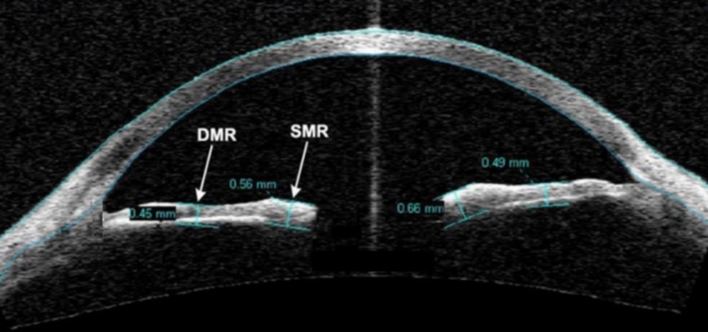
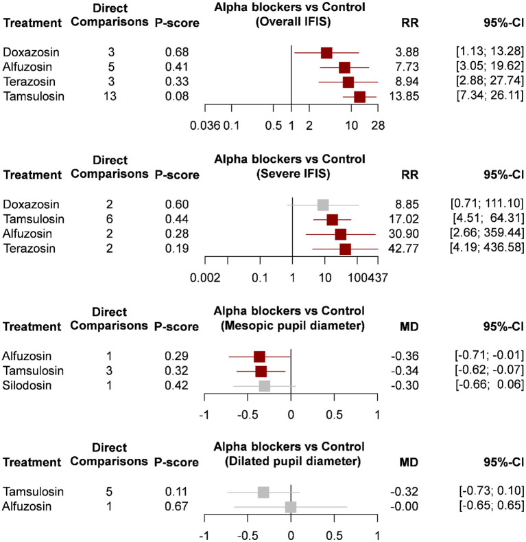
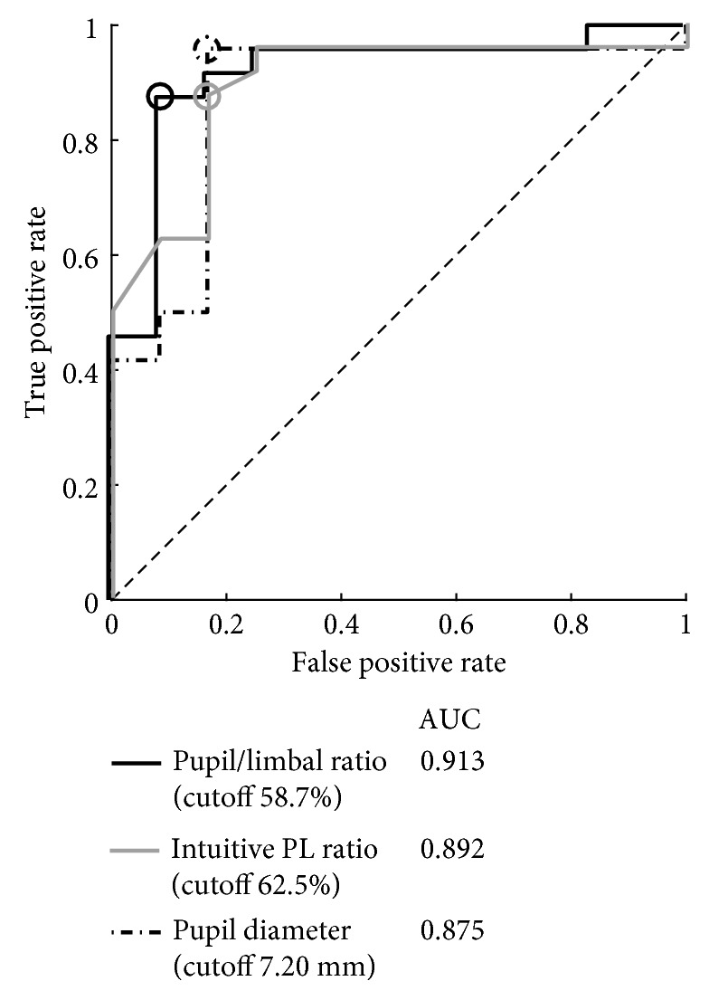
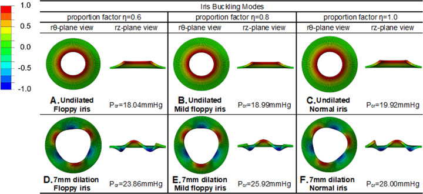
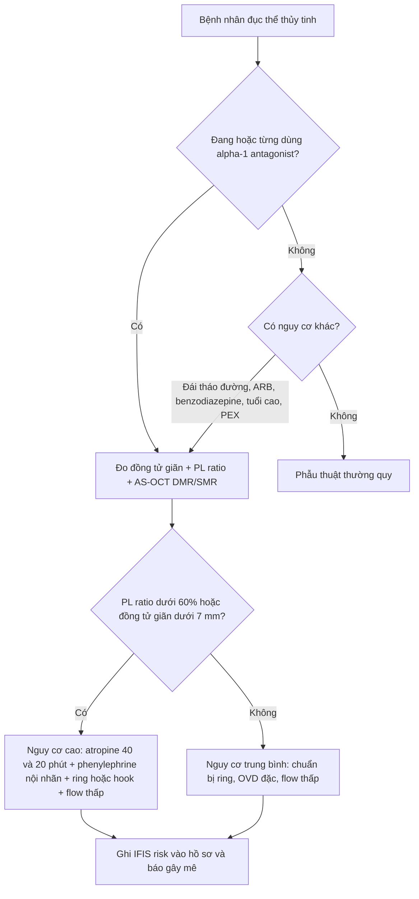
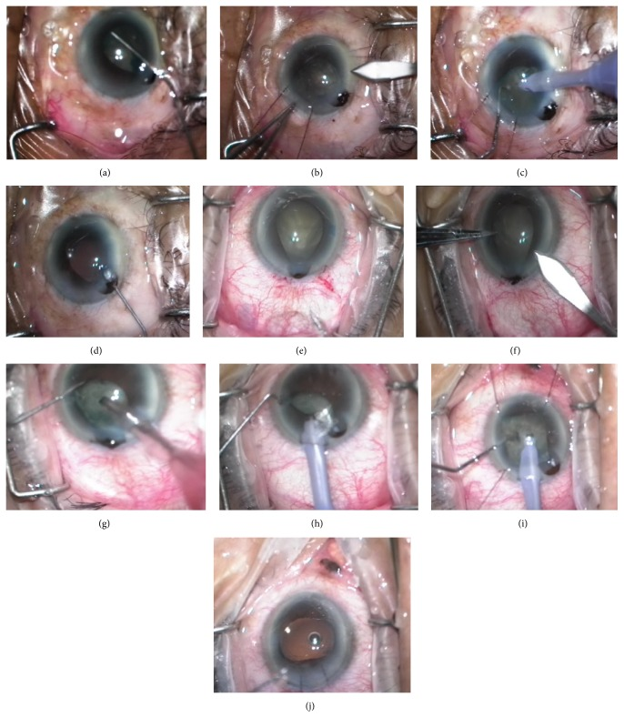
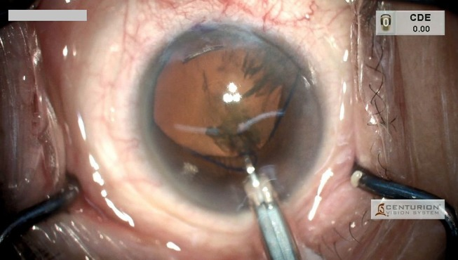

# 1508 — Hội chứng mống mắt đàn hồi (IFIS) khi mổ đục thể thủy tinh: tam chứng trong mổ, dự báo trước bằng PL ratio và AS-OCT / Intraoperative floppy iris syndrome

**Tags:** `pattern:mong-mat-dan-hoi` `pattern:dong-tu-co-lai` `pattern:mong-mat-sa-vet-mo` `pattern:dong-tu-gian-kem` `pattern:DMR-mong` `vung:mat` `vung:the-thuy-tinh` `vung:tien-phong` `vung:limbus` `protocol:AS-OCT` `protocol:UBM` `protocol:PL-ratio` `protocol:sieu-am-tien-phong` `score:Chang-0-3` `incidentaloma:khong`

**Mức chắc chắn (certainty):** tổng hợp y văn (literature synthesis) — dựng từ **1 phân tích mạng 6.488 ca / 25 nghiên cứu tiến cứu** (*Front Med* 2022, **PMC9468244**, CC BY 4.0 — dùng ảnh forest plot), **1 nghiên cứu cắt ngang 60 mắt có AS-OCT định lượng DMR/SMR** (*BMC Ophthalmol* 2024, **PMC11451146**, CC BY 4.0 — dùng ảnh AS-OCT), **1 nghiên cứu 84 mắt dựng đường cong ROC cho PL ratio** (*J Ophthalmol* 2018, **PMC6317099**, CC BY 4.0 — dùng ảnh ROC), **1 mô hình phần tử hữu hạn về độ vênh của mống mắt** (*Eye* 2020, **PMC7784872**, CC BY 4.0 — dùng ảnh sơ đồ), **1 loạt 1.003 mắt tại Ấn Độ** (**PMC4185166**, CC BY-NC-SA 3.0 — chỉ đọc số liệu), **2 tổng quan** (**PMC7039091**, **PMC7729334** — chỉ đọc số liệu), **1 phân tích chi phí 1.294 ca** (**PMC10020785**, CC BY 4.0 — chỉ đọc số liệu), và **2 ca có ảnh phẫu thuật CC BY** (**PMC5141300** CC BY 4.0; **PMC7187865** CC BY-NC 3.0). Nhóm **không có bệnh nhân của mình**; chỗ chưa đủ chắc ghi "chưa rõ". **Không ghi tên tác giả trong bài** — attribution ghi tạp chí + năm + PMCID (đối chiếu `authorString` ở `images/CREDITS.md`).

> **Câu chốt:** IFIS không phải "đồng tử nhỏ do dính" mà là **mất trương lực cơ giãn đồng tử do thuốc, có thể không hồi phục** — nên nó **không đáp ứng giãn đồng tử**, **xảy ra dù đã ngừng tamsulosin nhiều tháng**, và **tái diễn ở mắt thứ hai**. Bốn con số phải thuộc: **(1)** nguy cơ IFIS khi dùng α1-antagonist: **tamsulosin RR 13,85 (7,34–26,11)**, terazosin **8,94**, alfuzosin **7,73**, doxazosin **3,88** trên **6.488 ca** (PMC9468244); thể **nặng** thì tamsulosin **17,02** nhưng alfuzosin **30,90** và terazosin **42,77** — khoảng tin cậy rất rộng, **không được đọc "alfuzosin an toàn"** (PMC9468244); **(2)** trên AS-OCT, vùng **cơ giãn (DMR)** mỏng **354,6 ± 83,7 µm** so với **446,9 ± 92,6 µm** ở chứng (**p < 0,001**), trong khi vùng **cơ thắt (SMR)** **không khác** (473,2 vs 460,5 µm; p = 0,53) — tức tổn thương **chọn lọc cơ giãn** (PMC11451146); **(3)** **PL ratio** (đồng tử giãn / đường kính giác mạc ngang) **< 58,7%** dự báo IFIS với **AUC 0,913**; đồng tử giãn **≤ 7,0 mm** có **độ nhạy 73% / độ đặc hiệu 95%** (PMC6317099; PMC7039091); **(4)** IFIS làm ca mổ **đắt thêm 101,34 €** (vật tư **420,2 vs 359,9 €**, thời gian **30,9 vs 21,4 phút**) và **biến chứng 18,75% vs 4,32%** (PMC10020785). Bẫy chết người: **gọi cơn co đồng tử trong mổ là "dính sau"** rồi xử trí bằng tách dính — trong khi nguyên nhân là **mất trương lực cơ giãn** và cách xử trí là **giảm flow + mở đồng tử bằng dụng cụ** (PMC7039091; PMC5141300).

## 1. Tổng quan bệnh học – cơ chế hình ảnh (TẠI SAO)

### 1.1 Vì sao đúng cơ giãn đồng tử — và vì sao tổn thương khó hồi phục

- **Cơ giãn đồng tử (dilator pupillae)** là cơ trơn xếp **hướng tâm** từ bờ đồng tử ra rìa mống mắt; trương lực của nó **mở đồng tử**, còn **cơ thắt (sphincter pupillae)** đóng đồng tử theo hệ **phó giao cảm**. Hai cơ **đối kháng**, nên **cùng một đường kính đồng tử** có thể do hai cơ chế khác nhau.
- **Thụ thể α1A chiếm ưu thế ở cơ giãn** (và ở cơ trơn tuyến tiền liệt). Tamsulosin gắn **α1A/α1D** với ái lực **cao gấp ~10–20 lần** các α1-antagonist khác, nên **ức chế cơ giãn mạnh nhất** — đúng là lý do nó vừa hiệu quả cho BPH vừa **gây IFIS nhiều nhất** (PMC7039091; PMC11451146).
- **Hai cơ chế cộng lại:**
  1. **Ức chế chức năng:** chẹn α1A → cơ giãn **không co** → đồng tử **không mở** dù nhỏ atropine/phenylephrine đủ liều.
  2. **Thoái hóa cấu trúc:** dùng lâu dài gây **teo sợi cơ giãn**; tamsulosin còn **gắn melanin** trong mống mắt, làm **tăng quá trình teo**. Vì vậy **ngừng thuốc không phục hồi** — đã có ca IFIS nặng **sau khi ngừng tamsulosin 2 năm**, và ca khởi phát **chỉ sau 48 giờ** dùng thuốc (PMC7039091; PMC11451146).
- **Hệ quả định lượng trên AS-OCT:** vùng **DMR** (dilator muscle region) mỏng **354,6 ± 83,7 µm** ở nhóm dùng α1-antagonist so với **446,9 ± 92,6 µm** ở chứng (**p < 0,001**), còn **SMR** (sphincter muscle region) **473,2 ± 76,5 vs 460,5 ± 99,5 µm** (**p = 0,53**) — **không khác**. Tỉ lệ **DMR/SMR** khác có ý nghĩa (**p < 0,001**), và **thời gian dùng thuốc càng dài → DMR/SMR càng thấp** (**r = 0,47; p = 0,001**) (PMC11451146). Đây là **bằng chứng hình ảnh trực tiếp** cho "teo chọn lọc cơ giãn", không phải "mống mắt teo đều".

### 1.2 Vì sao đồng tử co trong mổ — vật lý đơn giản nhưng quyết định

- Diện tích đồng tử tỉ lệ **bình phương** đường kính: **S = π·d²/4**. Từ **7,0 mm** xuống **6,0 mm** mất **~27% diện tích**; xuống **5,0 mm** mất **~49%**. Với đầu phaco **~2,8 mm**, đồng tử **5 mm** chỉ còn **~1,1 mm vành** mỗi bên — đủ để **đụng mống mắt** khi xoay nhân.
- **Vì sao co dần chứ không co ngay:** khi tưới hút, **dòng chảy và chấn thương cơ học** giải phóng **prostaglandin** tại chỗ → cơ thắt co thêm; đồng thời **áp lực tưới** đẩy mống mắt **về phía vết mổ**. Ở mống mắt bình thường, cơ giãn giữ được vòng cung; ở mống mắt **mất trương lực**, vòng này **sụp (buckle)**.
- **Mô hình cơ học định lượng:** mô phỏng phần tử hữu hạn cho **áp lực tới hạn gây vênh (critical buckling pressure, Pcr)** của mống mắt: **18,04 mmHg** (mống mắt "floppy") so với **19,92 mmHg** (bình thường) khi **chưa giãn**; khi **giãn 7 mm**, **23,86 vs 28,00 mmHg** (PMC7784872). Áp lực tưới phaco thường **20–30 mmHg** → mống mắt floppy **vênh ngay trong dải áp lực làm việc**, còn mống mắt bình thường thì không. Đây là **lời giải thích vật lý** cho "lượn sóng" nhìn thấy trên màn hình.
- **Vì sao sa ra vết mổ:** vết mổ **hơi rò** tạo **gradient áp lực** từ tiền phòng ra ngoài; mống mắt mất trương lực **bị hút vào dòng rò** và **kẹt** ở mép vết mổ. Vì vậy **sa mống mắt không phải "mống mắt yếu" đơn thuần** — nó là **dấu hiệu của vết mổ không kín + mống mắt floppy**, và **xử lý bằng cách làm kín vết mổ**, không chỉ bằng thuốc.

### 1.3 Vì sao nhìn thấy và đo được trên AS-OCT / UBM (vật lý)

| Công cụ | Nguyên lý vật lý | Đo được gì | Giới hạn |
|---|---|---|---|
| **AS-OCT (~1310 nm, chụp tiền phòng)** | Giao thoa ánh sáng cận hồng ngoại; phân giải trục **~5–20 µm**, xuyên qua giác mạc trong | **Độ dày mống mắt tại DMR** (nửa đường từ gai củng mạc tới bờ đồng tử) và **SMR** (cách bờ đồng tử **0,75 mm**); **góc tiền phòng**, **độ sâu tiền phòng**, **đường kính đồng tử** | Không xuyên qua **giác mạc đục/màng máu**; cần cố định mắt |
| **UBM 35–50 MHz** | Siêu âm tần số cao, phân giải trục **~35–50 µm**, xuyên **4–5 mm** | **Mống mắt, thể mi, dây chằng Zinn**, nang mống mắt, **vị trí IOL** khi giác mạc đục | Không đo chi tiết bề mặt như OCT; đầu dò chạm mắt |
| **Scheimpflug / chụp ảnh tiền phòng** | Chiếu khe sáng + camera, dựng 3D | **Đường kính đồng tử** theo điều kiện ánh sáng, **white-to-white** | Không đo được độ dày mống mắt |
| **Video phẫu thuật (đo trên màn hình)** | Hiệu chuẩn bằng **lưỡi dao 2,4 mm / 1,7 mm** đã biết | **Đồng tử giãn**, **PL ratio** ngay trước rạch | Phụ thuộc người đo; **PL ratio "trực giác"** kém chính xác hơn đo |

- **Vì sao phải chuẩn hóa theo đường kính giác mạc:** đường kính đồng tử **phụ thuộc kích thước mắt và chủng tộc**; **PL ratio = đồng tử / limbus** loại bỏ biến thiên này. Nghiên cứu 84 mắt cho **cutoff 58,7%**, **AUC 0,913** — tốt hơn đường kính đồng tử tuyệt đối (**AUC 0,875**, cutoff **7,20 mm**) (PMC6317099).

### 1.4 Các con số phải nhớ (ngưỡng định lượng)

| Biến số | Số liệu | Nguồn |
|---|---|---|
| Tần suất IFIS chung | **1,1–12,6%** | PMC7039091 |
| Ấn Độ, 1.003 mắt | **4,78% (48 mắt)**; người dùng tamsulosin **68,3%**; alfuzosin **16,6%**; không dùng thuốc **17/944 mắt** | PMC4185166 |
| Nguy cơ theo thuốc (6.488 ca) | tamsulosin **RR 13,85**; terazosin **8,94**; alfuzosin **7,73**; doxazosin **3,88** | PMC9468244 |
| Thể **nặng** | tamsulosin **17,02**; alfuzosin **30,90**; terazosin **42,77**; doxazosin **8,85** | PMC9468244 |
| Đồng tử giãn ≤ 7,0 mm | **Se 73% / Sp 95%** dự báo IFIS | PMC7039091 |
| PL ratio | cutoff **58,7%**, **AUC 0,913**; **< 60%** = nguy cơ cao | PMC6317099 |
| AS-OCT DMR | **354,6 ± 83,7 vs 446,9 ± 92,6 µm** (p < 0,001) | PMC11451146 |
| AS-OCT SMR | **473,2 ± 76,5 vs 460,5 ± 99,5 µm** (p = 0,53) | PMC11451146 |
| IFIS trong nhóm dùng thuốc | **22/28 mắt (78,57%)**; PCR **7,14%**; xước mống mắt **14,28%** | PMC11451146 |
| Chi phí / thời gian | vật tư **420,2 vs 359,9 €**; **30,9 vs 21,4 phút**; **+101,34 €/ca** | PMC10020785 |
| Biến chứng | **18,75%** khi có IFIS vs **4,32%** toàn bộ | PMC10020785 |
| Phenylephrine nội nhãn | khởi mê **0,31%**; IFIS **0,31%** có thể đủ, cần thì **1–1,25%** | PMC10805356 |

## 2. Mẫu hình + chẩn đoán phân biệt theo vị trí (gamut)

### 2.1 Tam chứng và phân độ (bắt buộc thuộc)

- **Tam chứng Chang–Campbell:** (1) **mống mắt sa ra vết mổ**; (2) **mống mắt mềm, lượn sóng** theo dòng tưới; (3) **đồng tử co dần trong mổ** (PMC7039091).
- **Phân độ Chang 0–3** (dùng trong mọi nghiên cứu dưới đây):
  - **0** — không IFIS, mống mắt ổn định;
  - **1 (nhẹ)** — lượn sóng rõ, **không co đáng kể**, **không sa**;
  - **2 (trung bình)** — lượn sóng **+ sa mống mắt** hoặc **co ≤ 2 mm**;
  - **3 (nặng)** — lượn sóng **+ sa** và **co > 2 mm** (PMC7039091; PMC6317099).

### 2.2 Gamut "đồng tử nhỏ / mống mắt sa trong mổ" — phân biệt theo vị trí và cơ chế

- **Do thuốc (IFIS thật):** bờ đồng tử **tròn đều**, **không dính**, giãn kém **hai bên**, tiền sử α1-antagonist/ARB/benzodiazepine/antipsychotic; **DMR mỏng**.
- **Do thoái hóa/dây chằng (pseudoexfoliation, PEX):** **chất bong vảy trắng ở bờ đồng tử và bao trước**, đồng tử giãn kém **không đều**, **phacodonesis**, **rung thể thủy tinh**; nguy cơ chính là **đứt dây chằng Zinn**, không phải mống mắt mất trương lực.
- **Do dính (posterior synechiae):** bờ đồng tử **dính vào bao trước**, đồng tử **méo, hình hoa**, **không giãn dù atropine**; tiền sử **viêm màng bồ đào/chấn thương**; thấy **dải dính** trên AS-OCT/UBM.
- **Do tuổi/đái tháo đường (sphincter sclerosis):** đồng tử nhỏ **cứng**, bờ dày; **không có** DMR mỏng chọn lọc; thường kèm **giãn kém đối xứng**.
- **Trong mổ, do chấn thương/dòng chảy (intraoperative miosis):** co **đột ngột** sau một động tác (xoay nhân, hydrodissection), **hồi phục một phần** khi giảm flow — khác IFIS **co dần và không hồi phục**.
- **Sa mống mắt do rò vết mổ (wound leak):** mống mắt **trồi ra ngay** khi bơm OVD hoặc khi áp lực tiền phòng tụt; **thấy dịch rò ở mép mổ**; xử lý bằng **khâu/làm kín**, không phải bằng thuốc.

### 2.3 Gamut yếu tố nguy cơ (hỏi tiền phẫu, kể cả thuốc đã ngừng)

- **α1-antagonist:** tamsulosin (mạnh nhất), terazosin, alfuzosin, doxazosin, **silodosin**, **naftopidil** (PMC9468244; PMC7039091).
- **Thuốc khác:** **finasteride**, **ARB** (đặc biệt ở nữ), **benzodiazepine**, **antipsychotic** (quetiapine, risperidone…), **donepezil**, **duloxetine** (PMC7039091; PMC13136699).
- **Bệnh nền:** **đái tháo đường** (ở nữ: **OR 14,47**), **tăng huyết áp** (OR **3,2** ở loạt Ấn Độ), **tuổi cao** (OR **1,09/năm**) (PMC4185166; PMC13136699; PMC7039091).
- **Mắt:** **đồng tử giãn kém**, **PL ratio thấp**, **PEX**, **mắt còn lại đã có IFIS**.

## 3. Bảng so sánh phân biệt (ma trận đối chiếu)

| Thực thể (entity) | Hình ảnh điển hình (tiền phẫu / trong mổ) | Chốt vào (rule-in) | Chốt loại (rule-out) | Gợi ý xác nhận |
|---|---|---|---|---|
| **IFIS do tamsulosin** | AS-OCT **DMR mỏng**, SMR bình thường; đồng tử giãn **≤ 7 mm**, PL ratio **< 60%**; trong mổ **tam chứng** | **Tiền sử α1-antagonist + DMR/SMR thấp + tam chứng trong mổ** | **Không dính bờ đồng tử**, **không có chất bong vảy**, **không phacodonesis** | AS-OCT **DMR/SMR**; đo **PL ratio**; hỏi thuốc **đã ngừng** |
| **IFIS do alfuzosin/doxazosin/terazosin** | Cùng kiểu nhưng **RR thấp hơn**; đồng tử giãn có thể **gần bình thường** | **Tiền sử đúng nhóm thuốc + tam chứng nhẹ–trung bình** | **RR thấp không loại trừ** (thể nặng **alfuzosin 30,9 / terazosin 42,8**) | Hỏi **tên thuốc cụ thể**, không chỉ "thuốc tiền liệt" |
| **Pseudoexfoliation (PEX)** | **Chất bong vảy trắng** ở bờ đồng tử/bao trước; **phacodonesis**; đồng tử giãn kém **không đều** | **Bong vảy + rung thể thủy tinh + đứt dây chằng** | **Không có bong vảy**, DMR bình thường → nghĩ IFIS | Đèn khe **sau giãn**, AS-OCT/UBM **dây chằng** |
| **Dính sau (posterior synechiae)** | Đồng tử **méo, hình hoa**, **dải dính** trên AS-OCT; tiền sử viêm màng bồ đào | **Dính thấy rõ + đồng tử không đều** | **Bờ đồng tử tròn đều, không dính** → loại dính | Đèn khe, **AS-OCT tiền phòng** |
| **Co đồng tử trong mổ do chấn thương/dòng chảy** | Co **đột ngột** sau động tác, **hồi phục** khi giảm flow | **Liên quan thời điểm + hồi phục** | **Co dần, không hồi phục, kèm sa** → IFIS | Giảm flow, quan sát 30–60 giây |
| **Sa mống mắt do rò vết mổ** | Mống mắt **trồi ra ngay**, **dịch rò**, tiền phòng **nông** | **Rò thấy rõ + tiền phòng nông** | **Không rò, tiền phòng duy trì** → IFIS | Bơm OVD, **kiểm tra vết mổ**, khâu |

*Hai vị trí đo trên AS-OCT. Ở nhóm dùng α1-antagonist, **DMR mỏng 354,6 µm** so với **446,9 µm** ở chứng, còn **SMR không khác** — tổn thương chọn lọc cơ giãn. Nguồn: BMC Ophthalmol 2024 (PMC11451146), CC BY 4.0, nguyên bản.*

### 3.1 Nguy cơ theo từng thuốc — đọc forest plot cho đúng

*Trên: RR IFIS chung — tamsulosin **13,85**, terazosin **8,94**, alfuzosin **7,73**, doxazosin **3,88**. Giữa: IFIS **nặng** — tamsulosin **17,02**, nhưng **alfuzosin 30,90** và **terazosin 42,77** với khoảng tin cậy **rất rộng**. Dưới: đồng tử áng sáng **nhỏ hơn** với tamsulosin (**−0,36 mm**) và alfuzosin (**−0,34 mm**), **silodosin không khác có ý nghĩa** (**−0,30; −0,66 đến 0,06**). Nguồn: Front Med 2022 (PMC9468244), CC BY 4.0, nguyên bản.*

- **Đọc đúng:** thứ hạng "an toàn" **chỉ đúng cho IFIS chung**. Với **IFIS nặng**, số ca ít → **khoảng tin cậy chồng lấp** (alfuzosin 2,66–359,44; terazosin 4,19–436,58). Kết luận thực hành: **không thuốc nào "không gây IFIS"**, chỉ khác **xác suất** (PMC9468244).
- **Silodosin:** không làm giảm đồng tử áng sáng có ý nghĩa trong phân tích gộp, **nhưng** nghiên cứu 36 mắt của Nhật ghi **15/19 mắt (79%)** dùng silodosin có IFIS, **không khác** tamsulosin **63%** (p = 0,55) (PMC6317099), và có báo cáo ca IFIS do silodosin (PMC5508473). **"Không giảm đồng tử áng sáng" ≠ "không gây IFIS"**.

### 3.2 Dự báo trước mổ bằng PL ratio — và giới hạn của nó

*PL ratio **cutoff 58,7%**, **AUC 0,913**; PL ratio trực giác **62,5%**, AUC 0,892; đường kính đồng tử **7,20 mm**, AUC 0,875. Nguồn: J Ophthalmol 2018 (PMC6317099), CC BY 4.0, nguyên bản.*

- **Cách đo:** giãn đồng tử tối đa (phenylephrine 0,5% + tropicamide 0,5%, nhỏ **3 lần cách 30 phút**), xác nhận **mất phản xạ ánh sáng**, đo **đường kính đồng tử ngang** và **white-to-white ngang** trên cùng điều kiện; **PL ratio = đồng tử / limbus** (PMC6317099).
- **Ngưỡng hành động:** **< 60%** → chuẩn bị **dụng cụ mở đồng tử** và **phác đồ IFIS**; **< 58,7%** là cutoff tối ưu của nghiên cứu (PMC6317099).
- **Giới hạn:** nghiên cứu **một trung tâm**, **84 mắt**, chưa **ngoại kiểm**; PL ratio **không thay** tiền sử thuốc — vì có ca **PL ratio bình thường mà vẫn IFIS**.

### 3.3 Vì sao mống mắt "vênh" — mô hình cơ học

*Pcr khi chưa giãn: **18,04 mmHg** (floppy) vs **19,92 mmHg** (bình thường); khi giãn 7 mm: **23,86 vs 28,00 mmHg**. Nguồn: Eye 2020 (PMC7784872), CC BY 4.0, nguyên bản.*

- **Đọc số:** mống mắt floppy **vênh ở áp lực thấp hơn** mống mắt bình thường **~2 mmHg** khi chưa giãn và **~4 mmHg** khi giãn 7 mm. Vì phaco chạy **20–30 mmHg**, mống mắt floppy **nằm trong vùng vênh** gần như suốt ca mổ — nên **giảm áp lực tưới** là biện pháp cơ học, không chỉ là "mẹo".

## 4. Protocol chụp/đo + hệ phân độ & xử trí

### 4.1 Tiền phẫu (phần "chụp" của bài này)

1. **Hỏi thuốc có cấu trúc** — không chỉ "đang dùng gì", mà **"đã từng dùng thuốc tiền liệt/α-blocker chưa, ngừng bao lâu"**. Ghi rõ **tên thuốc** (tamsulosin khác alfuzosin), **thời gian dùng**, **ARB**, **benzodiazepine**, **antipsychotic**, **finasteride**, **donepezil/duloxetine** (PMC7039091).
2. **Đo đồng tử giãn tối đa + white-to-white → PL ratio**; ghi **mm** và **%**. **< 60%** = nguy cơ cao (PMC6317099).
3. **AS-OCT tiền phòng** (nếu có): đo **DMR** (nửa đường **gai củng mạc → bờ đồng tử**) và **SMR** (cách bờ đồng tử **0,75 mm**), tính **DMR/SMR**; **DMR mỏng** phù hợp tiền sử thuốc (PMC11451146). **Chưa có ngưỡng DMR tuyệt đối được ngoại kiểm** — dùng như **bằng chứng hỗ trợ**, không phải tiêu chuẩn chẩn đoán.
4. **UBM 35–50 MHz** khi **giác mạc đục** hoặc cần xem **dây chằng Zinn** (phân biệt PEX).
5. **Không tự ngừng α1-antagonist**: bằng chứng **không đủ** cho thấy ngừng thuốc loại bỏ IFIS; ngừng có thể **làm nặng bí tiểu**. Nếu có thể phối hợp tiết niệu: **mổ đục thể thủy tinh trước khi khởi trị tamsulosin**, hoặc chọn thuốc **nguy cơ thấp hơn** khi bệnh nhân **chưa mổ** (PMC7039091; PMC11503239).
6. **Ghi "IFIS risk" vào hồ sơ + báo gây mê** — vì kế hoạch **giãn đồng tử, thời gian, dụng cụ** thay đổi.

### 4.2 Dự phòng và xử trí trong mổ (theo bậc)

| Bậc | Biện pháp | Số liệu / lý do |
|---|---|---|
| **1. Dược lý** | **Atropine 1%** nhỏ **40 và 20 phút** trước mổ ± **phenylephrine nội nhãn** | Giảm IFIS, rõ nhất với thể **nhẹ** (PMC7039091) |
| **2. Nội nhãn** | **Phenylephrine 0,31%** cho khởi mê; **IFIS: 0,31%** có thể đủ, cần thì **1–1,25%** | Nồng độ thấp **giảm nguy cơ tim mạch**; bằng chứng về liều **còn yếu** (PMC10805356) |
| **3. Cơ học — OVD** | **OVD đặc/dẻo**, bơm đầy tiền phòng, **hạn chế xoay mống mắt** | Duy trì tiền phòng, giảm vênh (PMC5141300) |
| **4. Cơ học — dụng cụ** | **Mòng mắt ring (Malyugin)** hoặc **móc mống mắt (iris hooks)** | Giữ đồng tử **7 mm**, chặn vênh; đặt **trước** khi đồng tử co (PMC7784872; PMC7187865) |
| **5. Thông số phaco** | **Giảm flow, giảm vacuum, giảm áp lực tưới**, **nhát cắt — chia nhân** | Hạ áp lực tưới xuống dưới **Pcr**; giảm chấn thương mống mắt (PMC7784872) |
| **6. Vết mổ** | **Đường hầm dài, vết mổ kín**, **tránh rò**; nếu rò → **khâu** | Sa mống mắt là dấu hiệu **rò + floppy** (PMC5141300) |
| **7. Kế hoạch B** | **Đổi cửa vào** (12 giờ hoặc bên đối diện), **đặt thêm móc**, **khâu vết mổ cũ** | Ca 2 trong PMC5141300: đổi cửa vào + **3 móc** mới hoàn tất |

### 4.3 Phân độ Chang và ngưỡng ghi nhận

- **Ghi nhận tối thiểu trong biên bản:** **đồng tử giãn (mm)**, **PL ratio (%)**, **Chang grade (0–3)**, **dụng cụ đã dùng**, **biến chứng** (PCR, mất thể thủy tinh vào dịch kính, xước mống mắt, tổn thương nội mô).
- **Vì sao phải ghi grade:** grade 3 làm **tăng biến chứng** và **thời gian mổ**; đồng thời là **dữ liệu cho mắt thứ hai** (PMC10020785).

## 5. Biến thể bình thường và cạm bẫy

- **Đồng tử giãn tốt không loại trừ IFIS.** IFIS có thể xảy ra với **đồng tử 7–8 mm**; ngược lại **đồng tử nhỏ** có thể chỉ do **tuổi/PEX**. Vì vậy **phải phối hợp tiền sử + PL ratio + hình thái bờ đồng tử**, không dựa một dấu.
- **"Co đồng tử trong mổ = dính sau" là bẫy kinh điển.** Dính sau có **dải dính**, bờ **méo**, và **không giãn dù atropine**; IFIS có bờ **tròn đều** và **co dần theo dòng chảy**. Điều trị khác hẳn: **tách dính** so với **giảm flow + ring**.
- **Ngừng tamsulosin 1 tuần không "reset" mống mắt.** Đã có IFIS sau **ngừng 2 năm**; nguy cơ vẫn còn vì **teo cơ giãn** (PMC7039091; PMC11451146). Đừng hứa với bệnh nhân "ngừng thuốc là an toàn".
- **Nữ giới bị bỏ qua.** IFIS ở nữ **ít hơn** nhưng **biến chứng nặng hơn** (PCR, mất nhân, mất nội mô); **đái tháo đường OR 14,47** và **ARB OR 1,67** là yếu tố độc lập ở nữ (PMC13136699; PMC7039091).
- **Sa mống mắt do rò ≠ IFIS.** Nếu bơm OVD thấy mống mắt **trồi ra ngay** và **tiền phòng nông**, kiểm tra **vết mổ rò** trước khi đổ lỗi cho thuốc; xử lý là **khâu/làm kín** (PMC5141300).
- **AS-OCT DMR thấp không đặc hiệu.** DMR có thể mỏng theo **tuổi, đái tháo đường, PEX**; **chưa có ngưỡng** phân biệt các nguyên nhân này. Dùng **DMR/SMR** và **bối cảnh thuốc**, không dùng một số tuyệt đối để "chẩn đoán IFIS" trước mổ.
- **Atropine không dành cho mọi mắt.** Ở **góc tiền phòng hẹp/nguy cơ glôcôm góc đóng**, atropine có thể **gây cơn góc đóng**; cân nhắc **phenylephrine nội nhãn** thay thế.
- **Phenylephrine nội nhãn không "vô hại".** Có thể gây **tăng huyết áp, loạn nhịp, phản xạ chậm**; dùng **nồng độ thấp nhất hiệu quả**, theo dõi tim mạch, đặc biệt ở người **bệnh tim mạch** (PMC10805356).

## 6. Tự lượng giá — Blind Quiz

**Ca 1 — Nam 74 tuổi, đục thể thủy tinh, đang dùng tamsulosin. Trong lúc hydrodissection, mống mắt trồi ra vết mổ. Nhìn ảnh, mô tả trước khi mở đáp án.**

- Gợi ý lâm sàng: đồng tử giãn **6,5 mm**, PL ratio **56%**; không có chất bong vảy, không phacodonesis.
- Câu hỏi: (1) Tam chứng nào đang có? (2) Ba chẩn đoán phân biệt? (3) Xử trí **thứ tự** trong ảnh là gì?

<b>Bấm để hiện đáp án (findings + chẩn đoán)</b>

- **Dấu hiệu:** (a) mống mắt **sa qua vết mổ chính** trong hydrodissection; (b) **hai móc mống mắt** được đặt, **vết mổ chính thứ hai ở 12 giờ**; (c) phaco tiếp qua **cửa trên**; (d) mống mắt được **đẩy lại bằng OVD** sau khi đặt IOL.
- **Chẩn đoán:** **IFIS** (Chang grade 2–3) do tamsulosin — **mất trương lực cơ giãn** + **rò vết mổ**.
- **Ba phân biệt:** **PEX** (không có bong vảy → loại), **dính sau** (bờ đồng tử tròn đều, không dải dính → loại), **sa do rò vết mổ đơn thuần** (có, nhưng **không giải thích được đồng tử 6,5 mm/PL 56%**).
- **Xử trí theo ảnh:** **giữ mống mắt trong vết mổ cũ** (không cố đẩy ra) → **đặt móc** → **mở cửa vào mới** → phaco **flow thấp** → **OVD** đẩy mống mắt về → **khâu vết mổ**.
- **Nguồn ảnh:** Case Rep Ophthalmol Med 2016 (PMC5141300), Fig. 1, **CC BY 4.0**, nguyên bản; mô tả theo chú thích gốc.

**Ca 2 — Nữ 68 tuổi, đái tháo đường, dùng ARB, đồng tử giãn 6,8 mm. Ảnh AS-OCT bên dưới. Đo gì và kết luận gì?**

- Câu hỏi: (1) Hai điểm đo tên gì, cách xác định? (2) Nếu **DMR 340 µm, SMR 470 µm**, nghĩ gì? (3) Có nên hoãn mổ để ngừng thuốc?

<b>Bấm để hiện đáp án</b>

- **Điểm đo:** **DMR** — độ dày mống mắt tại **nửa đường từ gai củng mạc đến bờ đồng tử**; **SMR** — cách **bờ đồng tử 0,75 mm** (PMC11451146).
- **Diễn giải:** **DMR/SMR = 340/470 = 0,72**, thấp hơn nhóm chứng (DMR **446,9** / SMR **460,5** ≈ **0,97**) → phù hợp **teo cơ giãn**; cộng **đồng tử 6,8 mm** (dưới 7 mm) và **đái tháo đường/ARB** → **nguy cơ IFIS cao** dù **không dùng α1-antagonist**.
- **Có nên hoãn?** **Không** — ngừng ARB **không có bằng chứng loại bỏ IFIS**, còn **tăng nguy cơ tim mạch**. Thay vào đó: **atropine 1%**, **phenylephrine nội nhãn**, **chuẩn bị ring**, **flow thấp**, ghi **IFIS risk**.
- **Nguồn ảnh:** BMC Ophthalmol 2024 (PMC11451146), Fig. 2, **CC BY 4.0**.

**Ca 3 — Bệnh nhân đã được đặt ring. Nhìn ảnh, cho biết dụng cụ, mục đích và vì sao nó hiệu quả về mặt cơ học.**

- Câu hỏi: (1) Dụng cụ gì? (2) Nó thay đổi **áp lực tới hạn** thế nào? (3) Khi nào đặt — trước hay sau khi đồng tử co?

<b>Bấm để hiện đáp án</b>

- **Dụng cụ:** **ring mở đồng tử (pupil expansion ring, Malyugin)** đặt qua vết mổ chính, móc vào bờ đồng tử, giữ đồng tử **~7 mm**.
- **Cơ học:** ring tạo **vòng tựa cứng** quanh bờ đồng tử → **tăng Pcr** và **chặn vênh**; mô hình cho thấy mống mắt floppy giãn 7 mm có Pcr **23,86 mmHg**, thấp hơn bình thường **28,00 mmHg**, nên cần **vòng tựa** để làm việc ở **20–30 mmHg** (PMC7784872).
- **Thời điểm:** **đặt trước** khi đồng tử co/sa (dự phòng), hoặc **ngay khi thấy lượn sóng** — đặt muộn khi đồng tử đã co **khó hơn** và **tăng chấn thương mống mắt**.
- **Nguồn ảnh:** Int Med Case Rep J 2020 (PMC7187865), Fig. 3, **CC BY-NC 3.0**, nguyên bản.

## 7. Câu hỏi nghiên cứu & điểm chưa đồng thuận (tính đến 11/2026)

1. **[Tranh cãi] Silodosin có thực sự "an toàn hơn" tamsulosin cho mống mắt, hay chỉ khác về đường kính đồng tử áng sáng?**
   - **Đã biết:** phân tích gộp 6.488 ca cho thấy silodosin **không** làm giảm đồng tử áng sáng có ý nghĩa (**−0,30 mm; −0,66 đến 0,06**), khác tamsulosin (**−0,36 mm**) và alfuzosin (**−0,34 mm**); nhưng nhóm tác giả vẫn kết luận **không đủ bằng chứng** để ưu tiên silodosin (PMC9468244).
   - **Chưa rõ:** một nghiên cứu 36 mắt lại ghi **IFIS 15/19 (79%)** ở nhóm silodosin, **không khác** tamsulosin **63%** (p = 0,55), và có **báo cáo ca IFIS do silodosin** — tức "đồng tử áng sáng tốt hơn" **không đồng nghĩa** ít IFIS (PMC6317099; PMC5508473).
   - **Hướng nghiên cứu:** thử nghiệm tiến cứu **đủ lực** so sánh **tỉ lệ IFIS grade 2–3** (không phải đường kính đồng tử) giữa silodosin và tamsulosin, có **chấm điểm mù qua video mổ**.
   - **Nguồn:** PMC9468244 (2022); PMC6317099 (2018); PMC5508473 (2017).

2. **[Khác biệt thực hành] Có nên ngừng α1-antagonist trước mổ đục thể thủy tinh, và ai quyết định — bác sĩ tiết niệu hay nhãn khoa?**
   - **Đã biết:** tổng quan và loạt ca đều ghi **ngừng tamsulosin 4–7 ngày không loại bỏ IFIS**, đã có ca sau **ngừng 2 năm**; ngừng thuốc có thể **làm nặng bít tiểu** (PMC7039091; PMC11503239).
   - **Chưa rõ:** một nghiên cứu đo **huyết động mạch mạc** thấy **SFCT và LCA giảm có ý nghĩa sau 1 tháng ngừng α1-antagonist**, chứng tỏ thuốc **còn tác động mạch máu** — nhưng **chưa có nghiên cứu** nối thay đổi này với **tỉ lệ IFIS** (PMC11727751).
   - **Hướng nghiên cứu:** nghiên cứu **triển khai** đánh giá quy trình **"báo trước khi khởi trị tamsulosin"** giữa tiết niệu và nhãn khoa, với kết cục **tỉ lệ IFIS grade 3** và **tỉ lệ bí tiểu cấp** sau ngừng thuốc.
   - **Nguồn:** PMC7039091 (2020); PMC11503239 (2024); PMC11727751 (2024).

3. **[Khoảng trống] Chưa có thang điểm nguy cơ tiền phẫu được ngoại kiểm, và chưa có ngưỡng AS-OCT DMR để "chẩn đoán" IFIS trước mổ.**
   - **Đã biết:** **PL ratio < 58,7%** có **AUC 0,913** trong một nghiên cứu **84 mắt, một trung tâm**; **DMR 354,6 vs 446,9 µm** phân biệt nhóm dùng thuốc với chứng trong **60 mắt** (PMC6317099; PMC11451146).
   - **Chưa rõ:** **chưa có** nghiên cứu **ngoại kiểm** PL ratio ở quần thể khác, và **chưa có ngưỡng DMR** phân biệt **IFIS do thuốc** với **DMR mỏng do tuổi/đái tháo đường/PEX**; tổng quan cũng ghi **thiếu hệ thống phân tầng nguy cơ thống nhất** (PMC7039091).
   - **Hướng nghiên cứu:** đoàn hệ đa trung tâm, **tiền cứu**, kết hợp **PL ratio + DMR/SMR + tiền sử thuốc**, báo cáo **AUROC, độ hiệu chuẩn** và **quyết định lâm sàng** (dùng ring hay không).
   - **Nguồn:** PMC6317099 (2018); PMC11451146 (2024); PMC7039091 (2020).

## Bài liên quan chéo

- [400 – Tổng quan Mắt & thị giác](../400-tong-quan-mat-thi-giac/lesson.md)
- [1504 – Đục thể thủy tinh cực sau: dự báo rách bao sau TRƯỚC mổ](../1504-duc-the-thuy-tinh-cuc-sau/lesson.md) (mắt đã có bất thường bao — cùng nhóm "phải chuẩn bị trước")
- [1492 – Đục bao sau nhân tạo sau phacovitrectomy: YAG lúc nào](../1492-duc-bao-sau-iol-yag-sau-cat-dich-kinh/lesson.md)
- [1498 – B-scan trước phẫu thuật đục thể thủy tinh: khi nào phải xem hậu đoạn](../1498-sieu-am-bscan-truoc-phaco-hau-doan/lesson.md)
- [1447 – Rách thể mi sau MIGS và Yamane](../1447-rach-the-mi-sau-migs-va-yamane/lesson.md) (biến chứng mống mắt–thể mi khác cơ chế)
- [3213 – Bọng dẹt sau PreserFlo: đọc theo hồ thượng củng mạc](../3213-bong-loc-sau-preserflo-microshunt/lesson.md)

## Ảnh

- `images/1508_iris-sa-ra-vet-mo_Anh-mau_PMC5141300-Fig1.jpg` — 9 panel phẫu thuật (a–j), **CC BY 4.0**, nguyên bản.
- `images/1508_ong-Malyugin_Anh-mau_PMC7187865-Fig3.jpg` — ring Malyugin trong tiền phòng, **CC BY-NC 3.0**, nguyên bản.
- `images/1508_forest-RR-alpha1_Do-thi_PMC9468244-Fig3.jpg` — forest plot, **CC BY 4.0**, nguyên bản.
- `images/1508_DMR-SMR-AS-OCT_Anh-mau_PMC11451146-Fig2.jpg` — AS-OCT DMR/SMR, **CC BY 4.0**, nguyên bản.
- `images/1508_ROC-PL-ratio_Do-thi_PMC6317099-Fig3.jpg` — ROC, **CC BY 4.0**, nguyên bản.
- `images/1508_buckling-mo-hinh_So-do_PMC7784872-Fig3.jpg` — mô hình vênh, **CC BY 4.0**, nguyên bản.
- Nguồn + giấy phép từng ảnh: `images/CREDITS.md`. Không crop/ghép ảnh CC BY-NC-ND.

> Không dùng để chẩn đoán độc lập khi chưa có người hướng dẫn.
