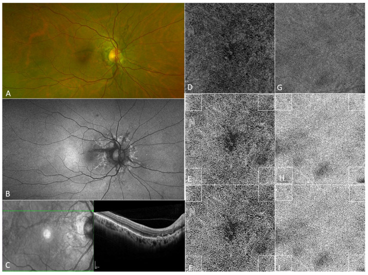
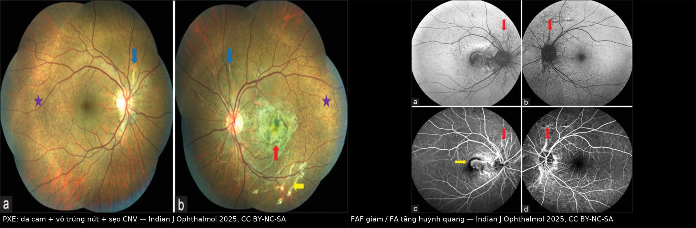
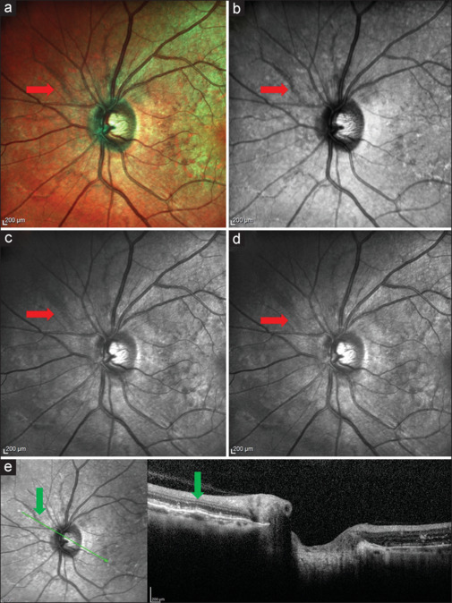
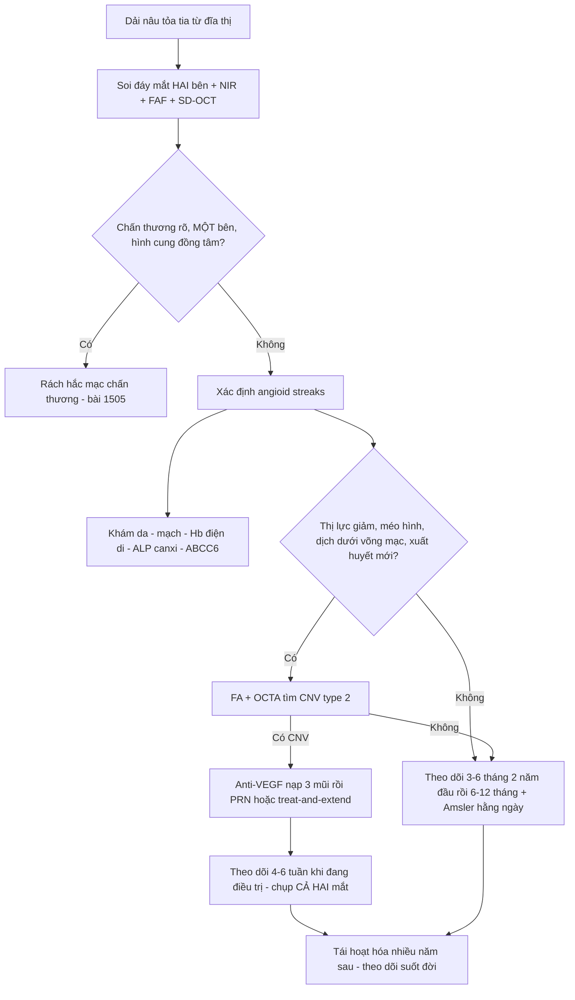
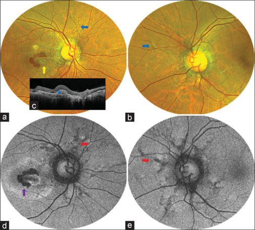
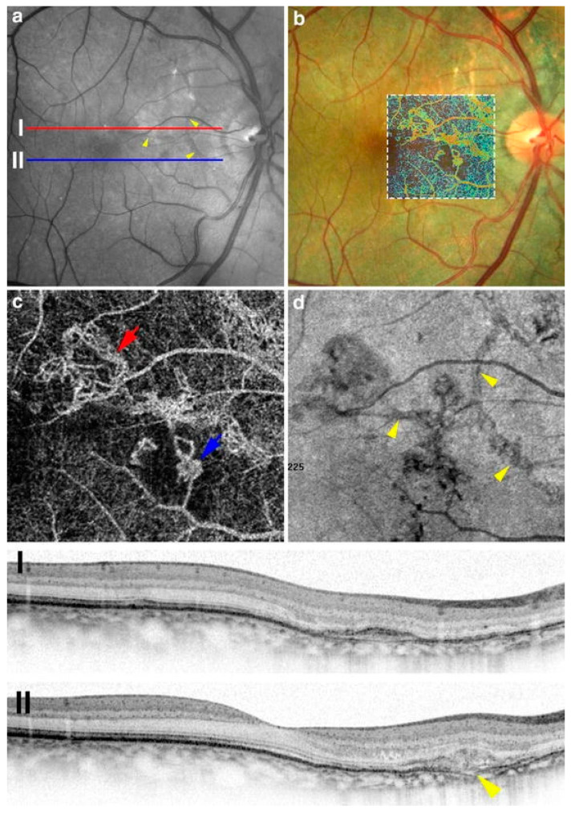
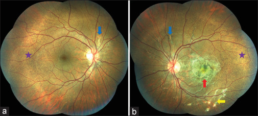
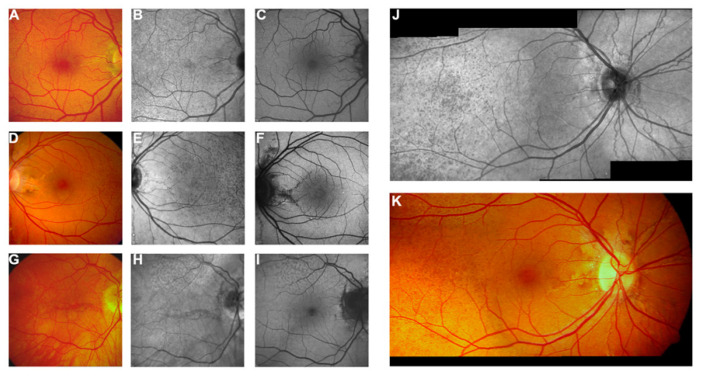

# 1509 — Angioid streaks & CNV: dải nâu tỏa nan hoa quanh đĩa thị — khi nào là PXE, khi nào là chấn thương / Angioid streaks

**Tags:** `pattern:angioid-streaks` `pattern:dai-toa-nan-hoa` `pattern:voi-hoa-mang-Bruch` `pattern:CNV-type-2` `pattern:xuat-huyet-duoi-vong-mac` `vung:hac-mac` `vung:mat` `vung:hoang-diem` `vung:dia-thi` `vung:hau-cuc` `anatomy:mang-Bruch` `anatomy:choriocapillaris` `protocol:OCT-hoang-diem` `protocol:FAF` `protocol:FA-OCTA` `protocol:NIR-multicolor` `protocol:sieu-am-Bscan` `score:khong` `incidentaloma:khong`

**Mức chắc chắn (certainty):** tổng hợp y văn (literature synthesis) — ghép **bài tổng quan 2025** về angioid streaks (*Indian J Ophthalmol* 2025 — **PMC11834907**, CC BY-NC-SA), **bài tổng quan 2024** về chẩn đoán–điều trị và đa phương thức hình ảnh (*Vision* 2024 — **PMC10976272**, CC BY 4.0), **đoàn hệ hồi cứu 39 mắt/29 bệnh nhân** theo dõi trung bình **69,4 tháng** với anti-VEGF (*J Ophthalmol* 2022 — **PMC9288306**, CC BY 4.0), **nghiên cứu định lượng choriocapillaris bằng SS-OCTA** 27 mắt bệnh/27 mắt chứng (*J Clin Med* 2022 — **PMC9026537**, CC BY 4.0), và **tổng quan PXE** (*Orphanet J Rare Dis* 2017 — **PMC5424392**, CC BY 4.0). Nhóm **không có bệnh nhân của mình**; chỗ suy luận ghi **[suy luận]**.

> **Vị trí trong thư viện:** [1505](../1505-rach-hac-mac-chan-thuong/lesson.md) đã đặt **angioid streaks** vào hàng "Chốt loại" quan trọng nhất của **rách hắc mạc chấn thương**, nhưng chỉ một dòng — ở đó dải **một bên, đúng hướng lực, có chấn thương**. Bài này trả lời mặt còn trống: **hai bên, đối xứng, không chấn thương — dải đó là bệnh gì, phải hỏi gì ở bệnh nhân, và theo dõi thế nào để không mất thị lực vì CNV**. Bài liên quan trực tiếp: [433 – Phù đĩa thị vs drusen đĩa](../433-phu-dia-thi-drusen/lesson.md) (drusen đĩa thị gặp **6–8% đến > 20%** ở PXE, so với **0,3%** dân số chung), [1486 – Khối hắc mạc trên siêu âm](../1486-khoi-hac-mac-sieu-am/lesson.md), [1479 – Bong võng mạc thanh dịch](../1479-bong-vong-mac-thanh-dich/lesson.md), [400 – Tổng quan Mắt & thị giác](../400-tong-quan-mat-thi-giac/lesson.md).

> **Câu chốt — sáu con số phải thuộc:** **(1)** Angioid streaks là **khe hở (dehiscence) của màng Bruch đã bị vôi hóa**, không phải mạch máu và không phải xuất huyết — dải rộng tới **~500 µm**, hai bên, tỏa từ đĩa thị (PMC11834907). **(2)** **PXE chiếm 59–87%** các ca angioid streaks; ngược lại **80–90% bệnh nhân PXE** có angioid streaks, và **gần như tất cả** sau **20 năm** theo dõi (PMC11834907; PMC10976272). **(3)** **PXE 1/100.000–1/25.000** dân số, di truyền **lặn** do đột biến **ABCC6 (16p13.1)** → **giảm pyrophosphate** → vôi hóa lạc chỗ sợi elastin (PMC5424392). **(4)** **CNV là biến chứng chính, 42–86%**, và **không điều trị thì thị lực < 20/200 vào thập niên 4–5** (PMC9026537; PMC9288306). **(5)** Anti-VEGF: **+6,9 chữ ETDRS ở 3 tháng** rồi **giữ ổn định tới 48 tháng**, nhưng **teo và xơ hóa đều 60,7%** ở 48 tháng — thuốc cứu được thị lực, không cứu được mô (PMC9288306). **(6)** Trên SS-OCTA, **flow deficit choriocapillaris 47,6% vs 38,9%** ở mắt chứng (p < 0,001) — tổn thương **lan ra ngoài dải** nhìn thấy (PMC9026537).

## 1. Tổng quan bệnh học – cơ chế hình ảnh (TẠI SAO)

### 1.1 Màng Bruch: lớp mỏng nhất, giòn nhất, và là nơi duy nhất bị "đứt"

- Ở hậu cực, từ trong ra ngoài: **võng mạc thần kinh** → **biểu mô sắc tố (RPE)** → **màng Bruch** → **lớp mao mạch hắc mạc (choriocapillaris)** → lớp Sattler → lớp Haller → củng mạc.
- **Màng Bruch** dày **2–4 µm**, 5 lớp, **giàu elastin**; nó vừa là **giá đỡ** cho RPE vừa là **hàng rào** giữa hắc mạc và võng mạc (PMC11834907).
- Trong angioid streaks, **sợi elastin của Bruch bị thoái hóa rồi vôi hóa**; canxi làm màng **mất đàn hồi và giòn như vỏ trứng**. Dải mà ta thấy trên đáy mắt **chính là đường gãy của màng đã vôi hóa**, kèm **teo RPE và choriocapillaris phía trên** (PMC11834907).
- Vì Bruch là màng đáy của RPE **và** của choriocapillaris, khi nó gãy thì **cả hai lớp này rách theo** — đó là lý do trên FAF thấy **mất tín hiệu dọc dải**, trên FA thấy **window defect**, và trên OCTA thấy **flow void** (mục 1.5–1.6).

### 1.2 TẠI SAO dải tỏa "nan hoa" từ đĩa thị — hình học của lực kéo

- Bruch không gãy ngẫu nhiên: nó **gấp nếp (undulation)** theo vùng ứng suất, và **rách ở đỉnh và bờ nếp gấp** — nơi sức cản cơ học thấp nhất (PMC11834907).
- Hướng dải phản ánh **đường lực kéo của các cơ vận nhãn** quanh nhãn cầu; vì vậy dải **tỏa hình tia từ đĩa thị ra chu biên**, **hai bên và đối xứng** — khác hoàn toàn **rách chấn thương một bên, hình cung đồng tâm đĩa thị** ([1505](../1505-rach-hac-mac-chan-thuong/lesson.md)).
- Tên "angioid" (giống mạch máu) đến từ **màu nâu–đỏ, bờ có sắc tố, rộng tới ~500 µm** — đủ lớn để bị nhầm với mạch máu, đặc biệt ở đáy mắt sẫm màu (PMC11834907).

### 1.3 Sinh bệnh học phân tử: ABCC6 → thiếu pyrophosphate → vôi hóa lạc chỗ

- **PXE (pseudoxanthoma elasticum, hội chứng Grönblad–Strandberg)** do đột biến **ABCC6** trên **16p13.1**, di truyền **lặn NST thường**. ABCC6 là bơm efflux ở **màng đáy tế bào gan**; mất chức năng → **giảm pyrophosphate (PPi) ngoại bào**, chất ức chế vôi hóa sinh lý → canxi-phosphate lắng vào **sợi elastin** ở da, mắt, thành mạch (PMC11834907; PMC5424392).
- **PXE: 1/100.000 đến 1/25.000** dân số, nữ nhẹ hơn nam (PMC5424392).
- Ở **Paget xương**, bất thường tái tạo xương làm canxi gắn vào sợi elastin; ở **bệnh huyết sắc tố**, **sắt huyết thanh cao** được coi là yếu tố thúc đẩy (PMC11834907).
- **Hệ quả lâm sàng ngoài mắt:** da "da gà vặt lông" ở cổ/gấp, **mạch ngoại vi hẹp, chảy máu tiêu hóa**, bệnh mạch vành — nghĩa là **dải ở đáy mắt là dấu chỉ điểm của một bệnh hệ thống**, không phải bất thường mắt đơn thuần (PMC5424392).

### 1.4 TẠI SAO CNV — và TẠI SAO luôn là type 2

- Khi Bruch đứt, **hàng rào giữa hắc mạc và võng mạc mất**; yếu tố sinh mạch từ hắc mạc khuếch tán vào khoang dưới võng mạc và màng mạch mới **mọc xuyên qua chỗ đứt, nằm TRÊN RPE** = **CNV type 2 (dưới võng mạc, subretinal)**. AMD điển hình là **type 1 (dưới RPE)**, nên hai bệnh **không đọc OCT giống nhau** (PMC11834907; PMC10976272).
- Vì dải hay đi qua **hậu cực**, CNV rơi đúng **hoàng điểm**; **42–86%** bệnh nhân có CNV trong quá trình theo dõi (PMC9026537; PMC9288306).
- **Không điều trị:** sẹo đĩa (disciform scar) + teo hắc võng mạc → **thị lực < 20/200 vào thập niên 4–5** (PMC9288306). CNV có thể **tái hoạt hóa sau nhiều năm** ở đúng vị trí cũ (PMC10976272).
- **Teo hắc võng mạc địa lý** (thường đi trước bởi **loạn dưỡng dạng pattern**) gây mất thị lực **độc lập với CNV** — đây là lý do một số mắt vẫn xấu đi dù CNV đã khô (PMC11834907).

### 1.5 TẠI SAO FAF giảm, FA tăng, còn ICG có thể "âm tính giả"

- **FAF (488 nm):** tín hiệu đến từ **lipofuscin trong RPE**. Dọc dải, **RPE mất** → **giảm huỳnh quang**; khi dải còn mờ trên ảnh màu, **FAF là modality vẽ dải rõ nhất** cùng với **NIR** (PMC11834907; PMC10976272).
- **FA:** **tăng huỳnh quang thì sớm** do **window defect** (thấy hắc mạc qua chỗ thiếu RPE) và **nhuộm (staining) thì muộn** ở bờ xơ/vôi; khi có CNV type 2 → **rò (leakage) lan rộng thì muộn**, thường dạng **lưới (reticular)** (PMC11834907, Hình 4).
- **ICG-A:** phân tử lớn, gắn protein huyết thanh **98%** (fluorescein **80%**) nên **không thoát** khỏi choriocapillaris bình thường — nhưng **tới 20% dải thấy rõ trên đáy mắt lại KHÔNG thấy trên ICG-A** (PMC10976272). Vì vậy **ICG không dùng để loại trừ** angioid streaks.
- **NIR/multicolor:** dải hiện rõ hơn hẳn trên **NIR và multicolor** so với green/blue reflectance (PMC11834907, Hình 5; PMC10976272, Hình 1).

### 1.6 TẠI SAO OCT "sờ" được màng Bruch, và OCTA thấy tổn thương rộng hơn dải

- Trên SD-OCT, **dải RPE–Bruch là đường tăng phản xạ mảnh**. Vôi hóa làm dải **dày và tăng phản xạ mạnh**; rách = **mất liên tục** vài chục đến vài trăm µm, có khi kèm **nếp gấp/nhô lên**. Vùng **peau d'orange** trên lâm sàng tương ứng **vùng chuyển tiếp giữa Bruch đã vôi hóa và chưa vôi hóa** — thấy được trên OCT (PMC10976272, Hình 3).
- **CNV type 2 trên OCT:** khối **tăng phản xạ nằm TRÊN dải RPE–Bruch** (dải RPE vẫn liên tục bên dưới), kèm **dịch dưới võng mạc** và mất liên tục ellipsoid zone (PMC11834907, Hình 1c).
- **SS-OCTA choriocapillaris** ở 27 mắt angioid streaks so với 27 mắt chứng: **flow deficit 47,62 ± 8,06% vs 38,90 ± 6,38%** (p < 0,001); **diện tích flow deficit 0,47 ± 0,08 vs 0,39 ± 0,06 mm²**; **số ổ giảm nhưng ổ to hơn** (5.313 vs 2.784 µm²) → **hợp nhất ổ thiếu tưới máu**, lan ra ngoài vùng dải (PMC9026537).
- Điểm thực hành: **OCTA không thay FA** khi quyết định điều trị — tác giả tổng quan khuyến cáo **không dựa riêng OCTA** vì màng mới có thể **không phát tín hiệu** hoặc bị **artifact projection** (PMC10976272).

*(A) Đáy mắt góc rộng — dải xám quanh đĩa. (B) FAF: dải giảm huỳnh quang + vùng tăng huỳnh quang cạnh đĩa. (C) OCT qua hoàng điểm. (D–F) choriocapillaris **en face cấu trúc**; (G–I) **flow** — các ô vuông 1×1 mm ở bốn góc là vùng đo **flow deficit**, tránh vùng CNV. Kết quả: **47,6% vs 38,9%** ở mắt chứng, ổ thiếu tưới máu **to hơn nhưng ít hơn** = hợp nhất. Nguồn: *J Clin Med* 2022 (PMC9026537), CC BY 4.0.*

### 1.7 Bảng hằng số phải nhớ

| Đại lượng | Giá trị | Nguồn |
|---|---|---|
| Angioid streaks trong PXE | **80–90%**; **gần như tất cả** sau **20 năm** | PMC11834907 |
| PXE trong các ca angioid streaks | **59–87%** | PMC11834907; PMC10976272 |
| PXE trong dân số | **1/100.000 – 1/25.000**; gen **ABCC6** 16p13.1, lặn | PMC5424392 |
| Paget xương / bệnh huyết sắc tố | **8–15%** / **0,9–6%** (thalassemia tới **30%** ở tuổi > 50) | PMC11834907; PMC10976272 |
| Ca angioid streaks có bệnh hệ thống | **> 50%** | PMC10976272 |
| CNV | **42–86%**; thị lực không điều trị **< 20/200** ở thập niên 4–5 | PMC9026537; PMC9288306 |
| Drusen đĩa thị trong PXE | **6–8% đến > 20%** (dân số chung **0,3%**) | PMC10976272 |
| Comet lesion (dấu hiệu đặc trưng PXE) | gặp ở **10–70%**, **hình sao chổi đuôi hướng về đĩa thị**, **tăng huỳnh quang trên FAF** | PMC10976272; PMC11834907 |
| Anti-VEGF (39 mắt, 69,4 tháng) | **59,3 → 63,7 chữ** ở 48 tháng; **+6,9 chữ ở 3 tháng** (p = 0,003); **4,6 mũi/năm đầu**, tổng **10,8 mũi/48 tháng** | PMC9288306 |
| Teo / xơ hóa ở 48 tháng | **60,7% / 60,7%** | PMC9288306 |
| Flow deficit choriocapillaris | **47,6% vs 38,9%** mắt chứng (p < 0,001) | PMC9026537 |
| Yếu tố tiên lượng xấu trên lâm sàng | dải **dài ≥ 3 đường kính đĩa**, cách hoàng điểm **≤ 1 đường kính đĩa**, thể **"vỏ trứng nứt" lan tỏa** | PMC11834907 |

## 2. Mẫu hình + chẩn đoán phân biệt theo vị trí (gamut)

**Mẫu hình:** bệnh nhân **thập niên 2–5** (thường **quanh 50 tuổi** khi có triệu chứng), **hai mắt**, đáy mắt có **dải nâu–xám/xám-vàng, bờ có sắc tố, tỏa hình tia từ đĩa thị** ra hậu cực và chu biên; **phần lớn KHÔNG triệu chứng** dù dải băng qua hoàng điểm; nhìn mờ – méo hình xuất hiện khi **CNV** hoặc **xuất huyết dưới võng mạc** (PMC11834907).

### 2.1 Gamut theo bệnh hệ thống — nhớ "PEPSI"

- **P — Pseudoxanthoma elasticum:** phổ biến nhất (**59–87%** ca angioid streaks); kèm **peau d'orange** thái dương hoàng điểm, **loạn dưỡng dạng pattern hai bên (65%)**, **comet lesion**, **drusen đĩa thị**, hẹp mạch ngoại vi, chảy máu tiêu hóa (PMC11834907; PMC5424392).
- **E — Ehlers–Danlos (thể cổ điển/tăng động) và các bệnh mô liên kết**, kể cả **hội chứng Turner**, **bệnh Camurati–Engelmann** (PMC11834907).
- **P — Paget xương (osteitis deformans):** **8–15%**; thường **ALP tăng**, xương biến dạng, tuổi khởi phát trẻ hơn và bệnh xương nặng hơn.
- **S — Sickle cell & bệnh huyết sắc tố:** **0,9–6%**; **thalassemia β tới 30%** ở bệnh nhân > 50 tuổi; ở nhóm này **CNV và mất thị lực hiếm hơn PXE**.
- **I — Idiopathic (vô căn)** và nhóm **"coincidental"**: tăng canxi máu, nhiễm độc chì, đái tháo đường, myopia, lupus, neurofibromatosis — danh sách dài nhưng **bằng chứng nhân quả yếu** (PMC11834907).

### 2.2 Gamut "dải quanh đĩa thị" — 4 câu hỏi phải trả lời

Dải quanh đĩa không đồng nghĩa angioid streaks. Bốn câu hỏi theo thứ tự:

1. **Một bên hay hai bên?** Hai bên đối xứng → angioid streaks; **một bên + đúng hướng lực + có chấn thương** → **rách hắc mạc** ([1505](../1505-rach-hac-mac-chan-thuong/lesson.md)).
2. **Xuất phát từ đĩa thị hay không?** Tỏa **từ bờ đĩa** → angioid; **hình cung đồng tâm cách đĩa 1–3 đường kính** → rách chấn thương; **ngắn, gấp khúc, ở hậu cực** → **lacquer crack** cận thị nặng.
3. **Có bệnh hệ thống không?** Da – mạch – xương – Hb – canxi – ALP. **> 50%** ca có bệnh nền (PMC10976272).
4. **Đã có CNV chưa?** Dịch dưới võng mạc, xuất huyết mới, méo hình, FA rò thì muộn, OCTA có mạng mạch.

Các thực thể còn lại trong gamut: **xơ hắc mạc/teo hắc võng mạc lan tỏa** (dải bị che lấp ở giai đoạn cuối), **viêm mạch võng mạc** (dải dọc mạch kèm bao mạch, viêm dịch kính), **histoplasmosis mắt** (sẹo điểm đục lỗ + teo quanh đĩa một bên), **thoái hóa hoàng điểm tuổi già/PCV** (bệnh nhân lớn tuổi, CNV type 1, không có dải tỏa tia), **chorioretinitis sclopetaria** (mất mô hắc võng mạc + co kéo, sau chấn thương tốc độ cao).

### 2.3 Ba tầng đọc kết quả

- **Tầng 1 — nhận diện:** dải tỏa tia hai bên? → nghĩ angioid streaks, đừng gọi "mạch máu bất thường".
- **Tầng 2 — nguyên nhân:** khám da (cổ, nách, gấp), mạch ngoại vi, **Hb điện di**, **ALP/canxi**, hỏi chảy máu tiêu hóa, tiền sử gia đình.
- **Tầng 3 — biến chứng:** CNV/teo hắc võng mạc — phần quyết định thị lực và phần **phải theo dõi suốt đời**.

## 3. Bảng so sánh phân biệt (ma trận đối chiếu)

| Thực thể (entity) | Hình ảnh điển hình (FAF / FA / OCT) | Chốt vào (rule-in) | Chốt loại (rule-out) | Gợi ý xác nhận |
|---|---|---|---|---|
| **Angioid streaks (PXE/vô căn)** | Dải **nâu–xám, hai bên, tỏa tia từ bờ đĩa**; FAF **giảm huỳnh quang dọc dải**; FA **tăng sớm + nhuộm muộn**; OCT: **dải RPE–Bruch dày, tăng phản xạ, mất liên tục** | **Hai bên + tỏa tia từ đĩa + FAF giảm dọc dải** | Dải **một bên, hình cung, có chấn thương** → rách hắc mạc; dải **ngắn gấp khúc ở hậu cực mắt cận thị** → lacquer crack | NIR/multicolor + FAF; khám da–mạch; **ABCC6** nếu nghi PXE |
| **Rách hắc mạc chấn thương** | **Một bên**, **hình cung/vệt đồng tâm đĩa thị** cách đĩa **1–3 đường kính**; kèm **xuất huyết dưới võng mạc**; OCT mất liên tục RPE–Bruch **kèm máu** | **Tiền sử chấn thương kín + một bên + hướng đồng tâm** | **Hai bên đối xứng, không chấn thương** → angioid streaks | Soi 360°, OCT raster toàn chiều dài ([1505](../1505-rach-hac-mac-chan-thuong/lesson.md)) |
| **Lacquer cracks (cận thị nặng)** | Dải **vàng nhạt, ngắn, thẳng/gấp khúc**, **nhiều vết**, ở **hậu cực**, kèm **teo hắc mạc quanh**, trục nhãn cầu **> 26,5 mm** | **AL > 26,5 mm + nhiều vết ngắn + teo hắc mạc** | Dải **dài, liên tục, tỏa từ đĩa** → angioid | Đo trục nhãn cầu; OCT; **lacquer cracks chỉ ~4,3%** mắt cận thị cao |
| **Xơ hắc mạc / teo hắc võng mạc lan tỏa** | Vùng **teo RPE–hắc mạc rộng**, hắc mạc mạch thô nổi rõ, **che lấp dải**; FAF giảm lan tỏa | **Teo lan tỏa + hắc mạc thô + giai đoạn cuối** | Còn **dải tỏa tia rõ** → angioid hoạt động | So phim cũ; FAF; FA |
| **Viêm mạch võng mạc** | Dải/xơ **dọc theo mạch máu** + **bao mạch (sheathing)**, viêm dịch kính, xuất huyết dọc mạch | **Bao mạch + viêm dịch kính + triệu chứng viêm** | Dải **không theo mạch, từ đĩa**, không viêm dịch kính → angioid | FA (rò dọc mạch), xét nghiệm viêm |
| **Histoplasmosis mắt** | **Sẹo điểm đục lỗ (punched-out)** quanh đĩa + đốm vàng ngoại vi, **thường một bên**; teo quanh đĩa **bám sát bờ đĩa** | **Sẹo điểm + đốm ngoại vi + một bên** | **Hai bên, dải liên tục tỏa tia** → angioid | FA; bối cảnh dịch tễ |
| **CNV type 2 trên angioid streaks** | **Khối tăng phản xạ TRÊN dải RPE** + dịch dưới võng mạc; FA **rò thì muộn dạng lưới**; OCTA mạng mạch; thị lực giảm lại, Amsler méo | **Dải + dịch dưới võng mạc + FA rò muộn** | **Sẹo phẳng, không dịch, OCTA không mạng mạch** → sẹo khô, không tiêm | FA (chuẩn) ± OCTA; **không chẩn CNV chỉ bằng OCTA** |

*Trái: **PXE** — dải tỏa tia (mũi tên xanh), **peau d'orange** thái dương hoàng điểm (sao tím), **vỏ trứng nứt** (mũi tên vàng), **sẹo CNV dạng đĩa** ở hoàng điểm (mũi tên đỏ). Phải: **FAF giảm huỳnh quang dọc dải** (mũi tên đỏ) và **FA tăng huỳnh quang** cùng vị trí, kèm **rò dạng lưới của CNV type 2** (mũi tên vàng). Nguồn: *Indian J Ophthalmol* 2025 (PMC11834907), CC BY-NC-SA 4.0. Ảnh ghép letterbox, không crop.*

### 3.1 Đọc theo trình tự cố định (5 bước)

1. **Đối xứng:** soi **hai mắt**, luôn giãn đồng tử — bất đối xứng là chuyện thường, **một mắt "sạch" không loại trừ**.
2. **NIR + FAF trước:** dải thường rõ hơn ảnh màu; FAF cho biết **RPE còn hay mất** dọc dải.
3. **OCT raster qua toàn bộ chiều dài dải + hoàng điểm:** tìm **mất liên tục RPE–Bruch**, độ dày dải vôi hóa, **dịch dưới võng mạc**, mất liên tục ellipsoid zone.
4. **FA khi có bất kỳ dấu hiệu nghi CNV** (thị lực giảm, méo hình, dịch, xuất huyết mới): tìm **rò thì muộn**; OCTA bổ sung, **không thay thế**.
5. **Đo và ghi:** chiều dài dải, khoảng cách tới tâm hoàng điểm (**≤ 1 đường kính đĩa** và **dài ≥ 3 đường kính đĩa** = nguy cơ cao), có **thể "vỏ trứng nứt" lan tỏa** không.

### 3.2 Dấu hiệu trên từng modality

| Modality | Thấy gì | Không thấy gì |
|---|---|---|
| **Đáy mắt màu (giãn đồng tử)** | Dải, peau d'orange, comet lesion, sẹo CNV, xuất huyết | Dải **mờ ở đáy mắt sẫm màu**; độ sâu tổn thương |
| **NIR / multicolor** | **Dải rõ nhất**, peau d'orange, comet lesion; **nhạy hơn ảnh màu** | Không định lượng được mất RPE |
| **FAF 488 nm** | **Giảm huỳnh quang dọc dải** (mất RPE/lipofuscin); bản đồ teo; theo dõi tiến triển | Không thấy dải khi bị **máu/xuất huyết che** |
| **FA** | **Window defect sớm + nhuộm muộn**; **rò của CNV**; phân biệt viêm mạch | Không thấy dải < ~50 µm; **không thấy tổn thương sau máu dày** |
| **ICG-A** | Mạch hắc mạc, màng CNV; comet lesion **giảm huỳnh quang thì muộn** | **Tới 20% dải không hiện** → **không dùng để loại trừ** |
| **SD-OCT** | **Chuẩn** cho mất liên tục RPE–Bruch, dày/vôi hóa, dịch dưới võng mạc, CNV type 2 | Dải **rộng theo chiều ngang** — cần raster, không chỉ 1 lát |
| **SS-OCTA** | Mạng mạch CNV, **flow deficit choriocapillaris** định lượng | **Artifact projection**; màng mới **có thể không phát tín hiệu** |
| **B-scan** | Khi đục thể thủy tinh/dịch kính: dày hắc mạc, bong võng mạc, khối | Không phân giải Bruch |
| **CT/MRI hốc mắt** | Chỉ để loại trừ khối/u, dị vật, bệnh xương | **Không bao giờ** thấy angioid streaks |

*(a) Multicolor, (b) hồng ngoại (IR), (c) green reflectance, (d) blue reflectance — cùng một mắt: dải (mũi tên đỏ) **nổi rõ nhất trên multicolor và IR**, mờ dần trên green và gần như mất trên blue. (e) Lát OCT cắt ngang dải: **mất liên tục phức hợp RPE–Bruch** (mũi tên xanh) — đây là "chỗ đứt" thật, không phải mạch máu. Nguồn: *Indian J Ophthalmol* 2025 (PMC11834907), CC BY-NC-SA 4.0.*

## 4. Protocol chụp + theo dõi (không có RADS — có lịch)

### 4.1 Việc phải làm ngay khi thấy dải tỏa tia

- **Khám toàn thân tối thiểu:** da (cổ, nách, khoeo, quanh rốn — sẩn vàng "da gà vặt lông"), **mạch ngoại vi (bắt mạch mu chân)**, huyết áp, hỏi **chảy máu tiêu hóa/thiếu máu**, tiền sử gia đình.
- **Xét nghiệm:** **Hb điện di/tổng phân tích tế bào máu** (loại trừ hemoglobinopathy), **ALP + canxi/phosphate** (Paget, tăng canxi), **creatinin**, lipid/mạch vành theo tuổi.
- **Di truyền:** **ABCC6** khi nghi PXE (kể cả da không rõ ràng — mô bệnh học có thể dương tính ở da "bình thường") (PMC5424392).

### 4.2 Trình tự hình ảnh

1. **Chụp màu góc rộng (ultrawide) hai mắt** — mốc so sánh.
2. **NIR + FAF** — vẽ dải và bản đồ teo.
3. **SD-OCT hoàng điểm + raster qua dải** — bắt buộc **cả hai mắt**.
4. **FA** khi nghi CNV (thị lực giảm/méo/Amsler dương/dịch/xuất huyết); **OCTA** ở mỗi lần theo dõi để phát hiện sớm mạng mạch.
5. **B-scan** khi không soi được hậu đoạn (đục thể thủy tinh, xuất huyết dịch kính) — nối [1498](../1498-sieu-am-bscan-truoc-phaco-hau-doan/lesson.md).

### 4.3 Lịch theo dõi [suy luận từ nguy cơ và tính hai bên]

- **Không có guideline chính thức** về nhịp khám (đây là bệnh hiếm). Thực hành hợp lý: **3–6 tháng/lần trong 2 năm đầu** sau khi phát hiện, sau đó **6–12 tháng/lần suốt đời**, vì **CNV hai bên, bất đối xứng** và **có thể tái hoạt hóa sau nhiều năm** (PMC10976272; PMC9288306).
- **Dạy bệnh nhân tự kiểm Amsler hằng ngày từng mắt** và quay lại **ngay** khi méo hình/nhìn mờ — đây là cách phát hiện CNV sớm nhất, quan trọng hơn mọi lịch hẹn.
- **Tư vấn:** tránh **thể thao va chạm, lặn, đai an toàn siết chặt vùng đầu**; nguy cơ **xuất huyết dưới võng mạc sau chấn thương rất nhẹ**, và **tới 15%** bệnh nhân mất thị lực đáng kể sau **chấn thương đầu nhẹ** (PMC11834907).

### 4.4 Điều trị — chỉ điều trị biến chứng

- **Bản thân dải: không có điều trị.** Không laser lên dải, không laser dự phòng, không corticoid.
- **CNV type 2:** **anti-VEGF** (bevacizumab **1,25 mg**, ranibizumab **0,5 mg**, aflibercept **2 mg**) — nạp 3 mũi rồi **PRN**, hoặc **treat-and-extend**; **không có so sánh đầu-đối-đầu** giữa các phác đồ (PMC10976272; PMC11834907).
- **Số liệu thực tế (39 mắt, 69,4 tháng):** BCVA **59,3 → 63,7 chữ ETDRS** ở 48 tháng (p = 0,85 so với ban đầu) nhưng **+6,9 chữ ở 3 tháng** (p = 0,003); **21,4% tăng ≥ 15 chữ**, **42,9% ổn định**; **4,6 mũi trong năm đầu**, tổng **10,8 mũi/48 tháng**; **teo 60,7%** và **xơ hóa 60,7%** ở 48 tháng — **teo hoàng điểm** là yếu tố gắn với thị lực kém (p = 0,047) (PMC9288306).
- **Tiên lượng xấu hơn:** bệnh nặng lúc bắt đầu, **tuổi khởi phát trẻ**, **có PXE**, mắt **chưa từng điều trị** với thị lực đã thấp; **CNV dưới hoàng điểm** kém hơn **cạnh/ngoài hoàng điểm** (PMC11834907; PMC10976272).
- **Lịch sử (không còn dùng):** laser quang đông, TTT, PDT, mổ dưới hoàng điểm — đều **tái phát nhiều** và **sẹo hóa trung tâm** (PMC11834907).
- **Thuốc toàn thân ở PXE:** thận trọng **aspirin/NSAID/kháng kết tập tiểu cầu** vì nguy cơ **chảy máu tiêu hóa và xuất huyết võng mạc**; cân nhắc với lợi ích tim mạch (PMC5424392).

## 5. Biến thể bình thường và cạm bẫy

- **Dải có thể gần như vô hình trên ảnh màu** ở đáy mắt sẫm màu: **NIR/multicolor** và **FAF** là đường vòng — đừng kết luận "không có dải" từ một ảnh màu.
- **Peau d'orange bị đọc là "drusen"**: đốm vàng nhạt thái dương hoàng điểm ở PXE **không phải drusen** mà là **vùng chuyển tiếp vôi hóa Bruch**; phân biệt bằng OCT (dải RPE–Bruch dày, tăng phản xạ) và FAF (thay đổi dạng lưới, không tăng huỳnh quang điểm như drusen).
- **Drusen đĩa thị "tăng huỳnh quang"** trong khi dải **giảm huỳnh quang** — ở PXE drusen đĩa thị gặp **6–8% đến > 20%** (dân số **0,3%**), dễ bị đọc thành "phù đĩa" (PMC10976272; nối [433](../433-phu-dia-thi-drusen/lesson.md)).
- **Chấn thương "không đáng kể"**: dụi mắt, bóng, dây an toàn, chấn thương đầu nhẹ — Bruch đã vôi hóa gãy như vỏ trứng, gây **xuất huyết dưới hoàng điểm lớn**; bệnh nhân thường **không coi đó là chấn thương**.
- **Gọi là "thoái hóa hoàng điểm tuổi già" ở người 40–50 tuổi**: dấu hiệu báo động sai — hỏi lại dải quanh đĩa, soi mắt bên kia, chụp FAF.
- **Bỏ sót CNV vì "dải băng qua hoàng điểm mà thị lực vẫn tốt"**: dải **tự nó không gây mất thị lực**; chỉ **CNV và teo** gây. Vì vậy **dịch dưới võng mạc** quan trọng hơn vị trí dải.
- **Tin OCTA tuyệt đối**: màng mới nhỏ có thể **không phát tín hiệu**, còn **projection artifact** của mạch hắc mạc có thể **giả CNV** — luôn đối chiếu **FA + OCT B-scan + dịch**.
- **Laser "đốt dải"**: không có chỉ định; laser chỉ gây **sẹo và ám điểm**, và CNV tái phát ở **bờ sẹo** (PMC11834907).
- **Không chẩn PXE chỉ bằng mắt**: da có thể **không điển hình**, và có ca **đột biến ABCC6 với da bình thường về mô học** — cần **khám da + di truyền** (PMC5424392).

## 6. Tự lượng giá — Blind Quiz

**Ca 1 — Nam 48 tuổi, nhìn mờ mắt phải 2 tuần, không chấn thương. Đáy mắt: dải nâu tỏa từ đĩa ở cả hai mắt, mắt phải có mảng đỏ sẫm ở hoàng điểm.**

- Hỏi: dải đi **từ đâu tới đâu** và **màu gì**? Mảng đỏ ở mắt phải là gì? Trên phim (c) khối tăng phản xạ nằm **trên hay dưới** dải RPE? Vì sao FAF (d, e) lại **giảm** tín hiệu dọc dải?

<b>Bấm để hiện đáp án (findings + chẩn đoán)</b>

- **Dấu hiệu:** dải **nâu–xám tỏa tia từ bờ đĩa thị** ở **cả hai mắt** (mũi tên xanh); mắt phải có **màng CNV + xuất huyết dưới võng mạc** ở hoàng điểm (mũi tên vàng).
- **OCT (c):** khối **tăng phản xạ dưới võng mạc, nằm TRÊN dải RPE** (dấu hoa thị xanh) = **CNV type 2**.
- **FAF (d, e):** **giảm huỳnh quang dọc dải** vì **RPE đã mất** (mất lipofuscin); vùng xuất huyết **giảm** do máu chắn, còn **quầng tăng huỳnh quang** quanh đó là **dịch dưới võng mạc**.
- **Chẩn đoán:** **angioid streaks + CNV type 2**; phải khám da/mạch và xét nghiệm **PXE – Paget – hemoglobinopathy**.
- Nguồn ảnh: *Indian J Ophthalmol* 2025 (PMC11834907), CC BY-NC-SA 4.0.

**Ca 2 — Nữ 52 tuổi, PXE đã biết, thị lực mắt trái từ 20/25 xuống 20/60 trong 6 tuần, Amsler thấy méo. OCTA và ảnh chồng màu:**

- Hỏi: (b) và (c) cho thấy gì mà ảnh màu (a) không thấy? Mũi tên **đỏ** và **xanh** chỉ hai thành phần nào của màng? Vì sao **không được** quyết định điều trị **chỉ** dựa vào OCTA?

<b>Bấm để hiện đáp án (findings + chẩn đoán)</b>

- **Dấu hiệu:** (a) ảnh đỏ-free **không thấy xuất huyết**; (b) **OCTA chồng lên ảnh màu** vẽ ra **mạng mạch CNV**; (c) **mũi tên đỏ = thân màng (mạng mạch)**, **mũi tên xanh = nhánh/vùng rò**; (d) **flow void** quanh màng.
- **B-scan (I, II):** **dịch dưới võng mạc nông** và **mất liên tục RPE–Bruch** (đầu tam giác vàng) — CNV **type 2** đi qua chỗ đứt.
- **Vì sao không chỉ dùng OCTA:** màng nhỏ có thể **không phát tín hiệu**, **artifact projection** có thể giả màng; quyết định cần **FA rò thì muộn + OCT có dịch + thị lực/Amsler** (PMC10976272).
- **Điều trị:** **anti-VEGF** nạp 3 mũi rồi PRN/treat-and-extend; theo dõi **cả hai mắt**.
- Nguồn ảnh: *Vision* 2024 (PMC10976272), CC BY 4.0.

**Ca 3 — Nam 41 tuổi, da cổ có sẩn vàng xếp thành lưới, mẹ bị "mờ mắt tuổi 45". Đáy mắt hai bên:**

- Hỏi: ba dấu hiệu ngoài dải là gì? Dấu nào **đặc trưng cho PXE**? Mắt phải mất thị lực trung tâm vì tổn thương nào?

<b>Bấm để hiện đáp án (findings + chẩn đoán)</b>

- **Ba dấu hiệu:** **peau d'orange** (sao tím) — lốm đốm RPE thái dương hoàng điểm; **vỏ trứng nứt (cracked eggshell)** (mũi tên vàng) — các đường gãy Bruch trong vùng **coquille d'oeuf**; **sẹo CNV dạng đĩa (disciform scar)** ở hoàng điểm (mũi tên đỏ).
- **Đặc trưng PXE:** **comet lesion** (đốm trắng có đuôi hướng về đĩa thị, **tăng huỳnh quang trên FAF**) — gặp **10–70%**, coi là **pathognomonic**; ngoài ra **drusen đĩa thị** và **loạn dưỡng dạng pattern hai bên (65%)**.
- **Mất thị lực trung tâm:** **CNV type 2 → sẹo đĩa**; ở PXE còn có **teo hắc võng mạc địa lý** gây mất thị lực **độc lập với CNV**.
- **Bước tiếp theo:** **ABCC6**, khám mạch ngoại vi, hỏi chảy máu tiêu hóa; tư vấn tránh thể thao va chạm.
- Nguồn ảnh: *Indian J Ophthalmol* 2025 (PMC11834907), CC BY-NC-SA 4.0.

**Ca 4 — Nữ 36 tuổi, khám sàng lọc vì em trai có PXE. Đáy mắt màu "gần bình thường", nhưng ảnh NIR và FAF:**

- Hỏi: vì sao **ảnh màu (A, D, G) khó thấy dải** mà **NIR (B, E, H)** lại thấy rõ? Trên **FAF (C, F, I)**, dải **giảm hay tăng** huỳnh quang, và vì sao? Điều đó nói gì về **RPE** dọc dải?

<b>Bấm để hiện đáp án (findings + chẩn đoán)</b>

- **NIR** phản ánh **hắc mạc và sắc tố** tốt hơn ảnh màu, nên **dải (khe Bruch + sắc tố bờ)** và **peau d'orange** hiện rõ; **ảnh màu** bị che bởi sắc tố nền và ánh sáng.
- **FAF:** dải **giảm huỳnh quang** vì **RPE mất → mất lipofuscin** dọc dải; vùng **tăng huỳnh quang** quanh đó là RPE còn lại/loạn dưỡng dạng pattern.
- **Ý nghĩa:** dải không chỉ là "đường vẽ" — nó là **vùng RPE–choriocapillaris đã mất**, tức **thị lực trung tâm đang mất dần nếu dải băng qua hoàng điểm**.
- **Kết luận:** **angioid streaks** ở người **chưa có triệu chứng**, có **tiền sử gia đình** → khám da + **ABCC6**, dặn **Amsler hằng ngày** và **theo dõi định kỳ**.
- Nguồn ảnh: *Vision* 2024 (PMC10976272), CC BY 4.0.

## 7. Câu hỏi nghiên cứu & điểm chưa đồng thuận (tính đến 11/2026)

1. **[Tranh cãi] Ở bệnh nhân CNV type 2 do angioid streaks, phác đồ treat-and-extend có giữ được thị lực tốt hơn PRN sau nạp 3 mũi không?**
   - **Đã biết:** PRN sau nạp và treat-and-extend đều được dùng; **chưa có so sánh đầu-đối-đầu**, y văn chỉ có **một ca báo treat-and-extend** (PMC10976272); đoàn hệ 39 mắt dùng nhiều phác đồ trộn (fixed/PRN/T&E) vẫn **ổn định thị lực tới 48 tháng** (PMC9288306).
   - **Chưa rõ:** phác đồ nào giảm số mũi mà không tăng **teo/xơ hóa (60,7% ở 48 tháng)**; khác biệt theo **có PXE hay không**.
   - **Hướng nghiên cứu:** RCT đa trung tâm hoặc **registry quốc tế** với outcome BCVA 24 tháng + số mũi + diện teo.
   - **Nguồn:** PMC10976272 (2024); PMC9288306 (2022).

2. **[Khoảng trống] Điều trị giảm vôi hóa màng Bruch (etidronate/pyrophosphate) có phòng được CNV và teo hoàng điểm ở PXE không?**
   - **Đã biết:** PXE do **thiếu PPi**; **etidronate** (đồng đẳng PPi) giảm vôi hóa lạc chỗ trên mô hình, nhưng **không đảo ngược** tổn thương đã có; **chưa có thử nghiệm** trên mắt người (PMC11834907; PMC5424392).
   - **Chưa rõ:** liều, thời điểm can thiệp (trước khi có dải?), và **biomarker** theo dõi (độ phản xạ RPE–Bruch trên OCT).
   - **Hướng nghiên cứu:** thử nghiệm pha II trên PXE có angioid streaks chưa CNV, outcome là **thời gian tới CNV/teo**.
   - **Nguồn:** PMC11834907 (2025); PMC5424392 (2017).

3. **[Khác biệt thực hành] Theo dõi mắt bên kia bằng OCTA hay FA, và bao lâu một lần, khi chưa có triệu chứng?**
   - **Đã biết:** tổn thương **hai bên và bất đối xứng**; **flow deficit choriocapillaris tăng rõ** ở mắt có dải (47,6% vs 38,9%) (PMC9026537); tác giả tổng quan khuyến cáo **không dựa riêng OCTA** để quyết định điều trị (PMC10976272).
   - **Chưa rõ:** **nhịp theo dõi tối ưu**; OCTA có phát hiện CNV **trước khi có dịch** đủ tin cậy để điều trị sớm hay không.
   - **Hướng nghiên cứu:** nghiên cứu **diagnostic accuracy** của OCTA so với FA ở mắt chưa triệu chứng, kèm phân tích chi phí–hiệu quả.
   - **Nguồn:** PMC9026537 (2022); PMC10976272 (2024).

## Bài liên quan chéo

- [1505 – Rách hắc mạc do chấn thương](../1505-rach-hac-mac-chan-thuong/lesson.md): **một bên, hình cung đồng tâm đĩa thị**, có chấn thương — đối cực của angioid streaks trong cùng gamut "dải quanh đĩa".
- [433 – Phù đĩa thị vs drusen đĩa](../433-phu-dia-thi-drusen/lesson.md): drusen đĩa thị **gặp nhiều ở PXE**, **tăng huỳnh quang** trên FAF — ngược với dải **giảm huỳnh quang**.
- [1479 – Bong võng mạc thanh dịch](../1479-bong-vong-mac-thanh-dich/lesson.md): phân biệt **dịch dưới võng mạc** (CNV) với **máu dưới võng mạc** và bong thanh dịch.
- [1486 – Khối hắc mạc trên siêu âm](../1486-khoi-hac-mac-sieu-am/lesson.md): khi vùng dải/hắc mạc **dày lên không giải thích được**, phải loại trừ melanoma/hemangioma.
- [1498 – B-scan trước phẫu thuật đục thể thủy tinh](../1498-sieu-am-bscan-truoc-phaco-hau-doan/lesson.md): dùng B-scan khi đục/máu không cho soi hậu đoạn.
- [400 – Tổng quan Mắt & thị giác](../400-tong-quan-mat-thi-giac/lesson.md): bảng DDx theo triệu chứng và lộ trình học.

## Ảnh

- Tên file theo `NNN_slug_Modality_SourceID.jpg`; nguồn + giấy phép từng ảnh ở `images/CREDITS.md`.
- 6 ảnh gốc + 1 ảnh ghép (`composite_pxe-faf-fa.jpg`, tạo bằng `tools/make_composite.py` — letterbox, không crop/kéo giãn).
- Ảnh **CC BY-NC-SA** (PMC11834907) dùng cho mục đích **giáo dục phi thương mại**, ghi công đầy đủ.

> Không dùng để chẩn đoán độc lập khi chưa có người hướng dẫn.
