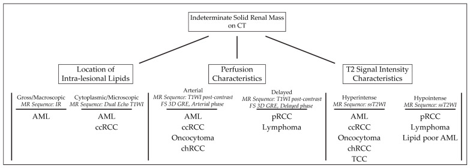
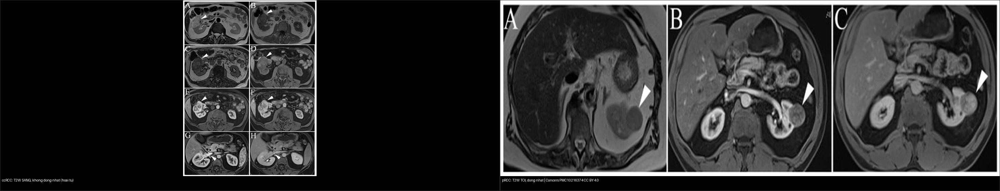
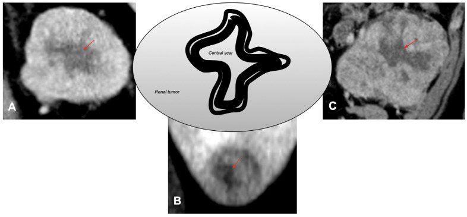
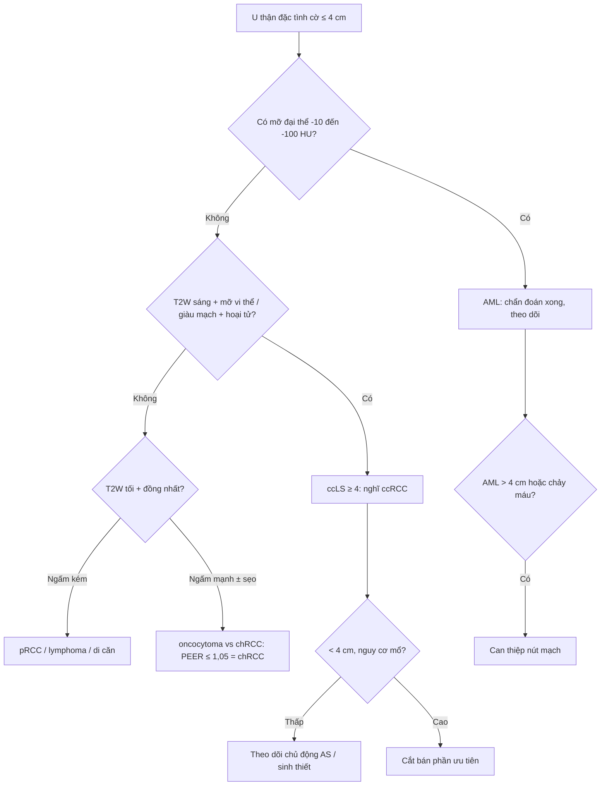
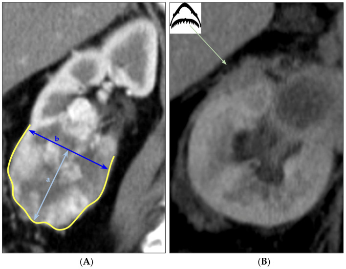
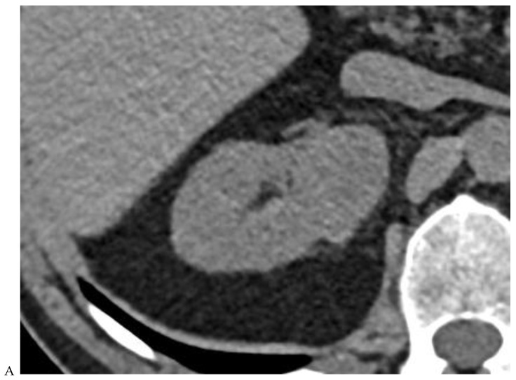
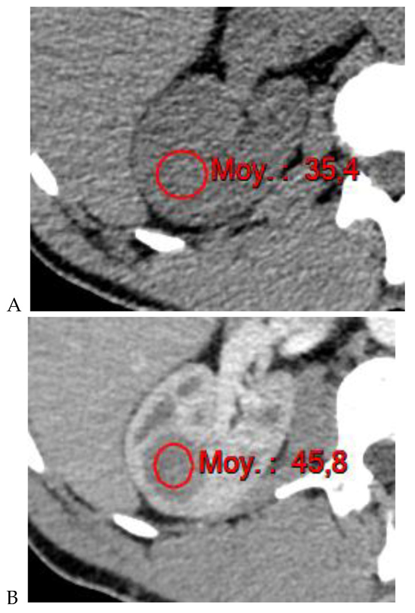
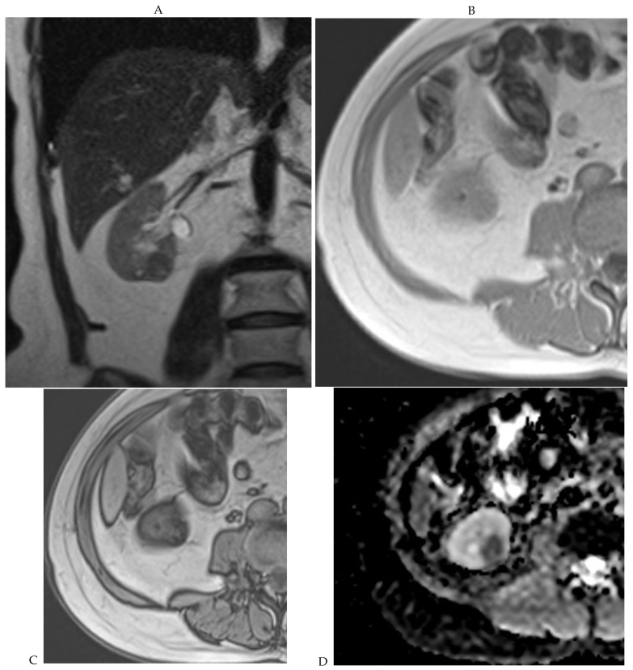

# 151 — U thận đặc: RCC vs oncocytoma vs AML / Solid renal masses

**Tags:** `pattern:u-than-dac` `vung:than` `score:ccLS` `protocol:CT-da-thi-than` `incidentaloma:u-than-tinh-co`
**Mức chắc chắn (certainty):** tổng hợp y văn (literature synthesis) — nhóm tự biên từ y văn mở (Cancers 2024/2023/2026, Medicina 2022, Transl Androl Urol 2025), số liệu lấy nguyên từ bảng/Fig nguồn.

## 1. Tổng quan — mật độ ngấm, mỡ vi thể & vật lý T2 quyết định tên u

- **U thận đặc (solid renal mass)** chiếm ~85% u ác đường niệu; trong đó **ung thư tế bào thận (renal cell carcinoma — RCC)** ~85% u đặc ác tính: **tế bào sáng (clear cell — ccRCC) ~70–75%**, **nhú (papillary — pRCC) 10–15%**, **kỵ màu (chromophobe — chRCC) ~5%**; **oncocytoma** lành chiếm **3–7%** u đặc.
- **Ngấm thật (true enhancement):** tăng **≥ 20 HU** trên CT, **≥ 15%** trên MRI giữa thì trước tiêm và thì thận (nephrographic **90–100s**); tăng **< 10 HU là giả ngấm (pseudoenhancement)**. Vùng 10–20 HU là vùng xám — phải đo ROI cùng vị trí 3 thì.
- **TẠI SAO mỗi loại có "chữ ký" riêng (theo vật lý + mô bệnh):**
  - **ccRCC:** tế bào chứa **glycogen + lipid vi thể (microscopic fat)** và mạng mạch VEGF dày → **T2W sáng (nhất là trong các u đặc)**, **ngấm mạnh–không đều thì động mạch rồi rửa trôi (washout)**, hay **hoại tử**. Lipid vi thể làm **mất tín hiệu trên chuỗi đối pha (opposed-phase)** — ccRCC là RCC **duy nhất** rớt tín hiệu rõ (gặp ở ~60%).
  - **pRCC / chRCC:** mật độ tế bào cao, ít mạch → **T2W tối, ngấm kém, đồng nhất**, ít hoại tử.
  - **oncocytoma:** tế bào **ái toan do ty thể dày đặc (eosinophilic)** → ngấm mạnh kiểu **nan hoa (spoke-wheel)** và có thể **sẹo trung tâm xơ (central scar)** tối T2, ngấm muộn — nhưng **chỉ ~30% oncocytoma có sẹo** và sẹo **không đặc hiệu**.
  - **u cơ mỡ mạch (angiomyolipoma — AML):** thành phần **mỡ đại thể (macroscopic fat) − 10 đến − 100 HU** (chốt chẩn đoán, không cần sinh thiết); AML **nghèo mỡ (fat-poor)** không thấy mỡ đại thể → phải dùng **chemical-shift** hoặc **hình dạng**.

## 2. Mẫu hình + chẩn đoán phân biệt theo tín hiệu T2 và mức ngấm (Gamut)

- **T2W sáng + giàu mạch + hoại tử/hỗn hợp** → *ccRCC*, (hiếm) di căn giàu mạch, u cơ biểu mô (PEComa).
- **T2W tối + kém mạch + đồng nhất** → *pRCC*, lymphoma, di căn — phân biệt bằng bối cảnh (lymphoma thường nhiều khối/hai bên + lan quanh).
- **T2W tối + đồng nhất + ngấm mạnh + sẹo/vôi** → *oncocytoma* hay *chRCC* — **không phân biệt chắc trên ảnh**.
- **Có mỡ đại thể trong u** → *AML* (chẩn đoán xong); nếu **đa ổ 2 bên + trẻ + mỡ** → nghĩ **xơ cứng củ (tuberous sclerosis — TSC)**.
- **Đa ổ/hai bên + u sáng tế bào ở người trẻ** → hội chứng di truyền (VHL, BHD, SDH) — không chỉ một u đơn độc.
- Gợi nhớ **"FAT–SCAR–NECROSIS"**: **F**at (mỡ = AML) · **A**ngiomyolipoma vs **T**umor giàu mạch (ccRCC) · **S**car (sẹo trung tâm = oncocytoma/chRCC) · **C**hromophobe · **A**ggressive (hoại tử/lobulation sâu = u độ cao) · **R**enal medullary (hiếm).

*Thuật toán tiếp cận u thận đặc lành/ác theo tín hiệu T2 và chemical-shift. Nguồn: Cancers 2023, PMC10216374, CC BY 4.0.*

## 3. Bảng so sánh phân biệt (ma trận đối chiếu)

| Thực thể (entity) | Hình ảnh điển hình | Chốt vào (rule-in) | Chốt loại (rule-out) | Gợi ý xác nhận |
|---|---|---|---|---|
| **ccRCC** (u sáng tế bào) | T2W **sáng, hỗn hợp**, giàu mạch không đều, **hoại tử**, mất tín hiệu đối pha | **T2W sáng + mất tín hiệu opposed-phase (mỡ vi thể) + ngấm mạnh rồi thải** | Sẹo trung tâm đơn độc đều + T2 rất tối → nghi oncocytoma/chRCC | **ccLS ≥ 4** trên MRI; sinh thiết; CT đa thì |
| **pRCC** (u nhú) | **T2W rất tối, đồng nhất, kém mạch** (ví dụ 35→45→59 HU), vỏ bao | **T2W tối + ngấm < ngấm vỏ thận + đa ổ/hai bên** | Ngấm mạnh rồi thải → không phải pRCC | Sinh thiết (chẩn đoán mô học) |
| **chRCC** (kỵ màu) | T2W tối–trung bình, đồng nhất, ngấm **vừa**, có thể **tăng đậm độ nền** | Ngấm **vừa phải đồng nhất** + không hoại tử | **PEER>1,05 → nghĩ oncocytoma** | Sinh thiết (khó tách với oncocytoma) |
| **oncocytoma** | **Sẹo trung tâm** + ngấm mạnh nan hoa; PEER MRI cao (trung vị 1,33) | **Ngấm mạnh đồng đều ± sẹo trung tâm ngấm muộn** | Sẹo cũng có ở chRCC/ccRCC → **không đặc hiệu** | Sinh thiết (RMB), theo dõi |
| **AML mỡ đại thể** | **Mỡ − 10 đến − 100 HU**, mạch xoắn, ± xuất huyết | **Có mỡ đại thể trong u = chốt, khỏi sinh thiết** | Không thấy mỡ → không loại được fat-poor AML | CT (chốt), cắt lớp mỏng |
| **AML nghèo mỡ (fat-poor)** | **T2 tối, không mỡ đại thể**, mềm/hình cầu | **Độ cầu thấp (sphericity ≤ 0,80) + nữ** → nghi AML | Nếu T2 sáng + mỡ vi thể → ccRCC | Chemical-shift MRI; sinh thiết |
| **U thận di căn/lymphoma** | Nhiều khối, hai bên, T2 tối đồng nhất, **ngấm kém** | **Nhiều tổn thương + bối cảnh u nguyên phát/lymphoma** | Khối đơn độc giàu mạch → RCC | Sinh thiết + PET-CT (CT bụng đơn thuần không đủ) |

*Trái: ccRCC — T2W **sáng**, không đồng nhất (hoại tử). Phải: pRCC — T2W **tối**, đồng nhất. Nguồn: Cancers 2023, PMC10216374, CC BY 4.0. Ảnh ghép letterbox.*

### Sẹo trung tâm — "chốt hụt" kinh điển
- **Sẹo trung tâm** xuất hiện ở **oncocytoma nhưng cũng ở chRCC và cả ccRCC** → **độ đặc hiệu kém**, không được dùng một mình để gọi lành.
- Trên CT đa thì, oncocytoma thường **ngấm mạnh lan toả**; nhưng nếu chỉ dựa "sẹo trung tâm" dễ **bỏ sót RCC**, dẫn tới theo dõi oan hoặc cắt thận muộn.

*Sẹo trung tâm (mũi tên đỏ) xuất hiện ở cả 3 loại — chứng minh sẹo **không đặc hiệu**. Nguồn: Cancers 2026, PMC13359438, CC BY 4.0.*

## 4. Protocol chụp + hệ điểm (ccLS) + phân giai đoạn

- **CT đa thì thận (multiphasic CT):** không tiêm (đo HU nền + mỡ/vôi/máu) → **thì vỏ–tuỷ (corticomedullary) 30–40s** (bắt mạch) → **thì thận (nephrographic) 90–100s** (đo ngấm thật) → **thì bài tiết (excretory) 5–10 phút** (hệ niệu). Lát **≤ 1,5 mm** để đo hình dạng/độ cầu.
- **MRI u thận tối thiểu:** T2W (không xoá mỡ + xoá mỡ), **T1W in-phase/opposed-phase (chemical-shift)**, **DWI/ADC**, và **DCE thì động mạch–tĩnh mạch–muộn**.
- **Điểm khả năng tế bào sáng (clear cell likelihood score — ccLS)** trên MRI (1–5): **ccLS ≥ 4 = nghĩ ccRCC**. Tổng hợp 8 nghiên cứu MRI (1.429 u, 869 ccRCC) cho **DOR 14,69 (KTC 95% 9,71–22,22)**; CT ccLS yếu hơn, DOR 5,64 — bằng chứng dùng thường quy còn **"yếu" (weak)**.
- **Dấu hiệu PCLE (peritumoral cortex low-enhancement)** trên thì vỏ–tuỷ: **Se 64,3%/Sp 94,8% cho u ác; với u ≤ 3 cm Sp 100%** — dấu "hữu ích loại trừ" chứ không đủ loại vào.
- **PEER (peak early-phase enhancement ratio)** trên MRI tách chRCC với oncocytoma: **oncocytoma trung vị 1,33 vs chRCC 0,55**; **cutoff ≤ 1,05 gọi chRCC (Se 100%, Sp 85,7%)**.
- **Độ cầu (sphericity)** trên CT tách fat-poor AML vs RCC: **AUC 0,909; cutoff 0,801 (Se 86,4%/Sp 84,7%)**; mô hình đa biến (nữ + thể tích nhỏ + độ cầu thấp) **AUC 0,965**.
- **Phân giai đoạn AJCC/TNM 8th (u thận):** T1a **< 4 cm**, T1b **4–7 cm**, T2a **7–10 cm**, T2b **> 10 cm**; **T3** = xâm lấn mỡ quanh thận/xoang thận hoặc **TM thận** (T3a), **TM chủ dưới dưới hoành** (T3b), **trên hoành** (T3c); **T4** = vượt mạc Gerota/tuyến thượng thận. **Nephrometry (RENAL/PADUA)** để lập kế hoạch cắt bán phần.

## 5. Biến thể bình thường và cạm bẫy

- **Giả u (pseudotumor) lành:** **cột Bertin phì đại (hypertrophic column of Bertin)**, **mỡ xoang thận (renal sinus fat)**, **dày trụ (septum of Bertin)** — đồng ngấm với vỏ thận, không ngấm kiểu khối → đừng gọi u.
- **AML nghèo mỡ giả RCC:** không thấy mỡ đại thể nhưng vẫn là AML — nghi khi **nữ + độ cầu thấp + T2 tối**, xác nhận chemical-shift/sinh thiết (đừng cắt thận oan).
- **oncocytoma vs chRCC:** **sinh thiết mô học cũng có thể không tách được** → dùng PEER MRI; nếu không chắc, theo dõi/lấy trọn u nhỏ thay vì cắt thận rộng.
- **RCC nang hoá** dễ bị xếp nhầm Bosniak: nốt đặc ngấm **dù nhỏ cũng lên Bosniak IV** (xem bài 150).
- **Giả ngấm nang/nốt < 1 cm** do hiệu ứng thể tích (volume averaging) — lát mỏng hoặc MRI xác nhận.
- **Bỏ sót nhánh mạch:** ccRCC hay có **huyết khối TM thận/TM chủ dưới (tumor thrombus)** — luôn đọc thì tĩnh mạch tới dưới hoành để phân giai đoạn.
- **Lobulation sâu / bờ răng cưa (saw-tooth)** và **mạch quanh u nổi** gợi **độ mô học cao/xâm lấn** — không được gọi lành.

*Lobulation sâu (contour vàng, tỷ số cung–dây arc-chord) gợi u xâm lấn. Nguồn: Cancers 2026, PMC13359438, CC BY 4.0.*

## 6. Tự lượng giá — Blind Quiz

**Ca 1 — Nam 42 tuổi, u thận phải 4,8 cm, CT đa thì. Đồng tỷ trọng nền, ngấm mạnh rồi thải dần, có sẹo trung tâm.**

- Hỏi: mô tả ngấm theo thì? 3 chẩn đoán phân biệt? Sẹo trung tâm có chốt lành không?

<b>Bấm để hiện đáp án (findings + chẩn đoán)</b>

- **Findings:** u 4,8 cm **đồng tỷ trọng ở thì không tiêm**, ngấm ở thì vỏ–tuỷ (B) rồi **rửa trôi ở thì thận và bài tiết (C, D)**, có sẹo trung tâm (E).
- **Chẩn đoán:** **oncocytoma** (P) — nhưng **sẹo trung tâm KHÔNG đặc hiệu** (gặp cả chRCC/ccRCC); cần PEER MRI/sinh thiết nếu u nhỏ, theo dõi.
- Nguồn: Cancers 2024, PMC11120239, CC BY 4.0.

**Ca 2 — Nữ 63 tuổi, u thận 3 cm, CT đa thì đo được 35 HU (nền) → 45 HU (vỏ–tuỷ) → 59 HU (thì thận).**

- Hỏi: mức ngấm nói gì về mạch máu u? Chẩn đoán? Dấu hiệu MRI đi kèm?

<b>Bấm để hiện đáp án (findings + chẩn đoán)</b>

- **Findings:** ngấm **kém** (45 HU < ngấm vỏ thận, tăng < 20 HU giữa các thì) — **hypovascular**.
- **Chẩn đoán:** **ung thư tế bào thận nhú (papillary RCC)** — MRI tương ứng **T2W tối, đồng nhất** (ảnh composite mục 3).
- Nguồn: Cancers 2024, PMC11120239, CC BY 4.0.

**Ca 3 — Nam 46 tuổi, u thận phải, MRI thấy T2 tối, không thấy mỡ đại thể nhưng mất tín hiệu trên chuỗi đối pha.**

- Hỏi: dấu hiệu chốt? Đây là RCC hay AML? Vì sao không cần cắt thận?

<b>Bấm để hiện đáp án (findings + chẩn đoán)</b>

- **Findings:** T2 tối (A), **mất tín hiệu rõ trên chuỗi đối pha (opposed-phase, C)** = **mỡ vi thể** (không phải mỡ đại thể); ADC tối (D).
- **Chẩn đoán:** **AML nghèo mỡ (fat-poor angiomyolipoma)** — chốt bằng chemical-shift/kết hợp độ cầu thấp; tránh cắt thận oan cho tổn thương lành.
- Nguồn: Cancers 2024, PMC11120239, CC BY 4.0.

**Ca 4 — Ghép đối chiếu: hai u thận, cùng T2W — bên nào gợi ccRCC, bên nào gợi pRCC?**

<b>Bấm để hiện đáp án (findings + chẩn đoán)</b>

- **Trái — ccRCC:** T2W **sáng, không đồng nhất** (hoại tử) + mỡ vi thể. **Phải — pRCC:** T2W **tối, đồng nhất**.
- **Chốt:** ccRCC sáng trên T2 vì giàu nước/glycogen–lipid vi thể + mạng mạch; pRCC tối vì mật độ tế bào cao. Nguồn: Cancers 2023, PMC10216374, CC BY 4.0.

## Bài liên quan chéo
- [100 – Tổng quan hệ Bụng](../100-tong-quan-he-bung/lesson.md)
- [110 – Giải phẫu bụng](../110-giai-phau-bung/lesson.md) (khoang quanh thận)
- [150 – Nang thận Bosniak & u thận](../150-nang-than-Bosniak/lesson.md) (nang phức tạp, ngấm thật)
- [152 – Sỏi niệu & ứ nước](../152-soi-nieu/lesson.md)
- [141 – Phúc mạc](../141-phuc-mac/lesson.md) (gieo rắc/sau phúc mạc)
- [131 – Tắc mật](../131-tac-mat/lesson.md) (đối chiếu bảng hệ Bụng)

## Ảnh
- Xem `images/CREDITS.md`. Tất cả ảnh bài này là **CC BY 4.0** (MDPI Cancers) → được phép ghép letterbox (composite).

> Không dùng để chẩn đoán độc lập khi chưa có người hướng dẫn.
