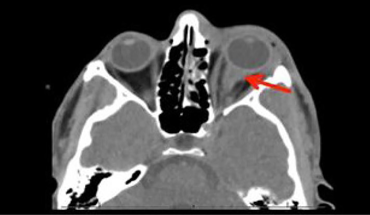
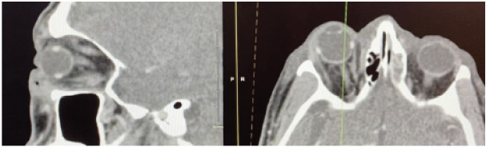
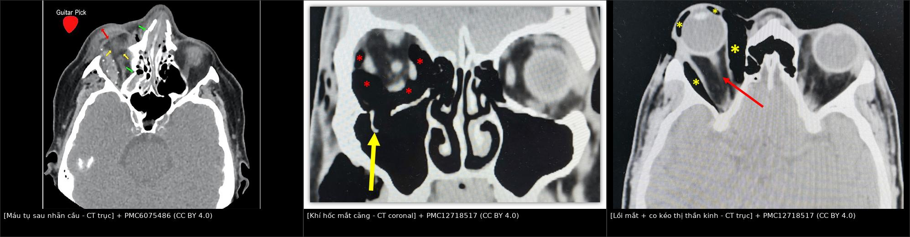
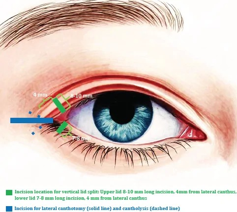
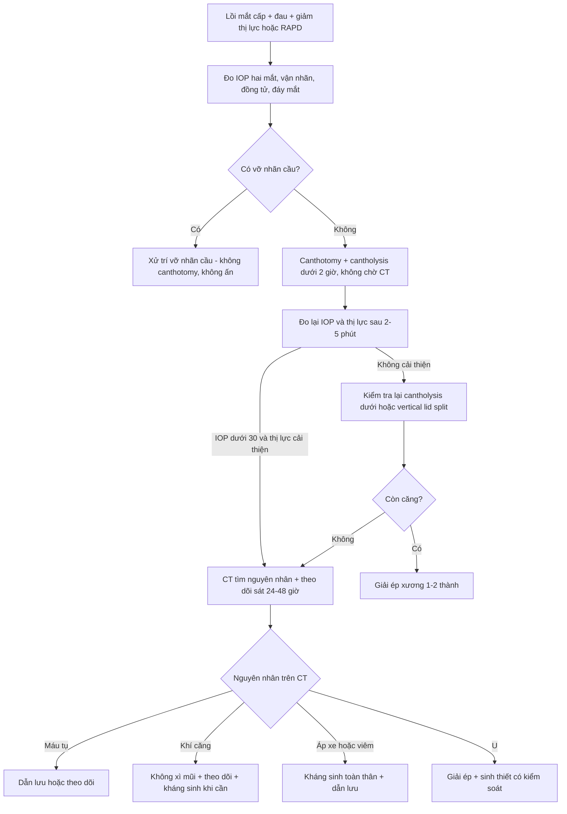
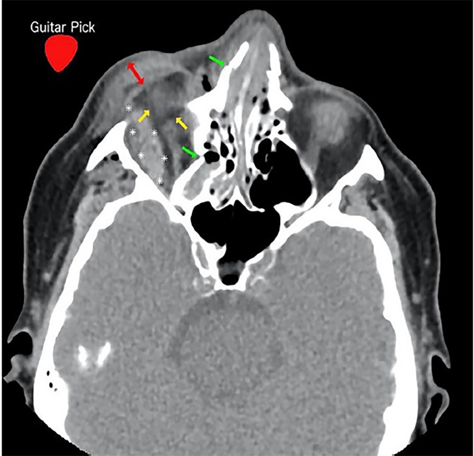
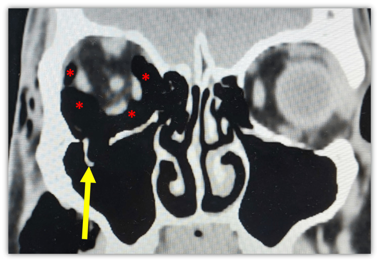
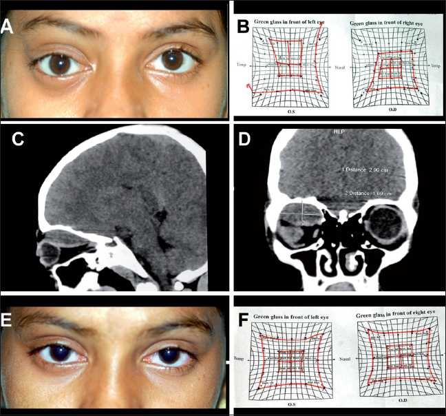

# 1510 — Hội chứng khoang hốc mắt cấp: hốc mắt căng làm mù trong 90–120 phút — chẩn đoán bằng tay, chẩn đoán phân biệt bằng CT / Acute orbital compartment syndrome (OCS)

**Tags:** `pattern:hoc-mat-cang` `pattern:loi-mat` `pattern:mau-tu` `pattern:khi-mo-mem` `vung:hoc-mat` `vung:mat` `vung:non-co` `vung:dinh-hoc-mat` `anatomy:thanh-o-mat` `protocol:CT-1mm` `protocol:sieu-am-hoc-mat` `protocol:MRI-hoc-mat` `score:khong` `incidentaloma:khong`

**Mức chắc chắn (certainty):** tổng hợp y văn (literature synthesis) — ghép **bài tổng quan đo áp lực hốc mắt** (*Diagnostics* 2022 — **PMC9221953**, CC BY 4.0), **nghiên cứu 29 ca OCS có định lượng CT** (*AJNR* 2023 — **PMC10171392**, đọc số liệu), **tổng quan hệ thống OCS ở trẻ 126 ca** (*Children* 2026 — **PMC13511678**, CC BY 4.0), **đoàn hệ 52 ca máu tụ sau nhãn cầu** (*Eur J Trauma Emerg Surg* 2026 — **PMC13486133**, CC BY 4.0), **74 mắt canthotomy** (*Am J Emerg Med* 2023 — **PMID 37290250**, đọc abstract), **28 ca giải ép xương** (*J Clin Med* 2025 — **PMC12112626**, CC BY 4.0), **mô hình lợn ngẫu nhiên** (*Eur J Anaesthesiol Intensive Care* 2025 — **PMC12513446**, đọc số liệu), cùng **5 ca nguyên văn** dùng cho quiz. Nhóm **không có bệnh nhân của mình**; chỗ suy luận ghi **[suy luận]**.

> **Vị trí trong thư viện:** [420](../420-vo-san-hoc-mat/lesson.md) phủ **vỡ sàn hốc mắt** và chỉ dành **một hàng** cho hội chứng khoang; [1506](../1506-di-vat-hoc-mat-ton-luu/lesson.md) phủ **dị vật** (có ca gây OCS); [449](../449-chan-thuong-mat-dich-vat/lesson.md) phủ **vỡ nhãn cầu**; [1501](../1501-chan-thuong-thi-than-kinh-ton/lesson.md) phủ **chấn thương dây thị**; [1461](../1461-ap-xe-duoi-mang-xuong-hoc-mat-o-tre/lesson.md) phủ **áp-xe dưới màng xương hốc mắt**; [3105](../3105-tran-khi-o-mat-sau-cham-thuong-go-ma/lesson.md) phủ **tràn khí hốc mắt**. Bài này trả lời mặt còn trống: **cùng một hội chứng, nhiều nguyên nhân — khi nào chẩn đoán bằng lâm sàng mà KHÔNG chờ CT, ngưỡng áp lực nào là thật, cửa sổ thời gian bao lâu, và canthotomy thất bại thì làm gì**.

> **Câu chốt — năm con số phải thuộc:** **(1)** Thần kinh thị và võng mạc chỉ chịu được thiếu máu **60–100 phút** (**90–120 phút** theo tổng quan khác) trước khi mù không hồi phục (PMC11476973, PMC13511678). **(2)** OCS xảy ra ở **0,5–1%** ca gãy xương hốc mắt (PMC11476973); máu tụ sau nhãn cầu gặp **0,7%** (52/7.671) ca chấn thương giữa mặt và **3,8%** trong số đó mù (PMC13486133). **(3)** Áp lực khoang hốc mắt bình thường **2–6 mmHg**, trong OCS **tới 100 mmHg và hơn** (PMC9221953); canthotomy hạ được **~50%** áp lực (PMC13486133), IOP giảm **45,8 mmHg** so với **20,9 mmHg** ở nhóm chứng (PMC12513446). **(4)** **Nhãn áp là dấu hiệu TỒI:** **10/24 trẻ** OCS có IOP **bình thường**, nhóm IOP bệnh lý chỉ **trung bình 24 mmHg** (22–70) (PMC13511678); đã có ca OCS sau blepharoplasty với **IOP bình thường** (PMC12594235). **(5)** Lần canthotomy đầu **thất bại 32%** (thành công **68%** vs **79,2%** ở bác sĩ mắt), và **thất bại → kết cục thị lực xấu hơn** (PMID 37290250).

## 1. Tổng quan bệnh học – cơ chế hình ảnh (TẠI SAO)

### 1.1 Hốc mắt là khoang kín, compliance thấp — áp lực tăng theo hàm mũ

- Hốc mắt (orbit) là **khoang kín** giới hạn bởi **xương hốc mắt** và **vách hốc mắt (orbital septum)**, chứa nhãn cầu, cơ vận nhãn, mỡ, mạch, thần kinh thị. Thể tích hốc mắt người lớn đo trên CT **31,9 ± 3,8 cm³ (trái) / 32,5 ± 4,6 cm³ (phải)** (PMC13486133).
- Thành xương **không giãn**; đường thoát duy nhất ra trước là **vách hốc mắt + dây chằng mi (canthal tendon)**. Vì vậy quan hệ **thể tích – áp lực là phi tuyến**: thêm **vài mL** máu trong hốc mắt đã làm áp lực tăng vọt, trong khi cùng thể tích đó ở mô mềm tự do gần như không đổi áp lực. Đây chính là **học thuyết khoang (compartment doctrine)** áp cho hốc mắt: **áp lực = thể tích thêm / độ giãn (compliance)**, và compliance của hốc mắt **rất nhỏ**.
- Hệ quả giải phẫu: hốc mắt là **hình tháp hẹp dần về đỉnh**; mọi khối choán chỗ đều **dồn áp lực về đỉnh**, nơi **thần kinh thị** đi qua **ống thị giác** — một vòng xương **không giãn**. Vì vậy **mù xảy ra trước khi nhãn cầu bị tổn thương**, và **lồi mắt có thể chỉ nhẹ** ở người vách hốc mắt dày.
- **Áp lực khoang hốc mắt (orbital compartment pressure, OCP)** bình thường **2–6 mmHg** (một số nghiên cứu **3–6 mmHg**); trong **bệnh mắt tuyến giáp (TED)** tăng **7–15 mmHg**, cá biệt tới **40 mmHg**; trong **OCS** đo được **tới 100 mmHg và cao hơn** (PMC9221953). So sánh: **huyết áp động mạch trung bình (MAP) ~ 70–100 mmHg** — nên khi OCP tiến gần MAP, **áp lực tưới máu thần kinh thị về 0**.

### 1.2 Sinh lý bệnh: nghẽn tĩnh mạch trước, thiếu máu động mạch sau

1. **Nghẽn tĩnh mạch:** áp lực mô > áp lực tĩnh mạch mắt trên → **tĩnh mạch mắt trên (SOV) xẹp** — đúng như hình ảnh: **SOV nhỏ hơn ở 69% (20/29) ca OCS** so với bên lành (PMC10171392).
2. **Giảm tưới máu động mạch:** các **động mạch mi sau ngắn** và **động mạch trung tâm võng mạc** nuôi **1/3 trước dây thị + võng mạc**; khi áp lực khoang vượt áp lực tưới máu, **sợi trục thần kinh thị thiếu máu** — tổn thương **sợi trục (axonal)**, không phải tổn thương myelin, nên **hồi phục kém** sau 90–120 phút (PMC13511678).
3. **Không có phù bù:** hốc mắt không có mô mềm dự trữ; **máu tụ** còn **tự tăng thể tích** (chảy máu tiếp diễn, đặc biệt ở người **chống đông/kháng kết tập tiểu cầu**) → áp lực **tự leo thang** trong nhiều giờ. Đoàn hệ 52 ca ghi nhận **dùng aspirin là yếu tố dự báo kết cục xấu** (PMC13486133).
4. **Thiếu máu không đối xứng:** chỉ **một bên** thường bị (55 phải / 59 trái trong 126 trẻ), nhưng **12 trẻ bị hai bên** — nên luôn khám **hai mắt** (PMC13511678).

### 1.3 Vì sao NHÃN ÁP không dùng để chẩn đoán — vật lý của hai khoang khác nhau

- **IOP là áp lực TRONG NHÃN CẦU**, không phải áp lực trong hốc mắt. Nhãn cầu là **khoang thứ hai**, ngăn cách với hốc mắt bởi củng mạc; khi hốc mắt căng, **thành nhãn cầu chịu ép từ ngoài** nhưng IOP chỉ tăng nếu **thể tích trong mắt** tăng hoặc **thành củng mạc bị ép đủ mạnh để biến dạng**.
- Bằng chứng: trong **126 trẻ** OCS, **IOP đo được ở 24 trẻ (27 mắt)** — **10 trẻ IOP bình thường**; nhóm bệnh lý **trung bình 24 mmHg (22–70)**, tức **nhiều ca dưới ngưỡng 30 mmHg** (PMC13511678). Ca **OCS sau blepharoplasty** được canthotomy **dù IOP không tăng** và **hồi phục thị lực** (PMC12594235).
- **[suy luận]** Ngược lại, IOP **rất cao** (như ca 50 mmHg) giúp xác nhận nhưng **IOP bình thường không loại trừ**; và ở **vỡ nhãn cầu** IOP **thấp giả tạo** — canthotomy không chữa được, còn ấn nhãn cầu làm **mất nội dung nhãn cầu**.
- Thực hành: dùng **bộ ba lâm sàng** — **lồi mắt + đau tăng nhanh + giảm thị lực/RAPD (relative afferent pupillary defect)** — cộng **nhãn cầu cứng (rock-hard globe)**, **hạn chế vận nhãn**, **phù kết mạc (chemosis)**. Một số tác giả lấy **IOP ≥ 30 mmHg** làm tiêu chuẩn hỗ trợ; nhưng tiêu chuẩn này **không nhạy** (xem mục 7).

### 1.4 Vật lý hình ảnh: mỗi nguyên nhân một đậm độ, một dấu hiệu

| Nguyên nhân | Đậm độ / dấu hiệu trên CT | Vì sao (vật lý + mô bệnh) | Nguồn |
|---|---|---|---|
| **Máu tụ sau nhãn cầu (RBH)** | **Tăng đậm độ** so với mỡ (**−40…−120 HU**) và cơ (**~40–60 HU**); máu đông thường **50–90 HU** (khoảng tham chiếu chung, **không có ngưỡng riêng cho hốc mắt**), **không ngấm thuốc**, bờ theo khoang | Máu đông đặc: protein + fibrin + tế bào → đậm độ cao hơn cơ; không có mạch nuôi nên **không ngấm** | PMC13486133, PMC10171392 |
| **Máu tụ dưới màng xương (SpH)** | Khối **hình thấu kính** sát thành xương, **giảm đậm độ** (máu cũ/thanh dịch), **không phá xương** | Máu nằm **giữa xương và màng xương** — đúng mặt phẳng màng xương, nên **ép vào hốc mắt** chứ không thấm vào mỡ | PMC3032247, PMC13511678 |
| **Khí hốc mắt căng** | **−1.000 HU**, ổ khí **nhiều ngăn**, có thể **lan dọc khe ổ mắt trên** | Khí từ xoang qua **chỗ gãy thành** khi **xì mũi/ho/thở máy**; khí **không tự thoát** vì cơ chế **van một chiều** | PMC12718517, [3105](../3105-tran-khi-o-mat-sau-cham-thuong-go-ma/lesson.md) |
| **Phù/viêm (cellulitis, sau mổ)** | **Dày mô mềm + mờ mỡ hốc mắt**, **có thể KHÔNG có khối**, ngấm thuốc lan tỏa | Phù làm **tăng thể tích mô** (không phải khối); CT có thể **bình thường về khối** → dễ bỏ OCS | PMC12594235 |
| **Áp-xe hốc mắt** | Ổ dịch **viền ngấm thuốc**, có thể **khí**, hạn chế khuếch tán | Hoại tử hóa lỏng + viền mô hạt; khí = **vi khuẩn sinh hơi** hoặc thông với xoang | [1461](../1461-ap-xe-duoi-mang-xuong-hoc-mat-o-tre/lesson.md) |
| **U hốc mắt** | Khối đặc **ngấm thuốc**, có thể **xâm lấn/xói xương**, đẩy nhãn cầu | U tăng thể tích **từ từ** → cơ chế bù (mỡ teo, lồi mắt) thường đủ; **OCS cấp trên u** là biến cố (chảy máu trong u) | PMC10171392 |
| **Dị vật** | Đậm độ theo vật liệu (**gỗ ≈ 0 HU**, thủy tinh **+300…+600 HU**, kim loại **> 1.000 HU**) | Vật liệu quyết định đậm độ, **không phải vị trí**; xem [1506](../1506-di-vat-hoc-mat-ton-luu/lesson.md) | [1506](../1506-di-vat-hoc-mat-ton-luu/lesson.md) |

### 1.5 Dấu hiệu CT định lượng — "hốc mắt căng" không chỉ là lồi mắt

Nghiên cứu 29 ca OCS (chụp CT **trước** điều trị, so với bên lành) cho **bộ số** sau (PMC10171392):

| Thông số | Bên OCS | Bên lành | Ý nghĩa |
|---|---|---|---|
| **Lồi mắt** (mm, đo tại **đường liên gò má / interzygomatic line**) | **24,4 ± 3,1** | **17,7 ± 3,1** | Chênh **~6,7 mm**; lồi mắt là dấu **nhạy** nhưng **không đặc hiệu** (TED, u cũng lồi) |
| **Chiều dài thần kinh thị** (mm) | **32,0 ± 2,5** | **25,8 ± 3,4** | **Co kéo thần kinh thị** — dấu **định lượng** mạnh nhất của tăng áp lực |
| **Góc củng mạc sau (posterior globe angle, PGA)** | **128,7° ± 18,9°** | **146,9° ± 6,4°** | **Nhỏ hơn = củng mạc sau bị "chụm"** → dấu **"guitar pick"** (chóp đàn guitar) |
| **Tĩnh mạch mắt trên (SOV)** | **Nhỏ hơn ở 69% (20/29)** | — | Nghẽn tĩnh mạch do áp lực — **ngược** với rò xoang hang (**SOV giãn**) |
| **Vị trí tổn thương** | **Ngoài nón 100%**, **trong nón 59% (17/29)**, **dưới màng xương 34% (10/29)** | — | Bất thường **ở đâu trong hốc mắt cũng gây OCS**, kể cả **không chạm thần kinh thị** |
| **Cơ vận nhãn** | **Không khác biệt** về kích thước/hình dạng | — | **Không dùng độ dày cơ** để chẩn đoán OCS (khác TED) |

- **Dấu "guitar pick" (tenting of the posterior sclera):** máu tụ đẩy **cực sau nhãn cầu** ra sau, củng mạc sau **bị kéo thành mỏm nhọn**; trên lát **trục** thấy **nhãn cầu hình "quả trứng bị kéo đuôi"** — dấu này được báo cáo trong ca OCS sau ngã (PMC6075486) và gắn với **thần kinh thị bị co kéo**.
- **Đo thể tích khối máu tụ / thể tích hốc mắt (RBH-to-orbit ratio):** đo trên CT 3D (phân đoạn bằng phần mềm); **tỷ lệ cao** dự báo **mù**, với **AUC 0,725** trong 52 ca (PMC13486133). Đây là **định lượng có ích cho nghiên cứu và tiên lượng**, chưa phải ngưỡng lâm sàng.

## 2. Mẫu hình + chẩn đoán phân biệt theo cơ chế và vị trí (gamut)

**Mẫu hình:** bệnh nhân **lồi mắt một bên cấp** ± **đau hốc mắt tăng nhanh** ± **giảm thị lực** ± **RAPD** ± **hạn chế vận nhãn** ± **phù kết mạc**, xuất hiện **sau chấn thương, sau mổ mi/hốc mắt, sau tiêm hậu nhãn cầu**, hoặc **không rõ nguyên nhân** ở người **chống đông**. Câu hỏi hình ảnh có **bốn lớp**:

1. **Có khối choán chỗ không** — máu tụ, khí, áp-xe, u, dị vật?
2. **Ở khoang nào** — **ngoài nón** (giữa màng xương và nón cơ), **trong nón** (trong nón cơ), **dưới màng xương**, **đỉnh hốc mắt**?
3. **Có dấu hiệu "căng" không** — co kéo thần kinh thị, PGA giảm, SOV nhỏ, "guitar pick"?
4. **Có chống chỉ định canthotomy không** — **vỡ nhãn cầu**, **vỡ xương phức tạp có di lệch não**, **rò động mạch – xoang hang** chưa kiểm soát?

### 2.1 Gamut theo cơ chế — cùng hội chứng, 6 nhóm nguyên nhân

- **Chảy máu (phổ biến nhất):** **máu tụ sau nhãn cầu** do chấn thương, sau **mổ mi/mở xương hốc mắt**, sau **tiêm hậu nhãn cầu/peribulbar**, ở người **chống đông/kháng kết tập tiểu cầu**; hoặc **máu tụ dưới màng xương (SpH)** — thể hay gặp ở **trẻ** và **xuất hiện muộn 4–7 ngày** (PMC13511678). **Vỡ nhãn cầu** và **vỡ mạch máu lớn** phải loại trừ trước.
- **Khí:** **tràn khí căng (tension orbital emphysema)** sau **gãy thành trong/sàn**, khi **xì mũi, ho, thở máy, chấn thương khí nén**; cơ chế **van một chiều** (PMC12718517).
- **Phù – viêm:** **viêm mô tế bào hốc mắt/áp-xe**, **sau blepharoplasty**, **bỏng – hồi sức dịch**, **viêm mô mềm dị ứng**; CT có thể **không thấy khối** (PMC12594235).
- **U:** u hốc mắt **lớn** hoặc **chảy máu trong u** (melanoma, lymphoma, di căn) — thể **"cấp trên mạn"**.
- **Dị vật / iatrogenic:** dị vật **gỗ** gây viêm – áp-xe – OCS ([1506](../1506-di-vat-hoc-mat-ton-luu/lesson.md)); **dụng cụ kéo hốc mắt (orbital retraction)** trong mổ nội soi xuyên ổ mắt; **băng ép quá chặt** sau mổ mi.
- **Mạch máu:** **rò động mạch – xoang hang (CCF)** gây lồi mắt **đập theo mạch**, **SOV GIÃN** — **ngược** với OCS; nếu chưa loại CCF mà canthotomy thì **không giải quyết** và có thể **chảy máu nhiều** ([423](../423-fistula-xoang-hang/lesson.md)).

### 2.2 Gamut theo vị trí — quyết định đường mổ và tiên lượng

- **Dưới màng xương (subperiosteal):** khối **giữa xương và màng xương**, **hình thấu kính**, hay ở **trần hốc mắt** (trẻ) hoặc **thành trong**; **không phá xương** nhưng **đẩy nhãn cầu xuống – ra**. Là cơ chế **hàng đầu ở trẻ** (102/126 ca) (PMC13511678, PMC3032247).
- **Ngoài nón (extraconal):** máu/khí/áp-xe **giữa màng xương và nón cơ** — **gặp ở 100% ca OCS** theo nghiên cứu CT (PMC10171392) vì đây là **khoang rộng nhất**.
- **Trong nón (intraconal):** tổn thương **sát thần kinh thị và mạch máu** — **tiên lượng xấu hơn**; trong 52 ca RBH, **vị trí trong nón** và **tiếp xúc thần kinh thị** dự báo **mù** (PMC13486133).

*CT trục không cản quang: **máu tụ trong nón** (mũi tên đỏ) nằm sát **bờ trong nhãn cầu trái**, kèm **lồi mắt** và **thần kinh thị dày** so với bên phải. Vị trí trong nón là yếu tố **tiên lượng xấu** trong đoàn hệ 52 ca (PMC13486133). Nguồn: *Clin Pract Cases Emerg Med* 2018 (PMC5965122), CC BY 4.0.*
- **Đỉnh hốc mắt (orbital apex):** hẹp nhất, **thần kinh thị + động mạch mắt + các dây III–IV–VI + V1**; **lồi mắt ít** nhưng **mù nhanh** và **hạn chế vận nhãn toàn bộ** (hội chứng đỉnh).
- **Thành trong → xoang sàng:** khí/áp-xe **lan hai chiều**; **không xì mũi** sau chấn thương (nguy cơ **tràn khí căng** và **viêm màng não**).

### 2.3 OCS "không có khối" — nhóm dễ bị bỏ nhất

- **Sau blepharoplasty:** phù + máu tụ **lan tỏa**, **không có ổ máu tụ khu trú** trên CT; ca báo cáo có **IOP bình thường**, **canthotomy vẫn cứu thị lực** (PMC12594235).
- **Bỏng/hồi sức:** phù **toàn bộ** hốc mắt + mi; **không có khối**; điều trị **giải ép sớm** (canthotomy) và **kiểm soát dịch**.
- **Tư thế (prone position):** **ép nhãn cầu từ ngoài** ở bệnh nhân **hôn mê nằm sấp** — ca báo cáo với **anisocoria rồi phù kết mạc nặng** (PMC12594241).

*CT hốc mắt (sagittal + axial) sau **blepharoplasty** hai mi trên: **lồi mắt phải** rõ, nhưng **không có ổ máu tụ** hay chảy máu hoạt động; IOP **không tăng** trên nhãn áp kế, bệnh nhân vẫn được canthotomy và **hồi phục thị lực**. Đây là cạm bẫy "CT không có khối = không có OCS". Nguồn: *Clin Pract Cases Emerg Med* 2025 (PMC12594235), CC BY 4.0.*

## 3. Bảng so sánh phân biệt (ma trận đối chiếu)

| Thực thể (entity) | Hình ảnh điển hình (CT/MRI/US) | Chốt vào (rule-in) | Chốt loại (rule-out) | Gợi ý xác nhận |
|---|---|---|---|---|
| **OCS do máu tụ sau nhãn cầu (RBH)** | Khối **tăng đậm độ** (máu đông, **~50–90 HU**), **không ngấm thuốc**, **co kéo thần kinh thị**, **PGA < 130°**, **"guitar pick"**, SOV nhỏ | **Lồi mắt + đau + RAPD/giảm thị lực + nhãn cầu cứng**; CT có khối **tăng đậm độ** trong hốc mắt | **Không co kéo thần kinh thị, PGA bình thường, SOV không đổi** → chưa căng; **ổ giảm đậm độ −1.000 HU** → khí, không phải máu | CT ≤ 1 mm + coronal; đo **chiều dài thần kinh thị**, **PGA**; **không chờ CT nếu lâm sàng rõ** |
| **Máu tụ dưới màng xương (SpH)** | Khối **hình thấu kính** sát xương, **giảm đậm độ**, **không phá xương**, đẩy nhãn cầu **xuống – ra** | **Trẻ + chấn thương nhẹ + lồi mắt xuất hiện MUỘN 1–7 ngày**; khối **sát trần/thành trong** | **Phá xương + di lệch mô mỡ** → gãy thành; **khối trong nón** → RBH | CT coronal/sagittal; **không chọc mù**; theo dõi **4–7 ngày** |
| **Tràn khí căng (tension emphysema)** | **−1.000 HU**, nhiều ổ khí **ngoài nón**, **co kéo thần kinh thị**, gãy thành trong/sàn | **Lạo xạo dưới da + lồi mắt tăng sau xì mũi/ho**; khí **lan dọc khe ổ mắt trên** | **Khí ít, không lồi mắt, không RAPD** → tràn khí đơn thuần, theo dõi | CT **cửa sổ phổi**; hỏi **xì mũi/thở máy**; **không bơm khí vào mũi** |
| **Viêm mô tế bào/áp-xe hốc mắt** | **Dày mô mềm + mờ mỡ**, **viền ngấm thuốc** (áp-xe), **khí trong ổ**, hạn chế khuếch tán | **Sốt + đau + phù mi + lồi mắt**, **không tiền sử chấn thương**; **ổ dịch viền ngấm** | **CT hoàn toàn bình thường + không sốt** → phù sau mổ; **khối đặc ngấm thuốc** → u | MRI **T2 fat-sat + T1 sau tiêm + DWI**; **không chọc qua da** khi chưa loại u/mạch máu |
| **U hốc mắt (kể cả chảy máu trong u)** | Khối **đặc ngấm thuốc**, **xói/xâm lấn xương**, **đẩy nhãn cầu từ từ** | **Lồi mắt tiến triển nhiều tuần–tháng**, **không đau cấp**, không RAPD sớm; CT/MRI có **khối đặc** | **Đau cấp + RAPD + khối tăng đậm độ đồng nhất** → máu tụ; **không thấy khối** → phù | MRI hốc mắt (**T1 fat-sat sau tiêm**); **sinh thiết có kiểm soát**, không chọc mù |
| **Rò động mạch – xoang hang (CCF)** | **SOV GIÃN**, cơ ngoài nón to, **lồi mắt đập theo mạch**, **ngấm thuốc thì động mạch** | **Tiếng thổi + lồi mắt đập + SOV giãn + giãn mạch kết mạc** | **SOV nhỏ + không tiếng thổi** → OCS (SOV nhỏ gặp **69%**) | **CTA/DSA**; **không canthotomy** trước khi loại CCF |
| **Bệnh mắt tuyến giáp (TED)** | **Thân cơ to, CHỪA GÂN**, mỡ hốc mắt tăng, lồi mắt **hai bên** | **Lồi mắt mạn, hai bên, không đau cấp**, có bệnh tuyến giáp; **cơ to chừa gân** | **Đau cấp + RAPD + cơ KHÔNG to** → OCS; **cơ to cả gân** → viêm cơ | MRI/CT; **không dùng độ dày cơ để chẩn đoán OCS** (không khác biệt trong 29 ca) |
| **Vỡ nhãn cầu (globe rupture)** | **Mất thể tích nhãn cầu**, **thay đổi hình dạng**, **khí/dị vật nội nhãn**, **vôi hóa?** | **IOP THẤP + tiền phòng nông + vết thương củng mạc**; **"collar button"** | **Nhãn cầu căng + IOP cao + không vết thương** → OCS (nhưng **IOP có thể bình thường**) | **Không ấn nhãn cầu**; **CT có cản quang? KHÔNG** — CT không cản quang; **mổ cấp** theo [449](../449-chan-thuong-mat-dich-vat/lesson.md) |
| **Gãy sàn/blow-out KHÔNG có OCS** | **Giọt lệ (teardrop)**, mỡ/cơ sa vào xoang hàm, **khí ít**, **PGA bình thường** | **Nhìn đôi dọc + hạn chế ngước + tê má**, **thị lực bình thường** | **RAPD + giảm thị lực + nhãn cầu cứng** → có OCS; **không co kéo thần kinh thị** → chưa căng | CT coronal; **không canthotomy** nếu không có dấu căng; xem [420](../420-vo-san-hoc-mat/lesson.md) |

*Trái: **máu tụ sau nhãn cầu** — khối tăng đậm độ (dấu hoa thị), **củng mạc sau bị kéo thành mỏm nhọn "guitar pick"** (mũi tên vàng), phù mi (mũi tên đỏ hai chiều), gãy xương (mũi tên xanh) (PMC6075486, CC BY 4.0). Giữa: **tràn khí hốc mắt căng** — ổ khí **−1.000 HU** (dấu hoa thị đỏ) + **gãy sàn** (mũi tên vàng) (PMC12718517, CC BY 4.0). Phải: **lồi mắt + khí + co kéo thần kinh thị** — nhãn cầu phải đẩy ra trước, **thần kinh thị căng** (mũi tên đỏ) so với bên lành (PMC12718517, CC BY 4.0). Ảnh ghép letterbox, không cắt nội dung chẩn đoán.*

### 3.1 Trình tự đọc CT hốc mắt khi nghi OCS — 6 bước

1. **So sánh HAI bên** ở cùng lát: lồi mắt, vị trí nhãn cầu, khoang mỡ.
2. **Đo lồi mắt** tại **đường liên gò má** (nối bờ trước gò má hai bên) — chênh **> 5 mm** so với bên lành là bất thường (nghiên cứu: **24,4 vs 17,7 mm**).
3. **Đo chiều dài thần kinh thị** từ **cực sau nhãn cầu** tới **ống thị giác** — **> 30 mm** hoặc chênh **> 4 mm** so với bên lành = **co kéo** (nghiên cứu: **32,0 vs 25,8 mm**).
4. **Đo góc củng mạc sau (PGA)** — **< 130°** hoặc **giảm > 10°** so với bên lành = **biến dạng củng mạc sau** (nghiên cứu: **128,7° vs 146,9°**); tìm **"guitar pick"**.
5. **Đậm độ khối:** **tăng đậm độ so với cơ** (máu đông **~50–90 HU**) = máu tụ; **−1.000 HU** = khí; **viền ngấm thuốc** = áp-xe/u; **0 HU** = gỗ ([1506](../1506-di-vat-hoc-mat-ton-luu/lesson.md)).
6. **Xương + tĩnh mạch:** gãy **thành trong/sàn/trần**, **SOV nhỏ** (OCS) hay **SOV giãn** (CCF), **khí nội sọ**, **máu tụ ngoài màng cứng**.

### 3.2 Dấu hiệu trên từng modality

| Modality | Thấy gì | Không thấy gì / cạm bẫy |
|---|---|---|
| **Lâm sàng (chuẩn vàng)** | **Lồi mắt + đau + RAPD + nhãn cầu cứng**; **không cần chờ hình ảnh** | Bệnh nhân **hôn mê, phù mi không mở được mắt**, **đau do gãy xương** che dấu → **khám lại nhiều lần** |
| **CT không cản quang ≤ 1 mm** | **Chuẩn** cho máu tụ, khí, gãy xương, dị vật; đo **lồi mắt, thần kinh thị, PGA** | **Phù/viêm lan tỏa** có thể **không thấy khối**; **IOP không đo được trên CT** |
| **CTA** | **Rò động mạch – xoang hang**, **giả phình**, **chảy máu hoạt động** | **Không dùng để chẩn đoán OCS** — chỉ để loại nguyên nhân mạch máu |
| **MRI hốc mắt** | **Áp-xe** (DWI), **u**, **máu tụ** (T1 sáng theo tuổi máu), **tổn thương thần kinh thị** | **Chống chỉ định** khi nghi **dị vật kim loại**; **chậm** — không dùng trong cấp cứu OCS |
| **Siêu âm đầu giường** | **Máu tụ sau nhãn cầu** (tăng âm), **bóng nhãn cầu**, **dấu hiệu chèn ép** | **Không ấn đầu dò** khi nghi **vỡ nhãn cầu**; **không thay thế** đánh giá thị lực |

## 4. Protocol + thuật toán xử trí (không có RADS — có cửa sổ thời gian)

### 4.1 Nguyên tắc: chẩn đoán là LÂM SÀNG, hình ảnh chỉ để tìm nguyên nhân

- **Không chờ CT** để canthotomy khi đã có **lồi mắt + đau tăng + giảm thị lực/RAPD + nhãn cầu cứng** — thời gian chịu thiếu máu **60–120 phút** (PMC11476973, PMC13511678). CT chạy **song song** hoặc **ngay sau** thủ thuật.
- **Đo IOP một lần không đủ:** đo **hai mắt**, ghi **thời điểm**, đo lại **sau canthotomy 2–5 phút**; **IOP bình thường không loại trừ** (10/24 trẻ; ca blepharoplasty).
- **Khám thần kinh – mắt đầy đủ:** **thị lực**, **đồng tử + RAPD**, **vận nhãn 9 hướng**, **đáy mắt** (thiếu máu võng mạc, **cherry-red spot**), **cảm giác V1**.

### 4.2 Protocol chụp

- **CT hốc mắt/hàm mặt không cản quang**, lát **≤ 1 mm**, **axial + coronal MPR**, **cửa sổ mô mềm + xương**; **không dùng cản quang** trừ khi nghi **mạch máu** (CTA).
- **CTA** khi: **lồi mắt đập theo mạch**, **tiếng thổi**, **SOV giãn**, **chảy máu ồ ạt**, **nghi giả phình động mạch mắt**.
- **MRI** chỉ khi: **đã loại trừ dị vật kim loại**, bệnh nhân **ổn định**, cần phân biệt **áp-xe/u/tổn thương thần kinh thị**.
- **Siêu âm** (nếu có): xác nhận **máu tụ sau nhãn cầu** tại giường, **không ấn** khi nghi vỡ nhãn cầu.

### 4.3 Thủ thuật: canthotomy + cantholysis (LCIC) — các con số

- **Mở góc mắt ngoài (lateral canthotomy):** đường **8 mm** từ góc mắt ngoài ra ngoài, theo **bờ ổ mắt** (sơ đồ: đường liền).
- **Cắt dây chằng mi dưới (inferior cantholysis):** đưa kéo vào **góc ngoài**, cắt **nhánh dưới dây chằng mi** (đường đứt nét) — **phải cắt HẾT**, đây là bước **hay bị bỏ** và là nguyên nhân **thất bại**.
- **Hiệu quả:** hạ **~50%** áp lực hốc mắt (PMC13486133); trong mô hình lợn, IOP giảm **45,8 mmHg** so với **20,9 mmHg** ở nhóm chứng (p = 0,002), và **chỉ nhóm LCIC** đạt tốc độ giảm **≥ 3 mmHg/phút** (PMC12513446).
- **Thất bại:** **32%** lần đầu không đưa IOP **< 30 mmHg** (thành công **68%** bác sĩ cấp cứu vs **79,2%** bác sĩ mắt); **thất bại → thị lực xấu hơn** (PMID 37290250). Khi thất bại: **kiểm tra lại cantholysis dưới**, rồi **vertical lid split** (ca đầu tiên cứu được sau LCIC thất bại — PMC13517972) hoặc **giải ép xương**.
- **Giải ép xương (orbital decompression):** trong 28 ca, mổ **trung vị 8,4 giờ** (IQR 4,8–24,0) sau khởi phát; **46% mù trước mổ**, cải thiện thị lực **36%**, vận nhãn **67%**, nhìn đôi **62%**; **2 thành (68%)** là kỹ thuật chính (PMC12112626). Một số tác giả vẫn giải ép **tới 48 giờ** sau chấn thương (PMC13486133).
- **Khoảng cách "chuẩn" và "thực tế":** trong 18 ca OCS, **chỉ 1 ca được mổ trong 100 phút**; thời gian từ triệu chứng tới mổ **46 ± 67 giờ** (PMC11476973). Vì vậy thông điệp thực hành là **canthotomy tại giường ngay khi nhận ra**, không chờ chuyển tuyến/chờ mổ chương trình.

*Đường xanh: **canthotomy 8 mm** (liền) + **cantholysis dưới** (đứt nét). Đường xanh lá: **vertical lid split** — mi trên **8–10 mm** cách góc mắt ngoài **4 mm**, mi dưới **7–8 mm** cách góc mắt ngoài **4 mm**. Nguồn: *Clin Pract Cases Emerg Med* 2026 (PMC13517972), CC BY 4.0 (đổi webp → JPEG, không cắt nội dung).*

### 4.4 Điều trị nội khoa hỗ trợ (không thay thế thủ thuật)

- **Acetazolamide** (giảm sản xuất thủy dịch) + **thuốc hạ nhãn áp tại chỗ** chỉ là **hỗ trợ**, dùng trong ca **nhẹ – trung bình** hoặc **chờ mổ**; ca tràn khí căng dùng **acetazolamide** sau canthotomy (PMC12718517).
- **Corticoid** tranh cãi trong OCS do máu tụ (không giảm áp tức thì); **không dùng corticoid** khi nghi **áp-xe/viêm nhiễm**.
- **Đầu cao 30°**, **không băng ép**, **giảm đau**, **điều chỉnh đông máu** (ngừng/đảo ngược kháng đông khi có chỉ định), **không xì mũi** khi có gãy thành trong.
- **Theo dõi 24–48 giờ:** OCS có thể **xuất hiện muộn** hoặc **tái phát** sau khi hết tác dụng thuốc; đoàn hệ 52 ca khuyến nghị **theo dõi tối thiểu 48 giờ** (PMC13486133), tổng quan trẻ ghi nhận **khởi phát muộn 4–7 ngày** ở nhóm **máu tụ dưới màng xương** (PMC13511678).

## 5. Biến thể bình thường và cạm bẫy

- **"IOP bình thường" không loại trừ OCS:** **10/24 trẻ** có IOP bình thường; IOP bệnh lý trung bình chỉ **24 mmHg** (22–70) (PMC13511678); ca **sau blepharoplasty** canthotomy **dù IOP không tăng** (PMC12594235). Đừng chờ IOP **> 40** mới xử trí.
- **Ngược lại, IOP cao không đồng nghĩa OCS:** **tăng nhãn áp cấp (glaucoma)** đau + nhìn mờ nhưng **không lồi mắt**, **không RAPD kiểu OCS**, tiền phòng nông; **canthotomy không hạ IOP** trong bệnh glôcôm.
- **Lồi mắt do TED:** **hai bên, mạn, không đau cấp**, **cơ to chừa gân**; **không canthotomy** vì không có căng cấp (trừ **TED cấp nguy kịch** — hiếm).
- **CCF:** **SOV giãn**, **lồi mắt đập**, **tiếng thổi**; **SOV nhỏ** mới là OCS (69%) — **đừng đảo dấu**.
- **Vỡ nhãn cầu:** IOP **thấp**, tiền phòng **nông**, **không ấn**; **canthotomy không chữa** và có thể làm **mất nội dung nhãn cầu**. Luôn loại trừ **trước** khi canthotomy.
- **Đo lồi mắt sai:** đầu **quay/xoay**, **lệch trục**, so với **bên lành bị bệnh khác** (TED hai bên, u cũ) — luôn đo **hai bên trên cùng lát CT** tại **đường liên gò má**.
- **Thỏa mãn tìm kiếm (satisfaction of search):** thấy **gãy sàn** rồi dừng, bỏ **máu tụ sau nhãn cầu** ở khoang sau; hoặc thấy **máu tụ** rồi bỏ **khí căng** và **dị vật**. Đọc **toàn bộ hốc mắt + đỉnh + xoang**.
- **Máu tụ dưới màng xương ở trẻ xuất hiện MUỘN:** chấn thương "nhẹ" 4–7 ngày trước, **lồi mắt xuống – ra**, **thị lực có thể còn tốt**; **chọc hút đơn thuần** có thể **tái phát** nếu máu tụ **thông với máu tụ dưới gale** (68% cần mổ lại trong nhóm có máu tụ dưới gale — PMC13511678). Ca 12 tuổi: chọc hút **5 mL máu đỏ sẫm** → thị lực **20/200 → 20/20** ngay hôm sau (PMC3032247).
- **Canthotomy "thất bại" thường do kỹ thuật:** **không cắt hết nhánh dưới dây chằng mi**; cần **kiểm tra bằng kéo/đầu dò** và **đo lại IOP** — nếu vẫn cao, chuyển **vertical lid split** hoặc **giải ép xương** (PMC13517972, PMID 37290250).
- **Máy CT không phải lý do để chậm:** bệnh nhân **hôn mê/đa chấn thương** đi CT trước rồi mới phát hiện mù — ca 80 tuổi **mù sau khi đi CT** (PMC6075486); **khám mắt trước khi rời khoa cấp cứu**.

## 6. Tự lượng giá — Blind Quiz

**Ca 1 — Nữ 80 tuổi, ngã đập mặt, rách mi trên phải 4 cm. Sau khi đi CT sọ–hốc mắt về, bệnh nhân báo mắt phải chỉ còn thấy ánh sáng. Khám: nhãn cầu phải cứng, lồi, hạn chế vận nhãn, RAPD; IOP 50 mmHg (mắt trái 12 mmHg).**

- Gợi ý: chấn thương kín, mù xuất hiện **sau** khi chụp; một bên IOP **50** so với **12**.
- Câu hỏi: (1) Khối bất thường nằm ở khoang nào và đậm độ bao nhiêu? (2) Dấu hiệu nào ở **cực sau nhãn cầu** chứng tỏ áp lực đang đè lên thần kinh thị? (3) Xử trí ngay là gì, và có phải chờ kết quả CT không?

<b>Bấm để hiện đáp án (findings + chẩn đoán)</b>

- **Findings:** CT trục — **máu tụ sau nhãn cầu** (dấu hoa thị) đẩy nhãn cầu ra trước; **củng mạc sau bị kéo thành mỏm nhọn "guitar pick"** (mũi tên vàng); phù mi (mũi tên đỏ hai chiều); **gãy xương** thành ngoài/thành trong (mũi tên xanh). Không có khí trong ổ.
- **Chẩn đoán:** **hội chứng khoang hốc mắt do máu tụ sau nhãn cầu**, sau ngã. Cơ chế: máu trong khoang kín → **co kéo thần kinh thị + giảm tưới máu**; **RAPD + IOP 50** xác nhận.
- **Chốt:** **khám mắt + canthotomy/cantholysis tại giường ngay** (trong **60–120 phút**); **không chờ CT**. Ở ca này, canthotomy do bác sĩ cấp cứu **hạ IOP và hồi phục thị lực**.
- **Nguồn ảnh:** Schwitkis AE, Pollack TL, Torbati SS. *Clin Pract Cases Emerg Med* 2018 (PMC6075486), **CC BY 4.0**.

**Ca 2 — Nam 47 tuổi, chấn thương kín vùng gò má phải 1 ngày trước. Ngày đầu: lồi mắt nhẹ, IOP 28 mmHg, không lồi rõ. Ngày hôm sau: lồi mắt tăng, liệt vận nhãn hoàn toàn, IOP 48 mmHg.**

- Gợi ý: bệnh nhân **xì mũi** sau chấn thương; đậm độ bất thường **rất thấp**, có **nhiều ổ**.
- Câu hỏi: (1) Đậm độ của ổ bất thường và vì sao nó **tăng dần**? (2) Cơ chế nào khiến khí **không thoát ra**? (3) Can thiệp nào hạ được áp lực, và vì sao **không được xì mũi**?

<b>Bấm để hiện đáp án (findings + chẩn đoán)</b>

- **Findings:** CT coronal — **nhiều ổ khí −1.000 HU** ở khoang ngoài nón hốc mắt phải (dấu hoa thị đỏ), **gãy sàn hốc mắt** (mũi tên vàng); CT trục — **lồi mắt + thần kinh thị căng** (mũi tên đỏ). Ảnh thứ ba trong bộ ảnh cho thấy **co kéo thần kinh thị** rõ.
- **Chẩn đoán:** **tràn khí hốc mắt căng (tension orbital emphysema)** gây OCS. Khí vào qua **chỗ gãy sàn**, bị giữ bởi **cơ chế van một chiều**; **xì mũi** làm khí vào thêm.
- **Chốt:** **canthotomy + cantholysis** (đã làm, IOP **48 → 28 mmHg**) + **acetazolamide**; dặn **không xì mũi**, theo dõi **lồi mắt/thị lực**. Bệnh nhân hồi phục hoàn toàn sau **5 ngày** (thị lực **6/9**).
- **Nguồn ảnh:** Chew CF, Prem-Kumar V. *Cureus* 2025 (PMC12718517), **CC BY 4.0**.

**Ca 3 — Bé gái 12 tuổi, ngã xe đạp 3 ngày trước, mắt phải lồi ra và nhìn mờ. Thị lực phải 20/200, trái 20/20; lồi mắt xuống – ra, hạn chế nâng và liếc trong.**

- Gợi ý: trẻ, chấn thương **nhẹ**, triệu chứng **xuất hiện muộn vài ngày**; không sốt, không đau dữ dội.
- Câu hỏi: (1) Khối nằm ở **mặt phẳng nào** (dưới màng xương hay trong nón)? (2) Vì sao lồi mắt **xuống và ra** mà không ra trước? (3) Có cần mổ mở xương ngay không?

<b>Bấm để hiện đáp án (findings + chẩn đoán)</b>

- **Findings:** Ảnh A — lồi mắt phải, nhãn cầu **xuống – ra**; ảnh C (sagittal) và D (coronal) — **khối giảm đậm độ 3,2 × 2,7 × 1,4 cm** ở **phần trên hốc mắt**, **sát trần**, đẩy nhãn cầu xuống – ra; **không thấy gãy xương** rõ.
- **Chẩn đoán:** **máu tụ dưới màng xương hốc mắt (subperiosteal hematoma)** sau chấn thương nhẹ, **xuất hiện muộn 3 ngày**. Máu nằm **giữa xương và màng xương** nên **ép nhãn cầu theo hướng ngược lại** (xuống – ra), không xâm nhập mỡ hốc mắt.
- **Chốt:** **chọc hút dưới hướng dẫn** (18 G) lấy **5 mL máu đỏ sẫm**, lồi mắt giảm ngay; **ngày hôm sau thị lực 20/20**, vận nhãn bình thường. **Không cần mở xương** nếu không có dấu căng thị thần kinh; nhưng nếu máu tụ **thông với máu tụ dưới gale** thì **68% phải mổ lại** (PMC13511678).
- **Nguồn ảnh:** *Indian J Ophthalmol* 2011 (PMC3032247), **CC BY** (ảnh nguyên bản, không cắt).

## 7. Câu hỏi nghiên cứu & điểm chưa đồng thuận (tính đến 11/2026)

1. **[Tranh cãi] Ở bệnh nhân lồi mắt cấp sau chấn thương, dùng ngưỡng IOP ≥ 30 mmHg hay chỉ dấu lâm sàng (RAPD + nhãn cầu cứng + giảm thị lực) để quyết định canthotomy?**
   - **Đã biết:** Nhiều phác đồ lấy **IOP ≥ 30 mmHg** làm tiêu chuẩn hỗ trợ (PMC6075486), nhưng **10/24 trẻ** OCS có IOP **bình thường** và nhóm bệnh lý chỉ **trung bình 24 mmHg** (PMC13511678); một ca OCS sau blepharoplasty có **IOP bình thường** vẫn được canthotomy và hồi phục (PMC12594235).
   - **Chưa rõ:** Độ nhạy/đặc hiệu thật của IOP theo từng nguyên nhân (máu tụ so với phù/khí), và ngưỡng nào đủ an toàn để **không bỏ sót** mà **không canthotomy tràn lan**.
   - **Hướng nghiên cứu:** Đoàn hệ tiến cứu ghi **IOP + OCP + RAPD + thời gian tới canthotomy**, phân tích ROC theo nguyên nhân.
   - **Nguồn:** PMC13511678 (2026); PMC12594235 (2025); PMC6075486 (2018).

2. **[Khác biệt thực hành] Khi canthotomy + cantholysis thất bại, nên lặp lại cantholysis/vertical lid split tại giường hay chuyển ngay giải ép xương?**
   - **Đã biết:** Lần đầu thất bại **32%** (thành công **68%** cấp cứu vs **79,2%** mắt) và thất bại gắn với **thị lực xấu hơn** (PMID 37290250); **vertical lid split** cứu được một ca sau LCIC thất bại (PMC13517972); giải ép xương trong loạt 28 ca có **trung vị 8,4 giờ**, cải thiện thị lực **36%** (PMC12112626).
   - **Chưa rõ:** Thứ tự tối ưu và **cửa sổ thời gian** cho từng bước; chưa có so sánh đầu-đối-đầu giữa **vertical lid split** và **giải ép xương** về thị lực cuối cùng.
   - **Hướng nghiên cứu:** RCT/đoàn hệ đa trung tâm so **thời gian tới giải ép** và **tỷ lệ thị lực ≥ 20/40** giữa hai chiến lược.
   - **Nguồn:** PMID 37290250 (2023); PMC13517972 (2026); PMC12112626 (2025).

3. **[Khoảng trống] Ở trẻ có máu tụ dưới màng xương hốc mắt, theo dõi – chọc hút – mở xương: tiêu chí nào quyết định và có cần theo dõi 4–7 ngày?**
   - **Đã biết:** OCS ở trẻ chủ yếu do **máu tụ dưới màng xương** (102/126), khởi phát **muộn 4–7 ngày**; **103/126 được mổ**, **21 bệnh nhân còn khiếm thị**, bằng chứng **rất thấp** (toàn bộ là ca lẻ/loạt nhỏ) (PMC13511678).
   - **Chưa rõ:** Ngưỡng **thể tích/kích thước** máu tụ dưới màng xương để can thiệp, giá trị của **chọc hút** so với **mở xương**, và **thời điểm chụp lại**.
   - **Hướng nghiên cứu:** Registry đa trung tâm (kể cả nước có nhiều chấn thương trẻ) ghi **thể tích máu tụ, thị lực, thời gian tới can thiệp**, theo mẫu **STROBE**.
   - **Nguồn:** PMC13511678 (2026); PMC3032247 (2011).

## Bài liên quan chéo
- [420 – Vỡ sàn hốc mắt & hội chứng khoang: giọt lệ, trapdoor trẻ em, canthotomy 2 giờ](../420-vo-san-hoc-mat/lesson.md)
- [1506 – Dị vật hốc mắt tồn lưu: gỗ giả khí, thủy tinh, kim loại — và ca gây OCS](../1506-di-vat-hoc-mat-ton-luu/lesson.md)
- [449 – Chấn thương mắt & dị vật nội nhãn: vỡ nhãn cầu, BETT](../449-chan-thuong-mat-dich-vat/lesson.md)
- [1501 – Chấn thương thị thần kinh: CT ≤ 1 mm + MPR, MRI STIR](../1501-chan-thuong-thi-than-kinh-ton/lesson.md)
- [1461 – Viêm mô tế bào hốc mắt & áp-xe dưới màng xương ở trẻ](../1461-ap-xe-duoi-mang-xuong-hoc-mat-o-tre/lesson.md)
- [3105 – Tràn khí hốc mắt sau chấn thương gò má](../3105-tran-khi-o-mat-sau-cham-thuong-go-ma/lesson.md)
- [423 – Rò động mạch – xoang hang: SOV giãn, lồi mắt đập theo mạch](../423-fistula-xoang-hang/lesson.md)
- [410 – Giải phẫu học mắt và hốc mắt](../410-giai-phau-hoc-mat/lesson.md)

## Ảnh
- `images/composite_OCS-CT.jpg` — ba cơ chế: máu tụ sau nhãn cầu / khí căng / lồi mắt co kéo thần kinh thị.
- `images/1510_hoi-chung-khoang-hoc-mat_CT_PMC6075486.jpg` — máu tụ sau nhãn cầu + "guitar pick" (ca 1).
- `images/1510_hoi-chung-khoang-hoc-mat_CT-khi_PMC12718517-f2.jpg` — tràn khí hốc mắt + gãy sàn (ca 2).
- `images/1510_hoi-chung-khoang-hoc-mat_CT-loi-mat_PMC12718517-f3.jpg` — lồi mắt + co kéo thần kinh thị (ca 2).
- `images/1510_hoi-chung-khoang-hoc-mat_CT-SpA_PMC3032247-f2.jpg` — máu tụ dưới màng xương ở trẻ (ca 3).
- `images/1510_hoi-chung-khoang-hoc-mat_CT-trong-non_PMC5965122.jpg` — máu tụ **trong nón** + thần kinh thị dày, lồi mắt.
- `images/1510_hoi-chung-khoang-hoc-mat_CT-khong-mau_PMC12594235.jpg` — OCS sau blepharoplasty **không có máu tụ**, IOP bình thường.
- `images/1510_hoi-chung-khoang-hoc-mat_Sodo_PMC13517972.jpg` — sơ đồ đường rạch canthotomy/cantholysis + vertical lid split.
- Nguồn, giấy phép từng ảnh: `images/CREDITS.md`.

> Không dùng để chẩn đoán độc lập khi chưa có người hướng dẫn.
