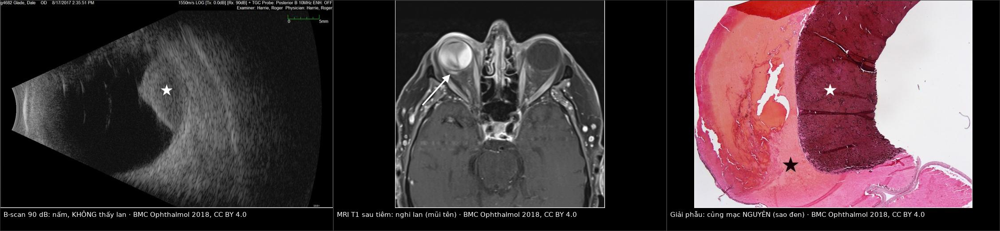
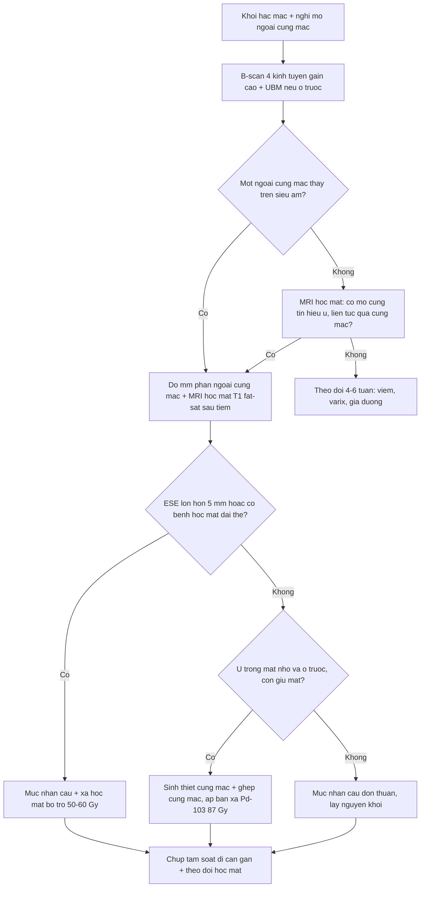
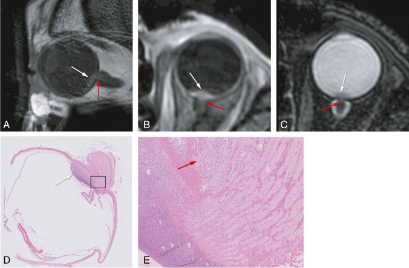
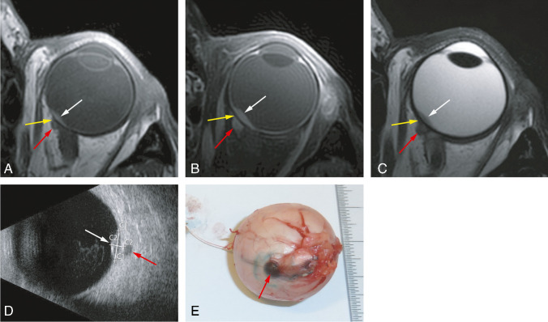
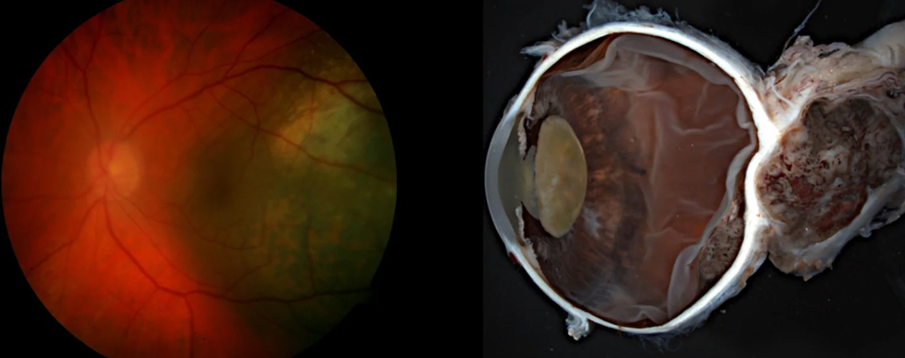
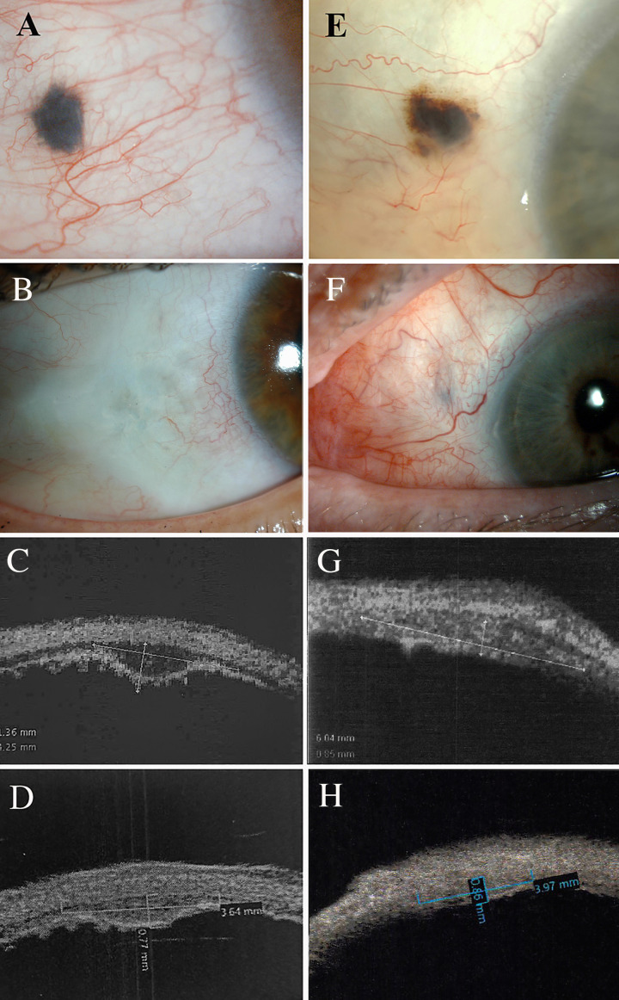

# 1511 — Lan ngoài củng mạc của melanoma hắc mạc: 5 mm chia đôi tiên lượng / Extrascleral extension of uveal melanoma

**Tags:** `pattern:lan-ngoai-cung-mac` `pattern:khoi-hoc-mat` `pattern:not-cung-mac` `vung:hac-mac` `vung:cung-mac` `vung:hoc-mat` `vung:nhan-cau` `vung:mat` `protocol:sieu-am-B-scan` `protocol:UBM` `protocol:MRI-hoc-mat` `protocol:MRI-T1-fat-sat` `score:AJCC-8` `incidentaloma:khong`

**Mức chắc chắn (certainty):** tổng hợp y văn (literature synthesis) — dựng từ hướng dẫn **ESMO–EURACAN 2026** (PMC13131131), đoàn hệ **150 mắt múc nhãn cầu** có phân tích đa biến (PMC13212211), đoàn hệ **43 ca ESE** điều trị/xạ hốc mắt (PMC13583686), **42 u hắc mạc** đối chiếu MRI–siêu âm–mô bệnh học (PMC8724164), loạt **5 ca ESE ẩn** điều trị bảo tồn (PMC10646849), **3.610 ca** u hắc mạc có di căn đồng thời (PMC8961763), ca MRI giả dương (PMC6291956) và ca gieo tế bào theo đường kim (PMC7151516). Nhóm **không có bệnh nhân của mình**; chỗ chưa đủ chắc ghi "chưa rõ". **Không ghi tên tác giả** — attribution dùng tạp chí + năm + PMCID.

> **Vị trí trong thư viện:** [448](../448-u-hac-mac/lesson.md) phủ **gamut u hắc mạc + điều trị theo kích thước**; [1486](../1486-khoi-hac-mac-sieu-am/lesson.md) phủ **khối hắc mạc trên siêu âm**; [1507](../1507-melanoma-hac-mac-lan-toa/lesson.md) phủ **thể lan tỏa/phẳng**; [1497](../1497-tai-phat-bo-sau-xa-ban-mach-melanoma-hac-mac/lesson.md) phủ **tái phát bờ sau xạ**; [1503](../1503-di-can-gan-melanoma-hac-mac/lesson.md) phủ **di căn gan**. Bài này trả lời **một câu**: *khi melanoma hắc mạc đã ra khỏi củng mạc — phát hiện bằng gì, đo bao nhiêu mm, và ai cần xạ hốc mắt bổ trợ?*
>
> **Câu chốt:** **(1)** ESE có mặt ở **tới 5,8%** người bệnh lúc chẩn đoán u hắc mạc (PMC10646849) và là yếu tố tiên lượng **độc lập**: **HR 4,73** cho tử vong do melanoma (p = 0,004; 150 mắt — PMC13212211). **(2)** Ngưỡng hành động là **5 mm**: AJCC 8 xếp **T4a = lan ≤ 5 mm**, **T4b = lan > 5 mm**; ESMO 2026 chỉ khuyến cáo **xạ hốc mắt bổ trợ khi lan > 5 mm hoặc nghi bệnh hốc mắt đại thể**, còn **≤ 5 mm đã lấy trọn** thì theo dõi (PMC13131131). **(3)** Siêu âm **không được bỏ**: trong so sánh trực tiếp, siêu âm thấy **100% (10/10)** ca có lan ngoài củng mạc, MRI chỉ **29%**, CT **0%** (dẫn qua PMC6291956).

## 1. Tổng quan bệnh học – cơ chế hình ảnh

### 1.1 U thoát ra bằng "cửa yếu" của củng mạc, không phải bằng cách phá vỡ củng mạc đều khắp

Củng mạc là **mô ít mạch, giàu collagen, chịu xạ tốt** (PMC10646849). Vì vậy tế bào melanoma hiếm khi "ăn mòn" qua một củng mạc dày lành; chúng đi theo **các ống xuyên củng mạc có sẵn**: **tĩnh mạch xoáy (vortex veins)**, **mạch và thần kinh thể mi**, **ống củng mạc–thần kinh thị**, và các **kênh mạch máu xiên (emissary channels)**. Ba hệ quả:

- **Vị trí lan có tính quy luật:** hay gặp **quanh tĩnh mạch xoáy**, **cạnh đĩa thị** và **vùng thể mi/rìa trước** — đúng nơi giải phẫu có ống xuyên (PMC10646849).
- **Đường đi xiên nên lát cắt mô học có thể KHÔNG thấy sự liên tục** giữa u trong và ngoài củng mạc; loạt 5 ca ESE ẩn ghi nhận "kênh nối không thấy trên mô bệnh học" vì tĩnh mạch xuyên đi chéo (PMC10646849). Đây là lý do **một tiêu bản "củng mạc nguyên vẹn" không loại trừ ESE ở chỗ khác**.
- **Xâm lấn tĩnh mạch xoáy là biến số tiên lượng độc lập** (HR **4,55**; p = 0,028), song hành với ESE — cùng phản ánh u đã vào đường thoát mạch (PMC13212211).

**Vì sao u nhỏ vẫn có ESE lớn:** u có thể **rất mỏng trong nhãn cầu** nhưng tế bào đã theo ống xuyên ra ngoài và **tích lũy thành khối sau củng mạc**. Ca mô tả năm 2023: u chỉ **8 × 6 mm đáy, dày 2,1 mm**, nhưng B-scan thấy **khối sau củng mạc liên tục**, MRI xác nhận, phải múc nhãn cầu nội soi để lấy **nguyên khối** (PMC9871740). Tương tự, loạt ESE ẩn có u nội nhãn **0,9–2,4 mm** nhưng nốt trên củng mạc đã nhìn thấy bằng đèn khe (PMC10646849).

### 1.2 Vì sao siêu âm thấy, và vì sao MRI thấy — hai vật lý khác nhau

- **Siêu âm 10–20 MHz:** củng mạc là mặt phân cách **trở kháng âm rất cao** nên dội mạnh và **che vùng sau**; mô u ngoài củng mạc chỉ hiện khi **tăng gain** và đầu dò vuông góc với bề mặt. Melanoma có **hồi âm thấp–trung bình** và **rỗng âm đáy u** vì mô đặc, ít mặt phân cách; khối ngoài củng mạc **cùng kiểu hồi âm** với khối trong. Ca dưới đây lưu ảnh ở **gain 90 dB** mới thấy rõ mô sau củng mạc.
- **MRI:** melanin là **chất thuận từ** → **T1 tăng, T2 giảm**; u ngấm thuốc vì mạch u rò rỉ và hàng rào máu–võng mạc không còn. Dấu chốt của ESE trên MRI không phải "có ngấm thuốc" mà là **mô ngoài củng mạc có tín hiệu GIỐNG HỆT khối trong nhãn cầu trên MỌI chuỗi xung** và **liên tục qua một chỗ khuyết/thay đổi bờ củng mạc** (PMC8724164, Fig. 7).
- **Hạn chế của MRI:** trong 42 u đối chiếu mô học, MRI **tốt** để đánh giá **lan ngoài củng mạc, xâm lấn thể mi, xâm lấn thần kinh thị**, nhưng **kém** trong phân biệt **xâm lấn củng mạc đơn thuần** và **đo đáy u dẹt**; so với siêu âm, MRI đo **chiều dày nhỏ hơn 0,5 mm** (p = 0,008) và **đáy nhỏ hơn 1,4 mm** (p < 0,001) (PMC8724164). Vì vậy **MRI không thay thế siêu âm để đo**, và **siêu âm không thay thế MRI để đánh giá hốc mắt/thần kinh thị**.

### 1.3 Ngưỡng định lượng nằm lòng

- **Tần suất:** **tới 5,8%** người bệnh u hắc mạc khi trình diện (PMC10646849). Trong **3.610** ca u hắc mạc, **1,9%** đã có di căn lúc chẩn đoán; nguy cơ di căn đồng thời tăng từ **0,7% (T1)** lên **7,9% (T4)**; trong 9 ca có hạch vùng, **6 ca (67%) có ESE** (PMC8961763).
- **Tiên lượng:** ESE **HR 4,73** (p = 0,004) cho sống còn đặc hiệu melanoma, ngang với thể tế bào epithelioid (HR 4,12) và sau xâm lấn tĩnh mạch xoáy (HR 4,55) (PMC13212211). Di căn 10 năm theo giai đoạn AJCC: **5% (I) → 40% (III)** (PMC13131131).
- **5 mm:** AJCC 8 tách **T4a (≤ 5 mm)** và **T4b (> 5 mm)**; ESMO dùng đúng ngưỡng này để quyết định **xạ hốc mắt bổ trợ** (PMC13131131).
- **Điều trị bảo tồn ESE nhỏ:** 5 ca, áp bản xạ **Pd-103**, liều đỉnh **87 Gy** tính tới **2 mm** từ mặt trong củng mạc, bản **12 mm**, theo dõi **80 tháng**: **0 tái phát, 0 di căn**, 3/5 đục thể thủy tinh (PMC10646849).
- **Hậu quả nếu bỏ sót:** trong **48 ca** melanoma thứ phát ở hốc mắt có theo dõi đầy đủ, **23 ca (48%)** xuất hiện **≥ 36 tháng** sau điều trị u nguyên phát (có ca > 30 năm); sống trung vị sau khi phát hiện bệnh hốc mắt chỉ **24 tháng** (PMC5481311) — lý do phải theo dõi hốc mắt lâu, không chỉ 5 năm.

## 2. Mẫu hình + chẩn đoán phân biệt theo vị trí (gamut)

**Mẫu hình trung tâm:** *mô mềm cùng tín hiệu/hồi âm với khối u trong nhãn cầu, nằm NGOÀI đường bờ củng mạc, liên tục qua củng mạc ở một điểm.* Bốn câu hỏi phải trả lời:

1. **Có thật là ngoài củng mạc không?** (bờ củng mạc mất liên tục, mô vượt ra mỡ hốc mắt, hay chỉ là "ngấm thuốc sát củng mạc").
2. **Lan bao nhiêu mm?** (đo **đường kính lớn nhất của phần ngoài củng mạc**, không đo khối trong mắt).
3. **Lan theo đường nào?** (tĩnh mạch xoáy, thể mi/rìa trước, ống thị giác — đổi cả kế hoạch mổ và tiên lượng).
4. **Có di căn chưa?** (ESE làm tăng xác suất di căn đồng thời: 67% ca có hạch vùng trong đoàn hệ 3.610 ca — PMC8961763).

**Gamut theo vị trí:**

- **Rìa trước/nốt trên củng mạc–kết mạc:** ESE ẩn của u thể mi/hắc mạc trước · melanoma kết mạc · névus · u hạt dị vật · mảng sắc tố sau viêm · di căn.
- **Sau củng mạc quanh tĩnh mạch xoáy:** ESE · **varix tĩnh mạch xoáy** · viêm củng mạc sau · viêm mô mỡ hốc mắt · di căn hốc mắt · u lympho · máu tụ.
- **Dọc thần kinh thị:** ESE theo ống củng mạc–thần kinh thị · u màng não bao thần kinh thị · glioma thần kinh thị · sarcoid · di căn.
- **Trẻ em:** lan ngoài củng mạc của **retinoblastoma** (vôi hóa thô, < 5 tuổi) · medulloepithelioma · tổn thương viêm sau tiêm/xạ.

**Mnemonic "SCLERA":** **S**ignal giống khối trong · **C**ontinuity qua củng mạc · **L**argest diameter của phần ngoài (mm) · **E**missary route · **R**etrobulbar fat bị xâm lấn · **A**ssess optic nerve + staging.

## 3. Bảng so sánh phân biệt (ma trận đối chiếu)

| Thực thể (entity) | Hình ảnh điển hình (US/MRI) | Chốt vào (rule-in) | Chốt loại (rule-out) | Gợi ý xác nhận |
|---|---|---|---|---|
| **ESE của melanoma hắc mạc** | Khối ngoài củng mạc **cùng hồi âm/tín hiệu** với u trong; T1 tăng–T2 giảm nếu sắc tố; ngấm thuốc mạnh; có thể ở vortex vein/ống thị | **Liên tục qua củng mạc + cùng tín hiệu mọi chuỗi + đo được mm** | Mô ngấm thuốc **không liên tục**, không thấy trên siêu âm gain cao → nghi viêm | B-scan gain cao 4 kinh tuyến + **MRI T1 fat-sat sau tiêm**; đo ESE, ghi vị trí |
| **Xâm lấn củng mạc ĐƠN THUẦN** | Củng mạc dày/ngấm thuốc nhưng **chưa có mô ra ngoài**; MRI kém phân biệt | **Bờ củng mạc còn, không có mô trong mỡ hốc mắt** | Có mô vượt bờ + cùng tín hiệu → **ESE, không phải chỉ xâm lấn** | MRI + mô bệnh sau múc; **không overstage T4** |
| **Viêm củng mạc sau** | Củng mạc dày, **dịch dưới bao Tenon ("dấu T")**, ngấm thuốc lan tỏa; đau, đỏ | **Dấu T + đau + đáp ứng NSAID/corticoid** | Khối khu trú liên tục với u nội nhãn → ESE | B-scan (dấu T), MRI; thử điều trị viêm |
| **Viêm mô mỡ/viêm sau mổ** | Mờ mỡ hốc mắt, ngấm thuốc **lan tỏa không tôn trọng bờ**, có bối cảnh mổ/tiêm | **Bối cảnh viêm + lan tỏa + giảm sau điều trị** | Khối đặc, bờ rõ, cùng tín hiệu u → ESE | Theo dõi 2–4 tuần; MRI lặp lại |
| **Varix tĩnh mạch xoáy** | Cấu trúc ống/túi **thay đổi theo Valsalva/tư thế**, tín hiệu dòng chảy | **Đổi kích thước khi nghiệm pháp Valsalva** | Cố định, đặc, cùng tín hiệu u → ESE | Siêu âm Doppler màu; MRI động |
| **Di căn/u lympho hốc mắt** | Khối hốc mắt **không liên tục** với u trong; T1 iso/tăng, T2 tăng (di căn) hoặc rất thấp (lympho) | **Không có u nội nhãn, hoặc khối tách rời** | Liên tục qua củng mạc → ESE | Sinh thiết hốc mắt, PET-CT, xét nghiệm máu |
| **Lan ngoài củng mạc của retinoblastoma (trẻ)** | Khối trong mắt **vôi hóa thô**, lan dọc thần kinh thị, đồng tử trắng | **Vôi hóa + tuổi < 5 + khối nội nhãn lớn** | Người lớn, không vôi hóa → melanoma | MRI sọ–hốc mắt, di truyền RB1 |

*Trái: B-scan gain 90 dB — hình nấm điển hình nhưng **không thấy** mô ngoài củng mạc. Giữa: MRI T1 sau tiêm — vùng ngấm thuốc sát củng mạc sau (mũi tên) bị đọc là "nghi lan". Phải: tiêu bản H&E — **củng mạc nguyên vẹn** (sao đen), khối u trong mắt (sao trắng), **không có ESE**. Nguồn: *BMC Ophthalmol* 2018, PMC6291956, CC BY 4.0; ảnh ghép letterbox.*

### Ba bước đọc một "bờ củng mạc đáng ngờ"

1. **Xác nhận bằng siêu âm trước, không bằng MRI một mình.** Quét **4 kinh tuyến**, tăng gain, đặt đầu dò vuông góc; ghi lại gain đã dùng. Nếu siêu âm âm mà MRI dương → **chưa đủ để đổi giai đoạn**, cần MRI lặp lại sau 4–6 tuần hoặc hội chẩn.
2. **Đo phần NGOÀI củng mạc, không đo khối trong.** Ghi **mm lớn nhất** và vị trí (giờ/kinh tuyến), vì **5 mm** đổi giai đoạn và đổi chỉ định xạ hốc mắt.
3. **Trả lời "u nhỏ hay lớn" bằng đáy/kích thước khối trong, nhưng đừng để nó trấn an.** Ca **8 × 6 mm, dày 2,1 mm** vẫn có ESE lớn; u nội nhãn **0,9–2,4 mm** vẫn có nốt trên củng mạc (PMC9871740, PMC10646849).

## 4. Protocol chụp + hệ phân độ/điểm chuẩn hóa

### 4.1 Bộ ảnh tối thiểu khi nghi ESE

- **Siêu âm mắt 10–20 MHz (B-scan) + A-scan:** quét **4 kinh tuyến**, **tăng gain** (ca mẫu dùng **90 dB**), focus sau nhãn cầu; đo **chiều dày, đáy, khoảng cách tới đĩa thị** và **phần ngoài củng mạc (mm)**. Ghi gain và vector trên ảnh.
- **UBM 35–50 MHz:** cho tổn thương **trước xích đạo/thể mi/rìa**; ca ESE ẩn đo được **1,4 mm** và **0,9 mm** bằng UBM (PMC10646849).
- **MRI hốc mắt 1,5–3 T:** **T1, T2, T1 fat-sat sau gadolinium**, lớp **≤ 2–3 mm**, gồm **DWI/ADC**; đánh giá **mỡ hốc mắt, cơ, thần kinh thị, giao thoa**. Trong 42 u: **ADC trung bình 1,16 ± 0,26 × 10⁻³ mm²/s**; ADC thấp hơn ở u dày hơn (p = 0,030) (PMC8724164).
- **Đáy mắt màu + FAF + OCT** để mô tả u nguyên phát; **không** dùng OCT để đánh giá ESE.
- **Chụp tầm soát di căn** khi đã xác nhận ESE: **MRI/CT gan–bụng** là ưu tiên (gan là ổ di căn đầu tiên ở **87–90%** ca — xem [1503](../1503-di-can-gan-melanoma-hac-mac/lesson.md)).

### 4.2 Phân độ AJCC 8 (phần liên quan ESE)

| Giai đoạn T | Định nghĩa |
|---|---|
| **T4a** | U hắc mạc có **lan ngoài củng mạc ≤ 5 mm** đường kính lớn nhất |
| **T4b** | U hắc mạc có **lan ngoài củng mạc > 5 mm** đường kính lớn nhất |
| **cT1c–cT4c** | Tiền tố "c" = phân độ lâm sàng; ESE **≤ 5 mm** vẫn có thể nằm trong nhóm cT thấp nếu u trong mắt nhỏ (5 ca ESE ẩn đều **cT1c**, PMC10646849) |

> ESE **luôn là yếu tố tiên lượng xấu**, kể cả khi u trong mắt nhỏ và giai đoạn chữ "T" thấp.

### 4.3 Đường đi quyết định

### 4.4 Điều trị: ba mức, không phải một

- **Cắt bỏ tại chỗ (áp bản xạ/proton):** chỉ cho ESE **nhỏ, trước, còn giữ mắt** — 5 ca Pd-103 **87 Gy** đỉnh, bản **12 mm**, ghép củng mạc ngay sau sinh thiết, **80 tháng** không tái phát (PMC10646849). Đây là ngoại lệ có chọn lọc, không phải chuẩn cho ESE sau.
- **Múc nhãn cầu:** lựa chọn chính khi ESE **> 5 mm**, u thay > 50% nhãn cầu, hoặc mắt mù/đau (PMC13131131). Lấy **nguyên khối**, tránh cắt ngang phần ngoài củng mạc; ca u nhỏ + ESE lớn được múc **dưới nội soi** để kiểm soát bờ (PMC9871740).
- **Xạ hốc mắt bổ trợ:** ESMO 2026 khuyến cáo cho **lan > 5 mm hoặc nghi bệnh hốc mắt đại thể**, mức **II, B**; **≤ 5 mm đã lấy trọn** thì **theo dõi** (PMC13131131). Liều dùng trong đoàn hệ Đức: **50–60 Gy** toàn hốc mắt (PMC13583686).
- **Nạo vét hốc mắt (exenteration):** khi u xâm lấn lan rộng, không còn khả năng lấy nguyên khối, hoặc tái phát hốc mắt; hướng dẫn xếp vào nhóm **30%** ca cần múc/nạo vét (PMC13131131).

## 5. Biến thể bình thường và cạm bẫy

- **MRI dương tính giả:** ca mẫu có **vùng ngấm thuốc sát củng mạc** bị đọc là lan, nhưng mô bệnh **củng mạc nguyên vẹn**; nguyên nhân được nghĩ là **viêm không đặc hiệu, mạch nuôi (feeder vessel) hoặc giả ảnh chuyển động** (PMC6291956). **Không đổi giai đoạn chỉ vì một vệt ngấm thuốc.**
- **Siêu âm âm tính giả:** trong 16 mắt có ESE đã xác nhận mô học, **chỉ 8 ca** được phát hiện trước mổ bằng siêu âm (dẫn qua PMC6291956). **Gain thấp hoặc đầu dò không vuông góc** là lý do thường gặp — phải quét lại 4 kinh tuyến ở gain cao trước khi kết luận.
- **"Củng mạc nguyên vẹn trên tiêu bản" không loại trừ ESE:** kênh xuyên đi chéo, lát cắt bỏ sót; đối chiếu **đại thể + MRI + B-scan**, không chỉ một lát H&E (PMC10646849).
- **U nhỏ không loại trừ ESE lớn:** u **8 × 6 mm, dày 2,1 mm** vẫn có khối sau củng mạc lớn (PMC9871740); **đừng** dừng ở "u nhỏ, theo dõi" khi chưa quét sau củng mạc.
- **Sinh thiết xuyên dịch kính khi chưa loại trừ ESE:** ca gieo tế bào theo đường kim **20 năm** sau FNAB 25G, thành khối thể mi **3,1 mm** + sắc tố củng mạc **3,0 mm từ rìa** (PMC7151516). Nếu nghi ESE, **tránh FNAB xuyên dịch kính**; nếu cần mô học, dùng đường **củng mạc có kiểm soát + xạ ngay**.
- **Nhầm viêm củng mạc sau với ESE:** dấu **T** (dịch dưới bao Tenon), đau, đỏ, đáp ứng chống viêm; ESE thì **khối đặc, cùng tín hiệu u, không đau**.
- **Bỏ sót thần kinh thị:** ESE có thể lan theo **ống củng mạc–thần kinh thị**; MRI thấy **dày/ngấm thuốc thần kinh thị**. Ca dưới đây cho thấy **xâm lấn thần kinh thị mức tối thiểu** chỉ thấy rõ khi phóng to — bỏ sót đổi cả bờ mổ và tiên lượng.

*U hắc mạc thể lentiform nhỏ (mũi tên trắng) với **xâm lấn thần kinh thị tối thiểu** (mũi tên đỏ) — dấu hiệu dễ bỏ qua nếu chỉ đọc mặt phẳng ngang. Nguồn: Neuroradiology 2022, PMC8724164, CC BY 4.0.*
- **Cận thị nặng:** **80%** ca ESE ẩn trong loạt 5 ca có cận thị; tác giả nêu giả thuyết **củng mạc mỏng** nhưng **chưa có bằng chứng nhân quả** (PMC10646849) — ghi nhận, không dùng để chẩn đoán.

## 6. Tự lượng giá — Blind Quiz

**Ca 1 — U hắc mạc thể "lentiform" nhỏ ở mắt trái; MRI 3 chuỗi, B-scan và bệnh phẩm dưới đây. Bạn đo gì, và vì sao phần ngoài củng mạc khó thấy trên lâm sàng?**

- Câu hỏi: (1) Mũi tên đỏ chỉ gì? (2) Tín hiệu của phần ngoài so với phần trong u? (3) Củng mạc giữa hai phần (mũi tên vàng) nói lên điều gì?

<b>Bấm để hiện đáp án</b>

- **Mũi tên đỏ:** **lan ngoài củng mạc (ESE)** — mô u nằm trong mỡ hốc mắt sau, liên tục với u trong nhãn cầu; mũi tên trắng là u trong mắt, mũi tên vàng là **củng mạc còn bình thường** giữa hai phần.
- **Tín hiệu:** ESE có **tín hiệu giống hệt** u trong mắt trên **cả T1, T1 fat-sat sau tiêm và T2** — đây là dấu chốt để phân biệt với mô viêm/xơ (thường không cùng kiểu tín hiệu và không liên tục).
- **Củng mạc bình thường giữa hai phần:** cho thấy u **đi qua ống xuyên** chứ không phá hủy toàn bộ củng mạc; **B-scan (D)** thấy được cả u trong và ESE, còn **đại thể (E)** xác nhận.
- **Ý nghĩa:** nếu phần ngoài **≤ 5 mm** → **T4a**; **> 5 mm** → **T4b** và cân nhắc **xạ hốc mắt bổ trợ** (PMC13131131).
- Nguồn: *Neuroradiology* 2022, Fig. 7, **PMC8724164**, CC BY 4.0.

**Ca 2 — Đáy mắt chỉ thấy một u nhỏ, nhưng nhãn cầu mở ra lại có khối lớn sau củng mạc. Giải thích?**

- Câu hỏi: (1) Vì sao ảnh đáy mắt "đánh lừa"? (2) Cần bổ sung gì ngay sau khi thấy u nhỏ? (3) Xạ hốc mắt bổ trợ có cải thiện sống còn không?

<b>Bấm để hiện đáp án</b>

- **Ảnh đáy mắt** chỉ thấy bề mặt u trong nhãn cầu; **phần lớn khối nằm sau củng mạc** và không nhìn thấy bằng soi đáy mắt. Vì vậy u "nhỏ" trên ảnh màu **không** đồng nghĩa u nhỏ về mặt giải phẫu.
- **Bổ sung:** **B-scan gain cao quét 4 kinh tuyến** + **MRI hốc mắt T1 fat-sat sau tiêm**; đo phần ngoài củng mạc và tầm soát di căn.
- **Xạ hốc mắt bổ trợ:** trong đoàn hệ **43 ca ESE** (26 ca xạ 50–60 Gy ± trước mổ, 17 ca chỉ múc), **không có khác biệt sống còn** và **không ca nào tái phát hốc mắt** ở cả hai nhóm; sống toàn bộ **32,6% / 5 năm** và **16,2% / 10 năm**; **61,5%** có tác dụng phụ xạ (PMC13583686). Vì vậy chỉ định phải chọn lọc theo **> 5 mm/bệnh hốc mắt đại thể**, không dùng đại trà.
- Nguồn: *BMJ Open Ophthalmology* 2026, Fig. 2, **PMC13583686**, CC BY-NC 4.0.

**Ca 3 — Nốt sẫm màu nhỏ trên củng mạc, đèn khe thấy rõ, nhưng đáy mắt "không có u"; UBM đo được tổn thương dày 1,4 mm. Chẩn đoán và xử trí?**

- Câu hỏi: (1) Vì sao đáy mắt "không thấy u" mà vẫn là melanoma? (2) Vì sao phải sinh thiết + ghép củng mạc? (3) Có thể giữ mắt không?

<b>Bấm để hiện đáp án</b>

- **U nội nhãn ẩn:** loạt 5 ca có nốt sắc tố trên củng mạc nhưng **u trong mắt rất nhỏ (0,9–2,4 mm)**, có ca **không thấy trên soi đáy mắt/transillumination**; chẩn đoán nhờ **sinh thiết củng mạc** và **UBM** (PMC10646849).
- **Sinh thiết + ghép củng mạc:** lấy **vạt củng mạc nửa dày hoặc sâu hơn**, bờ **≥ 2 mm**, ghép **màng ngoài tim đông khô** ngay để giữ thành nhãn cầu và chuẩn bị cho xạ.
- **Giữ mắt được:** áp bản xạ **Pd-103**, **87 Gy** đỉnh cách mặt trong củng mạc **2 mm**, bản **12 mm**, **7 ngày**; theo dõi **80 tháng**: **0 tái phát, 0 di căn**, 3/5 đục thể thủy tinh. Đây là **ngoại lệ chọn lọc** cho ESE **nhỏ, trước** — không áp dụng cho ESE sau > 5 mm.
- **Bài học:** nốt sắc tố trên củng mạc **không được coi là "nốt lành"** khi chưa loại trừ melanoma ẩn; và **sinh thiết có kiểm soát + xạ ngay** an toàn hơn chọc dò mù.
- Nguồn: *British Journal of Ophthalmology* 2023, Fig. 2, **PMC10646849**, CC BY 4.0.

## 7. Câu hỏi nghiên cứu & điểm chưa đồng thuận (tính đến 11/2026)

1. **[Khác biệt thực hành] Ở người bệnh melanoma hắc mạc có lan ngoài củng mạc ≤ 5 mm đã được múc nhãn cầu lấy trọn, xạ hốc mắt bổ trợ có giảm tái phát hốc mắt và tử vong so với theo dõi?**
   - **Đã biết:** ESMO 2026 chỉ khuyến cáo xạ hốc mắt khi lan **> 5 mm** hoặc nghi bệnh hốc mắt đại thể (mức **II, B**); đoàn hệ 43 ca dùng **50–60 Gy** không cải thiện sống còn, không ca nào tái phát hốc mắt, nhưng **61,5%** có tác dụng phụ.
   - **Chưa rõ:** chọn bệnh nhân nào được lợi (bờ dương, lan theo ống thị, u xâm lấn tĩnh mạch xoáy) và liều/trường chiếu tối ưu; **không có thử nghiệm ngẫu nhiên**.
   - **Hướng nghiên cứu:** registry đa trung tâm tiến cứu, phân tầng theo mm lan và bờ mô học, outcome tái phát hốc mắt + sống còn.
   - **Nguồn:** PMC13131131; PMC13583686.

2. **[Tranh cãi] Siêu âm hay MRI là chuẩn phát hiện lan ngoài củng mạc của melanoma hắc mạc?**
   - **Đã biết:** so sánh trực tiếp cho siêu âm **100% (10/10)** vs MRI **29%** vs CT **0%**; ngược lại một loạt 12 ca báo MRI **Se 100% / Sp 89%**; MRI 42 u đối chiếu mô học tốt cho ESE nhưng **kém** cho xâm lấn củng mạc và đáy u dẹt.
   - **Chưa rõ:** giá trị của MRI 3T có cuộn bề mặt, DWI/ADC định lượng và siêu âm tần số cao trong **ESE ≤ 2 mm**; tiêu chuẩn vàng mô học khác nhau giữa các loạt.
   - **Hướng nghiên cứu:** nghiên cứu độ chính xác chẩn đoán, so sánh đồng thời US–MRI–mô học trên cùng mắt, báo cáo theo STARD.
   - **Nguồn:** PMC6291956; PMC8724164.

3. **[Khoảng trống] Điều trị bảo tồn ESE nhỏ/ẩn bằng sinh thiết củng mạc + ghép + áp bản xạ có an toàn và bền vững > 10 năm?**
   - **Đã biết:** 5 ca, u nội nhãn **0,9–2,4 mm**, Pd-103 **87 Gy**, theo dõi **80 tháng**: không tái phát, không di căn, 3/5 đục thể thủy tinh; chưa rõ bờ xạ khi u ẩn và nguy cơ gieo tế bào theo đường sinh thiết.
   - **Chưa rõ:** tiêu chuẩn chọn ca (vị trí trước, độ dày, cận thị), tỷ lệ tái phát sau 10–20 năm và ảnh hưởng của ghép củng mạc lên liều xạ.
   - **Hướng nghiên cứu:** registry tiến cứu dài hạn, đối chiếu với múc nhãn cầu; nghiên cứu sinh học về đường xuyên củng mạc.
   - **Nguồn:** PMC10646849; PMC7151516.

## Bài liên quan chéo
- [448 – U hắc mạc: melanoma vs névus vs di căn — gamut + MRI + điều trị theo kích thước](../448-u-hac-mac/lesson.md)
- [1486 – Khối hắc mạc trên siêu âm: hồi âm thấp = melanoma, hồi âm cao = hemangioma, MOLES](../1486-khoi-hac-mac-sieu-am/lesson.md)
- [1507 – Melanoma hắc mạc thể LAN TỎA: u phẳng vẫn xuyên củng mạc](../1507-melanoma-hac-mac-lan-toa/lesson.md)
- [1497 – Tái phát bờ sau xạ bản mạch melanoma hắc mạc](../1497-tai-phat-bo-sau-xa-ban-mach-melanoma-hac-mac/lesson.md)
- [1503 – Di căn gan của melanoma hắc mạc](../1503-di-can-gan-melanoma-hac-mac/lesson.md)
- [1510 – Hội chứng khoang hốc mắt cấp: chẩn đoán phân biệt khối/lồi mắt cấp](../1510-hoi-chung-khoang-hoc-mat/lesson.md)
- [400 – Tổng quan Mắt & thị giác](../400-tong-quan-mat-thi-giac/lesson.md)

## Ảnh
- `images/1511_lan-ngoai-cung-mac_MRI-Path_PMC8724164.jpg` — Fig. 7, *Neuroradiology* 2022, **PMC8724164**, **CC BY 4.0**.
- `images/1511_lan-ngoai-cung-mac_MRI-ON_PMC8724164.jpg` — Fig. 8, *Neuroradiology* 2022, **PMC8724164**, **CC BY 4.0** (dự phòng; dùng trong mục cạm bẫy).
- `images/1511_lan-ngoai-cung-mac_SlitLamp-UBM_PMC10646849.jpg` — Fig. 2, *Br J Ophthalmol* 2023, **PMC10646849**, **CC BY 4.0**.
- `images/1511_lan-ngoai-cung-mac_Bscan_PMC6291956.jpg`, `..._MRI-FP_PMC6291956.jpg`, `..._Histo_PMC6291956.jpg` — Fig. 1–3, *BMC Ophthalmol* 2018, **PMC6291956**, **CC BY 4.0**.
- `images/1511_lan-ngoai-cung-mac_Fundus-Macro_PMC13583686.jpg` — Fig. 2, *BMJ Open Ophthalmology* 2026, **PMC13583686**, **CC BY-NC 4.0**.
- `images/composite_lan-ngoai-cung-mac_gia-duong-tinh.jpg` — ảnh ghép từ 3 hình trên của **PMC6291956** (letterbox, giữ aspect; **CC BY 4.0**).

> Không dùng để chẩn đoán độc lập khi chưa có người hướng dẫn.
