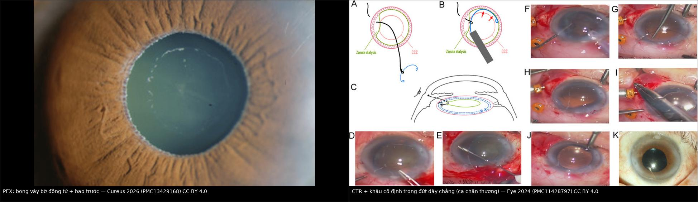
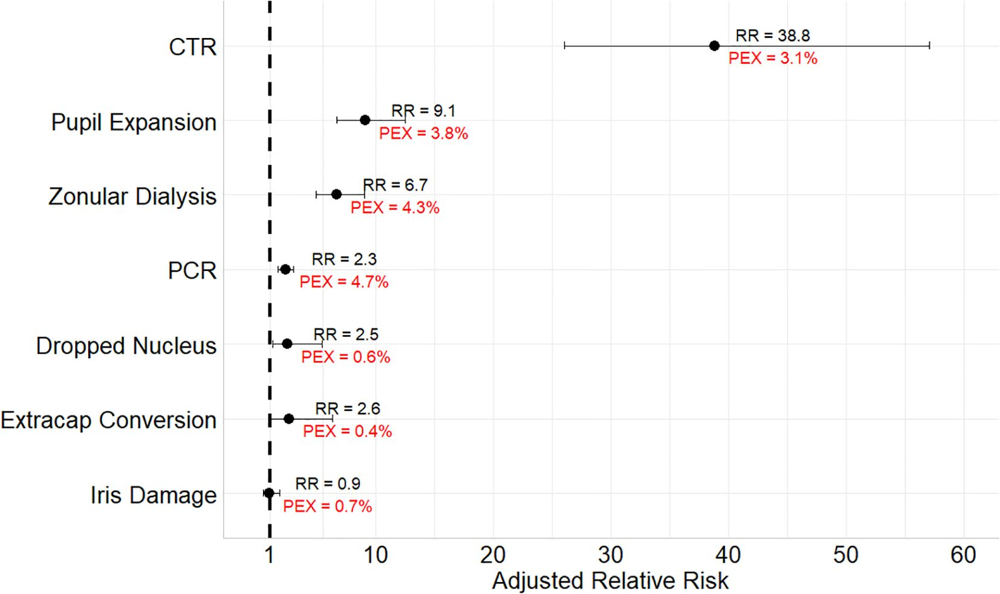
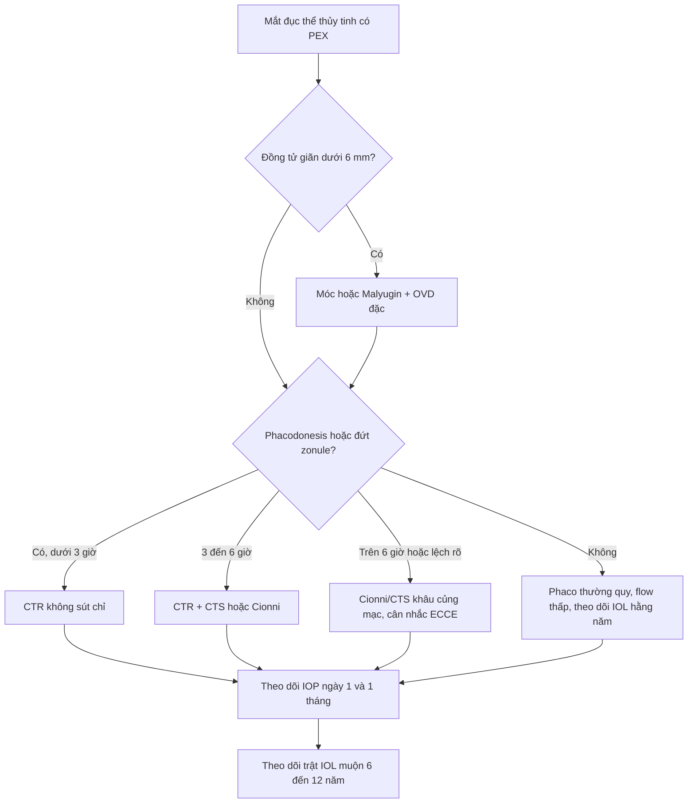
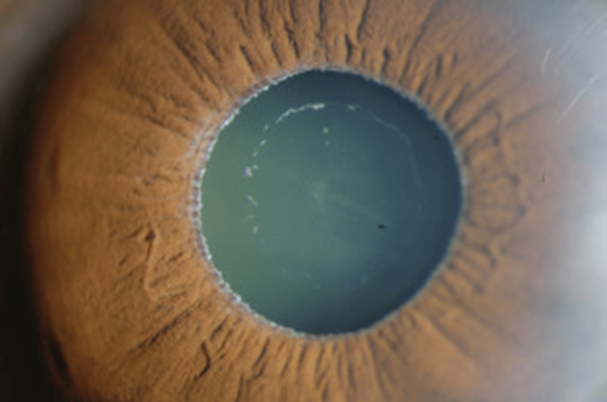
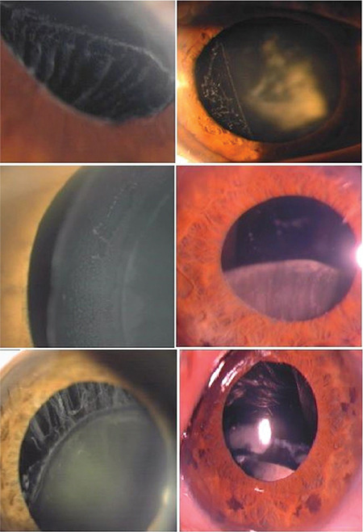
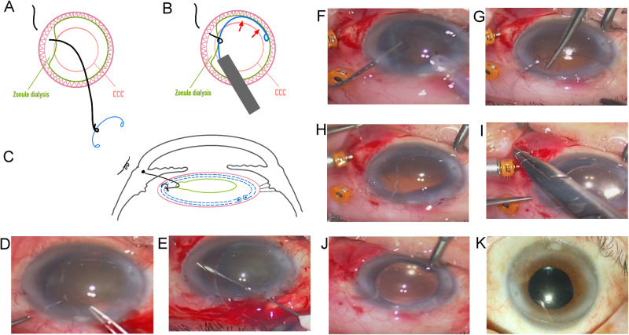

# 1512 — Bệnh bong vảy bao thể thủy tinh (pseudoexfoliation, PEX) trước phaco: đồng tử giãn kém, phacodonesis và đứt dây chằng Zinn / Pseudoexfoliation syndrome before cataract surgery

**Tags:** `pattern:bong-vay-bao-truoc` `pattern:dong-tu-gian-kem` `pattern:phacodonesis` `pattern:mong-mat-teo-sac-to` `pattern:ba-vung-bao-truoc` `vung:mat` `vung:the-thuy-tinh` `vung:mong-mat` `vung:zonule` `vung:tien-phong` `protocol:UBM` `protocol:AS-OCT` `protocol:danh-gia-day-chang` `score:khong` `incidentaloma:khong`

**Mức chắc chắn (certainty):** tổng hợp y văn (literature synthesis) — dựng từ **1 đoàn hệ đa trung tâm 172.008 mắt** (*Front Ophthalmol* 2026, **PMC12935656**, CC BY 4.0 — dùng ảnh forest plot), **1 ca lâm sàng có ảnh đèn khe** (*Cureus* 2026, **PMC13429168**, CC BY 4.0), **1 tổng quan atlas 12 hình lâm sàng PEX** (*Turk J Ophthalmol* 2023, **PMC10442753**, CC BY-NC-ND 4.0 — dùng nguyên bản, không sửa), **1 bài kỹ thuật CTR có ảnh mổ** (*Eye* 2024, **PMC11428797**, CC BY 4.0), **1 tổng quan zonulopathy** (*Saudi J Ophthalmol* 2025, **PMC12685262**, CC BY-NC-ND 4.0 — chỉ đọc số liệu), **1 tổng quan cơ chế PEX** (*Cells* 2026, **PMC13466095**, CC BY 4.0 — chỉ đọc số liệu), cùng các đoàn hệ/so sánh **295 mắt** (DOI 10.1111/aos.13110), **107 mắt** (DOI 10.1016/j.jfo.2015.08.015), **914 mắt** (DOI 10.1007/s10792-021-01752-x), **513 mắt FLACS** (DOI 10.1080/08820538.2022.2051054), **45 mắt muộn** (DOI 10.1016/j.jcrs.2010.01.035) và **72 mắt** (J Fr Ophtalmol 2020). Nhóm **không có bệnh nhân của mình**; chỗ chưa đủ chắc ghi "chưa rõ". **Không ghi tên tác giả trong bài** — attribution ghi tạp chí + năm + PMCID/DOI.

> **Câu chốt:** PEX **không phải "đồng tử nhỏ do dính"** và cũng **không phải IFIS** — đây là bệnh **lắng đọng vật liệu fibrillar lên bao trước và dây chằng Zinn**, nên nguy cơ chính là **đứt dây chằng, rơi nhân, rách bao sau**, và **trật IOL muộn nhiều năm sau mổ**. Bốn nhóm số phải thuộc: **(1)** trên **172.008 mắt**, PEX làm tăng **đứt dây chằng RR 6,7 (4,9–9,0)**, **rách bao sau RR 2,3 (1,7–3,0)**, **rơi nhân RR 2,5 (1,2–5,4)**, **chuyển ECCE RR 2,6 (1,03–6,3)**, và **dùng CTR RR 38,8** (PMC12935656); **(2)** hậu phẫu: **tăng IOP ≥ 22 mmHg RR 1,6 (1,1–2,3)** và **trật IOL cần mổ lại RR 7,3 (4,4–12,2)** (PMC12935656); **(3)** **trật IOL muộn trong bao** có **tần suất tích lũy 0,5–3%**, xuất hiện trung bình **6–12 năm** sau mổ, và **PEX là yếu tố nền hay gặp nhất** (DOI 10.1097/j.jcrs.0000000000000605), chiếm **66,7% (30/45)** một loạt trật muộn (DOI 10.1016/j.jcrs.2010.01.035); **(4)** **CTR không sút chỉ không ngăn được biến chứng bao/IOL** (295 mắt, DOI 10.1111/aos.13110) — nên **đừng hứa "đặt ring là an toàn"**. Bẫy chết người: **gọi PEX là IFIS** rồi xử trí bằng **móc/ring mống mắt** trong khi vấn đề thật là **dây chằng yếu** — mất nhân vào dịch kính.

## 1. Tổng quan bệnh học – cơ chế hình ảnh (TẠI SAO)

### 1.1 Vật liệu PEX là gì — và vì sao nó "bám" vào bao trước, dây chằng

- PEX là bệnh **toàn thân, tuổi già**: vật liệu ngoại bào dạng **sợi fibrillar** lắng đọng ở mống mắt, bao thể thủy tinh, dây chằng Zinn, thể mi, bè củng mạc, và cả tim–mạch–màng não. Ước tính **60–70 triệu người** trên thế giới, **khoảng 1/3** phát triển glôcôm (PMC13466095).
- **Thành phần:** lõi **fibrillin-1/fibrillin-2** bao quanh bởi **glycoconjugate** (heparan/dermatan/chondroitin sulfate) cùng clusterin, vitronectin, apolipoprotein E, yếu tố bổ thể, amyloid P. Biến thể **LOXL1** làm **liên kết chéo bất thường** → sợi **kháng phân giải protease**, không được dọn sạch, tích tụ dần (PMC13466095).
- **Vì sao hình ảnh học thấy được:** đây là **vật liệu protein dày đặc**, không phải canxi — trên **đèn khe** nó tán xạ ánh sáng thành **vảy trắng như cám** ở bờ đồng tử và bao trước; trên **AS-OCT/UBM** nó **tăng hồi âm/tăng tín hiệu** vì mật độ quang cao hơn thủy dịch và mô mống mắt bình thường. **CT/MRI không dùng để chẩn đoán PEX** — độ tương phản của vài chục micromet vật liệu nằm dưới ngưỡng phân giải không gian, và PEX không tạo tín hiệu đặc hiệu trên T1/T2.
- **Vì sao bám vào bao trước:** bao thể thủy tinh là **màng collagen IV/laminin** liên tục tái cấu trúc; vật liệu lắng theo **dòng thủy dịch tiền phòng** và theo **vùng tiếp xúc mống mắt–bao** → tạo hình thái **ba vùng** kinh điển (đĩa trung tâm trong đồng tử, vùng sạch nơi mống mắt tì, vòng ngoại vi).

### 1.2 Vì sao dây chằng yếu — và vì sao yếu tiếp diễn SAU mổ

- Vật liệu PEX lắng **trực tiếp lên sợi zonule và biểu mô không sắc tố thể mi**; sợi trở nên **dày, cứng, mất đàn hồi** — trên UBM 35–50 MHz, **bao trước và dây chằng dày hơn** ở mắt PEX so với chứng trong một loạt nhỏ 10 mắt (DOI 10.1016/j.jcrs.2006.01.015). Dày **không đồng nghĩa khỏe**: vật liệu fibrillar **giòn** và **dễ đứt** dưới lực xoay nhân.
- **Sau mổ, lực kéo vẫn tiếp tục:** bao trước xơ hóa co lại (capsule contraction) tạo lực **hướng tâm** lên các sợi zonule còn lại. Ở mắt PEX, **phản ứng xơ hóa bao tăng**, nên **cân bằng lực bị phá vỡ dần** → **trật IOL trong bao muộn** dù ca mổ "trơn". Đây là lý do PEX nằm trong nhóm **nguyên nhân hay gặp nhất của trật IOL muộn** cùng cận thị cao và tiền sử cắt dịch kính (DOI 10.1097/j.jcrs.0000000000000605).
- **Hệ quả định lượng:** đứt dây chằng **4,3%** ở mắt PEX so với chứng, **RR 6,7**; cần **CTR 3,1%**, **RR 38,8**; **rơi nhân 0,6%**, **RR 2,5** (PMC12935656). Con số **RR 38,8** không phải "nguy cơ biến chứng" mà là **mức độ bác sĩ phải đổi kế hoạch mổ** — nó phản ánh **chỉ định đặt CTR** và **cả prophylactic**.

### 1.3 Vì sao đồng tử giãn kém — cơ chế KHÁC IFIS

- **Tại mống mắt:** vật liệu PEX trong **mô đệm và thành mạch mống mắt** gây **xơ hóa cơ thắt (sphincter)**, **teo biểu mô sắc tố bờ đồng tử** (moth-eaten), và **dính sau** với bao trước. Kết quả: đồng tử **nhỏ, bờ không đều, giãn kém KHÔNG đối xứng**; nhỏ atropine/phenylephrine **không mở được** vì **cơ thắt đã xơ**, không phải vì **cơ giãn mất trương lực** như IFIS (bài 1508).
- **Tại IFIS:** tổn thương **chọn lọc cơ giãn (DMR)**, bờ đồng tử **tròn đều**, **không có vảy**, **không phacodonesis** (bài 1508). Hai bệnh **có thể cùng tồn tại** ở người già dùng tamsulosin — khi đó **cả hai cơ chế** cùng làm ca mổ khó.
- **Hệ quả thực hành:** PEX cần **giãn đồng tử bằng cơ học** (móc/malyugin) và **ổn định bao**; IFIS cần **giảm flow + ring mống mắt** và **tránh rò vết mổ**. Đổi công cụ giữa hai bệnh cảnh là **đổi cách xử lý nguyên nhân**, không phải "đổi mẹo".

### 1.4 Vì sao rung thể thủy tinh (phacodonesis) là dấu hiệu muộn — và đo bằng gì

- **Phacodonesis** là **dao động của thể thủy tinh theo nhịp mắt** (gõ nhẹ nhãn cầu hoặc liếc nhanh rồi quan sát bằng khe sáng hẹp). Nó xuất hiện khi **mất một phần đáng kể lực nâng của zonule**; vì vậy **không có phacodonesis không loại trừ** đứt dây chằng khu trú.
- **Đo khách quan:** **UBM 35–50 MHz** (xuyên 4–5 mm, phân giải trục **~35–50 µm**) thấy **dây chằng dày/giãn, khoảng trống giữa bao và thể mi**, và **bao trước dày**; **AS-OCT tiền phòng** (phân giải **~5–20 µm**) đo **độ sâu tiền phòng, góc, độ dày mống mắt** nhưng **không thấy hết chu vi zonule**; **siêu âm B-scan 10 MHz** chỉ dùng khi **đục/không thấy hậu đoạn**, không đánh giá được zonule.
- **Giới hạn:** UBM cần **đầu dò chạm mắt**, phụ thuộc người đo; **chưa có ngưỡng độ dày zonule được ngoại kiểm** để dự báo đứt dây chằng. Vì vậy phacodonesis vẫn là **dấu lâm sàng chính**, hình ảnh chỉ **hỗ trợ**.

### 1.5 Con số phải nhớ (ngưỡng định lượng)

| Biến số | Số liệu | Nguồn |
|---|---|---|
| Tần suất PEX toàn cầu | **60–70 triệu người**; **~1/3** có glôcôm | PMC13466095 |
| Tần suất trong quần thể mổ phaco | **1,2%** (172.008 mắt, Anh); **10,7%** (585 mắt, Thổ Nhĩ Kỳ); **8%** (107 mắt, Pháp) | PMC12935656; PMC13369941; DOI 10.1016/j.jfo.2015.08.015 |
| Đồng tử giãn ≤ 6 mm | **54%** | DOI 10.1016/j.jfo.2015.08.015 |
| Đứt dây chằng khi mổ | **4,3%**; **RR 6,7 (4,9–9,0)** | PMC12935656 |
| Rách bao sau (PCR) | **4,7%**; **RR 2,3 (1,7–3,0)** | PMC12935656 |
| Rơi nhân | **0,6%**; **RR 2,5 (1,2–5,4)** | PMC12935656 |
| Chuyển ECCE | **0,4%**; **RR 2,6 (1,03–6,3)** | PMC12935656 |
| Dùng CTR | **3,1%**; **RR 38,8** | PMC12935656 |
| Dùng dụng cụ mở đồng tử | **3,8%**; **RR 9,1** | PMC12935656 |
| Tăng IOP ≥ 22 mmHg sau mổ | **RR 1,6 (1,1–2,3)** | PMC12935656 |
| Trật IOL cần mổ lại | **RR 7,3 (4,4–12,2)** | PMC12935656 |
| Trật IOL muộn trong bao | **0,5–3%**, trung bình **6–12 năm**; PEX là yếu tố nền hay gặp nhất | DOI 10.1097/j.jcrs.0000000000000605 |
| PEX trong các ca trật IOL muộn | **66,7% (30/45)** | DOI 10.1016/j.jcrs.2010.01.035 |
| PCR theo kinh nghiệm | **4,5%** (học viên) vs **1,9%** (chuyên gia), p = 0,002 | DOI 10.1007/s10792-021-01752-x |
| Zonulopathy nói chung | **0,46–2,6%** dân số; **7,3%** ở bệnh nhân góc đóng nguyên phát | PMC12685262; PMC9293109 |

## 2. Mẫu hình + chẩn đoán phân biệt theo vị trí (gamut)

### 2.1 Bộ dấu hiệu trên đèn khe — thứ tự khám

1. **Bờ đồng tử:** mất sắc tố kiểu **"moth-eaten"**, **vảy trắng** ở rìa đồng tử (nhìn rõ nhất **trước khi giãn**, nền mống mắt sẫm).
2. **Bao trước sau khi giãn:** **ba vùng** — **đĩa trung tâm** (trong đồng tử), **vùng sạch** (mống mắt tì), **vòng ngoại vi** (dưới mống mắt); có thể **không điển hình** hoặc **chỉ một vùng**.
3. **Phacodonesis:** khe sáng hẹp, bảo bệnh nhân liếc nhanh; nhìn **rìa thể thủy tinh dao động**; so **hai mắt** (bệnh thường **hai bên nhưng không đối xứng** — **69%** hai bên trong loạt 107 mắt).
4. **Góc tiền phòng (gonioscopy):** **tăng sắc tố bè** kiểu Sampaolesi, dính góc, hẹp góc (**32%** mắt PEX có góc hẹp so với **4%** dân số chung — dẫn từ PMC11004152).
5. **Đo sinh trắc:** AL, K, **độ sâu tiền phòng**, **độ dày thể thủy tinh**; PEX thường **nhân cứng hơn** (PMC13369941).

### 2.2 Gamut "đồng tử nhỏ + mống mắt kém vững" — phân biệt theo cơ chế

- **PEX:** vảy trắng + bờ **không đều** + **phacodonesis/đứt dây chằng** + giãn kém **không đối xứng**; **hai bên**; tuổi **> 60**.
- **IFIS:** tiền sử **α1-antagonist**; bờ **tròn đều**, **không vảy**, **không phacodonesis**; AS-OCT **DMR mỏng** (bài 1508).
- **Dính sau (posterior synechiae):** đồng tử **méo/hình hoa**, **dải dính**; tiền sử **viêm màng bồ đào/chấn thương**; thường **một mắt**.
- **Xơ cơ thắt do tuổi/đái tháo đường:** đồng tử **nhỏ, cứng, bờ dày**, **không vảy**, **không phacodonesis**; giãn kém **đối xứng**.
- **Co đồng tử trong mổ (intraoperative miosis):** co **đột ngột** sau một động tác, **hồi phục** khi giảm flow.
- **Sa mống mắt do rò vết mổ:** mống mắt **trồi ra ngay**, **tiền phòng nông**, thấy **dịch rò**; xử lý bằng **khâu/làm kín**.
- **Phối hợp PEX + IFIS:** có **cả vảy và tiền sử thuốc**; nguy cơ **cộng gộp** — phải chuẩn bị **cả ring mống mắt và CTR**.

### 2.3 Gamut "rung thể thủy tinh / lệch thể thủy tinh"

- **PEX** (hay gặp nhất ở người già), **chấn thương** (đứt zonule khu trú), **Marfan** (dài sợi, lệch **hai bên**, **hướng lên–vào trong**), **homocystinuria** (lệch **xuống–ra ngoài**, kèm huyết khối/chậm phát triển), **viêm màng bồ đào mạn**, **thể thủy tinh nhân tạo** (pseudophakodonesis sau mổ), **lão hóa/không rõ nguyên nhân**. Phân biệt bằng **tuổi, hai bên, hướng lệch, bệnh nội tiết–mô liên kết, tiền sử chấn thương**.

### 2.4 Phân độ mất dây chằng theo giờ (thực hành, chưa có thang điểm ngoại kiểm)

| Mức | Tổn thương | Hướng xử trí |
|---|---|---|
| **Nhẹ** | **< 3 giờ (< 90°)** hoặc chỉ **rung nhẹ** | **CTR** thường, **không sút chỉ**; theo dõi |
| **Trung bình** | **3–6 giờ (90–180°)** | **CTR + CTS/móc**, cân nhắc **Cionni CTR**; **giảm flow**, **không xoay nhân mạnh** |
| **Nặng** | **> 6 giờ (> 180°)** hoặc **lệch rõ** | **Cionni/CTS khâu củng mạc**, **cân nhắc ECCE/ICCE**, hội chẩn **dịch kính–võng mạc** |

- **Ngưỡng có nguồn:** **đứt > 70°** làm tăng nguy cơ **trật IOL–bao**; khi đó có thể cần **Cionni CTR + khâu củng mạc**, nhưng **chỉ prolene có thể thoái hóa trong 15 năm** → trật muộn (PMC12685262).
- **CTR không sửa được bao lệch nặng** và **không ngăn tiến triển zonulopathy** (PMC12685262) — nên **phân độ trước mổ chỉ là ước lượng**, phải **chuẩn bị dụng cụ cho mức nặng hơn**.

## 3. Bảng so sánh phân biệt (ma trận đối chiếu)

| Thực thể (entity) | Hình ảnh điển hình (đèn khe / UBM / AS-OCT) | Chốt vào (rule-in) | Chốt loại (rule-out) | Gợi ý xác nhận |
|---|---|---|---|---|
| **PEX** | Vảy trắng bờ đồng tử + **ba vùng** bao trước; **phacodonesis**; UBM **zonule dày/giãn** | **Vảy + phacodonesis/đứt dây chằng**, hai bên không đối xứng | **Không vảy, không rung, UBM zonule bình thường** → nghĩ nguyên nhân khác | Đèn khe **sau giãn**, UBM, soi **mắt đối bên** |
| **IFIS** | Bờ đồng tử **tròn đều, không vảy**; AS-OCT **DMR mỏng**, SMR bình thường | **Tiền sử α1-antagonist + tam chứng trong mổ** | **Có vảy/phacodonesis** → không giải thích đủ bằng IFIS | Hỏi **tên thuốc**, PL ratio, AS-OCT |
| **Dính sau** | Đồng tử **méo**, **dải dính**, không giãn dù atropine | **Dính thấy rõ**, tiền sử viêm | **Bờ tròn đều, không dải** → loại | Đèn khe, AS-OCT tiền phòng |
| **Xơ cơ thắt (tuổi/ĐTĐ)** | Đồng tử **nhỏ cứng**, bờ dày, **đối xứng**, không vảy | **Giãn kém đối xứng + không phacodonesis** | **Có vảy/rung** → không phải đơn thuần | So hai mắt, đái tháo đường |
| **Chấn thương zonule** | **Đứt khu trú** một vùng, tiền sử chấn thương, có thể **lệch thể thủy tinh** | **Vùng đứt + tiền sử** | **Ba vùng bong vảy hai bên** → PEX | Hỏi chấn thương, UBM vùng nghi |
| **Marfan/homocystinuria** | Lệch thể thủy tinh **hai bên**, dấu toàn thân | **Lệch hai bên + dấu hệ thống** | **Không dấu toàn thân, có vảy** → PEX | Khám toàn thân, gen |

*Trái: vảy PEX ở bờ đồng tử và bao trước (Cureus 2026, PMC13429168, CC BY 4.0). Phải: CTR + khâu cố định trong **đứt dây chằng 180° do chấn thương** (Eye 2024, PMC11428797, CC BY 4.0) — dùng để minh họa kỹ thuật, **không phải ca PEX**. Ảnh nguyên bản, ghép letterbox bằng `tools/make_composite.py`.*

### 3.1 Nguy cơ định lượng — đọc forest plot cho đúng

*RR hiệu chỉnh (tuổi, giới, đái tháo đường, đồng tử nhỏ, đục nặng): **CTR 38,8** (PEX 3,1%), **mở đồng tử 9,1** (3,8%), **đứt dây chằng 6,7** (4,3%), **PCR 2,3** (4,7%), **rơi nhân 2,5** (0,6%), **chuyển ECCE 2,6** (0,4%), **tổn thương mống mắt 0,9** (0,7%). Nguồn: Front Ophthalmol 2026 (PMC12935656), CC BY 4.0, nguyên bản.*

- **Đọc đúng:** đây là **RR sau hiệu chỉnh**, không phải tỉ lệ tuyệt đối; **PEX là yếu tố nguy cơ độc lập cho PCR** ngay cả sau khi hiệu chỉnh **đứt dây chằng** (PMC12935656). Ngược lại, **tổn thương mống mắt không tăng** (RR 0,9) — tức **PEX không làm mống mắt dễ rách hơn**, mà làm **bao/dây chằng yếu hơn**.
- **Đối lập có chủ đích:** một loạt **585 mắt** không thấy khác biệt biến chứng (PMC13369941); một loạt **513 mắt** FLACS cũng không thấy khác biệt (DOI 10.1080/08820538.2022.2051054). Cỡ mẫu nhỏ và **chọn bệnh** giải thích phần lớn — **không được đọc "PEX an toàn"** từ các loạt nhỏ.

### 3.2 CTR — bằng chứng hai chiều (điểm tranh cãi trung tâm)

- **Ủng hộ:** CTR **giảm lệch và xoay trục IOL toric**, **giảm nghiêng IOL đa tiêu** ở mắt nghi yếu zonule (55 mắt, PMC7039513); CTR **giữ bao ổn định** và giúp **đặt IOL trong bao** ở ca đứt dây chằng (PMC11428797).
- **Phản biện:** **CTR không sút chỉ không ngăn biến chứng hậu phẫu** ở **143 mắt PEX có yếu zonule** (52 mắt có CTR vs 91 không; p = 0,64) (DOI 10.1111/aos.13110). Trong đoàn hệ 172.008 mắt, dù **CTR được dùng nhiều gấp 38,8 lần**, **trật IOL vẫn tăng RR 7,3** (PMC12935656).
- **Tác hại riêng của CTR:** **phức hợp bao–CTR–IOL trật ra trước** gây **glôcôm góc đóng cấp/ngắt quãng** — 7 ca, chẩn đoán bằng UBM, phải **lấy cả bao + CTR** và thay **IOL cố định mống mắt** (DOI 10.1097/IJG.0000000000000780).
- **Hệ quả thực hành:** đặt CTR khi **có yếu zonule thật** (đứt/rung/bao không vững), **không đặt "cho chắc"** ở mắt PEX không có dấu hiệu; và **theo dõi IOL lâu dài** dù đã đặt CTR.

## 4. Protocol chụp/đo + hệ phân độ & xử trí

### 4.1 Tiền phẫu — checklist "5 bước"

1. **Khám đèn khe có giãn đồng tử**: ghi **đường kính đồng tử tối đa (mm)**, **vảy/bờ đồng tử**, **ba vùng bao trước**, **phacodonesis**, **so hai mắt**.
2. **Đo sinh trắc**: AL, K, **độ sâu tiền phòng**, công suất IOL; **không dùng một công thức duy nhất** — ở mắt yếu zonule, **sai số khúc xạ do vị trí IOL hiệu dụng** có thể gây **tăng 0,41 ± 0,52 D** so với **0,04 ± 0,59 D** khi có CTR (DOI 10.1177/11206721211051920). **Chưa rõ** công thức nào bù tốt nhất — ghi nhận để tư vấn.
3. **UBM 35–50 MHz** khi **nghi zonule/giác mạc đục**: tìm **dây chằng giãn/đứt**, **bao trước dày**, **khoảng trống bao–thể mi**.
4. **Đánh giá glôcôm**: IOP, thị trường, OCT RNFL; PEX **1/3 có glôcôm**, và **IOP sau mổ dễ tăng** (RR 1,6).
5. **Lập kế hoạch dụng cụ**: **móc/malyugin** nếu đồng tử **< 5–6 mm**; **CTR/CTS/Cionni** theo phân độ mục 2.4; **báo gây mê** và **chuẩn bị dịch kính–võng mạc** nếu phân độ nặng.

### 4.2 Trong mổ — theo bậc

| Bậc | Biện pháp | Số liệu / lý do |
|---|---|---|
| **1. Vào tiền phòng** | **Trypan blue** nhuộm bao (nếu bao xơ/khó thấy), **OVD đặc** giữ tiền phòng | Bao PEX **dày, giòn**, dễ rách khi mở bao |
| **2. Mở bao** | **CCC 5,0–5,5 mm**, **lực kéo nhẹ**, **tránh "bẻ" bao** | CCC nhỏ → **phimosis**; lớn → mất ổn định |
| **3. Hydrodissection** | **Chậm, từng phần**, quan sát **sóng bao** | Lực nước mạnh = **đứt zonule** |
| **4. Xoay/tách nhân** | **Giảm flow, giảm vacuum**, **chia nhân tại trung tâm**, tránh xoay trong bao | Đứt dây chằng **RR 6,7** (PMC12935656) |
| **5. Ổn định bao** | **CTR** khi **đứt/rung**; **CTS/Cionni** khi **> 3–6 giờ**; **móc** khi bao lệch | CTR **giảm lệch IOL** (PMC7039513) nhưng **không ngăn hết** (DOI 10.1111/aos.13110) |
| **6. Đặt IOL** | **Trong bao** nếu còn đủ ổn định; **rãnh củng mạc** nếu bao mất > 6 giờ | Mất bao = **IOL ngoài bao**, nguy cơ **trật thứ phát** |
| **7. Kết thúc** | **Khâu kín vết mổ**, kiểm tra **tiền phòng kín**, **không để sót viscoelastic** | Rò vết mổ + PEX làm **mống mắt sa**, IOP tăng |

### 4.3 Hậu phẫu — theo dõi dài hạn

- **Ngày 1–7:** IOP (**tăng ≥ 22 mmHg RR 1,6**), phù giác mạc, viêm; **PCO 31,7% ở 12 tháng** trong loạt 107 mắt (DOI 10.1016/j.jfo.2015.08.015).
- **1–3 tháng:** **co bao trước/phimosis**, **lệch IOL**, khúc xạ; **YAG bao sau** khi PCO ảnh hưởng thị lực.
- **Hằng năm:** **trật IOL muộn** (trung bình **6–12 năm**, **0,5–3%**) — hướng dẫn bệnh nhân **tái khám khi thị lực giảm/thấy IOL lệch**, không chờ đau.
- **Glôcôm:** theo dõi IOP/thị trường; **PEX glaucoma** đáp ứng thuốc kém hơn POAG (tổng quan DOI 10.1111/j.1600-0420.2007.00903.x).

### 4.4 Sơ đồ quyết định

## 5. Biến thể bình thường và cạm bẫy

- **"Đồng tử giãn tốt = không PEX" là sai.** PEX có thể giãn gần bình thường ở giai đoạn sớm; **vảy ở bờ đồng tử** và **rung nhẹ** mới là chốt.
- **"Không thấy vảy = không PEX" cũng sai.** Vảy có thể **bị rửa trôi** sau viêm, **khu trú một vùng**, hoặc **chỉ thấy ở mắt đối bên**; soi **cả hai mắt** sau giãn.
- **Gọi PEX là IFIS** → dùng **ring mống mắt** trong khi **bao đã mất ổn định** → **rơi nhân**. Hỏi **tiền sử thuốc** và tìm **vảy/rung** để phân biệt.
- **CTR không phải "bảo hiểm".** Không ngăn biến chứng (DOI 10.1111/aos.13110); có thể **tự trật ra trước gây góc đóng** (DOI 10.1097/IJG.0000000000000780).
- **Phacodonesis âm không loại trừ đứt khu trú.** Đứt **1–2 giờ** có thể không rung; phát hiện **trong lúc mở bao** (bao nhăn, không căng) → **đổi kế hoạch ngay**.
- **Nhân cứng hơn ở PEX** (PMC13369941) → **tăng năng lượng phaco** lại **tăng lực lên zonule**; cân bằng **chia nhân** và **flow thấp**, không "đạp bàn đạp cho nhanh".
- **Sai số khúc xạ do CTR** (tăng **0,41 D** hướng viễn) dễ bị quy cho "công thức sai" (DOI 10.1177/11206721211051920) — cần **đo lại sinh trắc** và tư vấn trước mổ.
- **Không dùng atropine ở góc hẹp** để "giãn thêm": PEX có **tần suất góc hẹp cao hơn** (32% vs 4%); atropine có thể **gây cơn góc đóng** — ưu tiên **giãn cơ học**.

## 6. Tự lượng giá — Blind Quiz

**Ca 1 — Nữ 72 tuổi, thị lực mắt phải 0,1, được chẩn đoán "đục thể thủy tinh". Nhìn ảnh, mô tả trước khi mở đáp án.**

- Gợi ý lâm sàng: không dùng thuốc tiền liệt tuyến; đồng tử giãn **5,5 mm**; mắt trái có "vảy trắng" tương tự.
- Câu hỏi: (1) Dấu hiệu chính? (2) Ba chẩn đoán phân biệt? (3) Kế hoạch mổ thay đổi thế nào?

<b>Bấm để hiện đáp án (findings + chẩn đoán)</b>

- **Dấu hiệu:** **vảy trắng như cám** ở **bờ đồng tử** và rải trên **bao trước**; đồng tử **giãn kém**; bao có vẻ **mờ, dày**.
- **Chẩn đoán:** **PEX** — vật liệu fibrillar lắng trên bao trước/mống mắt, hai bên không đối xứng.
- **Ba phân biệt:** **IFIS** (không vảy, bờ tròn đều — loại), **dính sau** (bờ không méo, không dải — loại), **xơ cơ thắt do tuổi** (có thể cùng tồn tại nhưng **không giải thích vảy**).
- **Kế hoạch:** **UBM** tìm đứt zonule; **móc/malyugin** nếu đồng tử nhỏ; **CTR nếu có rung/đứt**; **flow thấp**, **chia nhân trung tâm**; theo dõi **IOP** và **trật IOL muộn**.
- **Nguồn ảnh:** Cureus 2026 (PMC13429168), Fig. 1, **CC BY 4.0**, nguyên bản; ca gốc đạt **BCVA 0,9 sau 1 tuần**.

**Ca 2 — Nam 78 tuổi, PEX hai mắt, chuẩn bị phaco mắt trái. Ảnh chụp sau giãn đồng tử. Bạn thấy gì và làm gì?**

- Gợi ý lâm sàng: thị lực 0,3; IOP 18 mmHg; không chấn thương; mắt phải đã mổ cách đây 7 năm, IOL còn trung tâm.
- Câu hỏi: (1) Các dấu hiệu ở 6 panel? (2) Mức độ zonule? (3) Dụng cụ và thứ tự xử trí?

<b>Bấm để hiện đáp án (findings + chẩn đoán)</b>

- **Dấu hiệu:** các panel cho thấy **bờ thể thủy tinh lệch**, **vùng dây chằng giãn/đứt**, **bao nhăn**, và **vảy PEX** trên bao; có panel **lệch thể thủy tinh rõ**.
- **Chẩn đoán:** **PEX có yếu zonule mức trung bình–nặng** (ước **3–6 giờ** hoặc hơn ở vùng lệch); **không loại trừ** đứt thêm trong mổ.
- **Xử trí:** **CCC nhẹ**, **hydrodissection chậm**, **CTR ± CTS/Cionni**, **giảm flow**, **chia nhân tại trung tâm**; **chuẩn bị ECCE/dịch kính** nếu bao mất ổn định; **không xoay nhân trong bao**.
- **Theo dõi:** IOP ngày 1, khúc xạ 1 tháng, **trật IOL muộn** hằng năm.
- **Nguồn ảnh:** Turk J Ophthalmol 2023 (PMC10442753), Fig. 7, **CC BY-NC-ND 4.0**, nguyên bản, không sửa.

**Ca 3 — Trong mổ, sau khi mở bao, bạn thấy bao "nhăn" và thể thủy tinh lệch. Ảnh minh họa kỹ thuật xử trí. Bạn làm gì tiếp?**

- Gợi ý lâm sàng: ca minh họa là **đứt dây chằng 180° do chấn thương**, không phải PEX; nguyên lý áp dụng cho PEX nặng.
- Câu hỏi: (1) Vì sao không tiếp tục phaco trong bao? (2) CTR thường hay Cionni? (3) Nêu 3 bước trong ảnh.

<b>Bấm để hiện đáp án (findings + chẩn đoán)</b>

- **Lý do:** tiếp tục xoay nhân trong bao **truyền lực lên zonule đã đứt** → **mở rộng đứt**, **rơi nhân**, **mất bao**.
- **Chọn dụng cụ:** **đứt 180°** → **Cionni CTR/CTS khâu củng mạc** (CTR thường **không đủ**); **đứt < 90°** có thể **CTR thường**.
- **Ba bước trong ảnh:** (A–C) **CTR có dây prolene + nút trượt**, luồn vào bao và **cố định củng mạc**; (D–E) **đứt 180°**, **kim 10-0 xuyên củng mạc** vào tiền phòng rồi **lấy ra bằng kim 27 G**; (F–K) **phaco + hút vỏ**, đặt IOL, **kéo chỉ giữ ring**, IOL **trung tâm**, thị lực **20/40 sau 3 tháng**.
- **Nguồn ảnh:** Eye 2024 (PMC11428797), Fig. 1, **CC BY 4.0**, nguyên bản; ca gốc là **chấn thương**, không phải PEX — bài học chỉ dùng **nguyên lý kỹ thuật**.

## 7. Câu hỏi nghiên cứu & điểm chưa đồng thuận (tính đến 11/2026)

1. **[Tranh cãi] Ở mắt PEX không có dấu hiệu yếu zonule rõ, đặt CTR dự phòng có giảm trật IOL muộn so với không đặt không?**
   - **Đã biết:** đoàn hệ 172.008 mắt cho thấy CTR được dùng **RR 38,8** nhưng trật IOL vẫn **RR 7,3**; một loạt 295 mắt không thấy CTR ngăn biến chứng (p = 0,64).
   - **Chưa rõ:** thiếu RCT; **confounding by indication** (mắt nặng hơn mới đặt ring); chưa tách được tác dụng theo **mức độ zonule**.
   - **Hướng nghiên cứu:** RCT hoặc registry có **propensity score**, outcome **trật IOL muộn ≥ 5 năm**.
   - **Nguồn:** PMC12935656 (2026); DOI 10.1111/aos.13110 (2017).

2. **[Khác biệt thực hành] FLACS có giảm biến chứng bao ở mắt PEX so với phaco thường không?**
   - **Đã biết:** loạt 513 mắt PEX **không khác** về sa dịch kính, rách bao, dùng dụng cụ hỗ trợ (p > 0,05); một loạt 2.021 mắt FLACS cũng không giảm rách bao so với phaco tay.
   - **Chưa rõ:** chưa có RCT trên **PEX có zonule yếu**, và **femtosecond capsulotomy** có giảm lực lên zonule hay không.
   - **Hướng nghiên cứu:** RCT đa trung tâm ở PEX, outcome **đứt dây chằng + rơi nhân**.
   - **Nguồn:** DOI 10.1080/08820538.2022.2051054 (2022); PMC6134952 (2018).

3. **[Khoảng trống] Có ngưỡng hình ảnh (UBM zonule/AS-OCT) nào dự báo đứt dây chằng trước mổ ở PEX chưa?**
   - **Đã biết:** UBM thấy **bao trước và zonule dày hơn** ở PEX (loạt 10 mắt); tổng quan zonulopathy chỉ nêu dấu lâm sàng, **không có ngưỡng**.
   - **Chưa rõ:** chưa có nghiên cứu tiến cứu **đo zonule mù với kết quả mổ**; chưa có cutoff được ngoại kiểm.
   - **Hướng nghiên cứu:** nghiên cứu **diagnostic accuracy** UBM/AS-OCT trước mổ, so với phát hiện trong mổ.
   - **Nguồn:** DOI 10.1016/j.jcrs.2006.01.015 (2006); PMC12685262 (2025).

> 2–3 mục; mỗi mục bắt buộc có **Nguồn** (PMCID/DOI). Không đặt ngân sách thời gian cứng; không bịa tranh cãi.

## Bài liên quan chéo

- [1508 – Hội chứng mống mắt đàn hồi (IFIS) khi phaco](../1508-hoi-chung-mong-mat-dan-hoi-ifis/lesson.md)
- [1504 – Đục thể thủy tinh cực sau: dự báo rách bao sau trước mổ](../1504-duc-the-thuy-tinh-cuc-sau/lesson.md)
- [1492 – Đục bao sau nhân tạo sau phaco ở mắt đã cắt dịch kính](../1492-duc-bao-sau-iol-yag-sau-cat-dich-kinh/lesson.md)
- [1498 – Siêu âm B-scan trước phaco: khi nào phải xem hậu đoạn](../1498-sieu-am-bscan-truoc-phaco-hau-doan/lesson.md)
- [1510 – Hội chứng khoang hốc mắt cấp](../1510-hoi-chung-khoang-hoc-mat/lesson.md)

## Ảnh

- `1512_PEX-bong-vay-bao-truoc_Slit-lamp_PMC13429168-Fig1.jpg` — Cureus 2026 (PMC13429168), **CC BY 4.0**.
- `1512_PEX-bao-truoc-ba-vung_Slit-lamp_PMC10442753-Fig5.jpg` — Turk J Ophthalmol 2023 (PMC10442753), **CC BY-NC-ND 4.0**, nguyên bản.
- `1512_PEX-zonule-yeu-sublux_Slit-lamp_PMC10442753-Fig7.jpg` — Turk J Ophthalmol 2023 (PMC10442753), **CC BY-NC-ND 4.0**, nguyên bản.
- `1512_CTR-dut-day-chang_Anh-mo_PMC11428797-Fig1.jpg` — Eye 2024 (PMC11428797), **CC BY 4.0**.
- `1512_RR-bien-chung_Do-thi_PMC12935656-Fig2.jpg` — Front Ophthalmol 2026 (PMC12935656), **CC BY 4.0**.
- `composite_1512_PEX-nhan-dien-xu-tri.jpg` — ghép từ 2 ảnh **CC BY 4.0** (PMC13429168 + PMC11428797) bằng `tools/make_composite.py`.

> Không dùng để chẩn đoán độc lập khi chưa có người hướng dẫn.
