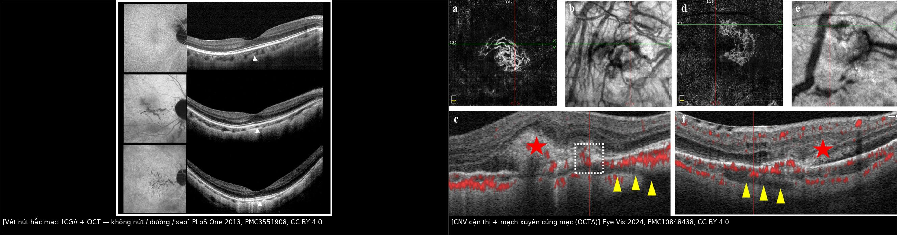
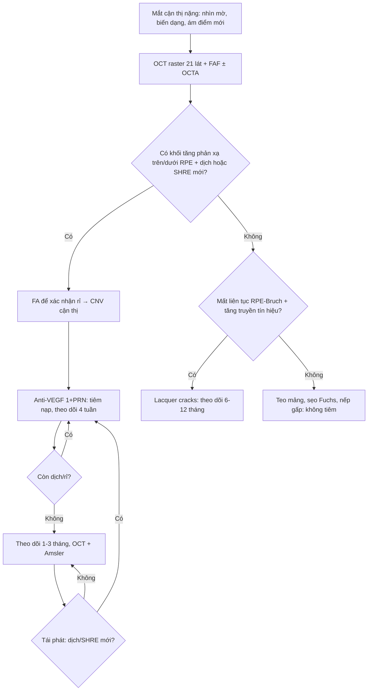
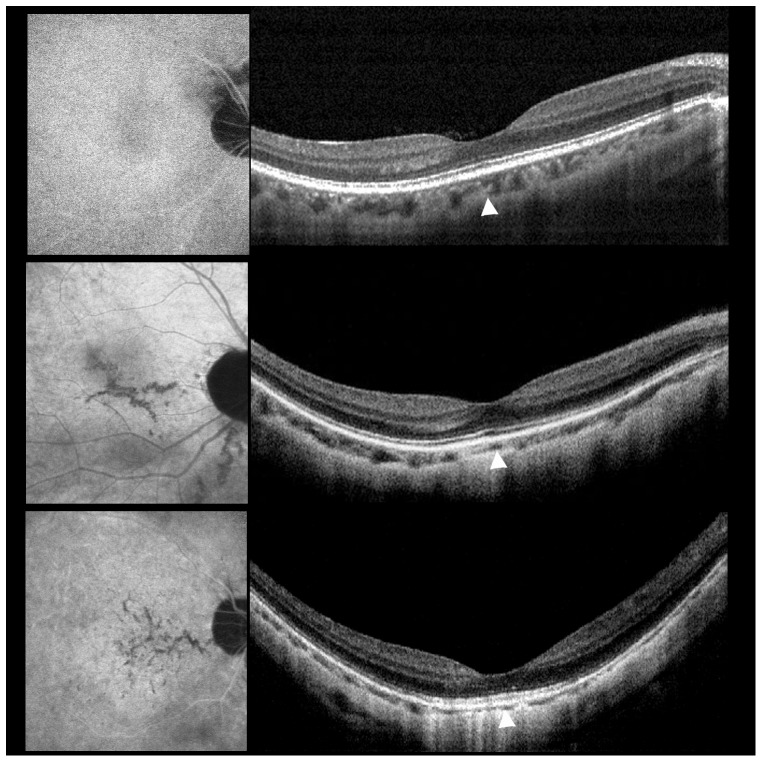
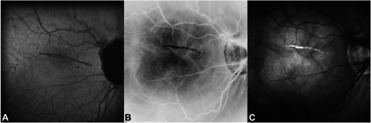
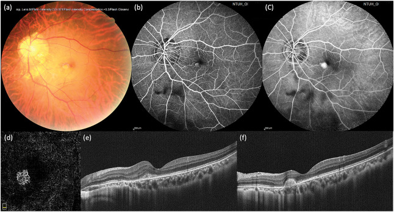

# 1513 — Vết nứt hắc mạc (lacquer cracks) & CNV cận thị: dải vàng ngắn ở hậu cực — khi nào theo dõi, khi nào tiêm / Lacquer cracks & myopic choroidal neovascularization

**Tags:** `pattern:lacquer-cracks` `pattern:dai-vang-hau-cuc` `pattern:CNV-type-2` `pattern:xuat-huyet-duoi-vong-mac` `pattern:teo-hac-mac` `pattern:gia-lap-lo` `vung:mat` `vung:hac-mac` `vung:hoang-diem` `vung:hau-cuc` `anatomy:mang-Bruch` `anatomy:choriocapillaris` `protocol:OCT-hoang-diem` `protocol:OCTA` `protocol:FAF` `protocol:ICGA` `protocol:hong-ngoai` `protocol:FA` `protocol:do-truc-nhan-cau` `score:META-PM` `score:ATN` `incidentaloma:khong`

**Mức chắc chắn (certainty):** tổng hợp y văn (literature synthesis) — dựng từ **nghiên cứu cắt ngang 69 mắt cận thị nặng** đo độ dày hắc mạc và trục nhãn cầu (*PLoS One* 2013, **PMC3551908**, CC BY 4.0 — dùng ảnh ICGA + OCT), **so sánh 32 mắt có vết nứt** trên hồng ngoại đen–trắng và ICGA (*Ophthalmol Sci* 2026, **PMC12686903**, CC BY-NC-ND 4.0 — dùng nguyên bản), **đoàn hệ 171 mắt CNV cận thị** điều trị anti-VEGF (*Retina* 2025, **PMC12637130**, CC BY-NC-ND 4.0 — dùng nguyên bản), **phân tích gộp mạng 34 nghiên cứu/2.098 mắt** (*Graefes Arch Clin Exp Ophthalmol* 2024, **PMC11106160**, CC BY 4.0 — chỉ đọc số), **đoàn hệ 82 mắt teo hoàng điểm sau tiêm** (*PLoS One* 2022, **PMC9499232**, CC BY 4.0), **42 mắt đo góc mạch xuyên củng mạc** (*Eye* 2026, **PMC13675170**, CC BY 4.0), **đoàn hệ 51 mắt tín hiệu quanh mạch xuyên củng mạc** (*Eye Vis* 2024, **PMC10848438**, CC BY 4.0 — dùng ảnh OCTA), **55 mắt theo dõi 24 tháng** (*Graefes Arch Clin Exp Ophthalmol* 2025, **PMC12886201**, CC BY 4.0), **88 mắt CNV cận thị trên SS-OCT** (*Front Med* 2020, **PMC7785753**, CC BY 4.0) và **tổng quan dịch tễ học myopic macular degeneration ở châu Á** (*Taiwan J Ophthalmol* 2026, **PMC13431223**, CC BY-NC-SA 4.0). Nhóm **không có bệnh nhân của mình**; chỗ suy luận ghi **[suy luận]**.

> **Vị trí trong thư viện:** [1509](../1509-angioid-streaks-pxe/lesson.md) đã đặt **lacquer cracks** vào hàng "Chốt loại" của angioid streaks, và [1505](../1505-rach-hac-mac-chan-thuong/lesson.md) đặt nó vào hàng "Chốt loại" của rách hắc mạc chấn thương — nhưng cả hai chỉ **một dòng**. Bài này trả lời mặt còn trống: **khi nào dải vàng đó chỉ là "vết nứt" để theo dõi, khi nào nó đã sinh mạng CNV và phải tiêm**, đọc trên **ICGA/OCT/OCTA** ra sao, và **vì sao CNV cận thị lại hay là type 2 ở người trẻ**. Liên quan trực tiếp: [1479 – Bong võng mạc thanh dịch](../1479-bong-vong-mac-thanh-dich/lesson.md), [1469 – Bong võng mạc có lỗ sau tiêm nội nhãn](../1469-bong-vong-mac-co-lo-sau-tiem-noi-nhan/lesson.md), [1512 – PEX trước phaco](../1512-pseudoexfoliation-truoc-phaco/lesson.md) (mắt cận thị cao cũng là mắt dễ trật IOL muộn), [400 – Tổng quan Mắt & thị giác](../400-tong-quan-mat-thi-giac/lesson.md).

> **Câu chốt — sáu con số phải thuộc:** **(1)** Vết nứt hắc mạc **không phải mạch máu, không phải xuất huyết, không phải "vết xước" của ảnh** — đây là **đứt thật phức hợp Bruch–RPE–choriocapillaris** do nhãn cầu giãn dài, gặp ở **4,3–9,2%** mắt cận thị cao (dẫn trong **PMC3551908**). **(2)** Mắt có vết nứt có hắc mạc **mỏng hơn một nửa**: **47,01 ± 22,43 µm vs 105,88 ± 37,12 µm**; trục nhãn cầu **29,41 vs 27,95 mm**; và **13%** mắt có vết nứt sẽ phát triển CNV, **42,7%** tiến tới teo mảng (dẫn trong **PMC3551908**). **(3)** CNV cận thị gặp ở **5–10%** mắt cận thị cao, **80,7% là type 2** (dưới võng mạc, trên RPE); **45,0%** mắt CNV có vết nứt đi kèm (**PMC12637130**). **(4)** Anti-VEGF là điều trị chuẩn: so với **không điều trị +14,1 chữ** (95% CI 10,8–17,4), so với **PDT +12,1 chữ** (8,3–15,8); **1+PRN chỉ cần 1,8 mũi** so với **3+PRN 3,2 mũi** mà thị lực không khác (**PMC11106160**). **(5)** Tái phát **39,8% trong 1 năm**, trung bình **2,42 mũi/năm**; type 1 và type 2 đều lên **+2,2 dòng** (**PMC12637130**). **(6)** Cái giá dài hạn: teo hoàng điểm liên quan CNV **24,5% ở 3 năm, 37,3% ở 5 năm**; tuổi già **HR 1,054/năm**, CNV lớn **HR 2,396** (**PMC9499232**). Bẫy chết người: **coi CNV cận thị là "lành tính, tiêm ít là đủ"** — đoàn hệ thực hành 24 tháng **không cải thiện thị lực** dù tiêm **8,78 mũi năm đầu** rồi tụt còn **3,45 mũi năm hai** (**PMC12886201**).

## 1. Tổng quan bệnh học – cơ chế hình ảnh (TẠI SAO)

### 1.1 Nhãn cầu giãn dài: lực kéo nào làm đứt màng Bruch

- Cận thị nặng (high myopia) không chỉ là "độ cận cao": nhãn cầu **dài ra theo trục trước–sau**, lớp củng mạc sau **mỏng và chùng** dần; hậu cực trở thành **vùng chịu lực căng lớn nhất** vì võng mạc, hắc mạc và màng Bruch cùng bị **kéo giãn trên một mặt cầu ngày càng lớn** (PMC8083114).
- **Màng Bruch** dày **2–4 µm**, là màng đáy **của cả RPE và choriocapillaris**; khi bị kéo quá giới hạn đàn hồi, nó **rách thành đường** — đó chính là **lacquer crack**. Vì là màng đáy chung, chỗ rách kéo theo **mất RPE tại chỗ** và **đứt mao mạch hắc mạc** (PMC3551908).
- Trong nghiên cứu cắt ngang 69 mắt, nhóm có vết nứt có **trục nhãn cầu 29,41 ± 0,90 mm** so với **27,95 ± 1,03 mm** ở nhóm không có (p < 0,001); khúc xạ **−14,87 ± 4,16 D** so với **−12,45 ± 2,93 D** (p = 0,006); thị lực **logMAR 0,37 ± 0,35** so với **0,05 ± 0,11** (PMC3551908). **Trục dài hơn không đồng nghĩa vết nứt nhiều hơn ở từng mắt** — trong cùng nghiên cứu, trục nhãn cầu dao động **25,52–31,16 mm** và có mắt **25,52 mm** vẫn cận −12 D.

### 1.2 Vì sao "vết nứt" lại **vàng** trên đáy mắt — và hiện thế nào trên từng modality

- **Đáy mắt màu:** chỗ RPE mất melanin để lộ **hắc mạc/sclera** phía dưới → dải **vàng nhạt, hơi xám**, ngắn, thẳng hoặc **gấp khúc hình chữ Y/chữ sao**; nhiều vết xếp thành **dạng đường (linear)** hoặc **dạng sao (stellate)**. Đây là mô tả hình thái đã dùng trong nghiên cứu ICGA/OCT (PMC3551908).
- **ICGA thì muộn (20–40 phút sau tiêm):** vết nứt **giảm huỳnh quang (hypofluorescent)** vì **không còn choriocapillaris** tại chỗ rách để giữ thuốc; ICGA được xem là **chuẩn tham chiếu** và phát hiện **32/32 mắt (100%)** trong loạt 32 mắt (PMC12686903). Vì sao phải **thì muộn**: ở thì sớm, thuốc còn trong mạch hắc mạc bình thường xung quanh, độ tương phản của dải rách chưa đủ; đợi thuốc rửa khỏi mao mạch, vùng **không có mao mạch** mới lộ ra thành dải tối.
- **Hồng ngoại đen–trắng (bwIR — black-on-white infrared reflectance):** RPE là **lớp phản xạ hồng ngoại mạnh nhất** của hậu cực; nơi RPE mất, phản xạ giảm → **dải giảm phản xạ (hyporeflective)**. Trên 32 mắt, bwIR phát hiện **29/32 = 90,6%** (95% CI 75–98), đồng thuận giữa 2 người đọc **κ = 0,78**; diện tích vết nứt **14,58 ± 8,21 mm²** trên bwIR so với **13,86 ± 8,50 mm²** trên ICGA (p = 0,73), hệ số tương quan **ICC 0,992** (PMC12686903). Đây là lựa chọn **không xâm lấn** khi không muốn tiêm thuốc cản quang.
- **OCT:** tại chỗ rách thấy **mất liên tục dải RPE–Bruch** và **tăng truyền tín hiệu (hypertransmission) xuống hắc mạc/sclera** — hiện tượng "cửa sổ" vì ánh sáng không còn bị RPE chặn. Kèm theo là **hắc mạc cực mỏng**: trung bình vùng hoàng điểm **47,01 ± 22,43 µm** ở mắt có vết nứt so với **105,88 ± 37,12 µm** (p < 0,001); dưới hoàng điểm **44,78 vs 107,88 µm** (PMC3551908). Đây là lý do trên OCT, **vết nứt và teo hắc mạc luôn đi cùng nhau**, còn "dải tối" đơn thuần không có mất RPE/Bruch thì **không phải vết nứt**.
- **FAF (autofluorescence):** vùng mất RPE mất luôn **lipofuscin** → **giảm huỳnh quang tự động** thành dải; nhưng FAF **không phân biệt** vết nứt với teo RPE mảng, nên chỉ dùng để **khoanh vùng tổn thương**, không phải chốt chẩn đoán **[suy luận từ cơ chế RPE–lipofuscin]**.

### 1.3 Vì sao vết nứt dẫn tới CNV — ba lớp cơ chế

- **Cơ chế hàng rào:** bình thường Bruch + RPE là **hàng rào** giữa hắc mạc và võng mạc. Vết nứt tạo **lỗ hổng cơ học** đúng nơi mạch hắc mạc nằm sát → mạch có thể **xuyên qua** vào khoang dưới võng mạc.
- **Cơ chế thiếu máu–VEGF:** hắc mạc mỏng **47 µm** (so với 106 µm) làm choriocapillaris **giảm tưới máu mạn**; thiếu oxy nội nhãn làm **VEGF tăng**, thúc đẩy mạch mới (PMC3551908; PMC7785753). Trên SS-OCT 88 mắt CNV cận thị, **hắc mạc mỏng** là yếu tố liên quan độc lập: **OR 0,509 mỗi 10 µm tăng** (p < 0,001) — nghĩa là **càng mỏng càng nguy cơ**; ngược lại **củng mạc dày** cũng liên quan (**OR 1,333 mỗi 10 µm**, p < 0,001), gợi ý **cấu trúc củng mạc–hắc mạc** chứ không chỉ độ dài nhãn cầu quyết định (PMC7785753).
- **Cơ chế "cửa vào" giải phẫu:** **mạch xuyên củng mạc (perforating scleral vessels, PSV)** — các nhánh mạch từ củng mạc chui vào hắc mạc — hiện diện **trong vùng CNV ở 78,67%** mắt (PMC7785753). Góc vào của PSV **biến thiên nhiều hơn** ở mắt CNV so với mắt chỉ có vết nứt: **AngleRange trung bình 12,8° vs 2,9°** (p ≤ 0,001) (PMC13675170). Và khi **có tín hiệu mạch mới quanh PSV**, nguy cơ **tái phát sau tiêm tăng**: **39,2%** số mắt có tín hiệu này, **HR 2,904**; hắc mạc dưới hoàng điểm **≤ 50 µm** cũng làm tăng tái phát (**HR 0,368** ở nhóm hắc mạc dày hơn) (PMC10848438).

### 1.4 Vì sao CNV cận thị **type 2** chiếm 80,7% — khác hẳn AMD

- Ở **thoái hóa hoàng điểm tuổi già (AMD)**, CNV thường **type 1**: nằm **dưới RPE**, vì Bruch dày lên, có drusen và màng Bruch còn "che" được mạch. Ở **cận thị nặng**, Bruch **cực mỏng, không drusen**, và đã có **lỗ rách** — mạch mới đi qua lỗ đó vào **khoảng dưới võng mạc**, nằm **trên RPE** = **type 2**.
- Hệ quả hình ảnh (PMC12637130): **80,7% type 2**, **96%** có dạng **classic** trên FA (tăng huỳnh quang sớm dạng lưới + rỉ ở thì muộn); **19,3% type 1** thì **80%** là **occult**. Trên OCT, type 2 là **khối tăng phản xạ hình vòm nằm TRÊN dải RPE**, thường **rất ít dịch**; **89,5%** có **dịch tiết tăng phản xạ dưới võng mạc (subretinal hyperreflective exudation, SHRE)** — chất tiết này **tan ở 69,3%** sau tiêm và **không phải mô mạch**.
- Vì sao phải phân biệt: **thể type 2 "kinh điển" dễ thấy**, còn **type 1 (19,3%) ẩn dưới RPE**, có **thể dịch trong võng mạc nhiều hơn (72,7% vs 39,9%)** và **thoái hóa hoàng điểm nặng hơn** — nếu chỉ tìm "khối vòm trên RPE" sẽ **bỏ sót gần 1/5 ca**, trong khi **cả hai thể đều đáp ứng anti-VEGF như nhau (+2,2 dòng)** (PMC12637130).

### 1.5 Con số phải nhớ (ngưỡng định lượng)

| Biến số | Số liệu | Nguồn |
|---|---|---|
| Tần suất vết nứt ở mắt cận thị cao | **4,3–9,2%** | dẫn trong PMC3551908 |
| Vết nứt → CNV | **13%** | dẫn trong PMC3551908 |
| Vết nứt → teo mảng (patchy atrophy) | **42,7%** | dẫn trong PMC3551908 |
| CNV cận thị ở mắt cận thị cao | **5–10%** | PMC12637130 |
| Tỉ lệ type 2 / type 1 | **80,7% / 19,3%** (n = 171) | PMC12637130 |
| Có vết nứt kèm CNV | **45,0%** (77/171) | PMC12637130 |
| Hắc mạc hoàng điểm: có nứt vs không | **47,01 ± 22,43 vs 105,88 ± 37,12 µm** | PMC3551908 |
| Trục nhãn cầu: có nứt vs không | **29,41 ± 0,90 vs 27,95 ± 1,03 mm** | PMC3551908 |
| Ngưỡng hắc mạc dự báo vết nứt (MCT) | **≤ 52,28 µm**: Se **76%**, Sp **97%**, AUC **0,926** | PMC3551908 |
| Ngưỡng hắc mạc dưới hoàng điểm (SFCT) | **≤ 58,93 µm**: Se **79%**, Sp **92%**, AUC **0,897** | PMC3551908 |
| Ngưỡng trục nhãn cầu | **≥ 28,37 mm**: Se **91%**, Sp **67%**, AUC **0,858** | PMC3551908 |
| SFCT < độ dày RPE–IS/OS (RIOS) | Se **78,8%**, Sp **88,3%**, độ chính xác **81,2%** | PMC3551908 |
| Phát hiện vết nứt bằng bwIR | **90,6%** (29/32); κ **0,78**; ICC **0,992** | PMC12686903 |
| Tín hiệu CNV quanh PSV | **39,2%** (20/51 mắt); tái phát **HR 2,904** | PMC10848438 |
| Tái phát sau 1 năm | **39,8%** (68/171) | PMC12637130 |
| Số mũi tiêm năm đầu (thực hành) | **8,78 ± 2,90**; năm hai **3,45 ± 4,40** | PMC12886201 |
| Teo hoàng điểm sau CNV | **24,5% ở 3 năm; 37,3% ở 5 năm** | PMC9499232 |

## 2. Mẫu hình + chẩn đoán phân biệt theo vị trí (gamut)

**Ba câu hỏi phải trả lời trước khi gọi tên một "dải" ở hậu cực:**

1. **Hướng của dải:** **ngắn, thẳng/gấp khúc, rời rạc ở hậu cực** → vết nứt cận thị; **tỏa nan hoa từ bờ đĩa** → angioid streaks; **hình cung đồng tâm cách đĩa 1–3 đường kính** → rách hắc mạc chấn thương.
2. **Một bên hay hai bên, có chấn thương không:** vết nứt **thường hai bên nhưng không đối xứng**; angioid **hai bên đối xứng**; rách chấn thương **một bên, đúng hướng lực**.
3. **Bối cảnh nhãn cầu:** **trục ≥ 26,5 mm**, khúc xạ **≤ −6 D**, hậu cực có **staphyloma** → cận thị bệnh lý; nếu trục bình thường thì phải nghĩ nguyên nhân khác (chấn thương, viêm, di truyền).

**Gamut theo hình thái – vị trí:**

- **Dải vàng ngắn ở hậu cực** (pattern "streak"): **lacquer cracks**; **angioid streaks** (PXE, Paget, thalassemia — bài 1509); **rách hắc mạc chấn thương** (bài 1505); **nếp gấp hắc mạc (choroidal folds)** — dải rộng, mờ, chạy song song, đổi theo tư thế; **sẹo laser/cryo cũ** — bờ đều, có tiền sử can thiệp; **dải co kéo (stretch lines)** ở mép staphyloma — mờ, không mất RPE.
- **Tổn thương vàng–xám dưới võng mạc ± xuất huyết ở mắt cận thị nặng** (pattern "subretinal lesion"): **CNV cận thị type 2**; **CNV type 1**; **PCV (pachychoroid)** — ít gặp nhưng phải loại trừ vì điều trị khác; **CNV do viêm** (toxoplasmosis, VKH, sarcoid); **CNV vô căn**; **xuất huyết hoàng điểm KHÔNG có CNV**; **Fuchs spot** (sẹo sắc tố sau xuất huyết cũ); **teo mảng (patchy atrophy)** không hoạt động.
- **Mảng trắng–xám có bờ rõ, không dịch, không rỉ:** **teo mảng** hoặc **sẹo Fuchs** — **không tiêm**; đây là điểm khác biệt lớn nhất với CNV hoạt động.

**Mẹo nhớ 3 trục:** **Hướng – Bên – Bối cảnh**; nếu vẫn chưa rõ, câu hỏi thứ tư là **"có mất liên tục RPE–Bruch trên OCT không?"** — có = vết nứt/rách; không = nếp gấp/dải co kéo.

## 3. Bảng so sánh phân biệt (ma trận đối chiếu)

| Thực thể (entity) | Hình ảnh điển hình (ICGA / IR / OCT / FA) | Chốt vào (rule-in) | Chốt loại (rule-out) | Gợi ý xác nhận |
|---|---|---|---|---|
| **Lacquer cracks** | Dải **ngắn, thẳng/gấp khúc** ở hậu cực; ICGA **giảm huỳnh quang**; bwIR **giảm phản xạ**; OCT **mất liên tục RPE–Bruch + tăng truyền tín hiệu**, hắc mạc **47 µm** | **Trục ≥ 26,5 mm + nhiều dải ngắn + hắc mạc < 60 µm** | Dải **tỏa từ đĩa, hai bên đối xứng** → angioid; **hình cung + chấn thương** → rách hắc mạc | ICGA thì muộn **20–40 phút**; bwIR (Se **90,6%**); đo MCT/SFCT |
| **Angioid streaks** (bài 1509) | Dải **nâu–xám, hai bên, tỏa nan hoa từ bờ đĩa**; FAF giảm dọc dải; OCT **Bruch dày, vôi hóa, mất liên tục** | **Hai bên + tỏa từ đĩa + bệnh hệ thống (PXE/Paget/thalassemia)** | Dải **ngắn, gấp khúc, chỉ ở hậu cực** → vết nứt | Khám da–mạch; **ABCC6** nếu nghi PXE |
| **Rách hắc mạc chấn thương** (bài 1505) | Dải **hình cung, đồng tâm đĩa thị, cách đĩa 1–3 DD**; OCT mất liên tục RPE–Bruch, **Sattler/Haller còn** | **Tiền sử chấn thương kín + hướng đồng tâm + một bên** | **Hai bên, không chấn thương** → angioid/vết nứt | AF/FAF + OCT raster qua toàn bộ chiều dài dải |
| **CNV cận thị type 2** | Khối **tăng phản xạ hình vòm TRÊN dải RPE**; **SHRE 89,5%**; FA **classic** (lưới sớm + rỉ muộn); OCTA thấy **mạng mạch** | **Khối trên RPE + rỉ trên FA + dịch/SHRE mới** | **Mảng teo/sẹo Fuchs không dịch, không rỉ** → không tiêm | OCT raster **21 lát** + FA/OCTA; đo CRT, SHRE |
| **CNV cận thị type 1** | Khối **dưới RPE**, **occult** trên FA; **thể dịch trong võng mạc 72,7%**; thoái hóa hoàng điểm nặng hơn | **Tổn thương dưới RPE + rỉ muộn + IRF** | **Không có rỉ, chỉ tăng phản xạ đều** → không phải CNV | ICGA/FA + OCT sau khi SHRE tan để lộ RPE |
| **Xuất huyết hoàng điểm không CNV** | Máu **dưới võng mạc/dưới RPE**, **không có mạng mạch** trên OCTA/FA; tự tan dần | **Máu đơn thuần + FA không rỉ** | **Có mạng mạch/rỉ** → CNV | Theo dõi **4–8 tuần**, chụp lại OCT/OCTA |
| **Teo mảng / sẹo Fuchs** | Mảng trắng–xám **bờ rõ**, hắc mạc **mất hoàn toàn**, không dịch; sẹo sắc tố đen (Fuchs) | **Không dịch, không rỉ, OCTA không có mạng mạch** | **Dịch/SHRE mới + rỉ** → CNV hoạt động | So ảnh cũ; OCTA để loại CNV ẩn |

*Trái: ICGA + OCT của ba mắt — **không vết nứt** (hắc mạc dày, mũi tên trắng), **vết nứt dạng đường**, **vết nứt dạng sao** (hắc mạc mỏng dần theo mức độ). Phải: OCTA **CNV cận thị** (sao đỏ = khối CNV trên RPE) và **mạch xuyên củng mạc** (mũi tên vàng). Nguồn: *PLoS One* 2013 (PMC3551908) và *Eye Vis* 2024 (PMC10848438), đều **CC BY 4.0**; ảnh ghép letterbox, không crop.*

### 3.1 Ba dấu hiệu định vị dải — đọc theo thứ tự

- **Bờ đĩa thị:** dải **xuất phát từ bờ đĩa** gần như luôn là **angioid**; dải **cách đĩa ≥ 1 đường kính** và **đồng tâm** là **rách chấn thương**; dải **rời rạc, không liên quan đĩa** là **vết nứt cận thị**.
- **Tính đối xứng:** **hai bên, đối xứng qua trục** → bệnh hệ thống (angioid); **hai bên nhưng khác nhau** → cận thị (vì hai mắt dài khác nhau); **một bên** → chấn thương/viêm.
- **Mất liên tục RPE–Bruch trên OCT:** **có** → vết nứt/rách thật; **không** → nếp gấp, dải co kéo, hoặc chỉ là **bóng mạch hắc mạc**.

### 3.2 Phân biệt "hoạt động" và "đã lành" — câu hỏi quyết định tiêm

- **Hoạt động:** **dịch dưới võng mạc/dưới RPE mới**, **SHRE mờ bờ**, **rỉ tăng dần trên FA**, **mạng mạch rõ trên OCTA**, **xuất huyết mới**.
- **Đã lành:** **khối tăng phản xạ đặc, bờ sắc nét**, **không dịch**, **không rỉ**, OCTA **mạch thưa/tắt**, kèm **teo mảng quanh**.
- **Bẫy hay gặp:** **SHRE còn sót lại sau tiêm** trông như "CNV còn hoạt động" nhưng **không rỉ trên FA** — SHRE là **dịch tiết**, không phải mô mạch; phân biệt bằng **FA/OCTA**, không bằng OCT đơn thuần (PMC12637130).

## 4. Protocol chụp + hệ phân độ/điểm chuẩn hóa

### 4.1 Chụp gì, khi nào

- **Bắt buộc:** **ảnh đáy mắt màu** + **OCT hoàng điểm raster 21 lát song song** (đủ để lần theo dải RPE khi SHRE làm mờ, đúng cách dùng trong đoàn hệ 171 mắt — PMC12637130) + **FAF** để khoanh vùng mất RPE.
- **Khi cần chẩn đoán vết nứt:** **ICGA thì muộn 20–40 phút** (chuẩn tham chiếu, phát hiện 100% trong loạt 32 mắt) **hoặc bwIR** (không xâm lấn, phát hiện **90,6%**, κ **0,78**) — PMC12686903.
- **Khi nghi CNV:** **FA** (rỉ + dạng classic/occult) và **OCTA 3 × 3 hoặc 6 × 6 mm** (mạng mạch, phân biệt SHRE với mô mạch). **OCTA không thay FA** khi cần xác nhận **rỉ hoạt động**; FA vẫn là chuẩn "hoạt tính".
- **Đo lường nền:** **trục nhãn cầu (IOLMaster/AB-scan)** + **khúc xạ** + **thị lực logMAR** + **chiều cao SHRE/CRT**; ghi **vị trí CNV** (dưới hoàng điểm 74,3%, cạnh hoàng điểm 25,7%) và **META-PM**.
- **Khi phương tiện đục (đục thể thủy tinh, xuất huyết dịch kính):** **siêu âm B-scan 10 MHz** để loại bong võng mạc/khối u trước khi kết luận; không dùng siêu âm để chẩn đoán vết nứt.

### 4.2 Ngưỡng định lượng dùng trong quyết định

- **Nguy cơ có vết nứt:** hắc mạc hoàng điểm **≤ 52,28 µm** (Se 76%, Sp 97%, AUC **0,926**) hoặc dưới hoàng điểm **≤ 58,93 µm** (Se 79%, Sp 92%, AUC **0,897**); trục nhãn cầu **≥ 28,37 mm** (Se 91%, Sp **67%** — **không đủ một mình**); khúc xạ **≤ −12,63 D** (Se 73%, Sp 64%, AUC **0,694** — **kém nhất**) (PMC3551908).
- **Quy tắc thực hành:** **SFCT < RIOS** (hắc mạc dưới hoàng điểm mỏng hơn khoảng cách RPE–IS/OS) có **Se 78,8%, Sp 88,3%, độ chính xác 81,2%** — dễ đo hơn "hắc mạc trung bình 14 điểm" và **không cần phần mềm đặc biệt** (PMC3551908).
- **Phân độ META-PM (myopic maculopathy):** **M0** không tổn thương; **M1** đáy mắt dạng vảy (tessellated); **M2** teo hắc mạc lan tỏa; **M3** teo mảng; **M4** teo hoàng điểm. **Dấu "plus"**: **vết nứt, sẹo Fuchs, CNV** — chính là các dấu **quyết định điều trị** chứ không nằm trong bậc M (PMC12637130).
- **Phân độ ATN:** **A** (atrophy) 0–4, **T** (traction) 0–5, **N** (neovascular) 0–3: **N0** không CNV, **N1** có CNV cận thị, **N2–N3** CNV kèm teo mảng/teo hoàng điểm ở mức tăng dần. Dùng ATN khi cần mô tả **đồng thời teo – co kéo – mạch máu** trên cùng một mắt (PMC8083114).

### 4.3 Điều trị: ngưỡng và phác đồ

- **Chỉ tiêm khi CNV HOẠT ĐỘNG** (dịch/SHRE mới + rỉ trên FA/OCTA). **Vết nứt đơn thuần không tiêm** — không có bằng chứng anti-VEGF làm giảm nguy cơ CNV; theo dõi **Amsler + OCT mỗi 6–12 tháng** [khác biệt thực hành, xem mục 7].
- **Phác đồ:** **1 mũi nạp + PRN** (1+PRN). Phân tích gộp mạng 34 nghiên cứu/2.098 mắt: so với **không điều trị**, anti-VEGF **+14,1 chữ** (95% CI 10,8–17,4); so với **PDT +12,1 chữ** (8,3–15,8); so với **triamcinolone +7,5 chữ** (1,2–13,8). **1+PRN** dùng **1,8 ± 1,3 mũi/12 tháng** so với **3+PRN 3,2 ± 0,9 mũi** mà **thị lực không khác** (PMC11106160).
- **Trong thực hành:** đoàn hệ 171 mắt dùng **trung bình 2,42 ± 1,55 mũi/năm**, **1,78 ± 0,09 mũi** để ổn định hoạt tính; **tái phát 39,8%**; **CRT giảm 41,2 ± 56,2 µm**; **thị lực +2,2 dòng** ở cả type 1 và type 2 (PMC12637130).
- **Cái giá:** teo hoàng điểm **24,5% ở 3 năm / 37,3% ở 5 năm**, tăng theo **tuổi (HR 1,054/năm)** và **kích thước CNV nền (HR 2,396)** — vì vậy **tiêm đủ để kiểm soát hoạt tính, không tiêm "cho dày"** khi không còn dịch/rỉ (PMC9499232).

## 5. Biến thể bình thường và cạm bẫy

- **Đáy mắt dạng vảy (tessellated fundus, M1) không phải vết nứt:** đây là **mạch hắc mạc nhìn xuyên qua RPE mỏng**, hình **mạng lưới mờ, liên tục, thay đổi theo ánh sáng**; vết nứt là **dải rời rạc, bờ sắc, cố định**. Trên bwIR, tessellation **không tạo dải giảm phản xạ rõ** như vết nứt (PMC12686903).
- **Dải co kéo/nếp gấp hắc mạc:** mờ, rộng, **không mất liên tục RPE–Bruch** trên OCT, thường đổi theo tư thế hoặc theo staphyloma; **không gọi là vết nứt** nếu OCT không có "cửa sổ".
- **Ảnh giả trên hồng ngoại/FAF:** bóng mạch hắc mạc lớn, bóng của **vật liệu nội nhãn** (IOL, dầu silicon), và **motion artifact** có thể tạo "dải tối"; luôn đối chiếu **OCT đúng vị trí** trước khi kết luận.
- **Nhầm "rỉ" với "nhuộm":** vết nứt có thể **bắt màu (staining)** trên FA muộn nhưng **không tăng kích thước/rỉ**; CNV thì **rỉ lan rộng theo thời gian**. Chụp **FA sớm + muộn** và so sánh, đừng chỉ nhìn một khung.
- **Bỏ sót CNV ngoài hoàng điểm:** 25,7% CNV **cạnh hoàng điểm** (PMC12637130) và có thể nằm **sát mép staphyloma**; OCT 6 × 6 mm có thể không phủ hết — **quét rộng hoặc OCTA wide-field** khi nghi.
- **Bỏ sót type 1:** nếu chỉ tìm "khối vòm trên RPE" sẽ bỏ **19,3%** CNV nằm **dưới RPE** (PMC12637130); đọc thêm **FA occult** và **OCTA toàn bề dày**.
- **Xuất huyết không CNV:** trong loạt 69 mắt cận thị nặng có **6 mắt xuất huyết hoàng điểm không CNV** (PMC3551908); máu tự tan trong vài tuần — **không tiêm anti-VEGF khi FA/OCTA không có mạng mạch**.
- **Cạm bẫy "tiêm ít là đủ":** đoàn hệ 24 tháng cho thấy **không cải thiện thị lực** với **3,45 mũi ở năm hai**, tác giả kết luận **CNV cận thị có thể bị điều trị thiếu** (PMC12886201) — đừng lấy "bệnh lành tính" làm lý do ngừng theo dõi.

## 6. Tự lượng giá — Blind Quiz

**Ca 1 — Ba mắt cận thị nặng, cùng chụp ICGA + OCT. Nhìn hình trước, mô tả trước.**

- Gợi ý lâm sàng: ba mắt **cận thị nặng**, thị lực khác nhau, không có xuất huyết.
- Câu hỏi: hàng nào **không có vết nứt**? Phân biệt **dạng đường** và **dạng sao**? Mũi tên trắng đánh dấu gì, và nó thay đổi thế nào từ trên xuống dưới?

<b>Bấm để hiện đáp án (findings + chẩn đoán)</b>

- **Hàng trên:** ICGA **không có dải tối**, OCT có **hắc mạc dày nhất** — **không vết nứt**.
- **Hàng giữa:** ICGA có **dải tối ngắn, phân nhánh** — **vết nứt dạng đường**; hắc mạc **mỏng hơn**.
- **Hàng dưới:** ICGA có **nhiều dải tối tỏa ra như sao** — **vết nứt dạng sao**; hắc mạc **mỏng nhất** (mũi tên trắng chỉ độ dày hắc mạc dưới hoàng điểm).
- Chẩn đoán: **lacquer cracks** ở các mức độ khác nhau; mức **dạng sao** đi kèm hắc mạc mỏng nhất (**39,34 vs 57,41 µm** ở dạng đường) — nặng hơn về mặt cấu trúc.
- Nguồn ảnh: *PLoS One* 2013 (PMC3551908), Fig. 1, **CC BY 4.0**.

**Ca 2 — Cùng một vết nứt, ba cách hiển thị. Cách nào không cần tiêm thuốc?**

- Gợi ý: bệnh nhân cận thị nặng, **không dung nạp thuốc cản quang**; cần xác nhận vết nứt đã biết.
- Câu hỏi: nhận ra vết nứt ở **panel nào**? Vì sao nó **tối** trên ảnh hồng ngoại và **tối** trên ICGA, nhưng **sáng** trên ảnh hồng ngoại trắng–trên–đen?

<b>Bấm để hiện đáp án (findings + chẩn đoán)</b>

- Vết nứt là **dải ngắn phía trên hoàng điểm**, thấy ở **cả ba modality**.
- **Hồng ngoại đen–trắng:** dải **giảm phản xạ** vì **mất RPE** — lớp phản xạ hồng ngoại mạnh nhất; **ICGA muộn:** dải **giảm huỳnh quang** vì **không còn choriocapillaris**; **hồng ngoại trắng–trên–đen:** đảo màu nên dải thành **tăng phản xạ**.
- Giá trị: bwIR phát hiện **90,6%** (29/32), κ **0,78**, diện tích **14,58 vs 13,86 mm²** so với ICGA (p = 0,73) — **dùng được để theo dõi không xâm lấn**.
- Nguồn ảnh: *Ophthalmol Sci* 2026 (PMC12686903), Fig. 1, **CC BY-NC-ND 4.0**, nguyên bản.

**Ca 3 — Nam 42 tuổi, cận −12,50 D, trục 30,45 mm, nhìn mờ 1 tuần.**

- Câu hỏi: mô tả **3 dấu hiệu** trên đáy mắt/FA/OCT; CNV **type mấy**, vì sao? Sau tiêm, dấu hiệu nào **mất** và dấu hiệu nào **có thể còn**?

<b>Bấm để hiện đáp án (findings + chẩn đoán)</b>

- Đáy mắt: **đáy mắt dạng vảy** (META-PM **M1**) + **tổn thương xám ở hoàng điểm**; FA: **tăng huỳnh quang sớm dạng lưới + rỉ thì muộn** = **classic**; OCTA: **mạng mạch**; OCT: **khối tăng phản xạ TRÊN dải RPE** + **dịch trong võng mạc nhẹ**.
- Chẩn đoán: **CNV cận thị type 2** (80,7% các ca) — mạch đi qua **lỗ Bruch/RPE** vào khoảng dưới võng mạc.
- Sau **1 mũi anti-VEGF**: dịch **mất**, khối **xẹp**; **SHRE** có thể còn **mờ bờ** và **tan dần ở 69,3%** sau 1 năm — **không đồng nghĩa còn hoạt động** nếu FA/OCTA không rỉ.
- Điều trị: **1+PRN**; thị lực trung bình **+2,2 dòng**; tái phát **39,8%** trong năm đầu.
- Nguồn ảnh: *Retina* 2025 (PMC12637130), Fig. 3, **CC BY-NC-ND 4.0**, nguyên bản.

## 7. Câu hỏi nghiên cứu & điểm chưa đồng thuận (tính đến 11/2026)

1. **[Tranh cãi] Ở bệnh nhân CNV cận thị hoạt động, phác đồ 1+PRN có tương đương 3 mũi nạp + PRN về thị lực 12 tháng không, kể cả ở CNV lớn hoặc type 1?**
   - **Đã biết:** Phân tích gộp mạng 34 nghiên cứu/2.098 mắt không thấy khác biệt thị lực; 1+PRN dùng **1,8 mũi** so với **3,2 mũi** (PMC11106160). Đoàn hệ 171 mắt dùng **2,42 mũi/năm**, tái phát **39,8%** (PMC12637130).
   - **Chưa rõ:** chưa có RCT phân tầng theo **kích thước CNV, type 1/2, hắc mạc < 50 µm** — nhóm nguy cơ tái phát cao.
   - **Hướng nghiên cứu:** RCT mở nhãn so sánh 1+PRN vs 3+PRN ở CNV lớn/type 1, outcome thị lực **12–24 tháng** và số mũi tiêm.
   - **Nguồn:** PMC11106160 (2024); PMC12637130 (2025).

2. **[Khác biệt thực hành] Vì sao kết quả thực hành kém hơn thử nghiệm — bệnh nhân được tiêm quá ít hay theo dõi quá thưa?**
   - **Đã biết:** Đoàn hệ 24 tháng **không cải thiện thị lực**, tiêm **8,78 mũi năm đầu** rồi **3,45 mũi năm hai**, tác giả kết luận **điều trị thiếu** (PMC12886201); trong khi RCT/meta-analysis cho **+12–14 chữ** (PMC11106160).
   - **Chưa rõ:** ngưỡng "đủ" chưa thống nhất; chưa rõ vai trò **OCTA tín hiệu quanh PSV** để quyết định mũi tiếp theo.
   - **Hướng nghiên cứu:** registry tiến cứu ghi **số mũi, khoảng cách tái khám, lý do ngừng**; thử nghiệm dùng **OCTA PSV** làm tiêu chí tái tiêm.
   - **Nguồn:** PMC12886201 (2025); PMC10848438 (2024).

3. **[Khoảng trống] Ở mắt có vết nứt chưa có CNV, khoảng theo dõi nào và tiêu chí OCTA nào phát hiện CNV tiền lâm sàng?**
   - **Đã biết:** **13%** mắt có vết nứt phát triển CNV; **42,7%** tiến tới teo mảng (dẫn trong PMC3551908). PSV góc rộng hơn ở mắt CNV (**12,8° vs 2,9°**) và tín hiệu quanh PSV làm tái phát **HR 2,904** (PMC13675170; PMC10848438).
   - **Chưa rõ:** chưa có **ngưỡng góc PSV** hay **khoảng theo dõi** được ngoại kiểm; chưa rõ OCTA có phát hiện CNV **trước khi có triệu chứng** hay không.
   - **Hướng nghiên cứu:** đoàn hệ tiến cứu chụp OCTA **6–12 tháng** ở mắt có vết nứt, so sánh với FA khi có triệu chứng.
   - **Nguồn:** PMC3551908 (2013); PMC13675170 (2026); PMC10848438 (2024).

## Bài liên quan chéo
- [400 – Tổng quan Mắt & thị giác](../400-tong-quan-mat-thi-giac/lesson.md)
- [1509 – Angioid streaks & CNV](../1509-angioid-streaks-pxe/lesson.md) (dải tỏa từ đĩa, hai bên)
- [1505 – Rách hắc mạc chấn thương](../1505-rach-hac-mac-chan-thuong/lesson.md) (dải hình cung, một bên)
- [1479 – Bong võng mạc thanh dịch không lỗ](../1479-bong-vong-mac-thanh-dich/lesson.md) (dịch dưới võng mạc không CNV)
- [1469 – Bong võng mạc có lỗ sau tiêm nội nhãn](../1469-bong-vong-mac-co-lo-sau-tiem-noi-nhan/lesson.md)
- [1512 – PEX trước phaco](../1512-pseudoexfoliation-truoc-phaco/lesson.md) (mắt cận thị cao: dây chằng yếu, trật IOL muộn)

## Ảnh
- Tên file: `1513_vet-nut-hac-mac_ICGA-OCT_PMC3551908-Fig1.jpg`, `1513_vet-nut-hong-ngoai_IR-ICGA_PMC12686903-Fig1.jpg`, `1513_CNV-can-thi-type2_OCT-FA_PMC12637130-Fig3.jpg`, `1513_CNV-mach-xuyen-cung-mac_OCTA_PMC10848438-Fig1.jpg`, `composite_1513_vet-nut-va-CNV.jpg`.
- Nguồn + giấy phép từng ảnh: xem `images/CREDITS.md`. Hai ảnh **CC BY-NC-ND 4.0** dùng **nguyên bản**, không crop/ghép; composite chỉ ghép từ hai ảnh **CC BY 4.0**.

> Không dùng để chẩn đoán độc lập khi chưa có người hướng dẫn.
