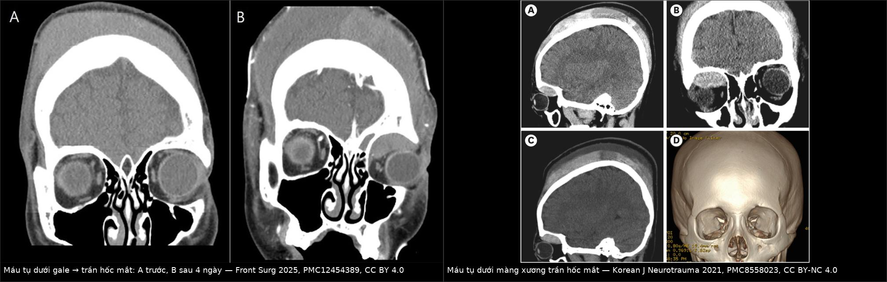
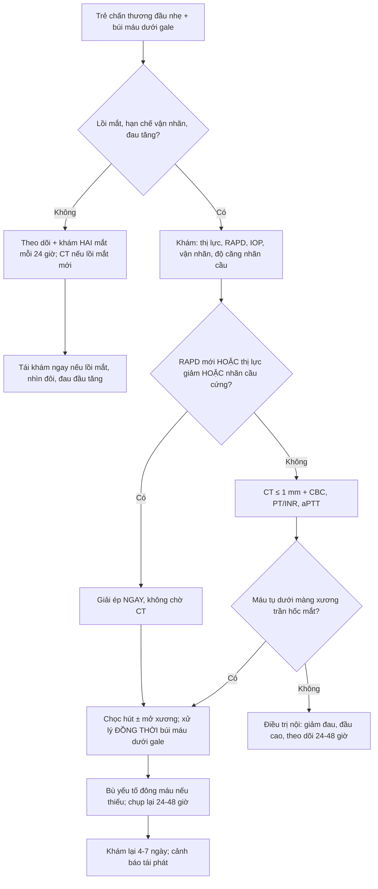
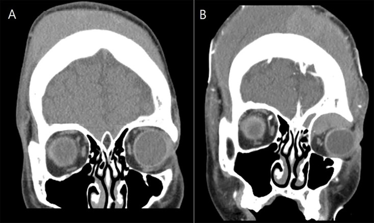
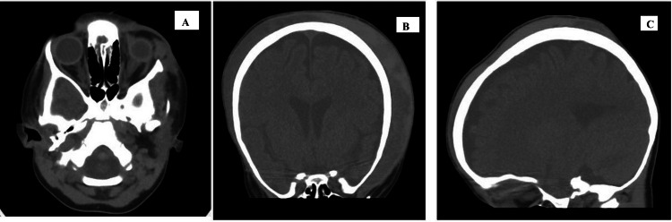
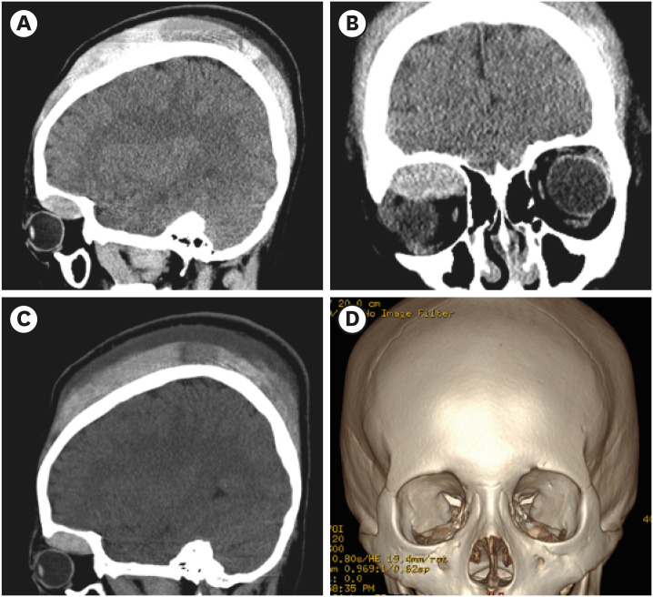

# 1514 — Máu tụ dưới gale lan vào hốc mắt: lồi mắt HAI BÊN xuất hiện muộn ở trẻ / Subgaleal hematoma with bilateral orbital compartment syndrome

**Tags:** `pattern:loi-mat` `pattern:mau-tu` `pattern:loi-mat-hai-ben` `vung:mat` `vung:hoc-mat` `vung:non-co` `vung:dinh-hoc-mat` `anatomy:arcus-marginalis` `protocol:CT-1mm` `protocol:sieu-am-hoc-mat` `protocol:MRI-hoc-mat` `score:khong` `incidentaloma:khong`

**Mức chắc chắn (certainty):** tổng hợp y văn (literature synthesis) — ghép **tổng quan hệ thống 126 trẻ / 138 mắt OCS do chấn thương** (*Children* 2026 — **PMC13511678**, CC BY 4.0), **tổng quan 27 ca máu tụ dưới gale ở trẻ ngoài sơ sinh** (*Front Pediatr* 2023 — **PMC10266201**, CC BY 4.0), và **3 ca nguyên văn có ảnh CT** (**PMC12454389** Front Surg 2025, CC BY 4.0; **PMC12719712** Cureus 2025, CC BY 4.0; **PMC8558023** Korean J Neurotrauma 2021, CC BY-NC 4.0). Nhóm **không có bệnh nhân của mình**; chỗ suy luận ghi **[suy luận]**.

> **Vị trí trong thư viện:** [1510](../1510-hoi-chung-khoang-hoc-mat/lesson.md) phủ **hội chứng khoang hốc mắt (orbital compartment syndrome, OCS)** nói chung — chẩn đoán bằng tay, canthotomy, IOP không loại trừ; bài này trả lời mặt còn trống: **một nguồn chảy NGOÀI hốc mắt (búi máu dưới gale) chảy tiếp vào trần hốc mắt trong nhiều ngày**, vì sao **hai bên**, vì sao **chọc hút búi máu dưới gale đơn thuần thất bại 68%**, và **thuật toán riêng cho nhóm này**. Liên quan: [420](../420-vo-san-hoc-mat/lesson.md) (vỡ sàn), [1461](../1461-ap-xe-duoi-mang-xuong-hoc-mat-o-tre/lesson.md) (áp-xe dưới màng xương), [3105](../3105-tran-khi-o-mat-sau-cham-thuong-go-ma/lesson.md) (khí hốc mắt), [449](../449-chan-thuong-mat-dich-vat/lesson.md) (vỡ nhãn cầu), [410](../410-giai-phau-hoc-mat/lesson.md) (giải phẫu hốc mắt).

> **Câu chốt — năm con số phải thuộc:** **(1)** Trong **126 trẻ** OCS do chấn thương, **25 trẻ (19,8%)** có **máu tụ dưới gale** kèm theo và **12 trẻ lồi mắt HAI BÊN** — hai bên gắn có ý nghĩa với nhóm dưới gale (**p < 0,05**) (PMC13511678). **(2)** Nhóm dưới gale khởi phát **MUỘN**: trung bình **5,4 ngày** tới triệu chứng đầu và **15,4 ngày** mới được khám, so với **1,9** và **2,3 ngày** ở nhóm không có máu tụ ngoài hốc mắt (**p < 0,05**) (PMC13511678). **(3)** Chỉ xử lý búi máu dưới gale là **không đủ**: **17/25 (68%)** phải can thiệp lần hai, trong khi nhóm không có máu tụ ngoài hốc mắt chỉ **3/80** (PMC13511678). **(4)** Ở trẻ, **81% (102/126)** OCS do **máu tụ DƯỚI MÀNG XƯƠNG hốc mắt** (thường ở **trần hốc mắt**) — khác người lớn (máu tụ sau nhãn cầu lan tỏa); chọc hút và mở xương đều thành công **95%** (PMC13511678). **(5)** **11/126** trẻ có **rối loạn đông máu** (9 bẩm sinh: hồng cầu hình liềm, hemophilia A/B, thiếu hụt fibrinogen, yếu tố VII/VIII/IX/XIII; 2 do thuốc/ECMO), gắn có ý nghĩa với máu tụ dưới gale (**p < 0,05**) (PMC13511678).

## 1. Tổng quan bệnh học – cơ chế hình ảnh (TẠI SAO)

### 1.1 Năm lớp da đầu và "khoang" dưới gale — vì sao máu chảy xa mà không đông tại chỗ

- Da đầu có **5 lớp**: da → mô liên kết đặc → **cân mạc (galea aponeurotica)** → **lớp mô lỏng (loose areolar tissue)** → **màng xương sọ (pericranium)**. **Khoang dưới gale** chính là lớp mô lỏng thứ tư, chứa **tĩnh mạch xuyên (emissary veins)** nối với xoang màng cứng.
- Khoang này **không có bám xương ở giữa**: galea bám vào **cơ trán (frontalis) – cơ chẩm (occipitalis)** ở trước–sau và **cân thái dương** hai bên, nên máu **lan khắp vòm sọ, vượt đường giữa, vượt khớp sọ** — đây là lý do **một búi máu có thể chạm cả hai hốc mắt**. Ở sơ sinh, khoang này chứa được **tới ~50% thể tích máu** của trẻ (PMC10266201); ở trẻ lớn, ca đã báo cáo hút **250 mL + 110 mL** từ vùng trán và trên ổ mắt (PMC8558023), ca khác truyền máu vì Hb xuống **7,1 g/dL** (PMC10266201).
- **Vì sao mắt bị "đen" trước khi hốc mắt bị chèn:** cơ trán **không bám xương**, nên máu chảy xuống **dưới cơ trán**, đọng **giữa cơ vòng mi (orbicularis oculi) và vách hốc mắt (orbital septum)** → **bầm tím quanh hốc mắt ("black eye")** dù **chưa có máu trong hốc mắt** (PMC8558023). Đây là cạm bẫy lớn: bầm mi **không** đồng nghĩa đã có máu trong hốc mắt.

### 1.2 Hai đường vào hốc mắt — và đường nào tạo "máu tụ dưới màng xương"

1. **Đường vách — mô quanh mắt:** qua khe giữa **vách hốc mắt và sừng bên cân cơ nâng mi**, máu vào **mô quanh mắt** (periocular), **không** vào khoang dưới màng xương, vì vách hốc mắt bám vào màng xương ở bờ ổ mắt (PMC8558023). Đường này gây **phù/bầm mi**, hiếm khi đủ để chèn ép.
2. **Đường dưới màng xương qua arcus marginalis:** **arcus marginalis** là nơi **màng xương sọ, màng xương hốc mắt (periorbita) và vách hốc mắt** gặp nhau ở bờ ổ mắt. Áp lực búi máu dưới gale **bong các bám dính này** rồi **luồn dưới màng xương (subperiosteal)** lên **trần hốc mắt** — đúng hình ảnh **máu tụ dưới màng xương hình thấu kính** trên CT (PMC13511678, PMC8558023).
3. **Đường ổ mắt trên (supraorbital notch):** **thần kinh trên ổ mắt** đi trong **mặt phẳng dưới gale** cho tới khi xuyên cơ trán; quanh **ổ mắt trên** màng xương **không liên tục** (thần kinh "trần"), tạo **khe nối từ khoang dưới gale vào khoang dưới màng xương hốc mắt**. Ổ mắt (notch) có đường kính **3,8–3,9 mm**, lớn hơn **lỗ (foramen) 2,3 mm**, và **đa số người có ổ chứ không phải lỗ** (PMC8558023). Bằng chứng hình ảnh: ca 12 tuổi có **ổ mắt trên bên bệnh RỘNG HƠN bên lành** trên dựng hình 3D xương sọ (PMC8558023 Fig 2D) — máu đi theo **ống thần kinh** vào hốc mắt phía trên–trong, khớp với vị trí máu tụ trong các ca khác.
- **[suy luận]** Vì màng xương trẻ **bám lỏng hơn người lớn**, cùng một lực chấn thương nhỏ tạo **lớp bóc tách dưới màng xương rộng hơn** → giải thích vì sao trẻ có **máu tụ dưới màng xương** (81%) chứ không phải máu tụ sau nhãn cầu lan tỏa như người lớn.

### 1.3 Vì sao biểu hiện MUỘN 4–7 ngày — vật lý của "dòng chảy tiếp diễn"

- Nhóm dưới gale khởi phát triệu chứng **trung bình 5,4 ngày** (SD 5,1) sau chấn thương, khám sau **15,4 ngày**; nhóm không có máu tụ ngoài hốc mắt: **1,9** và **2,3 ngày** (PMC13511678, Bảng 2).
- Hai ca nguyên văn cho thấy rõ **mốc thời gian**: ca 12 tuổi bị **giật tóc**, CT ngày 0 chỉ có búi máu dưới gale khu trú; **ngày 3** búi máu lan toàn bộ da đầu; **ngày 4** đột ngột lồi mắt phải (PMC8558023). Ca 16 tuổi: CT **4 ngày trước nhập viện** đã có máu tụ dưới gale + phù quanh hốc mắt nhưng **KHÔNG có máu trong hốc mắt**; CT lúc nhập viện (14 ngày sau chấn thương) có **máu tụ dưới màng xương hốc mắt + lồi mắt nặng** (PMC12454389).
- Cơ chế: **áp lực = thể tích thêm / độ giãn**, mà khoang dưới gale – dưới màng xương **độ giãn thấp**; máu còn **chảy tiếp** (đặc biệt khi có rối loạn đông máu) nên **áp lực leo thang theo ngày**, cuối cùng **bóc arcus marginalis** rồi dồn vào **hốc mắt hình tháp hẹp dần về đỉnh** — nơi **thần kinh thị** chui qua **ống thị giác không giãn**. Vì vậy **lồi mắt là dấu hiệu của giai đoạn muộn**, không phải dấu hiệu đầu tiên.

### 1.4 Vật lý hình ảnh: đậm độ nói gì về tuổi máu và vị trí

| Dấu hiệu trên CT không cản quang | Số đo / ngưỡng | Vì sao (vật lý + mô bệnh) |
|---|---|---|
| Búi máu dưới gale **vượt đường khớp sọ, vượt đường giữa** | **50–90 HU** khi cấp; **hỗn hợp cấp–bán cấp** ("mixed acute and subacute density") khi 2–3 ngày; **0–20 HU** khi chỉ còn huyết thanh | Máu đông = protein + fibrin + tế bào → đậm độ cao hơn cơ (~40–60 HU); khi hồng cầu lắng/tan, đậm độ giảm dần → **búi máu cũ có thể giả dịch** |
| **Không bị giới hạn bởi đường khớp** | — | Màng xương sọ **bám chặt ở đường khớp**, nên **máu tụ dưới màng xương (cephalohematoma)** dừng ở khớp; **khoang dưới gale** không có bám → vượt khớp. Đây là **chốt phân biệt số 1** |
| Máu tụ **dưới màng xương hốc mắt** | Hình **thấu kính (biconvex)**, đáy rộng áp **trần hốc mắt**, **không viền ngấm thuốc**; ca 2 tuổi: **2,0 × 0,7 × 0,7 cm**; ca MRI: **30,5 × 24 mm** ngoài nón sau vách | Máu nằm **giữa xương và màng xương** — mặt phẳng màng xương quyết định hình thấu kính; không có mạch nuôi nên **không ngấm thuốc** (khác u/máu tụ đang hoạt động) |
| **Lồi mắt + đẩy nhãn cầu** | Đo tại **đường liên gò má**; trong loạt trẻ: **mọi ca lệch nhãn cầu đều XUỐNG DƯỚI hoặc XUỐNG–NGOÀI** (PMC13511678) | Khối máu nằm **trên–trong** (trần hốc mắt) đẩy nhãn cầu theo hướng ngược lại — hướng lệch là **manh mối vị trí** |
| **Máu tụ ngoài màng cứng (EDH) kèm theo** | **21/126** trẻ; **15/21 có gãy xương hốc mắt**; tai nạn giao thông **~30%** nhóm này | Máu từ ổ gãy **trần hốc mắt** chảy vào hốc mắt — cơ chế **khác hẳn** đường arcus marginalis |

### 1.5 Ngưỡng thiếu máu thần kinh thị — vì sao "chờ vài ngày" là sai

- Võng mạc và thần kinh thị chịu **90–120 phút** thiếu máu trước khi tổn thương **không hồi phục** (PMC13511678); **áp lực khoang hốc mắt** bình thường **2–6 mmHg**, trong OCS tới **> 100 mmHg** (PMC9221953).
- **RAPD (relative afferent pupillary defect)** là dấu **tiên lượng**: **15 trẻ** có RAPD, trong đó **10 trẻ vẫn còn khiếm thị** dù đã mổ kịp thời (PMC13511678) — nghĩa là **RAPD xuất hiện = đã có tổn thương sợi trục**, không chờ thêm.
- **Nhãn áp (IOP) KHÔNG dùng để loại trừ**: đo được ở **24 trẻ (27 mắt)**, **10 trẻ IOP bình thường**; nhóm bệnh lý chỉ **trung bình 24 mmHg (22–70)** (PMC13511678). Ca 12 tuổi có **IOP ổn, RAPD âm** nên tác giả **không mổ cấp** mà chọc hút — một quyết định **có lý** nhưng chỉ an toàn khi theo dõi sát (PMC8558023).

## 2. Mẫu hình + chẩn đoán phân biệt theo vị trí (gamut)

**Mẫu hình trung tâm:** trẻ **chấn thương đầu nhẹ** (ngã, giật tóc, đánh vào đầu) → **búi máu dưới gale lan rộng, vượt đường khớp** → sau **3–7 ngày** **lồi mắt (một hoặc hai bên) + hạn chế vận nhãn + đau** → CT có **máu tụ dưới màng xương trần hốc mắt**.

**Gamut theo VỊ TRÍ của máu (quyết định tên gọi và cách xử trí):**

1. **Dưới gale (subgaleal)** — vượt khớp, vượt đường giữa, lan xuống mi; **nguồn chảy tiếp diễn**. Không tự chèn ép mắt nhưng là **bể chứa**.
2. **Dưới màng xương sọ (cephalohematoma)** — **dừng ở đường khớp**, không vượt đường giữa; lành tính, **không** lan vào hốc mắt.
3. **Dưới màng xương hốc mắt (orbital subperiosteal hematoma, OSH)** — **trần hốc mắt**, hình thấu kính; **nguyên nhân số 1 của OCS ở trẻ (81%)**.
4. **Sau nhãn cầu / trong nón (retrobulbar, intraconal)** — lan tỏa, hay gặp **người lớn**; ở trẻ thường là **phần mở rộng** của OSH hoặc do **vỡ mạch** kèm theo (PMC12454389: "suspected hematoma in the left intraconal space").
5. **Ngoài màng cứng + gãy trần hốc mắt** — **21/126**, thường tai nạn giao thông; máu theo **ổ gãy** vào hốc mắt.
6. **Dưới kết mạc / trong mi** — "**raccoon eyes**": **máu tụ dưới gale** hoặc **gãy sàn sọ trước**; **không** đồng nghĩa có máu trong hốc mắt.
7. **Trong hốc mắt KHÔNG do máu** — **khí hốc mắt** (sau xì mũi/chấn thương gò má), **áp-xe/viêm mô tế bào**, **u** (neuroblastoma, LCH, di căn) — cùng "lồi mắt" nhưng **điều trị ngược hẳn**.

**Gamut theo CƠ CHẾ (dễ nhớ: "SGH → 3 cửa vào hốc mắt"):**
- **Cửa 1 – dưới cơ trán:** bầm mi, phù mi (lành tính).
- **Cửa 2 – arcus marginalis:** bong màng xương → **OSH trần hốc mắt** (chèn ép thật).
- **Cửa 3 – ổ mắt trên:** theo **thần kinh trên ổ mắt** → máu tụ **trên–trong** hốc mắt (chèn ép thật).

## 3. Bảng so sánh phân biệt (ma trận đối chiếu)

| Thực thể (entity) | Hình ảnh điển hình | Chốt vào (rule-in) | Chốt loại (rule-out) | Gợi ý xác nhận |
|---|---|---|---|---|
| **Máu tụ dưới gale lan vào hốc mắt (bài này)** | Búi máu dưới gale **vượt khớp/đường giữa** + **máu tụ thấu kính ở trần hốc mắt**, lồi mắt **xuống–ngoài**, xuất hiện **3–7 ngày** sau chấn thương nhẹ | **Búi máu vượt đường khớp + OSH trần hốc mắt + khởi phát muộn**; tiền sử **giật tóc/ngã nhẹ** | Búi máu **dừng ở khớp** (→ cephalohematoma); **không có máu trong hốc mắt** trên CT lặp lại | CT sọ–hốc mắt **≤ 1 mm**, đo 3 chiều; **CBC + PT/INR + aPTT ± yếu tố đông máu** |
| **Cephalohematoma** | Khối **dưới màng xương sọ**, **dừng ở đường khớp**, không vượt đường giữa | **Bờ bị chặn bởi khớp sọ** | Vượt khớp/đường giữa → **dưới gale** | Khám + CT; không cần can thiệp |
| **EDH + gãy trần hốc mắt** | Máu **ngoài màng cứng** hình thấu kính trong sọ + **gãy trần hốc mắt**, máu trong hốc mắt | **Gãy xương hốc mắt + khối ngoài màng cứng** | Không gãy xương, búi máu dưới gale đơn thuần | CT sọ **xương** + nhu mô; hội chẩn ngoại thần kinh |
| **Máu tụ sau nhãn cầu (người lớn điển hình)** | Máu **lan tỏa** trong nón/ngoài nón, không giới hạn màng xương; thường sau mổ/chấn thương trực tiếp | **Lan tỏa + tiền sử mổ mắt/chấn thương trực tiếp** | Hình **thấu kính áp trần hốc mắt** → OSH | CT; đo áp lực khoang nếu có dụng cụ |
| **Viêm mô tế bào / áp-xe hốc mắt** | Dày mô mềm, **mờ mỡ hốc mắt**, ổ dịch **có viền ngấm thuốc**; có thể **khí** | **Sốt + đau nhức + viêm xoang sàng cùng bên + viền ngấm thuốc** | Khối **không ngấm thuốc, hình thấu kính**, không sốt → máu tụ | Kháng sinh + theo dõi 24–48 giờ; chọc hút/dẫn lưu khi ≥ 1 cm |
| **U hốc mắt (neuroblastoma, LCH, di căn)** | Khối đặc **ngấm thuốc**, có thể **xói xương**, lồi mắt tiến triển; "raccoon eyes" hai bên | **Khối ngấm thuốc + phá xương + u nguyên phát** | **Không ngấm thuốc + bờ theo màng xương** → máu tụ | MRI có cản quang + DWI; **không sinh thiết mù** |
| **Khí hốc mắt (tension emphysema)** | **−1.000 HU**, ổ khí nhiều ngăn, lồi mắt sau **xì mũi/ho** | **Đậm độ khí (âm tuyệt đối)** | Khối đậm độ mô/máu → không phải khí | CT cửa sổ xương; xem [3105](../3105-tran-khi-o-mat-sau-cham-thuong-go-ma/lesson.md) |
| **Máu tụ dưới màng xương KHÔNG chấn thương** | Cùng hình thấu kính ở trần hốc mắt nhưng **không có búi máu dưới gale** | **Viêm xoang, hồng cầu hình liềm, sau CPR** | Có búi máu dưới gale vượt khớp → nguồn chấn thương | MRI/CT xoang; điện di huyết sắc tố |

*Trái: CT coronal — **A** trước (chỉ có búi máu dưới gale + phù quanh hốc mắt), **B** sau 4 ngày (**máu tụ dưới màng xương trần hốc mắt + lồi mắt**). Phải: CT sagittal/coronal — máu tụ **hình thấu kính** dưới màng xương trần hốc mắt, kèm dựng hình 3D cho thấy **ổ mắt trên bên bệnh rộng hơn**. Nguồn: PMC12454389 Fig 2 (CC BY 4.0); PMC8558023 Fig 2 (CC BY-NC 4.0). Ảnh ghép letterbox, không crop/kéo giãn.*

### Ba dấu hiệu "đắt giá" trên một lát CT

- **Dấu 1 — búi máu vượt đường khớp:** chốt **dưới gale** (không phải cephalohematoma) và là **nguồn chảy tiếp diễn**.
- **Dấu 2 — khối thấu kính áp trần hốc mắt:** định vị **khoang dưới màng xương**, đo 3 chiều (mm) để so sánh lần chụp sau.
- **Dấu 3 — hướng lệch nhãn cầu:** **xuống–ngoài** = khối ở **trên–trong**; nếu lệch **ngang** thuần túy, nghĩ khối **ngoài nón bên** hoặc **u**.

## 4. Protocol chụp + thuật toán xử trí (không có RADS — có "đồng hồ")

### 4.1 Protocol hình ảnh

- **CT sọ + hốc mắt không cản quang, lát ≤ 1 mm, tái tạo đa bình diện (MPR) + cửa sổ xương:** đầu tay vì **nhanh, có xương, thấy máu tụ**; **110/126** trẻ trong loạt có CT (PMC13511678). Cản quang **không** cần cho máu tụ cấp; dùng khi nghi **giả phình/rò** hoặc khối **ngấm thuốc**.
- **Siêu âm hốc mắt đầu giường (9/126 ca):** không bức xạ, thấy **máu tụ sau nhãn cầu/dưới màng xương**, dấu **"guitar pick" (globe tenting)** khi thần kinh thị bị co kéo; có thể **hướng dẫn chọc hút** (báo cáo thành công **95%** cho OSH) (PMC13511678).
- **MRI hốc mắt (18/126 ca):** khi cần phân biệt **máu ở các thì** (T1/T2 theo hemoglobin), **u**, hoặc **áp-xe**; bắt buộc **T1 fat-sat sau tiêm + T2 fat-sat** theo phụ lục Mắt.
- **Xét nghiệm bắt buộc:** **CBC (Hb, tiểu cầu) + PT/INR + aPTT**; nếu nghi bệnh nền: **yếu tố VIII/IX/XI, yếu tố XIII, vWF, điện di Hb** (PMC10266201, PMC8558023, PMC12719712). Nhóm dưới gale **phải** làm đông máu vì gắn có ý nghĩa thống kê (PMC13511678).
- **Theo dõi hình ảnh:** chụp lại **24–48 giờ** nếu lồi mắt tăng sau can thiệp; **CT lặp lại ở ngày 4–7** nếu lần đầu **chưa có máu trong hốc mắt** nhưng búi máu dưới gale còn lớn (đúng ca PMC12454389).

### 4.2 Thuật toán 60 giây (Adapted từ PMC13511678, Hình 11)

### 4.3 Ngưỡng xử trí (theo bằng chứng hiện có)

| Tình huống | Xử trí | Cơ sở |
|---|---|---|
| Búi máu dưới gale **không** lồi mắt, không rối loạn tri giác | **Theo dõi**, giảm đau; **không** chọc hút thường quy | 18 mắt theo dõi, đa số không di chứng; chọc hút có nguy cơ **nhiễm trùng** qua tĩnh mạch xuyên (PMC13511678, PMC10266201) |
| Lồi mắt + **máu tụ dưới màng xương**, **không** RAPD/không giảm thị lực | **Chọc hút** (hoặc mở xương nếu máu đặc/tái phát) **+ xử lý búi máu dưới gale** | Chọc hút **29** và mở xương **43** ca, thành công **95%** cả hai (PMC13511678) |
| **RAPD mới / thị lực giảm / nhãn cầu cứng** | **Giải ép ngay** (canthotomy–cantholysis ± mở xương) **không chờ CT** | Cửa sổ thiếu máu **90–120 phút**; mổ **thì đầu** có thị lực tốt hơn **có ý nghĩa** (p < 0,05) (PMC13511678) |
| Búi máu dưới gale **tái phát** sau chọc hút | **Xử lý cả hai khoang** (gale + hốc mắt) hoặc **nút mạch** khi có nguồn động mạch | **68%** cần can thiệp lần hai khi chỉ xử lý gale; nút mạch đã dùng cho ca tái phát (PMC13511678, PMC10266201) |
| **Thiếu yếu tố đông máu / Hb giảm** | Bù **FFP/yếu tố**, truyền máu theo Hb; **không chọc hút khi chưa sửa đông máu** | Ca hemophilia C: FFP + hồng cầu khối trước mổ; ca Hb **7,1 g/dL** phải truyền (PMC12719712, PMC10266201) |

## 5. Biến thể bình thường và cạm bẫy

**Biến thể / hình thái dễ nhầm**
- **Búi máu dưới gale "giả dịch" (0–20 HU)** khi đã vài ngày: đậm độ thấp như nước, dễ đọc là **phù dưới da** hoặc **dịch dưới cân** — nhưng **vượt đường khớp** và **dày mô dưới gale** mới là chốt.
- **Bầm mi hai bên ("raccoon eyes")** do búi máu dưới gale chảy dưới cơ trán: **không** phải gãy sàn sọ trước, và **không** chứng minh có máu trong hốc mắt.
- **Máu tụ dưới màng xương ở sơ sinh** (8 ca trong loạt, 1 ca hai bên) sau **đẻ khó/kẹp forceps** — sinh lý màng xương bong khi *molding*, có thể **không có chấn thương rõ** (PMC13511678).

**Cạm bẫy (pitfall) — 8 lỗi hay gặp**
1. **Chọc hút búi máu dưới gale rồi cho là "đã xử lý"**: **68% (17/25)** tái phát/cần mổ lại; phải xử lý **cả khoang hốc mắt** (PMC13511678).
2. **Tin CT âm tính vài ngày trước**: ca 16 tuổi có CT **4 ngày trước** không có máu trong hốc mắt, rồi **lồi mắt nặng** (PMC12454389) — **thời điểm chụp** quan trọng hơn số lần chụp.
3. **Dùng IOP để loại trừ**: **10/24 trẻ** IOP bình thường (PMC13511678).
4. **Bỏ sót mắt thứ hai**: **12/126** hai bên, gắn với nhóm dưới gale — luôn khám **hai mắt**, kể cả khi trẻ chỉ kêu một bên.
5. **Gọi là viêm mô tế bào/áp-xe** vì mi sưng đỏ: khối **không ngấm thuốc**, **không sốt**, có **búi máu dưới gale** → máu tụ; kháng sinh trì hoãn giải ép = mù.
6. **Băng ép đầu chặt sau chọc hút**: tác giả ca hemophilia B cảnh báo **băng ép có thể làm tăng lan máu vào hốc mắt** — chỉ dùng **băng nhẹ** và theo dõi (PMC8558023) **[suy luận từ cơ chế áp lực]**.
7. **Satisfaction of search**: thấy **gãy xương sọ** rồi dừng, bỏ **máu tụ hốc mắt**; hoặc thấy **máu tụ hốc mắt** rồi bỏ **búi máu dưới gale** (nguồn chảy).
8. **Gọi lồi mắt ở trẻ là u** (neuroblastoma/LCH) rồi **sinh thiết mù**: khối **không ngấm thuốc**, hình **thấu kính**, có chấn thương nhẹ → máu tụ; MRI/DWI trước, sinh thiết sau.

## 6. Tự lượng giá — Blind Quiz ngay trên trang tĩnh

**Ca 1 — thiếu niên, lồi mắt tiến triển 2 tuần sau chấn thương đầu**

- Gợi ý lâm sàng: nam 16 tuổi, chậm phát triển, nhập viện **2 tuần** sau chấn thương đầu vì sưng mi và lồi mắt trái tăng dần; IOP trái **20 mmHg**, không đo được thị lực.
- Câu hỏi: (1) Khác biệt chính giữa **A** và **B**? (2) Vì sao CT sớm **âm tính** mà bệnh vẫn nặng lên? (3) Hai khoang nào phải xử lý?

<b>Bấm để hiện đáp án (findings + chẩn đoán)</b>

- Dấu hiệu: **A** (4 ngày trước nhập viện) — búi máu dưới gale + phù quanh hốc mắt, **chưa có máu trong hốc mắt**. **B** (lúc nhập viện) — búi máu dưới gale **lan rộng nhiều vùng da đầu**, **máu tụ dưới màng xương trần hốc mắt**, **lồi mắt + lệch nhãn cầu** rõ.
- Chẩn đoán: **máu tụ dưới gale lan vào hốc mắt gây hội chứng khoang muộn** — vì máu còn chảy tiếp và bóc **arcus marginalis** trong nhiều ngày, nên CT sớm **không loại trừ**.
- Xử trí trong ca: lấy máu tụ hốc mắt qua **đường rạch dưới cung mày + canthotomy bên + dẫn lưu**, đồng thời **chọc hút búi máu dưới gale 3 lần**; VEP sau mổ còn tốt.
- Nguồn ảnh: Lee HJ và cs., *Front Surg* 2025, **PMC12454389** Fig 2 — **CC BY 4.0**.

**Ca 2 — trẻ 2 tuổi, đầu to ra sau ngã nhẹ**

- Gợi ý lâm sàng: nữ 2 tuổi, ngã 2 ngày trước, đầu to (**chu vi đầu 54 cm**), mi sưng, nhãn cầu trái **lệch xuống**, có tiền sử gia đình rối loạn chảy máu.
- Câu hỏi: (1) Vì sao khối da đầu **vượt đường khớp** lại quan trọng? (2) Khối ở trần hốc mắt đo bao nhiêu? (3) Xét nghiệm nào không được bỏ?

<b>Bấm để hiện đáp án (findings + chẩn đoán)</b>

- Dấu hiệu: **A** — búi máu dưới gale **chu vi, vượt đường khớp**, đậm độ **hỗn hợp cấp–bán cấp**; **B/C** — **khối dưới màng xương trần hốc mắt trái 2,0 × 0,7 × 0,7 cm** gây lồi mắt (MRI: máu tụ ngoài nón sau vách **30,5 × 24 mm**).
- Chẩn đoán: **máu tụ dưới gale + máu tụ dưới màng xương hốc mắt**, trên nền **hemophilia C (thiếu yếu tố XI, ~1/1.000.000)**. Vượt đường khớp = khoang **dưới gale** (không phải cephalohematoma) và là **nguồn chảy tiếp diễn**.
- Xử trí: FFP + hồng cầu khối + acid tranexamic → **dẫn lưu máu tụ hốc mắt qua đường rạch dưới cung mày 2 cm**; xuất viện ngày 11, hết lồi mắt.
- Nguồn ảnh: Al Mustafa W và cs., *Cureus* 2025, **PMC12719712** Fig 1 — **CC BY 4.0**.

**Ca 3 — 12 tuổi, giật tóc rồi lồi mắt một bên**

- Gợi ý lâm sàng: nam 12 tuổi, bị anh trai **giật tóc**; ngày 3 búi máu lan toàn da đầu; ngày 4 đau mắt phải, **lồi mắt**, nhìn đôi, **không RAPD**, IOP ổn định.
- Câu hỏi: (1) Mô tả hình dạng và vị trí khối máu tụ. (2) Hình **D** gợi ý đường lan nào? (3) Vì sao không canthotomy ngay?

<b>Bấm để hiện đáp án (findings + chẩn đoán)</b>

- Dấu hiệu: **A/B/C** — khối **hình thấu kính, áp trần hốc mắt trên–trong**, bờ cong theo xương, **không ngấm thuốc** (máu tụ **dưới màng xương**); **D** — **ổ mắt trên bên phải rộng hơn bên trái** trên dựng hình 3D.
- Chẩn đoán: **máu tụ dưới màng xương hốc mắt do búi máu dưới gale đi theo ống thần kinh trên ổ mắt** (ổ **3,8–3,9 mm** vs lỗ **2,3 mm**), trên nền **hemophilia B (yếu tố IX 7%)**.
- Xử trí: **chọc hút cấp** búi máu dưới gale (**250 mL** vùng trán + **110 mL** trên ổ mắt) → lồi mắt giảm, nhắm mắt được; **không canthotomy** vì **IOP ổn + RAPD âm**; khối hốc mắt **không tăng** sau 3 ngày.
- Nguồn ảnh: Kim SY và cs., *Korean J Neurotrauma* 2021, **PMC8558023** Fig 2 — **CC BY-NC 4.0**.

## 7. Câu hỏi nghiên cứu & điểm chưa đồng thuận (tính đến 11/2026)

1. **[Tranh cãi] Ở trẻ có hội chứng khoang do máu tụ dưới gale, chọc hút búi máu dưới gale đơn thuần có tương đương giải ép đồng thời cả búi máu dưới gale và máu tụ hốc mắt về thị lực cuối cùng?**
   - **Đã biết:** **17/25 (68%)** trẻ chỉ xử lý búi máu dưới gale phải can thiệp lần hai, so với **3/80** ở nhóm không có máu tụ ngoài hốc mắt (PMC13511678); ca 16 tuổi vẫn phải mổ lấy máu tụ hốc mắt dù đã chọc hút búi máu dưới gale **3 lần** (PMC12454389).
   - **Chưa rõ:** Tiêu chí chọn ca **chọc hút đơn thuần** (thể tích? đậm độ? có RAPD?) và ngưỡng thể tích máu tụ để mổ.
   - **Hướng nghiên cứu:** Registry tiến cứu đa trung tâm ghi **thể tích máu tụ (cm³), thời gian tới giải ép, thị lực 3–6 tháng**.
   - **Nguồn:** PMC13511678 (2026); PMC12454389 (2025).

2. **[Khoảng trống] Siêu âm hốc mắt đầu giường có thể thay CT trước khi giải ép ở trẻ nghi máu tụ dưới màng xương, để giảm liều bức xạ?**
   - **Đã biết:** Siêu âm được dùng ở **9/126** trẻ, thấy dấu **"guitar pick"** và hướng dẫn chọc hút (báo cáo thành công **95%** cho OSH); siêu âm là đầu tay ở sơ sinh (PMC13511678, PMC5493487).
   - **Chưa rõ:** Độ chính xác của siêu âm so với CT theo **từng vị trí** (trần hốc mắt vs trong nón) và ca nào **đủ an toàn để bỏ CT**.
   - **Hướng nghiên cứu:** Nghiên cứu độ chính xác chẩn đoán tiến cứu, mù người đọc, so **siêu âm – CT – mô tả trong mổ**.
   - **Nguồn:** PMC13511678 (2026); PMC5493487 (2017).

3. **[Khác biệt thực hành] Bộ xét nghiệm đông máu tối thiểu và vai trò băng ép đầu sau chọc hút búi máu dưới gale ở trẻ.**
   - **Đã biết:** **11/126** trẻ có rối loạn đông máu, gắn với máu tụ dưới gale (**p < 0,05**); các ca báo cáo thiếu **yếu tố XIII, VII, XI** và **vWD** (PMC13511678, PMC10266201, PMC12719712); một tác giả cảnh báo **băng ép có thể làm tăng lan máu vào hốc mắt** (PMC8558023).
   - **Chưa rõ:** Có nên làm **yếu tố XIII/vWD** thường quy cho mọi búi máu dưới gale không tương xứng chấn thương; băng ép **nên hay không**, áp lực bao nhiêu.
   - **Hướng nghiên cứu:** Khuyến cáo đồng thuận (Delphi) + đoàn hệ so **băng ép vs không** về tỷ lệ lan vào hốc mắt.
   - **Nguồn:** PMC10266201 (2023); PMC8558023 (2021); PMC12719712 (2025).

## Bài liên quan chéo
- [1510 – Hội chứng khoang hốc mắt cấp (OCS): mù sau 90–120 phút, canthotomy, IOP không loại trừ](../1510-hoi-chung-khoang-hoc-mat/lesson.md)
- [420 – Vỡ sàn hốc mắt: giọt lệ, trapdoor trẻ em](../420-vo-san-hoc-mat/lesson.md)
- [1461 – Viêm mô tế bào hốc mắt & áp-xe dưới màng xương ở trẻ](../1461-ap-xe-duoi-mang-xuong-hoc-mat-o-tre/lesson.md)
- [3105 – Tràn khí hốc mắt sau chấn thương gò má](../3105-tran-khi-o-mat-sau-cham-thuong-go-ma/lesson.md)
- [449 – Chấn thương mắt & dị vật nội nhãn: vỡ nhãn cầu, BETT](../449-chan-thuong-mat-dich-vat/lesson.md)
- [410 – Giải phẫu học mắt và hốc mắt](../410-giai-phau-hoc-mat/lesson.md)
- [423 – Rò động mạch – xoang hang: lồi mắt đập theo mạch, SOV giãn](../423-fistula-xoang-hang/lesson.md)

## Ảnh
- `images/composite_1514_gale-vs-hoc-mat.jpg` — đối chiếu búi máu dưới gale lan vào trần hốc mắt (PMC12454389) và máu tụ dưới màng xương trần hốc mắt (PMC8558023).
- `images/1514_mau-tu-duoi-gale_CT_PMC12454389.jpg` — CT coronal trước/sau 4 ngày (ca 1).
- `images/1514_mau-tu-duoi-gale_CT_PMC12719712.jpg` — CT axial/coronal/sagittal: búi máu vượt khớp + khối trần hốc mắt (ca 2).
- `images/1514_mau-tu-duoi-gale_CT_PMC8558023.jpg` — CT sagittal/coronal + dựng hình 3D ổ mắt trên (ca 3).
- Nguồn, giấy phép từng ảnh: `images/CREDITS.md`.

> Không dùng để chẩn đoán độc lập khi chưa có người hướng dẫn.
