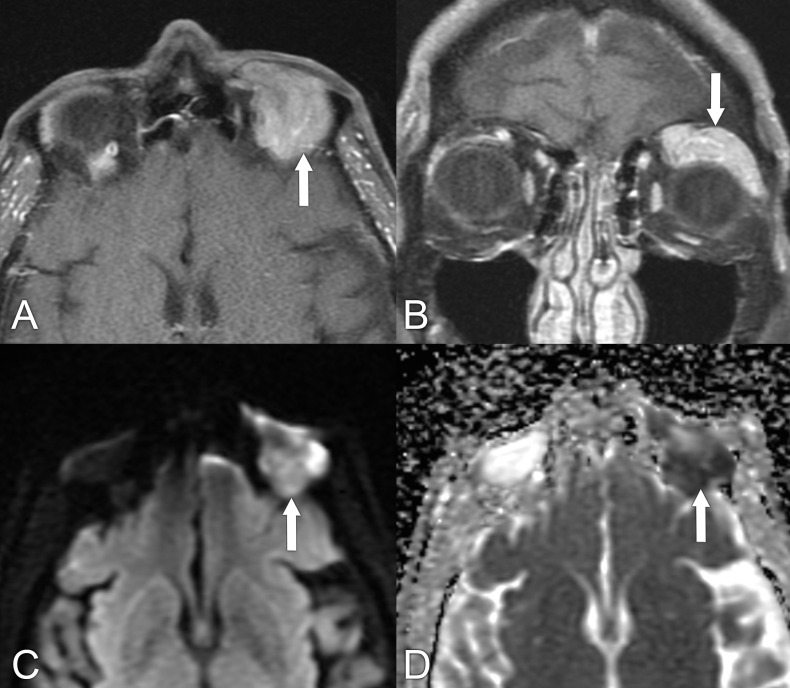
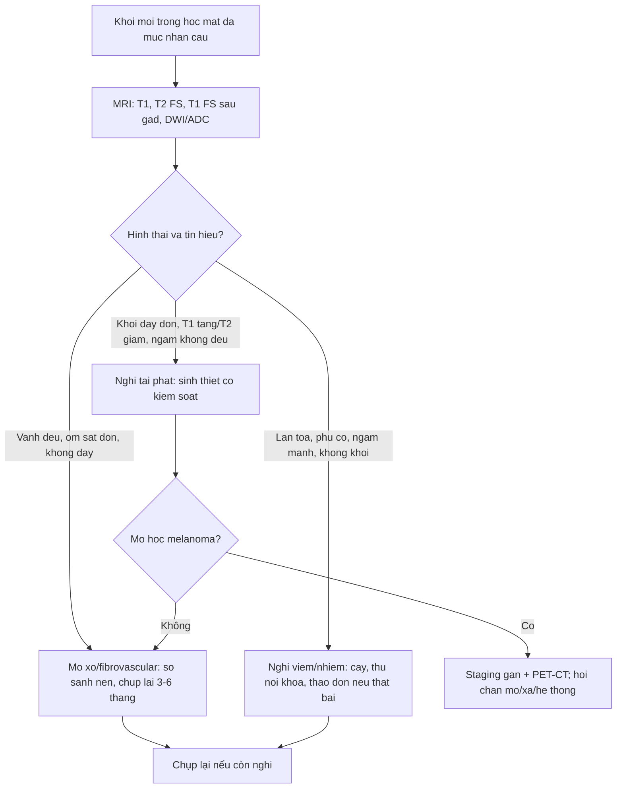
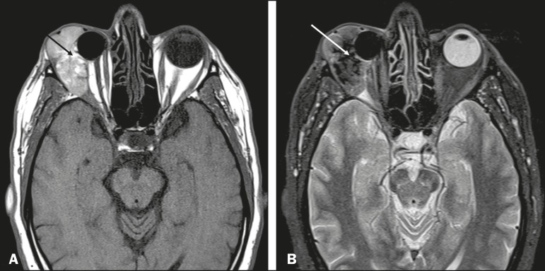
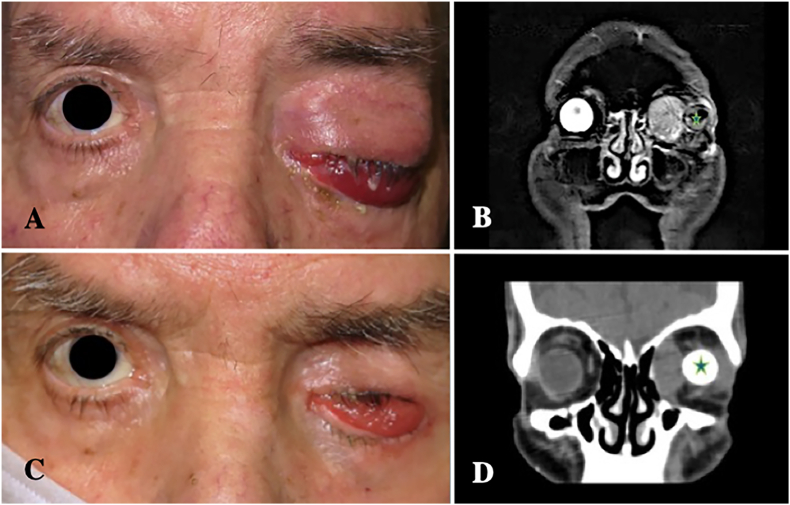
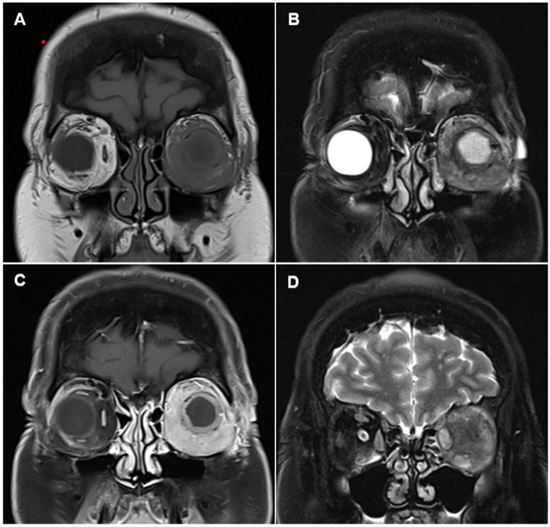

# 1515 — Theo dõi hốc mắt sau múc nhãn cầu vì melanoma hắc mạc: đọc MRI thế nào để không gọi sẹo là tái phát / Orbital surveillance after enucleation for uveal melanoma

**Tags:** `pattern:khoi-hoc-mat` `pattern:tai-phat` `pattern:mo-xo` `pattern:day-don-hoc-mat` `vung:hoc-mat` `vung:mat` `vung:nhan-cau` `vung:dinh-hoc-mat` `protocol:MRI-hoc-mat` `protocol:MRI-T1-fat-sat` `protocol:DWI-ADC` `protocol:FDG-PET` `incidentaloma:khong`

**Mức chắc chắn (certainty):** tổng hợp y văn (literature synthesis) — dựng từ hướng dẫn **ESMO–EURACAN 2026** (PMC13131131), đoàn hệ **89 ca melanoma thứ phát trong hốc mắt** ở Moorfields (PMC5481311), ca tái phát hốc mắt sau **9 năm** (PMC12664425), **37 ca melanoma hốc mắt** (PMC11978098), tổng quan MRI u hắc mạc (PMC10252038), **42 u hắc mạc** đối chiếu mô học (PMC8724164), ca viêm hốc mắt quanh độn gốm sinh học (PMC9552018) và ca melanoma nguyên phát trong hốc mắt đã múc (PMC6808609). Nhóm **không có bệnh nhân của mình**; chỗ chưa đủ chắc ghi "chưa rõ". **Không ghi tên tác giả** — attribution dùng tạp chí + năm + PMCID.

> **Vị trí trong thư viện:** [448](../448-u-hac-mac/lesson.md) phủ **gamut u hắc mạc + điều trị theo kích thước**; [1511](../1511-lan-ngoai-cung-mac-melanoma-hac-mac/lesson.md) phủ **lan ngoài củng mạc (ESE)** — yếu tố làm tái phát hốc mắt tăng từ **3% lên 18%**; [1497](../1497-tai-phat-bo-sau-xa-ban-mach-melanoma-hac-mac/lesson.md) phủ **tái phát bờ sau xạ bản**; [1503](../1503-di-can-gan-melanoma-hac-mac/lesson.md) phủ **di căn gan**. Bài này trả lời **một câu**: *sau khi đã múc nhãn cầu, một khối mới trong hốc mắt là sẹo – mô xơ – nhiễm độn hay tái phát, và đọc MRI thế nào để không mổ oan mà cũng không bỏ ca muộn?*
>
> **Câu chốt:** **(1)** Tái phát hốc mắt gặp ở **~3%** người múc nhãn cầu vì u lớn và **18%** khi có **lan ngoài củng mạc** lúc mổ (PMC12664425); **48% (23/48)** ca bệnh hốc mắt xuất hiện **≥ 36 tháng** sau điều trị u nguyên phát, **74%** trong số đó **> 6 năm**, ca muộn nhất **40–42 năm** (PMC5481311, PMC12664425). **(2)** Vành mô **đồng tín hiệu cơ trên T1, trung gian trên T2, ngấm thuốc đều và ôm sát mặt độn** là **mô xơ–fibrovascular bình thường**, không phải u (PMC9552018). **(3)** Không có tiêu chuẩn MRI nào đủ để loại trừ tái phát: ca viêm độn gốm sinh học có **lan tỏa + ADC trung tính + không phù** vẫn phải **sinh thiết** mới loại được melanoma (PMC9552018); vì vậy **khối mới đẩy độn, T1 tăng/T2 giảm, ngấm không đều** → **lấy mô**.

## 1. Tổng quan bệnh học – cơ chế hình ảnh

### 1.1 Tế bào melanoma "ngủ" ở đâu sau khi mắt đã lấy ra?

Múc nhãn cầu (enucleation) lấy **nhãn cầu + một đoạn thần kinh thị**, nhưng **không lấy hết** các đường thoát của u: **ống xuyên củng mạc (emissary channels)**, **vỏ quanh tĩnh mạch xoáy**, **mô mỡ sau củng mạc**, và **mô quanh đoạn thần kinh thị còn lại**. Tế bào còn lại có thể **nằm im nhiều năm** rồi mới tăng sinh — gọi là **hiện tượng ngủ (tumor dormancy)**. Cơ chế được nghĩ nhiều nhất là **giám sát miễn dịch**: lympho T đặc hiệu u (tyrosinase, Melan-A/MART-1, gp100) giữ cụm tế bào ở trạng thái cân bằng; khi **mất nhận diện kháng nguyên** hoặc **suy giảm miễn dịch do tuổi/tình trạng bệnh**, cụm tế bào thoát kiểm soát (PMC5481311).

Vì vậy **thời gian không loại trừ**: trong **48 ca melanoma thứ phát ở hốc mắt** có theo dõi đầy đủ, **23 ca (48%)** xuất hiện bệnh hốc mắt **≥ 36 tháng** sau u nguyên phát, **17/23 (74%)** sau **> 6 năm**, ca dài nhất **> 34 năm** (PMC5481311); y văn ghi nhận ca **40 năm** (DOI 10.1177/11206721211001266) và **42 năm** (PMC12664425). Bệnh nhân có thể đến vì **đau hốc mắt, chảy dịch, kính giả không còn vừa, hoặc sờ thấy nốt** — không có triệu chứng toàn thân.

### 1.2 Vì sao MRI là modality chính — và vì sao nó không đủ một mình

**Melanin là chất thuận từ (paramagnetic):** các gốc tự do bền trong melanin **rút ngắn T1** → khối **tăng tín hiệu T1**; đồng thời **rút ngắn T2** → **giảm tín hiệu T2**. Tỉ lệ này được báo cáo **72–95%** ở melanoma hốc mắt (PMC11978098). Nhưng **~15% u hắc mạc không có sắc tố** (PMC10252038) — khối **không tăng T1** vẫn có thể là melanoma. Vì vậy **thiếu dấu hiệu melanin không loại trừ**, và **có dấu hiệu melanin cũng không chứng minh tái phát** (melanocytoma, máu cũ, melanoma nguyên phát đều có thể tăng T1).

**Mô xơ–fibrovascular thì ngược lại:** đây là **mô hạt có mao mạch, nguyên bào sợi và dịch kẽ**, không phải mô u đặc. Trên MRI nó **đồng tín hiệu với cơ trên T1**, **tín hiệu trung gian trên T2** (không sáng như dịch), và **ngấm thuốc mạnh, đồng nhất** vì mao mạch dò rỉ + khoảng ngoại bào rộng. Dấu hiệu quyết định không phải "có ngấm thuốc" mà là **hình thái**: vành mỏng, **đều**, **ôm theo mặt độn**, không tạo khối đẩy (PMC9552018). Vành này xuất hiện **sớm nhất khoảng 5 tháng** sau đặt độn hydroxyapatite, **rõ nhất ở phần ngoại vi** (DOI 10.1016/s0161-6420(92)31918-9); trên 23 trẻ, ngấm thuốc được bán định lượng theo **thang 5 điểm**, trung bình **34 tuần** sau đặt độn (DOI 10.5301/EJO.2011.6298).

### 1.3 Khuếch tán (DWI/ADC): hữu ích nhưng chồng lấn

**Chuyển động khuếch tán của nước** giảm khi mật độ tế bào tăng → **ADC thấp**. Melanoma hắc mạc có **ADC 1,16 ± 0,26 × 10⁻³ mm²/s** (PMC8724164); lymphoma hốc mắt **0,6–0,8 × 10⁻³ mm²/s**, viêm **1,0–1,3 × 10⁻³ mm²/s**, với ngưỡng gợi ý **< 0,75–0,80** cho lymphoma và **> 0,9–1,0** cho viêm (PMC13171307). Ba dải này **chồng nhau**, và **không có nghiên cứu nào lập ngưỡng riêng cho hốc mắt đã múc nhãn cầu**. Ca viêm độn gốm sinh học có **ADC trung tính**, **không phù trên T2**, và vẫn **không phân biệt được** với tái phát trước sinh thiết (PMC9552018) — đây là bài học cốt lõi: **ADC là bằng chứng phụ, không phải phán quyết**.

### 1.4 Các con số phải nhớ

- **Tần suất:** **~3%** sau múc nhãn cầu vì u lớn; **18%** nếu có **lan ngoài củng mạc** lúc mổ (PMC12664425). Lan ngoài củng mạc có mặt ở **2–6%** tất cả u hắc mạc và **~13%** mắt phải múc (PMC13583686).
- **Thời điểm:** trong melanoma thứ phát ở hốc mắt, **48%** xuất hiện **muộn ≥ 36 tháng**; **74%** ca muộn xảy ra **> 6 năm** (PMC5481311).
- **Tiên lượng:** sau khi có bệnh hốc mắt, **52/69 ca tử vong**, với **trung vị 24 tháng** từ lúc chẩn đoán hốc mắt (PMC5481311); sống 5 năm của **37 ca melanoma hốc mắt** (hỗn hợp nguyên phát/thứ phát) là **78,4% ± 7,3%** (PMC11978098). Tái phát tại chỗ làm **tăng nguy cơ di căn**, với **HR 6,28** được dẫn trong tổng quan ca tái phát (PMC12664425).
- **Biến chứng không phải u:** lộ độn xảy ra **0,9–11%** (PMC12020655) — một "kẻ bắt chước" thường gặp của tái phát.

## 2. Mẫu hình + chẩn đoán phân biệt theo vị trí (gamut)

**Mẫu hình trung tâm:** *mô mềm mới hoặc dày lên trong hốc mắt đã mất nhãn cầu, có/không đẩy độn hốc mắt, có/không tăng tín hiệu T1.*

Bốn câu hỏi phải trả lời trước khi gọi "tái phát":

1. **Mô mới nằm ở đâu?** tiền vách/socket (nang, u hạt, lộ độn) · **trong nón** (cuống thị, đỉnh) · **ngoài nón** (mỡ, cơ, tuyến lệ) · **trong chính độn** (fibrovascular bình thường vs nhiễm).
2. **Nó có tôn trọng mặt độn không?** vành đều, ôm sát = mô xơ; nốt tách rời/đẩy độn = khối thật.
3. **Tín hiệu có "melanin" không?** T1 tăng + T2 giảm; nhớ **15% u không sắc tố**.
4. **Có bằng chứng lan ra ngoài hốc mắt?** xương, đỉnh, thần kinh thị, não — đổi giai đoạn và kế hoạch mổ.

**Gamut theo khoang:**

- **Tiền vách/socket:** nang kết mạc khổng lồ · u hạt dị vật · **lộ/nhiễm độn** · tái phát tại mỏm củng mạc · u nhú.
- **Trong nón:** tái phát dọc **cuống thần kinh thị** · u màng não thần kinh thị · di căn · lymphoma.
- **Ngoài nón:** tái phát theo **ống xuyên củng mạc** · u tuyến lệ · myositis/viêm cơ · di căn.
- **Trong độn:** **fibrovascular ingrowth bình thường** (vành ngấm đều) · nhiễm độn (ổ dịch/khí, lộ niêm mạc) · độn gốm sinh học gây viêm lan tỏa.

**Mnemonic "SOCKET":** **S**ignal (T1/T2 có melanin?) · **O**rbit compartment (trong/ngoài nón) · **C**onformity to implant (ôm mặt độn?) · **K**inetics/ADC (ngấm đều hay không, ADC) · **E**xtraorbital spread (xương/đỉnh/não) · **T**issue (sinh thiết khi còn nghi).

## 3. Bảng so sánh phân biệt (ma trận đối chiếu)

| Thực thể (entity) | Hình ảnh điển hình (MRI/CT) | Chốt vào (rule-in) | Chốt loại (rule-out) | Gợi ý xác nhận |
|---|---|---|---|---|
| **Tái phát melanoma hốc mắt** | Khối đặc bờ rõ/vừa, **T1 tăng nếu sắc tố**, **T2 giảm**, ngấm mạnh **không đều**, **đẩy độn**, có thể xâm lấn cơ/đỉnh; ADC thấp | **Khối mới so với MRI nền + đẩy độn + T1↑/T2↓ + ngấm không đều** | Vành mỏng đều ôm sát độn, không đẩy → không phải khối | **Sinh thiết/FNA có kiểm soát** + mô học; PET-CT/staging gan |
| **Mô xơ–fibrovascular quanh độn** | Vành mô **đồng tín hiệu cơ T1**, **trung gian T2**, **ngấm đều**, bám mặt độn; ngấm rõ ở ngoại vi trong vài tháng đầu | **Đều, đối xứng, không đẩy độn, không xâm lấn mỡ** | Nốt rời, bờ không đều, ngấm không đồng nhất → nghi u | So sánh chuỗi trước; chụp lại 3–6 tháng |
| **Viêm hốc mắt do độn (gốm sinh học/HA)** | Lan tỏa, T1 đồng tín hiệu cơ, T2 trung gian, **ngấm mạnh**, **phù cơ**, không có nốt; đau, hồng, chảy dịch | **Lan tỏa + phù cơ + bối cảnh độn + giảm sau tháo độn** | Khối khu trú, bờ rõ, xâm lấn xương → không phải viêm đơn thuần | Sinh thiết + cấy; **tháo độn** nếu tái phát |
| **Nhiễm/lộ độn** | Khuyết niêm mạc, **dịch/khí quanh độn**, viêm mô; CT thấy rõ hơn MRI | **Lộ độn + dịch/khí + chảy mủ** | Niêm mạc liên tục, không dịch → không nhiễm | Lâm sàng + cấy; siêu âm/CT |
| **Nang kết mạc khổng lồ** | Cấu trúc **dịch thuần**: T1 thấp/đồng tín hiệu dây thị teo, **không ngấm thuốc**, vỏ mỏng; CT nội dung giảm tỷ trọng | **Tín hiệu dịch, không phần đặc ngấm thuốc** | Có thành phần đặc/ngấm → không phải nang đơn thuần | Siêu âm/CT; chọc hút |
| **Melanoma NGUYÊN PHÁT hốc mắt** | Khối sắc tố **T1↑/T2↓**, không có u nội nhãn; tiền sử múc mắt **vì lý do khác** | **Tiền sử múc mắt không do u + T1↑/T2↓ + không có u nguyên phát nội nhãn** | Có tiền sử melanoma hắc mạc → nghĩ tái phát trước | Sinh thiết + staging toàn thân |
| **Di căn hốc mắt** | Khối xâm lấn, T1 đồng/tăng nhẹ, T2 tăng, ngấm thuốc; bối cảnh ung thư khác | **Bệnh nguyên phát đã biết + nhiều ổ + xâm lấn xương** | Đơn độc, sắc tố, không có bệnh nguyên phát | Sinh thiết + PET-CT |
| **Lymphoma hốc mắt** | **Ôm khuôn** theo cấu trúc, T2 tối, ngấm đồng nhất, **ADC 0,6–0,8 × 10⁻³ mm²/s** | **ADC thấp + ôm khuôn + không phá xương** | ADC > 1,0 hoặc phù lan tỏa → nghi viêm | Sinh thiết; DWI/ADC |
| **Xơ hóa sau xạ/mổ** | Mô xơ co kéo, **T2 thấp**, ngấm chậm; không đẩy độn; ổn định qua các lần chụp | **Bối cảnh xạ + kích thước ổn định + co kéo** | **Lớn dần, đẩy độn, ADC thấp** → không phải sẹo | So sánh nhiều thời điểm; sinh thiết nếu tiến triển |

*Ví dụ đọc "tín hiệu + khuếch tán" ở một khối hốc mắt: T1 sau tiêm (A), T1 sau tiêm mặt cắt trán (B), DWI (C) và ADC (D). Khối ngấm thuốc mạnh, **hạn chế khuếch tán** (sáng trên DWI, **tối trên ADC**) — kiểu mô đặc, mật độ tế bào cao. Lymphoma có ADC **0,6–0,8 × 10⁻³ mm²/s**, thấp hơn viêm (**1,0–1,3**); melanoma hắc mạc **1,16 ± 0,26** — ba dải chồng nhau nên **ADC không tự quyết định**. Nguồn: *Frontiers in Ophthalmology* 2026, Fig. 4, PMC13171307, CC BY 4.0.*

### Ba bước đọc một "khối mới" trong hốc mắt đã múc

1. **So với MRI nền, không so với trí nhớ.** Mô xơ sau mổ ngấm thuốc mạnh trong những tháng đầu; chỉ **thay đổi theo thời gian** mới có ý nghĩa. Nếu chưa có nền → chụp lại **3–6 tháng** trước khi kết luận.
2. **Mô tả hình thái trước, tín hiệu sau.** "Vành đều ôm độn" ≠ "khối đẩy độn". Đây là khác biệt giữa **theo dõi** và **lấy mô**.
3. **Trả lời câu hỏi lâm sàng, không chỉ câu hỏi hình ảnh.** Đau + kính không vừa + nốt sờ thấy ở người **có ESE (nguy cơ tái phát 18%)** đủ để **sinh thiết** dù ADC "trung tính" (PMC9552018).

## 4. Protocol chụp + hệ phân độ/điểm chuẩn hóa

### 4.1 Protocol MRI hốc mắt sau múc nhãn cầu

- **Máy:** ưu tiên **3 T + cuộn bề mặt (surface coil)**; 1,5 T vẫn dùng được nhưng cần lát mỏng hơn (PMC10252038).
- **Mặt phẳng:** axial, coronal, sagittal; **lát ≤ 2–3 mm**, FOV từ **bờ trước hốc mắt tới đỉnh** (gồm giao thoa thị giác khi nghi lan).
- **Chuỗi xung tối thiểu:** **T1** · **T2 fat-sat** · **T1 fat-sat sau gadolinium** (3 mặt phẳng) · **DWI (b = 0 và 1.000) + ADC**. Có thể thêm **3D T1 fat-sat isotropic ~1 mm** để dựng lại theo trục thần kinh thị.
- **Đo:** đường kính lớn nhất 3 mặt phẳng; khoảng cách tới **mặt độn**, **đỉnh hốc mắt**, **thần kinh thị**; ROI ADC **≥ 3 vùng**, tránh hoại tử/vôi.
- **Đối chiếu:** cùng mặt phẳng, cùng chuỗi với lần trước; ghi rõ **thời điểm so với mổ**.
- **CT:** khi cần **xương** (xâm lấn/thủng thành hốc mắt) hoặc khi MRI không thực hiện được; **không dùng CT để đo mô mềm**.

### 4.2 Khi nào chụp? (không có lịch chuẩn — nói rõ mức chắc chắn)

- **Khuyến cáo có bằng chứng:** ESMO 2026 khám **lâm sàng mỗi 6 tháng trong 2–5 năm đầu, sau đó hằng năm**; guideline **không đưa ra lịch MRI hốc mắt thường quy** (PMC13131131). Khi **nghi tái phát ngoài nhãn cầu**, chỉ định **MRI hốc mắt + não** và **staging toàn thân** (PMC13131131).
- **Thực hành hợp lý (suy luận từ dữ liệu, không phải mức I):** bệnh nhân **nguy cơ cao** (ESE > 5 mm, bờ dương, u thể biểu mô) — **MRI nền 3–6 tháng sau mổ** để có mốc so sánh, sau đó **chụp khi có triệu chứng** hoặc **mỗi 6–12 tháng trong 2–3 năm đầu**. Lý do: bệnh hốc mắt muộn gặp ở **48%** và **có thể là biểu hiện duy nhất** của bệnh tái hoạt (PMC5481311, PMC12664425).
- **Không chụp định kỳ vô hạn:** lợi ích sống còn chưa được chứng minh; chi phí và lo âu là thật (PMC13131131).

### 4.3 Bảng mốc thời gian thực hành

| Thời điểm | Việc làm | Vì sao |
|---|---|---|
| **3–6 tháng sau mổ** | MRI nền (nếu nguy cơ cao hoặc cần mốc) | Mô xơ còn ngấm mạnh; cần ảnh nền để so |
| **Mỗi 6 tháng (2–5 năm)** | Khám hốc mắt, kính giả, sờ nốt, đau/dịch | ESMO 2026 (PMC13131131) |
| **Bất kỳ lúc nào có triệu chứng** | MRI hốc mắt ± não; CT nếu cần xương | Đau, kính không vừa, nốt, chảy máu |
| **Sau 5 năm** | Khám hằng năm; giáo dục bệnh nhân về tái phát muộn | 74% ca muộn > 6 năm (PMC5481311) |

### 4.4 Đường đi quyết định

### 4.5 Hệ phân độ/điểm

**Không có RADS hay thang điểm riêng cho hốc mắt sau múc nhãn cầu.** Các thang hiện có chỉ dùng để **bán định lượng mức ngấm thuốc của độn** (thang **5 điểm** cho fibrovascular ingrowth — DOI 10.5301/EJO.2011.6298) hoặc **phân giai đoạn u nguyên phát AJCC 8** — không dùng để chẩn đoán tái phát. Vì vậy quyết định dựa trên **hình thái + so sánh + mô học**, không dựa trên "điểm".

## 5. Biến thể bình thường và cạm bẫy

- **Vành ngấm thuốc quanh độn là bình thường.** Trong ca viêm độn gốm sinh học, **vành mô ngoại vi của độn** được mô học xác nhận là **fibrovascular ingrowth**, không phải u (PMC9552018). Đừng gọi "tái phát" chỉ vì vành ngấm mạnh.
- **"Cold zone" trước độn = thiếu mạch nuôi, không phải u.** Trên 2 ca lộ độn hydroxyapatite, vùng **không ngấm thuốc phía trước** tương ứng **thất bại xâm nhập mạch** tại chỗ lộ (DOI 10.1016/s0161-6420(94)31112-2). Ngược lại, **vành ngấm đều** mới là lành.
- **ADC "trung tính" không loại trừ tái phát.** Ca 2022: lan tỏa, **không phù trên T2**, **ADC trung tính**, **phù cơ** — vẫn phải **sinh thiết**; kết quả là viêm, hết sau tháo độn (PMC9552018).
- **U không sắc tố.** **~15%** u hắc mạc không tăng T1 (PMC10252038) — đừng đợi "T1 sáng" mới nghĩ melanoma.
- **Melanoma NGUYÊN PHÁT trong hốc mắt.** Bệnh nhân múc mắt **vì đau/thần kinh/trauma** rồi **12 năm sau** có khối sắc tố: MRI **T1 tăng, T2 giảm mạnh**, CT xâm lấn cơ/tuyến lệ — chẩn đoán là **melanoma nguyên phát hốc mắt**, không phải "tái phát" (PMC6808609). **Tiền sử múc mắt vì lý do gì** là câu hỏi bắt buộc.
- **Nang kết mạc khổng lồ** sau múc mắt: cấu trúc dịch, **T1 đồng tín hiệu dây thị teo**, **không ngấm thuốc**; gặp ở **3–7%** người múc mắt có đặt độn — dễ bị đọc là "khối" nếu chỉ nhìn T1 (PMC10959544).
- **Độn cũ có vỏ kim loại** gây **giả ảnh dải** trên CT; đối chiếu phim cũ và mô tả loại độn (PMC9650925).
- **Bỏ sót do "thỏa mãn tìm kiếm":** thấy độn lệch là dừng. Phải nhìn **sau độn, đỉnh hốc mắt, cuống thần kinh thị, và hốc mắt bên kia**.
- **Sinh thiết không làm thay đổi xử trí thì đừng làm.** Ngược lại, khi **kết quả đổi giữa theo dõi và nạo vét/mổ**, **phải lấy mô** — không có dấu hiệu MRI nào thay thế được mô học (PMC9552018).

*Melanoma nguyên phát trong hốc mắt đã múc: **T1 (A)** có ổ **tăng tín hiệu** (mũi tên đen) trong khối lan tỏa; **STIR (B)** khối **giảm tín hiệu** (mũi tên trắng), không mất tín hiệu khi fat-sat — phù hợp **melanin**, không phải mỡ. Đây là "kẻ bắt chước" của tái phát khi tiền sử múc mắt không do u. Nguồn: *Radiologia Brasileira* 2019, Fig. 2, PMC6808609, CC BY-NC-ND 4.0 (nguyên bản, không cắt ghép).*

## 6. Tự lượng giá — Blind Quiz

**Ca 1 — Đau hốc mắt và kính giả không còn vừa, 9 năm sau múc nhãn cầu vì melanoma hắc mạc.**

- Gợi ý lâm sàng: nam **80 tuổi**, đau nhiều hốc mắt phải, không sốt, không sụt cân; tiền sử múc nhãn cầu **9 năm** trước vì melanoma hắc mạc thể biểu mô, **không** lan củng mạc/thần kinh thị.
- Câu hỏi: (1) Mô tả bất thường trên MRI và vị trí độn. (2) Ba chẩn đoán phân biệt hàng đầu. (3) Bước tiếp theo **đổi xử trí** là gì?

<b>Bấm để hiện đáp án (findings + chẩn đoán)</b>

- **Findings:** MRI mặt cắt trán T2 thấy **khối lớn lấp gần toàn bộ hốc mắt**, **đồng tín hiệu với cơ**, **đẩy độn ra ngoài** (dấu sao); CT **không phá xương**. FDG-PET/CT trong ca gốc **tăng bắt xạ tại hốc mắt**, không có ổ khác.
- **Chẩn đoán:** **tái phát melanoma hắc mạc trong hốc mắt** — xác nhận bằng **FNA qua mí dưới**; sau đó **pembrolizumab** làm giảm > 50% thể tích trong 3 tháng, độn trở về vị trí cũ.
- **Vì sao không phải "sẹo":** khối **đẩy độn**, **không ôm mặt độn**, và **có triệu chứng mới** — khác vành fibrovascular đều.
- **Bài học:** tái phát có thể xuất hiện **9 năm** sau mổ và **không có di căn** lúc trình diện; **không được trấn an bằng "đã múc mắt là khỏi"**.
- Nguồn: *American Journal of Ophthalmology Case Reports* 2025, Fig. 1, **PMC12664425**, CC BY-NC-ND 4.0.

**Ca 2 — Sáu tháng sau múc nhãn cầu vì u T4b, đau tăng và kính giả lệch xuống 1 cm.**

- Gợi ý lâm sàng: nữ **60 tuổi**, múc nhãn cầu trái **6 tháng** trước vì melanoma hắc mạc **T4b**, đặt độn gốm sinh học **22 mm**; đau hốc mắt 2 tháng, kính giả lệch, **hai nốt di động** ở bờ dưới hốc mắt, niêm mạc đỏ nhưng **không lộ độn**.
- Câu hỏi: (1) Phần nào của hình ảnh là **bình thường**? (2) Vì sao ADC không giúp loại trừ? (3) Xử trí?

<b>Bấm để hiện đáp án (findings + chẩn đoán)</b>

- **Bình thường:** **vành mô ngoại vi trong độn** — đồng tín hiệu cơ trên T1, trung gian trên T2, **ngấm thuốc đều** — là **fibrovascular ingrowth**, được mô học xác nhận.
- **Bất thường:** **thâm nhiễm lan tỏa** ra mô mỡ quanh độn, **ngấm mạnh**, **phù cơ trực**; **không có phù rõ trên T2/ADC** nên **không phân biệt được** viêm xơ hóa với tái phát lan tỏa.
- **Xử trí:** **sinh thiết** (frozen section) — **không có tế bào ác tính**; **tháo độn**; triệu chứng hết hoàn toàn. Chẩn đoán: **viêm hốc mắt do độn gốm sinh học**.
- **Bài học:** **vành ngấm đều = lành**, nhưng **lan tỏa + phù cơ** vẫn cần mô học; **ADC trung tính không loại trừ**.
- Nguồn: *American Journal of Ophthalmology Case Reports* 2022, Fig. 2, **PMC9552018**, CC BY-NC-ND 4.0.

**Ca 3 — Khối sắc tố làm bật kính giả, 12 năm sau múc nhãn cầu vì đau thần kinh hốc mắt.**

- Gợi ý lâm sàng: nam **59 tuổi**, múc nhãn cầu phải **12 năm** trước vì biến chứng **tiêm cồn** điều trị đau thần kinh hốc mắt (không phải ung thư); nay khối to 3 tháng, **đẩy bật kính giả**.
- Câu hỏi: (1) Tín hiệu nói gì? (2) Vì sao **không** gọi là "tái phát melanoma"? (3) Cần gì để chẩn đoán?

<b>Bấm để hiện đáp án (findings + chẩn đoán)</b>

- **Tín hiệu:** ổ **tăng T1** và **giảm mạnh T2/STIR** trong khối lan tỏa = **melanin**; khối **xâm lấn cơ trực/cơ chéo, tuyến lệ**, không có mặt phẳng tách.
- **Vì sao không phải tái phát:** **mắt được múc vì lý do không do u** — không có melanoma nội nhãn để "tái phát". Đây là **melanoma nguyên phát hốc mắt** (nguồn gốc tế bào melanin neural crest còn lại trong hốc mắt), chiếm **< 1%** u hốc mắt nguyên phát (PMC6808609, PMC11978098).
- **Chẩn đoán:** **sinh thiết** → melanoma thể tế bào hình thoi, sắc tố mạnh; staging âm tính.
- **Bài học:** **hỏi lại lý do múc mắt** là bước 0; "khối sắc tố trong hốc mắt" không đồng nghĩa "tái phát".
- Nguồn: *Radiologia Brasileira* 2019, Fig. 2, **PMC6808609**, CC BY-NC-ND 4.0.

## 7. Câu hỏi nghiên cứu & điểm chưa đồng thuận (tính đến 11/2026)

1. **[Khác biệt thực hành] Ở người múc nhãn cầu vì u hắc mạc nguy cơ cao (ESE > 5 mm/bờ dương), MRI hốc mắt định kỳ có cải thiện phát hiện sớm và sống còn so với chỉ khám lâm sàng?**
   - **Đã biết:** tái phát **3%** (u lớn) và **18%** (có ESE); **48%** xảy ra **≥ 36 tháng**; ESMO 2026 chỉ khuyến cáo khám **6 tháng/lần trong 2–5 năm** rồi hằng năm, **không đưa ra lịch MRI thường quy**.
   - **Chưa rõ:** lợi ích sống còn của MRI định kỳ, nhịp tối ưu và chi phí–lợi ích ở nhóm nguy cơ cao.
   - **Hướng nghiên cứu:** đoàn hệ tiến cứu/registry phân tầng theo ESE, so sánh MRI định kỳ với khám lâm sàng.
   - **Nguồn:** PMC13131131; PMC12664425; PMC5481311.

2. **[Tranh cãi] Ngưỡng ADC nào phân biệt tái phát melanoma với mô xơ/viêm trong hốc mắt đã múc nhãn cầu?**
   - **Đã biết:** melanoma hắc mạc **ADC 1,16 ± 0,26 × 10⁻³ mm²/s**; lymphoma **0,6–0,8**; viêm **1,0–1,3**; ca viêm độn có **ADC trung tính** vẫn không loại trừ được u.
   - **Chưa rõ:** ngưỡng riêng cho hốc mắt sau múc/xạ, ảnh hưởng của độn và xơ hóa lên ADC.
   - **Hướng nghiên cứu:** nghiên cứu độ chính xác chẩn đoán, đối chiếu mô học, báo cáo STARD.
   - **Nguồn:** PMC8724164; PMC13171307; PMC9552018.

3. **[Khoảng trống] FDG-PET/CT có giá trị gì khi MRI hốc mắt không kết luận?**
   - **Đã biết:** ESMO ghi **giá trị còn tranh luận**; ca tái phát có **bắt xạ cao tại hốc mắt** và không có ổ ngoài hốc mắt.
   - **Chưa rõ:** ngưỡng SUV, độ đặc hiệu trong viêm/hoại tử sau xạ, và ảnh hưởng lên quyết định mổ.
   - **Hướng nghiên cứu:** đoàn hệ tiến cứu so PET/CT với mô học ở ca MRI không kết luận.
   - **Nguồn:** PMC13131131; PMC12664425.

## Bài liên quan chéo
- [448 – U hắc mạc: melanoma vs névus vs di căn — gamut + MRI + điều trị theo kích thước](../448-u-hac-mac/lesson.md)
- [1511 – Lan ngoài củng mạc của melanoma hắc mạc: 5 mm chia đôi tiên lượng](../1511-lan-ngoai-cung-mac-melanoma-hac-mac/lesson.md)
- [1497 – Tái phát bờ sau xạ bản mạch melanoma hắc mạc](../1497-tai-phat-bo-sau-xa-ban-mach-melanoma-hac-mac/lesson.md)
- [1503 – Di căn gan của melanoma hắc mạc](../1503-di-can-gan-melanoma-hac-mac/lesson.md)
- [1510 – Hội chứng khoang hốc mắt cấp: chẩn đoán phân biệt khối/lồi mắt cấp](../1510-hoi-chung-khoang-hoc-mat/lesson.md)
- [1506 – Dị vật hốc mắt tồn lưu: giả ảnh kim loại và cạm bẫy CT](../1506-di-vat-hoc-mat-ton-luu/lesson.md)
- [400 – Tổng quan Mắt & thị giác](../400-tong-quan-mat-thi-giac/lesson.md)

## Ảnh
- `images/1515_theo-doi-hoc-mat_MRI-T2-CT_PMC12664425.jpg` — Fig. 1, *American Journal of Ophthalmology Case Reports* 2025, **PMC12664425**, **CC BY-NC-ND 4.0**.
- `images/1515_theo-doi-hoc-mat_MRI-T1T2CE_PMC9552018.jpg` — Fig. 2, *American Journal of Ophthalmology Case Reports* 2022, **PMC9552018**, **CC BY-NC-ND 4.0**.
- `images/1515_theo-doi-hoc-mat_MRI-DWIADC_PMC13171307.jpg` — Fig. 4, *Frontiers in Ophthalmology* 2026, **PMC13171307**, **CC BY 4.0**.
- `images/1515_theo-doi-hoc-mat_MRI-T1STIR_PMC6808609.jpg` — Fig. 2, *Radiologia Brasileira* 2019, **PMC6808609**, **CC BY-NC-ND 4.0**.

> Không dùng để chẩn đoán độc lập khi chưa có người hướng dẫn.
