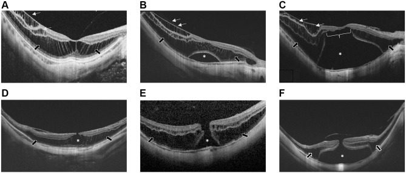
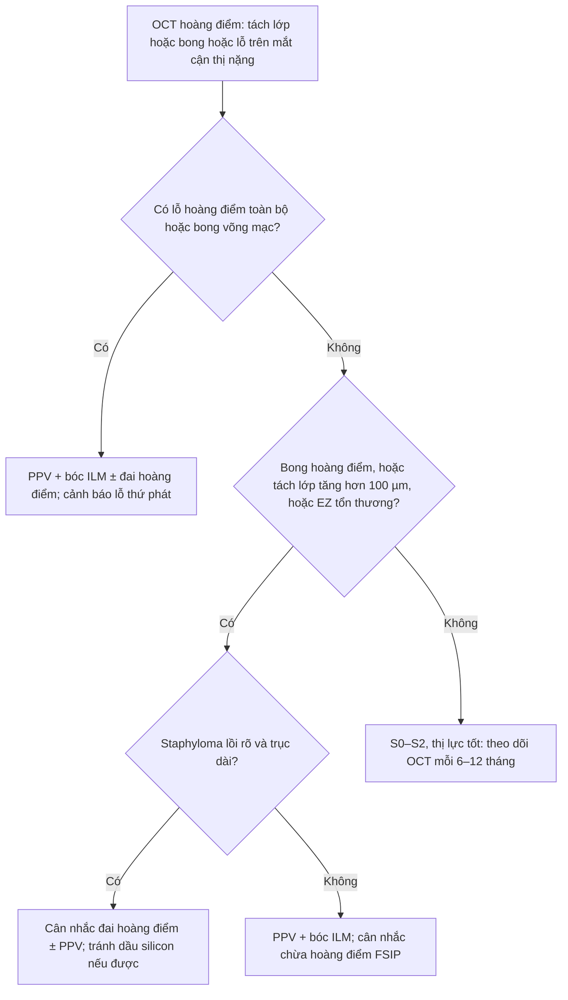
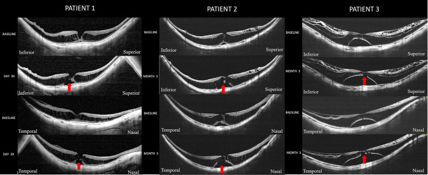
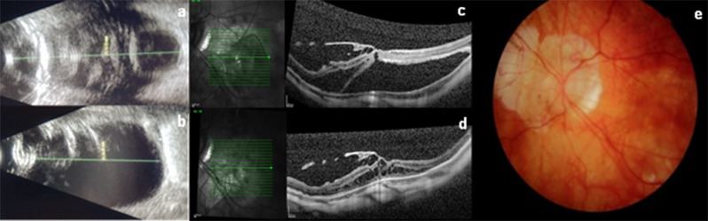
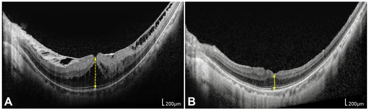
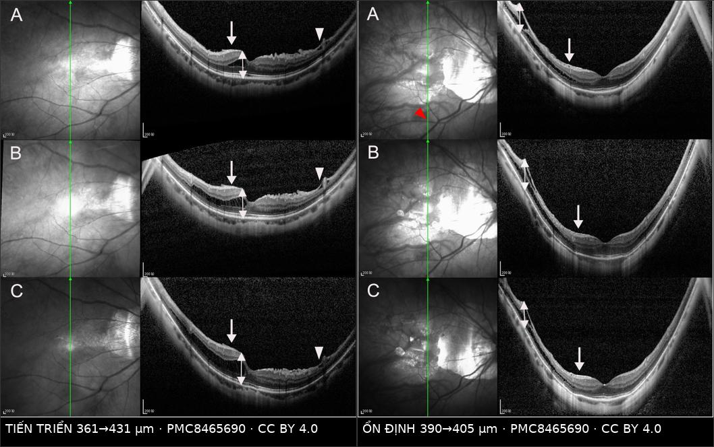

# 1516 — Bệnh lý co kéo cận thị (myopic traction maculopathy, MTM) & tách lớp hoàng điểm / Myopic traction maculopathy and foveoschisis

**Tags:** `pattern:foveoschisis` `pattern:tach-lop-vong-mac` `pattern:bong-hoang-diem` `pattern:lo-hoang-diem` `pattern:cot-Muller` `vung:mat` `vung:hoang-diem` `vung:hau-cuc` `anatomy:ILM` `anatomy:staphyloma` `anatomy:hac-mac` `protocol:SS-OCT` `protocol:OCT-12mm` `protocol:USG-B-scan` `protocol:do-truc-nhan-cau` `score:MSS` `score:ATN` `score:schisis-S0-S4` `incidentaloma:khong`

**Mức chắc chắn (certainty):** tổng hợp y văn (literature synthesis) — dựng từ **đoàn hệ tự nhiên 113 mắt** (*BMC Ophthalmol* 2021, **PMC8465690**, CC BY 4.0 — dùng ảnh), **đoàn hệ 120 mắt theo dõi dọc** (*Front Med* 2021, **PMC8777019**, CC BY 4.0 — dùng ảnh), **đoàn hệ 101 mắt** (*Cureus* 2024, **PMC11230611**, CC BY 4.0 — chỉ đọc số), **153 bệnh nhân hai mắt** (*Invest Ophthalmol Vis Sci* 2021, **PMC8665302**, CC BY-NC-ND 4.0 — chỉ đọc số), **38 mắt trục ngắn < 26,5 mm** (*Retina* 2022, **PMC8852681**, CC BY-NC-ND 4.0 — chỉ đọc số), **phân tích gộp 9 nghiên cứu/350 mắt** (*BMC Ophthalmol* 2024, **PMC10913604**, CC BY 4.0 — chỉ đọc số), **61 mắt bong hoàng điểm** (*Sci Rep* 2022, **PMC9017033**, CC BY 4.0 — chỉ đọc số), **36 mắt sau PPV + bóc ILM** (*J Ophthalmol* 2025, **PMC11842140**, CC BY 4.0 — chỉ đọc số), **33 mắt đo chiều cao hoàng điểm** (*Life* 2026, **PMC12942102**, CC BY 4.0 — dùng ảnh), **loạt 3 ca vành đai hoàng điểm** (*Int J Retina Vitreous* 2024, **PMC11350928**, CC BY 4.0 — dùng ảnh), **tổng quan thực hành** (*Community Eye Health* 2025, **PMC11938194**, CC BY 4.0), **đoàn hệ dân số 839 mắt** (*Ophthalmol Sci* 2025, **PMC12459344**, CC BY-NC-ND 4.0), **tổng quan chẩn đoán – xử trí** (*Clin Ophthalmol* 2020, **PMC7646438**, CC BY-NC 3.0 — dùng ảnh phổ tổn thương) và **48 mắt mổ ngoài khuyến cáo MSS** (*Indian J Ophthalmol* 2025, **PMC12178370**, CC BY-NC-SA 4.0). Nhóm **không có bệnh nhân của mình**; chỗ suy luận ghi **[suy luận]**.

> **Vị trí trong thư viện:** [1513](../1513-lacquer-cracks-cnv-can-thi/lesson.md) đã chốt mặt **sinh mạch (CNV)** của mắt cận thị; [1429](../1429-lo-hoang-diem-thu-phat-manh-oi/lesson.md) chốt **lỗ hoàng điểm thứ phát**; [1493](../1493-bien-chung-dai-hoang-diem-khi-nao-thao/lesson.md) chốt **biến chứng đai hoàng điểm**; [1467](../1467-mang-truoc-vong-mac-erm/lesson.md) chốt **màng trước võng mạc**. Bài này trả lời khoảng trống ở giữa: **tách lớp võng mạc do co kéo trên mắt cận thị nặng** — khi nào chỉ theo dõi, khi nào mổ, mổ kiểu gì, và **vì sao "bong hoàng điểm" trong MTM là điểm ngoặt**.

> **Câu chốt — sáu con số phải thuộc:** **(1)** MTM gặp ở **tới 30%** mắt cận thị cao (**PMC11938194**), nhưng ở quần thể dân số chỉ **2,9% mắt / 4,6% người** cận thị cao (839 mắt, **PMC12459344**) — khác biệt vì chọn mẫu bệnh viện (tới **38%** trong y văn). **(2)** Đây là bệnh **tiến triển**: **43,4%** mắt tiến triển trong **38,2 ± 11,1 tháng** (**PMC8465690**), **26,67%** trong **15,4 tháng** (**PMC8777019**), **24,8%** trong **25,7 tháng** (**PMC11230611**); các loạt báo **11,6–68,9%** tùy tiêu chuẩn. **(3)** Tiêu chuẩn tiến triển định lượng: **tăng > 100 µm chiều cao tách lớp** hoặc **lan sang vùng chưa tách** (Parolini, dẫn trong **PMC8777019**); **bong hoàng điểm tiến triển tới 41,67%** — cao nhất trong các thể, và có thể **chuyển thành lỗ hoàng điểm toàn bộ trong 23 ngày – 3 tháng** (Hình 3, **PMC8777019**). **(4)** **Mắt còn lại** cũng tiến triển **43,8%** trong **34,6 tháng**; tốc độ lên T3–T5 là **9,98%/năm** ở T0 so với **24,59%/năm** ở T1–T2 (**PMC8665302**). **(5)** Mổ PPV + bóc ILM: bề dày trung tâm hoàng điểm **427,1 → 155,9 µm**, thị lực **1,10 → 0,78 logMAR**, **63,89%** lên ≥ 2 dòng (**PMC11842140**); bong hoàng điểm dính lại **96,7%** nhưng **13,1%** tạo lỗ hoàng điểm thứ phát trong **3,4 tuần** (**PMC9017033**). **(6)** **Chừa hoàng điểm khi bóc ILM (FSIP)** giảm lỗ sau mổ còn **4,25%** so với **8,6%** khi bóc toàn bộ, thị lực tốt hơn **SMD −0,47** (**PMC10913604**). Bẫy chết người: **gọi tách lớp ngoài là "bong thanh dịch" rồi chọc/dẫn lưu** — trong MTM dịch nằm **trong** võng mạc, không phải dưới võng mạc.

## 1. Tổng quan bệnh học – cơ chế hình ảnh (TẠI SAO)

### 1.1 Hai lực ngược chiều trên một thành cầu giãn

- **MTM (myopic traction maculopathy)** là nhóm tổn thương hoàng điểm do **co kéo** ở mắt cận thị nặng: co kéo dịch kính – võng mạc (VMT), màng trước võng mạc (ERM), **tách lớp võng mạc (retinoschisis)**, **bong hoàng điểm (foveal detachment, FD)**, **lỗ hoàng điểm bán phần/toàn bộ (LMH/FTMH)** và **bong võng mạc có lỗ hoàng điểm (MHRD)** (**PMC8465690**, **PMC7646438**).
- **Cận thị cao** được định nghĩa **SE ≤ −6 D** hoặc **trục nhãn cầu ≥ 26,5 mm** (**PMC7646438**, **PMC11938194**). Khi nhãn cầu dài ra, **củng mạc sau mỏng và chùng**, hậu cực phình thành **staphyloma** — định nghĩa của Spaide là **"chỗ lồi ra của thành mắt có bán kính cong nhỏ hơn vùng xung quanh"** (**PMC7646438**).
- Có **hai hệ lực** cùng kéo võng mạc (**PMC7646438**, **PMC11938194**):
  1. **Lực tiếp tuyến (tangential)** — ERM co, **ILM cứng lại**, dịch kính còn dính một phần (partial PVD) kéo **song song** mặt võng mạc;
  2. **Lực vuông góc (perpendicular)** — staphyloma và sự giãn không đồng bộ của củng mạc kéo **vuông góc**, làm hõm hoàng điểm sâu thêm.
- Vì sao hai lực này lại **tách lớp** chứ không chỉ kéo giãn: võng mạc là một **lưới tế bào Müller** chạy xuyên từ ILM tới màng giới hạn ngoài; khi bị kéo, các cột Müller **giãn dài như dây chằng** và lớp mô lỏng nhất ở **lớp rối ngoài (OPL)/lớp hạt trong (INL)** tách ra thành **khoang dịch**, còn các cột Müller còn lại chính là **vách ngăn** nhìn thấy trên OCT. Đây là lý do hình ảnh đặc trưng: **khoang giảm phản xạ** + **cột tăng phản xạ** chạy dọc, không phải một khoang dịch trơn như bong thanh dịch **[suy luận từ giải phẫu – mô bệnh, đối chiếu mô tả trong PMC7646438]**.
- **Staphyloma là yếu tố quyết định vị trí**: tách lớp ngoài hay nằm **đúng vùng lồi nhất của staphyloma**, nơi lực căng thành mắt lớn nhất (định luật Laplace: **T ∝ P × r**, bán kính cong càng nhỏ thì ứng suất thành càng cao) (**PMC8465690** báo tách lớp ngoài ở hoàng điểm/staphyloma tiến triển nhanh hơn ở vùng cạnh mạch; **PMC8852681** cho thấy **92,11%** mắt MTM trục < 26,5 mm vẫn có staphyloma).

### 1.2 Vì sao OCT nhìn thấy — và nhìn thấy gì

- **OCT** đo **thời gian trễ của ánh sáng phản xạ**; dịch trong khoang tách lớp **không phản xạ** → **giảm phản xạ (hyporeflective)**; vách Müller và mô võng mạc còn lại **phản xạ mạnh** → **cột tăng phản xạ**. Độ phân giải trục của SD-OCT **~5–7 µm** đủ thấy vách dày vài chục µm; **SS-OCT bước sóng ~1050 nm** xuyên qua lớp RPE tốt hơn, nên đọc được **hắc mạc mỏng và bờ staphyloma** — hai thứ SD-OCT 840 nm thường "cắt" mất **[suy luận vật lý – thông số thiết bị chuẩn]**.
- **Chiều cao tách lớp** được đo bằng **MNT (maximum neural thickness)** — khoảng cách từ ILM tới **bờ ngoài RPE** tại điểm dày nhất (**PMC8465690** mô tả trực tiếp trên ảnh: **399 → 525 µm** ở một mắt tiến triển). Với mục đích tiên lượng sau mổ, **chiều cao hoàng điểm (FH, foveal height)** được định nghĩa là **khoảng cách thẳng đứng ngắn nhất từ bề mặt dịch kính – võng mạc tới bờ ngoài RPE**, gồm cả khoang tách lớp và bong hoàng điểm; sau khi hết tách lớp, đo **CFT (central foveal thickness)** — bề dày mô võng mạc thật (**PMC12942102**, Hình 1).
- **Dải ellipsoid (EZ)** là lớp **đoạn trong tế bào quang thụ** giàu ty thể — nơi tiêu thụ oxy mạnh nhất. Khi tách lớp kéo dài, khoảng khuếch tán từ hắc mạc tới quang thụ tăng lên; **EZ mất liên tục** là dấu hiệu tổn thương **không hồi phục** và là yếu tố tiên lượng thị lực xấu nhất trong đoàn hệ 113 mắt (**p = 0,0130**) (**PMC8465690**). Vì sao **bong hoàng điểm** nặng hơn tách lớp: một khi dịch lọt **dưới** lớp quang thụ, khoảng cách khuếch tán tăng vọt và tế bào quang thụ **chết dần** — đoàn hệ 61 mắt bong hoàng điểm có **93,44%** kèm tách lớp và gần **một nửa** có lỗ bán phần trong/ngoài (**PMC9017033**).
- **Hắc mạc mỏng** là nền của mọi thứ: mắt cận thị cao có hắc mạc hậu cực mỏng hơn, choriocapillaris thưa — nên khả năng bù trừ khi tách lớp kém **[suy luận, phù hợp PMC7646438 về vai trò hắc mạc – củng mạc]**.

### 1.3 Vì sao bệnh tiến triển — và vì sao không phải mắt nào cũng tiến triển

- **Tiến triển** trong đoàn hệ 113 mắt: **43,4%** trong **38,2 ± 11,1 tháng**; tách lớp ngoài **ở hoàng điểm hoặc trong staphyloma** tiến triển nhanh hơn tách lớp ở **vùng cạnh mạch** (**p = 0,0011**); **PVD bán phần** cũng làm tiến triển nhanh hơn (**p = 0,0447**) — vì dịch kính còn dính **một phần** vừa kéo vừa **tạo lực tiếp tuyến lệch** (**PMC8465690**).
- Đoàn hệ 120 mắt xác nhận **26,67%** tiến triển trong **15,4 tháng**; hai yếu tố độc lập là **bong màng giới hạn trong (ILM detachment)** và **tách lớp lan toàn hoàng điểm** lúc đầu; **5 mắt (4,17%) tự khỏi** khi ILM/ERM **rách** hoặc PVD **hoàn toàn** — nghĩa là **theo dõi có cơ sở**, không phải "chờ vô ích" (**PMC8777019**).
- Đoàn hệ 101 mắt: **24,8%** tiến triển, **3%** thoái triển, tốc độ **0,20 bệnh nhân–năm**; yếu tố liên quan là **thị lực lúc đầu** (**p = 0,012**) và **có staphyloma** (**p = 0,001**) (**PMC11230611**).
- Vì sao tỷ lệ dao động **11,6–68,9%**: khác **tiêu chuẩn tiến triển** (chỉ thị lực vs hình thái), khác **thời gian theo dõi**, khác **tuổi/PVD** — chính là khoảng trống chuẩn hóa ở mục 7 (**PMC8465690** bàn trực tiếp).

## 2. Mẫu hình + chẩn đoán phân biệt theo vị trí (gamut)

### 2.1 Mẫu hình theo vị trí và mức độ lan

- **Phân độ tách lớp theo vị trí (S0–S4, Parolini)** — dùng trong **PMC8777019**:
  - **S0:** không tách lớp hoàng điểm;
  - **S1:** tách lớp **ngoài hoàng điểm** (extrafoveal, hay ở vùng cạnh mạch — thường **lớp trong**);
  - **S2:** tách lớp **chỉ ở hoàng điểm**;
  - **S3:** tách lớp **ở hoàng điểm nhưng chưa toàn bộ hoàng điểm**;
  - **S4:** tách lớp **toàn bộ hoàng điểm**.
- **Vị trí quyết định tốc độ**: tách lớp **ngoài ở hoàng điểm/staphyloma** nhanh hơn **cạnh mạch** (**p = 0,0011**, **PMC8465690**); tách lớp **toàn hoàng điểm** là yếu tố nguy cơ độc lập (**PMC8777019**). Cạnh mạch thường là **tách lớp trong** do mạch máu võng mạc **dính chặt** vào ILM tạo điểm neo — vì thế ít tiến triển hơn **[suy luận từ mô tả giải phẫu trong PMC8465690]**.
- **Mẫu hình theo tổn thương (thứ tự nặng dần):** tách lớp → **bong hoàng điểm** → **lỗ bán phần (LMH)** → **lỗ toàn bộ (FTMH)** → **bong võng mạc có lỗ hoàng điểm (MHRD)**. Đây là **một bệnh tiến triển**, không phải 5 bệnh rời (**PMC7646438**, **PMC11938194**).
- **Mẫu hình "ống sáo" (champagne flute)**: tách lớp ngoài lan thành **nhiều khoang dọc** từ hoàng điểm ra hậu cực, vách Müller dày — dấu hiệu tách lớp **mạn, đang hoạt động**, hay gặp ở S3–S4 **[suy luận mô tả hình thái; không gán tỷ lệ vì nguồn đã đọc không báo số]**.
- **Mẫu hình "bậc thang" ở bờ staphyloma**: bờ tách lớp **gãy góc** đúng nơi thành mắt đổi bán kính cong — nhìn trên OCT dọc qua hoàng điểm; giúp phân biệt với bong thanh dịch do CNV (bờ thoải, có màng tăng phản xạ dưới võng mạc) (**PMC7646438**).

### 2.2 Gamut chẩn đoán phân biệt

- **Tách lớp võng mạc do MTM** (người lớn cận thị nặng, staphyloma, trục dài, vách Müller).
- **Bong hoàng điểm trong MTM** (dịch **dưới** võng mạc ngoài, trên RPE, thường có tách lớp ngoài đi kèm; **93,44%** ca bong hoàng điểm có tách lớp — **PMC9017033**).
- **Lỗ hoàng điểm bán phần (LMH) / toàn bộ (FTMH)** trong MTM — bờ lỗ, mất liên tục các lớp, kích thước đo bằng µm (**PMC7646438**).
- **Bong võng mạc có lỗ hoàng điểm (MHRD)** — dịch lan ra ngoài hoàng điểm, thường có **lỗ toàn bộ** + tách lớp; khác bong võng mạc rách chu biên (**PMC7646438**, **PMC11350928**).
- **Tách lớp do di truyền (X-linked retinoschisis)** — **bé trai, hai bên**, tách lớp **nan hoa ở hoàng điểm** + tách lớp chu biên, **ERG giảm sóng b**, **không có staphyloma/trục dài**; đây là "kẻ bắt chước" nguy hiểm nhất ở người trẻ **[suy luận từ đặc điểm bệnh học chuẩn; nguồn đã đọc không báo số]**.
- **Bệnh lý hố thị thần kinh (optic disc pit maculopathy)** — tách lớp **dạng bong** nối từ **hố thị** ra hoàng điểm, thường một bên, trẻ; **không có staphyloma**; OCT thấy **cầu nối dịch từ đĩa thị** **[suy luận từ hình thái chuẩn]**.
- **CNV cận thị** — **xuất huyết/dịch cấp**, **màng tăng phản xạ dưới võng mạc**, **OCTA có mạng mạch**; CNV gặp **5–10%** mắt cận thị cao, **80,7% type 2** (**PMC12637130**, bài [1513](../1513-lacquer-cracks-cnv-can-thi/lesson.md)).
- **Bong võng mạc rách (RRD)** — có **rách**, dịch **dưới võng mạc** lan theo trọng lực, **không có cột Müller**; siêu âm khi không thấy đáy mắt.
- **Màng trước võng mạc (ERM) có nang giả** — co kéo **tiếp tuyến**, nang nhỏ trong hoàng điểm, **không có staphyloma**; có thể **kèm** MTM (**PMC7646438**).
- **Dome-shaped macula (DM)** — vồng **lồi về phía dịch kính** trong staphyloma, **yếu tố bảo vệ**: mắt có DM có thị lực cuối tốt hơn (**p = 0,0494**) (**PMC8465690**); DM **có thể kèm tách lớp**, nên đừng loại MTM chỉ vì thấy vồng.

## 3. Bảng so sánh phân biệt (ma trận đối chiếu)

| Thực thể (entity) | Hình ảnh điển hình trên OCT/US | Chốt vào (rule-in) | Chốt loại (rule-out) | Gợi ý xác nhận |
|---|---|---|---|---|
| **Tách lớp MTM (foveoschisis)** | Khoang **giảm phản xạ trong võng mạc** + **cột Müller tăng phản xạ**; hay ở hoàng điểm/staphyloma; MNT **399–665 µm** trong ví dụ tiến triển | **Cột – vách trong khoang dịch** + **staphyloma** + trục dài | Dịch **dưới** võng mạc trơn, không cột → bong thanh dịch/CNV | SS-OCT 12 mm dọc + ngang qua hoàng điểm; đo MNT/FH |
| **Bong hoàng điểm trong MTM (FD)** | Khoang **dưới võng mạc ngoài**, bờ cong theo hõm hoàng điểm; **93,44%** kèm tách lớp | **Dịch dưới võng mạc + tách lớp ngoài** + EZ còn/có thể mất | Dịch **trong** võng mạc → tách lớp đơn thuần | OCT dọc; so sánh bờ RPE; theo dõi **1–3 tháng** vì tiến triển **41,67%** |
| **Lỗ hoàng điểm bán phần (LMH)** | Mất liên tục **một phần** các lớp, bờ nang; đáy lỗ còn lớp ngoài | **Bờ lỗ có nang + đáy còn mô** | Mất liên tục **toàn bộ** tới RPE → FTMH | OCT cắt mỏng 3 µm; đo đường kính |
| **Lỗ hoàng điểm toàn bộ (FTMH)** | Mất liên tục **tất cả** lớp tới RPE; bờ dày, có nang | **Lỗ toàn bộ + bờ nang** | Chỉ mất lớp trong, đáy còn → LMH | OCT; siêu âm nếu đục |
| **MHRD** | **FTMH + dịch lan ra ngoài hoàng điểm**, tách lớp quanh | **Lỗ toàn bộ + bong võng mạc lan** | Bong võng mạc rách chu biên không lỗ hoàng điểm | OCT rộng + B-scan; đánh giá trục, staphyloma trước mổ |
| **X-linked retinoschisis** | Tách lớp **nan hoa** ở hoàng điểm + chu biên, hai bên; không staphyloma | **Bé trai + hai bên + ERG sóng b giảm** | Người lớn, một bên, staphyloma → MTM | ERG; khám gia đình; OCT chu biên |
| **Optic disc pit maculopathy** | Tách lớp/bong nối **từ hố thị** ra hoàng điểm, một bên | **Hố thị + cầu dịch từ đĩa** | Không thấy hố thị, có staphyloma → MTM | OCT qua đĩa thị; chụp đáy mắt nghiêng |
| **CNV cận thị** | **Màng tăng phản xạ dưới võng mạc**, xuất huyết, dịch; OCTA có mạng | **OCTA có mạng CNV + xuất huyết** | Chỉ tách lớp, không màng mạch → MTM | OCTA, FA; xem bài 1513 |
| **ERM có nang giả** | Màng tăng phản xạ **trên ILM**, co kéo tiếp tuyến, nang nhỏ | **Màng trên ILM + co kéo ngang** | Cột Müller trong khoang dịch → tách lớp | OCT; có thể kèm MTM |

*Sáu mức của cùng một bệnh trên OCT (A–F): **A** tách lớp với cột Müller (mũi tên trắng = lớp trong, đen = lớp ngoài); **B** bong hoàng điểm (dấu \*) trên nền tách lớp; **C** bong võng mạc + tách lớp + lỗ bán phần ngoài; **D** lỗ bán phần; **E** lỗ toàn bộ; **F** bong võng mạc có lỗ hoàng điểm. Nguồn: *Clin Ophthalmol* 2020 (PMC7646438), Fig. 1, CC BY-NC 3.0 — nguyên bản, không sửa.*

## 4. Protocol chụp + hệ phân độ/điểm chuẩn hóa

### 4.1 Protocol tối thiểu

- **SS-OCT hoàng điểm, chế độ 12 mm widefield** (hoặc SD-OCT EDI nếu không có SS-OCT), **cắt dọc + ngang qua trung tâm hoàng điểm**, cộng **cắt xoay (radial)** để không bỏ sót tách lớp lệch trục; **cùng một kinh tuyến ở mỗi lần theo dõi** để so sánh chiều cao có ý nghĩa (**PMC8465690**, **PMC8777019**).
- **Đo và ghi vào phiếu:** **MNT** (chiều cao tách lớp tối đa), **FH** trước mổ, **CFT** sau mổ, **độ dày hắc mạc dưới hoàng điểm**, **trục nhãn cầu (IOLMaster)**, **staphyloma** (rộng/hẹp/quanh đĩa), **EZ còn hay mất**, **PVD bán phần/hoàn toàn**, **ERM/ILM detachment** (**PMC12942102**, **PMC8465690**).
- **OCTA/FA** khi có **xuất huyết, dịch cấp, màng tăng phản xạ dưới võng mạc** để loại **CNV cận thị** (bài 1513); **B-scan siêu âm** khi đục thể thủy tinh/dịch kính hoặc **không đánh giá được bờ staphyloma** — siêu âm còn dùng để **đo staphyloma trước đặt đai** (**PMC11350928**).
- **Trước mổ:** đo **trục nhãn cầu + công suất IOL** (mắt dài dễ sai số), đánh giá **võng mạc chu biên** (nguy cơ rách khi thao tác), hỏi **thuốc chống đông**, và **giải thích rõ**: mổ chủ yếu **cải thiện giải phẫu**, thị lực có thể chỉ lên **~2 dòng** (**PMC11938194**, **PMC11842140**).

### 4.2 Ba hệ phân độ cần biết

- **S0–S4 (mức lan tách lớp, Parolini)** — mô tả ở mục 2; dùng để **theo dõi và so sánh** giữa các lần khám (**PMC8777019**).
- **MSS (Myopic Traction Maculopathy Staging System, Parolini)** — chia MTM thành **4 giai đoạn** theo tổn thương trên OCT (co kéo → tách lớp → bong → lỗ), kèm **dưới nhóm a/b**; các đoàn hệ dùng **3a/3b/4a/4b** cho mắt có bong võng mạc/lỗ (**PMC11350928**, **PMC12733502**) và hệ này **gắn với khuyến cáo điều trị**: giai đoạn sớm **theo dõi**, **bong hoàng điểm → đai hoàng điểm**, **lỗ hoàng điểm → PPV** (**PMC11938194**, **PMC7646438**).
- **ATN (Atrophy – Traction – Neovascularization)** — chấm **T** theo mức co kéo; **T cao ở mắt thứ nhất dự báo tiến triển mắt còn lại**, và **T0 → T3–T5 là 9,98%/năm** so với **24,59%/năm** ở T1–T2 (**PMC8665302**; độ tin cậy liên quan sát **κ = 0,734** cho T — **PMC8063469**).

### 4.3 Khi nào theo dõi, khi nào mổ (lưu đồ)

- **Theo dõi** là lựa chọn hợp lý cho **S0–S2, thị lực tốt, không bong hoàng điểm** vì **4,17%** tự khỏi và tiến triển **chậm** (**PMC8777019**, **PMC11938194**).
- **Mổ** khi **bong hoàng điểm**, **lỗ toàn bộ**, **MHRD**, hoặc **tách lớp tiến triển + giảm thị lực/EZ tổn thương** (**PMC11938194**, **PMC9017033**, **PMC12942102**).
- **Đai hoàng điểm (macular buckle)** tác động **lực vuông góc**: đẩy củng mạc vào trong, làm **phẳng staphyloma**; trong loạt 22 mắt **T3**, **100%** dính hoàng điểm; 9 mắt **T4/T5** mổ kết hợp **đóng lỗ 100%** (**PMC8852681**); loạt 3 ca MHRD **100%** dính và **100%** cải thiện thị lực, không biến chứng (**PMC11350928**). Lợi ích lớn: **tránh dầu silicon**, vốn gây **glôcôm thứ phát** ở mắt cận thị cao (**PMC11938194**).
- **PPV + bóc ILM** tác động **lực tiếp tuyến**: 36 mắt, **CFT 427,1 → 155,9 µm**, **63,89%** lên ≥ 2 dòng; **16/36** dính hoàn toàn, **18/36** dính một phần; CFT trước mổ càng cao càng khó dính hoàn toàn (**OR 1,007 mỗi µm**, **PMC11842140**).
- **Chừa hoàng điểm (FSIP)** thay vì bóc toàn bộ: gộp **9 nghiên cứu/350 mắt** (141 FSIP vs 209 bóc toàn bộ) — lỗ sau mổ **4,25% vs 8,6%**, thị lực tốt hơn **SMD −0,47** (95% CI −0,80 đến −0,14; **p = 0,006**), giải phẫu tương đương (**PMC10913604**).
- **Bong hoàng điểm** sau PPV: dính **96,7%** (59/61) nhưng trung bình **12,10 ± 8,10 tháng**, **13,1%** tạo lỗ thứ phát trong **3,4 ± 4,1 tuần**, nhất là khi có **VMT (OR 1,309)** hoặc **lỗ bán phần ngoài (OR 1,369)** (**PMC9017033**).
- **Kết cục chức năng** phụ thuộc **EZ**: EZ mất → thị lực cuối kém (**p = 0,0130**); **FH cao** và **EZ tổn thương** cũng dự báo kết cục xấu sau mổ (**PMC12942102**, **PMC8465690**).

## 5. Biến thể bình thường và cạm bẫy

- **Dome-shaped macula (DM)** — vồng lồi trong staphyloma, **bảo vệ** (thị lực cuối tốt hơn, **p = 0,0494**); nhưng DM **có thể kèm tách lớp**, nên **không được dùng DM để loại MTM** (**PMC8465690**).
- **MTM ở mắt trục < 26,5 mm** — có thật: 38 mắt, trục trung bình **25,89 ± 0,56 mm**, **92,11%** vẫn có **staphyloma**; đừng loại MTM chỉ vì trục "chưa đủ dài" (**PMC8852681**).
- **Nhầm tách lớp ngoài với bong thanh dịch** — đây là lỗi nguy hiểm nhất: dịch **trong** võng mạc có **cột Müller**, không có màng dưới võng mạc; chọc/dẫn lưu "dịch dưới võng mạc" trong MTM là **chỉ định sai** **[suy luận từ giải phẫu OCT]**.
- **Bong hoàng điểm không phải "dịch lành tính"** — tiến triển **41,67%**, có thể thành **FTMH trong 23 ngày** (Hình 3, **PMC8777019**); hẹn theo dõi **1–3 tháng**, không phải 1 năm.
- **Tự khỏi** xảy ra (**4,17%**) khi ILM/ERM rách hoặc PVD hoàn toàn — đừng mổ **tất cả** S2–S3 chỉ vì "có tách lớp" (**PMC8777019**).
- **Lỗ hoàng điểm sau mổ** — bóc ILM toàn bộ làm tăng nguy cơ (**8,6% vs 4,25%**); ở mắt có **VMT/O-LMH** nguy cơ lỗ thứ phát **13,1%** — phải **cảnh báo trước** và theo dõi **4 tuần đầu** (**PMC10913604**, **PMC9017033**).
- **Dầu silicon ở mắt cận thị cao** — dễ **glôcôm thứ phát**, và mắt dài làm **tamponade kém**; nếu có thể, chọn **đai hoàng điểm** hoặc **gas** (**PMC11938194**).
- **Siêu âm B-scan** khi không thấy đáy mắt: đừng bỏ qua **staphyloma + bong võng mạc** chỉ vì OCT kém; ngược lại, **OCT qua dầu silicon** có thể sai chiều cao do **artefact khúc xạ** **[suy luận vật lý]**.
- **Sai số IOL** ở mắt trục dài là cạm bẫy thường gặp khi phối hợp phaco — đo **trục nhãn cầu** và dùng công thức phù hợp mắt dài **[suy luận thực hành]**.

## 6. Tự lượng giá — Blind Quiz

**Ca 1 — Nữ 55 tuổi, cận thị −23 D, trục 32,4 mm, OCT hoàng điểm có bong hoàng điểm; ba bệnh nhân trong hình được theo dõi dọc.**

- Gợi ý: nhìn **khoang dịch nằm ở đâu** (trong hay dưới võng mạc), **bờ EZ**, và **mũi tên đỏ** ở lần chụp sau.
- Câu hỏi: (1) Dịch nằm trong hay dưới võng mạc? (2) Điều gì xảy ra với hoàng điểm sau 23 ngày – 3 tháng? (3) Vì sao đây là **cấp cứu bán phần** chứ không phải "theo dõi 1 năm"?

<b>Bấm để hiện đáp án (findings + chẩn đoán)</b>

- **Findings:** cả ba mắt có **bong hoàng điểm** (dịch dưới võng mạc ngoài) trên nền **tách lớp**; lần chụp sau, **mũi tên đỏ** chỉ **lỗ hoàng điểm toàn bộ** mới xuất hiện — bong hoàng điểm đã **chuyển thành FTMH**.
- **Chẩn đoán:** MTM thể **bong hoàng điểm** tiến triển nhanh; đây là lý do **bong hoàng điểm là chỉ định mổ** và cần **theo dõi 1–3 tháng**, không phải 6–12 tháng.
- **Con số:** bong hoàng điểm tiến triển **41,67%**; trong hình, chuyển thành lỗ trong **23 ngày** (bệnh nhân 1), **3 tháng** (bệnh nhân 2 và 3) (**PMC8777019**, Fig. 3).
- Nguồn ảnh: *Front Med* 2021 (PMC8777019), Fig. 3, CC BY 4.0.

**Ca 2 — Nam 62 tuổi, cận thị nặng, mất thị lực trung tâm; siêu âm và OCT trước/sau mổ.**

- Gợi ý: so **bờ sau nhãn cầu** trên siêu âm trước và sau; chú ý **vật liệu tăng âm** áp vào củng mạc; trên OCT, **bờ hoàng điểm** thay đổi thế nào.
- Câu hỏi: (1) Tổn thương trên siêu âm là gì? (2) Can thiệp nào đã làm thay đổi bờ sau nhãn cầu? (3) Vì sao chọn can thiệp này thay vì bơm dầu?

<b>Bấm để hiện đáp án (findings + chẩn đoán)</b>

- **Findings:** siêu âm trước mổ: **staphyloma lớn ở hậu cực + bong hoàng điểm** (mũi tên); sau mổ: bờ staphyloma **phẳng lại** do **đai hoàng điểm**; OCT trước mổ: **bong hoàng điểm + tách lớp**; sau mổ: **võng mạc áp**, còn thay đổi cấu trúc.
- **Chẩn đoán:** MTM có **bong hoàng điểm/MHRD** trên **staphyloma** — điều trị bằng **đai hoàng điểm** (đơn thuần hoặc kết hợp PPV).
- **Vì sao:** đai tác động **lực vuông góc**, làm phẳng staphyloma; tránh **dầu silicon** — vốn gây **glôcôm thứ phát** ở mắt cận thị cao (**PMC11938194**). Trong loạt này **3/3** dính võng mạc và cải thiện thị lực (**PMC11350928**).
- Nguồn ảnh: *Int J Retina Vitreous* 2024 (PMC11350928), Fig. 3, CC BY 4.0.

**Ca 3 — Mắt cận thị cao, tách lớp hoàng điểm; đo chiều cao trước và sau mổ.**

- Gợi ý: mũi tên vàng đứt nét đo từ đâu tới đâu; sau mổ đo gì khác.
- Câu hỏi: (1) Hai phép đo khác nhau ở điểm nào? (2) Vì sao phải đo **cùng kinh tuyến** mỗi lần? (3) Chỉ số nào dự báo kết cục thị lực?

<b>Bấm để hiện đáp án (findings + chẩn đoán)</b>

- **Findings:** **A** — **FH (foveal height)** = khoảng cách **thẳng đứng ngắn nhất** từ **bề mặt dịch kính – võng mạc** tới **bờ ngoài RPE**, gồm cả khoang tách lớp và bong hoàng điểm; **B** — **CFT** = **bề dày võng mạc nhỏ nhất tại trung tâm hoàng điểm** sau khi tách lớp/bong đã hết.
- **Vì sao cùng kinh tuyến:** chiều cao thay đổi theo mặt cắt; lệch kinh tuyến vài mm có thể làm **MNT/FH khác > 50 µm**, đủ để gọi nhầm "tiến triển" (tiêu chuẩn **> 100 µm**) (**PMC8777019**).
- **Tiên lượng:** **FH cao**, **EZ tổn thương**, **bong hoàng điểm** → kết cục xấu hơn; **CFT trước mổ cao** dự báo khó dính hoàn toàn (**OR 1,007/µm**) (**PMC12942102**, **PMC11842140**).
- Nguồn ảnh: *Life* 2026 (PMC12942102), Fig. 1, CC BY 4.0.

**Ảnh ghép đối chiếu — tiến triển vs ổn định (cùng một bệnh, hai số phận):**

*Trái: **tiến triển** S2 → S3, MNT **361 → 399 → 431 µm**, thị lực **20/32 → 20/40**. Phải: **ổn định** S3, MNT **390 → 406 → 405 µm**, thị lực giữ **20/32** trong 67 tháng. Ghép letterbox từ *BMC Ophthalmol* 2021 (PMC8465690), Fig. 2 và Fig. 3, CC BY 4.0.*

## 7. Câu hỏi nghiên cứu & điểm chưa đồng thuận (tính đến 11/2026)

1. **[Tranh cãi] Ở mắt MTM tách lớp mạn tính còn thị lực tốt, mổ sớm (PPV ± bóc ILM) có tốt hơn theo dõi không?**
   - **Đã biết:** tiến triển **24,8–43,4%** trong 2–3 năm, nhưng **4,17%** tự khỏi; mổ cải thiện giải phẫu (CFT **427 → 156 µm**).
   - **Chưa rõ:** chưa có RCT so mổ sớm với theo dõi; chọn bệnh nhân theo EZ/FH còn tùy nghiên cứu.
   - **Hướng nghiên cứu:** RCT hoặc đoàn hệ tiến cứu phân tầng theo EZ, FH và tốc độ tiến triển.
   - **Nguồn:** PMC8777019 (2021); PMC11842140 (2025); PMC8465690 (2021).

2. **[Khoảng trống] Ngưỡng và khoảng theo dõi chuẩn cho MTM là gì?**
   - **Đã biết:** tiêu chuẩn tiến triển **tăng > 100 µm** hoặc lan rộng (Parolini) đang được dùng; tỷ lệ tiến triển dao động **11,6–68,9%**.
   - **Chưa rõ:** chưa validate tiến cứu; chưa có khoảng theo dõi tối ưu (3, 6 hay 12 tháng).
   - **Hướng nghiên cứu:** Delphi đồng thuận + đoàn hệ đo lặp lại để tính MDC của MNT/FH.
   - **Nguồn:** PMC8465690 (2021); PMC7646438 (2020).

3. **[Khác biệt thực hành] Bóc ILM chừa hoàng điểm (FSIP) hay bóc toàn bộ?**
   - **Đã biết:** gộp 9 nghiên cứu/350 mắt: lỗ sau mổ **4,25% vs 8,6%**, thị lực tốt hơn **SMD −0,47**.
   - **Chưa rõ:** toàn bộ là hồi cứu, không RCT; ca có VMT/O-LMH vẫn có **13,1%** lỗ thứ phát.
   - **Hướng nghiên cứu:** RCT so FSIP với bóc toàn bộ, phân tầng theo VMT/O-LMH.
   - **Nguồn:** PMC10913604 (2024); PMC9017033 (2022).

## Bài liên quan chéo
- [400 – Tổng quan Mắt & thị giác](../400-tong-quan-mat-thi-giac/lesson.md)
- [1513 – Vết nứt hắc mạc & CNV cận thị](../1513-lacquer-cracks-cnv-can-thi/lesson.md) (mặt sinh mạch của cùng mắt cận thị)
- [1429 – Lỗ hoàng điểm thứ phát sau mổ ROP/bong võng mạc](../1429-lo-hoang-diem-thu-phat-manh-oi/lesson.md) (khi tách lớp đã thành lỗ)
- [1493 – Biến chứng đai hoàng điểm: khi nào tháo](../1493-bien-chung-dai-hoang-diem-khi-nao-thao/lesson.md) (mặt sau của điều trị bằng đai)
- [1505 – Rách hắc mạc chấn thương](../1505-rach-hac-mac-chan-thuong/lesson.md) (phân biệt với vết nứt/đứt Bruch)
- [1479 – Bong võng mạc thanh dịch](../1479-bong-vong-mac-thanh-dich/lesson.md) (phân biệt dịch dưới võng mạc)
- [1467 – Màng trước võng mạc (ERM)](../1467-mang-truoc-vong-mac-erm/lesson.md) (lực tiếp tuyến cùng cơ chế)

## Ảnh
- Tên file: `1516_<slug>_<Modality>_<SourceID>.jpg`; nguồn + giấy phép từng ảnh trong `images/CREDITS.md`.
- Ảnh ghép `composite_1516_tien-trien-vs-on-dinh.jpg` tạo bằng `tools/make_composite.py` (letterbox, không crop/kéo giãn), chỉ từ hai ảnh **CC BY 4.0**.
- Không dùng ảnh từ nguồn không rõ giấy phép; các bài **CC BY-NC-ND** chỉ đọc số, không tải ảnh.

> Không dùng để chẩn đoán độc lập khi chưa có người hướng dẫn.
