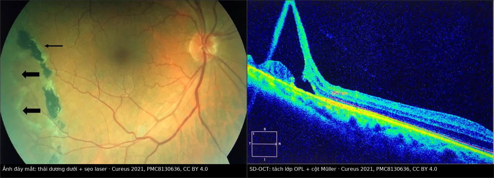
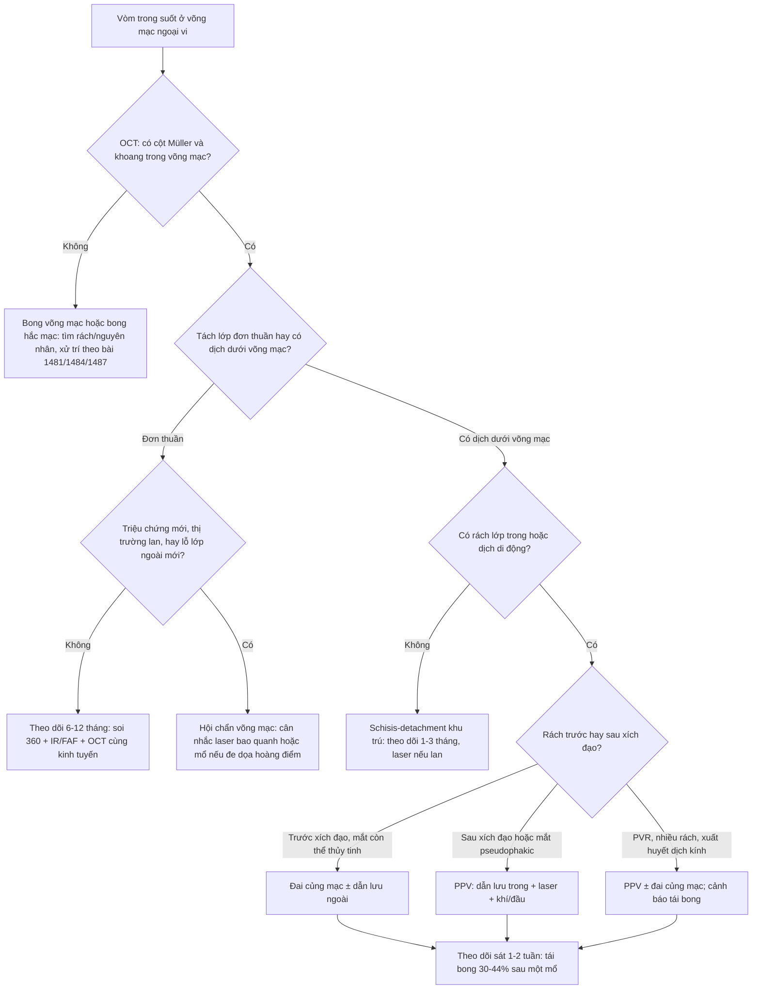
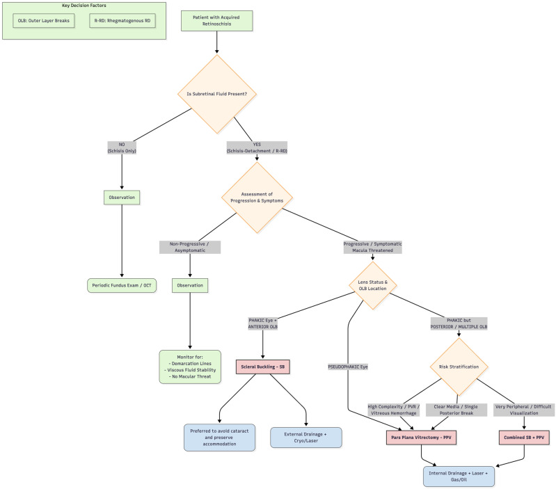
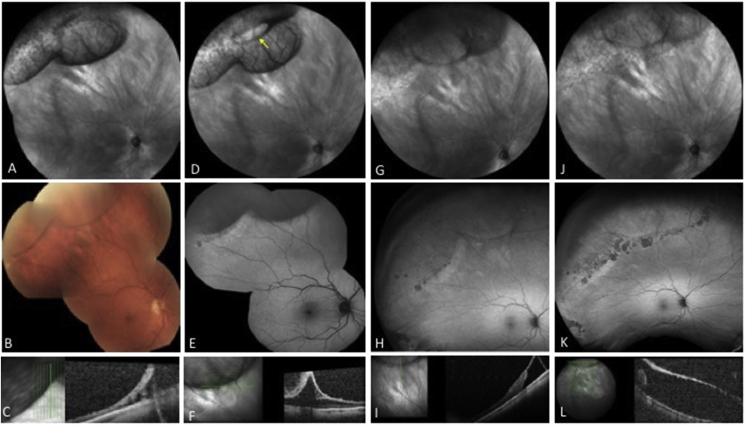
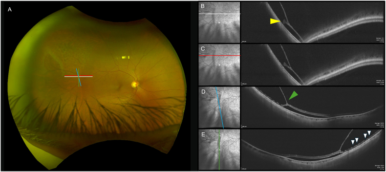
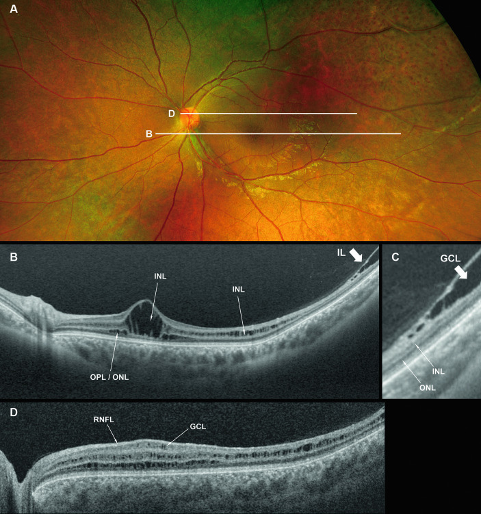

# 1518 — Tách lớp võng mạc ngoại vi so với bong võng mạc / Peripheral retinoschisis versus retinal detachment

**Tags:** `pattern:tach-lop-vong-mac` `pattern:retinoschisis` `pattern:schisis-detachment` `pattern:bong-vong-mac` `pattern:voi-day-khong-dinh-dia-thi` `pattern:lo-rach-vong-mac` `pattern:xuat-huyet-dich-kinh` `vung:mat` `vung:vong-mac` `vung:ora-serrata` `anatomy:OPL` `anatomy:GCL` `anatomy:ora-serrata` `protocol:soi-day-mat-an-sclera` `protocol:UWF-OCT` `protocol:SS-OCT` `protocol:FAF` `protocol:hong-ngoai` `protocol:sieu-am-B-scan` `score:XLRS-grade` `incidentaloma:tach-lop-vong-mac`

**Mức chắc chắn (certainty):** tổng hợp y văn (literature synthesis) — dựng từ **tổng quan hệ thống + thuật toán 2026** về tách lớp mắc phải và bong võng mạc liên quan tách lớp (*Med Sci* 2026, **PMC13028219**, CC BY 4.0 — dùng hình thuật toán), **ca lâm sàng có SD-OCT kinh điển** (*Cureus* 2021, **PMC8130636**, CC BY 4.0 — dùng ảnh), **loạt 27 mắt so sánh FAF – hồng ngoại – OCT** (*Am J Ophthalmol Case Rep* 2020, **PMC7125323**, CC BY-NC-ND 4.0 — dùng ảnh nguyên bản), **ca UWF-OCT 55 tuổi** (*Am J Ophthalmol Case Rep* 2026, **PMC13316662**, CC BY-NC-ND 4.0 — dùng ảnh nguyên bản), **19 mắt XLRS** (*Front Med* 2023, **PMC10687576**, CC BY 4.0 — dùng ảnh), **đoàn hệ 52 bệnh nhân XLRS** (*Acta Ophthalmol* 2025, **PMC11810562**, CC BY 4.0 — chỉ đọc số) và **3 ca rách lớp ngoài khổng lồ** (*Oman J Ophthalmol* 2025, **PMC12604721**, CC BY-NC-SA 4.0 — chỉ đọc số). Nhóm **không có bệnh nhân của mình**; chỗ suy luận ghi **[suy luận]**. **Không ghi tên tác giả** — attribution dùng tạp chí + năm + PMCID.

> **Vị trí trong thư viện:** [1481](../1481-lo-rach-vong-mac-laser-du-phong/lesson.md) chốt **lỗ rách cấp chưa bong**; [1487](../1487-bong-vong-mac-gia-the-thuy-tinh/lesson.md) chốt **bong võng mạc ở mắt pseudophakic**; [1516](../1516-co-keo-can-thi-foveoschisis/lesson.md) chốt **tách lớp hoàng điểm do co kéo ở mắt cận thị**; [1484](../1484-bong-hac-mac-sau-mo-mat/lesson.md) chốt **bong hắc mạc**. Bài này trả lời khoảng trống ở **chu biên**: **vòm trong suốt ở võng mạc ngoại vi là tách lớp hay bong?** — và khi nào một tách lớp lành tính bỗng trở thành bong võng mạc thật.

> **Câu chốt — sáu con số phải thuộc:** **(1)** Tách lớp mắc phải gặp ở **1,65–7,00%** người trên 40 tuổi (**PMC8130636**), nhưng tổng quan 2026 báo tới **4–22%** (**PMC13028219**) — khác biệt do **định nghĩa và cách phát hiện**, không phải do dân số khác. **(2)** Tách lớp đơn thuần **hầu như không tiến triển thành bong thật**: chỉ **0,05%** ca tách lớp thoái hóa phát triển thành **bong võng mạc liên quan tách lớp (R-RD)**; đoàn hệ **218 mắt theo dõi trung bình 9 năm** có **0 ca** schisis-detachment khu trú tiến triển thành R-RD (**PMC13028219**). **(3)** **Rách lớp trong** gặp ở **50–70%** ca và **một mình nó lành tính** — chỉ khi có **rách lớp ngoài** (hit 1) cộng **rách lớp trong/co kéo dịch kính** (hit 2) thì dịch lỏng mới vào khoảng dưới võng mạc (**PMC13028219**). **(4)** **UWF-OCT bỏ sót tới 30% rách lớp ngoài** nếu chỉ soi đáy mắt thường, vì rách nằm **ra trước xích đạo** hoặc **bị vách trong che** (**PMC13028219**). **(5)** Thành công sau **một** mổ R-RD chỉ **56,2–70%** (thấp hơn hẳn bong võng mạc thường): **đai củng mạc cho rách trước xích đạo 85–86%**, **PPV cho rách sau xích đạo 67%**, **PPV khi PVR > độ B: 0%** (**PMC13028219**, bảng 3). **(6)** **XLRS** là kẻ bắt chước: **39–50%** có tách lớp ngoại vi, **95–100%** có hình nan hoa hoàng điểm, **ERG sóng b giảm**; tách lớp ngoại vi ở XLRS xảy ra ở **lớp hạch (GCL)**, không phải lớp rối ngoài (**PMC10687576**, **PMC11810562**). Bẫy chết người: **chọc/dẫn lưu "dịch dưới võng mạc"** khi thực ra là **khoang tách lớp chứa dịch nhầy** — dịch không chảy, còn kim thì tạo rách lớp ngoài thật.

## 1. Tổng quan bệnh học – cơ chế hình ảnh (TẠI SAO)

### 1.1 Tách lớp là gì — và tách ở đâu

- **Tách lớp võng mạc ngoại vi mắc phải (acquired/senile retinoschisis)** là sự **tách đôi võng mạc cảm giác** do thoái hóa vi nang (microcystoid degeneration) hợp nhất lại, tạo **khoang chứa dịch nhầy** giữa **lá trong (inner leaf)** và **lá ngoài (outer leaf)** (**PMC13028219**, **PMC8130636**).
- Có **hai thể mô học** (**PMC13028219**):
  1. **Thể điển hình (typical cystoid)** — tách tại **lớp rối ngoài (outer plexiform layer, OPL)**, vòm nhẵn hình thoi, **giới hạn trước xích đạo**, hiếm khi bong;
  2. **Thể lưới/bóng nước (reticular/bullous)** — tách **nông hơn**, tại **lớp sợi thần kinh (NFL)** hoặc **lớp tế bào hạch (GCL)**, **bóng nước, lan ra sau xích đạo**, và **chính là thể hay có rách lớp ngoài**.
- **Lá trong chứa mạch máu võng mạc và màng giới hạn trong (ILM)**; **lá ngoài nằm sát biểu mô sắc tố (RPE)** và là nơi **rách lớp ngoài** xuất hiện. Vì mạch máu nằm **trong** lá trong, khi tách lớp bóng nước, mạch máu **đi theo vòm** — đây là dấu lâm sàng mạnh nhất để phân biệt với bong võng mạc (mạch máu **nằm trên màng bong**, sát đáy) (**PMC13028219**).
- **Vị trí hay gặp nhất là thái dương dưới (inferotemporal)**: **8/13 mắt** trong loạt 27 mắt (**PMC7125323**); tổng quan cũng ghi nhận tương tự (**PMC13028219**). Bong võng mạc thật trong cùng loạt lại **chủ yếu ở thái dương trên** (**PMC7125323**) — một gợi ý định vị hữu ích nhưng **không đủ để chẩn đoán**.

### 1.2 Vì sao khoang tách lớp KHÔNG giống khoảng dưới võng mạc

- **Bản chất dịch quyết định hình ảnh và tiên lượng.** Khoang tách lớp chứa **dịch nhầy giàu hyaluronic acid**, do các tế bào võng mạc thoái hóa tiết ra; độ nhớt cao làm dịch **không di chuyển theo tư thế**, **không chảy qua sclerotomy** khi mổ, và **chặn tiến triển** dù có rách lớp ngoài (**PMC13028219**).
- Ngược lại, **dịch kính hóa lỏng** có độ nhớt thấp: một khi đi qua **cả hai lớp** (rách trong + rách ngoài), nó vào khoảng dưới võng mạc và gây **bong tiến triển nhanh** — đây là **cơ chế "hai đòn" (two-hit)** (**PMC13028219**).
- Trên **OCT**, dịch nhầy **không phản xạ** → **khoang giảm phản xạ (hyporeflective)**; các **cột Müller** còn lại bắc ngang khoang → **cấu trúc tăng phản xạ hình cột** chạy từ lá trong xuống lá ngoài. Đây là **dấu đặc hiệu (pathognomonic)** của tách lớp, **không có** trong bong võng mạc mạn (**PMC13028219**, bảng 1).
- **Vì sao tách lớp gây khiếm khuyết thị trường TUYỆT ĐỐI, còn bong võng mạc thường chỉ tương đối:** tách lớp cắt đứt **synapse giữa tế bào quang thụ và tế bào lưỡng cực tại OPL**, nên tín hiệu **mất hoàn toàn** trên vùng tách; bong võng mạc chỉ **đẩy võng mạc ra khỏi RPE**, tế bào quang thụ còn sống một thời gian nên vùng bong thường chỉ **giảm nhạy cảm** (**PMC13028219** mô tả scotoma tuyệt đối của tách lớp; **PMC7125323** mô tả scotoma tương đối của bong). Đây là lý do **đo thị trường** có giá trị hơn **đo thị lực** để theo dõi tiến triển.

### 1.3 Vì sao ảnh trông như vậy — từng modality

- **Đáy mắt màu/wide-field:** vòm **trong suốt, nhẵn, bóng**, mạch máu **nổi rõ trên vòm**; **không có nếp nhăn (corrugated)** như bong; **không có sắc tố** trong khoang; có thể thấy **"white-with-pressure"** hoặc **"snowflake"** do di tích chân tế bào Müller (**PMC13028219**). **Đường ranh giới sắc tố (demarcation line)** ở bờ sau là dấu **mạn tính/ổn định**, không phải dấu hoạt động.
- **FAF (fundus autofluorescence):** võng mạc nâng lên **đổi hướng ánh sáng** và **che RPE** → vùng tổn thương thường **giảm huỳnh quang (hypo-AF)**. Tuy nhiên **không đặc hiệu**: trong loạt 27 mắt, **toàn bộ 13 mắt RS và 4 mắt schisis-detachment đều hypo-AF**, và **9/10 mắt bong võng mạc cũng hypo-AF** (**PMC7125323**) — tức FAF **không phân biệt được** ba thực thể, trái với câu "RS thường đồng huỳnh quang" trong một tổng quan khác (**PMC13028219**). Đây là **mâu thuẫn nguồn có thật**, ghi ở mục 7.
- **Hồng ngoại (IR):** bước sóng dài xuyên qua **đục môi trường** tốt hơn ảnh màu; vùng tách lớp **giảm phản xạ (hyporeflective)** với **bờ rõ**, **mạch máu nổi rõ**, và **lỗ lớp ngoài** có thể thấy **trên IR mà không thấy trên FAF** (**PMC7125323**). IR là modality **nhanh, không tiếp xúc**, hữu ích khi bệnh nhân **không nhìn cố định được**.
- **Siêu âm B-scan:** tách lớp cho **vòm dày, nhẵn, không di động**, **không bám vào đĩa thị**; bong võng mạc cho **màng mỏng, gấp nếp, di động**, và **dính vào đĩa thị/ora**. B-scan dùng khi **đục thể thủy tinh/dịch kính** che đáy mắt; **không thấy rách lớp ngoài** trên B-scan (**PMC13028219**, **PMC8130636**).
- **OCT:** là **chuẩn vàng**. SD-OCT thường chỉ phủ **30–50°**, nên **không tới được vùng ngoại vi** nơi bệnh bắt đầu; **UWF-OCT/SS-OCT bước sóng ~1050 nm** quét được **tới chu biên**, xuyên qua **lá trong đục** và dịch nhầy, cho thấy **vách tách, độ dày lá trong, cột Müller, rách lớp ngoài và dịch dưới võng mạc** (**PMC13028219**, **PMC13316662**).

### 1.4 Vì sao đa số ổn định — và vì sao một số ít thì không

- **Đa số ổn định:** trong loạt theo dõi 27 mắt, **9/10 bệnh nhân tái khám không tiến triển** (thời gian theo dõi trung bình **53 tháng** ở nhóm schisis-detachment) (**PMC7125323**); đoàn hệ 218 mắt của Byer **không có ca schisis-detachment khu trú nào tiến triển thành R-RD trong 9 năm** (**PMC13028219** dẫn lại).
- **Thiểu số tiến triển khi có "hai đòn":** **rách lớp ngoài** đơn thuần → dịch nhầy rỉ vào khoảng dưới võng mạc tạo **schisis-detachment** (thường **khu trú, bờ sắc tố, không di động**); thêm **rách lớp trong** hoặc **co kéo dịch kính** → dịch lỏng vào → **R-RD** (di động, lan nhanh, có thể tới hoàng điểm) (**PMC13028219**).
- **Cửa sổ tiến triển có thể rất ngắn:** ca trong **PMC7125323** cho thấy trình tự **tách lớp → lỗ lớp ngoài mới → schisis-detachment** trong **vài tháng**, và hình ảnh **IR phát hiện lỗ ngoài trước FAF**. Ca **PMC13316662** còn cho thấy **chỉ có lỗ lớp ngoài, KHÔNG có lỗ lớp trong**, dưới **co kéo của lá trong dày** — nghĩa là **"hai đòn" có thể chỉ cần một lỗ + lực kéo**, không nhất thiết phải đủ hai lỗ.

## 2. Mẫu hình + chẩn đoán phân biệt theo vị trí (gamut)

### 2.1 Bốn mẫu hình của cùng một phổ

1. **Tách lớp đơn thuần (schisis only):** vòm nhẵn, **không dịch dưới võng mạc**, **không rách lớp ngoài**; thị trường có **khiếm khuyết tuyệt đối** tương ứng; **theo dõi**.
2. **Schisis-detachment (không do rách):** **rách lớp ngoài nhỏ** → dịch nhầy vào khoảng dưới võng mạc; bong **khu trú, không di động**, **bờ sắc tố**; thường **tự giới hạn**.
3. **R-RD (bong võng mạc liên quan tách lớp):** **rách cả hai lớp** hoặc **rách ngoài + co kéo mạnh**; dịch **lỏng**, bong **di động, lan nhanh**, có thể **bong hoàng điểm**; **0,05%** ca tách lớp (**PMC13028219**).
4. **Rách lớp ngoài khổng lồ (giant outer lamellar tear):** thể hiếm, **rách lớn bờ nhăn**, kèm **nhiều lỗ lớp trong**, **PVR sớm**; thị lực lúc đến thường **đếm ngón tay/bóng bàn tay**; mổ **khó, tái bong cao** (**PMC12604721**).

### 2.2 Vị trí quyết định cách đọc

- **Thái dương dưới, trước xích đạo:** mẫu hình **tách lớp điển hình**; hay gặp **thể OPL**; **rách lớp ngoài** nếu có thường **nhỏ và ra trước**, rất dễ bỏ sót khi soi thường (**PMC13028219**).
- **Thái dương trên, lan sau xích đạo:** mẫu hình **bong võng mạc** nhiều hơn; nếu vẫn là tách lớp thì thường **thể lưới/bóng nước**, nguy cơ **rách lớp ngoài** cao hơn (**PMC7125323**, **PMC13028219**).
- **Quanh ora serrata:** nghĩ tới **dialysis** hoặc **lỗ vô khuẩn do vỡ**; tách lớp **hiếm khi tới sát ora** mà thường **dừng trước ora**.
- **Sau cực/hoàng điểm:** nếu gặp "tách lớp" ở hoàng điểm, phải nghĩ **MTM ở mắt cận thị nặng** (bài 1516) hoặc **XLRS** ở bé trai — **không phải** tách lớp thoái hóa chu biên.

### 2.3 Gamut chẩn đoán phân biệt

- **Tách lớp thoái hóa mắc phải (điển hình/lưới)** — người ≥ 40 tuổi, vòm nhẵn, mạch trong vòm, cột Müller.
- **Schisis-detachment** — dịch dưới võng mạc khu trú, bờ sắc tố, không di động.
- **R-RD** — bong di động, có rách hai lớp, lan nhanh.
- **Bong võng mạc rách mạn (chronic RRD)** — màng mỏng gấp nếp, **dính đĩa thị**, **không cột Müller**, **đường ranh giới sắc tố**.
- **XLRS (tách lớp liên kết X)** — bé trai, **hai bên**, **nan hoa hoàng điểm**, tách lớp ngoại vi ở **GCL**, **ERG âm**, tiền sử gia đình.
- **Bong hắc mạc (choroidal detachment)** — **vòm dày, nhẵn, không dính đĩa thị**, "kissing choroidals", hay sau mổ/hạ nhãn áp (bài 1484).
- **Melanoma hắc mạc** — khối **đặc**, **hồi âm thấp bên trong** trên B-scan, có mạch máu, có thể kèm bong thanh dịch.
- **Thoái hóa dạng lưới (lattice degeneration)** — **dải teo mỏng, không nâng**, có thể kèm lỗ nhỏ; **không phải tách lớp**.
- **Dialysis ở ora** — bờ võng mạc **rời ora**, thường sau chấn thương; **không có vòm tách lớp**.
- **Bong thanh dịch/exudative** — dịch **di chuyển theo tư thế**, **không rách**, tìm nguyên nhân (u, viêm, CSC).

*Trái: vòm tách lớp **thái dương dưới** trong suốt, mạch máu đi trên vòm; mũi tên mảnh chỉ **sẹo laser** bao quanh, mũi tên đậm chỉ bờ tổn thương. Phải: **SD-OCT** cắt qua vòm — khoang **giảm phản xạ** tại **lớp rối ngoài**, có **cột Müller bắc cầu**; lá trong còn mạch máu. Nguồn: *Cureus* 2021 (PMC8130636), Fig. 1 và Fig. 2, CC BY 4.0 — ghép letterbox bằng `make_composite.py`, không crop/kéo giãn.*

## 3. Bảng so sánh phân biệt (ma trận đối chiếu)

| Thực thể (entity) | Hình ảnh điển hình (đáy mắt / FAF-IR / OCT / B-scan) | Chốt vào (rule-in) | Chốt loại (rule-out) | Gợi ý xác nhận |
|---|---|---|---|---|
| **Tách lớp điển hình (OPL)** | Vòm **nhẵn, trong suốt**, thái dương dưới; FAF/IR **hypo**; OCT khoang giảm phản xạ **tại OPL** + **cột Müller** | **Cột Müller bắc cầu** + **mạch máu trong lá trong** + **khiếm khuyết thị trường tuyệt đối** | Dịch **dưới** võng mạc không cột; màng **di động** | UWF-OCT dọc qua vòm; đo chiều cao khoang; so kinh tuyến |
| **Tách lớp thể lưới/bóng nước (NFL/GCL)** | Vòm **cao, bóng**, lan sau xích đạo; dễ có **rách lớp ngoài** | Tách **nông ở NFL/GCL** trên OCT; **vách trong mỏng** | Tách tại OPL, giới hạn trước xích đạo → thể điển hình | SS-OCT chu biên; tìm rách ngoài ở bờ sau |
| **Schisis-detachment** | Bong **khu trú, không di động**, **bờ sắc tố**; OCT: **rách lớp ngoài** + dịch dưới võng mạc, **không rách lớp trong** | **Rách lớp ngoài** + dịch dưới võng mạc **không di động** + bờ sắc tố | **Rách lớp trong** hoặc dịch di động → R-RD | UWF-OCT qua bờ tổn thương; IR tìm lỗ ngoài; theo dõi 1–3 tháng |
| **R-RD (hai lớp)** | Bong **di động**, **gấp nếp**, lan nhanh; OCT: **rách cả hai lớp** hoặc **rách ngoài + co kéo** | **Rách lớp trong + rách lớp ngoài**; dịch **lỏng di động** | Chỉ rách lớp ngoài, bờ sắc tố → schisis-detachment | UWF-OCT + soi 360° ấn sclera; đánh giá PVR, hoàng điểm |
| **Bong võng mạc rách mạn** | Màng **mỏng, gấp nếp**, **dính đĩa thị/ora**; FAF **hypo**; OCT **không cột Müller** | **Dính đĩa thị** + **không cột** + rách toàn bộ | **Cột Müller** + vòm nhẵn → tách lớp | OCT/B-scan; tìm lỗ rách 360° |
| **XLRS** | Bé trai, **hai bên**; **nan hoa hoàng điểm**; tách lớp ngoại vi **bóng nước**, OCT tách **GCL**; **ERG sóng b giảm** | **Nam + hai bên + ERG âm + RS1** | Người lớn, một bên, ERG bình thường → tách lớp mắc phải | ERG, OCT chu biên, xét nghiệm RS1, khám gia đình |
| **Bong hắc mạc** | **Vòm dày, nhẵn**, **không dính đĩa thị**; "kissing" hai bên; B-scan **hồi âm dày** | **Không dính đĩa thị** + bối cảnh hạ áp/sau mổ | Vòm mỏng dính đĩa thị → bong võng mạc | B-scan/UBM; đo nhãn áp; xem bài 1484 |
| **Melanoma hắc mạc** | Khối **đặc, sắc tố**, có mạch; B-scan **hồi âm thấp trong lòng**; có thể bong thanh dịch | **Khối đặc + hồi âm thấp + mạch máu** | Vòm **trong suốt, không khối** → tách lớp | B-scan + FAF + MRI hốc mắt khi cần |
| **Thoái hóa dạng lưới** | **Dải teo mỏng**, đường gạch, **không nâng**; có thể lỗ nhỏ trong dải | **Dải teo phẳng** + lỗ trong dải | **Vòm nâng** + khoang dịch → tách lớp | Soi 360° ấn sclera; OCT nếu nghi lỗ |
| **Dialysis ở ora** | Bờ võng mạc **rời ora**, thường sau chấn thương; bong lan theo trọng lực | **Rời ora** + bối cảnh chấn thương | Vòm tách lớp **giữa võng mạc** → không dialysis | Soi ấn sclera 360°; B-scan khi đục |

## 4. Protocol chụp + hệ phân độ/điểm chuẩn hóa

### 4.1 Protocol tối thiểu

- **Soi đáy mắt giãn đồng tử 360° có ấn sclera** là bước **không thể thay thế**; **vẽ sơ đồ** vị trí, số múi giờ, khoảng cách tới ora/hoàng điểm, và **ghi rõ có rách lớp ngoài hay không**. Không có ấn sclera thì **bỏ sót rách ra trước** (**PMC13028219**).
- **Ảnh màu wide-field + FAF + hồng ngoại** ngay lần đầu: **không tiếp xúc, nhanh**, dùng để **lập bản đồ bờ tổn thương** và **so sánh giữa các lần**; IR **phát hiện lỗ lớp ngoài tốt hơn FAF** trong ca tiến triển (**PMC7125323**).
- **OCT là chuẩn vàng**, ưu tiên **UWF-OCT/SS-OCT** (bước sóng ~1050 nm) với **B-scan dài 26 mm** qua **bờ trước và bờ sau** của vòm, thêm **cắt dọc trục** nếu cần; nếu chỉ có SD-OCT, phải **đưa máy ra ngoại vi** và chấp nhận **giới hạn 30–50°** (**PMC13028219**, **PMC13316662**).
- **Ghi vào phiếu:** **lớp tách (OPL vs NFL/GCL)**, **chiều cao khoang**, **độ dày lá trong**, **có/không cột Müller**, **rách lớp trong**, **rách lớp ngoài (vị trí, kích thước)**, **dịch dưới võng mạc**, **bờ sắc tố**, **PVD**, **hoàng điểm có bị đe dọa**. Đây là các biến quyết định theo dõi hay mổ (**PMC13028219**).
- **Siêu âm B-scan** khi **đục thể thủy tinh/dịch kính** hoặc không đánh giá được chu biên; dùng để **loại trừ khối u** và **phân biệt màng dày/không di động với màng mỏng/di động** (**PMC13028219**).
- **Thị trường (30-2 hoặc Goldmann)** ở lần đầu và khi có triệu chứng: tách lớp cho **khiếm khuyết tuyệt đối**; **khiếm khuyết mở rộng vào 10–20° trung tâm** là dấu **tiến triển** quan trọng hơn thị lực (**PMC13028219**).
- **Bé trai + tách lớp ngoại vi + bất thường hoàng điểm:** làm **ERG nháy sáng** (tìm **sóng b giảm/ERG âm**) và **xét nghiệm RS1** trước khi gọi là "tách lớp thoái hóa" (**PMC10687576**, **PMC11810562**).

### 4.2 Phân độ và ngưỡng xử trí

- **Không có RADS cho tách lớp ngoại vi.** Hệ phân độ thực hành dùng được là **phân độ chu biên XLRS (Grade 1–4 + D)** của **PMC10687576**:
  - **Grade 1:** không tách lớp;
  - **Grade 2:** **tách lớp ẩn** (OCT có, soi đáy mắt bình thường);
  - **Grade 3:** tách lớp **thấy được**, nông hoặc bóng nước, tách **GCL** + nang **INL**;
  - **Grade 4:** **teo võng mạc**, mất cấu trúc lớp (lá ngoài teo);
  - **+D:** có **bong võng mạc** kèm/không kèm tách lớp.
- **Ngưỡng "đủ để can thiệp" (theo tổng quan 2026, PMC13028219):**
  - **Bong hoàng điểm (macula-OFF)** → **mổ**;
  - **Bong đe dọa hoàng điểm** (dịch trong **1–2 đường kính đĩa** từ hoàng điểm) → **mổ dự phòng**;
  - **Dịch vượt qua xích đạo/vượt cung mạch** → **mổ**;
  - **Mất đường ranh giới sắc tố ở tổn thương đang lan** → **mổ**;
  - **Xuất huyết dịch kính từ mạch bắc cầu** hoặc **PVR** → **mổ**;
  - **Tách lớp đơn thuần, không triệu chứng, không tiến triển** → **theo dõi** (không mổ).
- **Theo dõi:** **6–12 tháng/lần** với tách lớp ổn định; **1–3 tháng** nếu **mới có triệu chứng (nhá đèn/ruồi bay tăng)**, **lỗ lớp ngoài mới**, hoặc **dịch tăng**; mỗi lần **cùng kinh tuyến OCT** để so sánh (**PMC7125323**, **PMC13028219**).

### 4.3 Lưu đồ quyết định

*Lưu đồ gốc: tách lớp đơn thuần → theo dõi; có dịch dưới võng mạc → đánh giá tiến triển/triệu chứng; mổ chọn theo **tình trạng thể thủy tinh** và **vị trí rách lớp ngoài**; PVR/nhiều rách → PPV ± đai. Nguồn: *Med Sci* 2026 (PMC13028219), Figure 1, CC BY 4.0 — nguyên bản.*

## 5. Biến thể bình thường và cạm bẫy

- **"White-with-pressure" và "snowflake"** ở vùng tách lớp là **di tích chân tế bào Müller**, không phải viêm hay xuất huyết; đừng gọi là "viêm võng mạc" (**PMC13028219**).
- **Thoái hóa vi nang ngoại vi (Blessig–Iwanoff)** là **tiền thân** của tách lớp: nang nhỏ, **không nâng**, có thể **lành tính**; chỉ khi nang **hợp nhất thành khoang lớn** mới gọi là tách lớp (**PMC13028219**).
- **Tách lớp MỘT BÊN là hiếm** — ca trong **PMC8130636** là **một bên**, trong khi đa số **hai bên**; đừng loại tách lớp chỉ vì mắt kia bình thường.
- **FAF không phân biệt được tách lớp với bong** trong thực tế: **toàn bộ RS và 9/10 RD đều hypo-AF** (**PMC7125323**). Dùng FAF để **lập bản đồ**, không dùng để **chốt chẩn đoán**.
- **Bỏ sót rách lớp ngoài:** **tới 30%** rách thấy trên UWF-OCT **không thấy khi soi thường**, vì **ở trước xích đạo** hoặc **bị lá trong che**; nếu chỉ soi bằng SD-OCT 30–50° thì **gần như chắc chắn bỏ sót** (**PMC13028219**).
- **"Satisfaction of search":** thấy vòm tách lớp rồi **dừng lại**, không tìm **bong võng mạc thật** ở nơi khác (thường **thái dương trên**) — trong loạt 27 mắt có **1 mắt vừa RS vừa RD** (**PMC7125323**).
- **Laser trên sàn tách lớp là vùng tranh cãi:** tổng quan 2026 **khuyên không** đốt vào sàn tách lớp vì có thể **gây rách lớp ngoài do hoại tử nhiệt/co kéo**, biến tách lớp ổn định thành R-RD; laser chỉ để **bao quanh bong thật** (**PMC13028219**). Ngược lại, một loạt **57 mắt** laser argon cho **thu nhỏ một phần/toàn bộ khoang** và **không ca nào tiến triển** (**PMC8130636** dẫn lại). Xem mục 7.
- **Chọc/dẫn lưu khoang tách lớp:** dịch **nhầy, không chảy** qua kim nhỏ; thao tác này **không làm xẹp** mà còn **tạo rách lớp ngoài** và **đưa dịch kính vào khoảng dưới võng mạc** **[suy luận từ cơ học dịch nhầy, PMC13028219]**.
- **Đường ranh giới sắc tố = mạn tính**, không phải "đang hoạt động": đừng mổ chỉ vì thấy sắc tố; ngược lại **mất bờ sắc tố ở tổn thương đang lan** mới là dấu tiến triển (**PMC13028219**).
- **XLRS bị gọi nhầm là phù hoàng điểm/viêm màng bồ đào:** nang **INL** hai bên ở bé trai + **ERG âm** + **RS1** mới là chẩn đoán; điều trị corticoid kéo dài **không giúp** (**PMC10687576**, **PMC11810562**).
- **Tách lớp hoàng điểm ở mắt cận thị nặng KHÔNG phải bài này:** đó là **MTM** với **staphyloma** và **cột Müller dọc**, xử trí khác hẳn (bài 1516).

## 6. Tự lượng giá — Blind Quiz

**Ca 1 — Nam 55 tuổi, nhá đèn và ruồi bay mới ở mắt phải; thị lực 20/20; đáy mắt có vòm trong suốt thái dương dưới, không thấy rách khi soi thường.**

- Gợi ý: so **cột trái (A–C)**, **cột giữa (D–F)** và **cột phải (G–I)**; chú ý **mũi tên vàng** ở D và **hai mũi tên vàng** ở G; cuối cùng xem **J–L** sau can thiệp.
- Câu hỏi: (1) Dấu hiệu mới xuất hiện ở lần chụp thứ hai là gì, và **modality nào thấy nó rõ nhất**? (2) Điều gì xảy ra với tổn thương ở lần chụp thứ ba? (3) Vì sao **không được chọc dẫn lưu** "dịch dưới võng mạc" ở đây?

<b>Bấm để hiện đáp án (findings + chẩn đoán)</b>

- **Findings:** A–C: tách lớp thái dương dưới, **OCT xác nhận khoang tách**; D–F (2 tháng sau): **lỗ lớp ngoài mới** (mũi tên vàng) **thấy trên hồng ngoại (D)** nhưng **không thấy trên FAF (E)**, OCT vẫn là tách lớp (F); G–I (2 tháng tiếp): **lỗ lớn hơn** (hai mũi tên vàng trên IR) và **schisis-detachment** xuất hiện trên OCT (I); J–L: sau **laser retinopexy** định hướng FAF, tổn thương **ổn định**.
- **Chẩn đoán:** tách lớp ngoại vi **tiến triển từ tách lớp đơn thuần → schisis-detachment** do **lỗ lớp ngoài**; điều trị **laser bao quanh**, không cần mổ.
- **Vì sao không chọc:** dịch trong khoang là **dịch nhầy**, không chảy; chọc chỉ **tạo thêm rách lớp ngoài** và có thể đưa dịch kính vào khoảng dưới võng mạc.
- Nguồn ảnh: *Am J Ophthalmol Case Rep* 2020 (PMC7125323), Fig. 3, CC BY-NC-ND 4.0 — nguyên bản, không crop/ghép.

**Ca 2 — Nam 55 tuổi, nhá đèn/ruồi bay mắt phải, thị lực 20/20; soi đáy mắt và ảnh màu không thấy rách.**

- Gợi ý: A là ảnh wide-field với các đường cắt; B–E là **UWF-OCT**. Tìm **mũi tên vàng** (B), **mũi tên xanh** (D) và **các mũi tên trắng** (E).
- Câu hỏi: (1) Lỗ nằm ở **lớp nào**? (2) Có **rách lớp trong** không? (3) Cơ chế nào đưa dịch vào khoảng dưới võng mạc khi chỉ có một lỗ?

<b>Bấm để hiện đáp án (findings + chẩn đoán)</b>

- **Findings:** A: vòm tách lớp thái dương, bờ không rõ; B–C: **lỗ lớp ngoài** (mũi tên vàng) + **dịch dưới võng mạc khu trú**; D: **lá trong dày, còn dính và kéo** lên lá ngoài (mũi tên xanh); E: **các lõm nhỏ trên mặt trong lá ngoài** (mũi tên trắng) giống "dimple" sau bóc ILM.
- **Chẩn đoán:** **schisis-detachment do lỗ lớp ngoài đơn độc**, dưới **co kéo của lá trong** — không có rách lớp trong. Điều trị: **laser retinopexy**.
- **Cơ chế:** "hai đòn" có thể chỉ cần **một lỗ (lớp ngoài) + lực kéo từ lá trong**, không nhất thiết phải có rách lớp trong; đây là điểm **mới** so với mô hình hai lỗ kinh điển.
- Nguồn ảnh: *Am J Ophthalmol Case Rep* 2026 (PMC13316662), Fig. 1, CC BY-NC-ND 4.0 — nguyên bản, không crop/ghép.

**Ca 3 — Bé trai 17 tuổi, nhìn mờ hai bên từ nhỏ; đáy mắt có vòm bóng nước ở vùng dưới của cả hai mắt, hoàng điểm hai bên có hình nan hoa.**

- Gợi ý: A là ảnh màu với hai đường cắt B và D; B–C là OCT ngang; chú ý **lớp nào bị tách** ở C và **các nang** ở B.
- Câu hỏi: (1) Tách lớp ở **lớp nào**? (2) Vì sao đây **không phải** tách lớp thoái hóa ở người lớn? (3) Xét nghiệm nào chốt chẩn đoán?

<b>Bấm để hiện đáp án (findings + chẩn đoán)</b>

- **Findings:** A: tách lớp **bóng nước vùng dưới**; B: tách lớp + **nang ở INL**, lớp OPL/ONL còn; C: **tách lớp tại lớp tế bào hạch (GCL)** (mũi tên trắng), **INL/ONL** bên dưới; D: vùng trên không tách lớp rõ.
- **Chẩn đoán:** **XLRS** — tách lớp ngoại vi ở **GCL** (khác tách lớp mắc phải ở **OPL**), kèm **nan hoa hoàng điểm** và **ERG sóng b giảm**.
- **Vì sao không phải tách lớp thoái hóa:** tuổi trẻ, **hai bên**, có **bất thường hoàng điểm**, **tiền sử gia đình**; và **lớp tách là GCL** trên OCT chu biên.
- Nguồn ảnh: *Front Med* 2023 (PMC10687576), Fig. 2, CC BY 4.0 — nguyên bản.

## 7. Câu hỏi nghiên cứu & điểm chưa đồng thuận (tính đến 11/2026)

1. **[Tranh cãi] Ở mắt tách lớp ngoại vi không triệu chứng hoặc tiến triển chậm, laser bao quanh có làm giảm nguy cơ R-RD hay lại gây rách lớp ngoài?**
   - **Đã biết:** một loạt **57 mắt** laser argon cho khoang **thu nhỏ một phần/toàn bộ** và **không ca nào tiến triển**; nhưng tổng quan 2026 cảnh báo laser trên **sàn tách lớp** có thể gây **rách lớp ngoài do hoại tử nhiệt/co kéo**, và chỉ nên laser **quanh bong thật**.
   - **Chưa rõ:** chưa có RCT; chọn bệnh nhân, kỹ thuật (bước sóng, khoảng cách bờ) và thời điểm laser khác nhau giữa các loạt.
   - **Hướng nghiên cứu:** RCT hoặc đoàn hệ tiến cứu phân tầng theo **độ dày lá trong, lỗ lớp ngoài và thị trường**; so laser với theo dõi.
   - **Nguồn:** PMC13028219 (2026); PMC8130636 (2021).

2. **[Khác biệt thực hành] Tách lớp ngoại vi trên FAF là đồng huỳnh quang hay giảm huỳnh quang — và điều đó có đổi cách theo dõi không?**
   - **Đã biết:** loạt 27 mắt thấy **toàn bộ RS và schisis-detachment đều hypo-AF**, và **9/10 bong võng mạc cũng hypo-AF**; một tổng quan khác lại mô tả RS **thường đồng huỳnh quang** và RD **hypo-AF**.
   - **Chưa rõ:** khác biệt do **độ cao tổn thương, góc chụp, detector gain** hay do **định nghĩa vùng quan tâm**; chưa rõ FAF có giá trị theo dõi độc lập hay chỉ để lập bản đồ.
   - **Hướng nghiên cứu:** nghiên cứu độ tương hợp giữa FAF, IR và OCT với **chuẩn tham chiếu OCT**; đo hệ số phản xạ chuẩn hóa.
   - **Nguồn:** PMC7125323 (2020); PMC13028219 (2026).

3. **[Khoảng trống] Ngưỡng nào trên UWF-OCT xác định "tách lớp đang tiến triển" và khoảng theo dõi tối ưu?**
   - **Đã biết:** theo dõi **6–12 tháng** cho tổn thương ổn định, **1–3 tháng** khi có triệu chứng; **30%** rách lớp ngoài bị bỏ sót nếu không có UWF-OCT; tỷ lệ tiến triển thành R-RD chỉ **0,05%**.
   - **Chưa rõ:** chưa có ngưỡng tăng **chiều cao khoang** hay **kích thước lỗ lớp ngoài** được validate; chưa rõ giá trị của **OCT lặp ở bệnh nhân không triệu chứng**.
   - **Hướng nghiên cứu:** đoàn hệ tiến cứu đo lặp UWF-OCT, tính **MDC** cho chiều cao khoang và đường kính lỗ; Delphi đồng thuận về khoảng theo dõi.
   - **Nguồn:** PMC13028219 (2026); PMC13316662 (2026); PMC7125323 (2020).

## Bài liên quan chéo
- [400 – Tổng quan Mắt & thị giác](../400-tong-quan-mat-thi-giac/lesson.md)
- [1481 – Lỗ rách võng mạc cấp chưa bong: laser dự phòng hay theo dõi](../1481-lo-rach-vong-mac-laser-du-phong/lesson.md) (mặt "có lỗ thật" của võng mạc ngoại vi)
- [1487 – Bong võng mạc ở mắt giả thể thủy tinh](../1487-bong-vong-mac-gia-the-thuy-tinh/lesson.md) (khi tách lớp đã thành bong thật)
- [1516 – Bệnh lý co kéo cận thị & tách lớp hoàng điểm](../1516-co-keo-can-thi-foveoschisis/lesson.md) (tách lớp ở hậu cực, cơ chế khác)
- [1484 – Bong hắc mạc sau mổ mắt](../1484-bong-hac-mac-sau-mo-mat/lesson.md) (vòm dày không dính đĩa thị)
- [1479 – Bong võng mạc thanh dịch](../1479-bong-vong-mac-thanh-dich/lesson.md) (dịch dưới võng mạc không rách)
- [1469 – Bong võng mạc có lỗ sau tiêm nội nhãn](../1469-bong-vong-mac-co-lo-sau-tiem-noi-nhan/lesson.md) (bong kèm lỗ, bối cảnh sau tiêm)

## Ảnh
- Tên file: `1518_tach-lop-ngoai-vi_<Modality>_<SourceID>.jpg`; nguồn + giấy phép từng ảnh trong `images/CREDITS.md`.
- Ảnh ghép `composite_1518_fundus-va-oct.jpg` tạo bằng `tools/make_composite.py` (letterbox, không crop/kéo giãn), chỉ từ hai ảnh **CC BY 4.0**.
- Hai ảnh **CC BY-NC-ND 4.0** (PMC7125323, PMC13316662) giữ **nguyên bản**, không crop/ghép/đổi màu.
- Không dùng ảnh từ nguồn không rõ giấy phép.

> Không dùng để chẩn đoán độc lập khi chưa có người hướng dẫn.
