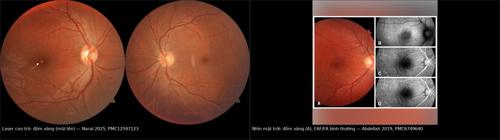
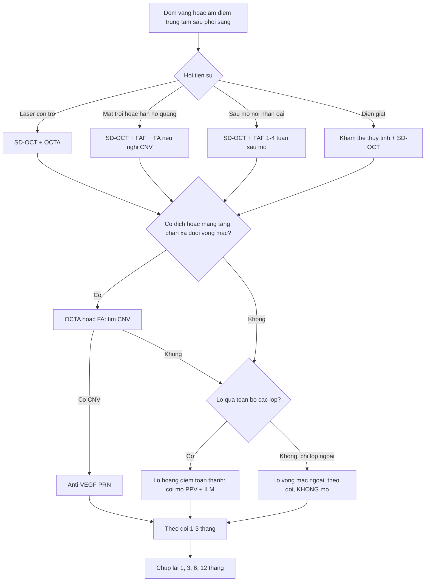
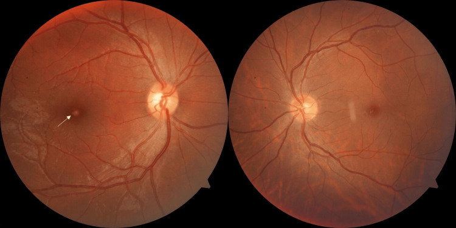
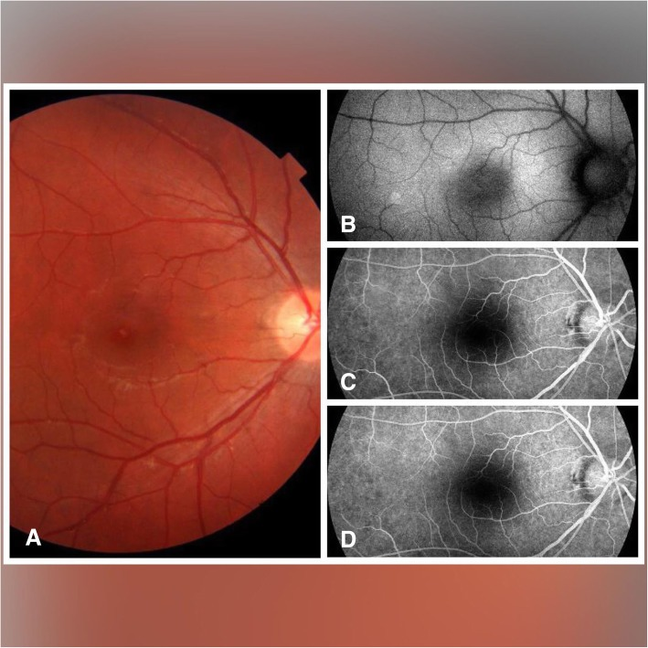
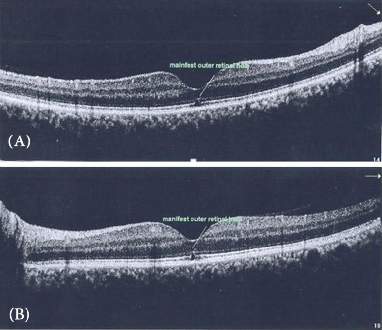
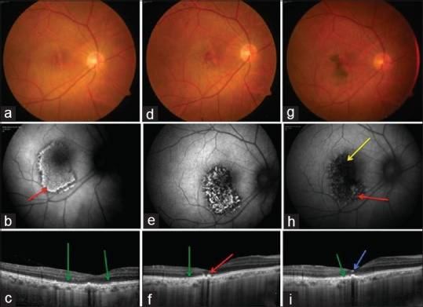
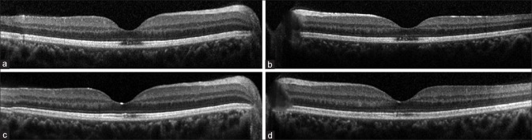

# 1519 — Bệnh võng mạc do ánh sáng: laser con trỏ, nhìn mặt trời, đèn mổ & điện giật / Photic retinopathy

**Tags:** `pattern:mat-EZ-hoang-diem` `pattern:lo-vong-mac-ngoai` `pattern:dom-vang-hoang-diem` `vung:mat` `vung:hoang-diem` `protocol:SD-OCT` `protocol:FAF` `protocol:OCTA`
**Mức chắc chắn (certainty):** tổng hợp y văn (literature synthesis) — tự biên từ các bài full-text mở CC BY/CC BY-NC-SA trên Europe PMC, số liệu lấy nguyên từ bài gốc, tên tác giả đối chiếu `authorString` theo PMCID.

> **Bài này trả lời “đốm vàng hoàng điểm sau khi nhìn vào nguồn sáng là gì, OCT đọc thế nào, có cần điều trị không”.**
> Khác với [1446 – phù hoàng điểm sau quang đông thể mi](../1446-phu-hoang-diem-sau-quang-dong-the-mi/lesson.md) (tổn thương do **laser y tế có chủ đích**) và [1492 – đục bao sau & YAG](../1492-duc-bao-sau-iol-yag-sau-cat-dich-kinh/lesson.md) (laser **phá mô có kiểm soát**), bài này nói về **ánh sáng ngoài ý muốn**: laser con trỏ, mặt trời/nhật thực, hàn hồ quang, đèn phẫu thuật — những ca mà “thị lực 20/20” và “đáy mắt gần bình thường” vẫn có thể kèm **ám điểm trung tâm vĩnh viễn**.

## 1. Tổng quan bệnh học – cơ chế hình ảnh

### 1.1 Vì sao chỉ một đốm sáng nhỏ lại đốt đúng hoàng điểm

- **Mắt là một thấu kính hội tụ có sẵn:** đồng tử giãn 7 mm có diện tích **0,385 cm²**; ảnh hội tụ trên võng mạc chỉ rộng **~50 µm** (diện tích **~2 × 10⁻⁵ cm²**). Tỷ số tập trung năng lượng ≈ **19.000 lần** — mọi nguồn sáng đủ mạnh chiếu vào mắt đều bị dồn vào một điểm ở hậu cực. Đây là lý do **cùng một nguồn sáng gây bỏng da nhẹ nhưng làm mù điểm vàng**.
- **Hoàng điểm là nơi dễ tổn thương nhất:** mật độ tế bào nón cao nhất, không có mạch máu trong hố trung tâm (nuôi dưỡng hoàn toàn từ màng mạch), chuyển hóa cao, và **melanin trong RPE + hắc mạc hấp thụ mạnh bước sóng 400–700 nm** → nhiệt và gốc tự do sinh ra ngay tại lớp ngoài võng mạc.
- **Ba cơ chế (theo thứ tự thường gặp):**
  - **Quang hóa (photochemical):** ánh sáng xanh **400–500 nm** kích thích lipofuscin/rhodopsin sinh **oxy hoạt hóa (ROS)**, phá màng tế bào cảm quang. Tổn thương **phụ thuộc liều** (bức xạ × thời gian), **không có ngưỡng nhọn** — nên nhìn mặt trời **vài chục giây** đã đủ, và **nhật thực** còn nguy hiểm hơn vì ánh sáng môi trường yếu làm **đồng tử giãn** trong khi ảnh mặt trời vẫn chói.
  - **Quang nhiệt (photothermal):** laser/near-infrared hấp thụ bởi melanosome → nhiệt độ võng mạc tăng; tổn thương xảy ra khi **ΔT ≥ 10 °C**. Với mặt trời, nhiệt độ tăng **không đủ để đông keo** — nên tổn thương mặt trời chủ yếu là **quang hóa + quang nhiệt tăng cường**.
  - **Quang cơ (photomechanical):** chỉ với laser **xung cực ngắn (Q-switched, mode-locked)** — hiệu ứng sóng âm gây rách mô; không gặp với laser con trỏ liên tục.
- **Vì sao tổn thương bắt đầu ở lớp ngoài:** đoạn ngoài tế bào cảm quang giàu lipid và có áp suất oxy cao nhất, sát RPE chứa melanin → **EZ (ellipsoid zone, ranh giới IS/OS cũ) và IZ (interdigitation zone) mất trước**, trong khi các lớp trong còn nguyên. Đây là lý do **OCT là phương thức chốt**, không phải đáy mắt.
- **Vì sao FAF có thể bình thường lúc đầu:** FAF đo **lipofuscin trong RPE**. Ngay sau phơi sáng, tế bào cảm quang đã hỏng nhưng **RPE còn sống** → FAF bình thường; chỉ khi RPE mất/chết mới **giảm tự huỳnh quang**. Ca nhìn mặt trời trong bài gốc có **FAF và FA bình thường** ngay lúc khám (Hình 1).

### 1.2 Ngưỡng định lượng nằm lòng

- **Mặt trời/nhật thực:** trong **3.082.727** lượt khám mới, **253 người (0,01%)** được chẩn đoán bệnh võng mạc do mặt trời (**349 mắt**); **62,06% một bên**, **73,12% nam**, **98,81% người lớn**, tuổi hay gặp nhất **thập niên 6** (22,13%); **78,8% mắt chỉ giảm thị lực nhẹ/không giảm (< 20/70)**, **12,89%** giảm trung bình (20/70–20/200).
- **Tiên lượng mặt trời:** 10 mắt/6 bệnh nhân, thị lực lúc vào **0,4–0,9**; **100% cải thiện**, đạt tối đa và **ổn định sau 6 tháng**; nhưng **lỗ võng mạc ngoài vẫn còn trên OCT ở 80%** sau 1 năm.
- **Laser con trỏ:** 31 mắt/22 bệnh nhân, **45% ≤ 15 tuổi**, **41% hai bên**, **64% tự chiếu**; **ám điểm trung tâm 61%**; thị lực trung bình **20/50 → 20/40**; **55% < 20/40** lúc vào; RPE thay đổi **68%**, lỗ võng mạc ngoài **55%**, dấu ASHH/anvil **16%**, **CNV thứ phát 10%**.
- **Laser ở trẻ (Freiburg):** 8 trẻ/11 mắt, tuổi trung bình **12,1** (6–16); thị lực trung vị **20/25**; **mất liên tục lớp ngoài võng mạc còn nguyên ở 8/11 mắt** sau trung vị **18 tháng**.
- **Khảo sát Vương quốc Anh:** **159 ca** tổn thương do laser con trỏ (**85% nam**, **80% < 20 tuổi**); **36% giảm thị lực trung bình (6/18–6/60)**, **17% giảm nặng (< 6/60)**.
- **Công suất thực vs nhãn:** một thiết bị ghi **“< 5 mW, Class III”** đo được **80–90 mW** (gấp **≥ 16 lần** nhãn); một thiết bị khác ghi **“Class II, < 1 mW”** đo được **47 mW**. Ngưỡng an toàn thông thường là **Class 1/2 ≤ 1 mW**; **Class 3B = 5–500 mW**; ca **1.000 mW** gây **lỗ hoàng điểm toàn thành**.
- **Đèn mổ/endoilluminator:** ca mổ kéo dài **2,5 giờ** với nguồn xenon, thị lực **6/36 → 4/60** sau 1 năm, **sẹo tăng sắc tố hoàng điểm** dù đã dùng corticoid uống 6 tuần.
- **Điện giật:** trẻ 12 tuổi, thị lực **6/9 hai mắt**, OCT mất EZ + RPE; **3 tháng sau 6/6** và OCT tái tổ chức — nhưng đây **không phải tổn thương do ánh sáng** (xem mục 5).

## 2. Mẫu hình + chẩn đoán phân biệt theo vị trí (gamut)

**Câu hỏi lọc:** *“Tổn thương nằm ở lớp nào, một bên hay hai bên, và tiền sử phơi sáng là gì?”* — chỉ cần ba thông tin này là khoanh được 80% chẩn đoán.

- **Theo cơ chế phơi sáng:**
  - **Ngoài y tế — mặt trời/nhật thực/hàn hồ quang:** hai bên (thường không đối xứng), đốm vàng–trắng đúng hố trung tâm, **FAF/FA có thể bình thường** lúc đầu, OCT **mất EZ/IZ + tăng phản xạ lớp ngoài**, sau đó **lỗ võng mạc ngoài**.
  - **Ngoài y tế — laser con trỏ:** một bên hoặc hai bên không đối xứng, **đốm vàng nhỏ/vài đốm**, có thể **mảng xuất huyết dưới võng mạc** nếu công suất lớn; OCT có **mound tăng phản xạ dưới võng mạc**, **ASHH** (dấu góc của lớp sợi Henle), **khoang giảm phản xạ dưới hố trung tâm**, hoặc **lỗ võng mạc ngoài hình chữ nhật**.
  - **Trong y tế — đèn mổ/endoilluminator:** sau **phẫu thuật nội nhãn dài** (đục thể thủy tinh phức tạp, cắt dịch kính), tổn thương **đúng hoàng điểm**, khởi phát **âm thầm vài ngày sau mổ**, FAF có **viền tăng huỳnh quang quanh ổ giảm huỳnh quang**.
  - **Không phải ánh sáng — điện giật:** hai bên, “**cherry-red spot**” ở hố trung tâm, OCT mất EZ/RPE; cơ chế là **dòng điện + co mạch**, không phải photon — nhưng hình ảnh giống và tiên lượng có thể tốt.
- **Theo mẫu hình OCT (dùng khi không có tiền sử rõ):**
  - **Mất EZ/IZ khu trú + khoang giảm phản xạ nhỏ dưới hố trung tâm:** tổn thương cấp do ánh sáng (laser, mặt trời).
  - **Lỗ võng mạc ngoài bờ vuông vắn, các lớp trong còn nguyên:** tổn thương **mạn** do ánh sáng — **không phải lỗ hoàng điểm toàn thành**, không cần mổ.
  - **Mất EZ dạng vòng cạnh hoàng điểm, hố trung tâm còn nguyên:** nhiễm độc **hydroxychloroquine** (bài [484](../484-nhiem-doc-vong-mac-hydroxychloroquine/lesson.md)).
  - **Dịch dưới võng mạc vòm nhẵn + mạch hắc mạc giãn:** CSCR/pachychoroid (bài [470](../470-cscr-do-corticosteroid-mat-thi-luc-khong-dau/lesson.md)).
  - **Màng tăng phản xạ dưới võng mạc + dịch + rò trên OCTA/FA:** **CNV thứ phát** sau chấn thương ánh sáng — cần điều trị khác hẳn.

## 3. Bảng so sánh phân biệt (ma trận đối chiếu)

| Thực thể (entity) | Hình ảnh điển hình (OCT/FAF/FA) | Chốt vào (rule-in) | Chốt loại (rule-out) | Gợi ý xác nhận |
|---|---|---|---|---|
| **Laser con trỏ — cấp** | Đốm vàng nhỏ ở hố trung tâm; OCT **mất EZ/IZ khu trú**, **mound tăng phản xạ dưới võng mạc**, **ASHH** (dải tăng phản xạ theo lớp Henle), **khoang giảm phản xạ**; bản đồ dày có thể **bình thường** | **Tiền sử chiếu laser + tổn thương khu trú đúng điểm chiếu + ASHH/mound** | **FAF/FA bình thường không loại trừ**; tổn thương lan tỏa hai bên đối xứng → nghĩ mặt trời/thuốc | SD-OCT thể tích + OCTA; hỏi **công suất, màu, khoảng cách, thời gian** |
| **Mặt trời/nhật thực/hàn hồ quang — cấp** | Đốm vàng–trắng hố trung tâm; OCT **tăng phản xạ lớp ngoài + mất EZ/IZ**, có thể **khoang dưới hố trung tâm**; **FAF và FA thường bình thường** | **Hai bên + đúng hố trung tâm + tiền sử nhìn mặt trời/nhật thực/hàn hồ quang** | **Một bên, bờ tổn thương lệch tâm, có xuất huyết** → nghĩ laser/chấn thương | Hỏi **kính lọc ISO 12312-2**, thời gian nhìn, có dùng ống nhòm/máy ảnh không |
| **Tổn thương do ánh sáng — mạn** | **Lỗ võng mạc ngoài** bờ vuông, RPE lốm đốm/tăng sắc tố, FAF **giảm huỳnh quang** tại ổ; thị lực có thể 20/20 | **Lỗ võng mạc ngoài + ám điểm trung tâm tồn tại + tiền sử phơi sáng** | **Lỗ toàn thành có nang/bờ cuộn, màng ngăn (operculum)** → lỗ hoàng điểm thật | OCT đường qua hố trung tâm + đối chiếu hai mắt; microperimetry |
| **Đèn mổ/endoilluminator** | Tổn thương **đúng hoàng điểm** sau mổ dài; FAF **viền tăng quanh ổ giảm**, OCT mất EZ/RPE, có thể **sẹo tăng sắc tố** | **Mổ nội nhãn kéo dài + tổn thương hoàng điểm không giải thích được** | **Phù cơ nang (CME)** có nang trong võng mạc, đáp ứng NSAID/steroid; **bong thanh dịch** có vòm dịch | Ghi lại **thời gian mổ, nguồn sáng, bộ lọc**; OCT + FAF 1–4 tuần sau mổ |
| **CNV thứ phát sau chấn thương ánh sáng** | **Màng tăng phản xạ dưới võng mạc** + dịch dưới võng mạc/trong võng mạc ± xuất huyết; **OCTA có mạng mạch**, FA rò | **Dịch/máu mới xuất hiện sau tổn thương đã ổn định + mạng mạch trên OCTA** | **Chỉ lỗ võng mạc ngoài khô, không dịch** → không phải CNV, không tiêm | OCTA (và FA nếu OCTA không kết luận); theo dõi sát 1–3 tháng |
| **Lỗ hoàng điểm toàn thành (vô căn)** | Lỗ qua **toàn bộ võng mạc**, bờ nang, **operculum**, đáy có chấm trắng; không liên quan phơi sáng | **Lỗ toàn thành + nang bờ + mất liên tục ILM** | **Chỉ lớp ngoài mất, lớp trong liên tục** → lỗ võng mạc ngoài do ánh sáng | OCT; phân biệt bằng độ sâu và bờ lỗ |
| **Nhiễm độc hydroxychloroquine** | **Mất EZ dạng vòng 2–6°** cạnh hoàng điểm, **hố trung tâm còn nguyên**; FAF vòng tăng rồi giảm; dùng thuốc **> 5 năm** | **Đối xứng hai bên + vòng cạnh hoàng điểm + tiền sử HCQ** | **Tổn thương một điểm đúng hố trung tâm, một bên** → không phải HCQ | Thị trường 10-2, FAF góc rộng; xem bài 484 |
| **CSCR/pachychoroid** | **Bong thanh dịch vòm nhẵn**, không mất EZ; hắc mạc dày, mạch giãn | **Dịch dưới võng mạc không có tổn thương lớp ngoài khu trú** | **Có lỗ/mất EZ tại đáy** → tổn thương ánh sáng | OCT + OCTA; hỏi corticoid (bài 470) |
| **Điện giật (không phải ánh sáng)** | **Cherry-red spot**, OCT mất EZ/RPE; có thể **Purtscher-like** (đốm bông, xuất huyết) | **Tiền sử điện giật + hai bên + tổn thương hố trung tâm** | **Không có tiền sử điện giật** → loại | Hỏi tai nạn điện; khám **thể thủy tinh** (đục là biểu hiện hay gặp nhất) |

*Trái: **laser con trỏ** — đốm vàng nhỏ đúng hố trung tâm, mắt bên kia bình thường (Naral G et al., *Cureus* 2025, PMC12597123, CC BY 4.0). Phải: **nhìn mặt trời** — đốm vàng (A) nhưng **FAF (B) và FA (C,D) gần như bình thường**, nên “FA bình thường” không loại trừ (Abdellah MM et al., *BMC Ophthalmol* 2019, PMC6749640, CC BY 4.0). Ảnh ghép letterbox, giữ nguyên tỷ lệ.*

## 4. Protocol chụp + cách theo dõi

### 4.1 Hỏi bệnh — phần quyết định chẩn đoán

- **Nguồn sáng:** loại thiết bị, **nhãn công suất/class**, màu (đỏ 650 nm / xanh 532 nm), khoảng cách, **thời gian chiếu**, số lần, có ai khác bị không.
- **Mặt trời:** có dùng **kính lọc đạt ISO 12312-2** không; có nhìn qua **ống nhòm/máy ảnh/kính râm thường** không (các dụng cụ này **hội tụ thêm** và làm tổn thương nặng hơn); nhật thực hay nhìn trực tiếp.
- **Sau mổ:** thời gian mổ, **nguồn sáng (xenon/halogen/LED)**, dùng **bộ lọc UV/xanh** không, có đặt kính áp tròng bảo vệ không.
- **Điện giật:** điện áp, đường vào–ra, có ngất/bỏng; hỏi thêm **nhìn mờ do đục thể thủy tinh** (biểu hiện hay gặp nhất).

### 4.2 Chụp gì, khi nào

- **SD-OCT hoàng điểm (thể tích + đường qua hố trung tâm):** bắt buộc; **quét cả vùng cạnh hoàng điểm** vì ASHH có thể nằm ngoài hố trung tâm. Chụp **ngay** và **lặp 1–2 tuần** (tổn thương có thể chưa rõ trong vài giờ đầu).
- **FAF:** bổ sung để đánh giá RPE; **bình thường lúc đầu không loại trừ**.
- **FA/OCTA:** khi nghi **CNV** (dịch/máu mới, giảm thị lực tiến triển); OCTA trước, FA khi OCTA không kết luận.
- **B-scan:** khi phương tiện trong suốt kém hoặc không loại trừ bong võng mạc ([411](../411-sieu-am-nhan-cau/lesson.md)).
- **Đo chức năng:** **Amsler** và **microperimetry** để lượng hóa ám điểm; **mfERG** giảm biên độ vùng hoàng điểm trong ca cấp (ca nhật thực 2024: **20/800 hai mắt**, mfERG giảm, **không cải thiện sau 2 tháng**).

### 4.3 Điều trị — điều gì có bằng chứng, điều gì không

- **Theo dõi là chuẩn:** phần lớn ca mặt trời hồi phục thị lực trong **vài tuần đến 6 tháng**; **không có thuốc nào chứng minh làm lành lỗ võng mạc ngoài**.
- **Corticoid:** chỉ có **báo cáo ca**, không có RCT; một số ca dùng prednisone/steroid uống được ghi nhận “cải thiện”, nhưng **không phân biệt được với hồi phục tự nhiên**. Không dùng corticoid thường quy; cân nhắc khi có phù/viêm kèm theo và **phải nói rõ đây là ngoài chỉ định**.
- **CNV thứ phát:** **anti-VEGF** (aflibercept 2 mg hoặc ranibizumab 0,5 mg) theo **PRN**; loạt ca laser cho thấy **PRN đủ đạt lui bệnh**, không nhất thiết điều trị kéo dài.
- **Lỗ hoàng điểm toàn thành:** nếu **toàn thành + triệu chứng**, phẫu thuật **PPV + bóc ILM ± đai**; **lỗ võng mạc ngoài KHÔNG mổ** (xem mục 5).
- **Đục thể thủy tinh do điện giật:** phẫu thuật khi ảnh hưởng thị lực.

### 4.4 Phòng ngừa (phần có thể làm ngay)

- **Nhật thực:** chỉ dùng kính lọc **ISO 12312-2**; **không** dùng kính râm thường, phim X-quang, đĩa mềm, hay nhìn qua **ống nhòm/máy ảnh/điện thoại** khi chưa có filter — các dụng cụ này **tăng năng lượng vào mắt**.
- **Laser con trỏ:** chỉ dùng thiết bị **Class 1/2 (≤ 1 mW)**; **không chiếu vào mắt/người/mặt phản chiếu**; giữ xa tầm tay trẻ em; nhãn “< 5 mW” **không đáng tin** (đã đo được 80–90 mW).
- **Đèn mổ/endoilluminator:** giảm **thời gian và cường độ** chiếu, dùng **bộ lọc UV/xanh**, **màn chắn cơ học** trên giác mạc khi mổ kéo dài; ghi nhận thời gian chiếu trong biên bản.
- **Trẻ có rối loạn hành vi/học tập/tâm thần:** nhóm **tự chiếu laser** hay gặp — cần **tư vấn gia đình + đánh giá tâm lý**, không chỉ điều trị mắt.

## 5. Biến thể bình thường và cạm bẫy

- **Bản đồ dày võng mạc bình thường:** ca laser có **độ dày trung tâm 261 µm** (bình thường) nhưng OCT cắt lớp thấy **mất EZ + khoang giảm phản xạ**. Chỉ nhìn bản đồ dày → **bỏ sót hoàn toàn**.
- **FAF và FA bình thường trong ca cấp:** đúng như ca nhìn mặt trời trong Hình 1. **Không được dùng FA/FAF bình thường để trấn an**; OCT mới là chốt.
- **“Thị lực 20/20” không loại trừ:** lỗ võng mạc ngoài tồn tại ở **80%** mắt sau 1 năm, trong khi thị lực có thể về 20/20; bệnh nhân vẫn **ám điểm** khi đọc chữ nhỏ.
- **Chỉ quét đúng đường giữa hoàng điểm:** ASHH/anvil có thể nằm **cạnh hoàng điểm** → phải quét **thể tích** hoặc nhiều đường song song.
- **Gọi lỗ võng mạc ngoài là “lỗ hoàng điểm” rồi mổ:** lỗ do ánh sáng **chỉ mất lớp ngoài**, bờ vuông, ILM và các lớp trong còn nguyên — **mổ PPV không có chỉ định** và có thể làm nặng thêm.
- **Nhãn công suất laser là giả:** “Class III, < 5 mW” đo được **80–90 mW**; “Class II, < 1 mW” đo được **47 mW**. Luôn hỏi **thiết bị thật**, đừng tin nhãn.
- **Nhật thực không gây “làn sóng” nhập viện:** dữ liệu 2024 cho thấy **1.774 lượt khám cấp cứu mắt**, **853 trước vs 921 sau** nhật thực, **không khác biệt có ý nghĩa (χ² = 1,432; p > 0,05)** — nghĩa là ca bệnh có thể đến **phòng khám mắt chuyên khoa** vài tuần sau, không phải cấp cứu ngay. Không có làn sóng ≠ không có ca.
- **Đèn mổ bị quy cho “phù cơ nang” hoặc “mổ thành công mà bệnh nhân kêu mờ”:** tổn thương đúng hoàng điểm, xuất hiện sau **vài ngày**, FAF có viền tăng huỳnh quang; cần **FAF/OCT** chứ không chỉ OCT độ dày.
- **Điện giật không phải bệnh do ánh sáng:** cơ chế là dòng điện/co mạch, có thể kèm **Purtscher-like** (đốm bông, xuất huyết) và **đục thể thủy tinh** — đừng gộp vào “photic” khi viết chẩn đoán.
- **Bỏ sót ở trẻ:** trẻ có thể **không kể** vì sợ, hoặc bị **nhược thị** che lấp; ca 13 tuổi trong y văn có **nhược thị một bên từ trước** nên tổn thương mắt còn lại dễ bị bỏ qua.

## 6. Tự lượng giá — Blind Quiz

**Ca 1 — Nam 20–30 tuổi, bị bạn chiếu laser đỏ vào mắt phải khi đang nói chuyện. Nhìn mờ + ám điểm trung tâm 1 ngày. Thị lực 20/30.**

- Hỏi: (1) Dấu hiệu ở hố trung tâm mắt phải? (2) Vì sao bản đồ độ dày có thể bình thường? (3) Cần hỏi thêm gì về thiết bị?

<b>Bấm để hiện đáp án (findings + chẩn đoán)</b>

- **Findings:** mắt phải có **đốm vàng nhỏ ở hố trung tâm** (mũi tên), mắt trái bình thường. OCT (ảnh dưới): **mất liên tục EZ/IZ khu trú**, **khoang giảm phản xạ nhỏ dưới hố trung tâm**, **bong thanh dịch nhẹ**, **bản đồ dày trung tâm 261 µm — bình thường**.
- **Chẩn đoán:** **bệnh võng mạc do laser con trỏ (laser pointer maculopathy) cấp**.
- **Vì sao bản đồ dày bình thường:** tổn thương chỉ ở **lớp ngoài** và khu trú **< 1 mm²**, không gây phù; độ dày trung bình không đổi. Phải đọc **từng B-scan**.
- **Hỏi thêm:** công suất/class ghi trên nhãn, màu, khoảng cách, **thời gian chiếu** — nhãn có thể sai (đã có ca ghi < 5 mW nhưng đo 80–90 mW).
- **Nguồn ảnh:** Naral G et al., *Cureus* 2025 (PMC12597123), CC BY 4.0 — Fig. 1 và Fig. 3.

**Ca 2 — Bé trai 11 tuổi nhìn trực tiếp mặt trời trong ngày nhật thực, không đeo kính lọc. Hai ngày sau nhìn mờ hai mắt, ám điểm trung tâm.**

- Hỏi: (1) Đốm vàng ở hố trung tâm là gì? (2) FAF và FA bình thường có loại trừ tổn thương không? (3) OCT sẽ thấy gì, và tiên lượng ra sao?

<b>Bấm để hiện đáp án</b>

- **Findings:** (A) **đốm vàng–trắng đúng hố trung tâm**, mất phản xạ hố trung tâm; (B) **FAF gần như bình thường**; (C,D) **FA không rò**. Đây là bộ ba điển hình của **bệnh võng mạc do mặt trời cấp**.
- **FAF/FA bình thường không loại trừ:** tổn thương nằm ở **tế bào cảm quang**, RPE còn sống nên **lipofuscin chưa mất**; FA chỉ thấy rò khi có CNV/viêm.
- **OCT:** **tăng phản xạ lớp ngoài + mất EZ/IZ**, sau đó hình thành **lỗ võng mạc ngoài** (ảnh dưới). Thị lực thường hồi phục trong **6 tháng** nhưng **lỗ vẫn còn ở 80%** sau 1 năm → **ám điểm có thể tồn tại**.
- **Nguồn ảnh:** Abdellah MM et al., *BMC Ophthalmol* 2019 (PMC6749640), CC BY 4.0 — Fig. 1.

- Hỏi tiếp: lỗ này có phải **lỗ hoàng điểm toàn thành** không? Có cần mổ không?

<b>Bấm để hiện đáp án</b>

- **Findings:** **lỗ võng mạc ngoài (outer retinal hole)** hai mắt — mất EZ/IZ và một phần nhân ngoài, **các lớp trong và ILM còn liên tục**, không nang bờ, không operculum.
- **Không phải lỗ toàn thành** → **không có chỉ định PPV**; theo dõi + giải thích ám điểm.
- **Nguồn ảnh:** Abdellah MM et al., *BMC Ophthalmol* 2019 (PMC6749640), CC BY 4.0 — Fig. 4 (6 tháng sau phơi sáng).

**Ca 3 — Nam 64 tuổi, mổ cắt dịch kính + cố định IOL sau bao bằng chỉ xuyên củng mạc, kéo dài 2,5 giờ, dùng nguồn sáng xenon. Sau mổ nhìn mờ, không đau.**

- Hỏi: (1) Tổn thương nằm ở đâu và do đâu? (2) Vì sao FAF đổi từ viền tăng sang ổ giảm huỳnh quang? (3) Corticoid có giúp không?

<b>Bấm để hiện đáp án</b>

- **Findings:** (a–c) ngày 1: **thay đổi sắc tố hoàng điểm**, FAF **viền tăng huỳnh quang** quanh ổ, OCT **mất ELM/EZ**; (d–f) 2 tháng: sắc tố tăng, FAF lốm đốm; (g–i) 1 năm: **sẹo tăng sắc tố, giảm huỳnh quang**, sắc tố di chuyển vào võng mạc trong.
- **Nguyên nhân:** **quang độc do đèn mổ + endoilluminator** — ánh sáng hội tụ đúng hoàng điểm trong thời gian dài; tổn thương xuất hiện **âm thầm sau mổ**.
- **FAF:** viền tăng = RPE **còn sống nhưng quá tải lipofuscin**; ổ giảm = **RPE đã mất**; sắc tố di chuyển = di chứng.
- **Corticoid không giúp:** bệnh nhân dùng **6 tuần corticoid uống** nhưng thị lực **6/36 → 4/60** sau 1 năm. Đây là tổn thương **cấu trúc không hồi phục**, không phải viêm.
- **Nguồn ảnh:** Dogra M et al., *Indian J Ophthalmol* 2019 (PMC6498908), CC BY-NC-SA 4.0 — Fig. 1 (nguyên bản, không chỉnh sửa).

**Ca 4 (tùy chọn) — Bé trai 12 tuổi bị điện giật, nhìn mờ hai mắt, thị lực 6/9.**

- Hỏi: đây có phải “photic retinopathy” không? Điều gì khác biệt về cơ chế và tiên lượng?

<b>Bấm để hiện đáp án</b>

- **Không phải do ánh sáng:** tổn thương do **dòng điện** (co mạch, tổn thương trực tiếp), không do photon. Hình ảnh giống (mất EZ/RPE, “cherry-red spot”) nhưng **cơ chế khác**.
- **Findings:** (a,b) lúc vào: **mất EZ và RPE**, ELM còn; (c,d) 3 tháng: **EZ tái tổ chức, RPE gần bình thường**, thị lực **6/6**.
- **Điểm thực hành:** khám thêm **thể thủy tinh** (đục là biểu hiện hay gặp nhất của điện giật) và tìm **Purtscher-like** nếu có đốm bông/xuất huyết.
- **Nguồn ảnh:** Ranjan R et al., *Indian J Ophthalmol* 2017 (PMC5700614), CC BY-NC-SA 4.0 — Fig. 2 (nguyên bản).

## 7. Câu hỏi nghiên cứu & điểm chưa đồng thuận (tính đến 11/2026)

1. **[Tranh cãi] Ở bệnh nhân tổn thương hoàng điểm cấp do ánh sáng, corticoid toàn thân có cải thiện thị lực/ám điểm so với theo dõi đơn thuần không?**
   - **Đã biết:** chỉ có báo cáo ca và loạt ca nhỏ; một số ca dùng steroid có cải thiện, nhưng đa số ca **tự hồi phục trong 6 tháng** kể cả không điều trị (10 mắt, **100% cải thiện**).
   - **Chưa rõ:** không phân biệt được hiệu quả thuốc với hồi phục tự nhiên; chưa có RCT, chưa có liều/thời điểm.
   - **Hướng nghiên cứu:** RCT nhỏ hoặc registry tiến cứu, outcome **microperimetry + OCT lỗ võng mạc ngoài ở 6–12 tháng**.
   - **Nguồn:** PMC6749640 (2019); PMC11309525 (2024); PMC10313552 (2023).

2. **[Khoảng trống] Dấu hiệu OCT nào dự báo ám điểm tồn tại dai dẳng sau tổn thương ánh sáng?**
   - **Đã biết:** lỗ võng mạc ngoài tồn tại **80%** sau 1 năm dù thị lực cải thiện; **mất EZ/IZ** là dấu chính; CNV thứ phát **10%** ở loạt laser.
   - **Chưa rõ:** chưa có mô hình tiên lượng kết hợp **kích thước lỗ, mất ELM, tổn thương RPE, mfERG**; ngưỡng kích thước để dự báo ám điểm vĩnh viễn chưa thống nhất.
   - **Hướng nghiên cứu:** cohort tiến cứu có **microperimetry** làm chuẩn, phân tích đa biến các biến OCT.
   - **Nguồn:** PMC6749640 (2019); PMC12139189 (2025).

3. **[Khác biệt thực hành] Trẻ tự chiếu laser: có bắt buộc đánh giá tâm lý/hành vi và tư vấn gia đình, hay chỉ theo dõi mắt?**
   - **Đã biết:** **4/77** báo cáo ca trẻ có vấn đề tâm lý/hành vi, và **3/4** trẻ trong một loạt địa phương có vấn đề này; tổn thương cấu trúc kéo dài **> 12 tháng** ở cả 4 trẻ.
   - **Chưa rõ:** chưa có khuyến cáo thống nhất về **sàng lọc tâm lý** và cách phối hợp gia đình–nhà trường; thực hành khác nhau giữa trung tâm.
   - **Hướng nghiên cứu:** nghiên cứu triển khai (implementation) đánh giá quy trình sàng lọc–tư vấn và tỷ lệ tái phơi nhiễm.
   - **Nguồn:** PMC6460723 (2019); PMC10313552 (2023).

## Bài liên quan chéo
- [441 – OCT hoàng điểm](../441-OCT-hoang-diem/lesson.md)
- [484 – Nhiễm độc võng mạc do hydroxychloroquine](../484-nhiem-doc-vong-mac-hydroxychloroquine/lesson.md)
- [470 – CSCR do corticosteroid: mất thị lực không đau](../470-cscr-do-corticosteroid-mat-thi-luc-khong-dau/lesson.md)
- [1429 – Lỗ hoàng điểm thứ phát mạn](../1429-lo-hoang-diem-thu-phat-manh-oi/lesson.md)
- [1446 – Phù hoàng điểm sau quang đông thể mi](../1446-phu-hoang-diem-sau-quang-dong-the-mi/lesson.md)
- [1492 – Đục bao sau & YAG sau cắt dịch kính](../1492-duc-bao-sau-iol-yag-sau-cat-dich-kinh/lesson.md)
- [411 – Siêu âm nhãn cầu](../411-sieu-am-nhan-cau/lesson.md)
- [449 – Chấn thương mắt & dị vật](../449-chan-thuong-mat-dich-vat/lesson.md)

## Ảnh
- `images/1519_photic-retinopathy_Fundus_PMC12597123.jpg`, `images/1519_photic-retinopathy_OCT_PMC12597123.jpg` — Naral G et al., *Cureus* 2025 (PMC12597123), **CC BY 4.0**.
- `images/1519_photic-retinopathy_OuterHole-OCT_PMC12139189.jpg` — Moussa M et al., *Int J Retina Vitreous* 2025 (PMC12139189), **CC BY 4.0**.
- `images/1519_solar-retinopathy_Fundus-FAF-FA_PMC6749640.jpg`, `images/1519_solar-retinopathy_OuterHole-OCT_PMC6749640.jpg` — Abdellah MM et al., *BMC Ophthalmol* 2019 (PMC6749640), **CC BY 4.0**.
- `images/1519_photic-maculopathy_Microscope-FAF-OCT_PMC6498908.jpg` — Dogra M et al., *Indian J Ophthalmol* 2019 (PMC6498908), **CC BY-NC-SA 4.0** (nguyên bản).
- `images/1519_photic-maculopathy_Electric-Shock-OCT_PMC5700614.jpg` — Ranjan R et al., *Indian J Ophthalmol* 2017 (PMC5700614), **CC BY-NC-SA 4.0** (nguyên bản).
- `images/composite_1519_laser-vs-solar.jpg` — ảnh ghép từ hai bài CC BY 4.0 ở trên (letterbox, không crop/kéo giãn).
- Nguồn + giấy phép từng ảnh: [`images/CREDITS.md`](images/CREDITS.md).

> Không dùng để chẩn đoán độc lập khi chưa có người hướng dẫn.
