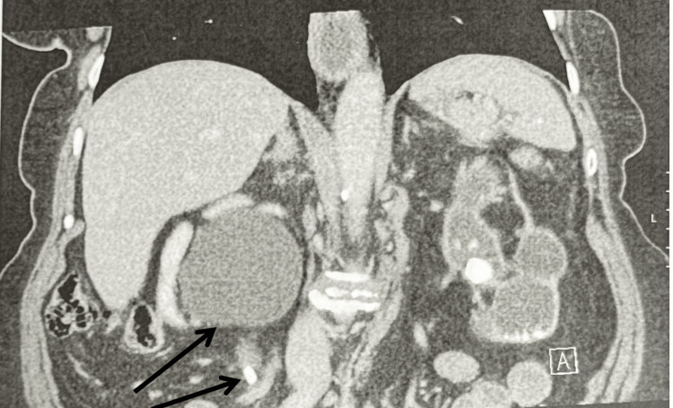
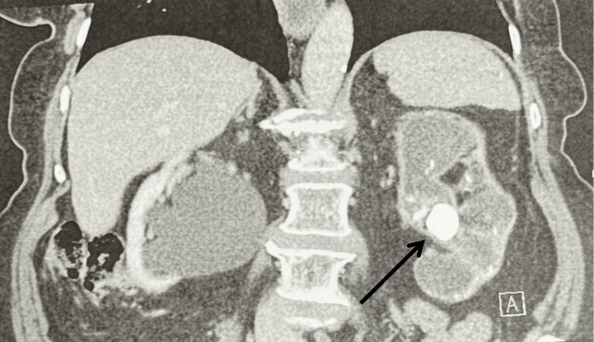

# 152 — Sỏi niệu, ứ nước & nhiễm trùng niệu trên / Stones, hydronephrosis & UTI

**Tags:** `pattern:soi-nieu` `vung:he-nieu`
**Mức chắc chắn (certainty):** tổng hợp y văn (literature synthesis) — nhóm tự biên từ y văn mở, chưa gắn ca nguyên văn đơn lẻ.

## 1. Tổng quan — sỏi cản quang + ứ nước + vỏ mỏng dần

- Sỏi > 90% cản quang trên CT không tiêm (axit uric là ngoại lệ không cản quang). TẠI SAO CT không tiêm là chuẩn sỏi: thấy sỏi + ứ nước + phù quanh mà không cần thuốc.
- **Ứ nước:** giãn bể thận + đài (nhện) + niệu quản trên sỏi; **vỏ mỏng dần + không đau = tắc mạn mất chức năng** (như thận trái 24 mm dưới đây).
- Ngưỡng: sỏi niệu quản > 6–7 mm khó tự ra (can thiệp); < 5 mm + không sốt/ứ nặng = theo dõi + tống sỏi.

## 2. Gamut đau hông + ứ nước

- **Sỏi niệu quản cấp:** sỏi cản quang + ứ nước + đau quặn + máu niệu — giảm đau + can thiệp theo mm.
- **Tắc mạn câm (silent):** sỏi lớn + vỏ mỏng + KHÔNG đau/sốt — mất chức năng không hồi phục (ca dưới).
- **Viêm thận bể thận:** thận to + ngấm loang lổ + sốt + bạch cầu niệu — kháng sinh (sỏi + sốt = dẫn lưu cấp cứu!).
- **Hoại tử nhú/viêm khí:** khí thận + ĐTĐ + nhiễm trùng nặng — mổ/dẫn lưu cấp cứu.

## 3. Bảng so sánh

| Thực thể (entity) | Hình ảnh | Chốt | Xử trí |
|---|---|---|---|
| Sỏi cấp + ứ nước | **Sỏi cản quang + giãn trên sỏi + đau/máu niệu** | Đau quặn + máu niệu | Giảm đau + can thiệp theo mm |
| Tắc mạn câm | **Sỏi lớn + vỏ mỏng + KHÔNG đau** | Không đau + vỏ mỏng = mất chức năng | Bảo tồn thận hỏng + cứu thận còn lại |
| Viêm thận bể thận | **Thận to + ngấm loang lổ + sốt** | Sốt + bạch cầu niệu + cấy (+) | Kháng sinh; sỏi + sốt = dẫn lưu |
| Thận sinh hơi | **Khí thận + ĐTĐ + sốc nhiễm trùng** | Khí + ĐTĐ + nặng | Dẫn lưu/mổ cấp cứu |

*Sỏi + giãn + nhu mô còn tốt. Nguồn: Patel et al., Cureus 2026 Fig. 1, CC BY 4.0.*

*Sỏi lớn + vỏ mỏng = tắc mạn câm. Nguồn: Patel et al., Fig. 2, CC BY 4.0.*

## 4. Protocol

- **CT không tiêm lát mỏng** đầu tay (sỏi + ứ nước + vỏ); cản quang khi nghi viêm/u.
- Siêu âm theo dõi sau can thiệp + tầm soát tái phát.
- Nhiễm trùng + tắc = dẫn lưu thận (nephrostomy/stent) cấp cứu trước kháng sinh đơn thuần.

## 5. Cạm bẫy

- **Không đau ≠ không tắc** (ca thận trái trên) — vỏ mỏng là bằng chứng mất chức năng.
- **Sỏi axit uric không cản quang** — CT thấy ứ nước mà không thấy sỏi + pH toan → kiềm hóa.
- **Phleboliths chậu** giả sỏi niệu quản — dấu vành mô mềm (soft-tissue rim) = sỏi thật.

## 6. Tự lượng giá — Blind Quiz

**Ca 1 — Không đau + sỏi 2 bên (8,7 mm + 24 mm). Đọc 2 ảnh, thận nào cứu?**

- Hỏi: bên nào còn chức năng? Bên nào mất? Xử trí mỗi bên?

<b>Bấm để hiện đáp án</b>

- **Phải (8,7 mm + ứ nước + nhu mô tốt):** tán sỏi + đặt stent cứu thận duy nhất. **Trái (24 mm + vỏ mỏng + không đau):** tắc mạn câm mất chức năng — bảo tồn + theo dõi.
- Nguồn: Patel et al., Fig. 1–2, CC BY 4.0.

**Ca 2 — Sốt + đau hông + sỏi niệu quản + ứ nước:** kháng sinh đơn thuần đủ không? *(Bảng mục 3.)*

<b>Bấm để hiện đáp án</b>

- **Không:** nhiễm trùng + tắc = dẫn lưu cấp cứu (nephrostomy/stent) + kháng sinh.

## Bài liên quan chéo
- [100 – Tổng quan hệ Bụng](../100-tong-quan-he-bung/lesson.md)
- [150 – Bosniak & u thận](../150-nang-than-Bosniak/lesson.md) (vỏ mỏng vs nang)
- [110 – Giải phẫu bụng](../110-giai-phau-bung/lesson.md) (khoang quanh thận)

> Không dùng để chẩn đoán độc lập khi chưa có người hướng dẫn.
