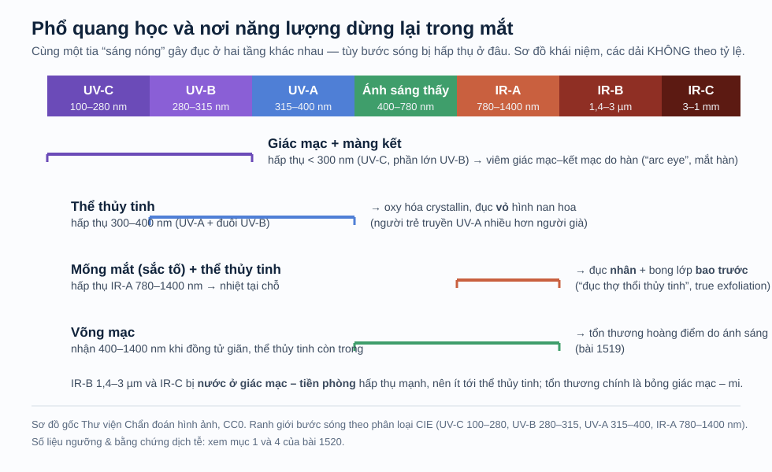
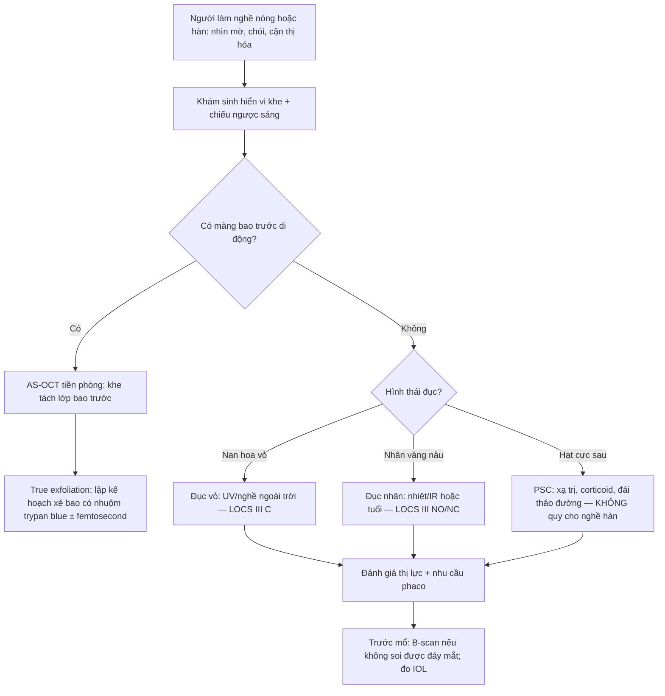
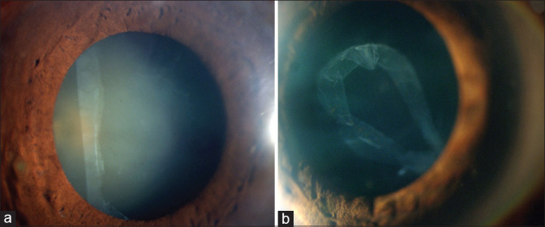
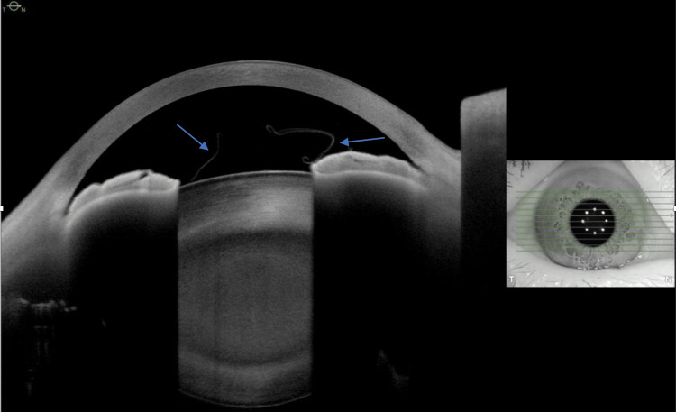
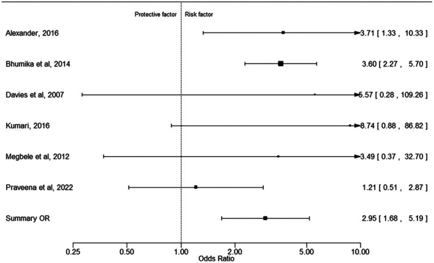

# 1520 — Đục thể thủy tinh do tia hồng ngoại và UV: “đục thợ thổi thủy tinh”, true exfoliation và mắt thợ hàn / Infrared and ultraviolet cataract

**Tags:** `pattern:duc-the-thuy-tinh` `pattern:manh-bao-truoc-bong` `pattern:duc-nhan` `vung:mat` `vung:the-thuy-tinh` `protocol:sinh-hien-vi-chieu-sang-khe` `protocol:AS-OCT` `score:LOCS-III`
**Mức chắc chắn (certainty):** tổng hợp y văn (literature synthesis) — số liệu lấy nguyên từ phân tích gộp, đo đạc phơi nhiễm nghề nghiệp và ca bệnh công bố mở; tên tác giả không ghi khi chưa đối chiếu trực tiếp, nguồn ghi theo `Tạp chí Năm (PMCID)`.

> **Bài này trả lời: “người làm nghề nóng/sáng — thổi thủy tinh, hàn hồ quang, lò luyện — bị đục thể thủy tinh kiểu gì, đọc trên sinh hiển vi và AS-OCT ra sao, và mổ khác người thường ở đâu”.**
> Khác với [1519 – bệnh võng mạc do ánh sáng](../1519-benh-vong-mac-do-anh-sang/lesson.md) (năng lượng tới **võng mạc**), bài này nói về năng lượng **dừng lại ở phía trước**: UV-B/UV-A ở **vỏ và bao trước**, hồng ngoại IR-A ở **mống mắt và nhân**. Khác với [6214 – đục do xạ trị](../6214-duc-the-thuy-tinh-xa-tri-retinoblastoma/lesson.md) (bức xạ ion hóa, PSC) và [1512 – bệnh bong vảy bao thể thủy tinh](../1512-pseudoexfoliation-truoc-phaco/lesson.md) (PXF, bệnh toàn thân có vảy).

## 1. Tổng quan bệnh học – cơ chế hình ảnh

### 1.1 Vì sao cùng một “tia sáng nóng” lại đục ở hai tầng khác nhau

- **Mắt là một chuỗi lọc bức xạ quang học (optical radiation), không phải một khối trong suốt.** Giác mạc hấp thụ gần hết bước sóng **< 300 nm** (UV-C 100–280 nm và phần lớn UV-B 280–315 nm); thể thủy tinh hấp thụ **300–400 nm** (UV-A 315–400 nm + đuôi UV-B); ánh sáng **400–780 nm** và **IR-A 780–1400 nm** đi qua được tới võng mạc; **IR-B 1,4–3 µm** bị **nước ở giác mạc – tiền phòng** hấp thụ mạnh nên ít tới thể thủy tinh.
- **Hệ quả 1 — UV đục ở vỏ:** UV-B kích thích triptophan trong protein thể thủy tinh sinh **kyurenine và oxy hoạt hóa (ROS)**, làm **crystallin bị oxy hóa, kết tụ, tăng tán xạ**; tổn thương ưu thế ở **vỏ trước và vùng dưới bao trước**, nơi tia tới trước và tế bào biểu mô bao còn sống. Trên sinh hiển vi: **đục hình nan hoa (cortical spokes)** từ ngoại vi vào trung tâm, thấy rõ nhất khi chiếu ngược sáng (retroillumination).
- **Hệ quả 2 — hồng ngoại đục ở nhân và bong bao trước:** IR-A xuyên qua giác mạc nhưng bị **sắc tố mống mắt** và **thể thủy tinh** hấp thụ → **nhiệt tại chỗ**. Sắc tố mống mắt nóng lên làm nóng thủy dịch và **tế bào biểu mô bao trước**; protein bao bị **thủy phân do nhiệt**, tế bào biểu mô chết/giảm mật độ → **tách lớp bao trước (anterior capsular delamination = true exfoliation)** và **đục nhân (nuclear sclerosis)**.
- **Bằng chứng thực nghiệm cho “chỉ cần ấm hơn một chút”:** nuôi thể thủy tinh chuột ở **37,5 °C** (so với **35,0 °C** sinh lý) trong vài ngày làm **giảm filensin và vimentin** — hai protein khung giữ cấu trúc sợi — trong **190 protein** định lượng được; **57 protein (30,0%)** chỉ có ở nhóm 37,5 °C trong khi **85 protein (44,7%)** chỉ có ở nhóm 35,0 °C (PMC11576961). Đây là cơ sở để hiểu vì sao **phơi nhiễm nhiệt nghề nghiệp kéo dài nhiều năm** có thể đục dù nhiệt độ mắt chỉ tăng vài phần mười độ.
- **Tại sao hình ảnh học vẫn có vai trò:** đục thể thủy tinh là **chẩn đoán lâm sàng** (sinh hiển vi khe), nhưng **AS-OCT tiền phòng** là phương thức chốt để thấy **lớp bao trước tách đôi** và độ dày bao; **siêu âm B 10 MHz** dùng khi đục quá dày không soi được đáy mắt; **CT hốc mắt** chỉ dùng khi có chấn thương/dị vật; **MRI chống chỉ định** khi nghi dị vật kim loại nội nhãn.

### 1.2 Ngưỡng định lượng nằm lòng

- **Thợ hàn (welding):** phân tích gộp **9 nghiên cứu, 5.165 thợ hàn và 513.026 người chứng**; **OR 2,95 (95% CI 1,68–5,19; p = 0,00017)** ở nước thu nhập trung bình – thấp, nhưng **OR 1,22 (0,79–1,90; p = 0,374)** ở nước thu nhập cao; **I² = 39%**, có dấu hiệu **thiên lệch công bố** theo hướng nguy cơ cao (PMC13353749). Trên toàn cầu có **> 10 triệu thợ hàn** và **~110 triệu lao động** liên quan hàn.
- **Ánh sáng mặt trời (UV tự nhiên):** phân tích gộp **31 nghiên cứu** cho **OR đục thể thủy tinh liên quan tuổi (ARC) 1,15 (1,09–1,21)**; phân theo hình thái: **vỏ 1,03 (1,02–1,03)**, **nhân 1,00**, **dưới bao sau 0,99 (0,95–1,01)** (PMC8604584). Khoảng tin cậy của nhóm vỏ hẹp bất thường do cách gộp — đọc như **tín hiệu hướng**, không phải độ chính xác tuyệt đối.
- **Thổi thủy tinh:** đo bức xạ quang tại **4 phòng thí nghiệm đại học + 3 studio tư nhân** cho thấy **UV và IR mức thấp ở mọi công đoạn**, nhưng **mức IR vượt ngưỡng ở thổi thủy tinh thủ công**; việc chọn kính bảo hộ dựa trên **kinh nghiệm**, không dựa trên **mức phơi nhiễm đo được** (PMC6980197).
- **True exfoliation:** trong **278 ca phaco** của một phẫu thuật viên, **6 ca (2,2%)**, **tuổi trung bình 85,0** — nhóm tác giả cho rằng bệnh gắn với **thoái hóa tuổi** nhiều hơn bức xạ hồng ngoại (PMC4777948). Ca bệnh khác: **78 tuổi, nông dân, không tiền sử tiếp xúc hồng ngoại/chấn thương**, vẫn **bong bao trước hai mắt** (PMC7350437); một ca nữa **hai mắt, không yếu tố nguy cơ**, mô học xác nhận **tách lớp bao trước** (PMC6380153).
- **Lịch sử:** Heister mô tả đục ở thợ thổi thủy tinh do **ánh sáng hồng ngoại** năm **1739**; Elschnig mô tả **true exfoliation** ở thợ thổi thủy tinh năm **1922** — hai mốc giải thích vì sao bệnh mang tên nghề.

## 2. Mẫu hình + chẩn đoán phân biệt theo vị trí (gamut)

- **Theo lớp giải phẫu (location):**
  - **Bao trước (anterior capsule):** màng mỏng **bong, di động (“floating/fluttering membrane”)** trong tiền phòng, mép cuộn lại; khi xé bao thấy **vòng đôi (double-ring sign)**. → **true exfoliation**: do nhiệt/IR, chấn thương, viêm, tia xạ, laser mống mắt, hoặc **tuổi**.
  - **Vỏ (cortex):** **nan hoa (spokes)**, đục **hình nêm** từ ngoại vi, hay gặp ở **vùng đồng tử** khi chiếu ngược sáng. → **UV/tia cực tím**, cũng gặp trong ĐTĐ, hạ calci máu, chấn thương.
  - **Nhân (nucleus):** **vàng → nâu (brunescent)**, tăng đậm độ đều; gây **cận thị hóa (myopic shift)**. → **nhiệt/IR mạn**, tuổi, hút thuốc.
  - **Dưới bao sau (PSC):** **hạt/vacuole dạng “tuyết rơi”** ở cực sau. → **bức xạ ion hóa, corticoid, ĐTĐ, viêm màng bồ đào** — phân tích gộp thợ hàn **không** thấy khác biệt PSC (PMC13353749), nên **PSC không phải hình thái “nghề hàn” điển hình**.
- **Gamut ngoài nghề nghiệp (phải loại trừ trước khi quy cho nghề):** tuổi, **đái tháo đường**, **corticoid toàn thân/hít**, hút thuốc, chấn thương kín, viêm màng bồ đào, **loạn dưỡng cơ (myotonic dystrophy)**, Wilson, viêm da cơ địa, **tia xạ**, suy cận giáp.
- **Gợi nhớ theo 5 nhóm nguyên nhân:** **NHIỆT** (IR, lò, thổi thủy tinh → nhân + bao trước) · **UV** (mặt trời, hàn hồ quang → vỏ + giác mạc cấp) · **THUỐC/BỆNH** (corticoid, ĐTĐ, viêm màng bồ đào → PSC) · **TUỔI** (thoái hóa bao, nhân) · **CHẤN THƯƠNG** (bao, zonule, dị vật) — nhóm “không rõ nguyên nhân” vẫn là lớn nhất, nên hỏi nghề nghiệp và thuốc trước khi kết luận.

*Sơ đồ gốc Thư viện CĐHA, CC0 — UV dừng ở giác mạc rồi thể thủy tinh; IR-A dừng ở mống mắt và thể thủy tinh. Không theo tỷ lệ.*

## 3. Bảng so sánh phân biệt (ma trận đối chiếu)

| Thực thể (entity) | Hình ảnh điển hình (sinh hiển vi / AS-OCT) | Chốt vào (rule-in) | Chốt loại (rule-out) | Gợi ý xác nhận |
|---|---|---|---|---|
| True exfoliation do nhiệt/IR | Màng mỏng **di động** trong tiền phòng, mép cuộn; AS-OCT: **khe tách lớp bao trước**, bao mỏng | **Màng tự do + AS-OCT tách lớp + tiền sử nghề nóng** (thổi thủy tinh, lò, thợ rèn) | **Không có vảy bờ đồng tử, không có ba vùng bao điển hình** (khác PXF) | AS-OCT tiền phòng, mô học bao sau mổ |
| True exfoliation “tuổi” (không phơi nhiễm) | Giống hệt trên, thường **hai mắt**, người **> 80 tuổi** | **Tuổi cao + hai mắt + không tiền sử**; **2,2% ca phaco**, tuổi trung bình **85** | **Một bên + có chấn thương/viêm** → tìm nguyên nhân thứ phát | Hỏi kỹ nghề nghiệp, AS-OCT |
| Đục vỏ do UV (cortical) | **Nan hoa** hình nêm, ngoại vi → trung tâm; rõ khi **chiếu ngược sáng** | **Phơi nắng nghề nghiệp (nông, ngư, xây dựng)** + nan hoa; OR ánh sáng **1,15** cho ARC, **1,03** cho vỏ | **Đục đều toàn bộ + không nan hoa** → nghĩ nhân/tuổi | LOCS III mục C, ảnh chiếu ngược sáng |
| Đục nhân do nhiệt/IR | Nhân **vàng–nâu**, tăng đậm độ; **cận thị hóa** | **Nghề nóng kéo dài + nhân nâu hai mắt**; xuất hiện **sớm hơn tuổi** | **PSC hạt ở cực sau** → không phải hình thái nhiệt | LOCS III NO/NC, đo khúc xạ trước mổ |
| PSC do xạ/corticoid | **Hạt, vacuole, mảng** ở **cực sau**, trục quang | **Tiền sử xạ trị/corticoid/ĐTĐ**, đục đúng trục quang | **Không liên quan liều nghề hàn** (không khác biệt ở thợ hàn) | Soi đáy mắt, AS-OCT, B-scan |
| PXF (bệnh bong vảy) | **Vảy trắng bờ đồng tử**, **ba vùng bao trước**, dây chằng yếu, phacodonesis | **Vảy + ba vùng + tăng nhãn áp/glôcôm** | **Màng mỏng tự do không vảy** → true exfoliation | Giãn đồng tử, soi bờ đồng tử, IOP |

- Ảnh mẫu true exfoliation và đục nhân: xem mục 6 (quiz) — ảnh CC BY/CC BY-NC-SA, giữ nguyên bản.

## 4. Protocol chụp + hệ phân độ/điểm chuẩn hóa

- **Khám sinh hiển vi khe (slit lamp) — “protocol” lõi của đục thể thủy tinh:**
  - Giãn đồng tử (**tropicamide 0,5–1% + phenylephrine 2,5%**), khám **chiếu sáng khe** + **chiếu ngược sáng (retroillumination)** để thấy nan hoa vỏ và màng bao trước.
  - Ghi **vị trí, hình thái, độ đục theo LOCS III**: **NO1–NO6** (độ mờ nhân), **NC1–NC6** (màu nhân), **C1–C5** (vỏ), **P1–P5** (dưới bao sau) — dùng để so sánh giữa các lần khám và giữa hai mắt.
  - Đo **thị lực, khúc xạ, nhãn áp**, soi đáy mắt; với true exfoliation: tìm **phacodonesis**, đứt dây chằng, **vòng đôi** khi xé bao.
- **AS-OCT tiền phòng (anterior segment OCT):** chốt **khe tách lớp bao trước**, độ dày bao, màng tự do; giúp lập kế hoạch **xé bao trước** (trypan blue, femtosecond) và tránh **xé bao bán phần/rách lan**.
- **Siêu âm B 10 MHz:** khi đục quá dày **không soi được đáy mắt** (loại trừ bong võng mạc, u, xuất huyết dịch kính trước phaco).
- **CT hốc mắt:** chỉ khi **chấn thương** (dị vật, vỡ nhãn cầu, gãy sàn); **MRI: chống chỉ định** nếu nghi dị vật kim loại.
- **Phòng bệnh nghề nghiệp (ngưỡng thực hành):**
  - Hàn hồ quang: chọn **kính lọc theo bậc (shade)** — OSHA 1910.133 Table J-1: hàn hồ quang kim loại có vỏ bọc **60–160 A → shade 10**, **160–250 A → shade 12**, **250–550 A → shade 14**; tiêu chuẩn châu Âu tương ứng **EN 169 / ISO 16321**.
  - Thổi thủy tinh/lò: **kính lọc hồng ngoại** (không dùng kính màu thường), tấm chắn nhiệt, thông gió; khám mắt định kỳ **hằng năm** ở người phơi nhiễm **> 10 năm**.
  - Kính áp tròng **không thay thế** kính bảo hộ; kính mát thường **không đủ** lọc IR.

## 5. Biến thể bình thường và cạm bẫy

- **Biến thể bình thường:** **vòng đôi (double ring)** ở mép xé bao trong true exfoliation là **dấu của lớp bao tách**, không phải rách bao; **màng bao trước mỏng, trong** có thể chỉ là **thoái hóa nhẹ** ở người già, không cần can thiệp nếu thị lực tốt.
- **Cạm bẫy 1 — nhầm true exfoliation với PXF:** PXF có **vảy trắng bờ đồng tử**, **ba vùng bao trước**, **dây chằng yếu**, nguy cơ **glôcôm**; true exfoliation **không có vảy**. Gọi sai làm **theo dõi glôcôm sai** và **bỏ sót bong bao** trước mổ ([1512](../1512-pseudoexfoliation-truoc-phaco/lesson.md)).
- **Cạm bẫy 2 — “mắt hàn” (arc eye):** đau, chói, chảy nước mắt, sợ ánh sáng xuất hiện **6–12 giờ** sau hàn, do **UV-B gây viêm giác mạc–kết mạc**, tự khỏi **24–72 giờ**; **không phải nhiễm trùng**, không cần kháng sinh — nhưng là **dấu chứng phơi nhiễm UV** đáng để hỏi tiền sử.
- **Cạm bẫy 3 — đồng tử như “khẩu độ”:**

| Tình huống | Đồng tử | Hệ quả |
|---|---|---|
| Ánh sáng mạnh ngoài trời | Co nhỏ | Giảm lượng UV vào thể thủy tinh — bảo vệ một phần |
| Hàn hồ quang không kính | Co nhỏ nhưng **cường độ rất cao** | Vẫn đủ UV gây **viêm giác mạc–kết mạc** và đục tích lũy |
| Đục nhân nâu đậm | Giãn kém | Khó phaco, cần năng lượng cao hơn, dễ phù giác mạc sau mổ |

- **Cạm bẫy 4 — bỏ sót bệnh hậu đoạn:** đục thể thủy tinh dày **che mất** bong võng mạc/u; **B-scan trước phaco** khi không soi được đáy mắt ([1498](../1498-sieu-am-bscan-truoc-phaco-hau-doan/lesson.md)).
- **Cạm bẫy 5 — “già thì đục là bình thường” (satisfaction of search):** đục thể thủy tinh giải thích nhìn mờ nhưng **không loại trừ** glôcôm, bệnh võng mạc ĐTĐ, hoặc tổn thương hoàng điểm; luôn khám **đáy mắt và nhãn áp** trước khi quy mọi triệu chứng cho thể thủy tinh.

## 6. Tự lượng giá — Blind Quiz

**Ca 1 — Nam 78 tuổi, nông dân, nhìn mờ hai mắt, nhãn áp tăng, không tiền sử chấn thương.**

- Gợi ý: ảnh a và b là **hai mắt**; chú ý **mép màng cuộn** ở vùng đồng tử.
- Câu hỏi: (1) Mô tả bất thường ở tiền phòng. (2) Ba chẩn đoán phân biệt? (3) Dấu hiệu nào chốt chẩn đoán, và nó thay đổi kế hoạch mổ thế nào?

<b>Bấm để hiện đáp án (findings + chẩn đoán)</b>

- **Dấu hiệu:** màng mỏng **bong, cuộn mép** từ bao trước, di động trong tiền phòng (mũi tên trong ảnh gốc); kèm **đục nhân hai mắt** và **CDR 0,7–0,8**.
- **Chẩn đoán:** **true exfoliation (bong lớp bao trước) hai mắt** + đục nhân + glôcôm nghi ngờ. Ca gốc **không có tiền sử hồng ngoại/chấn thương** → ủng hộ nhánh **thoái hóa tuổi**.
- **Vì sao quan trọng:** xé bao ở mắt này dễ **rách lan**; ca gốc dùng **trypan blue + viscoelastic đủ** và ghi nhận **vòng đôi** ở mép xé bao.
- Nguồn ảnh: *Indian J Ophthalmol* 2020 (PMC7350437), CC BY-NC-SA 4.0.

**Ca 2 — Nữ 70 tuổi, nhìn mờ tiến triển, không đau; AS-OCT tiền phòng:**

- Câu hỏi: (1) AS-OCT cho thấy gì? (2) Phân biệt với bệnh bong vảy bao thể thủy tinh (PXF) bằng dấu nào? (3) Có cần mổ ngay không?

<b>Bấm để hiện đáp án</b>

- **Dấu hiệu:** **màng mỏng tăng phản xạ, tự do** trong tiền phòng, **tách khỏi mặt trước bao** (mũi tên) — tương ứng **tách lớp bao trước**; thể thủy tinh có **đục nhân độ 3**.
- **Chẩn đoán:** **true exfoliation thể thoái hóa tuổi** (không có tiền sử nghề nóng), đục thể thủy tinh kèm theo.
- **PXF khác ở:** **vảy bờ đồng tử**, ba vùng bao trước, dây chằng yếu — **không có màng tự do** như ảnh này.
- **Xử trí:** phaco + IOL khi thị lực ảnh hưởng; **AS-OCT trước và trong mổ** giúp xé bao trọn, tránh **xé bao bán phần**.
- Nguồn ảnh: *Cureus* 2026 (PMC12863414), CC BY 4.0.

**Ca 3 — Đọc bằng chứng: thợ hàn có thật sự tăng nguy cơ đục thể thủy tinh?**

- Câu hỏi: (1) OR gộp ở nhóm này là bao nhiêu? (2) Vì sao kết luận khác nhau giữa nước thu nhập cao và trung bình – thấp? (3) Điều đó thay đổi tư vấn nghề nghiệp thế nào?

<b>Bấm để hiện đáp án</b>

- **OR gộp = 2,95 (1,68–5,19)** ở nhóm thu nhập trung bình – thấp; ở nhóm thu nhập cao **1,22 (0,79–1,90)** — khác biệt lớn, **I² = 39%**.
- **Giải thích khả dĩ:** **tuân thủ bảo hộ** (shade đúng, khẩu trang hàn, thông gió), **phương pháp nghiên cứu** (phân loại đục, tuổi chuẩn hóa), và **hiệu ứng cộng thêm của UV mặt trời** ở nước nhiều nắng.
- **Tư vấn:** không phải “hàn chắc chắn đục” mà là **nguy cơ phụ thuộc bảo hộ** — kiểm tra **shade đúng theo cường độ dòng**, khám mắt định kỳ, và **không bỏ qua triệu chứng cấp của mắt hàn**.
- Nguồn ảnh: *Acta Ophthalmol* 2026 (PMC13353749), CC BY 4.0.

## 7. Câu hỏi nghiên cứu & điểm chưa đồng thuận (tính đến 11/2026)

1. **[Tranh cãi] Ở người cao tuổi, true exfoliation là bệnh của thoái hóa tuổi hay của phơi nhiễm hồng ngoại tích lũy?**
   - **Đã biết:** 2,2% (6/278) ca phaco, tuổi trung bình 85,0, không có tiền sử nghề nóng ở nhiều ca (PMC4777948); các ca hai mắt không yếu tố nguy cơ vẫn có tách lớp bao trước (PMC6380153, PMC12863414).
   - **Chưa rõ:** phân tầng **liều IR** (đo được, không chỉ hỏi tiền sử) giữa nhóm có và không có true exfoliation; tỷ lệ thật ở thợ thổi thủy tinh hiện đại.
   - **Hướng nghiên cứu:** đoàn hệ nghề nghiệp có **đo bức xạ cá nhân** + AS-OCT định kỳ, so với nhóm cùng tuổi không phơi nhiễm.
   - **Nguồn:** PMC4777948 (2015); PMC12863414 (2026).

2. **[Khoảng trống] Ngưỡng liều–đáp ứng nào của IR-A dự báo đục nhân ở thợ thổi thủy tinh và thợ lò?**
   - **Đã biết:** thổi thủy tinh thủ công có **mức IR vượt ngưỡng** trong khi UV/IR các công đoạn khác ở mức thấp (PMC6980197); thể thủy tinh chuột ở **37,5 °C** đã giảm filensin/vimentin (PMC11576961).
   - **Chưa rõ:** chưa có **giá trị liều tích lũy** (J/m² hoặc giờ–mức phơi nhiễm) tương ứng với đục; chưa rõ **thời gian tiềm tàng** ở người.
   - **Hướng nghiên cứu:** nghiên cứu **đo liều – đáp ứng** tiến cứu, kèm **LOCS III** và chụp AS-OCT hằng năm.
   - **Nguồn:** PMC6980197 (2000); PMC11576961 (2025).

3. **[Khác biệt thực hành] Vì sao nguy cơ đục ở thợ hàn chênh gần 2,5 lần giữa nước thu nhập cao và trung bình – thấp — do tuân thủ bảo hộ hay do khác biệt phương pháp?**
   - **Đã biết:** OR **2,95 (1,68–5,19)** so với **1,22 (0,79–1,90)**, **I² = 39%**, có **thiên lệch công bố** (PMC13353749).
   - **Chưa rõ:** tỷ lệ **đeo kính lọc đúng shade** và **thời gian phơi nhiễm thực** chưa được đo trong đa số nghiên cứu; tiêu chuẩn phân loại đục khác nhau.
   - **Hướng nghiên cứu:** khảo sát **tuân thủ + đo UV cá nhân** trong cùng một protocol ở cả hai nhóm nước.
   - **Nguồn:** PMC13353749 (2026).

## Bài liên quan chéo
- [400 – Tổng quan Mắt & thị giác](../400-tong-quan-mat-thi-giac/lesson.md)
- [1519 – Bệnh võng mạc do ánh sáng](../1519-benh-vong-mac-do-anh-sang/lesson.md) (năng lượng tới võng mạc)
- [6214 – Đục thể thủy tinh do xạ trị](../6214-duc-the-thuy-tinh-xa-tri-retinoblastoma/lesson.md) (bức xạ ion hóa)
- [1512 – Bệnh bong vảy bao thể thủy tinh trước phaco](../1512-pseudoexfoliation-truoc-phaco/lesson.md) (PXF)
- [1504 – Đục thể thủy tinh cực sau](../1504-duc-the-thuy-tinh-cuc-sau/lesson.md)
- [1498 – B-scan trước phaco](../1498-sieu-am-bscan-truoc-phaco-hau-doan/lesson.md)

## Ảnh
- `images/1520_true-exfoliation_SlitLamp_PMC7350437-Fig1.jpg` — CC BY-NC-SA 4.0, giữ nguyên bản.
- `images/1520_true-exfoliation_AS-OCT_PMC12863414-Fig3.jpg` — CC BY 4.0.
- `images/1520_nuclear-cataract_SlitLamp_PMC6380153-Fig1.jpg` — CC BY-NC-SA 4.0, giữ nguyên bản.
- `images/1520_welding-cataract_Forest-PMC13353749-Fig3.jpg` — CC BY 4.0.
- `images/1520_pho-hap-thu_So-do_CC0.svg` — sơ đồ gốc, CC0.
- Chi tiết nguồn/giấy phép: [`images/CREDITS.md`](images/CREDITS.md).

> Không dùng để chẩn đoán độc lập khi chưa có người hướng dẫn.
