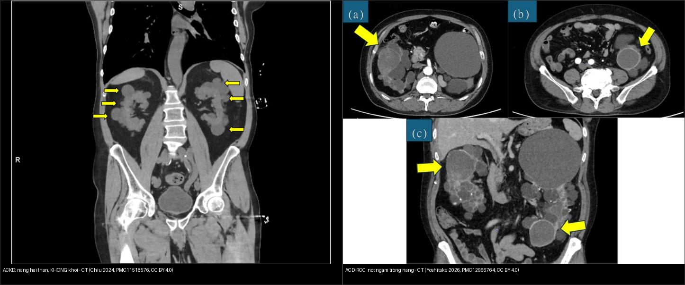
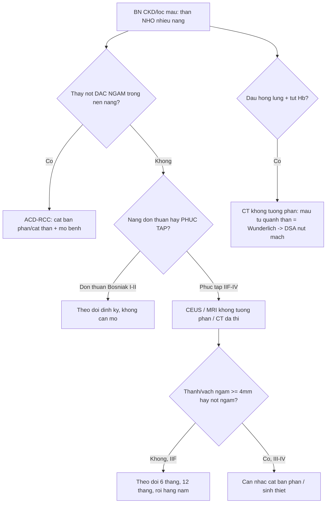
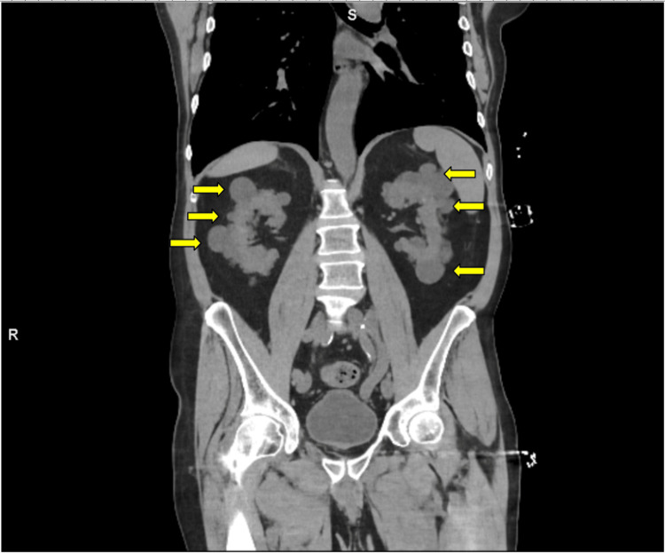
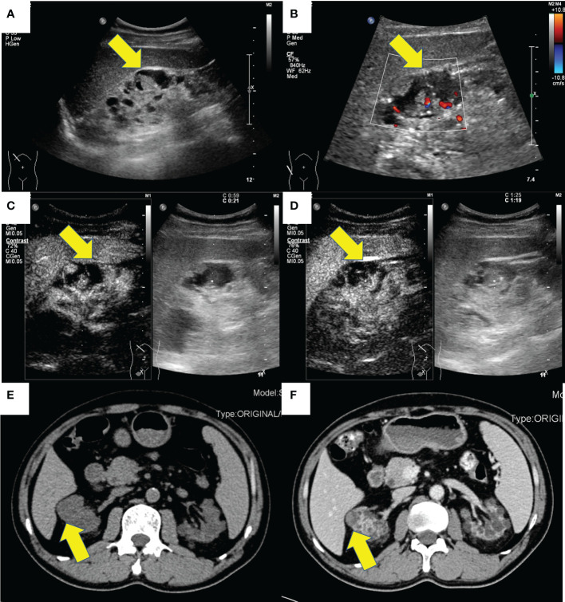
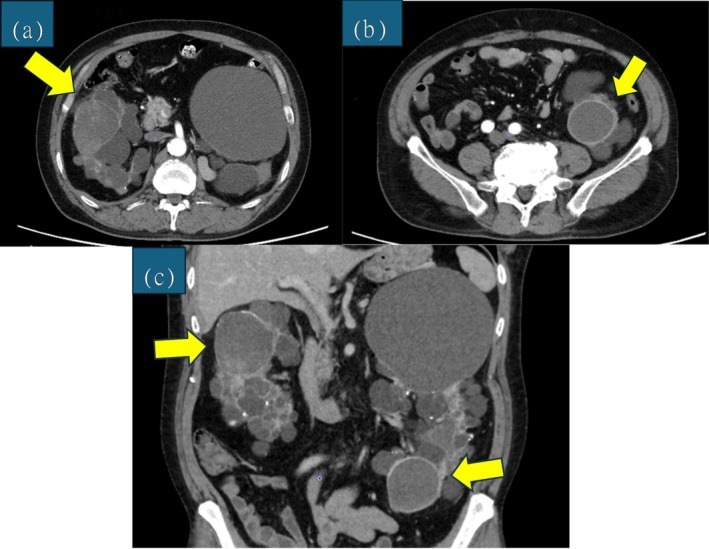
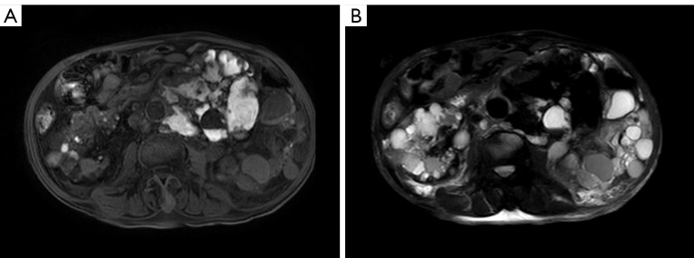
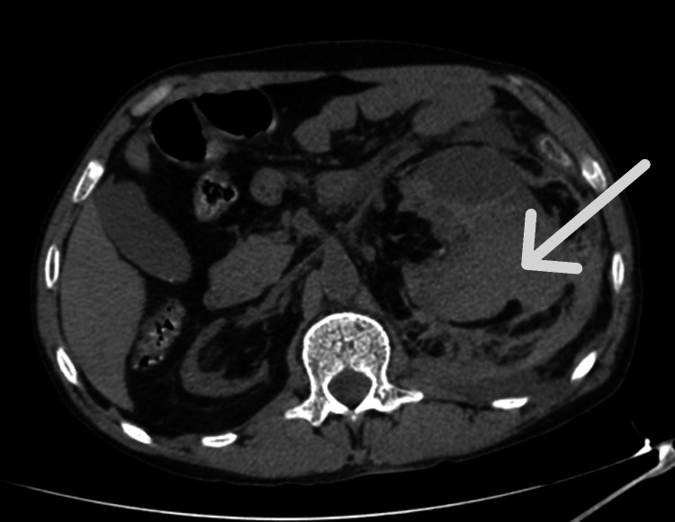

# 153 — Thận nang mắc phải trên lọc máu & ung thư tế bào thận / ACKD & ACD-RCC

**Tags:** `pattern:than-nang-mac-phai` `pattern:u-than-dac` `vung:than` `protocol:sang-loc-than-loc-mau` `score:Bosniak` `incidentaloma:u-than-tinh-co`
**Mức chắc chắn (certainty):** tổng hợp y văn (literature synthesis) — nhóm tự biên từ y văn mở (Cureus 2024/2026, Front Oncol 2023, IJU Case Rep 2026, Quant Imaging Med Surg 2025, J Clin Med 2026, Pan Afr Med J 2023, Pediatr Nephrol 2025), số liệu lấy nguyên từ bài gốc.

## 1. Tổng quan — vì sao "thận teo trên lọc máu" lại nang hóa và sinh ung thư

- **Bệnh thận nang mắc phải (acquired cystic kidney disease — ACKD):** xuất hiện **≥ 3 nang mỗi thận ở thận nhỏ hoặc bình thường** (một số định nghĩa kinh điển dùng **≥ 4 nang/thận**), **loại trừ bệnh nang di truyền/bẩm sinh** (bệnh thận đa nang trội nhiễm sắc thể thường — ADPKD, xơ cứng củ — TSC) (PMC10632177, PMC11947055).
- **TẠI SAO thận teo lại nang:** trong môi trường urê huyết (uremia) mạn, các ống thận còn sống bị kích thích bởi **yếu tố tăng trưởng + proto-oncogene** → **tăng sản biểu mô ống thận** → túi nang tách khỏi ống gốc, đa số **nhỏ, ở vùng vỏ lẫn tủy**, hai bên, đối xứng. Mô thận bị xơ teo dần theo thời gian lọc máu (PMC11947055).
- **Dịch tễ & ngưỡng định lượng (chốt):**
  - Tỉ lệ ACKD ở người **chạy thận nhân tạo định kỳ ~31,6%** (thời gian lọc trung vị **33,5 tháng**; PMC10632177), ở **trẻ em** lọc máu/thay thận **42%** (PMC11947055).
  - **Càng lọc lâu càng nang nhiều:** thời gian lọc **≥ 28 tháng** làm tăng nguy cơ ACKD **~6 lần** (OR hiệu chỉnh 6,09; KTC 95% 1,43–25,82; PMC11947055); **> 36 tháng** → **OR 7,1 (KTC 95% 3,3–15,5)**; **giới nam OR 2,6** (PMC10632177). Sau **> 10 năm lọc**, tỉ lệ nang hóa có thể tới **~80%**.
  - **Thận nhỏ (định lượng):** chiều dài trung bình **~85 m m (trái) / ~81 mm (phải)** — đây là mấu chốt phân biệt với **ADPKD (thận khổng lồ)** (PMC10632177).
- **TẠI SAO ACKD sinh ung thư:** lọc máu mạn = viêm mạn + suy giảm giám sát miễn dịch + tổn thương oxy hóa DNA → **ung thư tế bào thận liên quan bệnh nang mắc phải (acquired cystic disease-associated RCC — ACD-RCC)**, một **thực thể mới trong phân loại WHO 2016**. Bệnh nhân ACKD có **nguy cơ RCC tăng hơn 100 lần** so với dân số chung (PMC12923457, PMC10269903).
  - **ACD-RCC là u ác hay gặp nhất ở thận người lọc máu, chiếm ~36%** các u ác của thận bệnh nhân dialysis (PMC12966764); **tinh thể oxalat canxi** trong u/mô kẽ là **dấu hiệu mô bệnh học đặc trưng (pathognomonic)** (PMC12966764, PMC10269903).
- Hệ quả: khối u thường **nhỏ, hai bên, đa ổ**, mọc trong **nền nhiều nang** → **dễ bị nang che lấp** (satisfaction of search); phần lớn **không triệu chứng**, chỉ phát hiện khi tầm soát.

## 2. Mẫu hình — gamut nang thận ở bệnh nhân CKD/lọc máu (Gamut)

- **Nhiều nang nhỏ hai thận trên thận NHỎ/BÌNH THƯỜNG ở người lọc máu** → *ACKD* (lành tính về bản thân nang, nhưng phải soi tìm **nốt đặc ngấm**).
- **Thận KHỔNG LỒ hai bên, nang lan tỏa cả gan** → *ADPKD* (di truyền, thường còn nước tiểu, có tiền sử gia đình).
- **Nang đơn thuần vài nang** → *nang thận đơn thuần* (không tăng nguy cơ rõ nếu Bosniak I).
- **Nang có vách/thành dày, vôi hóa, xuất huyết** → *nang phức tạp* → phải xếp **Bosniak** (IIF/III/IV).
- **Nốt đặc ngấm trong nền nang** → *ACD-RCC* (hoặc RCC thường gặp khác: ccRCC/pRCC — xem bài 151).
- **Nang + máu tụ quanh thận (không đối xứng, tăng đậm độ cấp)** → *chảy máu trong/thành nang* = hội chứng Wunderlich — cấp cứu.
- Gợi nhớ **"3C — Cyst, Cancer, Crash"**: **C**yst (nhiều nang che u) · **C**ancer (ACD-RCC, nguy cơ ×100) · **C**rash (chảy máu quanh thận/Wunderlich).

## 3. Bảng so sánh phân biệt (ma trận đối chiếu)

| Thực thể (entity) | Hình ảnh điển hình | Chốt vào (rule-in) | Chốt loại (rule-out) | Gợi ý xác nhận |
|---|---|---|---|---|
| **ACKD** | Nhiều nang nhỏ **hai bên**, vỏ+tủy, **thận nhỏ** (~81–85 mm), ở người lọc máu | **≥ 3 nang/thận + thận nhỏ/bình thường + đang lọc máu** | Thận khổng lồ + nang gan → ADPKD | Siêu âm/ MRI không cản quang đối chiếu lịch sử lọc |
| **ADPKD** | Thận **khổng lồ** hai bên + **nang gan/tụy** + tiền sử gia đình | **Thận to + nang gan + cả nhà mắc** | Nhiều nang nhưng thận teo nhỏ → ACKD | Gene PKD1/PKD2, MRI đếm nang |
| **Nang phức tạp (Bosniak IIF–IV)** | Vách/thành dày, vôi hóa, ngấm sau tiêm | **Thành/vách ngấm ≥ 4 mm hoặc nốt ngấm = Bosniak III–IV** | Vách mảnh < 2 mm không ngấm = Bosniak I | CEUS/CT đa thì; theo dõi Bosniak III (40–60% ác) |
| **ACD-RCC** | **Nốt đặc ngấm trong/ven nang**, nền nhiều nang, hai bên, hay ở nam | **Nốt đặc ngấm ở BN ESRD/lọc máu + nền ACKD** | Nang xuất huyết đơn thuần (không có phần đặc ngấm) | Mô bệnh (tinh thể oxalat); CT/MRI/CEUS |
| **Chảy máu nang / Wunderlich** | Khối **tăng đậm độ cấp (hyperdense)** quanh/cạnh thận, không ngấm | **Máu tụ quanh thận + đau hông lưng đột ngột + tụt Hb** | U đặc ngấm (có mạch) → ACD-RCC | CT không cản quang; DSA + nút mạch khi chảy máu hoạt tính |
| **RCC thận ghép / thận native sau ghép** | Khối ngấm **thì động mạch + thải thuốc** ở thận native teo nang | **Sau ghép + ức chế miễn dịch + khối ngấm** | Nang đơn thuần không ngấm | CT đa thì/MRI; theo dõi siêu âm hằng năm |

*Trái: nang nhỏ hai bên trên thận nhỏ, **không có phần đặc ngấm**. Phải: **nốt đặc ngấm** (mũi tên vàng) trong nền nang = ACD-RCC. Nguồn: Chiu B et al., Cureus 2024 (PMC11518576) + Yoshitake R et al., IJU Case Rep 2026 (PMC12966764), CC BY 4.0. Ảnh ghép letterbox.*

## 4. Protocol chụp + hệ phân độ Bosniak + lịch tầm soát

- **Siêu âm bụng (gray-scale + Doppler) là tuyến đầu** để tầm soát nang/khối ở bệnh nhân lọc máu; **CEUS (siêu âm cản quang vi bọt khí)** là lựa chọn ưu tiên để đánh giá nang phức tạp (PMC13578127, PMC10269903).
  - **TẠI SAO chọn CEUS:** vi bọt khí **hoàn toàn nội mạch, không độc thận**, dùng được ở mọi giai đoạn CKD và người lọc máu → đánh giá **ngấm thật của vách/thành/nốt** mà không lo **thuốc cản quang iod** hay **gadolinium (nguy cơ xơ hóa thận–hệ thống — NSF)**.
- **MRI không cản quang** (T1/T2, DWI) khi cần mô tả nang/khối; **tránh nhóm gadolinium I** nếu eGFR **< 30 mL/phút/1,73 m²** (nguy cơ NSF) — ưu tiên **nhóm II** nếu thật cần.
- **CT đa thì** chỉ khi nghi u đặc/để xếp Bosniak và không dùng được CEUS/MRI; **bệnh nhân vô niệu/lọc máu không sợ độc thận do iod** nhưng nên hạn chế liều.
- **Hệ phân độ Bosniak 2019** (nguy cơ ác): **I** < 1% (vách < 2 mm, không vách/vôi) · **II** ~1–2% · **IIF** ~5–10% (theo dõi) · **III** có **vách/thành ngấm ≥ 4 mm hoặc dày đều** → **40–60% ác** · **IV** có **nốt đặc/phần đặc ngấm** → **> 80% ác**. CEUS dùng bản **Bosniak điều chỉnh (EFSUMB 2020)** — phân độ dựa trên **ngấm**, không dựa đậm độ hay T1 (PMC13578127, PMC11947055).
- **Lịch tầm soát gợi ý:** **siêu âm hằng năm** (cả thận native và thận ghép) cho bệnh nhân lọc máu/ghép thận nguy cơ cao; **chụp cản quang cho nang Bosniak ≥ II**; ứng viên **ghép thận** cần tầm soát trước ghép vì ức chế miễn dịch làm u tiến triển nhanh (PMC11947055, PMC13302036).

## 5. Biến thể bình thường và cạm bẫy

- **ACKD vs ADPKD — chốt ở KÍCH THƯỚC THẬN:** ACKD = **thận nhỏ/bình thường** (~81–85 mm) trên người lọc máu; ADPKD = **thận khổng lồ** + nang gan + tiền sử gia đình.
- **Giả ngấm (pseudoenhancement):** nang/nốt **< 1 cm** có thể "ngấm" giả do hiệu ứng thể tích (volume averaging) trên CT — xác nhận bằng lát mỏng/CEUS/MRI.
- **Bỏ sót u vì "nhiều nang quá" (satisfaction of search):** phải **càn từng nang** tìm **nốt/vách đặc ngấm**; đo ROI 3 thì với ngấm thật **≥ 20 HU** trên CT.
- **T1 sáng trong nang KHÔNG = u:** máu/nhầy cũ hay **xuất huyết trong nang** sáng T1 — **dấu chốt vẫn là thành/vách/nốt NGẤM**, không phải đậm độ/T1.
- **Gadolinium — cạm bẫy an toàn:** **nhóm I** ở eGFR < 30 → **NSF**; đi đường CEUS/MRI không cản quang trước.
- **Wunderlich:** chảy máu quanh thận có thể là **biểu hiện đầu tiên**, dễ nhầm sỏi/đau lưng cơ học — CT không cản quang + theo dõi Hb; **chảy máu hoạt tính → DSA nút mạch**.
- **Thận ghép:** **thận native teo nang vẫn có nguy cơ** (không biến mất sau ghép) — theo dõi siêu âm **hằng năm**, vì ức chế miễn dịch thúc đẩy u (PMC13302036).

## 6. Tự lượng giá — Blind Quiz

**Ca 1 — Nam 78 tuổi, suy thận giai đoạn cuối (creatinine 19,7 mg/dL), té ngã nhập viện. CT bụng không cản quang (coronal) có bất thường ở hai thận.**

- Hỏi: mô tả bất thường? Thận to hay nhỏ? Ba chẩn đoán phân biệt? Cần soi thêm gì?

<b>Bấm để hiện đáp án (findings + chẩn đoán)</b>

- **Findings:** **nhiều nang nhỏ hai bên vùng vỏ lẫn tủy** (mũi tên vàng), thận **không to** — trên nền suy thận giai đoạn cuối.
- **Chẩn đoán:** **ACKD** — chốt bởi "≥ 3 nang/thận + thận nhỏ/bình thường + ESRD"; phân biệt **ADPKD (thận khổng lồ + nang gan)**, **nang đơn thuần**, **nang phức tạp**. **Phải càn tìm nốt đặc ngấm** (ACD-RCC) vì nguy cơ RCC **> 100 lần**.
- Nguồn: Chiu B et al., Cureus 2024, Fig. 2, PMC11518576, CC BY 4.0.

**Ca 2 — Nam 58 tuổi lọc máu, siêu âm + CT thấy khối ở thận phải trên nền thận nhiều nang.**

- Hỏi: phần nào của khối cần đánh giá? Dấu hiệu nào khẳng định u ác? Vì sao siêu âm/CEUS quan trọng ở người CKD?

<b>Bấm để hiện đáp án (findings + chẩn đoán)</b>

- **Findings:** nang nền + **phần đặc của khối NGẤM mạnh** (Doppler có mạch, CEUS ngấm, CT cản quang ngấm).
- **Chẩn đoán:** **ACD-RCC** — phần **đặc ngấm** (không phải đậm độ/T1 dịch nang) mới là chốt; xác nhận bằng CEUS/CT/MRI + mô bệnh (tinh thể oxalat đặc trưng). CEUS giúp tránh **iod/gadolinium**.
- Nguồn: Yang Y et al., Front Oncol 2023, Fig. 1, PMC10269903, CC BY 4.0.

**Ca 3 — Bệnh nhân lọc máu dài ngày, CT bụng: hai thận nang, mỗi bên có một nốt đặc ngấm.**

- Hỏi: hai nốt ngấm nằm ở đâu? Chẩn đoán? Vì sao "u ác hai bên" lại hay gặp ở người lọc máu?

<b>Bấm để hiện đáp án (findings + chẩn đoán)</b>

- **Findings:** thận hai bên **nang hóa nền** + **nốt đặc ngấm** ở cực giữa phải và cực dưới trái (mũi tên vàng) = **ACD-RCC hai bên**.
- **Chẩn đoán:** **ACD-RCC** — hay gặp **nam, lọc máu lâu**, **hai bên/đa ổ**; ~**36%** u ác của thận dialysis; điều trị cắt thận (bán phần khi có thể).
- Nguồn: Yoshitake R et al., IJU Case Rep 2026, PMC12966764, CC BY 4.0.

**Ca 4 — Nam 54 tuổi, ACD-RCC, MRI bụng (T1WI và T2WI-SPAIR).**

- Hỏi: nang ở A và B khác nhau thế nào? Vài nang T1 SÁNG nhưng T2 TỐI — nghĩ gì? Có phải u không?

<b>Bấm để hiện đáp án (findings + chẩn đoán)</b>

- **Findings:** nhiều nang **T1 thấp/T2 cao** (dịch đơn thuần); một số nang **T1 cao + T2-SPAIR thấp** = **xuất huyết trong nang** (không phải u).
- **Chốt:** **T1 sáng KHÔNG đồng nghĩa u**; dấu hiệu ác là **thành/vách/nốt ngấm** (xem Ca 2–3). Đối chiếu CEUS/CT để không sinh thiết oan.
- Nguồn: Chen Q, Tan S., Quant Imaging Med Surg 2025, PMC12514716, CC BY-NC-ND 4.0 (giữ nguyên bản).

**Ca 5 — Bệnh nhân lọc máu, đau hông lưng trái đột ngột, tụt huyết áp/Hb. CT bụng không cản quang.**

- Hỏi: khối tăng đậm độ là gì (dịch/u/máu)? Dấu hiệu chốt? Bước xử trí nếu đang chảy máu hoạt tính?

<b>Bấm để hiện đáp án (findings + chẩn đoán)</b>

- **Findings:** khối **tăng đậm độ cấp (máu)** lan khoang quanh thận trái + sau phúc mạc, **không ngấm** (không phải u đặc).
- **Chẩn đoán:** **chảy máu từ nang trên nền ACKD (hội chứng Wunderlich)** — ổn định: theo dõi/bù máu; **chảy máu hoạt tính → DSA nút mạch** (như Ca nguyên văn này).
- Nguồn: Mbina Nzienghi D et al., Cureus 2026, Fig. 1, PMC13352129, CC BY 4.0.

**Ca 6 — Ghép đối chiếu: bên nào chỉ có nang, bên nào có phần đặc ngấm?**

<b>Bấm để hiện đáp án (findings + chẩn đoán)</b>

- **Trái — ACKD:** nang nhỏ hai bên, **không có phần đặc ngấm** → theo dõi. **Phải — ACD-RCC:** **nốt đặc ngấm trong nền nang** → u cần can thiệp.
- **Chốt:** ở người lọc máu, mọi nang đều phải soi **thành/vách/nốt NGẤM**; đậm độ/T1 không quyết định. Nguồn: Chiu 2024 (PMC11518576) + Yoshitake 2026 (PMC12966764), CC BY 4.0.

## Bài liên quan chéo
- [100 – Tổng quan hệ Bụng](../100-tong-quan-he-bung/lesson.md)
- [150 – Nang thận Bosniak](../150-nang-than-Bosniak/lesson.md) (ngấm thật, Bosniak I–IV)
- [151 – U thận đặc: RCC vs oncocytoma vs AML](../151-u-than-dac/lesson.md) (phân loại RCC, ccLS)
- [152 – Sỏi niệu & ứ nước](../152-soi-nieu/lesson.md) (đau hông lưng — phân biệt)
- [141 – Phúc mạc](../141-phuc-mac/lesson.md) (máu tụ sau phúc mạc)

## Ảnh
- Tên file: `153_slug_Modality_SourceID.jpg`. Nguồn + giấy phép từng ảnh trong `images/CREDITS.md`.
- Ảnh **CC BY-NC-ND** (PMC12514716) giữ **nguyên bản**, không crop/ghép; ảnh ghép chỉ dùng ảnh **CC BY** (letterbox nền đen).

> Không dùng để chẩn đoán độc lập khi chưa có người hướng dẫn.
