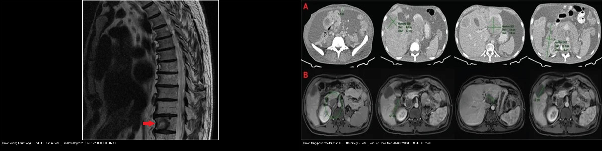
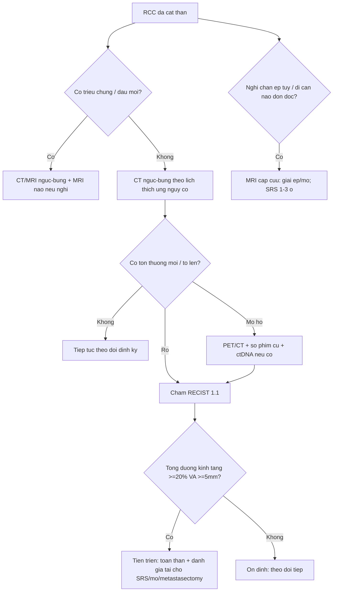
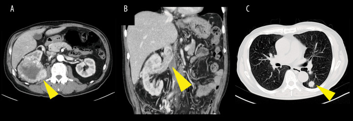
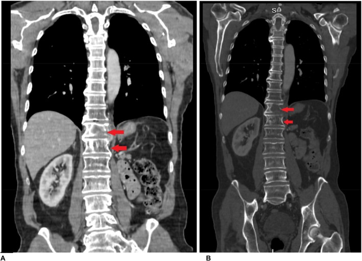
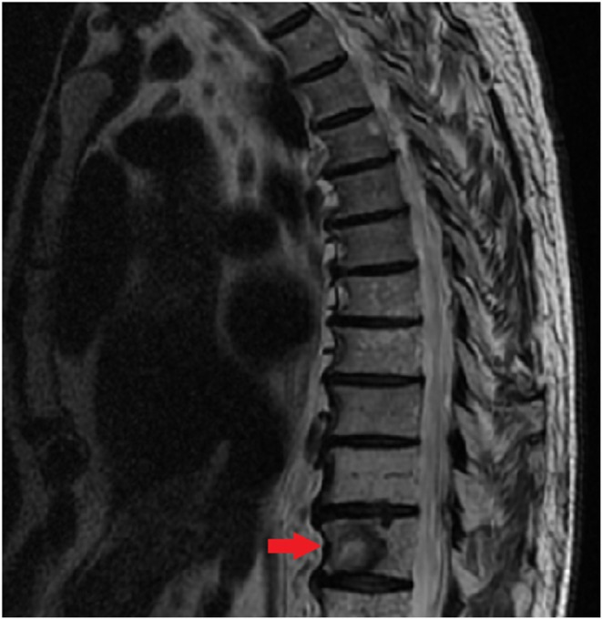
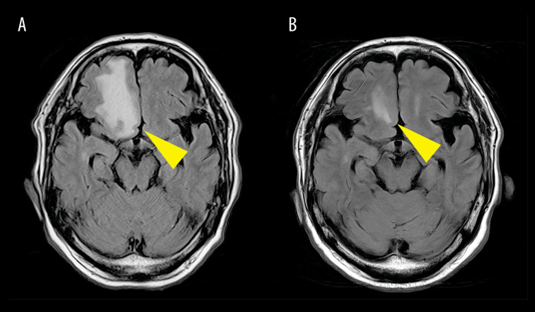
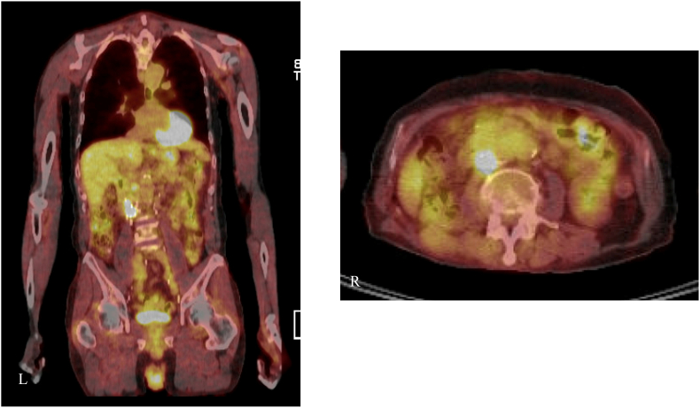
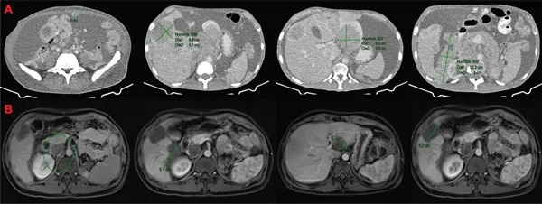
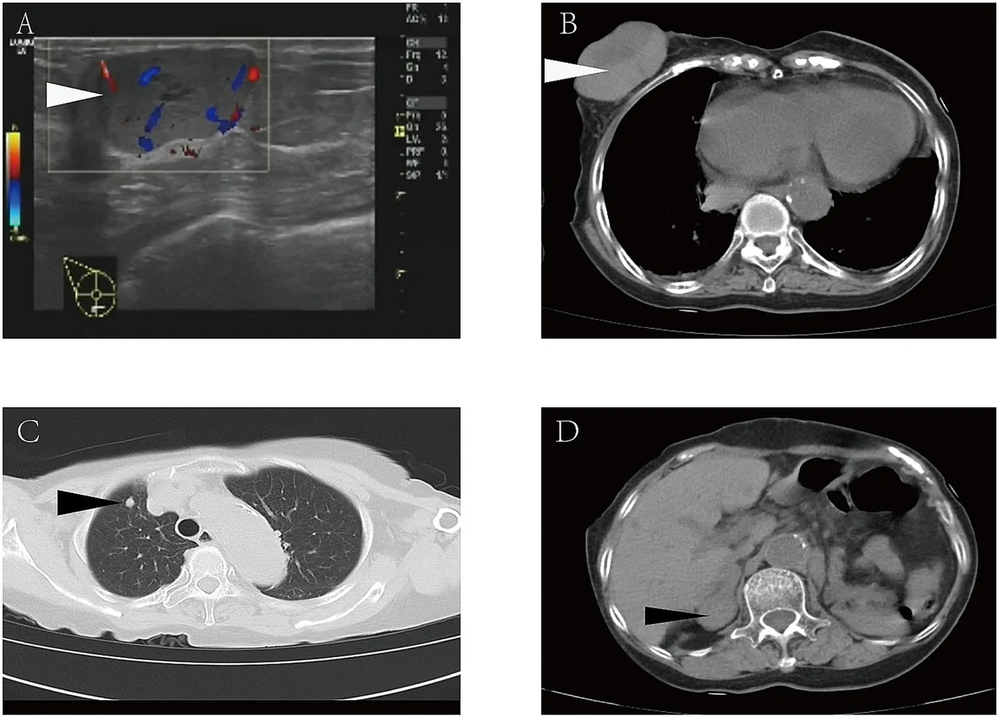

# 154 — Ung thư tế bào thận di căn & theo dõi sau cắt thận / Metastatic RCC & post-nephrectomy surveillance

**Tags:** `pattern:u-than-dac` `pattern:di-can-rcc` `vung:than` `protocol:theo-doi-sau-cat-than` `score:RECIST` `incidentaloma:u-than-tinh-co`
**Mức chắc chắn (certainty):** tổng hợp y văn (literature synthesis) — nhóm tự biên từ y văn mở (Am J Case Rep 2026, Clin Case Rep 2025, Urol Case Rep 2026, Case Rep Oncol Med 2026, Front Med 2026, Cancers 2026), số liệu lấy nguyên từ bài gốc; có 1 ca nguyên văn (Ca 5).

## 1. Tổng quan — vì sao "đã cắt thận rồi" vẫn phải theo dõi, và hình ảnh đọc gì

- **Ung thư tế bào thận (renal cell carcinoma — RCC)** là u ác ống thận, hay gặp nhất là **thể tế bào sáng (clear cell RCC — ccRCC)** (~75%); RCC có hai nét riêng: **di căn theo đường máu rất sớm** (qua TM thận → TM chủ dưới → phổi) và **di căn muộn/rất muộn** (đã ghi nhận **18–30 năm** sau cắt thận) (PMC13503303, PMC13519954).
- **TẠI SAO vẫn phải theo dõi sau cắt thận:** mô hình không phải "cắt là hết" mà là **bệnh hệ thống có thể tồn dư ở mức vi thể**. Sau điều trị triệt căn, **~30%** bệnh nhân tái phát/di căn (AUA); giai đoạn **nguy cơ rất cao tái phát > 65%**, riêng thể **biệt hóa sarcomatoid ~70%** (PMC13360029). Mô đệm giàu mạch + mất gen ức chế **VHL** → tăng HIF → tăng VEGF → u giàu mạch, dễ ngấm mạnh và dễ chảy máu (nên di căn xương của RCC thường **tiêu xương, ngấm mạnh, dễ vỡ**).
- **TẠI SAO di căn RCC "hiện hình" theo cách riêng (vật lý tín hiệu):**
  - **Di căn xương tiêu xương:** hủy xương do u + phản ứng mạch → trên CT **ổ tiêu xương bờ rõ, phá vỏ, có phần mô mềm ngấm mạnh**; trên MRI **T1 thấp** (tủy bị thay thế) — tương phản rất rõ ở người > 40 tuổi vì tủy vàng T1 vốn sáng (PMC12208906).
  - **Di căn não:** vùng phù quanh u **T2/FLAIR tăng tín hiệu**, u **ngấm viền** sau tiêm; hay ở **ngã ba/chỗ nối chất trắng–chất xám** (PMC13383680).
  - **Di căn phổi:** nốt tròn đặc nhiều ổ ("đạn thần công — cannonball"), mô mềm giàu mạch nên có thể **ngấm mạnh và hoại tử/chảy máu khi lớn**.
- **Ngưỡng định lượng khung (chốt):** thể tích u/nốt trên CT dùng để **chấm RECIST 1.1**; **tiến triển (PD) = tổng đường kính đích tăng ≥ 20% VÀ ≥ 5 mm** so với **nadir**, hoặc xuất hiện tổn thương mới, hoặc tiến triển rõ không mơ hồ. **Tái phát tại chỗ (giường thận)** sau cắt thận: nốt mô mềm trong/ven giường thận, thường **ngấm thì động mạch – thải thì muộn**, phải phân biệt **mô sẹo/xơ hậu mổ** (ngấm chậm, ổn định) và **nhánh mạch/mô mỡ** (PMC13126283).

## 2. Mẫu hình + chẩn đoán phân biệt theo vị trí (gamut)

- **Nốt mô mềm ở giường thận sau cắt thận** → tái phát tại chỗ, mô sẹo hậu mổ, quai ruột dính, hạch cạnh ĐMC mới, di căn thượng thận cùng bên.
- **Nốt phổi nhiều ổ hai bên** → di căn RCC (đạn thần công), di căn u khác, lao/nấm (nốt vệ tinh + hang), nốt viêm.
- **Tổn thương tiêu xương đơn/đa ổ** → di căn RCC (ngấm mạnh, dễ chảy máu), di căn tuyến tiền liệt/vú (tạo xương), myeloma (tiêu xương bờ rõ không ngấm mô mềm), xương hóa trị.
- **Khối trong não có phù nhiều** → di căn não (RCC, phổi, melanoma), u nguyên phát TKTW, áp-xe.
- **Di căn "không hay gặp":** phúc mạc và nhiều khoang ổ bụng (PMC13519954), **tá tràng/đường tiêu hóa** (PMC12208906), **vú** (PMC13503303), tụy, tuyến giáp — các vị trí này thường gắn với bệnh **lan rộng, tiên lượng xấu**, đừng vì "hiếm" mà loại trừ.
- Gợi nhớ **"LBBH + R"**: **L**ung (phổi) · **B**one (xương) · **B**rain (não) · **H**epatic (gan) · **R**are (phúc mạc, tá tràng, vú, tụy) — "LBBH" là 4 đích kinh điển theo đường máu; **R** là nhóm ít gặp nhưng cần nhớ.

## 3. Bảng so sánh phân biệt (ma trận đối chiếu)

| Thực thể (entity) | Hình ảnh điển hình (CT/MRI theo thì) | Chốt vào (rule-in) | Chốt loại (rule-out) | Gợi ý xác nhận |
|---|---|---|---|---|
| **Tái phát TẠI CHỖ (giường thận)** | Nốt mô mềm trong/ven giường thận, **ngấm mạnh thì ĐM + thải thì muộn**; PET/CT ngấm FDG | **Nốt ngấm mới/tăng kích thước so với phim cũ** ở giường thận | Khối **ổn định nhiều năm**, ngấm chậm đồng nhất = sẹo; mỡ đơn thuần = mô mỡ | So phim cũ; cắt ngang mỏng; PET/CT; **ctDNA** khi hình ảnh mơ hồ (PMC13126283) |
| **Di căn PHỔI** | Nốt tròn đặc, nhiều ổ hai bên, **thì đáy phổi**, kích thước tăng dần | **Nốt mới/đa ổ hai bên + tiền sử RCC** | Nốt vệ tinh + tree-in-bud = lao; hang = nhiễm trùng/K | CT ngực; theo dõi thể tích theo RECIST |
| **Di căn XƯƠNG (tiêu xương)** | **Ổ tiêu xương bờ rõ + phá vỏ + mô mềm ngấm mạnh**; MRI **T1 thấp, T2/STIR cao**; nguy cơ **chèn ép tủy** | **T1 thấp + ngấm + tiêu xương** ở BN có RCC | Tạo xương đặc = di căn tuyến tiền liệt; **tủy đỏ T1 ≥ cơ** = lành | CT xương; MRI (đánh giá tủy/chèn ép); xạ hình/PET |
| **Di căn NÃO** | Tổn thương ở nối chất trắng–chất xám, **phù T2/FLAIR rộng, ngấm viền** | **Phù rộng + ngấm viền + bệnh cảnh ung thư** | Áp-xe (DWI sáng/ADC tối), u nguyên phát | MRI não T1+Gd, DWI; xạ định vị (SRS) khi ít ổ |
| **Di căn TẠNG/PHÚC MẠC (hiếm)** | Bánh mạc nối/nốt phúc mạc, hạch sau phúc mạc, tổn thương gan; kèm **cổ trướng** | **Nốt phúc mạc/hạch mới + tiền sử RCC + báng** | Báng lành, lao phúc mạc, u nguyên phát phúc mạc | CT bụng-có cản quang; PET/CT; mô bệnh |
| **Di căn VÚ (rất hiếm)** | Khối vú đặc ngấm mạnh, có thể **chảy máu**; kèm nốt phổi/thượng thận | **Khối vú mới + tiền sử cắt thận RCC (dù rất muộn)** | Ung thư vú nguyên phát (vôi hóa, bờ gai) | Siêu âm + sinh thiết; IHC (PAX8+, CAIX+) |

*Trái: di căn xương **tiêu xương** thân đốt sống (RCC điển hình — hủy xương, ngấm mạnh, dễ chèn ép tủy). Phải: **di căn nhiều khoang** (phúc mạc + hạch sau phúc mạc) — nhóm ít gặp nhưng tiên lượng xấu. Nguồn: Peshin S et al., Clin Case Rep 2025 (PMC12208906) + Usubillaga JP et al., Case Rep Oncol Med 2026 (PMC13519954), CC BY 4.0. Ảnh ghép letterbox.*

## 4. Protocol + giai đoạn TNM 8 + RECIST + hướng theo dõi

- **CT ngực–bụng–khung chậu có cản quang** là nền tảng cho giai đoạn và theo dõi; **MRI bụng** khi cần đánh giá huyết khối TM chủ dưới/giai đoạn mạch máu; **MRI não** khi nghi di căn TKTW; **PET/CT** khi hình ảnh mơ hồ/không điển hình (**nhưng tổn thương < 5 mm / tổn thương bàng quang–phổi có thể âm giả — nên không dùng đơn độc**).
- **Giai đoạn TNM 8 (AJCC) — cần nhớ ngưỡng kích thước:** **T1a ≤ 4 cm**, **T1b 4–7 cm**, **T2a 7–10 cm**, **T2b > 10 cm**; **T3a** = xâm lấn mỡ quanh thận/xoang thận/nhánh tĩnh mạch, **T3b** = huyết khối TM chủ dưới **dưới cơ hoành**, **T3c** = **trên cơ hoành**; **T4** = xâm lấn ngoài mạc Gerota/thượng thận cùng bên.
- **Phân độ huyết khối TM chủ dưới (Mayo I–IV):** **I** = trong TM thận, **II** = trong TM chủ dưới **dưới gan**, **III** = **trong gan/tới gan**, **IV** = **tới nhĩ phải** (Ca 1 là **độ II**; Ca 5 là **độ IV**).
- **Theo dõi thích ứng nguy cơ (risk-adapted, EAU/AUA):** nhóm **thấp** → thưa (nhiều hướng dẫn ngừng theo dõi chuyên biệt sau ~5–10 năm nếu giai đoạn thấp); nhóm **trung gian** → CT ngực + bụng khoảng **mỗi 6 tháng trong 3 năm đầu**, rồi hằng năm; nhóm **cao/rất cao** → **mỗi 3–6 tháng trong 3–5 năm đầu**. **RCC di căn muộn** → không dừng theo dõi máy móc theo mốc thời gian nếu BN còn trẻ/nguy cơ cao.
- **RECIST 1.1:** đích = tối đa 5 tổn thương/bệnh nhân (2/tạng); **PD = tăng ≥ 20% VÀ ≥ 5 mm** so với nadir, hoặc tổn thương mới. **Đáp ứng hoàn toàn (CR)** = mất hết tổn thương đích, hạch < 10 mm.

## 5. Biến thể bình thường và cạm bẫy

- **Mô sẹo/keo hậu mổ ở giường thận** ngấm thuốc thì muộn và **ổn định nhiều năm** — đừng gọi tái phát; **so phim cũ** là chốt (PMC13126283).
- **Huyết khối TM chủ dưới do u vs do huyết khối lành:** huyết khối u **ngấm mạnh** (có tân mạch), **lan liên tục với u thận**, có thể tăng đậm độ; huyết khối lành ngấm kém, dính thành. MRI/CT có cản quang phân biệt.
- **PET/CT âm giả:** nốt nhỏ < 5 mm, **di căn phổi/bàng quang** có thể **không ngấm FDG** — **PET âm KHÔNG loại trừ tái phát**; ngược lại viêm/sau mổ có thể ngấm giả (PMC13126283).
- **Di căn xương ở người > 40 tuổi:** tủy vàng T1 vốn sáng; **bất kỳ tổn thương T1 tối hơn cơ/đĩa + ngấm** đều đáng ngờ — không "bỏ qua vì già".
- **"Hiếm" không có nghĩa là không:** di căn **tá tràng/vú/phúc mạc** đều đã có ca (PMC12208906, PMC13503303, PMC13519954); BN RCC cũ có triệu chứng tiêu hóa/vú mới phải soi hình ảnh.
- **Sai sót do thỏa mãn tìm kiếm (satisfaction of search):** thấy u thận rồi dừng → bỏ sót **huyết khối TM chủ dưới + di căn phổi** (Ca 1). Luôn đọc phổi và dòng TM thận–chủ dưới trên cùng phim.
- **Tái phát muộn:** đừng loại trừ chỉ vì "đã 20 năm" — ca vú xuất hiện **20 năm** sau cắt thận (PMC13503303).

## 6. Tự lượng giá — Blind Quiz

**Ca 1 — Nam 73 tuổi, tình cờ, chẩn đoán cuối cùng "RCC di căn". CT bụng (A) và ngực (B–C)?**

- Hỏi: Ngoài u thận, còn hai tổn thương "chết người" nào? Chúng ở đâu? Giai đoạn T bao nhiêu?

<b>Bấm để hiện đáp án (findings + chẩn đoán)</b>

- **Findings:** (A) **u thận phải** ngấm mạnh; (B) **huyết khối mô mềm trong TM chủ dưới (mũi tên vàng)**; (C) **nhiều nốt phổi hai bên** (di căn).
- **Chẩn đoán:** **ccRCC di căn (M1)** + **huyết khối TM chủ dưới độ II (Mayo)** → giai đoạn **pT3b** — phân biệt với huyết khối lành (không ngấm, không dính u). Bước tiếp: đa mô thức (hệ thống + cân nhắc cắt thận/thrombectomy trì hoãn); theo dõi **MRI não** vì ca này sau đó **di căn não muộn đơn độc** dù đáp ứng ngoài sọ hoàn toàn.
- Nguồn: **Ito F et al.**, Am J Case Rep 2026, Fig 1, PMC13383680, CC BY-NC-ND 4.0.

**Ca 2 — Bệnh nhân RCC, MRI cột sống ngực (A) và ảnh tiêu xương (B):**

- Hỏi: Tín hiệu tổn thương trên T1 và T2/STIR? Vì sao đây là "cấp cứu tiềm ẩn"?

<b>Bấm để hiện đáp án (findings + chẩn đoán)</b>

- **Findings:** nhiều **tổn thương đốt sống T1 tín hiệu thấp + T2/STIR tăng** (mũi tên đỏ) = **di căn tủy xương**. **Chẩn đoán:** **di căn xương RCC** — nguy cơ **chèn ép tủy** (có phần mô mềm/đường vào ống sống) → cần **MRI khẩn + corticoid/mổ hoặc xạ khi có chèn ép**.
- **Vì sao T1 thấp:** tế bào u thay thế tủy vàng (vốn giàu mỡ, T1 sáng); nước/phù tự do T2 tăng. Nguồn: **Peshin S et al.**, Clin Case Rep 2025, Fig 1, PMC12208906, CC BY 4.0.

**Ca 3 — Cùng bệnh nhân, phim cắt dọc đốt sống có ổ tiêu xương:**

- Hỏi: Kiểu hủy xương này gợi ung thư nào? Cần phân biệt với tạo xương?

<b>Bấm để hiện đáp án (findings + chẩn đoán)</b>

- **Findings:** **ổ tiêu xương phá vỏ** thân đốt + mô mềm (mũi tên đỏ). **Chuỗi chốt:** RCC là ung thư **tiêu xương (lytic) ngấm mạnh, dễ chảy máu** — khác **di căn tạo xương đặc (tuyến tiền liệt/vú)**. **Chẩn đoán:** di căn xương RCC. Nguồn: **Peshin S et al.**, Clin Case Rep 2025, Fig 2, PMC12208906, CC BY 4.0.

**Ca 4 — Cùng bệnh nhân Ca 1, sau đáp ứng hoàn toàn ngoài sọ, xuất hiện triệu chứng thần kinh. MRI FLAIR (A) và sau xạ (B):**

- Hỏi: Ổ tổn thương nằm ở đâu? Đặc điểm phù? Hướng xử trí?

<b>Bấm để hiện đáp án (findings + chẩn đoán)</b>

- **Findings:** tổn thương **thùy trán phải (mũi tên vàng)** + **phù FLAIR rộng quanh u**; (B) sau **xạ định vị (SRT)** giảm kích thước rõ. **Chẩn đoán:** **di căn não đơn độc muộn** của ccRCC (dù đáp ứng hoàn toàn ngoài sọ) → **xạ định vị 1–3 ổ**; **đừng bỏ MRI não** khi BN RCC có triệu chứng TKTW mới. Nguồn: **Ito F et al.**, Am J Case Rep 2026, Fig 4, PMC13383680, CC BY-NC-ND 4.0.

**Ca 5 (ca nguyên văn) — Nam RCC có huyết khối TM chủ dưới độ IV, sau cắt thận + lấy huyết khối. Một năm sau hình ảnh mơ hồ, chụp PET/CT:**

- Hỏi: Có nốt ngấm ở đâu? Khi hình ảnh mơ hồ thì dựa vào đâu để phát hiện bệnh tồn dư?

<b>Bấm để hiện đáp án (findings + chẩn đoán)</b>

- **Findings:** PET/CT ngấm FDG **nhẹ (SUVmax ~2,2)** ở **giường thận phải** + **3 ổ ngấm sau phúc mạc sau TM chủ dưới**, tương ứng nốt mô mềm trên CT trước. **Chẩn đoán:** **tái phát tại chỗ/sau phúc mạc** — ca nguyên văn cho thấy **ctDNA dương tính** đã thúc đẩy **mổ sớm** dù hình ảnh còn mơ hồ. **Chốt:** khi hình ảnh chưa rõ, **so phim cũ + PET/CT + dấu ấn phân tử (ctDNA)** giúp quyết định. Nguồn: **Ghavshough MH et al.**, Urol Case Rep 2026, Fig 2, PMC13126283, CC BY-NC-ND 4.0.

**Ca 6 — Nam 31 tuổi ccRCC pT3aN0M0, 7 tháng sau cắt thận xuất hiện báng bụng. CT cản quang:**

- Hỏi: Những khoang nào bị tổn thương? Đây là vị trí di căn "kinh điển" hay "hiếm"?

<b>Bấm để hiện đáp án (findings + chẩn đoán)</b>

- **Findings:** **di căn phúc mạc + hạch sau phúc mạc + tổn thương gan + huyết khối TM chủ dưới** (nhiều khoang). **Chẩn đoán:** **tái phát nhiều khoang** của ccRCC — **di căn phúc mạc là vị trí RẤT hiếm**, gắn với bệnh lan rộng/tiên lượng xấu, nhưng ca này đáp ứng tốt với **pembrolizumab + lenvatinib** rồi **mổ giảm khối hoàn toàn** (IMDC nhóm nguy cơ xấu). Nguồn: **Usubillaga JP et al.**, Case Rep Oncol Med 2026, Fig 2, PMC13519954, CC BY 4.0.

**Ca 7 — Nữ 88 tuổi, cắt thận vì ccRCC cách đây 20 năm, nay khối vú phải chảy máu. Siêu âm + CT:**

- Hỏi: Vì sao không nghĩ "ung thư vú nguyên phát"? Ngoài khối vú còn gì?

<b>Bấm để hiện đáp án (findings + chẩn đoán)</b>

- **Findings:** (A) siêu âm khối vú đặc có mạch; (B–D) CT có **khối vú + nốt phổi phải + khối thượng thận phải**. **Chẩn đoán:** **di căn vú của ccRCC 20 năm sau cắt thận** (rất hiếm) — đã **vỡ chảy máu**; IHC **PAX8+/CAIX+** giúp xác nhận nguồn thận. **Chốt:** tiền sử RCC + nhiều ổ (vú, phổi, thượng thận) → nghĩ **di căn RCC muộn**, không phải ung thư vú. Nguồn: **Huang C et al.**, Front Med 2026, Fig 1, PMC13503303, CC BY 4.0.

**Ca 8 — Ghép đối chiếu: hai kiểu di căn, hai nguy cơ khác nhau:**

<b>Bấm để hiện đáp án (findings + chẩn đoán)</b>

- **Trái — di căn xương tiêu xương:** nguy cơ **chèn ép tủy/gãy xương bệnh lý** → MRI khẩn, xạ/mổ, bisphosphonate. **Phải — di căn tạng/phúc mạc:** gắn bệnh lan rộng, cân nhắc **toàn thân ± mổ giảm khối**. **Chốt:** cùng là "di căn RCC" nhưng **vị trí quyết định biến chứng và cách can thiệp**. Nguồn: PMC12208906 + PMC13519954, CC BY 4.0.

## Bài liên quan chéo
- [100 – Tổng quan hệ Bụng](../100-tong-quan-he-bung/lesson.md)
- [151 – U thận đặc: RCC vs oncocytoma vs AML](../151-u-than-dac/lesson.md) (chẩn đoán u nguyên phát)
- [150 – Nang thận Bosniak](../150-nang-than-Bosniak/lesson.md)
- [156 – Hội chứng di truyền u thận](../156-hoi-chung-di-truyen-u-than/lesson.md) (RCC hai bên/người trẻ)
- [153 – Thận nang mắc phải trên lọc máu](../153-benh-than-nang-mac-phai-loc-mau/lesson.md) (nguy cơ RCC ×100)
- [155 – Thượng thận tình cờ](../155-thuong-than-tinh-co/lesson.md) (di căn thượng thận — Ca 7)

## Ảnh
- Tên file: `154_slug_Modality_SourceID.jpg`. Nguồn + giấy phép từng ảnh trong `images/CREDITS.md`.
- Ảnh **CC BY-NC-ND** (PMC13383680, PMC13126283) giữ **nguyên bản**, không crop/ghép; ảnh ghép chỉ dùng ảnh **CC BY** (letterbox nền đen).

> Không dùng để chẩn đoán độc lập khi chưa có người hướng dẫn.
