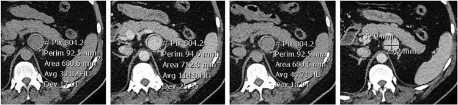
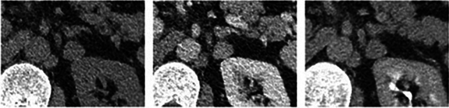

# 155 — Khối thượng thận tình cờ / Adrenal incidentaloma & Washout

**Tags:** `pattern:khoi-thuong-than` `vung:thuong-than` `incidentaloma:thuong-than` `protocol:CT-washout`
**Mức chắc chắn (certainty):** tổng hợp y văn (literature synthesis) — nhóm tự biên từ y văn mở, chưa gắn ca nguyên văn đơn lẻ.

## 1. Tổng quan — 10 HU + công thức thải thuốc (Cửa 1)

- **CT không tiêm ≤ 10 HU = u tuyến (adenoma) giàu mỡ nội bào** → lành 100%, dừng ngay không tiêm! Mỡ đại thể **< −30 HU** = u cơ mỡ mạch (myelolipoma).
- **> 10 HU:** chạy washout (trước HUpre + cửa 70s HUenh + muộn 15p HUdel):
  - Tuyệt đối: **APW = (HUenh − HUdel)/(HUenh − HUpre) × 100% ≥ 60%** = adenoma nghèo mỡ.
  - Tương đối (thiếu thì trước): **RPW = (HUenh − HUdel)/HUenh × 100% ≥ 40%**.
- TẠI SAO adenoma thải nhanh: mao mạch + khoảng kẽ ít giữ thuốc; ác tính/di căn giữ thuốc lâu.
- Đặt ROI ≥ 2/3 đường kính, tránh vôi/hoại tử/viền (partial volume).

*Trước + cửa + muộn + đo trục. Nguồn: Van Aswegen et al., Abdom Radiol 2024 Fig. 1, CC BY 4.0.*

## 2. Gamut khối thượng thận theo HU + lâm sàng

- **≤ 10 HU:** adenoma giàu mỡ — dừng.
- **> 10 HU + thải đạt:** adenoma nghèo mỡ — theo dõi/xét nghiệm chức năng.
- **> 10 HU + cơn THA/đánh trống ngực:** u tủy thượng thận (pheochromocytoma) — metanephrine trước mọi thủ thuật!
- **K tiền sử + to nhanh/hoại tử:** di căn/ung thư vỏ thượng thận (ACC) — PET/sinh thiết/mổ.

## 3. Bảng + bẫy pheo chết người (Cửa 4)

| Thực thể (entity) | Hình ảnh | Chốt | Xử trí |
|---|---|---|---|
| Adenoma giàu mỡ | **≤ 10 HU** | Dừng, lành 100% | Xét nghiệm chức năng 1 lần |
| Adenoma nghèo mỡ | **APW ≥ 60% / RPW ≥ 40%** | Thải đạt + < 4 cm | Theo dõi 6–12 tháng |
| Pheochromocytoma | **> 110–120 HU thì cửa + vôi/hoại tử** nhưng **vẫn thải ≥ 60% giả adenoma** | **Metanephrine trước mọi can thiệp** | Mổ có chuẩn bị alpha-block |
| Di căn/ACC | To nhanh + hoại tử + K tiền sử; ACC thường > 4–6 cm | PET + sinh thiết/mổ | Theo K nguyên phát |

*Thải "đạt chuẩn" nhưng là pheo ác — washout không loại trừ pheo/di căn RCC-HCC. Nguồn: Van Aswegen et al., Fig. 5, CC BY 4.0.*

## 4. Protocol washout

- Trước tiêm + cửa 70s + muộn 15p (ROI cùng vị trí, ≥ 2/3 đường kính).
- Kèm xét nghiệm: dexamethasone 1 mg + metanephrine + aldosterone/renin (THA).
- ≥ 4 cm hoặc tăng trưởng: PET/sinh thiết/mổ (ác tính tới 40% ở ≥ 4 cm).

## 5. Cạm bẫy

- **Pheo + di căn RCC/HCC giàu mạch** thải nhanh giả adenoma — metanephrine + tiền sử K trước khi tin washout.
- **Vôi hóa/xuất huyết/hoại tử lớn** làm sai ROI — tránh vùng này khi đo.
- **Myelolipoma mỡ đại thể** đừng gọi adenoma nghèo mỡ — HU < −30 là chốt.

## 6. Tự lượng giá — Blind Quiz

**Ca 1 — Nốt thượng thận 17 mm, washout 89%. Đọc 3 thì + kết luận?**

- Hỏi: thải đạt có = adenoma không? Bẫy gì? Xét nghiệm bắt buộc trước mổ?

<b>Bấm để hiện đáp án</b>

- **Pheochromocytoma ác:** thải 89% nhưng mô bệnh pheo — metanephrine trước mọi thủ thuật (cơn THA chết người khi chạm vào).
- Nguồn: Van Aswegen et al., Fig. 5, CC BY 4.0.

**Ca 2 — Nốt 2 cm + 5 HU không tiêm:** chẩn đoán + có cần tiêm không? *(Bảng mục 3.)*

<b>Bấm để hiện đáp án</b>

- **Adenoma giàu mỡ:** ≤ 10 HU = dừng ngay, xét nghiệm chức năng 1 lần.

## Bài liên quan chéo
- [100 – Tổng quan hệ Bụng](../100-tong-quan-he-bung/lesson.md)
- [110 – Giải phẫu bụng](../110-giai-phau-bung/lesson.md) (khoang quanh thận)
- [150 – Bosniak & u thận](../150-nang-than-Bosniak/lesson.md) (di căn RCC)

> Không dùng để chẩn đoán độc lập khi chưa có người hướng dẫn.
