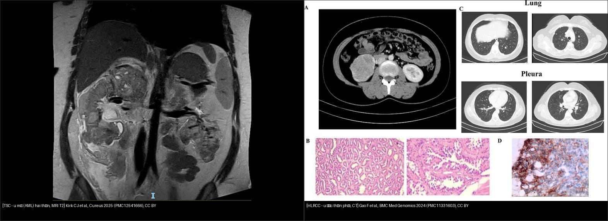
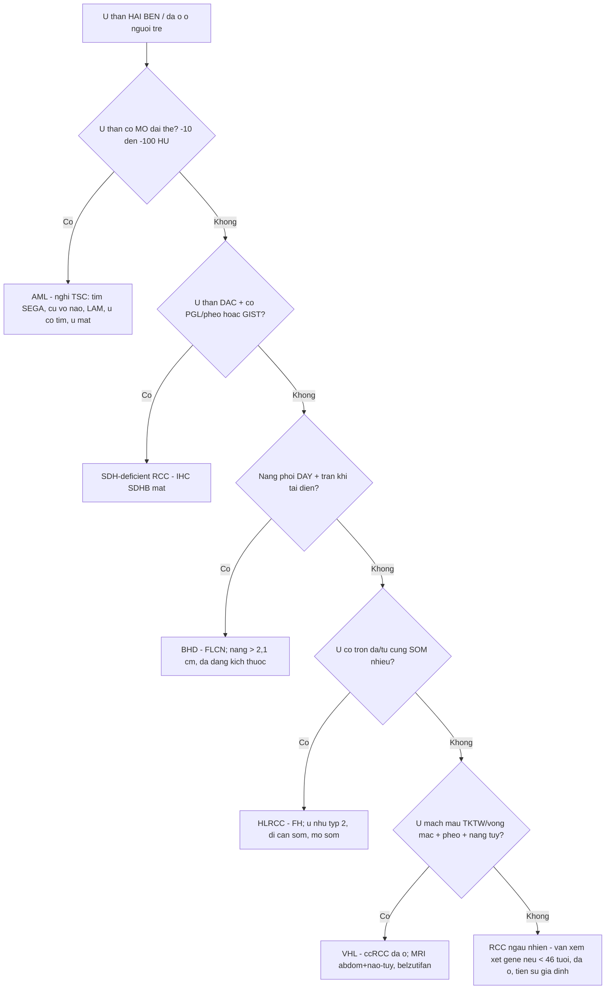
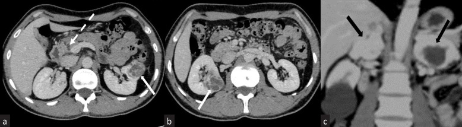
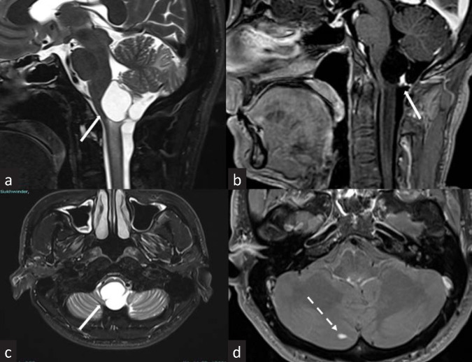
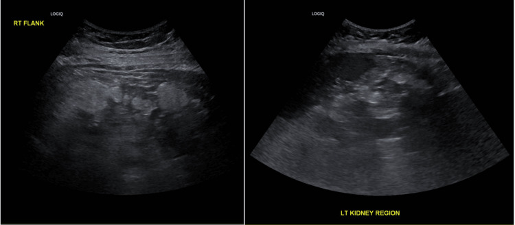
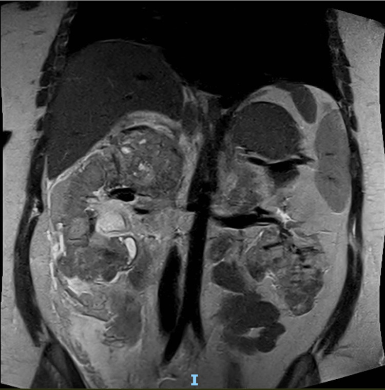
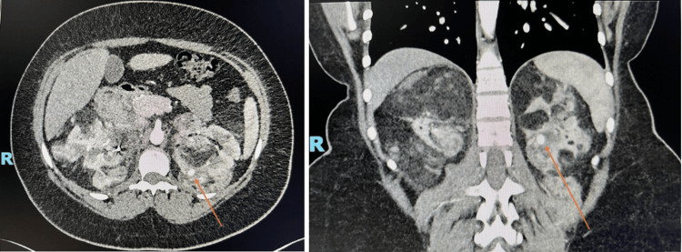
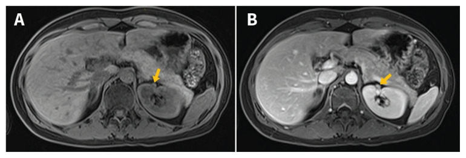
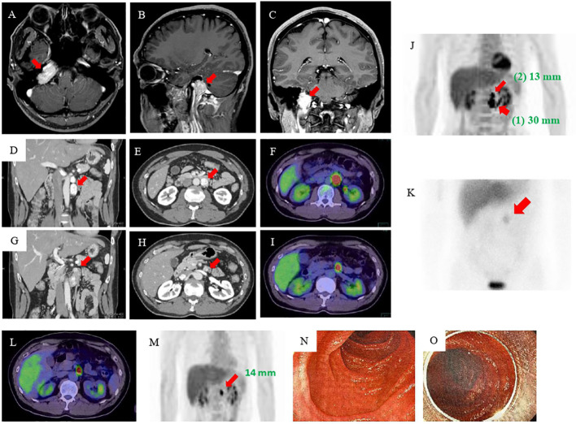

# 156 — Hội chứng di truyền u thận / Hereditary renal tumor syndromes (VHL · BHD · HLRCC · TSC · SDH)

**Tags:** `pattern:u-than-dac` `pattern:u-than-hai-ben` `vung:than` `protocol:sang-loc-u-than-di-truyen` `incidentaloma:u-than-tinh-co`
**Mức chắc chắn (certainty):** tổng hợp y văn (literature synthesis) — nhóm tự biên từ y văn mở (Indian J Nephrol 2025, Familial Cancer 2026, Diagnostics 2023, Cureus 2025, J Kidney Cancer VHL 2022, BMC Med Genomics 2024, CMAJ 2026, Front Endocrinol 2022, Virchows Arch 2026, Eur J Radiol Open 2022), số liệu lấy nguyên từ bài gốc.

> **Câu chốt:** U thận **hai bên + đa ổ ở người trẻ** không bao giờ được gọi là "RCC ngẫu nhiên hai bên" — phải chủ động tìm **hội chứng di truyền**, vì nó đổi cả **tầm soát cả gia đình**, **thời điểm mổ** và **thuốc toàn thân** (mTOR/HIF-2α).

## 1. Tổng quan — vì sao gen hỏng lại đổi hình ảnh, và ngưỡng định lượng

Năm hội chứng dùng chung một cơ chế: **đột biến dòng mầm (germline) ở gen ức chế u → mất chức năng ức chế → tăng sinh đa ổ, hai bên, ở người trẻ**. Loại gen quyết định **loại u** (mỡ hay đặc, tế bào sáng hay nhú) và **cơ quan ngoài thận**. Hiểu cơ chế = đọc được tín hiệu.

- **VHL (von Hippel-Lindau, gen VHL, 3p25):** mất pVHL → **HIF không bị phân giải** → tăng VEGF/angiogenesis. Hệ quả hình ảnh: u **rất giàu mạch** → **ngấm mạnh thì động mạch** rồi rửa nhanh; ccRCC tế bào sáng giàu lipid/glycogen → **T1 hơi cao, T2 sáng, có giảm tín hiệu chemical-shift** (mỡ vi thể). VHL sinh cả **nang** (thận/tụy) và **u mạch máu (hemangioblastoma)**.
- **BHD (Birt-Hogg-Dubé, gen FLCN, 17p11.2):** mất folliculin → loạn mTOR + rối loạn kết dính tế bào. Hệ quả: **nang phổi đáy phổi hai bên** + u thận typ **oncocytoma / u tế bào kết hợp (hybrid oncocytic tumor) / chromophobe RCC** (đa ổ, hai bên, tiến triển chậm).
- **HLRCC (gen FH, 1q42.3):** mất fumarate hydratase → **ứ fumarate (oncometabolite)** → ổn định HIF + đổi epigenome → **RCC nhú typ 2 kiểu HLRCC** (đặc tế bào ưa acid, **nhân lớn, hạt nhân rõ có "quầng quanh nhân"** — WHO 2016). Kèm **u cơ trơn (leiomyoma) da & tử cung** sớm, nhiều.
- **TSC (xơ cứng củ, gen TSC1/TSC2):** mất hamartin/tuberin → mTOR bật liên tục → **u mạch cơ mỡ (angiomyolipoma — AML)**: mô học **3 thành phần (mỡ + cơ trơn + mạch loạn dạng)**. Mỡ đại thể → **−10 đến −100 HU** trên CT (không cản quang), **T1 sáng tắt khi fat-sat**; mạch loạn dạng → **phình giả trong u → vỡ, chảy máu sau phúc mạc (Wunderlich)**.
- **SDH (SDHA/B/C/D):** mất phức hợp II ty thể → **ứ succinate (oncometabolite)** → **SDH-deficient RCC** (< 1% RCC, tế bào ưa acid xếp đặc/ổ) + **paraganglioma/pheochromocytoma** + GIST.

**Ngưỡng định lượng bắt buộc (mục 1 & 4):**
- **Ngấm thật** trên CT = tăng **≥ 20 HU** so với không cản quang (dưới ngưỡng = nang/pseudolesion); **giả ngấm (pseudoenhancement)** hay gặp ở nốt **< 1 cm**.
- **Mỡ đại thể** trong u = **−10 đến −100 HU** (chốt AML); mỡ **vi thể** = giảm tín hiệu **chemical-shift** (in-phase/out-of-phase) mà không thấy mỡ đại thể.
- **VHL:** RCC xuất hiện ở **tới 70%** bệnh nhân **trước tuổi 60**; hemangioblastoma TKTW **60–80%**; u mạch võng mạc là **biểu hiện đầu tiên ở 43%**, xác suất tích lũy **80% tới tuổi 80**; nang/u thần kinh nội tiết tụy **~60%** (pNET **8–17%**). **U < 3 cm → theo dõi chủ động** (nguy cơ di căn thấp).
- **BHD:** nang phổi **70–85%** (có thể chiếm **tới 30%** nhu mô), tràn khí màng phổi **~25%** (một số nghiên cứu **tới 61%**; tuổi trung vị tràn khí đầu **~38 tuổi**), ung thư thận **19–35%**, u da **84%**; tỉ lệ lưu hành **~1/200.000**. Trên CT, nang BHD **to nhất 4,1 ± 1,1 cm** (vs **1,6 ± 0,9 cm** ở người không BHD); **cắt ngưỡng 2,1 cm → Se 99% / Sp 82%**, **AUC 0,955**; **đa dạng kích thước nang 100% vs 18,2%**.
- **HLRCC:** **nguy cơ RCC tích lũy cả đời 15%**, tuổi chẩn đoán trung bình **41 tuổi (10–90)**; u cơ trơn da **> 80%**; **70%** u cơ trơn tử cung được chẩn đoán **trước 30 tuổi**.
- **TSC:** biểu hiện thận **tới 80%**; **nguy cơ chảy máu AML 25–50%**; bệnh thận là **nguyên nhân tử vong hàng đầu ở người lớn TSC**; AML đơn độc ngẫu nhiên gặp ở **tới 3%** dân số chung.
- **SDH:** **< 1%** các RCC.

## 2. Mẫu hình + chẩn đoán phân biệt theo vị trí & loại mô (Gamut)

- **Mẫu hình A — "u thận HAI BÊN/đa ổ ở người trẻ (< 40 tuổi)":** nghĩ ngay 5 hội chứng **VHL · BHD · HLRCC · TSC · SDH**. Kèm **> 1 cơ quan** càng mạnh.
- **Mẫu hình B — "u thận có MỠ":** *AML (TSC/ngẫu nhiên)* là chính; hiếm gặp **RCC chứa mỡ**, liposarcoma, u mỡ xâm lấn xương. Mỡ **đại thể** (HU thấp rõ) khác mỡ **vi thể** (chỉ chemical-shift).
- **Mẫu hình C — "nang phổi đáy phổi + u thận/da":** **BHD** (nang mỏng thành, đa dạng kích thước, đáy phổi, hai bên) — khác LAM (bệnh mô kẽ lan tỏa + tràn khí, nữ, TSC) và PLCH (nốt + nang thùy trên, hút thuốc).
- **Mẫu hình D — "AML hai thận + tổn thương TKTW/da":** **TSC** (SEGA, củ vỏ não, u mạch cơ mỡ, LAM, u cơ tim, u mạch cơ mỡ da, mảng giảm sắc tố).
- **Mẫu hình E — "u thận đặc + paraganglioma/pheochromocytoma/GIST":** **SDH**.
- **Gợi nhớ ngoài thận (chốt chẩn đoán):**
  - **VHL:** hemangioblastoma TKTW (tiểu não/hành tủy), **u mạch võng mạc**, pheo, u thần kinh nội tiết tụy, u túi nội dịch (ELST).
  - **BHD:** nang phổi đáy + **tràn khí màng phổi tự phát tái diễn** + **fibrofolliculoma** (sẩn sáp mặt).
  - **HLRCC:** **u cơ trơn da** (đau, sờ nổi) + **u xơ tử cung rất sớm/nhiều**.
  - **TSC:** mảng giảm sắc tố "lá dương xỉ", u sợi mạch mặt (angiofibroma), SEGA, động kinh, LAM.
  - **SDH:** **PGL/pheo** (SDHB → nguy cơ ác cao), **GIST trẻ** (Carney-Stratakis).

## 3. Bảng so sánh phân biệt (ma trận đối chiếu)

| Thực thể (entity) | Hình ảnh điển hình | Chốt vào (rule-in) | Chốt loại (rule-out) | Gợi ý xác nhận |
|---|---|---|---|---|
| **VHL** | ccRCC **hai bên/đa ổ + nang** thận & tụy, **pheo** (2 thượng thận), u mạch máu TKTW/võng mạc | **U thận đặc đa ổ + nang tụy + pheo/u mạch máu ở người trẻ** | U thận đơn độc không kèm tổn thương cơ quan khác → ít nghĩ VHL | Gene VHL; lịch MRI bụng + não tủy; belzutifan khi không mổ được |
| **BHD** | **Nang phổi đáy phổi hai bên** (mỏng thành, đa dạng kích thước) + u thận **oncocytoma/hybrid/chromophobe** | **Nang phổi đáy + tràn khí tự phát tái diễn + > 1 nang > 2,1 cm + tiền sử gia đình** | Nang phổi thùy trên + nốt (PLCH) hoặc LAM lan tỏa → loại BHD | Gene FLCN; CT ngực + MRI thận định kỳ |
| **HLRCC** | U thận **đặc, nhú typ 2**, một ổ (có thể < 1 cm), **ngấm + thải**; kèm u cơ trơn | **U thận nhú typ 2 + u cơ trơn da/tử cung sớm, nhiều** | U thận không kèm u cơ trơn/tiền sử gia đình → ít nghĩ HLRCC | Gene FH; IHC **mất FH + 2SC dương**; MRI thận hằng năm |
| **TSC** | **AML hai thận, nhiều, to, có MỠ đại thể**; nang thận; phình giả trong u | **U thận có mỡ (−10 đến −100 HU) + SEGA/củ vỏ não/LAM/u cơ tim/u mặt** | U thận đặc **không mỡ** hai bên → TSC ít khả năng; nghĩ VHL/SDH | Gene TSC1/TSC2; everolimus khi AML ≥ 3 cm/tăng nhanh; nút mạch khi chảy máu |
| **SDH** | **SDH-deficient RCC** đặc/ổ tế bào ưa acid + **PGL/pheo** (đôi khi GIST) | **U thận + PGL/pheo (hoặc GIST) ở người trẻ** | Không có PGL/pheo → ít nghĩ SDH | IHC **mất SDHB**; gene SDHA/B/C/D; tầm soát PGL/pheo toàn thân |

*Trái: TSC — hai thận méo mó vì **nhiều u mỡ (AML)** trên MRI T2. Phải: HLRCC — **u đặc** thận phải, kèm tổn thương phổi (di căn) trên CT. Chốt: **có mỡ đại thể = AML (TSC)**; **đặc không mỡ, một ổ = RCC (HLRCC/VHL/SDH)**. Nguồn: Kirk CJ et al., Cureus 2025 (PMC12541666) + Gao F et al., BMC Med Genomics 2024 (PMC11331603), CC BY. Ảnh ghép letterbox.*

## 4. Protocol chụp + lịch tầm soát + sơ đồ ra quyết định

- **Nguyên tắc chung:** đây là **tầm soát lặp lại nhiều lần, bắt đầu từ tuổi trẻ/thiếu niên** → ưu tiên **MRI (không tia X)**; hạn chế CT tích lũy liều. **US** là tuyến đầu ở trẻ nhỏ (thóp/ổ bụng). **WB-MRI (whole-body MRI)** đánh giá nhiều cơ quan trong một lần, không tia xạ — hợp bệnh nhân trẻ hơn PET/CT.
- **Thận:** MRI bụng **có + không cản quang** (T1 in/out-of-phase để tìm **mỡ vi thể**, T2, DWI/ADC, T1 fat-sat sau tiêm). CT đa thì khi cần đánh giá mạch/phình giả. Đo **ngấm ≥ 20 HU** để phân biệt nốt đặc với nang.
- **TKTW (VHL):** MRI não + tủy toàn bộ (hemangioblastoma có thể ở hành tủy/tủy).
- **Ngực (BHD):** HRCT ngực thì hít vào (và thở ra khi nghi tắc nghẽn) — mô tả **vị trí đáy, kích thước > 2,1 cm, đa dạng kích thước**.
- **Thượng thận/PGL:** MRI/CT + **metanephrine huyết/tương** (không chỉ hình ảnh).
- **Bảng lịch tầm soát VHL (theo khuyến cáo quốc tế, Indian J Nephrol/Familial Cancer 2025–2026):**

| Tổn thương | Khoảng tầm soát | Tuổi bắt đầu | Phương thức |
|---|---|---|---|
| U mạch võng mạc | Hằng năm | Càng sớm càng tốt | Soi đáy mắt |
| Hemangioblastoma TKTW | 2 năm/lần + khám thần kinh hằng năm | 15 (baseline 10) | MRI |
| Tổn thương thận | 2 năm/lần | 15 | MRI và/hoặc CT |
| Tổn thương tụy | 2 năm/lần | 15–65 (khi chưa có tổn thương) | MRI và/hoặc CT |
| Pheochromocytoma | Hằng năm | 5 | Metanephrine ± MRI/CT |
| U túi nội dịch (ELST) | 2 năm/lần | 15 | MRI + thính lực đồ |

- **Khi cần đo "động học khối u" (tumor kinetics):** tăng tần suất MRI **3–6 tháng/lần** để tính tốc độ phát triển → cá nhân hóa lịch theo dõi (VHL: u < 3 cm **theo dõi chủ động**).
- **HLRCC:** MRI thận **hằng năm** (bắt đầu từ ~8–10 tuổi theo nhiều khuyến cáo; chưa đồng thuận hoàn toàn) vì u có thể **nhỏ nhưng di căn sớm** → **ngưỡng mổ thấp hơn** RCC thường.
- **TSC:** MRI bụng **1–3 năm/lần**; **AML ≥ 3 cm hoặc tăng nhanh → cân nhắc everolimus (mTOR)**; **AML chảy máu/phình giả → nút mạch siêu chọn lọc**.
- **BHD:** **MRI/CT thận định kỳ** (không cần cản quang thường quy) + CT ngực; giáo dục **tránh hút thuốc, lặn, bay áp lực** (nguy cơ tràn khí).

## 5. Biến thể bình thường và cạm bẫy

- **AML nghèo mỡ (fat-poor AML) giả RCC:** không thấy mỡ đại thể → dễ chẩn đoán nhầm RCC và mổ oan. Chốt: **chemical-shift có mỡ vi thể** + **ngấm mạnh rồi bền/thải ít** + bối cảnh TSC; sinh thiết khi còn nghi ngờ.
- **Sai lầm "u thận hai bên = di căn":** ở người trẻ, **hai bên + đa ổ** phải nghĩ **hội chứng di truyền**, không mặc định là di căn (u nguyên phát thứ hai).
- **Pseudolesion/pseudoenhancement:** nốt **< 1 cm** có thể "ngấm" giả do hiệu ứng thể tích → xác nhận bằng lát mỏng/MRI/CEUS.
- **Nang đơn thuần làm lu mờ nốt đặc:** trong nền nhiều nang (VHL/TSC), **phải càn tìm phần đặc ngấm** (satisfaction of search).
- **T1 sáng KHÔNG = máu/u:** mỡ (T1 sáng **tắt** khi fat-sat) khác máu/nhầy (T1 sáng **không tắt**). Dấu chốt mỡ = **mất tín hiệu fat-sat + HU thấp**.
- **Pheo "tình cờ" bỏ sót:** mọi u thượng thận **> 10 HU** ở bệnh nhân có u thận hai bên cần **metanephrine** trước khi sinh thiết/mổ (nguy cơ cơn tăng huyết áp).
- **BHD vs LAM vs PLCH (nang phổi):** BHD = **đáy phổi, mỏng thành, đa dạng kích thước, > 2,1 cm**, kèm u thận/da; LAM = **lan tỏa, nữ, tràn khí, TSC**; PLCH = **thùy trên, nốt + nang, hút thuốc**.
- **Mỹ từ "theo dõi" ở HLRCC:** khác RCC thường, u HLRCC **nhỏ vẫn di căn sớm** → **không áp ngưỡng 3 cm** của ccRCC cho HLRCC.

## 6. Tự lượng giá — Blind Quiz

**Ca 1 — Nam 34 tuổi, đau bụng tiến triển + vã mồ hôi > 1 năm. CT bụng có cản quang (a, b axial; c coronal).**

- Gợi ý lâm sàng: đau bụng, vã mồ hôi, huyết áp dao động.
- Câu hỏi: mô tả hai thận và tuyến thượng thận? Có gì ở tụy? Ba chẩn đoán phân biệt? Hội chứng nào gom tất cả lại?

<b>Bấm để hiện đáp án (findings + chẩn đoán)</b>

- **Findings:** hai thận có **khối đặc–nang ngấm không đồng nhất ở hai bên (RCC)** — mũi tên trắng đặc; **tổn thượng thận hai bên ngấm mạnh (pheochromocytoma)** — mũi tên đen; **nang nhỏ ở đầu tụy** (mũi tên đứt nét).
- **Chẩn đoán:** **bệnh von Hippel-Lindau (VHL)** — RCC hai bên + pheo hai bên + nang tụy. Cần **MRI não–tủy** tìm hemangioblastoma + soi đáy mắt.
- **Chốt:** **u thận đa ổ hai bên ở người trẻ + pheo + nang tụy = VHL**; u thận < 3 cm → **theo dõi chủ động**.
- Nguồn: Prabhakar N et al., Indian J Nephrol 2025, Fig. 1, PMC12392227, CC BY-NC-SA (giữ nguyên bản).

**Ca 2 — Cùng bệnh nhân VHL, MRI não–cổ (a–c T2/sau tiêm, d sau tiêm).**

- Câu hỏi: mô tả tổn thương ở hành tủy và tiểu não? Vì sao bệnh nhân VHL hay có loại tổn thương này?

<b>Bấm để hiện đáp án (findings + chẩn đoán)</b>

- **Findings:** **nang T2 sáng + nốt thành ngấm mạnh** ở mặt lưng hành tủy (a–c) và nốt ngấm nhỏ ở bán cầu tiểu não phải (d) = **hemangioblastoma**.
- **Chẩn đoán:** hemangioblastoma TKTW — gặp ở **60–80%** bệnh nhân VHL; do mất pVHL → tăng HIF/VEGF → u **rất giàu mạch**. Dấu hiệu **"nang + nốt thành ngấm"** là chìa khóa.
- Nguồn: Prabhakar N et al., Indian J Nephrol 2025, Fig. 2, PMC12392227, CC BY-NC-SA (giữ nguyên bản).

**Ca 3 — Nữ 62 tuổi, tràn khí màng phổi tự phát; CT ngực (A: bệnh nhân BHD; B: chứng không BHD; C: bệnh phẩm).**

- Câu hỏi: nang phân bố ở đâu? Yếu tố nào trên CT gợi ý cần xét nghiệm gen FLCN?

<b>Bấm để hiện đáp án (findings + chẩn đoán)</b>

- **Findings:** **nang phổi hai bên, ưu thế vùng ĐÁY**, mỏng thành, **kích thước rất đa dạng** (A) — khác nang nhỏ rải rác ở nhóm không BHD (B). C: bệnh phẩm nang.
- **Chẩn đoán:** **hội chứng Birt-Hogg-Dubé (BHD)**. Chốt: **nang > 2,1 cm (Se 99%/Sp 82%, AUC 0,955) + đa dạng kích thước (100% vs 18,2%) + vị trí đáy** → **xét nghiệm gen FLCN**, và **tầm soát u thận** (nguy cơ 19–35%).
- Nguồn: Choi YJ et al., Diagnostics 2023, Fig. 1, PMC9858281, CC BY.

**Ca 4 — Nữ 22 tuổi, đau bụng phải; siêu âm (trái) và MRI T2 coronal (phải, cùng ca).**

- Câu hỏi: mô tả bất thường hai thận? Tín hiệu/đậm độ gợi ý thành phần gì trong u? Hội chứng nào?

<b>Bấm để hiện đáp án (findings + chẩn đoán)</b>

- **Findings:** siêu âm: **ổ tăng hồi âm (mỡ)** ở cả hai vùng thận; MRI T2 coronal: hai thận **méo mó vì vô số u** chứa mỡ = **angiomyolipoma hai bên, nhiều**.
- **Chẩn đoán:** **xơ cứng củ (TSC)** — AML hai thận, nhiều, to (biểu hiện thận gặp tới **80%**; AML TSC **lớn hơn, nhiều hơn, hai bên** so AML ngẫu nhiên). Chốt: **mỡ đại thể −10 đến −100 HU / tăng hồi âm / T1 sáng tắt khi fat-sat**.
- Nguồn: Kirk CJ et al., Cureus 2025, Fig. 3–4, PMC12541666, CC BY.

**Ca 5 — Cùng bệnh nhân TSC, CT đa thì bụng (thì động mạch) sau đợt chảy máu sau phúc mạc.**

- Câu hỏi: bất thường tròn tăng đậm độ trong/ven thận là gì? Vì sao nguy hiểm và xử trí?

<b>Bấm để hiện đáp án (findings + chẩn đoán)</b>

- **Findings:** hai thận **vô số AML** + **phình giả (pseudoaneurysm) dạng tròn tăng đậm độ thì động mạch** trong u (mũi tên cam).
- **Chẩn đoán:** phình giả trong AML là **nguồn chảy máu** — nguy cơ chảy máu AML ở TSC **25–50%**; xử trí **nút mạch siêu chọn lọc** (ca này có phình giả 9 mm ở thận đối diện được **nút mạch dự phòng**), kèm cân nhắc **everolimus**.
- Nguồn: Kirk CJ et al., Cureus 2025, Fig. 6–9, PMC12541666, CC BY.

**Ca 6 — Ghép đối chiếu: bên nào là u MỠ, bên nào là u ĐẶC?**

<b>Bấm để hiện đáp án (findings + chẩn đoán)</b>

- **Trái — TSC:** hai thận biến dạng vì **nhiều u mỡ (AML)** → **có mỡ đại thể** = AML. **Phải — HLRCC:** **u đặc** một ổ thận phải (kèm tổn thương phổi di căn) → **RCC**.
- **Chốt:** **mỡ đại thể → AML (TSC)**; **đặc không mỡ → RCC**; nhưng **RCC đặc hai bên ở người trẻ vẫn phải truy hội chứng (VHL/SDH/HLRCC/BHD)**. Nguồn: Kirk CJ et al., Cureus 2025 (PMC12541666) + Gao F et al., BMC Med Genomics 2024 (PMC11331603), CC BY.

**Ca 7 — Nữ 30 tuổi, sẩn đỏ nâu ở lưng (**u cơ trơn da**); MRI bụng T1 trước (A) và sau tiêm thì thận (B).**

- Gợi ý: sẩn đau ở lưng + nhiều u xơ tử cung từ trẻ.
- Câu hỏi: mô tả tổn thương thận? Đây là loại u gì và vì sao phải can thiệp sớm dù rất nhỏ?

<b>Bấm để hiện đáp án (findings + chẩn đoán)</b>

- **Findings:** **nốt 8 mm ngấm thuốc ở thận trái** (mũi tên vàng) trên MRI sau tiêm (B), không thấy trên T1 trước tiêm (A).
- **Chẩn đoán:** **RCC liên quan HLRCC (FH-deficient)** — loại **nhú typ 2**, tiến triển **hung hãn, di căn sớm**. Chốt ngoài thận: **u cơ trơn da + u xơ tử cung rất sớm/nhiều** (70% trước 30 tuổi); **nguy cơ RCC tích lũy 15%**.
- **Chốt xử trí:** u HLRCC **nhỏ vẫn có thể di căn** → **không áp ngưỡng "3 cm theo dõi" của ccRCC**; MRI thận **hằng năm**, cân nhắc mổ/cắt bỏ sớm.
- Nguồn: Udupa M et al., CMAJ 2026, Fig. 2, PMC12826678, CC BY-NC-ND (giữ nguyên bản).

**Ca 8 — Bệnh nhân trẻ, nhiều khối: (A–C) MRI đầu, (D–F) CT bụng, (G–K) PET/MIBG. Không có tổn thương thận rõ.**

- Câu hỏi: các khối ngấm mạnh ở đâu? Nếu bệnh nhân kèm một u thận đặc ở người trẻ, hội chứng nào và gene nào?

<b>Bấm để hiện đáp án (findings + chẩn đoán)</b>

- **Findings:** **paraganglioma đa ổ** — khối ngấm mạnh ở đầu (chỗ lỗ tĩnh mạch), sau phúc mạc (30 mm, 13 mm) và **tá tràng (14 mm)**, bắt xạ trên PET/MIBG.
- **Chẩn đoán:** **hội chứng paraganglioma-pheochromocytoma liên quan SDH (SDHx)**; nếu kèm **RCC đặc tế bào ưa acid ở người trẻ** → **SDH-deficient RCC** (IHC **mất SDHB**, < 1% các RCC).
- **Chốt:** **u thận + PGL/pheo (hoặc GIST) ở người trẻ = nghĩ SDH** — tầm soát toàn thân bằng MIBG/PET và **gen SDHA/B/C/D**.
- Nguồn: Kawanabe S et al., Front Endocrinol 2022, Fig. 1, PMC9871575, CC BY.

## Bài liên quan chéo
- [100 – Tổng quan hệ Bụng](../100-tong-quan-he-bung/lesson.md) (bảng DDx bắt buộc)
- [150 – Nang thận & Bosniak](../150-nang-than-Bosniak/lesson.md) (nang phức tạp, ngấm thật)
- [151 – U thận đặc: RCC vs oncocytoma vs AML](../151-u-than-dac/lesson.md) (phân loại RCC, ccLS, mỡ)
- [153 – Thận nang mắc phải trên lọc máu & ACD-RCC](../153-benh-than-nang-mac-phai-loc-mau/lesson.md) (u thận hai bên ở nhóm khác)
- [155 – Thượng thận tình cờ](../155-thuong-than-tinh-co/lesson.md) (pheo/adenoma — không sinh thiết trước khi loại pheo)

## Ảnh
- Tên file: `156_slug_Modality_SourceID.jpg`. Nguồn + giấy phép từng ảnh trong `images/CREDITS.md`.
- Ảnh **CC BY-NC-SA** (PMC12392227) và **CC BY-NC-ND** (PMC12826678) giữ **nguyên bản**, không crop/ghép.
- Ảnh ghép (`composite_156_*`) chỉ dùng ảnh **CC BY** (letterbox nền đen + dải attribution).
- AuntMinnie / Radiopaedia: chỉ dẫn link, tải từng case khi giấy phép cho phép.

> Không dùng để chẩn đoán độc lập khi chưa có người hướng dẫn.
