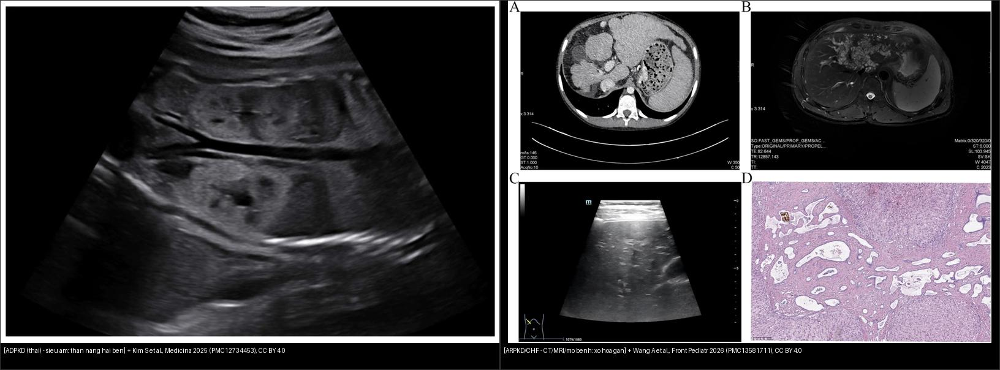
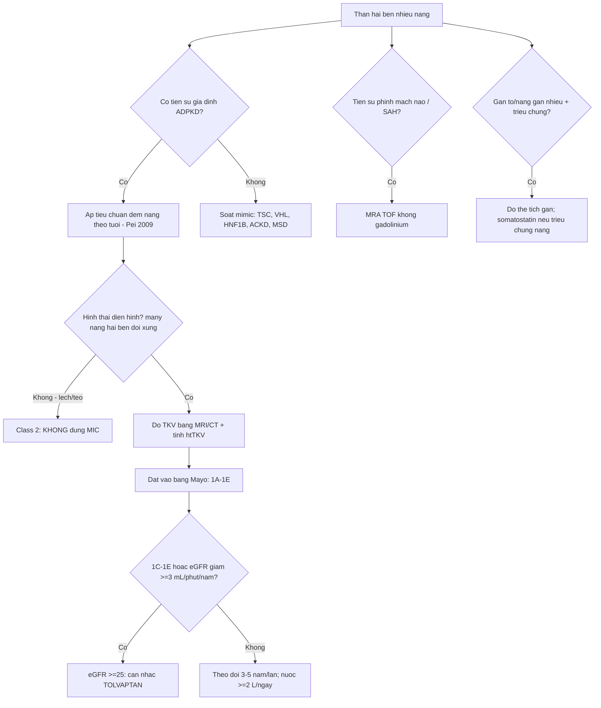
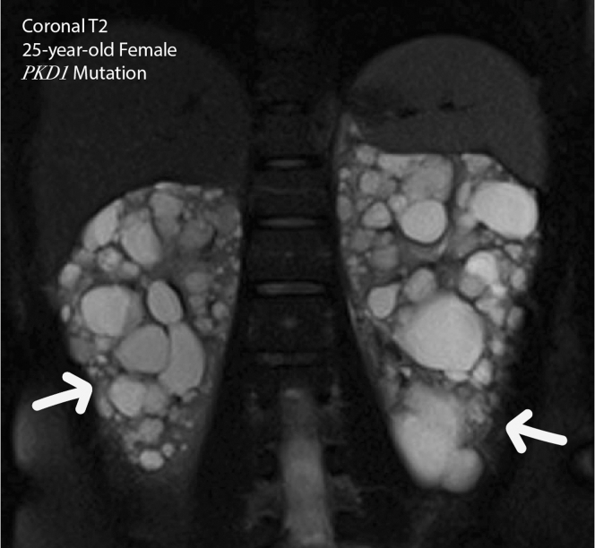
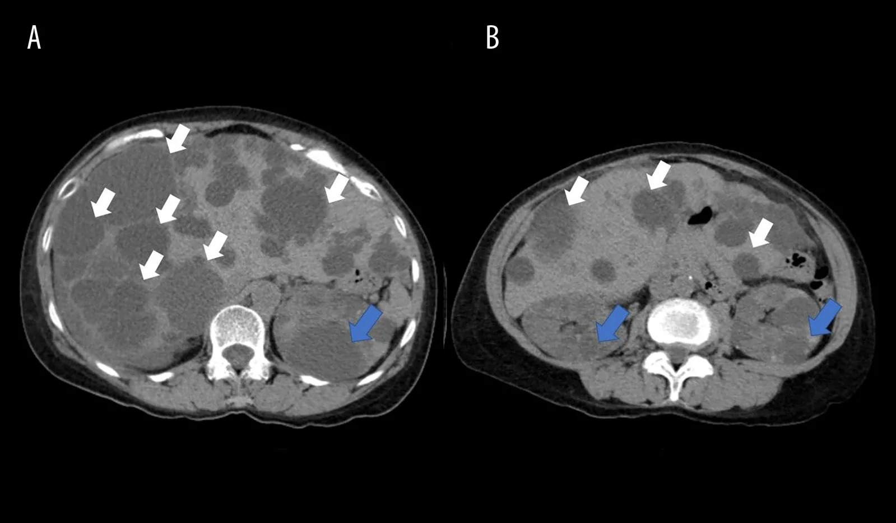
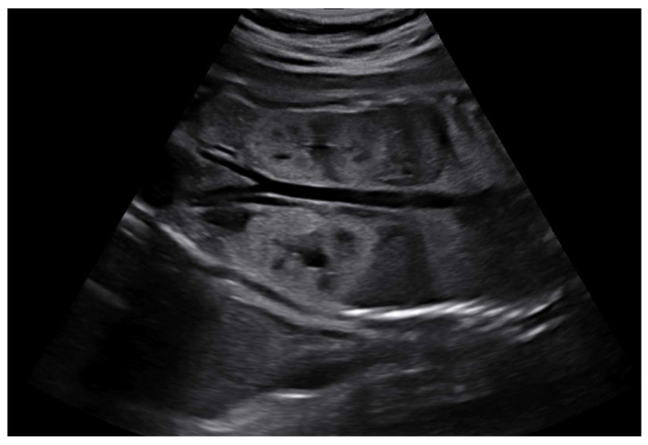
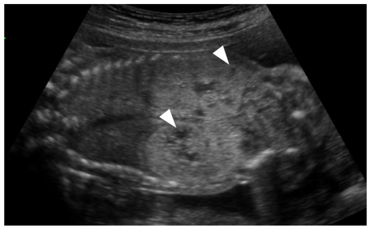
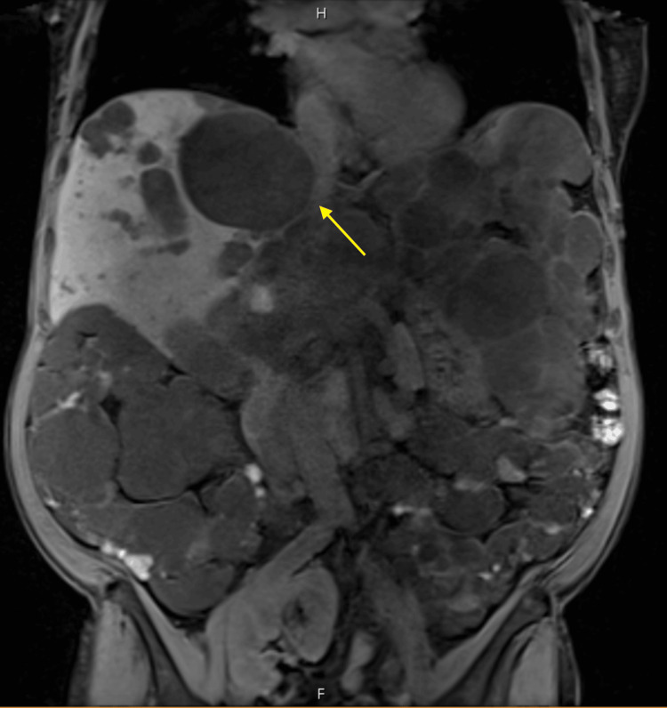
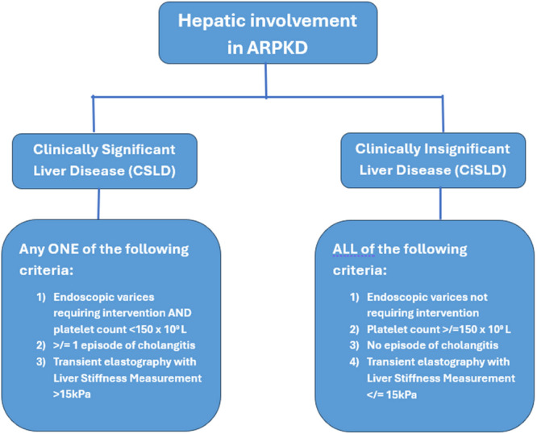

# 157 — Bệnh thận đa nang ADPKD/ARPKD & gan đa nang / ADPKD–ARPKD & polycystic liver disease

**Tags:** `pattern:than-da-nang` `vung:than` `vung:gan` `score:Mayo-MIC` `protocol:sang-loc-than-da-nang` `incidentaloma:nang-gan-than`
**Mức chắc chắn (certainty):** tổng hợp y văn (literature synthesis) — nhóm tự biên từ y văn mở (Kidney Int Rep 2025, Am J Case Rep 2026, Medicina 2025, Front Pediatr 2026, JPGN Rep 2026, Cureus 2026), số liệu đối chiếu guideline KDIGO 2025 + Pei 2009 + Irazabal 2015.

## 1. Tổng quan — vì sao nang mọc, và TẠI SAO đọc được trên CT/MRI

- **Bệnh thận đa nang trội NST thường (autosomal dominant polycystic kidney disease — ADPKD)** là **bệnh thận đơn gen hay gặp nhất**, khoảng **1/1.000–1/2.500** người lớn; **PKD1 (~78%)** nặng hơn **PKD2**; **~50% tiến triển tới suy thận giai đoạn cuối (ESKD) trước tuổi 60**, và ADPKD chiếm **~5–10%** tổng số ESKD ở người lớn (PMC13587221).
- **Cơ chế sinh nang (để nhớ TẠI SAO hình ảnh như vậy):** đột biến **PKD1/PKD2** → mất phức hợp **polycystin-1/2** ở lông mao (± polycystin) → ống thận tăng sinh biểu mô + tăng tiết dịch + giãn ra thành **nang chứa dịch lọc**. Nang xuất phát từ mọi đoạn ống → phân bố **vỏ lẫn tủy, hai bên, lan tỏa**. Riêng **ARPKD (lặn)** do **PKHD1** → **vi nang (microcyst)** toàn bộ ống góp → thận to nhưng **không nang lớn**.
- **TẠI SAO tín hiệu (vật lý):**
  - Nang chứa **dịch trong (simple fluid)** → **CT 0–15 HU** (nước), **MRI T1 thấp + T2 rất cao**.
  - Nang **xuất huyết** (hay gặp trong ADPKD) → **T1 cao (methemoglobin) + T2 biến thiên, thường có mức dịch–dịch** (không phải mỡ → **không mất tín hiệu khi fat-sat**).
  - Nang **nhiễm trùng** → **thành dày + ngấm + viêm mỡ quanh nang + khí trong nang**, hạn chế khuếch tán; có thể **"mờ" không phân biệt được với máu về đậm độ đơn thuần** → phải đối chiếu lâm sàng + phim cũ (CRP, sốt).
- **Gan đa nang (polycystic liver disease — PLD)** gần như luôn đi kèm ADPKD (nang gan **nặng hơn ở nữ**); biến chứng cơ học khi nang **chèn rốn gan/mạch máu** (PMC13412458).
- **ARPKD/CHF** (lặn): ngoài thận to tăng âm còn có **xơ hóa gan bẩm sinh (congenital hepatic fibrosis — CHF)** → xơ quanh ống mật → **tăng áp lực cửa, lách to, giãn tĩnh mạch thực quản**. Dịch tễ CHF **~1/10.000–1/20.000**, nguy cơ tái phát cho con **25%** (PMC13581711).

## 2. Mẫu hình + chẩn đoán phân biệt theo vị trí (gamut)

- **Thận hai bên nhiều nang + thận TO** → ADPKD (nang lớn rõ, vỏ+tủy), **ARPKD** (trẻ nhỏ, vi nang tăng âm, mất phân biệt vỏ–tủy), **TSC** (kèm AML chứa mỡ), **VHL** (kèm u đặc ngấm + nang tụy), **HNF1B** (thận nhỏ, ít nang, kèm đái tháo đường/giãn đường mật), **nephronophthisis** (thận bình thường/nhỏ, nang tủy, CKD trẻ).
- **Thận hai bên nhiều nang + thận NHỎ/BÌNH THƯỜNG ở người lọc máu** → **ACKD** (bệnh thận nang mắc phải; nguy cơ RCC thật — khác ADPKD).
- **Nang gan nhiều ổ** → **PLD/ADPLD** (kèm ADPKD; ≥ 10 nang), **bệnh Caroli** (giãn đường mật thông cây mật + central dot), **u mô đệm đường mật von Meyenburg** (nốt < 1,5 cm, T2 "trời sao", không thông mật), **xơ hóa gan bẩm sinh/CHF** (không phải nang lớn, mà **giãn đường mật + xơ + tăng áp lực cửa**).
- **Bất thường phối hợp phải soát khi thấy thận đa nang:** **phình mạch não** (12,9% ở ADPKD vs 2,9% dân số chung), **nang tụy/lách**, **phình/tách ĐMC**, **thoát vị thành bụng**, **bệnh túi thừa đại tràng**, **sỏi thận (~20%)**.
- Gợi nhớ **"CYST–LIVER–BRAIN"**: **C**yst (nang lớn hai bên) · **Y**oung/adult PKD1 nặng hơn PKD2 · **S**tones + **T**ạng (gan/tụy) · **LIVER** (PLD, nặng ở nữ) · **BRAIN** (phình mạch não, tầm soát có mục tiêu).

## 3. Bảng so sánh phân biệt (ma trận đối chiếu)

| Thực thể (entity) | Hình ảnh điển hình | Chốt vào (rule-in) | Chốt loại (rule-out) | Gợi ý xác nhận |
|---|---|---|---|---|
| **ADPKD** | Thận **TO hai bên**, nang lớn lan tỏa vỏ+tủy; **nang gan/tụy**; ± phình mạch não | **≥ 3 nang (15–39t) / ≥ 2 nang mỗi thận (40–59t) / ≥ 4 nang mỗi thận (≥ 60t)** khi có tiền sử gia đình (siêu âm); **≥ 10 nang (MRI 16–40t)** | Ở người 40–59t, **< 2 nang tổng cộng** → **LOẠI trừ** (NPV 100%); thận **nhỏ** + lọc máu → ACKD | Siêu âm → MRI/CT; **htTKV + MIC**; gene PKD1/PKD2 |
| **ARPKD / CHF** | Trẻ nhỏ: **thận to, tăng âm lan tỏa, vi nang, mất phân biệt vỏ–tủy**; gan: **giãn đường mật + xơ + tăng áp lực cửa** | **Thận to tăng âm ở sơ sinh/nhũ nhi + gan xơ/tăng áp lực cửa** | Nang lớn rõ ở người lớn + nang gan → ADPKD | Gene **PKHD1**; siêu âm thai; phân độ gan CSLD/CiSLD |
| **ACKD** | Thận **nhỏ/bình thường** (~81–85 mm), nhiều nang, ở người **lọc máu/ESKD** | **≥ 3 nang/thận + thận nhỏ + đang lọc máu** | Thận khổng lồ + nang gan → ADPKD | Xem bài 153; **nguy cơ RCC thật (×100)** |
| **TSC** | Nang thận + **AML chứa mỡ (−10 đến −100 HU)**; u sừng trán, u dưới màng não thất; LAM | **Mỡ đại thể trong khối thận** + tổn thương TKTW | Nang thuần không có thành phần mỡ | Xem bài 156; gene TSC1/TSC2 |
| **VHL** | Nang thận + **u đặc ngấm mạnh (RCC)**, nang tụy, u mạch máu võng mạc/TKTW, pheo | **Nang + u đặc ngấm** ở người trẻ, đa tạng | Chỉ có nang không đặc → ADPKD/đơn thuần | Xem bài 156; gene VHL |
| **Gan đa nang (PLD) / von Meyenburg / Caroli** | PLD: **nang gan lớn nhiều ổ**; von Meyenburg: nốt **< 1,5 cm T2 "trời sao", không thông mật**; Caroli: **giãn đường mật thông cây + central dot** | **PLD: ≥ 10 nang gan + nang thận (ADPKD)** | Nang gan đơn thuần vài ổ, không nang thận | MRI/MRCP; xem bài 123 |

*Trái: **ADPKD thai** — thận hai bên **nhiều nang lớn** (trội). Phải: **ARPKD/CHF** — hình ảnh xơ hóa gan bẩm sinh (giãn đường mật + xơ quanh ống mật, tăng áp lực cửa). Nguồn: Kim S et al., Medicina 2025 (PMC12734453) + Wang A et al., Front Pediatr 2026 (PMC13581711), CC BY 4.0. Ảnh ghép letterbox.*

## 4. Protocol + phân độ Mayo (MIC) + hướng xử trí

- **Siêu âm là tuyến đầu** sàng lọc người lớn có nguy cơ (KDIGO 2025); **MRI/CT** khi siêu âm chưa rõ hoặc để **đo thể tích**.
- **Tiêu chuẩn siêu âm thống nhất (Pei 2009) khi có tiền sử gia đình:**
  - **15–29 tuổi:** ≥ **3 nang** (một/b hai thận) để **chẩn đoán** (PPV 100%); **< 1 nang** để **loại trừ** (NPV 91%).
  - **30–39 tuổi:** ≥ **3 nang** (PPV 100%); **< 1 nang** → loại trừ (NPV 98%).
  - **40–59 tuổi:** ≥ **2 nang MỖI thận** (PPV 100%); **< 2 nang tổng cộng** → **loại trừ (NPV 100%)**.
  - **≥ 60 tuổi:** ≥ **4 nang mỗi thận** để chẩn đoán.
  - **MRI (16–40 tuổi):** **≥ 10 nang (tổng hai thận)** = chẩn đoán; **< 5 nang** = loại trừ (độ đặc hiệu ~98–100%).
- **Thể tích thận (TKV) & htTKV + Phân độ Mayo (MIC, Irazabal 2015):**
  - **htTKV = (TKV hai thận) / chiều cao (m)**, đơn vị **mL/m**. Đo tốt nhất bằng **phân đoạn (segmentation) MRI/CT**; công thức **ellipsoid (π/6 × D × R × C)** nhanh nhưng kém chính xác (siêu âm **thấp hơn ~11%**, xếp nhầm độ ~22%).
  - **MIC class 1 (điển hình, hai bên lan tỏa)** chia **1A–1E** theo htTKV + tuổi (tương ứng **tốc độ tăng htTKV/năm** và **tuổi suy thận**):

| Phân độ | Tốc độ tăng htTKV/năm | Tuổi suy thận (Kaplan–Meier) | Ý nghĩa |
|---|---|---|---|
| **1A** | < 1,5% | < 20% tới suy thận | tiến triển chậm |
| **1B** | 1,5–3,0% | **71,2** tuổi | chậm |
| **1C** | 3,0–4,5% | **62,8** tuổi | tiến triển nhanh (cân nhắc tolvaptan) |
| **1D** | 4,5–6,0% | **55,6** tuổi | tiến triển nhanh |
| **1E** | > 6,0% | **45,1** tuổi | tiến triển nhanh |

  - **Class 2 (không điển hình)** gồm **2A** (một bên/khu trú/lệch) và **2B** (teo, chiều dài thận trung bình **< 14,5 cm**): **KHÔNG dùng MIC** vì thể tích không dự báo được diễn tiến.
- **Tiêu chuẩn điều trị (KDIGO 2025):** **tolvaptan** cho người lớn **eGFR ≥ 25 mL/phút/1,73 m²** VÀ có **tiến triển nhanh** (Mayo **1C–1E**, hoặc **giảm eGFR ≥ 3 mL/phút/năm**, hoặc **điểm PROPKD > 6**). **Không** dùng mTOR/statins/metformin/somatostatin để *làm chậm tiến triển thận*; somatostatin **chỉ** để giảm thể tích gan trong **gan đa nang có triệu chứng**.
- **Tầm soát phình mạch não:** **KHÔNG tầm soát đại trà** — chỉ khi có **tiền sử bản thân/gia đình phình mạch não, xuất huyết dưới nhện, hoặc đột tử không giải thích**. Phương pháp: **MRA TOF không gadolinium** (bảo vệ thận). Phình **≤ 5 mm vòng tuần hoàn trước** thường **theo dõi**, không can thiệp.

## 5. Biến thể bình thường và cạm bẫy

- **Nang xuất huyết vs nang nhiễm trùng — KHÔNG có một dấu hiệu đơn độc nào đủ:** xuất huyết = **tăng đậm độ trên CT không cản quang, T1 cao, mức dịch–dịch, mỡ quanh sạch, thoái triển theo tuần**; nhiễm trùng = **thành dày/ngấm, viêm mỡ quanh nang, khí trong nang, hạn chế khuếch tán, nang MỚI so với phim trước**. Nghi nhiễm trùng nang → **¹⁸F-FDG PET/CT** khi cần xác nhận; điều trị **kháng sinh ngấm mỡ 4–6 tuần** (fluoroquinolone/TMP-SMX), **không** dựa vào đậm độ đơn thuần.
- **ADPKD vs ACKD — chốt ở KÍCH THƯỚC thận:** ADPKD = thận **khổng lồ**; ACKD = thận **nhỏ/bình thường** ở người lọc máu (xem bài 153).
- **RCC trong ADPKD:** KDIGO 2025 nêu **ADPKD KHÔNG làm tăng rõ nguy cơ RCC** → **không tầm soát ung thư vì riêng chẩn đoán ADPKD**; nhưng nếu có **thành phần đặc/ngấm** trên nền hàng trăm nang thì rất dễ bỏ sót → luôn nhìn "phần ngấm", so phim cũ. (**ACKD thì có tăng nguy cơ thật.**)
- **Không cần gadolinium để đo TKV** — quan trọng ở người suy thận (tránh nguy cơ xơ hóa thận–hệ thống).
- **Gan đa nang chèn ép** có thể gây **tắc mật/hẹp tĩnh mạch/huyết khối** (Ca MRCP) — đừng chỉ mô tả "nhiều nang", hãy tìm **biến chứng cơ học**.
- **Trẻ em:** **1 nang ở trẻ < 15 tuổi có tiền sử gia đình là rất đáng ngờ**, nhưng **siêu âm bình thường không loại trừ**; **không tầm soát đại trà phình mạch não/nang tạng ở trẻ** (KDIGO).
- **Sỏi thận ~20%** trong ADPKD; cần phân biệt **sỏi** với **vôi hóa thành nang**.

## 6. Tự lượng giá — Blind Quiz

**Ca 1 — Nữ 25 tuổi, đột biến PKD1, MRI T2 coronal bụng:**

- Hỏi: Hai thận thế nào? Vì sao T2 rất sáng? Cần báo cáo thêm gì để quyết định điều trị?

<b>Bấm để hiện đáp án (findings + chẩn đoán)</b>

- **Findings:** **hai thận to, nang lan tỏa hai bên** (nang chứa dịch → **T2 rất cao**), hình thái **điển hình (class 1)**. **Chẩn đoán:** **ADPKD**. **Phải báo cáo thêm:** **TKV/htTKV + phân độ Mayo (1A–1E)** — vì phân độ quyết định **có chỉ định tolvaptan** (1C–1E + eGFR ≥ 25). Nguồn: **Hu Z et al.**, Kidney Int Rep 2025, gr2, PMC12446943, CC BY-NC-ND 4.0.

**Ca 2 — Bệnh nhân ADPKD, CT bụng cản quang: nang ở gan và thận:**

- Hỏi: Nang nào ở gan, nang nào ở thận? Điều gì gợi ý "gan đa nang (PLD)"?

<b>Bấm để hiện đáp án (findings + chẩn đoán)</b>

- **Findings:** **nhiều nang gan giảm đậm độ (mũi tên trắng)** + **nang thận hai bên (mũi tên xanh)**. **Chẩn đoán:** **ADPKD kèm gan đa nang (PLD)** — chốt **≥ 10 nang gan + nang thận**; nang gan **nặng hơn ở nữ**. Nguồn: **Zaulkafali TA et al.**, Am J Case Rep 2026, Fig 2, PMC13505321, CC BY-NC-ND 4.0.

**Ca 3 — Thai nhi (song thai), siêu âm 24 tuần: hai thận của một thai có hình dạng bất thường.**

- Hỏi: Mô tả thận? Nghĩ ADPKD hay ARPKD? Vì sao phải đánh giá gan sau sinh?

<b>Bấm để hiện đáp án (findings + chẩn đoán)</b>

- **Findings:** **thận hai bên to, nhiều nang lớn vỏ + tủy** (ADPKD thai). **Chẩn đoán:** **ADPKD** — khác **ARPKD** (thận **tăng âm lan tỏa, vi nang, mất phân biệt vỏ–tủy**, thường **hai bên đối xứng + ối ít**). Sau sinh phải theo dõi **huyết áp, chức năng thận + gan (CHF/tăng áp lực cửa)**. Nguồn: **Kim S et al.**, Medicina 2025, Fig 2, PMC12734453, CC BY 4.0.

**Ca 4 — Thai nhi có thận to tăng âm, gần mất phân biệt vỏ–tủy. Siêu âm:**

- Hỏi: Mẫu hình này gợi bệnh gì? Phân biệt với nang lớn (ADPKD) thế nào?

<b>Bấm để hiện đáp án (findings + chẩn đoán)</b>

- **Findings:** **thận to, tăng âm lan tỏa, gần mất ranh giới vỏ–tủy** (mũi tên trắng). **Chẩn đoán:** hướng **ARPKD/ciliopathy** (vi nang không đếm được) — cần **đánh giá gan (CHF) + gene PKHD1**; **khác ADPKD** (ADPKD có **nang lớn rõ ràng**). Nguồn: **Kim S et al.**, Medicina 2025, Fig 3, PMC12734453, CC BY 4.0.

**Ca 5 — Bệnh nhân gan đa nang, MRCP: có một tổn thương lớn chèn ép vùng rốn gan.**

- Hỏi: Tổn thương là gì? Vì sao cần tìm biến chứng mạch mật?

<b>Bấm để hiện đáp án (findings + chẩn đoán)</b>

- **Findings:** **nang gan lớn chèn ép rốn gan (mũi tên vàng)**. **Chẩn đoán:** biến chứng **cơ học của gan đa nang (PLD/ADPKD)** → có thể **hẹp đường mật/huyết khối TM cửa**. **Chốt:** với gan đa nang, không chỉ đếm nang — phải tìm **chèn ép/giãn đường mật/tăng áp lực cửa**. Nguồn: **Santharam Y et al.**, Cureus 2026, i02, PMC13412458, CC BY 4.0.

**Ca 6 — Sơ đồ phân độ bệnh gan trong ARPKD (trẻ em) — dùng để làm gì?**

<b>Bấm để hiện đáp án (findings + chẩn đoán)</b>

- **Nội dung:** sơ đồ phân ARPKD thành **bệnh gan có ý nghĩa lâm sàng (CSLD)** và **không (CiSLD)**. **CSLD** = có **bất kỳ** tiêu chí: **giãn tĩnh mạch cần can thiệp + tiểu cầu < 150 × 10⁹/L** · **≥ 1 đợt viêm đường mật** · **độ đàn hồi gan (elastography) ≥ 15 kPa**. **CiSLD** = **tất cả**: không cần can thiệp giãn tĩnh mạch · tiểu cầu ≥ 150 × 10⁹/L · **không** viêm đường mật · elastography < 10 kPa. **Vì sao quan trọng:** quyết định theo dõi nội soi/tiểu cầu và **thời điểm ghép gan**. Nguồn: **Kurkal K, Gupte GL.**, JPGN Rep 2026, Fig 1, PMC13398733, CC BY-NC-ND 4.0.

## Bài liên quan chéo
- [100 – Tổng quan hệ Bụng](../100-tong-quan-he-bung/lesson.md)
- [150 – Nang thận Bosniak](../150-nang-than-Bosniak/lesson.md)
- [151 – U thận đặc: RCC vs oncocytoma vs AML](../151-u-than-dac/lesson.md)
- [153 – Thận nang mắc phải trên lọc máu (ACKD)](../153-benh-than-nang-mac-phai-loc-mau/lesson.md) (phân biệt ADPKD vs ACKD)
- [156 – Hội chứng di truyền u thận](../156-hoi-chung-di-truyen-u-than/lesson.md) (TSC/VHL/HNF1B)
- [123 – Nang gan & bệnh gan đa nang](../123-nang-gan-va-benh-gan-da-nang/lesson.md) (PLD, Caroli, von Meyenburg)
- [154 – RCC di căn & theo dõi sau cắt thận](../154-rcc-di-can-va-theo-doi-sau-cat-than/lesson.md)

## Ảnh
- Tên file: `157_slug_Modality_SourceID.jpg`. Nguồn + giấy phép từng ảnh trong `images/CREDITS.md`.
- Ảnh **CC BY-NC / CC BY-NC-ND** giữ **nguyên bản**, không crop/ghép; ảnh ghép chỉ dùng ảnh **CC BY** (letterbox nền đen).

> Không dùng để chẩn đoán độc lập khi chưa có người hướng dẫn.
