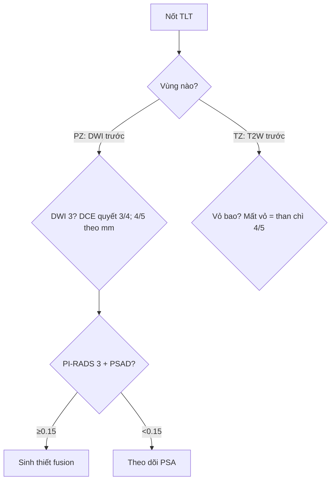

# 158 — Tiền liệt tuyến & PI-RADS v2.1 / Prostate PI-RADS

**Tags:** `pattern:khoi-tien-liet-tuyen` `vung:tien-liet-tuyen` `score:PI-RADS` `protocol:mpMRI-tien-liet-tuyen`
**Mức chắc chắn (certainty):** tổng hợp y văn (literature synthesis) — nhóm tự biên từ y văn mở, chưa gắn ca nguyên văn đơn lẻ.

## 1. Tổng quan — PZ đọc DWI, TZ đọc T2W + 1,5 cm + PSAD 0,15

- **Ngoại vi (PZ, 70–75% K):** ống tuyến đầy dịch → T2 sáng đều, khuếch tán tự do; ung thư (csPCa Gleason ≥ 3+4) lấp ống → hạn chế mạnh — TẠI SAO **DWI (b ≥ 1.400) + ADC là chủ đạo tuyệt đối**, DCE chỉ tie-breaker nâng 3→4.
- **Chuyển tiếp (TZ, 20–25% K):** nền BPH cũng hạn chế + ngấm giống K — TẠI SAO **T2W là chủ đạo**: BPH có **vỏ bao xơ (organized chaos)**, K là mảng xám mất vỏ (**erased charcoal**).
- Ngưỡng: **1,5 cm** tách 4/5 (đo ADC với PZ, T2W với TZ); **PSAD ≥ 0,15** sinh thiết vùng xám PI-RADS 3; kỹ thuật: T2 3 mm/0 mm, DWI b ≥ 1.400, DCE ≤ 15 giây ≥ 2 phút.

## 2. Gamut nốt tiền liệt tuyến (Gamut)

- **PZ tối ADC + sáng DWI + DCE (+):** PI-RADS 4–5 — fusion biopsy + hệ thống.
- **TZ mất vỏ + than chì + ≥ 1,5 cm:** PI-RADS 5 — sinh thiết + giai đoạn EPE.
- **PI-RADS 3 + PSAD ≥ 0,15:** sinh thiết; < 0,15 theo dõi PSA.
- **Đối xứng đáy + ria mép:** vùng trung tâm (CZ) — đừng sinh thiết oan!

## 3. Bảng quy đổi PI-RADS v2.1

| Vùng + chuỗi chủ đạo | Điểm chuỗi | Chốt vào (rule-in) → PI-RADS | Chốt loại (rule-out) |
|---|---|---|---|
| PZ (DWI/ADC) 1–2 | Tuyến/chêm thẳng | **1–2: không sinh thiết** | — |
| PZ DWI 3 | Vừa khu trú | **DCE (−) → 3; DCE (+) → 4** | Viêm thẳng-chêm → 2 |
| PZ DWI 4/5 | Rõ rệt, < 1,5 cm / ≥ 1,5 cm-EPE | **4 / 5 (bất kể DCE)** | — |
| TZ (T2W) 1–2 | Vỏ bao hoàn toàn/gần hoàn toàn | **DWI ≥ 4 → 3, còn lại 1–2** | Vỏ bao = BPH |
| TZ T2W 3–5 | Mờ-không vỏ / than chì </≥ 1,5 cm | **3 / 4 / 5 theo DWI + mm** | — |

## 4. Protocol mpMRI + flowchart

- T2 đa mặt 3 mm + DWI b ≥ 1.400 + ADC + DCE ≤ 15s; V = AP×Ngang×Dài×0,52; PSAD = PSA/V.

## 5. Cạm bẫy

- **Ria mép CZ đối xứng đáy** tưởng PI-RADS 4/5 — coronal + đối xứng là bình thường.
- **BPH thò ra PZ** đọc nhầm 4 — T2W thấy vỏ bao + liên tục TZ → PI-RADS 2.
- **Máu sau sinh thiết** giả K — T1W máu sáng + hemorrhage exclusion (ổ tối = u!) + chờ 6 tuần.
- **AFMS trước** tối T2/ADC nhưng không sáng DWI/không ngấm — K sừng trước thì ngược lại.

## 6. Tự lượng giá — Blind Quiz

**Ca 1 — PZ phải tối ADC + sáng b1600 12 mm + DCE (+):** PI-RADS mấy? Sinh thiết không? *(Bảng mục 3.)*

<b>Bấm để hiện đáp án</b>

- **PI-RADS 4** (DWI 4, < 1,5 cm) — fusion + hệ thống (bất kể DCE).

**Ca 2 — PI-RADS 3 + PSA 6, V 50 mL:** PSAD bao nhiêu? Sinh thiết hay theo dõi? *(Bảng mục 3 + mục 4.)*

<b>Bấm để hiện đáp án</b>

- **PSAD = 6/50 = 0,12 (< 0,15):** theo dõi PSA (≥ 0,15 mới sinh thiết).

**Ca 3 — Đáy đối xứng ria mép tối ADC 2 bên:** PI-RADS mấy? *(Bảng mục 5.)*

<b>Bấm để hiện đáp án</b>

- **Bình thường (CZ):** không sinh thiết — bẫy số 1 PI-RADS!

## Bài liên quan chéo
- [100 – Tổng quan Bụng](../100-tong-quan-he-bung/lesson.md)
- [150 – Bosniak](../150-nang-than-Bosniak/lesson.md) (logic RADS)
- [155 – Thượng thận](../155-thuong-than-tinh-co/lesson.md) (washout)

> Không dùng để chẩn đoán độc lập khi chưa có người hướng dẫn.
