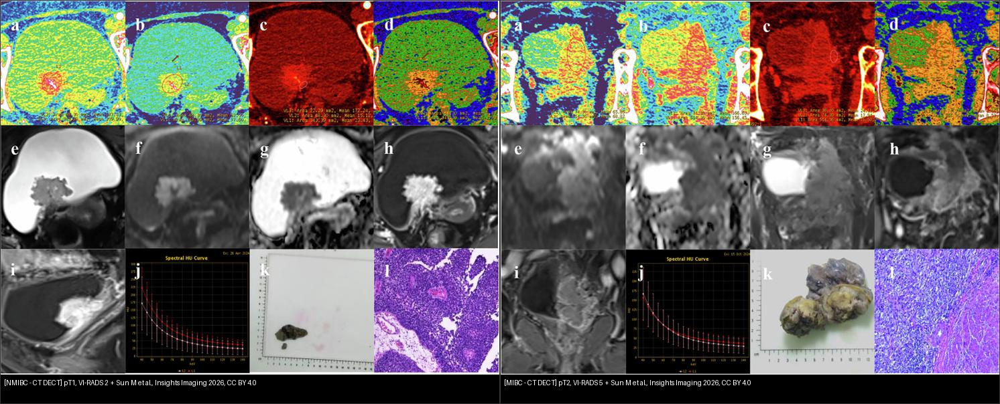
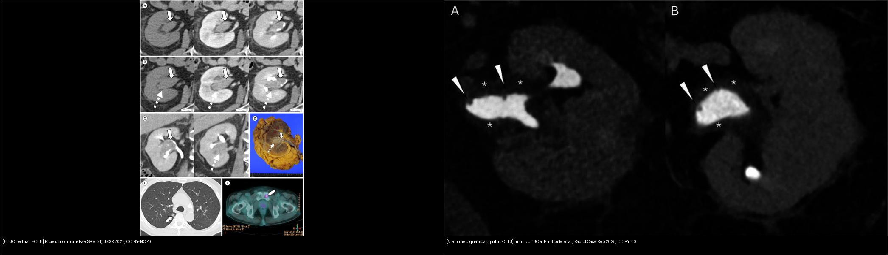
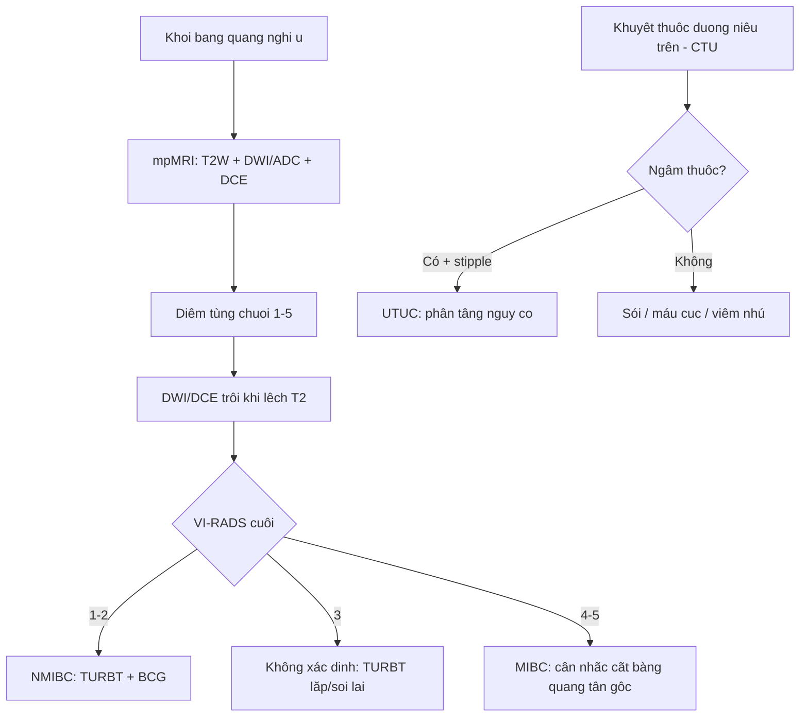
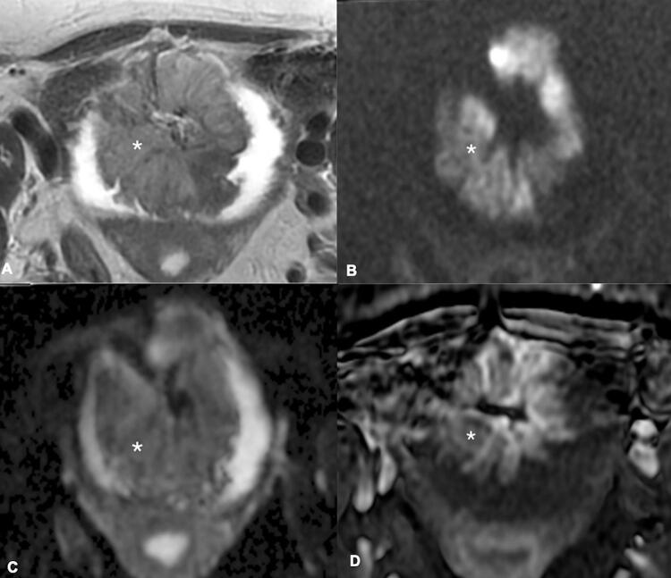
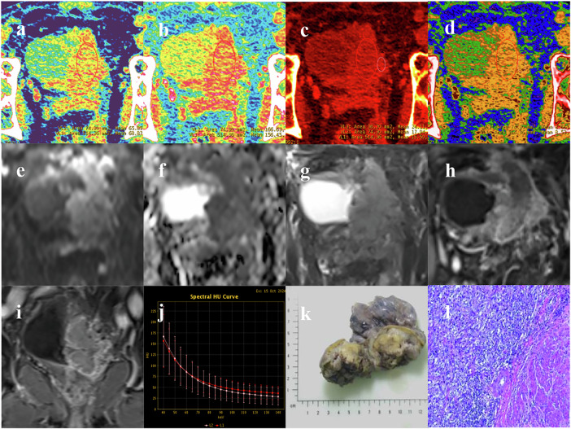
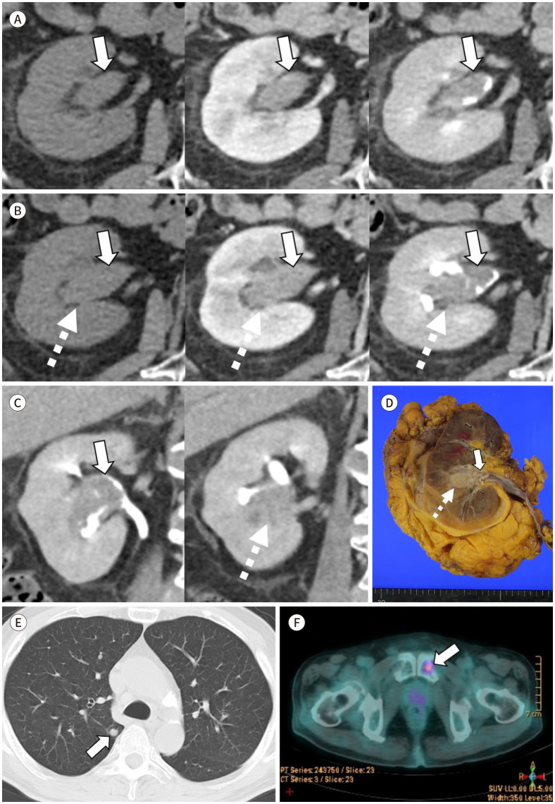
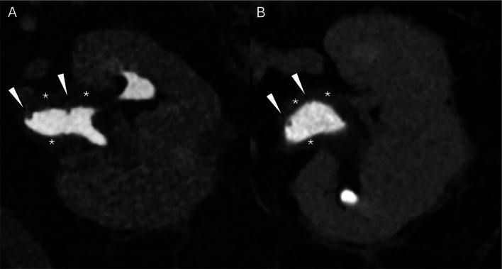

# 159 — Bàng quang & đường niệu trên: VI-RADS, xâm lấn cơ & UTUC / Bladder VI-RADS & UTUC

**Tags:** `pattern:u-bang-quang` `pattern:khuyet-thuoc-duong-nieu` `vung:bang-quang` `vung:duong-nieu-tren` `score:VI-RADS` `protocol:mpMRI-bang-quang` `protocol:CTU`
**Mức chắc chắn (certainty):** tổng hợp y văn (literature synthesis) — nhóm tự biên từ y văn mở (Insights Imaging 2026 CC BY 4.0, Int Braz J Urol 2022 CC BY 4.0, J Korean Soc Radiol 2024 CC BY-NC 4.0, Radiol Case Rep 2025 CC BY 4.0), chưa gắn ca nguyên văn đơn lẻ.

## 1. Tổng quan — ranh giới sống còn là cơ (muscularis propria), không phải kích thước

- **U niệu mạc (urothelial carcinoma)** chiếm **~90%** u bàng quang. Mấu chốt điều trị: **T1 (xâm lấn lớp dưới niêm mạc — lamina propria) vs T2 (xâm lấn cơ — muscularis propria)** — T1 cắt nội soi (TURBT) + BCG; T2 phải **cắt bàng quang tận gốc (radical cystectomy)**. TẠI SAO hình ảnh không thể chỉ đọc "khối": cùng khối to nhưng khác ranh giới cơ = khác phẫu thuật.
- **TẠI SAO MRI (không phải CT) cho cơ:** T2W high-resolution thấy **dải cơ giảm tín hiệu (hypointense detrusor)**; u = tín hiệu trung gian-cao + **DWI tăng mạnh/ADC thấp** (tế bào đặc, kênh ngoại bào hẹp) + **DCE ngấm sớm** (tân mạch). Xâm lấn cơ = u **phá dải cơ giảm tín hiệu** (T2W) + tín hiệu DWI/ngấm kéo vào lớp cơ.
- **TẠI SAO DWI/DCE trội hơn T2W (VI-RADS):** tương phản cơ-tế bào (diffusion) + mạch máu (perfusion) mạnh và khách quan hơn tương phản mô mềm của T2W — nên VI-RADS lấy DWI/DCE làm **chuỗi quyết định (dominant)** khi lệch với T2.
- **UTUC (u niệu mạc đường niệu trên):** **~5–10%** u niệu mạc; **~60% đã xâm lấn (≥ pT2) lúc chẩn đoán** — nặng hơn bàng quang; hình trên CT urography là **khuyết thuốc (filling defect)** + **dấu chấm (stipple sign — thuốc đọng trong khe u)** + tắc → ứ nước.
- Phân tầng UTUC (EAU): **nguy cơ cao** khi có ≥ 1 trong: **ứ nước, u > 2 cm, tế bào học độ cao, u không cuống (sessile), đa ổ, CIS** → **cắt thận-niệu quản tận gốc (radical nephroureterectomy)**; nguy cơ thấp → **bảo tồn thận** (nội soi đốt).

## 2. Mẫu hình + chẩn đoán phân biệt theo vị trí (Gamut)

- **Khối bàng quang trong lòng:** u niệu mạc (đám thành bàng quang ± cuống), viêm bàng quang (thành dày lan tỏa, không khối khu trú), polyp/máu cục (di động).
- **Thành bàng quang dày:** u xâm lấn (bất đối xứng, khu trú, DWI sáng), viêm mạn/phóng xạ (đối xứng, ngấm ít), tăng sinh tuyến (cystitis glandularis).
- **Khuyết thuốc đường niệu trên (CTU):** sỏi (tăng tỷ trọng, vôi), **cục máu (không ngấm, đổi theo thời gian)**, **UTUC (ngấm, không cuống, stipple)**, **viêm niệu quản nhú (polypoid pyeloureteritis — thành đều, không ngấm)**, polyp xơ-biểu mô (nhẵn, di động, không ngấm).
- Gợi nhớ **khuyết thuốc đường niệu "STONE-CHIPS":** **S**tone, **T**umor, **O**rganized clot, **N**ecrosis/độc chất, **E**xternal compression, **C**yst/pyeloureteritis, **H**ypertrophy/polyp...

## 3. Bảng so sánh phân biệt (ma trận đối chiếu)

| Thực thể (entity) | Hình ảnh điển hình | Chốt vào (rule-in) | Chốt loại (rule-out) | Gợi ý xác nhận |
|---|---|---|---|---|
| **U bàng quang NMIBC** (T1) | T2W: u nửa trong, **dải cơ còn liền**; DWI sáng, ADC thấp; **VI-RADS 2** | **Dải cơ giảm tín hiệu còn nguyên** | Dải cơ bị phá + ngấm vào cơ → MIBC | TURBT + BCG |
| **U bàng quang MIBC** (T2) | **Phá dải cơ giảm tín hiệu** + DWI/ngấm kéo vào cơ/bó ngoài; **VI-RADS 4–5** | **U phá cơ, ngấm vào muscularis** | Cơ còn liền mọi chuỗi → NMIBC | Cắt bàng quang tận gốc (bệnh nhân thích hợp) |
| **UTUC (niệu mạc trên)** | Khuyết thuốc **ngấm thuốc** + **stipple sign** + ứ nước, không cuống | **Ngấm + stipple + tắc → ứ nước** | Không ngấm + đổi tư thế → máu cục | CTU + tế bào học nước tiểu; RNU nếu nguy cơ cao |
| **Sỏi niệu quản** | **Tăng tỷ trọng (vôi hóa)**, bóng lưng, không ngấm | **Tăng HU + vôi + không ngấm** | Ngấm thuốc → u | CT KUB không cản quang |
| **Viêm niệu quản nhú (pyeloureteritis)** | Khuyết thuốc **nhẵn dạng ngón/thùy**, thành đều, **KHÔNG ngấm thuốc** | **Không ngấm + thành đều + bối cảnh viêm** | Ngấm + không cuống → UTUC | Sinh thiết/đốt; theo dõi |
| **Huyết khối đường niệu** | Khuyết thuốc **không ngấm**, hình đổi giữa các thì | **Không ngấm + thay đổi theo lần chụp** | Bất biến + ngấm → u | Theo dõi, CT lại |

*Trái (a–l): NMIBC pT1, VI-RADS 2 — u khu trú, dải cơ còn. Phải: MIBC pT2, VI-RADS 5 — xâm lấn cơ. Hàng a–d: bản đồ trọng số năng lượng kép (spectral HU); e–h: CT/MRI; i: tái tạo đa bình diện; j: đường cong HU; k–l: bệnh phẩm + vi thể. Nguồn: Sun M et al., Insights Imaging 2026, CC BY 4.0. Ảnh ghép letterbox.*

*Trái: A) khuyết thuốc ngấm thuốc trong bể thận-niệu quản (mũi tên trắng), D) bệnh phẩm u; F) PET/di căn. Nguồn: Bae SB et al., J Korean Soc Radiol 2024, CC BY-NC 4.0. Phải: A, B) viêm niệu quản nhú — khuyết thuốc nhẵn, thành đều, không ngấm. Nguồn: Phillipi M et al., Radiol Case Rep 2025, CC BY 4.0. Ảnh ghép letterbox.*

### Dấu hiệu chốt cần nhớ
- **Dải cơ giảm tín hiệu trên T2W:** còn liền = NMIBC (VI-RADS ≤ 3); bị phá = MIBC (VI-RADS ≥ 4).
- **DWI/ADC:** u tế bào đặc → DWI sáng, ADC thấp; là chuỗi "trội" cùng DCE trong VI-RADS.
- **Stipple sign (UTUC):** thuốc cản quang đọng trong khe giữa các nhú u → khuyết thuốc "lấm tấm".
- **Ngấm thuốc = mấu chốt:** u ngấm; sỏi/máu cục/viêm nhú không ngấm.

## 4. Protocol chụp + hệ phân độ/điểm chuẩn hóa

- **mpMRI bàng quang (VI-RADS):** 3T, **bàng quang căng vừa**, T2W high-res (mặt phẳng vuông góc thành), **DWI + ADC bắt buộc**, **DCE (gadolinium)** — 3 chuỗi, mỗi chuỗi cho điểm 1–5, **ghép thành VI-RADS cuối** (DWI/DCE trội). Chống chỉ định/chú ý: kim loại mô cấy, chức năng thận (gadolinium + nguy cơ xơ hóa).
- **CT urography (CTU) đường niệu trên:** **kỹ thuật bắt đầu tiêm (bolus-tracked)** với **hai pha: pha thận (nephrographic ~90–100 giây) + pha bài tiết (excretory ~7–10 phút)** — pha bài tiết mới thấy khuyết thuốc đường niệu; **bơm nước/uống nước** làm giãn để lộ tổn thương.
- **VI-RADS → xử trí:** **1–2** = NMIBC (TURBT); **3** = không xác định (cân nhắc TURBT lặp/soi lại); **4–5** = MIBC (cân nhắc cắt bàng quang). **VI-RADS không thay thế TURBT** — chỉ định hướng trước mổ.
- **UTUC:** **CTU là chuẩn** + **tế bào học nước tiểu** (độ nhạy thấp nhưng chốt sinh thiết); nội soi niệu quản (ureteroscopy) + sinh thiết khi cần bảo tồn.

**Hệ phân độ/điểm chuẩn hóa:** **VI-RADS** (Vesical Imaging-Reporting and Data System) 1–5; **TNM** u niệu mạc: **Ta** (nhú chưa xâm lấn), **T1** (lamina propria), **T2** (muscularis propria), **T3** (mỡ quanh bàng quang), **T4** (cơ quan kề). Phân tầng UTUC theo EAU (ứ nước, kích thước, độ mô học, hình thái).

## 5. Biến thể bình thường và cạm bẫy

- **Bàng quang căng/giãn** giả thành bàng quang mỏng và có thể giả u (trabeculation) — chuẩn hóa mức căng trước khi đo.
- **Viêm bàng quang sau BCG/tia xạ** giả u xâm lấn (DWI sáng do viêm) — cần sinh thiết/TURBT, đừng chỉ dựa DWI.
- **DWI giả u do nhiễu/u phân (fecal) trong trực tràng** cạnh bàng quang — dùng trường nhỏ + giảm nhiễu.
- **Máu cục đường niệu không ngấm nhưng có thể che u** — CT lại sau khi máu tự tan; đừng loại trừ u vì "không ngấm lần này".
- **Sỏi nhỏ dính niệu quản** giả khuyết thuốc không ngấm — luôn pha không cản quang (CT KUB) để thấy vôi.
- **Satisfaction of search:** thấy u bàng quang rồi dừng → bỏ sót **UTUC đồng thời (synchronous)** (bài này có ca UTUC + u khác ipslateral!) — luôn chụp toàn tuyến niệu.
- **VI-RADS 3 bị đọc thành 4** → cắt bàng quang oan (bệnh nhân già trước TURBT không có mẫu cơ). VI-RADS 3 phải xác nhận bằng mô học.

## 6. Tự lượng giá — Blind Quiz

**Ca 1 — Khối bàng quang trên mpMRI. Đọc từng chuỗi trước, đừng lộ đáp án.**

- Hỏi: dải cơ (muscularis) còn liền hay bị phá? DWI/ADC và DCE nói gì? VI-RADS bao nhiêu — cắt nội soi hay cắt bàng quang?

<b>Bấm để hiện đáp án (findings + chẩn đoán)</b>

- Dấu hiệu (findings): A) T2W — khối tín hiệu trung gian ngôi sao ở nửa trong thành; B) DWI — khối **sáng mạnh**; C) ADC — **tối (khuếch tán hạn chế)**; D) DCE — khối ngấm. **Dải cơ giảm tín hiệu phía ngoài u còn liền**.
- Chẩn đoán (diagnosis): u ở **nửa trong**, cơ còn → **VI-RADS 2 (NMIBC)** — xử trí **TURBT ± BCG**, không cắt bàng quang.
- Nguồn ảnh: Nicola R et al., Int Braz J Urol 2022, CC BY 4.0.

**Ca 2 — Bệnh phẩm u bàng quang. Khối này ở nông hay đã vào cơ?**

- Hỏi: các bản đồ trọng số năng lượng kép (a–d) và đường cong HU (j) cho thông tin gì so với VI-RADS? Đây là NMIBC hay MIBC?

<b>Bấm để hiện đáp án (findings + chẩn đoán)</b>

- Dấu hiệu (findings): khối **ngấm mạnh**, đường cong HU/VMI (j) đặc trưng u tế bào; bệnh phẩm (k) + vi thể (l) cho thấy **u xâm lấn sâu**. Tương ứng **pT2 = MIBC, VI-RADS 5**.
- Chẩn đoán (diagnosis): **u bàng quang xâm lấn cơ (MIBC)** — vì u phá lớp cơ; hướng **cắt bàng quang tận gốc** (bệnh nhân thích hợp). CT năng lượng kép (spectral) hỗ trợ dự đoán xâm lấn cơ bên cạnh VI-RADS.
- Nguồn ảnh: Sun M et al., Insights Imaging 2026, CC BY 4.0.

**Ca 3 — Bệnh nhân đái máu, CT urography có khuyết thuốc bể thận-niệu quản (mũi tên trắng).**

- Hỏi: khuyết thuốc này ngấm thuốc hay không? Là sỏi, máu cục hay u? Phân tầng nguy cơ + xử trí?

<b>Bấm để hiện đáp án (findings + chẩn đoán)</b>

- Dấu hiệu (findings): A–C) khuyết thuốc trong đài-bể thận **ngấm thuốc** (mũi tên trắng đặc), có **stipple**; D) bệnh phẩm u vàng; E–F) nhu mô phổi + PET cho thấy bối cảnh tái phát/đồng thời.
- Chẩn đoán (diagnosis): **UTUC (u niệu mạc đường niệu trên)** — vì khuyết thuốc **ngấm thuốc**, không cuống. Nguy cơ cao (u lớn/ứ nước/có tổn thương đồng thời) → **cắt thận-niệu quản tận gốc**; máu cục thì không ngấm.
- Lưu ý: ca này còn minh họa **u đồng thời (synchronous)** — nhớ chụp toàn tuyến niệu.
- Nguồn ảnh: Bae SB et al., J Korean Soc Radiol 2024, CC BY-NC 4.0.

**Ca 4 — Khuyết thuốc niệu quản NHƯNG không ngấm thuốc. U hay không u?**

- Hỏi: dấu hiệu nào loại UTUC? Cần làm gì trước khi mổ "u niệu quản"?

<b>Bấm để hiện đáp án (findings + chẩn đoán)</b>

- Dấu hiệu (findings): A, B) khuyết thuốc **nhẵn dạng ngón/thùy** trong bể thận-niệu quản, **KHÔNG ngấm thuốc** (so hai thì: độ ngấm không tăng); thành đều.
- Chẩn đoán (diagnosis): **viêm niệu quản nhú (polypoid pyeloureteritis)** — tổn thương viêm **không ngấm** giả UTUC. Chốt loại UTUC: **không ngấm thuốc + bối cảnh viêm + không cuống thật**. Xử trí: nội soi niệu quản + sinh thiết trước khi quyết định mổ tận gốc.
- Nguồn ảnh: Phillipi M et al., Radiol Case Rep 2025, CC BY 4.0.

## Bài liên quan chéo
- [100 – Tổng quan hệ Bụng](../100-tong-quan-he-bung/lesson.md)
- [150 – Nang thận Bosniak & u thận](../150-nang-than-Bosniak/lesson.md)
- [152 – Sỏi niệu, ứ nước & nhiễm trùng niệu trên](../152-soi-nieu/lesson.md)
- [158 – Tiền liệt tuyến & PI-RADS v2.1](../158-tien-liet-tuyen-PIRADS/lesson.md)

> Không dùng để chẩn đoán độc lập khi chưa có người hướng dẫn.
