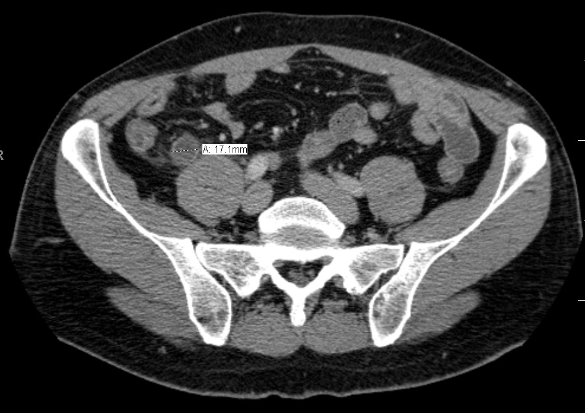

# 160 — Bụng cấp hố chậu & tắc ruột / Acute GI: appendicitis, diverticulitis & SBO

**Tags:** `pattern:day-thanh-ruot` `pattern:tac-ruot` `vung:ong-tieu-hoa` `protocol:CT-bung-cap`
**Mức chắc chắn (certainty):** tổng hợp y văn (literature synthesis) — nhóm tự biên từ y văn mở, chưa gắn ca nguyên văn đơn lẻ.

## 1. Tổng quan — 3 số quyết định mổ hay không

- **Ruột thừa > 6 mm** (ngoài-ngoài, từ đáy manh tràng) + thành > 3 mm + sỏi phân + thâm nhiễm mỡ = viêm ruột thừa (**≥ 8 mm** đặc hiệu cao).
- **Ruột non giãn > 3 cm** + điểm chuyển tiếp + dấu phân ruột non = tắc ruột non (SBO).
- **Bờm mỡ 1,5–3,5 cm** mỡ (−40…−100 HU) + viền tăng tỷ trọng + chấm trắng trung tâm = viêm bờm mỡ → **CẤM MỔ** (tự giới hạn, giảm đau).
- TẠI SAO số quan trọng: ruột thừa ≤ 6 mm + không thâm nhiễm = theo dõi, tránh mổ oan; quai kín + mất ngấm = mổ tối khẩn.

## 2. Ma trận 3 hố chậu (tránh mổ oan)

| Thực thể (entity) | Hình ảnh | Chốt | Xử trí |
|---|---|---|---|
| Viêm ruột thừa | **Ống cụt > 6 mm + thành > 3 mm + sỏi + thâm nhiễm mỡ** | ≥ 8 mm đặc hiệu cao | Mổ/kháng sinh theo phác đồ |
| Viêm túi thừa | Túi lồi + **dày thành đoạn dài > 5 cm giữ lớp** + thâm nhiễm mỡ | Hinchey Ia–IV (áp-xe ≥ 4 cm = II) | Kháng sinh/dẫn lưu/mổ theo Hinchey |
| Viêm bờm mỡ | **1,5–3,5 cm mỡ + viền + chấm trắng**, thành ruột gần bình thường | Mỡ + viền + chấm trắng | **Bảo tồn, cấm mổ/kháng sinh mạnh** |

## 3. Tắc quai kín + thiếu máu (mổ tối khẩn)

- **Quai kín (closed-loop):** quai U/C chứa dịch + **xoắn mạch (whirl)** + 2 mỏ chim (double beak).
- **Thiếu máu:** **mất ngấm thành** + phù mạc treo + **khí thành ruột (pneumatosis)** + **khí TM cửa** (ra sát vỏ gan < 2 cm; khác khí đường mật tập trung rốn gan).
- Có 2 nhóm trên = mổ ngay, đừng chờ.

*Đo ngoài-ngoài 17,1 mm. Nguồn: Doc James, CC BY-SA 3.0.*

## 4. Protocol CT bụng cấp

- Cản quang TM thì cửa (thành ruột + mạch mạc treo) + MPR coronal (ruột thừa/quai tắc).
- Không uống cản quang thường quy (chậm + nôn); trực tràng khi nghi đại tràng.

## 5. Cạm bẫy

- **Ruột thừa sau manh tràng cao** (dưới gan) — tìm từ đáy manh tràng, đừng kết luận không thấy.
- **Viêm manh tràng đơn độc (typhlitis)** sau hóa trị — giống viêm ruột thừa nhưng điều trị nội.
- **Bờm mỡ cạnh túi thừa viêm** — đọc cả 2, đừng mổ bờm mỡ.

## 6. Tự lượng giá — Blind Quiz

**Ca 1 — Đau hố chậu phải. Đo ruột thừa trước.**

- Hỏi: bao nhiêu mm? Ngưỡng nào? Có mổ không?

<b>Bấm để hiện đáp án</b>

- **Viêm ruột thừa (17,1 mm >> 8 mm):** vượt xa ngưỡng đặc hiệu — mổ/kháng sinh theo phác đồ.
- Đối chiếu bản trơn/annotated trong CREDITS. Nguồn: Doc James, CC BY-SA 3.0.

**Ca 2 — Đau hố chậu trái + tổn thương mỡ 2 cm + viền + chấm trắng, thành ruột bình thường:** mổ hay bảo tồn? *(Bảng mục 2.)*

<b>Bấm để hiện đáp án</b>

- **Viêm bờm mỡ:** bảo tồn (giảm đau), cấm mổ.

## Bài liên quan chéo
- [100 – Tổng quan hệ Bụng](../100-tong-quan-he-bung/lesson.md)
- [110 – Giải phẫu bụng](../110-giai-phau-bung/lesson.md) (đáy manh tràng, mạc treo)
- [162 – Tắc ruột & mạc treo (dự kiến)](../162-tac-ruot-mac-treo/lesson.md) (quai kín)

> Không dùng để chẩn đoán độc lập khi chưa có người hướng dẫn.
