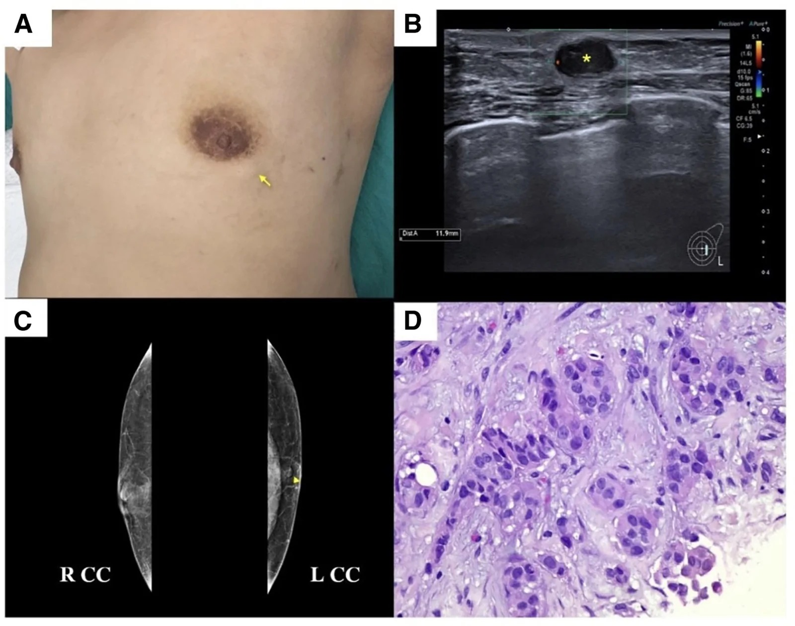
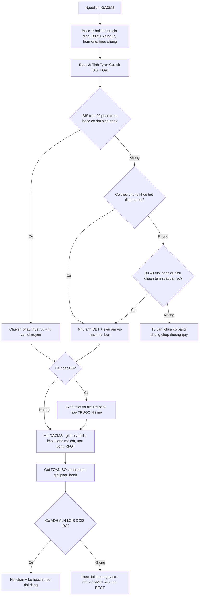

# 1600 — Đánh giá ngực TRƯỚC phẫu thuật tạo hình ngực nam hóa (GACMS) / Preoperative breast evaluation before gender-affirming chest masculinization surgery

**Tags:** `pattern:danh-gia-nguy-co` `pattern:khoi-vu` `pattern:vi-voi-hoa` `pattern:rfgt` `vung:vu` `vung:thanh-nguc` `score:Tyrer-Cuzick` `score:IBIS` `score:BI-RADS` `protocol:nhu-anh` `protocol:sieu-am-vu` `protocol:MRI-vu` `incidentaloma:u-tuyen-con-lai`
**Mức chắc chắn (certainty):** tổng hợp y văn (literature synthesis) — tổng hợp từ y văn mở qua Europe PMC (*Annals of Surgical Oncology* 2026 scoping review, *Plast Reconstr Surg Glob Open* 2026 ca + abstract, *Annals of Surgery Open* 2026), có **ca nguyên văn** dùng cho quiz (ảnh CC BY-NC-ND, giữ nguyên bản).

## 1. Tổng quan — "mastectomy" không phải cắt tuyến toàn bộ: vì sao vẫn còn mô tuyến và vì sao phải đánh giá TRƯỚC mổ

- **Thuật ngữ quyết định cách theo dõi:** "gender-affirming mastectomy" (GAM) là **tên gọi dễ gây nhầm** — phần lớn ca là **giảm tuyến dưới toàn phần (subtotal glandular reduction)**, không phải cắt tuyến triệt để như mastectomy ung thư. Vì mục tiêu là **đường nét ngực nam tính + bảo tồn núm–quàng (NAC)**, phẫu thuật viên **giữ lại mô tuyến quanh núm và dưới da** để nuôi núm → tồn tại **mô tuyến vú còn lại (retained fibroglandular tissue — RFGT)** (Vyas KS et al., *Ann Surg Open* 2026; Chu C et al., *Ann Surg Oncol* 2026).
- **RFGT nhiều hay ít tùy kỹ thuật (định lượng):** trong loạt mổ dự phòng/ung thư, **RFGT được xác định trên MRI ở 50% ca núm–quàng bảo tồn (nipple-sparing) và 13% ca da bảo tồn (skin-sparing)**; RFGT là **yếu tố góp phần chính vào tái phát** (Wu L et al., *Ann Surg Open* 2026, trích nghiên cứu MRI định lượng).
- **Quy mô dân số:** ước **1,3 triệu người trưởng thành TGNB ở Mỹ**, trong đó **35,9% (480.000) là nam chuyển giới** và **25,6% (341.800) là người phi nhị phân**; **25–35%** người TGNB chọn phẫu thuật khẳng định giới, và **GAM là phẫu thuật đầu tiên phổ biến nhất** (Chu C et al. 2026).
- **Nguy cơ nền:** **13,1%** người sinh ra với giới tính nữ (AFAB) sẽ có chẩn đoán ung thư vú trong đời; **đa số bệnh nhân GAM ở tuổi 20–30**, tức **chưa tới đỉnh nguy cơ 65–74 tuổi** — nên nguy cơ tuyệt đối thấp, nhưng **không bằng 0**.
- **Bằng chứng bệnh lý trên bệnh phẩm (số liệu chính):**
  - **Scoping review 13 nghiên cứu (Mỹ, 10 năm):** tổng **42 ca atypia, 6 DCIS, 1 Paget, 10 IDC**. Trong **9 nghiên cứu chỉ xét bệnh phẩm GAM thường quy (3.869 ca): 42 atypia, 5 DCIS, 1 Paget, 3 IDC**. **7 IDC + 1 DCIS được phát hiện TRƯỚC mổ qua tầm soát** và được điều trị phối hợp với phẫu thuật vú (Chu C et al. 2026).
  - **880 ca GAM:** **7 (0,8%)** atypia, **0** ung thư (Chu C et al. 2026).
  - **865 ca / 1.730 vú:** **12 (0,7%)** có tổn thương nguy cơ cao hoặc ác; **bệnh nhân < 25 tuổi giảm 70% khả năng có phát hiện tình cờ** so với lớn tuổi hơn (Chu C et al. 2026).
  - **286 ca GAM:** **2 (0,7%)** ung thư tình cờ (1 DCIS kèm ADH, 1 IDC).
  - **148 ca:** ADH **2% (3/148)**, carcinoma in situ **1% (1/148)**.
  - **318 ca:** **6,6%** có "tăng nguy cơ", **5,3%** tổn thương tăng sinh, **0,6%** ADH, **0,6%** IDC.
- **Khảo sát 288 người tìm GACMS (4/2019–12/2024):** tuổi trung bình **26,6 ± 7,4**; BMI **27,4 ± 6,2**; **33,3% (96/288)** có tiền sử gia đình ung thư vú (13 bậc 1, 74 bậc 2); **15 người xét nghiệm gen → 3 mang đột biến bệnh lý (BRCA2, PALB2, TP53)**; **35 người chụp nhũ ảnh trước mổ → 1 có đặc điểm nguy cơ cao**; **IBIS/Tyrer–Cuzick tính được ở 80 người: trung bình 16,1 ± 5,5 (6,7–39,2)**, trong đó **56,2% nguy cơ trung bình, 23,8% trung cấp (15–19%), 20,0% cao (≥ 20%)**; **8 người được chuyển phẫu thuật vú và 15 chuyển di truyền**; **4/16 người nguy cơ cao (25%) chọn cắt tuyến dự phòng**; giải phẫu bệnh **1 ca DCIS độ trung bình** (abstract, *Plast Reconstr Surg Glob Open* 2026, PMC13340889 — bài không có danh sách tác giả trong Europe PMC nên ghi theo tạp chí).
- **Ngưỡng "nguy cơ cao" đang được dùng trong tài liệu GACMS:** **hơn 50%** người tìm GACMS có **Tyrer–Cuzick ≥ 17%** trong một nghiên cứu *Annals of Surgical Oncology* 2024 (trích trong Vyas KS et al. 2026) — tức **ngưỡng hành động thực tế thấp hơn ngưỡng 20% cổ điển**, và đây là lý do **không thể bỏ qua bước mô hình hóa nguy cơ**.
- **TẠI SAO hình ảnh trông như vậy (vật lý + mô bệnh):**
  - **Mô tuyến T1 thấp, T2 trung bình, ngấm thuốc; mỡ T1 cao, T2 cao, không ngấm.** Sau GACMS, ngực gồm **chủ yếu mỡ + sẹo xơ + đảo mô tuyến nhỏ quanh núm** → trên **MRI**, RFGT hiện là **đảo tín hiệu T1 thấp/T2 trung bình ngấm thuốc trong nền mỡ sáng**; đây là **phương tiện định lượng RFGT tốt nhất**.
  - **Nhũ ảnh ở ngực "nam hóa":** thể tích nhỏ, mô tuyến bị nén sát da → **khó nhưng vẫn làm được**; nhũ ảnh vẫn **nhạy nhất với vi vôi hóa**: độ nhạy cho **DCIS 87–95%** so với **siêu âm 47–71%** (Wu L et al. 2026). Vì vậy **"ngực nhỏ nên không chụp được" là lý do sai** — ACR khuyến cáo **nhũ ảnh là phương thức đầu tay cho nam giới có triệu chứng vú**.
  - **Siêu âm:** phụ thuộc người làm, tốt để **định hướng khối sờ thấy** và hướng dẫn sinh thiết, **không thay thế** nhũ ảnh để loại trừ DCIS.
  - **Sẹo và mô tuyến còn lại chồng lấp:** mô tuyến dưới quầng nằm **ngay dưới sẹo chu vi quầng** → khối mới ở đây **rất dễ bị quy cho sẹo**, đúng cơ chế ca 44 tuổi dưới đây bị bỏ qua 2 năm.

## 2. Mẫu hình (pattern) + chẩn đoán phân biệt theo bối cảnh trước mổ (Gamut)

- **Khuôn 1 — Khối sờ thấy trước mổ, ngực nhỏ, tuổi 20–35.** Gamut: **fibroadenoma** vs **gynecomastia dạng nốt** vs **papilloma** vs **IDC** vs **nang thượng bì/u mỡ** dưới da. Chốt: **BI-RADS trên siêu âm + nhũ ảnh**, sinh thiết lõi nếu **B4/B5**.
- **Khuôn 2 — Vi vôi hóa trên nhũ ảnh trước mổ.** Gamut: **DCIS** vs vôi hóa tuyến lành vs vôi hóa da/sẹo vs vôi hóa do xạ. Chốt: **hình thái cụm + phân bố ống tuyến**; **không bỏ qua vì "ngực nam ít mô tuyến"**.
- **Khuôn 3 — Tiết dịch núm / chảy máu đầu vú.** Gamut: **papilloma trong ống** vs **DCIS thể nhú** vs viêm ống quanh núm (Zuska) vs **Paget núm**. Chốt: **siêu âm ống tuyến + nội soi ống tuyến/xét nghiệm dịch**; **Paget = sinh thiết da núm**.
- **Khuôn 4 — Ngực không triệu chứng, có tiền sử gia đình hoặc đột biến gen.** Gamut: **nguy cơ cao di truyền (BRCA1/2, PALB2, TP53)** vs nguy cơ trung bình cộng gộp vs nguy cơ dân số. Chốt: **mô hình nguy cơ + xét nghiệm gen**, không dựa cảm tính "còn trẻ".
- **Khuôn 5 — Mô tuyến "to ra" khi dùng testosterone.** Gamut: **gynecomastia do hormone** vs **tăng sinh tuyến sinh lý** vs **khối thật** vs **hoại tử mỡ**. Chốt: **testosterone làm thay đổi hình thái mô (nhiều mô sợi, apocrine metaplasia, vôi hóa) nhưng 4 nghiên cứu KHÔNG thấy tăng tổn thương có ý nghĩa** — không dùng để trấn an, cũng không dùng để hoãn mổ.
- **Khuôn 6 — Tổn thương chỉ phát hiện trên BỆNH PHẨM sau mổ.** Gamut: **ADH/ALH/LCIS** vs **DCIS** vs **IDC** vs **papilloma có/không atypia** vs thay đổi do testosterone. Chốt: **bắt buộc gửi toàn bộ bệnh phẩm** và **hội chẩn nếu B3 trở lên** (nối bài [513](../513-ton-thuong-vu-nguy-co-cao/lesson.md)).

## 3. Bảng so sánh phân biệt (ma trận đối chiếu)

| Thực thể (entity) | Hình ảnh điển hình (nhũ ảnh/DBT, siêu âm, MRI) | Chốt vào (rule-in) | Chốt loại (rule-out) | Gợi ý xác nhận |
|---|---|---|---|---|
| **Fibroadenoma** | Oval, **bờ rõ**, đồng nhất, có vách; nhũ ảnh: khối bờ rõ không vôi hóa; MRI: T1 trung bình, T2 sáng, ngấm đều chậm | **Oval + bờ rõ + đồng nhất + không xâm lấn ở tuổi < 35** | **Bờ không đều, đặc không đồng nhất, lớn nhanh sau 35 tuổi → không phải FA** | Siêu âm ± core; theo dõi nếu BI-RADS 3 |
| **Gynecomastia dạng nốt** | Mô tuyến **hình nan hoa/lưỡi** từ núm, **đối xứng**, không tạo khối tròn; hay ở nam dùng hormone | **Đối xứng hai bên + hình nan hoa + không khối tròn** | **Khối tròn lệch tâm + vi vôi hóa + một bên → nghĩ ung thư** (nối bài [596](../596-ung-thu-vu-nam-va-nguoi-chuyen-gioi/lesson.md)) | Siêu âm + nhũ ảnh hai bên |
| **ADH / ALH / LCIS (B3)** | Thường **không thấy trên hình ảnh**; nếu thấy thì là **vi vôi hóa cụm** hoặc mô tuyến dày | **Vi vôi hóa cụm + mô học B3 trên bệnh phẩm GAM** | **Không có tổn thương trên phim KHÔNG loại trừ** — chẩn đoán chỉ bằng mô học | Gửi toàn bộ bệnh phẩm; hội chẩn; nối [513](../513-ton-thuong-vu-nguy-co-cao/lesson.md) |
| **DCIS** | **Vi vôi hóa cụm/đường ống** trên nhũ ảnh; có thể chỉ thấy trên MRI là **NME**; siêu âm thường âm | **Vi vôi hóa cụm hình đa dạng/đường ống + BI-RADS 4–5** | **Siêu âm âm KHÔNG loại trừ DCIS** — độ nhạy siêu âm chỉ 47–71% vs nhũ ảnh 87–95% | Nhũ ảnh/DBT + dẫn hướng sinh thiết; MRI khi nghi |
| **IDC (ung thư biểu mô xâm lấn)** | Khối **bờ không đều, không đồng nhất**, có thể **sau sẹo quầng**; MRI: bờ tua gai, washout, ADC thấp | **Khối đặc bờ không đều + di động kém + hạch nách** | **Bờ rõ + đồng nhất + ổn định nhiều năm → nghiêng lành** | Core 14G + clip; ER/PR/HER2; nối [514](../514-ung-thu-vu-TNM-MRI-lan-rong/lesson.md) |
| **Papilloma trong ống** | Tiết dịch núm; siêu âm: khối trong ống giãn; MRI: nốt trong ống | **Tiết dịch một ống + khối trong lòng ống giãn** | **Khối đặc ngoài ống + vi vôi hóa → không phải papilloma** | Siêu âm 12–18 MHz + cắt qua ống |
| **Hoại tử mỡ / seroma sau chấn thương** | Nang dầu có **mỡ**, vôi hóa vỏ; MRI: T1 sáng trong lõi, lõi không ngấm | **Có mỡ trong tổn thương + lõi không ngấm** | **Ngấm đặc lõi + lớn dần → không phải hoại tử mỡ** | So phim cũ, MRI T1 không trừ mỡ |
| **U mỡ / nang thượng bì dưới da** | Nông, bờ rõ, **không có mô tuyến**; siêu âm: u mỡ giảm hồi âm đồng nhất, nang có vỏ | **Nằm trong mô dưới da, không liên quan tuyến** | **Nằm trong mô tuyến + có thành phần đặc ngấm → không phải u mỡ** | Siêu âm; chỉ cắt nếu triệu chứng |

*Ca nguyên văn (44 tuổi, nam chuyển giới): (A) khối 1 cm dưới sẹo chu vi quầng; (B) siêu âm khối giảm hồi âm 1,2 cm, ít mạch; (C) nhũ ảnh khối 1 cm sát núm, không vi vôi hóa; (D) H&E — carcinoma xâm lấn. Trước mổ bệnh nhân KHÔNG được chụp hình ảnh và bệnh phẩm KHÔNG được gửi giải phẫu bệnh. Nguồn: Wannasri T et al., Plast Reconstr Surg Glob Open 2026 (PMC13680890), CC BY-NC-ND 4.0 — giữ nguyên bản.*

### Vì sao phải đánh giá TRƯỚC mổ, không phải "mổ rồi tính"

- **Tổn thương B4/B5 phát hiện trước mổ đổi hoàn toàn kế hoạch:** 7 IDC + 1 DCIS trong scoping review được **tầm soát trước GAM** và **điều trị phối hợp với phẫu thuật vú** — nếu mổ như ca thẩm mỹ thường quy, các ca này sẽ **mất cơ hội cắt trọn + đánh giá hạch** đúng lúc.
- **Nguy cơ cao đổi loại phẫu thuật:** người mang **BRCA1/2, PALB2, TP53** nên được tư vấn **cắt tuyến dự phòng (risk-reducing, lấy nhiều mô hơn)** thay vì chỉ giảm tuyến để đẹp; trong loạt 288 người, **25% (4/16) người nguy cơ cao đã chọn hướng này**.
- **Bệnh phẩm là dữ liệu, không phải rác:** tỷ lệ phát hiện tình cờ **0,7–0,8%** nghe nhỏ, nhưng trên **3.869 ca** của scoping review là **hàng chục ca atypia/DCIS/IDC** — bỏ gửi bệnh phẩm là **bỏ toàn bộ khả năng phát hiện sớm** này.

## 4. Protocol đánh giá trước mổ + mô hình nguy cơ

- **Bước 1 — Hỏi bệnh có cấu trúc (5 mục):** (1) **tiền sử gia đình**: số người bậc 1/bậc 2, **tuổi khởi phát < 50**, **ung thư vú ở nam**, **ung thư buồng trứng/tụy/tuyến tiền liệt**; (2) tiền sử **sinh thiết vú, ADH/LCIS**; (3) **xạ ngực** (Hodgkin, u trung thất) trước 30 tuổi; (4) **hormone**: testosterone, thời gian dùng, liều; (5) **triệu chứng**: khối, đau, tiết dịch, thay đổi da/núm.
- **Bước 2 — Mô hình hóa nguy cơ (bắt buộc ghi vào hồ sơ):**
  - **Tyrer–Cuzick / IBIS** — tính được **cả carcinoma xâm lấn và in situ**, có **mật độ tuyến (phiên bản 7+)**, phân biệt lực cao hơn ở nhóm nguy cơ cao; **không có biến số testosterone** và **chưa được validation ở nam chuyển giới**.
  - **Gail / BCRAT** — đơn giản hơn, **chỉ tính ung thư xâm lấn**, **không tính BRCA**, hiệu lực thấp hơn ở nhóm nguy cơ cao.
  - **Ngưỡng dùng trong tài liệu GACMS:** **IBIS ≥ 20% = cao; 15–19% = trung cấp** (cách phân tầng của loạt 288 người); nghiên cứu 2024 dùng **≥ 17%** làm ngưỡng "cần chú ý".
  - **Cạm bẫy:** điểm **thấp không loại trừ** đột biến gen (loạt 288 người có **3 ca mang BRCA2/PALB2/TP53** dù phần lớn điểm trung bình).
- **Bước 3 — Xét nghiệm di truyền khi có:** ung thư vú **nam** trong gia đình, **≥ 1 bậc 1** ung thư vú/ buồng trứng, **tuổi khởi phát < 50**, **gốc Ashkenazi**, **TNBC ở người trẻ**, hoặc **bản thân có tổn thương B3**. Panel tối thiểu: **BRCA1, BRCA2, PALB2, TP53, CHEK2, ATM, PTEN**.
- **Bước 4 — Hình ảnh theo triệu chứng và nguy cơ:**
  - **Có triệu chứng (khối/tiết dịch/da đổi):** **nhũ ảnh/DBT + siêu âm vú–nách hai bên** — đây là **chuẩn đầu tay**, kể cả ngực nhỏ; ACR áp dụng **cùng logic cho nam giới có triệu chứng**.
  - **Không triệu chứng, nguy cơ cao (IBIS ≥ 20%, đột biến gen, xạ ngực cũ):** **MRI vú ± nhũ ảnh** theo lịch tầm soát nguy cơ cao (nối bài [524](../524-sang-loc-va-quan-ly-nguy-co-cao-ung-thu-vu/lesson.md)).
  - **Trước mổ thường quy cho người nguy cơ trung bình:** **chưa có bằng chứng mức 1**; thực hành hợp lý là **chụp nếu ≥ 40 tuổi hoặc đủ tiêu chuẩn tầm soát dân số**, và **luôn chụp nếu có triệu chứng**.
- **Bước 5 — Hội chẩn và ra quyết định:** B4/B5 → **chuyển phẫu thuật vú** trước khi mổ; nguy cơ cao/đột biến → thảo luận **cắt tuyến dự phòng (lấy nhiều mô) vs giảm tuyến** và **phẫu thuật hai thì**.
- **Bước 6 — Trong mổ và sau mổ:** **ghi rõ ý định phẫu thuật** (reduction vs mastectomy), **khối lượng mô cắt**, **ước lượng RFGT**, và **gửi TOÀN BỘ bệnh phẩm** giải phẫu bệnh.

| Tổ chức | Sau "mastectomy" | Sau giảm tuyến / không mổ |
|---|---|---|
| **ACR** | Không chỉ định hình ảnh ở mọi tuổi/nguy cơ; chỉ chụp khi có triệu chứng (US/MRI) | Nhũ ảnh/DBT theo hướng dẫn nữ cùng tuổi/nguy cơ |
| **Endocrine Society** | Khám lâm sàng vùng hạ quầng hằng năm | Nhũ ảnh theo ACS |
| **Fenway Health** | Khám ngực hằng năm | Tầm soát theo hướng dẫn nữ |
| **UCSF Transgender Care** | Không có hướng dẫn dựa bằng chứng; đánh giá theo triệu chứng; nhũ ảnh "thường không khả thi" | Tầm soát theo hướng dẫn nữ |
| **WPATH SOC-8** | Không đồng thuận; quyết định chia sẻ với bệnh nhân | Theo hướng dẫn địa phương cho nữ |
| **AAFP** | Không tầm soát thường quy | Theo hướng dẫn nữ |
| **ACOG** | Xác nhận "mastectomy hay reduction" trước khi ngừng tầm soát | Tiếp tục tầm soát |
| **NCCN** | Theo ACR Appropriateness Criteria | Theo ACR |
| **USPSTF** | Không có hướng dẫn riêng | Nhũ ảnh 2 năm/lần, 40–74 tuổi |

*Nguồn bảng: Vyas KS et al., Ann Surg Open 2026 (PMC13016194), Table 1.*

## 5. Biến thể bình thường và cạm bẫy

- **"Mastectomy" là tên sai:** nếu hồ sơ ghi "đã cắt tuyến toàn bộ", bác sĩ hình ảnh sau này có thể **ngừng tầm soát** và **bỏ qua khối mới**. Luôn đọc **mô tả phẫu thuật thật** và tìm **RFGT**.
- **Hướng dẫn mâu thuẫn:** bảng ở mục 4 cho thấy **9 tổ chức, 9 cách** — ACR nói **không chụp gì** sau mastectomy, trong khi ACOG nói phải **xác nhận mastectomy hay reduction trước khi ngừng tầm soát**. Vì vậy phải **ghi rõ cơ sở đã dùng** trong hồ sơ.
- **Bẫy "ngực nhỏ không chụp được":** thể tích nhỏ **không phải chống chỉ định**; nhũ ảnh vẫn nhạy hơn siêu âm với **DCIS vi vôi hóa** (87–95% vs 47–71%) và ACR dùng nhũ ảnh làm đầu tay cho nam có triệu chứng.
- **Bẫy "chỉ siêu âm là đủ":** một khối giảm hồi âm bờ rõ trên siêu âm **không loại trừ** DCIS/IDC; cần **nhũ ảnh/DBT** và **sinh thiết** nếu B4/B5.
- **Bẫy sẹo quầng:** khối mới **ngay dưới sẹo chu vi quầng** rất dễ bị gọi là "sẹo lồi/mô tuyến còn lại". Ca 44 tuổi đã **tự sờ thấy khối 1 tháng** nhưng trước đó **2 năm không có hình ảnh nào**; nếu trước mổ có chụp và gửi bệnh phẩm, bệnh đã có thể được phát hiện sớm hơn.
- **Bẫy "testosterone bảo vệ":** 4 nghiên cứu không thấy testosterone làm tăng tổn thương có ý nghĩa, nhưng **không có nghĩa là loại trừ** — vẫn phải đánh giá theo nguy cơ và triệu chứng.
- **Bẫy mô hình nguy cơ:** Gail **không tính BRCA/PALB2/TP53**; cả Gail và IBIS **chưa được validation ở nam chuyển giới** và **không có biến số hormone** → dùng như **công cụ hỗ trợ hội thoại**, không phải "giấy bảo hành".
- **Bẫy bỏ bệnh phẩm:** không gửi giải phẫu bệnh = **mất vĩnh viễn** thông tin về atypia/DCIS ẩn; tỷ lệ 0,7–0,8% nhưng **hậu quả không đối xứng**.

## 6. Tự lượng giá — Blind Quiz

**Ca 1 — Nam chuyển giới 44 tuổi, sờ thấy khối ngực trái 1 tháng, 2 năm sau phẫu thuật tạo hình ngực nam hóa (mổ ở cơ sở khác, không rõ hồ sơ). Nhìn 4 bảng A–D, mô tả trước khi mở đáp án.**

- Gợi ý: không tiền sử gia đình, **chưa từng dùng testosterone**, chưa từng tầm soát.
- Hỏi: (1) vị trí khối so với sẹo nói lên điều gì về mô tuyến còn lại? (2) ba chẩn đoán phân biệt? (3) bước nào đã bị bỏ qua 2 năm trước?

<b>Bấm để hiện đáp án</b>

- **Dấu hiệu:** (A) khối 1 cm dưới **sẹo chu vi quầng** cũ; (B) siêu âm: khối **giảm hồi âm 1,2 cm, bờ phân thùy, ít mạch** ngay dưới **phức hợp núm–quàng**; (C) nhũ ảnh: khối 1 cm sát núm, **không vi vôi hóa, không co kéo**; (D) H&E: carcinoma xâm lấn.
- **Chẩn đoán:** **IDC 1,2 cm, ER/PR dương, HER2 âm**, phát hiện **2 năm sau GACMS**. Sinh thiết lõi → **cắt tuyến bổ sung + đánh giá hạch** → **giai đoạn IIA có hạch**, hóa–xạ–nội tiết; theo dõi 9 tháng không bệnh.
- **Vị trí khối:** nằm đúng **vùng mô tuyến quanh núm được giữ lại (RFGT)** — bằng chứng lâm sàng rằng GACMS **giảm nhưng không xóa** nguy cơ.
- **Bị bỏ qua:** (1) **không chụp hình ảnh trước mổ**; (2) **không gửi bệnh phẩm** giải phẫu bệnh; (3) không tư vấn theo dõi sau mổ.
- Nguồn: Wannasri T, Tosirisuk P, Limpratya T, *Plast Reconstr Surg Glob Open* 2026 (PMC13680890), CC BY-NC-ND 4.0 — ảnh giữ nguyên bản.

**Ca 2 — Người 28 tuổi tìm GACMS, không triệu chứng; mẹ và dì ung thư vú tuổi 45; chưa xét nghiệm gen.**

- Hỏi: bạn làm gì trước khi đặt lịch mổ? Hai ngưỡng nguy cơ cần nhớ? Khi nào chuyển phẫu thuật vú?

<b>Bấm để hiện đáp án</b>

- **Trước mổ:** hỏi đủ tiền sử gia đình 2 bậc + tuổi khởi phát; **tính Tyrer–Cuzick/IBIS** (và Gail để đối chiếu); **tư vấn xét nghiệm gen** vì có **2 người bậc 2, tuổi < 50** (BRCA1/2, PALB2, TP53 là tối thiểu); **khám + siêu âm/nhũ ảnh nếu có triệu chứng**.
- **Ngưỡng:** **IBIS ≥ 20% = nguy cơ cao**, **15–19% = trung cấp**; tài liệu GACMS 2024 dùng **≥ 17%** làm ngưỡng cần chú ý; "hơn 50% người tìm GACMS có TC ≥ 17%".
- **Chuyển phẫu thuật vú khi:** IBIS ≥ 20%, **đột biến gen bệnh lý**, hoặc **B4/B5** trên hình ảnh/sinh thiết — để bàn **cắt tuyến dự phòng** thay vì chỉ giảm tuyến.
- **Lưu ý:** điểm **thấp không loại trừ** đột biến — trong loạt 288 người vẫn có **3 ca BRCA2/PALB2/TP53**.

**Ca 3 — Bệnh phẩm GACMS trả về "ADH, bờ không rõ"; bệnh nhân 31 tuổi, không có tổn thương trên hình ảnh trước mổ.**

- Hỏi: ADH ở đây nghĩa là gì? Có cần mổ lại không? Theo dõi thế nào?

<b>Bấm để hiện đáp án</b>

- **ADH (atypical ductal hyperplasia)** là tổn thương **B3** — yếu tố nguy cơ và có thể **nâng bậc thành DCIS/IDC** ở lần đánh giá sau; **không thấy trên hình ảnh không loại trừ** (ADH thường chỉ có trên mô học).
- **Tỷ lệ trong bệnh phẩm GAM:** **0,8% (7/880)** trong một loạt; **0,6% ADH** trong loạt 318 ca; **42 ca atypia** trên 3.869 bệnh phẩm thường quy của scoping review.
- **Xử trí:** **hội chẩn phẫu thuật vú**; nếu bờ không rõ và không có mô tuyến đáng kể còn lại → thường **theo dõi sát** thay vì mổ lại; nếu còn RFGT nhiều → cân nhắc **cắt bổ sung** và **tư vấn hóa dự phòng** (nối [594](../594-hoa-du-phong-ung-thu-vu/lesson.md)).
- **Theo dõi:** khám lâm sàng định kỳ + **nhũ ảnh/DBT hằng năm nếu còn RFGT** (quan điểm Wu L et al. 2026) hoặc **MRI nếu nguy cơ cao**.

## Bài liên quan chéo
- [500 – Tổng quan hệ Vú & Sản Phụ khoa](../500-tong-quan-vu-san-phu-khoa/lesson.md)
- [596 – Ung thư vú ở nam giới & người chuyển giới](../596-ung-thu-vu-nam-va-nguoi-chuyen-gioi/lesson.md) (sau mổ, chẩn đoán ung thư ở nam)
- [594 – Hóa dự phòng ung thư vú](../594-hoa-du-phong-ung-thu-vu/lesson.md) (ngưỡng vào và lựa chọn thuốc)
- [524 – Sàng lọc & quản lý nguy cơ cao ung thư vú](../524-sang-loc-va-quan-ly-nguy-co-cao-ung-thu-vu/lesson.md)
- [513 – Tổn thương vú nguy cơ cao trên sinh thiết lõi (B3)](../513-ton-thuong-vu-nguy-co-cao/lesson.md)
- [514 – Ung thư vú: TNM & MRI lan rộng](../514-ung-thu-vu-TNM-MRI-lan-rong/lesson.md)
- [1602 – Hemangioma & tổn thương mạch lành tính của vú](../1602-hemangioma-ton-thuong-mach-lanh-vu/lesson.md)
- [1613 – Viêm tuyến vú u hạt & áp-xe vú](../1613-viem-tuyen-vu-u-hat-va-ap-xe-vu/lesson.md)

## Ảnh
- Tên file: `1600_GACMS_<Modality>_<PMCID>.jpg`.
- Nguồn + giấy phép từng ảnh: `images/CREDITS.md`. Cả 2 ảnh là **CC BY-NC-ND 4.0** → **giữ nguyên bản, không crop/ghép**.

> Không dùng để chẩn đoán độc lập khi chưa có người hướng dẫn.
