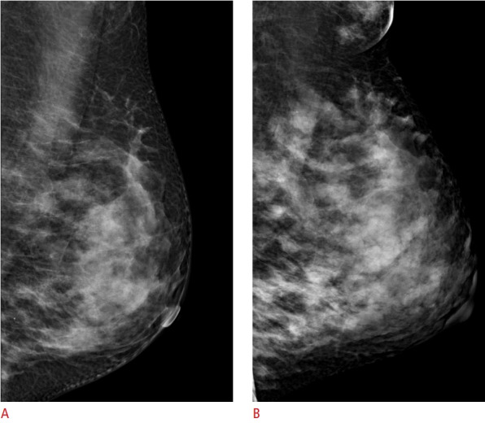
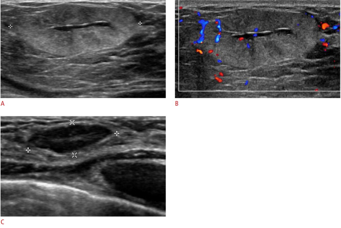
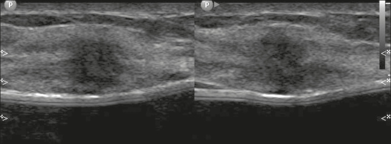
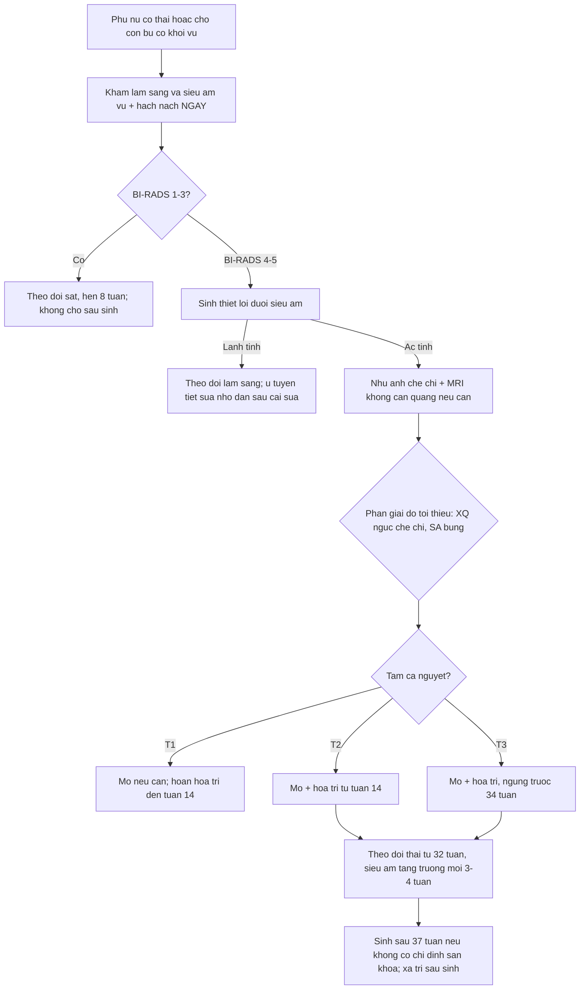
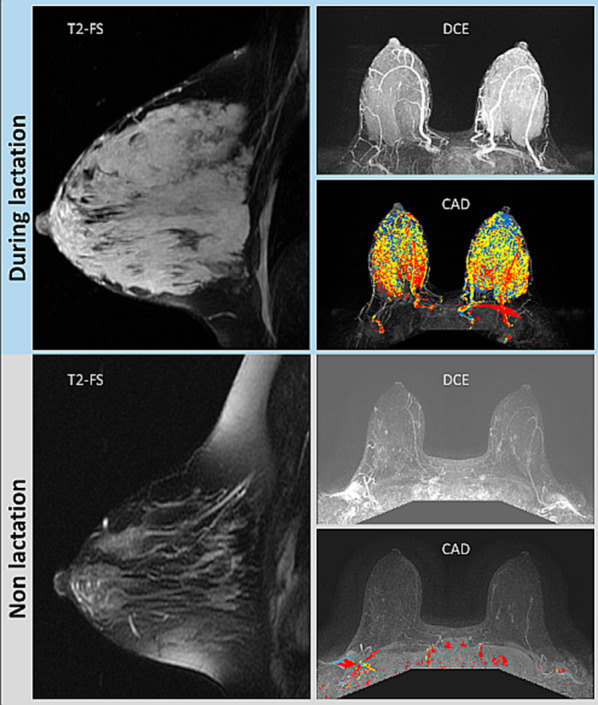
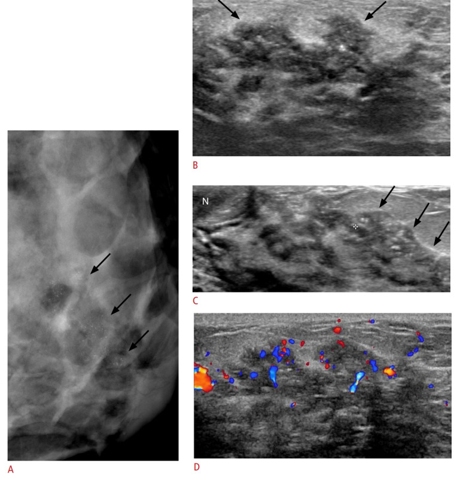
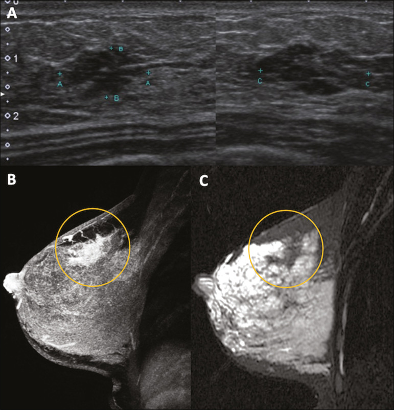

# 1601 — Ung thư vú trong thai kỳ & cho con bú: protocol hình ảnh, giả u sinh lý và xử trí theo tam cá nguyệt / Breast cancer in pregnancy and lactation

**Tags:** `pattern:u-vu` `pattern:thai-ky` `vung:vu` `score:BI-RADS` `protocol:sieu-am-vu` `protocol:nhu-anh` `protocol:MRI-vu`
**Mức chắc chắn (certainty):** tổng hợp y văn (literature synthesis) — bài review chẩn đoán–điều trị (Front Med 2026, PMC13144061, CC BY), review điều trị theo tam cá nguyệt (OncoTargets Ther 2026, PMC13135752, CC BY-NC), khuyến cáo SMFM Consult Series #76 (Pregnancy 2026, PMC13344446, CC BY-NC), atlas hình ảnh thai kỳ–cho con bú (Ultrasonography 2020, PMC7315302, CC BY-NC; Radiol Bras 2020, PMC7720671, CC BY) và review MRI (Insights Imaging 2022, PMC8994812, CC BY). Số liệu lấy nguyên từ bài gốc; chỗ hai nguồn mâu thuẫn được ghi rõ.

> **Câu hỏi gốc của bài:** phụ nữ **đang mang thai hoặc đang cho con bú** đến khám vì **khối vú sờ thấy** — làm gì **trước**, được phép chụp gì, **không được** chụp gì, khi nào **sinh thiết**, và nếu là ung thư thì **điều trị theo tam cá nguyệt** thế nào để không hại thai?
> **Điểm tựa:** vú thai kỳ–cho con bú là **vú "đang xây dựng"**: tuyến tăng sinh, ứ sữa, tăng nước và tăng mạch → **vừa che mất ung thư, vừa tạo ra vô số "giả u"**. Vì vậy nguyên tắc kép: **(1) siêu âm trước, không trì hoãn vì thai; (2) mọi khối nghi ngờ đều phải lấy mô — "chờ sau sinh" là sai lầm chết người.**

## 1. Tổng quan bệnh học – cơ chế hình ảnh

**A. Định nghĩa và dịch tễ (cửa 1 Argon — con số):**
- **PABC (pregnancy-associated breast cancer)** = ung thư vú chẩn đoán **trong thai kỳ** hoặc **trong vòng 12 tháng sau sinh**; **BCP** (breast cancer during pregnancy) là phần trong thai kỳ. PABC chiếm **0,2–3,8%** ung thư vú (PMC13144061, PMC13135752).
- Tần suất: **~1/1.000 thai kỳ** (PMC13144061) — nguồn khác ghi **1/10.000–1/3.000** (PMC13135752) → **dao động theo định nghĩa và dân số**, không có một con số tuyệt đối.
- **~30% là ung thư vú ba âm (TNBC)**, **~40% đã có di căn hạch nách** lúc chẩn đoán; **35% (7/20) có đột biến sinh bệnh** (6 ca BRCA1) trong một cohort nhỏ → **mọi ca BCP nên được tư vấn xét nghiệm gen** (PMC13144061).

**B. TẠI SAO hình ảnh khó – ba thay đổi sinh lý và hệ quả trên từng phương thức:**

| Thay đổi sinh lý | Hệ quả trên nhũ ảnh | Hệ quả trên siêu âm | Hệ quả trên MRI |
|---|---|---|---|
| **Tăng sinh tiểu thùy + tăng nước/mô tuyến** | **Mật độ tuyến tăng mạnh** (ảnh dưới) → che khối, **Se nhũ ảnh giảm** | Nhu mô **giảm hồi âm lan tỏa**, khó phân biệt u với tuyến | **BPE tăng (grade 3)**, giả dương trên CAD |
| **Giãn ống tuyến + ứ sữa** | **Vi vôi hóa kiểu tiết sữa (secretory)** rải rác, hai bên — lành tính | Nang sữa, **galactocele** (mức béo–dịch) | Galactocele: **mức mỡ–dịch** trên T1/T2 |
| **Tăng tưới máu + phù nề** | Khó đánh giá đối xứng; **giả dày da** | Tăng tín hiệu Doppler lan tỏa (dễ nhầm "u có mạch") | Ngấm thuốc nền mạnh, **che tổn thương nhỏ** |

*Cùng một bệnh nhân 33 tuổi: (A) nhũ ảnh **trước khi mang thai** — tuyến mật độ không đồng nhất; (B) **trong thời kỳ cho con bú** — vú to hơn, **mật độ nhu mô tăng rõ**, thêm mô tuyến phụ ở nách. Đây là lý do **nhũ ảnh một mình không đủ** để loại trừ ung thư trong thai kỳ. Nguồn: Lee SE, Bae YK, *Ultrasonography* 2020 (PMC7315302) Fig. 1, CC BY-NC 4.0.*

**C. Ngưỡng định lượng của từng phương thức (bắt buộc nhớ):**

| Phương thức | Giá trị chẩn đoán | Liều/ an toàn | Ghi chú |
|---|---|---|---|
| **Siêu âm** | **Se 86,4%, Sp 96,5%** cho PABC (Robbins, dẫn trong PMC13144061) | Không bức xạ | **Bước 1 bắt buộc**; đánh giá cả **hạch nách** |
| **Nhũ ảnh** | **Se 78–90%** (nhất là với vi vôi hóa) | **< 3 mGy** cho hai bên; **tử cung < 0,03 mGy**; **thai nhi 0,001–0,01 mGy** | **Làm được và an toàn**; cần khi đã nghi ung thư (tìm ổ thứ hai/đối bên) |
| **MRI không cản quang** | Chưa đủ bằng chứng cho BCP (PMC13144061) | An toàn | DWI/ADC hữu ích khi siêu âm–nhũ ảnh không kết luận |
| **MRI có gadolinium trong THAI** | — | Gadolinium **qua nhau thai**; nguy cơ lý thuyết | **Không thường quy** (PMC13144061, PMC8994812) — nhưng xem mục 5 (SMFM) |
| **MRI có gadolinium SAU SINH/cho bú** | BPE grade 3 làm **giảm độ nhạy** | Gadolinium **được coi là an toàn** khi cho con bú (PMC8994812) | Vẫn **hạn chế** vì BPE che tổn thương |
| **Xạ hình xương / PET** | — | Bức xạ hạt nhân đáng kể | PMC13144061: **chống chỉ định**; SMFM: **không từ chối nếu thật cần** (xem mục 5) |

## 2. Mẫu hình + chẩn đoán phân biệt theo bối cảnh (Gamut)

- **Khuôn 1 — Khối đặc, bờ đều, trong 3 tháng cuối hoặc đang cho bú:** nghĩ **lactating adenoma** (u tuyến tiết sữa) — lành tính, **tự thoái triển sau cai sữa** (PMC8994812); phân biệt với **fibroadenoma to ra do thai** (có trước thai, to lên) và **PABC bờ đều giả lành** (đã có báo cáo).
- **Khuôn 2 — Khối đau + sốt + đỏ vú:** **viêm vú/áp-xe** — siêu âm tìm ổ dịch để chọc hút; **nhưng viêm vú không đáp ứng 2 tuần kháng sinh phải sinh thiết** (ung thư thể viêm có thể giả viêm vú).
- **Khuôn 3 — Khối căng, không đau, sau cai sữa:** **galactocele** — siêu âm có thể hỗn hợp; MRI **mức béo–dịch** là chốt.
- **Khuôn 4 — Vú to nhanh, đau, không khối rõ:** **phì đại tuyến vú thai kỳ (gestational gigantomastia)** — chẩn đoán loại trừ, cần loại u/viêm.
- **Khuôn 5 — Khối cứng, bờ không rõ, hạch nách:** **PABC** — ưu tiên sinh thiết lõi dưới siêu âm.
- **Khuôn 6 — Viêm mủ tái diễn, không đáp ứng kháng sinh, dò:** **viêm tuyến vú u hạt (granulomatous mastitis)** — chẩn đoán mô học, **đừng nhầm ung thư thể viêm**.
- **Khuôn 7 — Sau chấn thương/giảm cân:** **hoại tử mỡ** — vôi hóa vỏ, lõi không ngấm; nhưng **khối mới cứng, không mất đi sau 4–6 tuần phải sinh thiết**.

**Mnemonic "LACTAT" cho khối vú trong thai kỳ–cho con bú:**
**L**actating adenoma · **A**p-xe/viêm vú · **C**arcinoma (PABC) · **T**úi sữa (galactocele) · **A** bất thường toàn tuyến (gigantomastia) · **T**ổn thương sau chấn thương/hoại tử mỡ.

## 3. Bảng so sánh phân biệt (ma trận đối chiếu)

| Thực thể (entity) | Hình ảnh điển hình | Chốt vào (rule-in) | Chốt loại (rule-out) | Gợi ý xác nhận |
|---|---|---|---|---|
| **PABC (ung thư vú trong thai/cho bú)** | Siêu âm: khối **giảm hồi âm, bờ không rõ, không song song da, có mạch**; có thể **bờ đều giả lành**; nhũ ảnh: **vi vôi hóa đa hình/thành chuỗi mới**; MRI: **NME hoặc khối ngấm nhanh–thoát** | **Khối đặc mới + bờ không rõ/vi vôi hóa mới + hạch nách bất thường** | **Không thể loại trừ bằng bất kỳ hình ảnh nào khi chưa có mô bệnh** | **Sinh thiết lõi dưới siêu âm** (bắt buộc) |
| **Lactating adenoma** | Siêu âm: **oval, bờ rõ, song song da**, đồng nhất/không đồng nhất, **tăng hồi âm** hoặc có **vùng trung tâm giảm hồi âm**, tăng sinh mạch; **nhỏ lại sau cai sữa** | **Bờ rõ + song song da + giảm kích thước sau cai sữa** | **Bờ không rõ, xâm lấn mô mỡ, hạch bất thường** → không còn là adenoma | Sinh thiết lõi nếu không điển hình; theo dõi 8 tuần sau cai sữa |
| **Fibroadenoma thay đổi do thai** | Có **trước thai**, to nhanh trong thai; siêu âm vẫn **oval, bờ rõ** | **So phim cũ: cùng vị trí, cùng hình thái, chỉ to lên** | **Tổn thương MỚI hoặc bờ mất rõ** → phải lấy mô | So phim cũ + siêu âm; sinh thiết nếu thay đổi |
| **Galactocele (túi sữa)** | Siêu âm: nang/hỗn hợp, **bờ rõ**, có thể mức dịch–béo; MRI: **mức mỡ–dịch** trên T1/T2 | **Mức béo–dịch + sau cai sữa + không ngấm đặc** | **Thành dày không đều, ngấm nốt, vôi hóa trong** → nghi u | Siêu âm ± MRI; chọc hút nếu cần |
| **Viêm vú / áp-xe** | Siêu âm: vùng **giảm hồi âm lan tỏa**, dày da, **ổ dịch có vách**; Doppler tăng | **Sốt + đau + đỏ + ổ dịch chọc hút ra mủ** | **Không đáp ứng kháng sinh 2 tuần**, khối đặc còn lại → **sinh thiết** | Siêu âm + chọc hút; cấy mủ |
| **Viêm tuyến vú u hạt** | Siêu âm: **tổn thương giảm hồi âm hình ống, dò ra da**, không song song da; MRI: viêm mô + ổ áp-xe | **Sinh mủ vô khuẩn + hình ống/dò + mô học u hạt** | **Cấy dương vi khuẩn thông thường** → viêm nhiễm thường | Sinh thiết lõi + cấy lao/nấm |
| **Gigantomastia thai kỳ** | Vú to khổng lồ hai bên, không khối khu trú; MRI: mô tuyến–mỡ tăng sinh lan tỏa | **To nhanh hai bên, không khối, không hạch** | **Khối khu trú/hạch bất thường** → loại trừ ung thư | Siêu âm toàn tuyến + loại trừ u |

*Lactating adenoma ở bệnh nhân 29 tuổi đang cho con bú: (A) khối **oval, bờ rõ, tăng hồi âm** với **vùng trung tâm giảm hồi âm**, tăng âm sau; (B) Doppler có mạch trong khối; (C) **sau cai sữa 8 tháng khối nhỏ lại** — đây là "chốt lành" theo thời gian, nhưng **vẫn phải có mô bệnh nếu không điển hình**. Nguồn: Lee SE, Bae YK, *Ultrasonography* 2020 (PMC7315302) Fig. 8, CC BY-NC 4.0.*

*Bệnh nhân 33 tuổi, **thai 27 tuần**, khối vú trái sờ thấy: siêu âm **khối giảm hồi âm, hình dạng không đều, bờ không giới hạn rõ** — sinh thiết lõi xác nhận **ung thư biểu mô tuyến xâm lấn**. Đối chiếu với ảnh lactating adenoma ở trên: **"bờ rõ" không đủ để yên tâm, "bờ không rõ" đủ để sinh thiết.** Nguồn: Rosas CHS et al., *Radiol Bras* 2020 (PMC7720671) Fig. 6, CC BY 4.0.*

## 4. Protocol chẩn đoán – xử trí theo tam cá nguyệt

**A. Đường đi chẩn đoán (áp dụng cho MỌI phụ nữ có thai/cho bú có khối vú):**
1. **Khám lâm sàng + siêu âm vú và hạch nách NGAY** — không chờ sau sinh, không "theo dõi 3 tháng" (nguy cơ chẩn đoán muộn).
2. **Phân loại BI-RADS** như người không mang thai (bài 510); **BI-RADS 4–5 → sinh thiết lõi dưới siêu âm** — đây là **tiêu chuẩn vàng**, an toàn trong thai kỳ.
3. **Nhũ ảnh** khi đã nghi ung thư (tìm ổ thứ hai, đối bên, vi vôi hóa) — **che bụng chì**, liều thai nhi **0,001–0,01 mGy** (an toàn); **không dùng làm bước 1** ở người trẻ vú dày.
4. **MRI không cản quang/DWI** khi siêu âm + nhũ ảnh không kết luận; **MRI có cản quang chỉ khi thật cần** (xem mục 5).
5. **Ghi rõ "bệnh nhân đang mang thai"** trên phiếu gửi giải phẫu bệnh — tế bào tăng sinh thai kỳ có thể **giả loạn sản**, gây **dương tính giả** (PMC13144061).
6. **Xét nghiệm gen BRCA1/2** được tư vấn cho mọi ca (35% có đột biến sinh bệnh trong cohort nhỏ).

**B. Phân giai đoạn tối thiểu (không "chụp dàn trải"):**
- **X-quang ngực có che chì** + **siêu âm bụng** (đánh giá gan) là mức tối thiểu; **MRI não/tủy** nếu nghi di căn; **CT/PET** chỉ khi kết quả **thay đổi điều trị** (SMFM cho phép khi cần — mục 5).
- **KHÔNG** chụp xạ hình xương/PET thường quy (PMC13144061 coi là chống chỉ định; SMFM thì "không từ chối nếu thật cần" — **phải hội chẩn**).

**C. Điều trị theo tam cá nguyệt (tóm tắt có số):**

| Tam cá nguyệt | Phẫu thuật | Hóa trị | Đích/nội tiết | Xạ trị |
|---|---|---|---|---|
| **T1 (0–13 tuần)** | Có thể mổ **bảo tồn hoặc cắt toàn bộ**; tránh mổ nếu có thể chờ sang T2 | **KHÔNG** — nguy cơ dị tật **14–20%** | **Không** | **Không** |
| **T2 (14–27 tuần)** | Mổ được (ưu tiên) | **Bắt đầu từ tuần 14** — anthracycline + cyclophosphamide ± taxane; dị tật **3–5%** | Trastuzumab: **không** (thiểu ối); tamoxifen: **không** | **Không** — hoãn sau sinh |
| **T3 (≥ 28 tuần)** | Mổ được | Tiếp tục, **ngừng trước 34 tuần** (paclitaxel hàng tuần có thể đến **35–36 tuần**) | Như trên | **Không** |
| **Sau sinh** | Hoàn tất phẫu thuật | Tiếp tục/đổi phác đồ | Theo thụ thể | **Xạ trị sau sinh** |

- **Sinh thiết hạch gác (SLNB):** dùng **99mTc colloid** (hoặc ICG) là lựa chọn; **KHÔNG dùng thuốc nhuộm xanh** (isosulfan blue → dị ứng; **methylene blue gây quái thai**) (PMC13135752). ASCO **không** khuyến cáo, NCCN **có** — cần hội chẩn.
- **Thời điểm sinh:** **tránh sinh trước 37 tuần** nếu không có chỉ định sản khoa; **ngừng hóa trị trước 34 tuần** để có **3–4 tuần** hồi phục tủy; theo dõi thai từ **32 tuần**, siêu âm tăng trưởng **mỗi 3–4 tuần** (SMFM 2026, PMC13344446).
- **Hóa trị khởi đầu quá sớm:** trước **18 tuần** → **sinh non OR 3,9 (95% CI 1,4–10,9)**; trước **15 tuần** → **thai chậm tăng trưởng OR 2,3 (1,0–4,9)** (PMC13344446).
- **Tamoxifen:** **17,6%** dị tật nặng trong 248 thai phơi nhiễm → **chống chỉ định**, và **bài tiết vào sữa** → không dùng khi cho bú (PMC13144061).
- **Trastuzumab:** **73,3%** thiểu ối khi phơi nhiễm giữa/cuối thai → **chống chỉ định**; **không cho con bú** khi đang điều trị.
- **Chấm dứt thai kỳ KHÔNG cải thiện tiên lượng** — chỉ cân nhắc khi bệnh rất tiến triển/giai đoạn sớm của thai (PMC13144061).

## 5. Biến thể bình thường và cạm bẫy

- **Cạm bẫy 1 — "có thai thì không được chụp nhũ ảnh":** SAI. Liều thai nhi **0,001–0,01 mGy** (thấp hơn nền phóng xạ tự nhiên trong vài ngày); **bỏ nhũ ảnh có thể bỏ sót vi vôi hóa lan rộng**. Hãy che chì và giải thích cho bệnh nhân.
- **Cạm bẫy 2 — BPE grade 3 trên MRI cho con bú che mất tổn thương:** ca BRCA1 có fibroadenoma **1,3 cm** trước thai; khi cho con bú **1,8 cm** nhưng **gần như không thấy** trên DCE vì BPE 3 (PMC8994812). → **MRI trong thời kỳ cho bú không đáng tin**; ưu tiên siêu âm + sinh thiết.

*Cùng một người mang BRCA1: **trên** — đang cho con bú 4 tháng: T2-FS nhu mô dày, **DCE ngấm nền mạnh**, CAD đỏ rực toàn bộ nhu mô (giả dương); **dưới** — 2 năm sau cai sữa: nhu mô giảm, **BPE 3 → 1**. Đây là lý do MRI có cản quang trong thời kỳ cho bú kém giá trị. Nguồn: Nissan N et al., *Insights Imaging* 2022 (PMC8994812) Fig. 2, CC BY 4.0.*

- **Cạm bẫy 3 — vi vôi hóa "tiết sữa" lành tính:** trong thai/cho bú có thể xuất hiện vi vôi hóa rải rác hai bên; nhưng **vi vôi hóa đa hình, thành chuỗi, phân nhánh, mới xuất hiện một bên** vẫn là **nghi ung thư** (ca dưới). Đừng gộp tất cả vào "do sữa".
- **Cạm bẫy 4 — ung thư "giả lành":** một số PABC có **bờ đều, giống u lành** trên siêu âm (PMC13144061); **bờ rõ không loại trừ**.
- **Cạm bẫy 5 — "chờ sinh rồi làm":** làm chậm chẩn đoán **nhiều tháng**, trong khi PABC có **~40% di căn hạch** lúc chẩn đoán. Chỉ hoãn **điều trị** (hóa trị/xạ), **không hoãn chẩn đoán**.
- **Cạm bẫy 6 — mâu thuẫn gadolinium (phản biện theo Argon):** PMC13144061 và PMC8994812 nói **không dùng gadolinium trong thai**; **SMFM Consult Series #76 (2026)** khuyến cáo **không từ chối CT/gadolinium/PET nếu thật cần** (GRADE 1C), sau khi cân nhắc lợi ích–nguy cơ. → Thực hành: **hội chẩn đa chuyên khoa**, ưu tiên **không cản quang**, nhưng **không để mẹ mất cơ hội chẩn đoán** vì sợ hãi mơ hồ.
- **Cạm bẫy 7 — quên hạch nách và hạch vú trong:** siêu âm chỉ khối vú mà bỏ nách → **bỏ sót N+**, đổi hoàn toàn tiên lượng và kế hoạch điều trị.
- **Cạm bẫy 8 — "cho con bú làm teo ung thư":** không có bằng chứng; **không được khuyên cai sữa để "chữa"** — nhưng nếu **điều trị hệ thống (hóa trị, đích, nội tiết)** thì **không cho bú** vì thuốc bài tiết vào sữa.
- **Cạm bẫy mặt cắt:** trên **siêu âm nách**, hạch **bình thường** ở người cho bú có thể **to, vỏ dày, rốn mỡ rõ**; hạch **mất rốn mỡ, vỏ dày không đều, tăng mạch** mới đáng sinh thiết. **Đừng chọc mọi hạch to**.

## 6. Tự lượng giá — Blind Quiz ngay trên trang tĩnh

**Ca 1 — Nữ 33 tuổi, thai 27 tuần, khối vú trái sờ thấy 3 tuần nay, không đau, không sốt.**

- Gợi ý: không có tiền sử u vú; hạch nách chưa rõ trên lâm sàng.
- Câu hỏi: (1) Mô tả tổn thương theo BI-RADS; (2) bước tiếp theo **hôm nay**; (3) có được chụp nhũ ảnh/MRI không?

<b>Bấm để hiện đáp án (findings + chẩn đoán)</b>

- Hình: **khối giảm hồi âm, hình dạng không đều, bờ không giới hạn rõ** — không song song da → **BI-RADS 4C–5**.
- Bước tiếp: **sinh thiết lõi dưới siêu âm ngay** (không chờ sau sinh) + siêu âm hạch nách. Kết quả ca gốc: **ung thư biểu mô tuyến xâm lấn**.
- Nhũ ảnh **được phép** (che bụng, liều thai nhi 0,001–0,01 mGy) để tìm ổ thứ hai/đối bên; **MRI không cản quang** nếu cần; **MRI gadolinium không thường quy** trong thai.
- Nguồn ảnh: Rosas CHS et al., *Radiol Bras* 2020 (PMC7720671) Fig. 6, CC BY 4.0.

**Ca 2 — Nữ 42 tuổi, thai 35 tuần, **chảy máu núm vú trái**. Khối vú không rõ nhưng ống tuyến dày.**

- Gợi ý: triệu chứng "chảy máu núm vú" ở người mang thai **không** mặc nhiên lành tính.
- Câu hỏi: (1) Dấu hiệu trên nhũ ảnh (A)? (2) Ý nghĩa của vi vôi hóa này? (3) Chẩn đoán mô học trong ca gốc?

<b>Bấm để hiện đáp án (findings + chẩn đoán)</b>

- (A) Nhũ ảnh MLO: **vi vôi hóa mảnh, đa hình, phân bố theo đoạn (segmental)** — mũi tên; (B–C) siêu âm: **biến đổi dạng ống có vôi hóa trong lòng ống**; (D) Doppler tăng mạch.
- Vi vôi hóa **đa hình + thành chuỗi + một bên** = **nghi ác**, khác vi vôi hóa "tiết sữa" rải rác hai bên.
- Mô học ca gốc: **ung thư biểu mô xâm lấn kèm DCIS**; bệnh nhân được **mổ bảo tồn** trong thai kỳ.
- Nguồn ảnh: Lee SE, Bae YK, *Ultrasonography* 2020 (PMC7315302) Fig. 12, CC BY-NC 4.0.

**Ca 3 — Nữ 38 tuổi, 6 tháng sau sinh, đang cho con bú, khối vú phải. Siêu âm và MRI được thực hiện.**

- Gợi ý: nhu mô vú còn ngấm mạnh do đang cho bú.
- Câu hỏi: (1) Mô tả siêu âm (A); (2) MRI (B–C) cho thấy gì và vì sao **khó** đánh giá? (3) Kết luận thực hành?

<b>Bấm để hiện đáp án (findings + chẩn đoán)</b>

- (A) Siêu âm: **khối giảm hồi âm, bờ vi tiểu thùy (microlobulated)**, không đều.
- (B) T1 sau tiêm: **non-mass enhancement (NME)** vùng trên–ngoài vú phải; (C) T2: vùng **tín hiệu thấp** so với nhu mô xung quanh (đang cho bú nên nhu mô tăng tín hiệu) — dấu hiệu **"nổi bật trên nền sáng"**.
- Thực hành: **BPE cao làm giảm độ nhạy MRI** → **không dùng MRI để loại trừ**; **sinh thiết theo siêu âm/MRI** là bắt buộc với NME.
- Nguồn ảnh: Rosas CHS et al., *Radiol Bras* 2020 (PMC7720671) Fig. 7, CC BY 4.0.

## Bài liên quan chéo
- [510 – BI-RADS: nhũ ảnh, siêu âm, MRI](../510-vu-BIRADS-nhu-anh-sieu-am-MRI/lesson.md) (phân loại và từ điển BI-RADS)
- [512 – Vi vôi hóa & tổn thương túi ngực](../512-vi-voi-hoa-tui-nguc-bien-dang/lesson.md) (vi vôi hóa đa hình vs lành tính)
- [514 – Ung thư vú: TNM, MRI lan rộng](../514-ung-thu-vu-TNM-MRI-lan-rong/lesson.md) (phân giai đoạn, đánh giá lan rộng)
- [516 – Hình ảnh vú sau điều trị](../516-hinh-anh-vu-sau-dieu-tri/lesson.md) (sẹo, hoại tử mỡ, tái tạo)
- [522 – Theo dõi sau điều trị ung thư vú](../522-theo-doi-sau-dieu-tri-ung-thu-vu/lesson.md) (theo dõi sau sinh/điều trị)
- [500 – Tổng quan Vú & Sản phụ khoa](../500-tong-quan-vu-san-phu-khoa/lesson.md)

> Không dùng để chẩn đoán độc lập khi chưa có người hướng dẫn.
