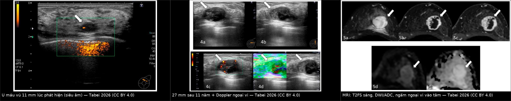
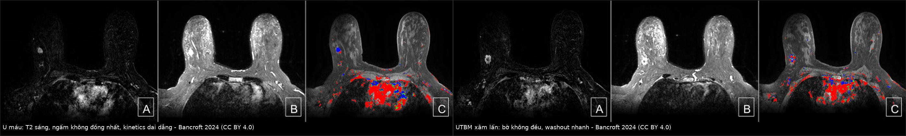
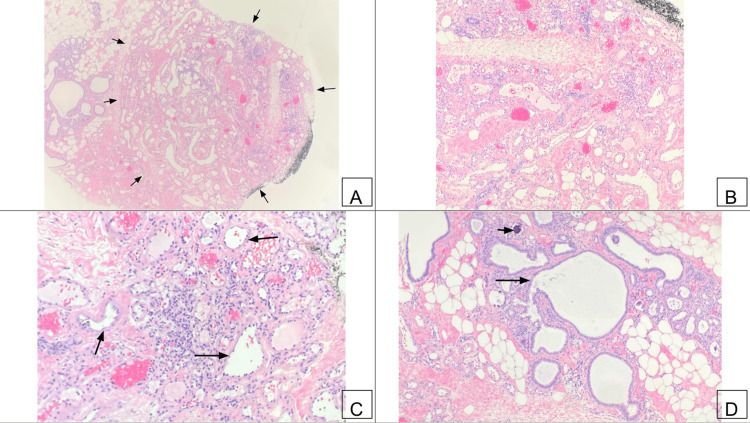
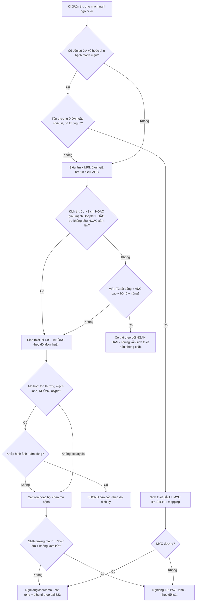
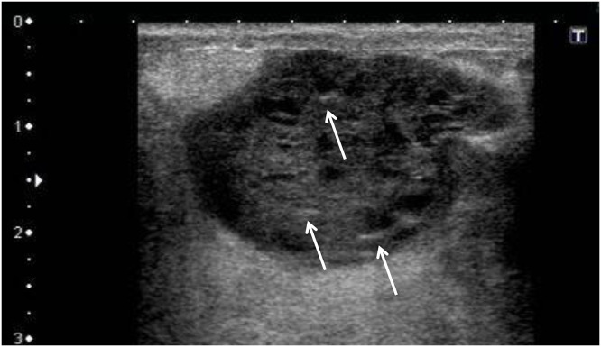
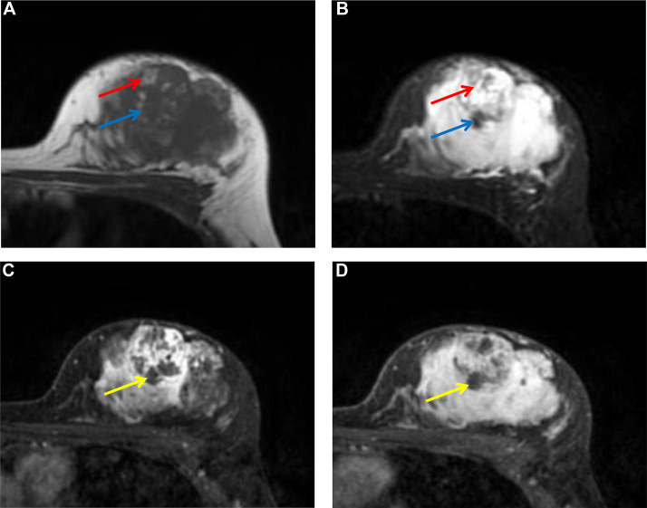
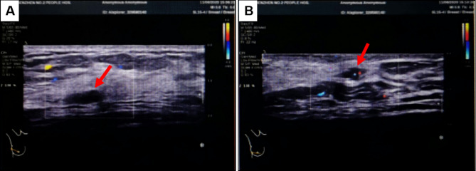
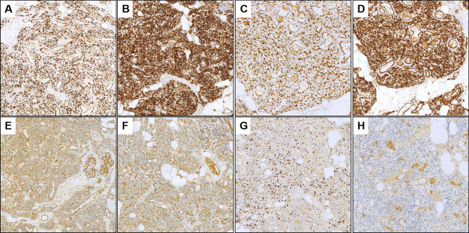

# 1602 — Hemangioma & tổn thương mạch lành tính của vú vs angiosarcoma / Benign vascular lesions of the breast vs angiosarcoma

**Tags:** `pattern:u-mach-lanh-tinh` `pattern:khoi-vu` `pattern:u-mach-ac-tinh` `pattern:vu-sau-dieu-tri` `vung:vu` `score:BI-RADS` `protocol:MRI-vu` `protocol:sinh-thiet-loi` `incidentaloma:hemangioma-vu`
**Mức chắc chắn (certainty):** tổng hợp y văn (literature synthesis) — nhóm tự biên từ y văn mở (Europe PMC/PMC: *Reports* 2026, *Cureus* 2024, *Radiology Case Reports* 2026, *Diagnostic Pathology* 2025) + trích số từ bài không mở toàn văn (*J Breast Imaging* 2024, *AJR* 2008, *Histopathology* 2017 & 2020, *Jpn J Radiol* 2025); có ca nguyên văn đọc trực tiếp từ bài gốc. Ảnh minh họa CC BY 4.0 (được ghép) và CC BY-NC-ND 4.0 (giữ nguyên bản).

## 1. Tổng quan — vì sao một khối "u máu" lại là câu hỏi ung thư + cơ chế hình ảnh

- **Định nghĩa:** hemangioma vú là **u mạch lành tính** tạo bởi các kênh mạch máu trưởng thành, phân loại theo **kích thước lòng mạch** (capillary: mao mạch; cavernous: xoang lớn; venous; perilobular: quanh tiểu thùy) — khác biệt mô học **không đổi xử trí** (PMC11079714). Đối cực ác tính là **angiosarcoma** (u nội mô mạch), gồm **nguyên phát** (trong nhu mô, thường nữ trẻ) và **thứ phát** (sau xạ — RAAS, hoặc trên phù bạch mạch mạn — hội chứng Stewart–Treves).
- **Vì sao phải học kỹ:** hai bên **trùng hình ảnh ở nhiều điểm** (đều là khối mạch, đều có thể T2 sáng, đều ngấm thuốc) nhưng **hậu quả trái ngược**: hemangioma **không cần mổ** nếu giải phẫu bệnh–hình ảnh khớp, còn angiosarcoma **tử vong cao và cần cắt rộng sớm**. Sai một bên = **mổ oan** hoặc **bỏ sót u ác**.
- **Ngưỡng định lượng bắt buộc:**
  - **Tần suất hemangioma:** **0,4%** toàn bộ u vú trên lâm sàng, nhưng tới **11%** trong loạt tử thiết; chỉ **0,15%** (15/~10.000) kết quả giải phẫu bệnh phẫu thuật (PMC12821452; *J Breast Imaging* 2024, PMID 38557759).
  - **Kích thước:** đa số **< 2,5 cm**; tuổi gặp **1,5–82 tuổi**; vị trí thường **nông — dưới da/trước mạc tuyến (anterior mammary fascia)**, hiếm khi trong cơ ngực/thành ngực (*J Breast Imaging* 2024).
  - **Angiosarcoma vú:** **0,04%** ung thư vú (PMC12666011) — tức **~1/100 so với hemangioma** trong cùng vùng.
  - **Dấu ấn mô bệnh:** **MYC khuếch đại/quá biểu hiện ~90% angiosarcoma THỨ PHÁT** (sau xạ) nhưng **hiếm ở angiosarcoma nguyên phát** (PMC12144682) → **MYC âm KHÔNG loại trừ angiosarcoma nguyên phát**, và **MYC dương chốt RAAS**.
  - **SMA (smooth muscle actin):** **dương 96% (22/23) tổn thương mạch lành** vs **âm 80% (12/15) angiosarcoma** — hữu ích khi hình thái chồng lấp (PMC12144682).
  - **Nguy cơ sau xạ:** tổn thương mạch sau xạ gồm **BLAP** (benign lymphangiomatous papules), **AVL** (atypical vascular lesion) và **RAAS**; **74 ca theo dõi dài: toàn bộ BLAP và AVL còn sống, không bệnh** (*Histopathology* 2020, PMID 32043616) — tức AVL **hiếm khi tiến triển**, nhưng vẫn phải theo dõi.
  - **Tiên lượng RAAS theo độ mô học:** sống 5 năm **85,7% (grade 1) / 83,3% (grade 2) / 40,4% (grade 3)** (*Histopathology* 2020).
- **TẠI SAO hình ảnh trông như vậy (vật lý + mô bệnh):**
  - **T2 rất sáng:** các **hồ máu chảy chậm/xoang tĩnh mạch** chứa huyết tương và hồng cầu → thời gian T2 dài. Vì vậy hemangioma **T2 tăng tín hiệu mạnh, đồng nhất hoặc có vách**; nhưng **T2 sáng KHÔNG đặc hiệu** — ung thư nhầy (mucinous), nang, u myxoid, phù/seroma cũng sáng.
  - **T1 iso–giảm:** máu tĩnh trong lòng mạch không phải mỡ → không sáng như mỡ; chỉ sáng khi có **huyết khối/máu cũ** (angiosarcoma thường có **máu ở nhiều giai đoạn** → T1 hỗn hợp sáng–tối, như ca PMC12666011).
  - **Ngấm thuốc:** hemangioma ngấm theo **huyết động lòng mạch** — có thể ngấm **mạnh, sớm** (capillary) hoặc **kiểu ngoại vi → trung tâm (centripetal)** như hemangioma gan (PMC12821452); angiosarcoma ngấm do **mô u tăng sinh mạch + shunt**, thường **không đồng nhất, washout** ở độ ác cao.
  - **Doppler:** hemangioma **thường ít mạch/không mạch** (dòng chảy rất chậm dưới ngưỡng Doppler), còn angiosarcoma **giàu mạch** — **đây là điểm phân biệt định lượng quan trọng** (*J Breast Imaging* 2024: angiosarcoma hay **> 2 cm, giàu mạch Doppler, bờ không đều, xâm lấn**).
  - **Vôi hóa:** **phlebolith** (huyết khối vôi hóa trong lòng mạch) tròn, bờ rõ, có thể thấy trên nhũ ảnh — gợi ý lành nhưng **không đủ loại trừ**.
  - **Vì sao hemangioma có thể to dần mà vẫn lành:** tăng kích thước có thể do **xơ hóa, huyết khối, tổ chức hóa sau xuất huyết** chứ không phải tăng sinh tế bào (ca 11 mm → 27 mm trong 11 năm, PMC12821452) → **"to lên" một mình không đồng nghĩa ác tính**, nhưng buộc phải đánh giá lại.

## 2. Mẫu hình (pattern) + chẩn đoán phân biệt theo bối cảnh (Gamut)

- **Khuôn 1 — Khối oval, bờ rõ, NÔNG (dưới da/trước mạc tuyến), Doppler ít mạch.** Gamut: **hemangioma** vs fibroadenoma vs nang phức tạp vs lymph node trong vú vs u mỡ. Chốt: **T2 rất sáng + ít mạch + vị trí nông + ổn định** → hemangioma; vẫn cần mô học nếu không điển hình.
- **Khuôn 2 — Khối trong nhu mô, bờ không đều, lớn nhanh, giàu mạch, da đỏ/tím.** Gamut: **angiosarcoma nguyên phát** vs carcinoma thể viêm vs áp-xe/viêm mô tế bào vs hematoma tổ chức hóa. Chốt: **> 2 cm + bờ không đều + mạch nhiều + tăng nhanh** → sinh thiết lõi ngay, không theo dõi.
- **Khuôn 3 — Sẩn/mảng tím ở da vú ĐÃ XẠ.** Gamut: **RAAS** vs **AVL/BLAP** vs viêm da xạ vs tái phát carcinoma da. Chốt: **thời gian ≥ 3 năm + không tan + tiến triển** → sinh thiết sâu + **MYC** (bài [523](../523-sarcoma-mach-do-xa-vu/lesson.md)).
- **Khuôn 4 — Khối mạch TÌNH CỜ trên MRI, không thấy trên nhũ ảnh/siêu âm.** Gamut: hemangioma vs DCIS/ung thư nhầy ẩn vs tổn thương myxoid. Chốt: **T2 sáng + ADC cao (không hạn chế khuếch tán thật) + bờ rõ** nghiêng lành; **vẫn cần sinh thiết có định hướng MRI** vì nhũ ảnh âm không loại trừ (ca PMC11079714).
- **Khuôn 5 — Chi trên phù bạch mạch mạn (sau ALND/xạ), xuất hiện nốt tím.** Gamut: **Stewart–Treves (angiosarcoma trên phù bạch mạch)** vs viêm mô tế bào tái diễn vs huyết khối tĩnh mạch vs tái phát tại chỗ. Chốt: **nốt/tím mới trên chi phù + không đáp ứng kháng sinh** → sinh thiết (bài [593](../593-phu-bach-mach-chi-tren-sau-dieu-tri-ung-thu-vu/lesson.md)).
- **Khuôn 6 — Sinh thiết lõi trả "hemangioma" nhưng hình ảnh/lâm sàng KHÔNG khớp.** Gamut: **angiosarcoma độ thấp giả u máu** vs **APH (atypical perilobular hemangioma)** vs hemangioma thật. Chốt: **bờ không rõ + xâm lấn + tế bào đầu vú (hobnail) + phân bào** → cần hội chẩn giải phẫu bệnh, **SMA/MYC**, cân nhắc cắt trọn.
- **Gợi nhớ "SLOW" (lành) vs "FAST" (ác):**
  - **S**uperficial (nông, trước mạc tuyến) — **L**obulated/oval, bờ rõ — **O**ld (ổn định, lớn chậm) — **W**eak Doppler (ít mạch).
  - **F**ast growth (lớn nhanh) — **A**typical/irregular margin — **S**ize > 2 cm + không đồng nhất — **T**hriving vessels (giàu mạch, có mạch xuyên/dẫn lưu lớn).

## 3. Bảng so sánh phân biệt (ma trận đối chiếu)

| Thực thể (entity) | Hình ảnh điển hình (nhũ ảnh / siêu âm / MRI) | Chốt vào (rule-in) | Chốt loại (rule-out) | Gợi ý xác nhận |
|---|---|---|---|---|
| **Hemangioma vú (capillary/cavernous/venous)** | Khối **oval/lobulated, bờ rõ hoặc microlobulated**, nông; Doppler **ít/không mạch**; MRI **T2FS rất sáng**, T1 iso–giảm, ngấm **ngoại vi → tâm** hoặc không đồng nhất, **ADC cao** | **Nông + bờ rõ + Doppler ít mạch + T2 rất sáng + ADC cao + ổn định** | **Bờ không đều + giàu mạch + xâm lấn mô mỡ + washout mạnh** → không phải hemangioma | Core 14G; nếu mô học lành **không atypia** + khớp hình ảnh → **không cần cắt** |
| **APH (atypical perilobular hemangioma)** | Thường **≤ 2 mm**, khó thấy; ca lớn **12 mm** có bờ không rõ từng vùng, xâm lấn quanh tiểu thùy | **Tổn thương mạch quanh tiểu thùy + tế bào atypia nhẹ/hobnail + SMA (+)** | **MYC (+) + hoại tử + xâm lấn rộng** → angiosarcoma | Hội chẩn mô bệnh; **SMA, MYC, Ki-67**; cắt trọn nếu bờ không rõ |
| **Angiosarcoma NGUYÊN PHÁT** | Khối **> 2 cm**, bờ không đều, không đồng nhất; **giàu mạch Doppler**; MRI T1/T2 **hỗn hợp do máu nhiều giai đoạn**, ngấm mạnh; có thể **da đỏ/tím, đau** | **Nữ trẻ + khối nhu mô lớn nhanh + T2 hỗn hợp + xuất huyết trong u** | **T2 rất sáng đồng nhất + bờ rõ + nông + ít mạch** → nghiêng lành | Sinh thiết lõi/cắt trọn; **MYC thường ÂM** (không dùng để loại trừ) |
| **RAAS / Stewart–Treves (thứ phát)** | Da–dưới da, **nhiều ổ (59,3%)**, bờ **không rõ (92,9%)**; T1 trung gian (84,2%), T2 **trung gian/hỗn hợp**; **ADC thấp 0,77–0,96 × 10⁻³ mm²/s** | **Vùng xạ cũ ≥ 3 năm HOẶC chi phù bạch mạch mạn + nốt tím mới + MYC (+)** | **MYC âm + mô học không atypia + ổn định** → AVL/BLAP, không phải RAAS | Sinh thiết sâu + **MYC IHC/FISH**; mapping trước cắt rộng |
| **AVL / BLAP sau xạ** | Sẩn da nhỏ trong trường xạ, có thể **lan ngoài trường xạ**; hình thái giống RAAS nhưng nhẹ | **Mô học mạch không điển hình nhẹ + MYC ÂM + không hoại tử** | **MYC (+) hoặc xâm lấn sâu** → RAAS | MYC bắt buộc; theo dõi sát, sinh thiết lại nếu tiến triển |
| **Ung thư nhầy (mucinous carcinoma)** | Bờ rõ/push, **T2 rất sáng** (nhầy), ngấm **chậm tăng dần**; typ hỗn hợp hạn chế khuếch tán mạnh hơn | **T2 sáng + ngấm chậm + tuổi lớn** | **ADC rất cao + bờ rõ + nông + ít mạch** không loại trừ nhầy → vẫn sinh thiết | Core; ER/PR; **ADC thấp ở typ hỗn hợp** |
| **EPC (encapsulated papillary carcinoma)** | Khối **dạng nang + nhú thành ngấm**, T2 sáng, **vỏ/bao rõ**, nhú ngấm sớm rồi washout | **Nang có nhú thành + vỏ rõ** | **Đặc hoàn toàn, không nhú, không vỏ** → ít nghĩ EPC | Core + mô bệnh; MRI giúp thấy nhú |
| **Fibroadenoma / nang phức tạp** | Oval, bờ rõ, **đồng nhất**, có vách; nang: **không ngấm, T2 rất sáng, ADC rất cao** | **Đồng nhất + không ngấm (nang) hoặc ngấm đều (FA)** | **Ngấm đặc không đồng nhất + T2 sáng hỗn hợp** → không phải FA/nang đơn thuần | Siêu âm ± core |
| **Hoại tử mỡ / seroma sau mổ–xạ** | Nang dầu, **vôi hóa vỏ**, lõi **không ngấm**, có thành phần mỡ; seroma: dịch, không ngấm, co nhỏ | **Có mỡ + lõi không ngấm + bờ vôi hóa** | **Ngấm đặc lõi + lớn lên** → không phải hoại tử mỡ | So phim cũ (bài [516](../516-hinh-anh-vu-sau-dieu-tri/lesson.md)) |

*Trái → phải: siêu âm lúc phát hiện **11 mm**, siêu âm sau 11 năm **27 mm** với **mạch ngoại vi** trên Doppler, và MRI (T2FS sáng, DWI/ADC, ngấm từ ngoại vi vào trung tâm). Dù **to gấp 2,5 lần**, mô học vẫn là **capillary hemangioma** — lớn dần do xơ hóa/huyết khối, không phải chuyển dạng. Ảnh ghép letterbox, CC BY 4.0 (Tabei A et al., Reports 2026; PMC12821452).*

### Dấu hiệu "chốt" và cạm bẫy của từng dấu hiệu
- **T2 sáng là dấu hiệu của NƯỚC, không phải của lành:** hemangioma, ung thư nhầy, nang, myxoid, phù, seroma đều T2 sáng → phải phối hợp **bờ + vị trí + Doppler + ADC + động học**.
- **ADC cao giúp loại "hạn chế khuếch tán thật":** hemangioma có **DWI sáng nhưng ADC cao** (T2 shine-through) — ca PMC12821452 ghi rõ **DWI sáng + ADC cao**; angiosarcoma (nhất là Stewart–Treves) có **ADC thấp 0,77–0,96 × 10⁻³ mm²/s** (*Jpn J Radiol* 2025, PMID 39907978).
- **Doppler là "bộ lọc" rẻ tiền:** hemangioma **ít mạch** vì dòng chảy chậm; **giàu mạch + > 2 cm + bờ không đều** là bộ ba nghi angiosarcoma (*J Breast Imaging* 2024).
- **Vị trí nông là gợi ý mạnh:** hemangioma thường **trước mạc tuyến/trong da–dưới da**; angiosarcoma nguyên phát trong **nhu mô**, RAAS/Stewart–Treves ở **da–dưới da nhưng nhiều ổ và bờ không rõ**.

*Trái (3 ảnh): **hemangioma 1,3 cm** — T2 sáng, ngấm không đồng nhất, **kinetics dai dẳng** (persistent) kèm vài vùng washout. Phải (3 ảnh): **UTBM xâm lấn 1,7 cm** — bờ không đều, **washout nhanh**. Hai tổn thương cùng tồn tại trên một vú; nhũ ảnh **không thấy** hemangioma. Ảnh ghép letterbox, CC BY 4.0 (Bancroft A et al., Cureus 2024; PMC11079714).*

*H&E: các kênh mạch thành mỏng, bờ rõ, **không atypia, không phân bào**, nằm trong mô đệm gian tiểu thùy; kèm columnar cell change và vi vôi hóa (không liên quan u mạch). Nguồn: Bancroft A et al., Cureus 2024, Fig. 7, CC BY 4.0.*

## 4. Protocol chẩn đoán – xử trí + lưu đồ

- **Bước 1 — Nhũ ảnh 2D/DBT:** tìm **khối oval/lobulated bờ rõ**, **phlebolith**; nhũ ảnh có thể **âm hoàn toàn** (hemangioma nông, nhỏ) → **nhũ ảnh âm không loại trừ**.
- **Bước 2 — Siêu âm + Doppler màu:** đo 3 chiều (mm), mô tả bờ, vị trí nông/sâu, **độ giàu mạch**. **Ít mạch = gợi ý lành**; **giàu mạch = cảnh báo** nhưng **không chốt** (capillary hemangioma có thể ngấm mạnh trên MRI).
- **Bước 3 — MRI vú (khi nhũ ảnh/siêu âm không kết luận, hoặc tổn thương chỉ thấy trên MRI):** T2FS, DWI/ADC, DCE + kinetic. Đọc **4 thông số**: (1) bờ, (2) tín hiệu T2, (3) **ADC**, (4) kiểu ngấm (centripetal/persistent vs washout).
- **Bước 4 — Sinh thiết lõi 14G (core needle), KHÔNG dùng FNA:** FNA không đủ cấu trúc mạch để phân biệt hemangioma/angiosarcoma. Lưu ý **chảy máu**: chèn ép đủ thời gian, xem xét ngừng kháng đông theo phác đồ; **không** tránh sinh thiết chỉ vì "nghi u máu".
- **Bước 5 — Quyết định dựa trên mô học + khớp hình ảnh:**
  - **Lành, không atypia, khớp hình ảnh** → **không cắt**: 84 bệnh nhân (76 lành, 5 atypia, 3 angiosarcoma), **17 ca được cắt vì lành đều không nâng bậc**, không tái phát/biến cố với theo dõi trung vị **39–40,6 tháng** (*Histopathology* 2017, PMID 28644513).
  - **Có atypia, hoặc không khớp hình ảnh–mô học, hoặc mô học "giống hemangioma" nhưng lâm sàng đáng ngờ** → **cắt trọn/hội chẩn** (angiosarcoma độ thấp có thể bị bỏ sót trên sinh thiết lõi).
  - **Sau xạ:** mọi tổn thương mạch mới → sinh thiết + **MYC**; AVL/BLAP theo dõi, RAAS điều trị theo bài 523.
- **Ngưỡng hành động (tóm tắt số):** **> 2 cm**, **giàu mạch Doppler**, **bờ không đều**, **xâm lấn**, **lớn nhanh**, **da đỏ/tím/loét**, **tiền sử xạ vú**, **phù bạch mạch mạn** = **không theo dõi đơn thuần**.
- **BI-RADS:** khối bờ rõ điển hình có thể **BI-RADS 3** (theo dõi ngắn hạn) nhưng **không áp dụng máy móc** cho tổn thương mạch trong vùng xạ; ca mơ hồ/không đồng nhất → **BI-RADS 4** và sinh thiết (ca PMC11079714 và PMC12821452 đều **BI-RADS 4** trước khi có mô học).

## 5. Biến thể bình thường và cạm bẫy

- **Cạm bẫy "T2 sáng = u máu lành":** ung thư nhầy, nang, myxoid, phù/seroma đều T2 sáng; **T2 sáng chỉ nói lên có nước**. Phải đọc thêm **bờ, vị trí, ADC, Doppler**.
- **Cạm bẫy "nhũ ảnh bình thường":** hemangioma nông nhỏ và angiosarcoma ở da đều có thể **không thấy trên nhũ ảnh** → **nhũ ảnh âm không loại trừ**; ca PMC11079714 phát hiện hemangioma **chỉ trên MRI**.
- **Cạm bẫy "ít mạch = lành":** đúng xu hướng nhưng **không tuyệt đối** — capillary hemangioma có thể ngấm mạnh/sớm (PMC3440933); ngược lại **angiosarcoma độ thấp** có thể ít mạch.
- **Cạm bẫy "to lên = ác":** hemangioma **11 → 27 mm trong 11 năm** vẫn lành (xơ hóa/huyết khối) — nhưng **tăng nhanh, không đồng nhất, đau, da đổi màu** thì phải sinh thiết lại.
- **Cạm bẫy hai chiều trên sinh thiết lõi:** (1) **angiosarcoma độ thấp giả hemangioma** → bỏ sót; (2) **APH lành bị đọc thành angiosarcoma** → mổ oan. Trong y văn, **đa số (4/6) ca APH từng bị chẩn đoán nhầm là angiosarcoma**, ca 12 mm bị **2 bệnh viện** chẩn đoán sarcoma (PMC12144682). Cần **hội chẩn + SMA/MYC/Ki-67**, không dựa một tiêu chuẩn.
- **Cạm bẫy "MYC âm = không phải angiosarcoma":** **MYC chỉ dương ở ~90% ca THỨ PHÁT**; angiosarcoma **nguyên phát thường MYC âm** (ca PMC12666011: CD31+/CD34+, **cMYC âm**, vẫn là angiosarcoma) → **MYC âm không loại trừ**.
- **Cạm bẫy "sinh thiết lành là xong":** nếu khối **vẫn lớn lên** hoặc hình ảnh không khớp → **sinh thiết lại/cắt trọn**; đây là lý do các ca "hemangioma" có bờ không rõ/xâm lấn cần cắt.
- **Cạm bẫy thai kỳ/cho con bú:** **lobular capillary hemangioma** (giống u hạt sinh mủ) có thể **mọc nhanh, chảy máu** do hormone — đừng quy kết ung thư chỉ vì tốc độ; nhưng vẫn cần mô học nếu không điển hình.
- **Cạm bẫy vị trí:** hemangioma có thể nằm trong **cơ ngực/thành ngực** (như intramuscular hemangioma) → đừng nhầm với khối vú; ngược lại tổn thương "trong vú" có thể là **hạch/da**.
- **Cạm bẫy sau xạ:** AVL có thể **lan ra ngoài trường xạ** → "ngoài vùng xạ" **không loại trừ** tổn thương mạch sau xạ.

## 6. Tự lượng giá — Blind Quiz

**Ca 1 — Nữ 50 tuổi, khối 11 mm phát hiện trên siêu âm, theo dõi 11 năm. Đọc ảnh theo trình tự.**

- Hỏi: (1) khối to lên gấp mấy lần? (2) ba dấu hiệu nào trên MRI gợi ý tổn thương mạch lành? (3) có nên kết luận ác tính chỉ vì to lên?

<b>Bấm để hiện đáp án (findings + chẩn đoán)</b>

- **Findings:** 11 mm → **27 mm** sau 11 năm (≈ 2,5 lần); siêu âm: oval, bờ rõ, **mạch ngoại vi**; MRI: **T2FS rất sáng**, **DWI sáng + ADC cao**, ngấm **từ ngoại vi vào trung tâm**, ngoại vi **fast-plateau**, trung tâm **persistent**.
- **Chẩn đoán:** **capillary hemangioma** (VAB xác nhận; BI-RADS 4B trước đó). Tăng kích thước do **xơ hóa/huyết khối**, không phải chuyển dạng ác.
- **Bài học:** **ADC cao** loại hạn chế khuếch tán thật; **ngấm ngoại vi → tâm** là dấu hiệu huyết động của u mạch lành.
- Nguồn ảnh: Tabei A et al., Reports 2026, Fig. 1, 4, 5, CC BY 4.0 (ảnh ghép letterbox).

**Ca 2 — Nữ 49 tuổi, ung thư vú phải mới chẩn đoán; MRI staging thấy thêm một khối 1,3 cm. Đọc MRI.**

- Hỏi: khối nào là ung thư, khối nào là hemangioma? Dấu hiệu nào **không** phân biệt được hai bên?

<b>Bấm để hiện đáp án (findings + chẩn đoán)</b>

- **Findings:** bên trái = **hemangioma 1,3 cm**, oval, bờ rõ, **T2 sáng**, ngấm không đồng nhất, **persistent kinetics**; bên phải = **UTBM xâm lấn 1,7 cm**, bờ không đều, **washout nhanh**. MIP cho thấy **hai tổn thương cùng tồn tại**.
- **Chẩn đoán:** hemangioma được xác nhận bằng **sinh thiết lõi có định hướng MRI** (BI-RADS 4), mô học khớp hình ảnh → không cần mổ riêng; hemangioma được lấy cùng bệnh phẩm cắt tuyến.
- **Điểm cần nhớ:** **T2 sáng có ở CẢ HAI** → không dùng T2 một mình; **kinetics + bờ** mới tách được. Lưu ý nguồn: chú thích Fig. 5 của bài gốc mô tả nhầm thành "irregular margins" (lặp từ Fig. 4), trong khi phần text ghi **oval, circumscribed** — đây là **lỗi biên tập của nguồn**, đã đối chiếu text.
- Nguồn ảnh: Bancroft A et al., Cureus 2024, Fig. 4 & 5, CC BY 4.0 (ảnh ghép letterbox).

**Ca 3 — Nữ 37 tuổi, khối vú trái 10 cm, đau, da đỏ–đen; sinh thiết lõi ban đầu trả "tổn thương mạch không điển hình". Đọc siêu âm và MRI.**

- Hỏi: dấu hiệu nào trên MRI nói "có máu ở nhiều giai đoạn"? Vì sao **cMYC âm** không loại trừ angiosarcoma?

<b>Bấm để hiện đáp án (findings + chẩn đoán)</b>

- **Findings:** siêu âm: khối **28 × 9 mm** giảm hồi âm **lẫn ổ tăng hồi âm**, giàu mạch vừa; MRI: **T1 sáng không đồng nhất có vách**, **T2 hỗn hợp sáng–tối**, ổ T2 tối **không ngấm** (xơ/huyết khối cũ), ngấm mạnh ngoại vi + ngấm tiến triển thì muộn. Kích thước trên MRI (**84 × 52 mm**) lớn hơn siêu âm nhiều do hematoma lan rộng.
- **Chẩn đoán:** **angiosarcoma nguyên phát, độ biệt hóa cao**; IHC **CD31+/CD34+, cMYC âm**. **MYC âm là bình thường ở thể nguyên phát** — chỉ ~90% ca **thứ phát** dương tính.
- **Xử trí:** cắt tuyến bảo tồn núm + **paclitaxel 12 chu kỳ**, không tái phát 3 năm.
- Nguồn ảnh: Taniuchi T et al., Radiology Case Reports 2026, Fig. 1 & 2, CC BY-NC-ND 4.0 (giữ nguyên bản, không ghép).

**Ca 4 — Nữ 47 tuổi, nốt 12 mm sát núm; hai bệnh viện chẩn đoán angiosarcoma. Đọc siêu âm và hóa mô miễn dịch.**

- Hỏi: bộ IHC này ủng hộ lành hay ác? Tiêu chuẩn nào giúp phân biệt APH với angiosarcoma độ thấp?

<b>Bấm để hiện đáp án (findings + chẩn đoán)</b>

- **Findings:** siêu âm: nốt **10 × 5 × 4 mm**, giảm hồi âm, cách núm ~4 mm; IHC: **ERG+, CD34+, FLI-1+, CD31+** (dòng nội mô), **SMA dương mạnh**, **D2-40 âm**, Ki-67 thấp; mô học: các cụm mạch **quanh tiểu thùy**, kênh mạch **không nối thông thật (non-anastomosing)**, tế bào **hobnail** và vài phân bào.
- **Chẩn đoán:** **atypical perilobular hemangioma (APH)** — lành; **SMA dương** là điểm tựa (dương 96% tổn thương lành, âm 80% angiosarcoma), cùng với **không có nối thông mạch thật** và **kiến trúc quanh tiểu thùy còn nguyên**.
- **Bài học:** APH thường **≤ 2 mm**, ca này **12 mm** nên rất dễ bị đọc thành angiosarcoma; **4/6 ca trong y văn từng bị chẩn đoán nhầm** → cần hội chẩn, không mổ rộng vội.
- Nguồn ảnh: Wei Y et al., Diagnostic Pathology 2025, Fig. 1 & 3, CC BY-NC-ND 4.0 (giữ nguyên bản, không ghép).

## Bài liên quan chéo
- [500 – Tổng quan Hệ Vú & Sản Phụ khoa](../500-tong-quan-vu-san-phu-khoa/lesson.md)
- [510 – BI-RADS vú: nhũ ảnh, siêu âm, MRI](../510-vu-BIRADS-nhu-anh-sieu-am-MRI/lesson.md)
- [516 – Hình ảnh vú sau điều trị: tái tạo, hoại tử mỡ, sẹo vs tái phát & BIA-ALCL](../516-hinh-anh-vu-sau-dieu-tri/lesson.md)
- [522 – Theo dõi sau điều trị ung thư vú: nhũ ảnh/DBT, siêu âm, MRI & CEM](../522-theo-doi-sau-dieu-tri-ung-thu-vu/lesson.md)
- [523 – Sarcoma mạch do xạ ở vú (RAAS) & vết tím–bầm dai dẳng sau xạ](../523-sarcoma-mach-do-xa-vu/lesson.md)
- [535 – U buồng trứng, phúc mạc, Krukenberg](../535-ung-thu-buong-trung-phuc-mac-krukenberg/lesson.md)
- [376 – U phần mềm KHÔNG mỡ: schwannoma vs sarcoma myxoid](../376-u-phan-mem-khong-mo/lesson.md)

## Ảnh
- `images/composite_hemangioma-11-nam.jpg`, `images/composite_hemangioma-vs-ung-thu-MRI.jpg`, `images/1602_hemangioma_HES-PMC11079714.jpg`, `images/1602_hemangioma_US_PMC12821452.jpg`, `images/1602_hemangioma_US-Doppler_PMC12821452.jpg`, `images/1602_hemangioma_MRI_PMC12821452.jpg`, `images/1602_hemangioma_MRI-PMC11079714.jpg`, `images/1602_ung-thu_MRI-PMC11079714.jpg`, `images/1602_angiosarcoma_US_PMC12666011.jpg`, `images/1602_angiosarcoma_MRI_PMC12666011.jpg`, `images/1602_APH_US_PMC12144682.jpg`, `images/1602_APH_IHC_PMC12144682.jpg`. Nguồn + giấy phép từng ảnh trong `images/CREDITS.md`.

> Không dùng để chẩn đoán độc lập khi chưa có người hướng dẫn.
