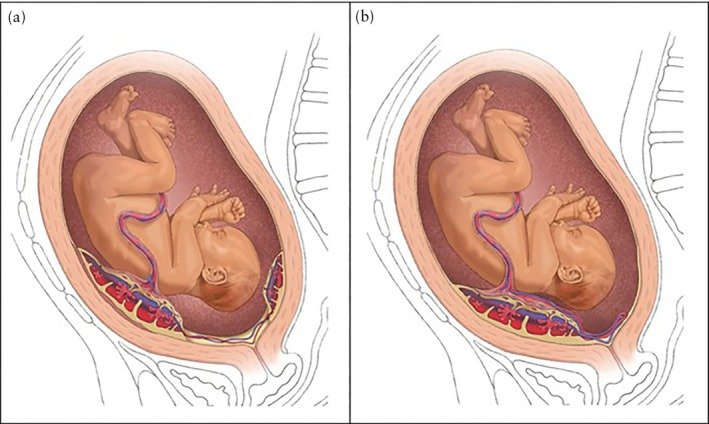
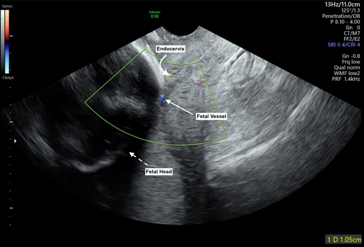
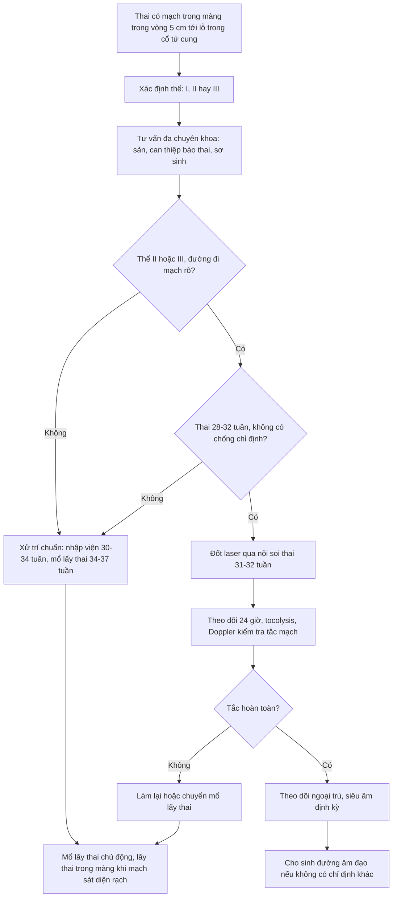
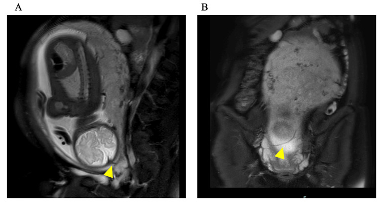
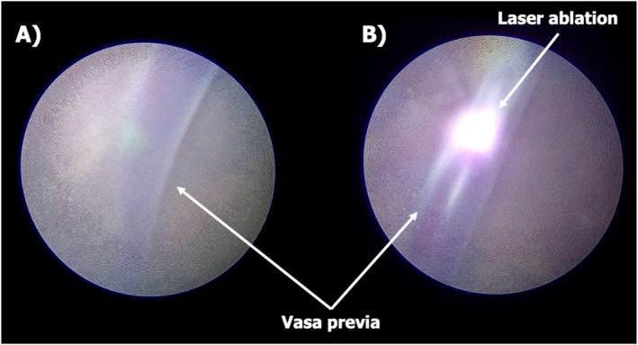

# 1603 — Vasa previa type II–III: chẩn đoán bằng Doppler đường âm đạo, ngưỡng 5 cm và đốt laser qua nội soi thai thay cho mổ lấy thai sớm

**Tags:** `pattern:vasa-previa` `pattern:mach-mau-tien-dao` `vung:co-tu-cung` `vung:nhau-thai` `score:5cm` `protocol:TVUS-Doppler` `protocol:MRI-thai` `protocol:fetoscopic-laser`
**Mức chắc chắn (certainty):** tổng hợp y văn (literature synthesis) — tổng hợp từ 1 nghiên cứu đoàn hệ so sánh **đốt laser qua nội soi thai (FLA) với xử trí chuẩn** (Backley 2026, 67 thai), 1 tổng quan hệ thống 54 ca FLA (Ruano 2025), 1 bài lập luận về **ngưỡng 5 cm** (Schenone 2025), 1 nghiên cứu dân số UKOSS (Attilakos 2024, 51 ca), 1 loạt 55 ca theo thể bánh nhau (Tachibana 2021) và 2 ca nguyên văn có ảnh mở; số liệu đối chiếu trực tiếp PMCID trong `sources.md`.

## 1. Tổng quan bệnh học – cơ chế hình ảnh

- **Định nghĩa:** **vasa previa (VP)** là tình trạng **mạch máu của thai nhi chạy trong màng ối, không được bảo vệ bởi bánh nhau hay dây rốn (không có Wharton's jelly)**, băng ngang hoặc nằm sát **lỗ trong cổ tử cung**. Vì thành mạch mỏng và không có đệm, **vỡ màng ối hoặc cơn co tử cung** có thể làm rách mạch → **thai mất máu cấp (exsanguination)** trong vài phút.
- **Dịch tễ:** **1/2.500–5.000** thai kỳ; tổng quan 24 nghiên cứu gộp **7,9/10.000** thai. Tại Anh (UKOSS 2014–2015): **6,64/100.000** ca sinh (**~1/15.062**) — tức là **chỉ các ca được chẩn đoán**, con số thật cao hơn.
- **Tử vong khi KHÔNG chẩn đoán trước sinh (số liệu quyết định):**
  - Loạt 155 ca của Oyelese: **94 ca không được chẩn đoán trước sinh → tử vong chu sinh 56%**.
  - Tổng quan hệ thống của Zhang: **thai lưu 27,4%**, **tử vong sơ sinh 15,8%**, **58% trẻ sống có di chứng thiếu oxy**.
  - UKOSS: 28 ca chẩn đoán trước sinh → **0 tử vong, 0 HIE**; 23 ca chỉ phát hiện quanh sinh → **tử vong chu sinh 37,5%**, **47% trẻ sống bị HIE**.
  - Chẩn đoán trước sinh làm **giảm 25 lần odds tử vong chu sinh** và **50 lần odds bệnh suất sơ sinh**; tỷ lệ tử vong gộp ở nhóm được chẩn đoán chỉ **0,94%**.
- **Ba thể (phân loại theo giải phẫu bánh nhau):**
  - **Type I:** dây rốn **bám màng (velamentous cord insertion)**, mạch chạy từ chỗ bám tới bánh nhau qua màng.
  - **Type II:** mạch nối **giữa hai thùy của bánh nhau** (bánh đôi/bánh phụ – bilobed/succenturiate).
  - **Type III:** mạch **rời bờ bánh nhau rồi quay lại bánh nhau ở vị trí khác** ("quỹ đạo boomerang"), **thường KHÔNG có dây rốn bám màng và không có bánh phụ** — đây là thể dễ bỏ sót nhất.
- **Yếu tố nguy cơ:** **hỗ trợ sinh sản (ART)** — 60,0% type I và 25,0% type không-I; **bánh đôi/bánh phụ**; **rau bám thấp** (61,8% ca lúc chẩn đoán); song thai; tiền sử rau bám thấp ở quý II.
- **TẠI SAO hình ảnh trông như vậy (vật lý + giải phẫu):**
  - Mạch máu thai trong màng **không có mô đệm** nên trên siêu âm là **cấu trúc ống song song, thành mỏng**, di động theo màng ối; trên **Doppler màu** hiện dòng **đỏ–xanh rõ** vì vận tốc máu thai cao.
  - **Doppler xung (pulsed-wave)** cho **dạng sóng động mạch rốn** (nhấp nháy theo tim thai) — đây là **tiêu chuẩn phân biệt với tĩnh mạch mẹ** (dòng liên tục, thay đổi theo nhịp thở).
  - Khi cổ tử cung **mở đến 10 cm**, mọi mạch trong **bán kính 5 cm** quanh lỗ trong đều có thể bị xé → **ngưỡng 5 cm** có cơ sở cơ học, không phải con số tùy tiện.
  - Trên **MRI**, mạch thai là **cấu trúc dòng chảy rỗng tín hiệu (flow void)** trong màng, thấy rõ khi bánh nhau **mặt sau** hoặc **bánh đôi** — nơi siêu âm bị che bởi bóng âm của thai.

## 2. Mẫu hình + chẩn đoán phân biệt theo vị trí (gamut)

- **Mẫu hình A — "dây rốn bám màng + mạch băng qua cổ tử cung":** **type I**; thường chẩn đoán sớm (**trung vị 21,4 tuần** trong loạt Tachibana), hay gặp ở thai ART.
- **Mẫu hình B — "mạch nối hai thùy bánh nhau":** **type II**; chẩn đoán muộn hơn (**28,6 tuần**), thường kèm rau bám thấp; **là thể phù hợp nhất với đốt laser** vì chỉ nuôi một phần bánh nhỏ (**≤ 10%** thể tích bánh).
- **Mẫu hình C — "mạch rời bờ bánh rồi quay lại, không có bánh phụ":** **type III**; dễ bị bỏ qua vì **không có yếu tố nguy cơ điển hình**; có thể chỉ thấy **một mạch đơn** thay vì cặp động–tĩnh.
- **Mẫu hình D — "dây rốn nằm trước ngôi thai (cord presentation)":** dây rốn **có Wharton's jelly**, dày hơn, di động; **không phải VP** nhưng cùng nguy cơ sa dây rốn khi vỡ ối.
- **Mẫu hình E — "cấu trúc mạch ở cổ tử cung nhưng là mạch MẸ":** **giãn tĩnh mạch cổ tử cung (cervical varix)**, dòng liên tục, không có dạng sóng động mạch rốn; **Valsalva** làm thay đổi rõ.
- **Mẫu hình F — "rau tiền đạo có xoang rìa lớn":** mạch thuộc **tuần hoàn mẹ**, nằm trong bánh; phân biệt bằng Doppler và bằng việc mạch **không băng qua màng ối**.
- **Gợi nhớ 4 câu hỏi tại máy siêu âm:** (1) mạch **có nằm trong màng** không? (2) **cách lỗ trong bao nhiêu cm**? (3) **dạng sóng là động mạch rốn hay tĩnh mạch mẹ**? (4) **thể nào** (I/II/III) và **bánh nhau có thùy phụ** không?

*(a) **Type II**: mạch nối bánh chính với **bánh phụ/thùy thứ hai**. (b) **Type III**: mạch rời bờ bánh và **quay lại bánh ở vị trí khác**, không có bánh phụ. Cả hai đều là mục tiêu của đốt laser. Nguồn: Backley S et al., *Ultrasound Obstet Gynecol* 2026, CC BY 4.0.*

## 3. Bảng so sánh phân biệt (ma trận đối chiếu)

| Thực thể (entity) | Hình ảnh điển hình (TVUS/Doppler/MRI) | Chốt vào (rule-in) | Chốt loại (rule-out) | Gợi ý xác nhận |
|---|---|---|---|---|
| **Vasa previa type I** | Mạch trong màng từ **dây rốn bám màng** băng qua lỗ trong; Doppler động mạch rốn | **Thấy điểm bám dây rốn vào màng + mạch nối tới bánh** | Có bánh phụ nối hai thùy → type II | TVUS + Doppler màu; quét cả mặt phẳng **không đứng dọc** |
| **Vasa previa type II** | Mạch nối **bánh chính ↔ bánh phụ/bánh đôi**; thường kèm rau bám thấp | **Hai thùy bánh + mạch nối băng qua cổ tử cung** | Không có thùy phụ, mạch quay lại bánh → type III | MRI khi bánh mặt sau; Doppler xung xác nhận động mạch |
| **Vasa previa type III** | Mạch **rời bờ bánh rồi quay lại**, không có bánh phụ, có thể **một mạch đơn** | **Mạch nằm trong màng trên lỗ trong + bánh nhau bình thường** | Có dây rốn bám màng rõ → type I; có thùy phụ → type II | Quét toàn bộ đoạn dưới; MRI; đối chiếu giải phẫu bánh sau sinh |
| **Cord presentation** | Dây rốn (có Wharton's jelly) nằm trước ngôi, dày, di động | **Cấu trúc dây rốn 3 mạch, có mô đệm** | Mạch đơn trong màng, không có mô đệm → VP | Doppler; theo dõi khi chuyển dạ |
| **Cervical varix (mạch mẹ)** | Cấu trúc tĩnh mạch giãn ở cổ tử cung, dòng **liên tục** | **Dạng sóng tĩnh mạch mẹ, đổi theo Valsalva/nhịp thở** | Dạng sóng động mạch rốn → VP | Doppler xung + nghiệm pháp Valsalva |
| **Rau tiền đạo (placenta previa)** | Bánh nhau che lỗ trong; mạch nằm **trong bánh**, không trong màng | **Mô bánh nhau che lỗ trong** | Chỉ có mạch trong màng, không có mô bánh → VP | TVUS; phân biệt “rau bám thấp” khi bờ bánh cách lỗ trong **< 20 mm** |
| **Dây rốn bám màng KHÔNG có mạch qua cổ tử cung** | Điểm bám màng nhưng mạch **cách lỗ trong > 5 cm** | **Khoảng cách > 5 cm ở mọi mặt phẳng** | Mạch trong **≤ 5 cm** → vẫn phải xử trí như VP | Quét 3D/STIC; đo khoảng cách ngắn nhất |

*Đầu dò đặt ở cùng đồ sau, thấy **mạch thai (fetal vessel)** chạy trong màng, **đầu thai (fetal head)** ở dưới, **lỗ trong cổ tử cung (endocervix)** ở trên. Thước đo của máy ghi **1,05 cm** từ mạch tới lỗ trong — nằm sâu trong ngưỡng 5 cm. Nguồn: Barraza A et al., *Cureus* 2025, CC BY 4.0.*

## 4. Protocol chụp + hệ phân độ/điểm chuẩn hóa

**Bước 1 — sàng lọc (18–26 tuần, mọi thai kỳ có yếu tố nguy cơ):**
- **Siêu âm đường âm đạo (TVUS) + Doppler màu**: độ nhạy phát hiện trung vị **93%**, độ đặc hiệu **99–100%** ở 18–26 tuần.
- **Quét TOÀN BỘ đoạn dưới tử cung**, không chỉ mặt phẳng đứng dọc: trong loạt 55 ca, **67,3%** ca chỉ được chẩn đoán nhờ **mặt phẳng KHÔNG đứng dọc** — bỏ sót mặt phẳng này là lý do hay gặp nhất của chẩn đoán muộn.
- **Doppler xung** xác nhận **dạng sóng động mạch rốn**; dùng **nghiệm pháp Valsalva** (20,0% ca trong loạt Tachibana) để phân biệt **tĩnh mạch mẹ** với **mạch thai**.
- Với **rau bám thấp ở quý II**, nên **quét lại quanh 32 tuần** vì một số ca VP chỉ lộ ra khi tử cung lớn lên.

**Bước 2 — ngưỡng chẩn đoán: 2 cm hay 5 cm?**

| Tổ chức / tài liệu | Ngưỡng | Ghi chú |
|---|---|---|
| RANZCOG 2019 | **2 cm** | Cấu trúc ống có dòng chảy, Doppler xung |
| ISUOG 2023 | **< 2 cm** (“thường < 2 cm”) | Kết hợp siêu âm bụng + âm đạo |
| SOGC 2023 | **< 2 cm** = vasa previa; **2–5 cm** = “low-lying fetal vessels” | Tách riêng nhóm 2–5 cm và **khuyến cáo cân nhắc mổ lấy thai** |
| Bài lập luận 2025 (Schenone) + đồng thuận Delphi 57 chuyên gia | **5 cm** | Lý do: cổ tử cung mở **10 cm** → bán kính **5 cm** đều nguy hiểm |
| FLUMEN trial (FDA chấp thuận) | **5 cm** | Tiêu chuẩn tuyển chọn cho đốt laser |

- **Quan điểm của bài:** dùng **≤ 5 cm** làm ngưỡng **an toàn**; nếu chỉ dùng 2 cm, một nhóm thai có mạch **2–5 cm** sẽ bị cho sinh đường âm đạo và có nguy cơ chết thai. **Báo cáo ca 2,8 cm đã có tử vong sơ sinh** sau khi “hết vasa previa”.

**Bước 3 — phương thức bổ trợ:**
- **3D/STIC, HD live flow, 3D power Doppler**: lập **bản đồ đường đi của mạch** để tránh cắt vào mạch khi mổ.
- **MRI thai**: chỉ định khi **bánh mặt sau**, **bánh đôi**, hoặc siêu âm không kết luận; mạch thai là **flow void** trong màng. MRI cũng giúp **đánh dấu vị trí rạch tử cung**.

**Bước 4 — xử trí chuẩn (standard management – SM):**
- **Nhập viện theo dõi** từ **30–34 tuần** (SMFM) hoặc **30–31 tuần** (Tachibana); theo dõi tim thai, **corticosteroid** khi có nguy cơ sinh non.
- **Mổ lấy thai (CS) chủ động 34–37 tuần** (ACOG/SMFM); loạt Nhật chọn **35–36 tuần**; UKOSS: mổ trung vị **36 tuần**, **32%** phải mổ cấp trước kế hoạch.
- **Kỹ thuật mổ:** lập bản đồ bánh/mạch trước rạch; **tránh rạch qua bánh hoặc mạch**; với bánh mặt trước dùng **Ward technique** (rạch cơ tử cung sang bên rồi bóc tách); **lấy thai trong màng ối (en caul)** khi mạch nằm sát diện rạch.
- **Tuyệt đối không** thăm âm đạo/khám trong/bấm ối khi chưa loại trừ VP.

**Bước 5 — đốt laser qua nội soi thai (fetoscopic laser ablation – FLA) cho type II–III:**

| Chỉ số | FLA | Xử trí chuẩn (SM) |
|---|---|---|
| Tuổi thai khi sinh (trung vị) | **36,0 tuần** (IQR 35,0–37,6) | **34,4 tuần** (IQR 33,4–35,0) |
| Sinh đường âm đạo | **62,9%** (loạt 35 ca) / **50%** (gộp 54 ca) | 0% (chủ động mổ) |
| Thời gian nằm viện trước sinh | **1 ngày** (IQR 0–3) | **16 ngày** (IQR 7–23) |
| Nguy cơ sinh non | **HR 0,24** (0,14–0,44) | Tham chiếu |
| Vào NICU | **34,3%** | **96,9%** |
| Truyền máu sơ sinh | **0%** | **18,8%** |
| Tử vong thai/sơ sinh | 0 | 0 |

- **Chọn ca:** **type II/III** có đường đi mạch rõ; **type I thường khó** vì mạch xuất phát từ bánh và không có thùy phụ để “cô lập”.
- **Thời điểm:** đa số làm **31–32 tuần (88,6%)**; **tránh < 28 tuần** (nguy cơ PPROM) và **> 34 tuần** (mạch to, ối đục vì vernix, khó xác nhận tắc hoàn toàn). Có thể làm sớm **28 tuần** nếu **cổ tử cung ngắn 20 mm** hoặc chảy máu.
- **Kỹ thuật:** vào bằng fetoscope, **amnioinfusion 71,4%**, laser diode **600 hoặc 800 µm** (như trong TTTS); đường kính mạch trung vị **0,3 cm** (0,1–0,5); thời gian mổ **60 phút** (34–125).
- **Kết quả:** **thành công kỹ thuật 98,1%** (53/54), **sống 100%**, không có biến chứng mẹ nặng; **1 ca phải làm lại**, **1 ca bỏ cuộc** phải mổ ngay.
- **Biến chứng cần theo dõi:** **PPROM**, **tách màng ối**, **tái thông mạch**, chorioamnionitis; theo dõi **24 giờ** sau thủ thuật, tocolysis (nifedipine/magnesium), siêu âm Doppler kiểm tra tắc mạch trước khi ra viện.

## 5. Biến thể bình thường và cạm bẫy

- **Bẫy nguy hiểm nhất: tin vào ngưỡng 2 cm.** Ca mạch **2,8 cm** được coi là “đã hết vasa previa”, 2 tuần sau chảy máu và **trẻ tử vong**; ngưỡng **5 cm** mới phản ánh đúng cơ học cổ tử cung mở 10 cm.
- **"Hết vasa previa" không đồng nghĩa an toàn:** 26% (43/165) ca được gọi là “giải quyết” khi theo dõi; type I hay “hết” hơn type II (**38,7% vs 12,5%**). Tỷ lệ “hết” giảm theo tuổi thai: **66,7%** (< 20 tuần), **40,5%** (20–24), **26,3%** (24–28), **16,7%** (> 28). Trong loạt 55 ca Nhật, **21,8%** “hết” nhưng **tất cả vẫn mổ lấy thai**.
- **Type III không có “cờ đỏ” kinh điển:** không dây rốn bám màng, không bánh phụ, có khi chỉ **một mạch** — nếu chỉ quét mặt phẳng đứng dọc sẽ bỏ sót; **25%** ca type không-I được chẩn đoán **sau 32 tuần**.
- **Bánh mặt sau/bánh đôi** bị bóng âm của thai che → **quét mặt phẳng chếch/3D** hoặc **MRI**.
- **Nhầm tĩnh mạch mẹ (cervical varix) thành mạch thai:** dùng **Doppler xung** + **Valsalva**; mạch thai có dạng sóng động mạch rốn, tĩnh mạch mẹ thì không.
- **Dương tính giả 17%** khi đối chiếu giải phẫu bệnh sau sinh — vẫn phải xử trí như VP cho tới khi sinh, nhưng cần **xác nhận bánh nhau sau sinh** để tư vấn lần sau.
- **Cord presentation ≠ vasa previa:** dây rốn có Wharton's jelly, dày, 3 mạch; xử trí khác (theo dõi chuyển dạ, mổ khi sa dây).
- **Sai lầm trong mổ:** rạch tử cung qua bánh/mạch gây **mất máu thai cấp**; phải **lập bản đồ trước mổ**, dùng **Ward technique** hoặc **en caul**, và **không bấm ối** khi mạch nằm sát.
- **Không được cho sinh đường âm đạo chỉ vì “không chảy máu”** hoặc vì mạch “chỉ còn 3–4 cm”; nguy cơ vỡ mạch khi mở cổ tử cung vẫn còn.

## 6. Tự lượng giá — Blind Quiz

**Ca 1 — Thai 32 tuần, không triệu chứng, siêu âm thấy cấu trúc mạch ở cổ tử cung. Nhìn ảnh, mô tả trước.**

- Gợi ý lâm sàng: thai tự nhiên, không rau bám thấp trên siêu âm bụng.
- Câu hỏi: (1) Cấu trúc mũi tên là gì, cách lỗ trong bao nhiêu? (2) Thể nào? (3) Ba lựa chọn xử trí và cách tư vấn?

<b>Bấm để hiện đáp án (findings + chẩn đoán)</b>

- Dấu hiệu: **mạch thai** chạy trong màng, **cách lỗ trong 1,05 cm**, sát đầu thai; Doppler màu có tín hiệu dòng chảy.
- Chẩn đoán: **vasa previa type I** (dây rốn bám màng) — nằm trong ngưỡng nguy hiểm **≤ 5 cm**.
- Xử trí: (a) **nhập viện theo dõi + mổ lấy thai 34–37 tuần**; (b) **đốt laser** nếu đủ tiêu chuẩn (thường type II/III, 31–32 tuần) — ca này type I nên **không phải ứng viên lý tưởng**; (c) theo dõi ngoại trú chỉ khi đã tư vấn rõ nguy cơ và có khả năng mổ cấp cứu trong **30 phút**.
- Nguồn: Barraza A et al., *Cureus* 2025, **CC BY 4.0**, PMCID PMC11964157.

**Ca 2 — Thai 35 tuần, không rau bám thấp, không bánh phụ, nhưng có mạch băng qua cổ tử cung. Nhìn MRI, mô tả trước.**

- Gợi ý lâm sàng: siêu âm trước đó kết luận “rau bám thấp đã di chuyển”; mạch chỉ thấy rõ khi quét lại muộn.
- Câu hỏi: (1) Cấu trúc đầu mũi tên vàng? (2) Vì sao thể này dễ bỏ sót? (3) Xử trí?

<b>Bấm để hiện đáp án (findings + chẩn đoán)</b>

- Dấu hiệu: **mạch thai (flow void)** chạy trong màng, sát **lỗ trong cổ tử cung**, không thấy mô bánh hay thùy phụ ở vị trí đó.
- Chẩn đoán: **vasa previa type III** — mạch rời bờ bánh rồi quay lại bánh, **không có dây rốn bám màng và không có bánh phụ**, nên không có “cờ đỏ” để nghi ngờ.
- Vì sao dễ bỏ sót: chỉ quét mặt phẳng đứng dọc; “rau bám thấp di chuyển” làm yên tâm giả; type III thường **một mạch đơn**.
- Xử trí: **mổ lấy thai chủ động 34–37 tuần**, lập bản đồ mạch trước rạch; **không** sinh đường âm đạo dù mạch “xa hơn 2 cm”.
- Nguồn: Aramaki S et al., *Cureus* 2026, **CC BY 4.0**, PMCID PMC13066703.

**Ca 3 — Hình nội soi thai dưới đây đang làm gì, và kết quả kỳ vọng là gì?**

- Gợi ý lâm sàng: thai 31 tuần, type II, mẹ muốn tránh mổ lấy thai sớm.
- Câu hỏi: (1) Kỹ thuật? (2) Tiêu chuẩn chọn ca và thời điểm? (3) Tỷ lệ thành công và biến chứng?

<b>Bấm để hiện đáp án (findings + chẩn đoán)</b>

- (A) Nhìn thấy **mạch tiền đạo** trong màng; (B) **đốt laser (laser ablation)** làm tắc mạch.
- Chỉ định: **type II/III**, đường đi mạch rõ, thường **31–32 tuần** (88,6% ca), tránh **< 28** và **> 34 tuần**; có thể sớm hơn nếu cổ tử cung ngắn hoặc chảy máu.
- Kết quả: **thành công kỹ thuật 98,1%**; **sinh đường âm đạo 50–62,9%**; **sống 100%**; tuổi thai sinh trung vị **36,0 vs 34,4 tuần** so với xử trí chuẩn; **vào NICU 34,3% vs 96,9%**.
- Biến chứng: **PPROM**, tách màng ối, tái thông mạch, bỏ cuộc/phải làm lại (~2–3%).
- Nguồn: Ruano R et al., *Prenat Diagn* 2025 (PMC12611538, CC BY 4.0); Backley S et al., *Ultrasound Obstet Gynecol* 2026 (PMC12951256, CC BY 4.0).

## Bài liên quan chéo
- [563 — Bất thường rau–bánh nhau sớm: rau tiền đạo, vasa previa & circumvallate](../563-bat-thuong-rau-banh-nhau-som/lesson.md)
- [566 — Song thai: xác định màng đệm/màng ối & TTTS/TAPS](../566-song-thai-chorionicity-TTTS-TAPS/lesson.md)
- [565 — Sàng lọc hình thái thai & Doppler sản khoa](../565-sang-loc-hinh-thai-va-doppler-san-khoa/lesson.md)
- [569 — Sinh non trong song thai: cổ tử cung ngắn, progesterone, cerclage](../569-sinh-non-song-thai/lesson.md)

## Ảnh
- Nguồn + giấy phép từng ảnh: `images/CREDITS.md`. Tên file theo mẫu `NNN_slug_Modality_SourceID.jpg`.
- Cả 4 ảnh đều **CC BY 4.0** từ Europe PMC full-text; không crop, không ghép.

> Không dùng để chẩn đoán độc lập khi chưa có người hướng dẫn.
