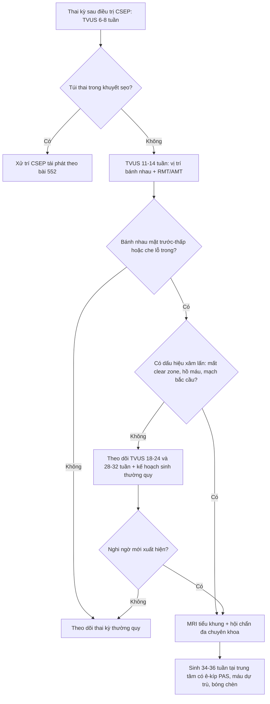
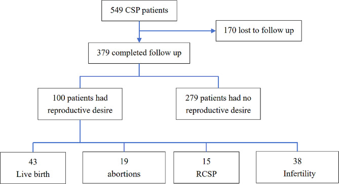
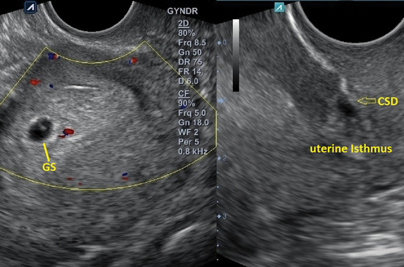
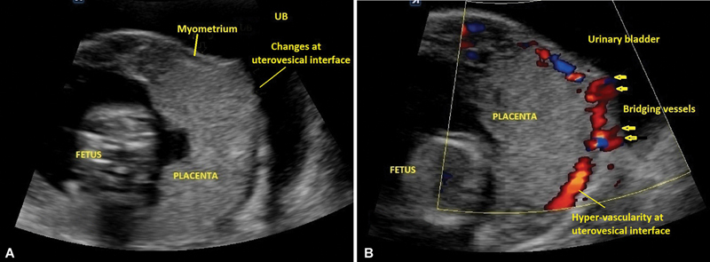
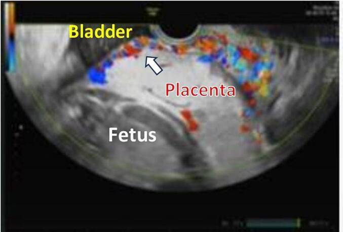

# 1604 — Thai kỳ sau điều trị chửa ở sẹo mổ lấy thai: tái phát, nhau cài răng lược & kết cục sinh sản / Pregnancy after treated cesarean scar ectopic

**Tags:** `pattern:thai-ky` `pattern:pas` `pattern:tai-phat` `vung:tu-cung-phan-phu` `protocol:TVUS-thai` `protocol:MRI-chau`
**Mức chắc chắn (certainty):** tổng hợp y văn (literature synthesis) — các đoàn hệ hồi cứu lớn (83–549 ca chửa sẹo) và 1 tổng quan hình ảnh; chưa có thử nghiệm ngẫu nhiên, nên mọi con số là **kết cục quan sát**, không phải khuyến cáo mức mạnh.

## 1. Tổng quan bệnh học – cơ chế hình ảnh

- **Câu hỏi lâm sàng sau khi điều trị chửa ở sẹo mổ lấy thai (cesarean scar ectopic pregnancy – CSEP) không phải "đã sạch chưa" mà là "mang thai lại thì sao".** Bài 552 dừng ở chẩn đoán – xử trí chỉ điểm; bài này trả lời phần sau: **tái phát, nhau cài răng lược (placenta accreta spectrum – PAS), kết cục sinh sản và khoảng cách mang thai**.
- **Nền giải phẫu:** khuyết sẹo (isthmocele) được định nghĩa là **chỗ lõm tại sẹo mổ lấy thai sâu ≥ 2 mm** trên siêu âm (tổng quan hệ thống, PMC9612856). Mô sẹo là **collagen xơ, gần như không có màng rụng (decidua)**; lớp cơ còn lại (residual myometrial thickness – RMT) mỏng hơn cơ lành.
- **TẠI SAO tái phát:** gai nuôi (trophoblast) làm tổ lại đúng vùng "cửa yếu" — nơi màng rụng khiếm khuyết và mô sẹo không co rút. Số liệu đoàn hệ: **15/100 (15%)** người mong con bị CSEP tái phát (PMC11088178); **8/74 (10,8%)** (PMC12443676); **5/76 thai (6,6%)** (PMC10173584). Khác biệt lớn vì **định nghĩa và mẫu số khác nhau** — luôn ghi rõ mẫu số khi trích.
- **TẠI SAO PAS:** thiếu lớp màng rụng tại sẹo → gai nuôi bám trực tiếp cơ tử cung (accreta), rồi increta/percreta nếu sâu tới thanh mạc – bàng quang. Trong một đoàn hệ 15.439 sản phụ có mổ lấy thai cũ (83 ca có tiền sử CSEP), tiền sử CSEP gắn với **PAS aRR 8,31**, **nhau tiền đạo aRR 6,50**, **băng huyết sau sinh (PPH) 21,7% vs 1,7% (aRR 2,62)**, **sinh non < 33 tuần aRR 12,05**, **nhẹ cân aRR 4,19** (PMC13262113). Đây là con số quan trọng nhất để tư vấn: **nguy cơ không chỉ là "tái phát chửa sẹo" mà là cả bệnh cảnh rau–nhau**.
- **Nguy cơ tuyệt đối thì vẫn thấp:** PAS gặp **2/51 (3,9%)** thai kỳ đạt được sau điều trị, 1 ca phải cắt tử cung vì chảy máu (PMC10173584). Nói cách khác: **đa số mang thai lại thành công, nhưng nhóm thất bại thì thất bại nặng**.
- **TẠI SAO hình ảnh thấy được (vật lý):**
  - **Mất dải sáng rõ (loss of clear zone):** bình thường có lớp màng rụng – cơ mảnh **giảm echo** sau bánh nhau; khi không có màng rụng, **không còn dải giảm echo** này.
  - **Hồ máu bánh nhau (placental lacunae):** các khoang tĩnh mạch giãn, echo trống, có dòng xoáy trên Doppler — máu chảy chậm trong khoang lớn.
  - **Mạch bắc cầu (bridging vessels):** tân mạch từ bánh nhau **xuyên qua cơ tử cung ra thanh mạc/bàng quang** — Doppler màu thấy dòng liên tục hai bờ.
  - **MRI:** dải **T2 tối trong bánh nhau** = fibrin/xơ (T2 ngắn vì mô xơ ít nước tự do), bánh nhau phồng (placental bulge), mất mặt phẳng giữa cơ và bàng quang. Trên DWI, bánh nhau **không hạn chế khuếch tán** — DWI không có vai trò chẩn đoán PAS.
- **Ngưỡng định lượng hay dùng:** RMT **≤ 3 mm** ở CSEP chỉ điểm nguy cơ vỡ (bài 552); với thai kỳ sau, **tỷ lệ RMT/AMT < 50%** (AMT = độ dày cơ lân cận) làm tăng nguy cơ PAS nếu bánh nhau nằm **mặt trước – thấp** (PMC11651832).

## 2. Mẫu hình + chẩn đoán phân biệt theo vị trí và thời điểm (Gamut)

Bốn câu hỏi theo thứ tự thời gian:

1. **Túi thai nằm ở đâu** so với khuyết sẹo (trong buồng – bám thấp – trong sẹo – cổ tử cung)?
2. **Có khuyết sẹo không, RMT còn bao nhiêu mm?**
3. **Bánh nhau sau này nằm mặt trước – thấp không?** (đây là điều kiện để PAS xảy ra trên sẹo)
4. **Có dấu hiệu xâm lấn chưa** (mất clear zone, hồ máu, mạch bắc cầu, bàng quang không đều)?

Gamut theo vị trí:

- **Trong buồng tử cung, bám thấp trên sẹo:** thai bình thường bám thấp (low-lying implantation) — phần lớn tiến triển tốt nhưng **phải theo dõi vị trí bánh nhau** về tam cá nguyệt 2.
- **Trong khuyết sẹo:** CSEP tái phát (type I/endogenic hoặc II/exogenic — bài 552).
- **Mặt trước – thấp, bánh nhau trên sẹo:** PAS (accreta → increta → percreta); kèm hoặc không kèm nhau tiền đạo.
- **Bánh nhau che lỗ trong nhưng không xâm lấn:** nhau tiền đạo (placenta previa) đơn thuần.
- **Trong ống cổ tử cung:** chửa cổ tử cung (differential của CSEP, bài 552).
- **Sau sẩy/thai lưu/hút thai:** sản phẩm thai tồn dư (retained products of conception – RPOC) nằm trong túi thừa sẹo — giả "khối u sẹo" (PMC11651832).

## 3. Bảng so sánh phân biệt (ma trận đối chiếu)

| Thực thể (entity) | Hình ảnh điển hình | Chốt vào (rule-in) | Chốt loại (rule-out) | Gợi ý xác nhận |
|---|---|---|---|---|
| **CSEP tái phát** | Túi thai trong khuyết sẹo, buồng tử cung rỗng, RMT mỏng | **Túi thai trong isthmocele + nghiệm pháp trượt âm tính + Doppler mạch nuôi quanh túi** | Túi thai trượt theo đầu dò → thai trong buồng/đang sẩy | TVUS + Doppler; β-hCG; MRI nếu nghi xâm lấn |
| **Thai bám thấp bình thường** | Túi thai trong buồng, **sát nhưng không trong** khuyết sẹo; cơ trước còn đều | **Có lớp cơ giữa túi thai và bàng quang, không mất liên tục** | Túi thai nằm trong khuyết + RMT ≤ 3 mm → CSEP | TVUS lặp 1–2 tuần; đo RMT |
| **PAS (accreta/increta/percreta)** | Bánh nhau mặt trước–thấp; **mất clear zone**, hồ máu, cơ < 1 mm, **mạch bắc cầu**, bàng quang không đều | **≥ 2 dấu hiệu: mất clear zone + hồ máu + mạch bắc cầu** (đặc hiệu tăng theo số dấu hiệu) | Còn clear zone đều + cơ ≥ 1 mm + không hồ máu → nhau bám bình thường | TVUS + Doppler (chuẩn đầu tay); **MRI** khi mặt phẳng sau khó, nghi percreta |
| **Nhau tiền đạo đơn thuần** | Bánh nhau che lỗ trong, **clear zone còn**, cơ đều | **Che lỗ trong + không dấu xâm lấn** | Có mạch bắc cầu/hồ máu + cơ < 1 mm → PAS | TVUS; theo dõi dịch chuyển bánh nhau tam cá nguyệt 2–3 |
| **RPOC tại túi thừa sẹo** | Khối hỗn hợp trong khuyết sẹo, có nang nhỏ, Doppler tín hiệu **thay đổi theo thời gian** | **Tiền sử hút thai/sẩy + khối trong sẹo + β-hCG giảm chậm** | Có túi thai/yolk sac + mạch nuôi kiểu trophoblast → CSEP | TVUS + β-hCG serial; tránh nạo mù |
| **Chửa cổ tử cung** | Túi thai dưới lỗ trong, eo tử cung rỗng, cổ phình | **Túi thai trong ống cổ + eo rỗng** | Túi thai ở đoạn dưới mặt trước = CSEP | TVUS; MRI khi cần |

*Ghi chú phản biện:* các dấu hiệu PAS trên siêu âm có **độ nhạy thay đổi lớn giữa người làm**; "âm tính" không loại trừ percreta, và "dương tính" đơn lẻ không đủ để mổ cắt tử cung non — cần hội chẩn đa chuyên khoa.

## 4. Protocol chụp + theo dõi + quyết định

**A. Trước khi mang thai lại (tư vấn tiền sản)**
- **TVUS đánh giá khuyết sẹo** (tốt nhất **sau mổ lấy thai ≥ 3 tháng**, pha noãn sớm khi có dịch trong buồng — PMC11651832): đo **chiều sâu, chiều dài khuyết, RMT, AMT**, tính **RMT/AMT**.
- **Không có ngưỡng RMT được chứng minh để khuyên mổ sửa sẹo trước khi mang thai.** Sửa isthmocele qua nội soi ổ bụng có tỷ lệ thai lâm sàng **62%** và sinh sống **72%** ở nhóm hiếm muộn (gộp 17 nghiên cứu, PMC12037975) — nhưng đây là dữ liệu quan sát, **không chứng minh sửa sẹo dự phòng tốt hơn theo dõi**. Chỉ cân nhắc khi **hiếm muộn + khuyết sẹo lớn + ứ dịch** hoặc đau/ra máu bất thường sau mổ.
- **Khoảng cách mang thai:** không có khuyến cáo thống nhất. Đoàn hệ ghi nhận khoảng cách trung bình **16,3 ± 10,83 tháng** (PMC12443676); một số nghiên cứu **loại trừ thai kỳ trong 12 tháng đầu** sau điều trị (PMC13103270) — thực hành phổ biến là **tránh thai đến khi β-hCG âm tính và tối thiểu 6–12 tháng**, nhưng đây là quy ước, không phải bằng chứng.
- **Yếu tố tiên lượng xấu hay gặp:** **sẩy thai sau điều trị** là yếu tố duy nhất gắn với CSEP tái phát (**OR 11,25; 95% CI 3,30–38,33**, PMC11088178); **dính buồng tử cung sau điều trị** là yếu tố chính khiến không có thai lại (PMC12443676). Vì vậy tránh nạo vét lặp, cân nhắc keo chống dính khi mổ.

**B. Thai kỳ sau — lịch theo dõi**
- **TVUS 6–8 tuần:** xác định vị trí túi thai so với sẹo; đo RMT; ghi khoảng cách túi thai – bàng quang (mm). Nếu túi thai trong sẹo → xử trí như bài 552.
- **TVUS 11–13 tuần 6 ngày:** xác định **vị trí bánh nhau** (mặt trước? thấp? che lỗ trong?) + đo RMT/AMT tại vị trí bánh nhau. Đây là mốc **quyết định theo dõi PAS**.
- **TVUS 18–24 tuần và 28–32 tuần** (nếu bánh nhau mặt trước–thấp hoặc có bất kỳ dấu hiệu nghi): tìm **mất clear zone, hồ máu, mạch bắc cầu, cơ < 1 mm, bàng quang không đều**.
- **MRI tiểu khung có gadolinium** khi siêu âm không kết luận, nghi **percreta** hoặc cần đánh giá **độ xâm lấn bàng quang** để lên kế hoạch mổ. MRI không thay thế siêu âm trong tầm soát.
- **Kế hoạch sinh:** nếu nghi PAS → sinh tại **trung tâm có ê-kíp đa chuyên khoa (sản – gây mê – niệu – can thiệp mạch – huyết học)**, mổ lấy thai chủ động **34–36 tuần** (ca báo cáo mổ 34 tuần 6 ngày, PMC11914175), có sẵn bóng chèn động mạch chủ/động mạch tử cung và máu dự trù.

**C. Kết cục sinh sản — số liệu để tư vấn**

| Kết cục | PMC11088178 (n = 100 mong con) | PMC12443676 (n = 74 có thai) | PMC10173584 (n = 51 theo đuổi) |
|---|---|---|---|
| Sinh sống | **43%** | **67,6%** | **60,8%** đủ tháng |
| Sẩy thai | **19%** | 2,7% | — |
| Hiếm muộn thứ phát | **38%** | **16,2%** | **15,7%** |
| CSEP tái phát | **15%** | **10,8%** | **6,6%** (5/76 thai) |
| PAS | không nêu | không nêu | **3,9%** (2/51, 1 cắt tử cung) |

**D. Sơ đồ quyết định**

*549 ca CSEP điều trị bằng hút thai dưới siêu âm ± nội soi sửa sẹo; 379 theo dõi được; trong 100 ca mong con: 43 sinh sống, 19 sẩy, 15 tái phát, 38 hiếm muộn thứ phát. Nguồn: Reprod Biol Endocrinol 2024 (PMC11088178), CC BY 4.0.*

## 5. Biến thể bình thường và cạm bẫy

- **Thai bám thấp không phải CSEP:** túi thai có thể nằm rất sát khuyết sẹo nhưng **vẫn trong buồng**; đừng chẩn đoán tái phát nếu không thấy túi **nằm trong** khuyết. Nghiệm pháp ấn đầu dò (sliding sign) và đo RMT ở mặt phẳng **đứng dọc giữa** là bắt buộc.
- **Dịch trong khuyết sẹo giả túi thai:** khuyết sẹo thường chứa ít dịch — không có viền trophoblast dày, không yolk sac, không mạch nuôi bao quanh.
- **"Đã điều trị CSEP" không có nghĩa "sẹo đã lành":** vẫn thấy khuyết sẹo nhiều năm; **khuyết sẹo tồn tại là nền nguy cơ**, không phải bằng chứng tái phát.
- **Bẫy hài lòng (satisfaction of search):** thấy thai trong buồng rồi bỏ qua việc **đo vị trí bánh nhau** ở 11–14 tuần — đây là bước bị bỏ nhiều nhất và là bước quyết định phát hiện PAS.
- **Đo RMT sai mặt phẳng:** đo chếch làm cơ trông dày hơn thực tế; đo tại **điểm mỏng nhất, vuông góc với thành trước**.
- **Siêu âm âm tính không loại trừ percreta**, đặc biệt khi bánh nhau mặt sau hoặc bệnh nhân béo; nghi ngờ lâm sàng → MRI.
- **Tránh nạo/hút lặp sau CSEP:** sẩy thai sau điều trị làm tăng nguy cơ tái phát (OR 11,25) và dính buồng tử cung làm giảm khả năng có thai — ưu tiên xử trí nội khoa/theo dõi khi an toàn.

## 6. Tự lượng giá — Blind Quiz

**Ca 1 — Thai 5 tuần trên người có mổ lấy thai cũ; không đau, không ra máu.**

- Gợi ý: ảnh trái có Doppler quanh túi thai; ảnh phải là mặt phẳng dọc qua eo tử cung.
- Câu hỏi: Túi thai nằm ở đâu? Cấu trúc mũi tên là gì? Chỉ số nào cần đo và vì sao nó quan trọng cho **thai kỳ này** (không phải cho chẩn đoán CSEP)?

<b>Bấm để hiện đáp án (findings + chẩn đoán)</b>

- Dấu hiệu: túi thai (GS) **trong buồng tử cung**, sát đoạn dưới; phía sau có **khuyết sẹo (CSD/isthmocele)** ở eo tử cung.
- Chỉ số cần đo: **RMT** và **AMT**, tính **RMT/AMT**. Ca này tỷ lệ **< 50%** — nếu sau này bánh nhau nằm **mặt trước – thấp**, nguy cơ PAS tăng.
- Chẩn đoán: **thai trong buồng trên nền khuyết sẹo**, không phải CSEP. Việc cần làm không phải mổ mà là **hẹn TVUS 11–14 tuần xác định vị trí bánh nhau**.
- Nguồn ảnh: Indian J Radiol Imaging 2025 (PMC11651832), Fig. 4 — CC BY-NC-ND 4.0, dùng nguyên bản.

**Ca 2 — Thai 7 tuần chẩn đoán CSEP, thai phụ quyết định giữ thai; theo dõi đến 13 tuần 5 ngày.**

- Câu hỏi: Ảnh B cho thấy dòng chảy ở đâu? Dấu hiệu này gọi là gì và nói lên điều gì về độ xâm lấn?

<b>Bấm để hiện đáp án (findings + chẩn đoán)</b>

- Dấu hiệu: (A) **không còn lớp cơ** giữa bánh nhau và bàng quang, đường echo bàng quang **mất đều**; (B) Doppler màu có **mạch bắc cầu (bridging vessels)** vượt mặt phẳng bàng quang – tử cung và **tăng sinh mạch mạnh ở mặt tiếp giáp**.
- Chẩn đoán: **CSEP tiến triển thành PAS** — mạch bắc cầu + mất cơ là dấu hiệu xâm lấn sâu (nghi increta/percreta).
- Ý nghĩa: thai giữ được nhưng phải sinh tại trung tâm có ê-kíp PAS; ca tương tự trong y văn nghi PAS từ **15–16 tuần**, chẩn đoán **percreta 22 tuần**, mổ ở **34 tuần 6 ngày** (PMC11914175).
- Nguồn ảnh: Indian J Radiol Imaging 2025 (PMC11651832), Fig. 9 — CC BY-NC-ND 4.0, dùng nguyên bản.

**Ca 3 — Thai 31 tuần, tiền sử CSEP đã điều trị; siêu âm mặt trước tử cung.**

- Câu hỏi: Mũi tên trỏ vào đâu? Vì sao đây là dấu hiệu đáng lo hơn "nhau tiền đạo đơn thuần"?

<b>Bấm để hiện đáp án (findings + chẩn đoán)</b>

- Dấu hiệu: **tăng sinh mạch (hypervascularity) trong bánh nhau** ngay sát thành trước, vùng mặt tiếp giáp tử cung – bàng quang.
- Chẩn đoán: **PAS** trên nền sẹo mổ lấy thai cũ. Khác nhau tiền đạo đơn thuần ở chỗ có **tân mạch xuyên qua cơ** và mất mặt phẳng sạch; nhau tiền đạo chỉ sai vị trí, không xâm lấn.
- Xử trí: mổ chủ động 34–36 tuần với ê-kíp đa chuyên khoa; ca nguồn mổ 34 tuần 6 ngày, bảo tồn tử cung bằng phẫu thuật bảo tồn một thì cải biên.
- Nguồn ảnh: Int J Surg Case Rep 2025 (PMC11914175), Fig. 2 — CC BY-NC-ND 4.0, dùng nguyên bản.

## Bài liên quan chéo
- [552 – Chửa ở sẹo mổ lấy thai & chửa góc](../552-chua-ngoai-tu-cung-seo-mo-lay-thai-va-chua-goc/lesson.md) (chẩn đoán – xử trí chỉ điểm)
- [560 – Nhau cài răng lược: lacunae, cơ < 1 mm & dải T2](../560-nhau-cai-rang-luoc-PAS-cap-cuu-san/lesson.md)
- [563 – Bất thường rau–bánh nhau sớm](../563-bat-thuong-rau-banh-nhau-som/lesson.md)
- [550 – Thai sớm: SRU, ngoài tử cung & vòng lửa](../550-thai-som-say-thai-thai-ngoai-tu-cung/lesson.md)
- [1605 – Endometrioma & tư vấn tiền sản: mổ dự phòng hay theo dõi](../1605-endometrioma-tu-van-tien-san/lesson.md)

## Ảnh
- Nguồn + giấy phép từng ảnh: `images/CREDITS.md`. Hai ảnh từ PMC11651832 và PMC11914175 là **CC BY-NC-ND 4.0** → giữ nguyên bản, **không crop, không ghép**.
- Ảnh sơ đồ kết cục từ PMC11088178 là CC BY 4.0.

> Không dùng để chẩn đoán độc lập khi chưa có người hướng dẫn.
