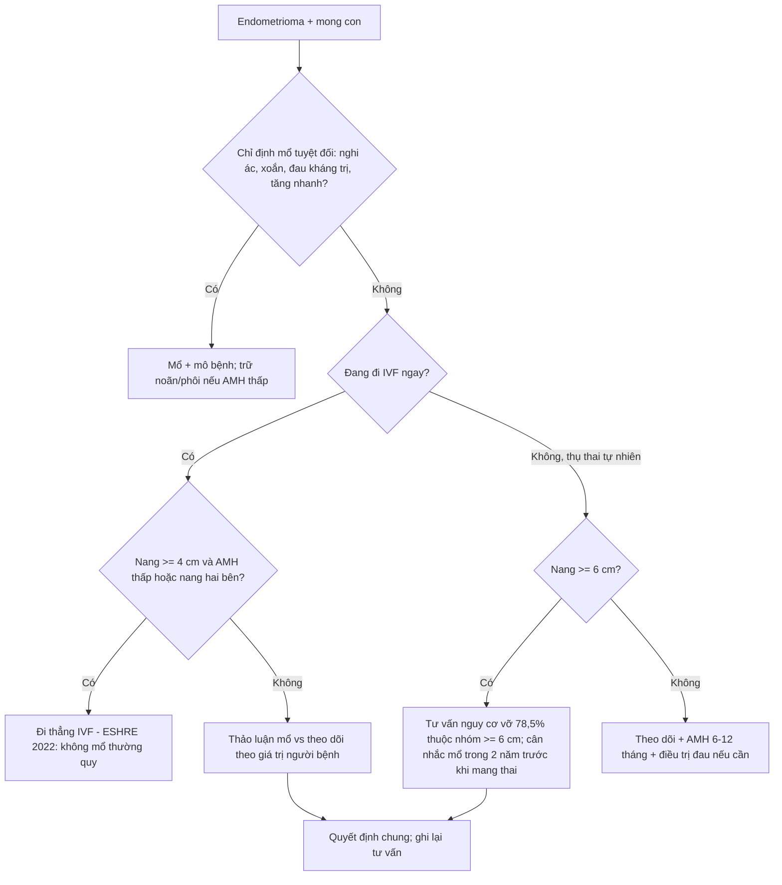
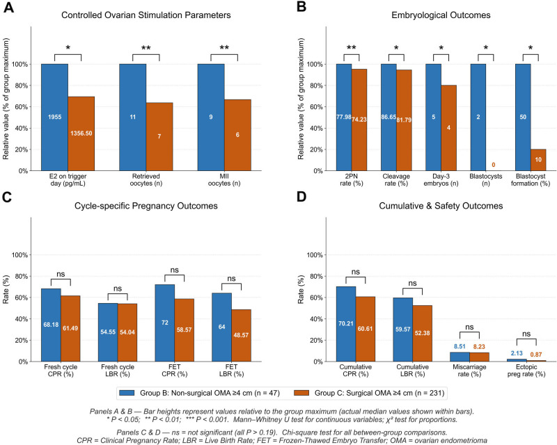
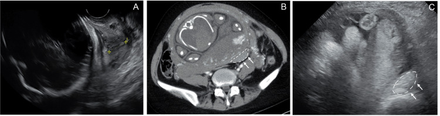
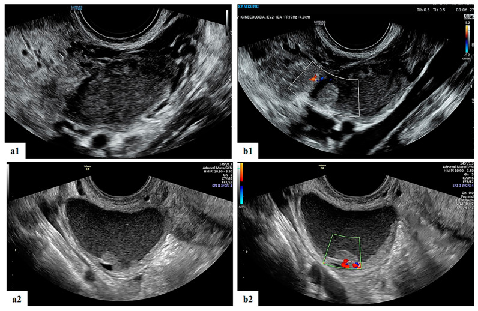

# 1605 — Endometrioma trước khi mang thai: mổ dự phòng hay theo dõi? / Ovarian endometrioma before pregnancy — prophylactic surgery or surveillance?

**Tags:** `pattern:nang-t1-sang` `pattern:lac-noi-mac` `vung:buong-trung` `vung:thai-ky` `protocol:TVUS` `protocol:MRI-chau` `incidentaloma:nang-buong-trung`
**Mức chắc chắn (certainty):** tổng hợp y văn (literature synthesis) — khuyến cáo ESHRE 2022 (mức mạnh) + đoàn hệ IVF 394 ca + đoàn hệ thai kỳ 208 ca + tổng quan 20 ca vỡ nang trong thai. Đây là chủ đề **chưa có thử nghiệm ngẫu nhiên**, nên các con số là bằng chứng quan sát.

## 1. Tổng quan bệnh học – cơ chế hình ảnh

- **Vấn đề:** nang lạc nội mạc buồng trứng (endometrioma) gặp ở **17–44%** phụ nữ có lạc nội mạc tử cung (PMC13671997); đa số **không triệu chứng** và được phát hiện khi siêu âm trước khi mong con. Câu hỏi thực hành: **mổ bóc nang trước khi mang thai hay theo dõi?**
- **Hai mặt của một đồng xu:**
  - **Mổ bóc nang (cystectomy)** làm giảm đau, giảm tái phát, có mô bệnh — nhưng **giảm dự trữ buồng trứng**: AMH giảm **~38%**, chênh lệch trung bình có trọng số **−1,13 ng/mL (95% CI −1,88 đến −0,37)** (meta-analysis 8 đoàn hệ, dẫn trong PMC10455819; chi tiết ở bài 585).
  - **Theo dõi** giữ được mô lành nhưng vẫn có nguy cơ **vỡ, xoắn, tái phát** và **không loại trừ được ác tính**.
- **TẠI SAO hình ảnh quyết định được (vật lý):**
  - **T1W rất sáng, không mất khi fat-sat:** dịch nang là **máu cũ cô đặc** (methemoglobin/hemosiderin + protein), không phải mỡ. Đây là điểm phân biệt với **u quái trưởng thành** (mỡ → **mất tín hiệu khi fat-sat**).
  - **T2W "shading" (bóng mờ):** nồng độ sắt–protein cao **rút ngắn T2** → tín hiệu trung gian/thấp, khác nang cơ năng (T2 rất sáng).
  - **Siêu âm: "ground glass" (kính mờ)** — echo dày đều, không có thành phần đặc; **không có tưới máu bên trong** trên Doppler. Nhú thật (true nodule) thì khác: có mạch, bờ không đều.
  - **DWI:** dịch máu cũ **không hạn chế khuếch tán** (không sáng trên DWI/không tối trên ADC); mô đặc nghi ác thì hạn chế.
- **Ngưỡng định lượng cần nhớ khi tư vấn:**
  - **Vỡ nang trong thai kỳ:** trong 20 ca được tổng quan, **78,5% nang ≥ 6 cm**, **50% xảy ra tam cá nguyệt 3**, tất cả ca ≥ 32 tuần đều phải mổ lấy thai (PMC12916156). Đây là lý do "nang to" được cân nhắc mổ **dù nguy cơ tuyệt đối rất thấp**.
  - **Tái phát sau mổ:** **21,5% ở 2 năm**, **40–50% ở 5 năm** (bài 584).
  - **Mổ trước IVF không cải thiện tỷ lệ sinh sống tích lũy:** **52,4% (mổ) vs 59,6% (không mổ)** ở nang ≥ 4 cm, **adjusted OR 0,77 (95% CI 0,38–1,56)**; AMH **1,98 vs 3,16 ng/mL**, số noãn thu được **7 vs 11** (PMC13472831, 394 ca).
  - **Mổ trước mang thai làm giảm nhau tiền đạo:** **8,5% vs 23,4%** (p = 0,020; OR 0,32; 95% CI 0,11–0,90) — nhưng lợi ích này **mất đi nếu mang thai > 2 năm sau mổ** (**20,0% vs 2,4%** khi mang thai trong vòng 2 năm) (PMC8986974, 208 thai).
- **Khuyến cáo ESHRE 2022 (mức mạnh):** **không mổ thường quy endometrioma trước hỗ trợ sinh sản (ART) để cải thiện tỷ lệ sinh sống**, vì lợi ích không chứng minh được còn **tác hại lên dự trữ buồng trứng là có thật**. Mổ **có thể cân nhắc** để giảm đau do lạc nội mạc; khi mổ thì **bóc nang được ưu tiên hơn chọc hút/đốt** (ESHRE 2022, khuyến cáo mạnh).

## 2. Mẫu hình + chẩn đoán phân biệt theo kích thước, triệu chứng và kế hoạch sinh sản (Gamut)

Năm câu hỏi theo thứ tự — trả lời xong mới quyết định:

1. **Có chỉ định mổ tuyệt đối không?** (nghi ác, xoắn, áp-xe, đau kháng trị, tăng nhanh, hình ảnh không điển hình).
2. **Nang bao nhiêu cm?** (< 4 cm / 4–6 cm / ≥ 6 cm).
3. **AMH và tuổi?** (AMH < 1,1 ng/mL = suy giảm dự trữ buồng trứng — bài 585; > 35 tuổi là yếu tố tiên lượng giảm mạnh).
4. **Kế hoạch sinh sản:** thụ thai tự nhiên, IVF ngay, hay IVF sau 6–12 tháng?
5. **Có đau/đau sâu/DIE kèm theo không?** (mổ vì đau là chỉ định khác với mổ vì nang).

Gamut theo kích thước – bối cảnh:

- **< 4 cm, không triệu chứng, AMH bình thường:** theo dõi + điều trị nội tiết nếu đau; **không mổ** (ESHRE 2022).
- **4–6 cm, mong con tự nhiên:** theo dõi là lựa chọn mặc định; mổ nếu đau nhiều, thất bại điều trị nội tiết, hoặc bệnh nhân ưu tiên giảm nguy cơ biến chứng thai kỳ sau khi được tư vấn đầy đủ.
- **≥ 6 cm:** nhóm có **78,5%** ca vỡ trong thai kỳ thuộc nhóm này (PMC12916156) → thảo luận mổ **trước** khi mang thai, đặc biệt nếu IVF (kiểm soát được thời điểm).
- **AMH < 1,1 ng/mL hoặc nang hai bên:** **tránh mổ** nếu không có chỉ định tuyệt đối; ưu tiên theo dõi, cân nhắc trữ noãn/phôi trước nếu vẫn phải mổ.
- **Nghi ác / nhú thật có mạch / thành dày không đều:** mổ + mô bệnh, không chờ.
- **Đã có thai:** xử trí theo bài 583 (decidualization giả ác, vỡ – xoắn) — **không** áp dụng logic "mổ dự phòng" ở đây nữa.

## 3. Bảng so sánh phân biệt (ma trận đối chiếu)

| Chiến lược (entity) | Hình ảnh / dữ liệu điển hình | Chốt vào (rule-in) | Chốt loại (rule-out) | Gợi ý xác nhận |
|---|---|---|---|---|
| **Theo dõi (surveillance)** | Nang "ground glass", T1 sáng không mất fat-sat, T2 shading, **không nhú có mạch** | **Nang < 4 cm + không đau nhiều + AMH bình thường + chưa cần IVF gấp** | Nang ≥ 6 cm, nhú thật có mạch, đau kháng trị, tăng nhanh → không theo dõi đơn thuần | TVUS + AMH mỗi **6–12 tháng** |
| **Mổ bóc nang trước mang thai** | Nang ≥ 4–6 cm; có thể kèm DIE | **Đau kháng trị / nang ≥ 6 cm / nghi ác / cần mô bệnh** | **AMH < 1,1 ng/mL + nang hai bên** → cân nhắc kỹ thuật khác hoặc trữ noãn trước | MRI trước mổ; AMH nền; mô bệnh |
| **Đốt/xơ hóa (ablation, sclerotherapy)** | Nang đơn thuần, không nghi ác | **Muốn giữ mô lành, nang tái phát nhiều lần** | **Không có mô bệnh** → loại khi nghi ác | Siêu âm theo dõi; AMH sau 3–6 tháng |
| **Đi thẳng IVF (không mổ)** | Nang ≥ 4 cm + hiếm muộn + AMH thấp | **Nang ≥ 4 cm không có chỉ định mổ tuyệt đối + AMH thấp** (ESHRE 2022) | Có đau dữ dội, nang tăng nhanh, nghi ác → phải mổ trước | AMH, AFC, tư vấn CLBR |
| **Nội tiết (OCP, dienogest, GnRH)** | Giảm đau, giảm tái phát | **Đau chu kỳ, chưa mong con ngay, sau mổ** | **Không dùng để "bảo vệ" AMH** — AMH còn giảm 21–26%/6 tháng (bài 585) | Hỏi tiền sử huyết khối, đau nửa đầu |
| **Giả u do decidualization (khi đã có thai)** | Nhú bờ trơn, tín hiệu giống bánh nhau, **ADC cao** | **Thai 11–13 tuần + nhú bờ trơn + ADC cao + không xâm lấn** | Bờ gai, ADC thấp, dịch ổ bụng → nghi ác | MRI; theo dõi, **không mổ** (bài 583) |

## 4. Protocol chụp + quy trình quyết định

**A. Đánh giá trước khi quyết định (1 buổi khám)**
- **TVUS + Doppler:** kích thước 3 chiều (mm), số nang, một/hai bên, echo "ground glass", **có nhú thật không**, mạch trong nhú, dấu dính (sliding sign), nang "hôn nhau" (kissing ovaries).
- **MRI tiểu khung** (T1, T2, **T1 fat-sat**, DWI/ADC, ± gadolinium): xác nhận máu cũ, loại u quái, đánh giá **DIE/ruột/niệu quản** nếu đau sâu; đo **thể tích nang và thể tích mô buồng trứng lành** (chỉ số OEVI đang nghiên cứu — bài 585).
- **AMH + AFC + FSH** (AMH lấy bất kỳ ngày nào; **1 ng/mL = 7,14 pmol/L**; ngưỡng DOR **< 1,1 ng/mL**).
- **Đừng đo AMH ngay sau mổ:** chờ **3–6 tháng** vì AMH giảm sâu nhất trong giai đoạn này rồi có thể hồi phục một phần (bài 585).

**B. Quy tắc tư vấn (điều quan trọng nhất của bài)**
1. **Nói rõ sự thật của bằng chứng:** mổ **không** làm tăng tỷ lệ sinh sống khi so với đi thẳng IVF (52,4% vs 59,6%; aOR 0,77; 0,38–1,56) và **làm giảm AMH ~38%**.
2. **Nói rõ lợi ích có thật:** mổ **giảm nhau tiền đạo** (8,5% vs 23,4%) **nếu mang thai trong vòng 2 năm** sau mổ; quá 2 năm lợi ích mất (20,0% vs 2,4%).
3. **Nói rõ nguy cơ của theo dõi:** vỡ nang trong thai **78,5% ở nang ≥ 6 cm**, **50% ở tam cá nguyệt 3** — biến cố hiếm nhưng nặng (mổ cấp cứu, sinh non).
4. **Nói rõ nguy cơ của mổ:** tái phát **21,5%/2 năm**, **40–50%/5 năm**; dính; giảm dự trữ không hồi phục ở nang hai bên.
5. **Ra quyết định theo giá trị của người bệnh** — không có "đúng tuyệt đối"; ghi lại nội dung tư vấn.

**C. Nếu chọn mổ — ba quy tắc thực hành**
- **Bóc nang, không đốt mù**; hạn chế đốt cầm máu trên mô lành (thêm tổn thương buồng trứng).
- **Trữ noãn/phôi trước mổ** nếu AMH thấp, nang hai bên, hoặc > 35 tuổi.
- **Mang thai trong vòng 2 năm** sau mổ (nếu không, lợi ích giảm nhau tiền đạo mất đi).

**D. Sơ đồ quyết định**

*394 ca IVF đầu tiên: nhóm không mổ (xanh, n = 47) vs mổ bóc nang trước đó (cam, n = 231) ở nang ≥ 4 cm. AMH và số noãn thấp hơn có ý nghĩa ở nhóm mổ, nhưng **tỷ lệ sinh sống tích lũy không khác biệt** (52,38% vs 59,57%, ns). Nguồn: Front Endocrinol 2026 (PMC13472831), CC BY 4.0.*

## 5. Biến thể bình thường và cạm bẫy

- **Bẫy số 1 — "nang to thì phải mổ":** nguy cơ vỡ tuyệt đối trong thai rất thấp; **78,5%** ca vỡ thuộc nhóm ≥ 6 cm **không có nghĩa mọi nang ≥ 6 cm sẽ vỡ**. Đừng biến con số tương đối thành chỉ định tuyệt đối.
- **Bẫy số 2 — đo AMH sai thời điểm:** AMH **giảm sâu nhất 1–3 tháng sau mổ**, hồi phục một phần đến **12 tháng**; đo ngay sau mổ sẽ đánh giá thấp dự trữ thật.
- **Bẫy số 3 — nhú trong thai:** từ **11–13 tuần**, **16% (95% CI 8–29%)** nang có phản ứng decidualization với nhú bờ trơn, **ADC cao** (thường **1,4–1,6 × 10⁻³ mm²/s**); đây là **sinh lý**, không phải ung thư — mổ trong thai là sai lầm (bài 583).
- **Bẫy số 4 — chọc hút/sclerotherapy không có mô bệnh:** nếu hình ảnh không điển hình (nhú thật, thành dày, vách dày) thì **không được** dùng kỹ thuật không lấy bệnh phẩm.
- **Bẫy số 5 — bỏ sót DIE:** nang đơn độc trên siêu âm nhưng bệnh nhân đau sâu/đau khi giao hợp — cần MRI tìm DIE ruột/niệu quản; xử trí DIE khác hoàn toàn xử trí nang.
- **Bẫy số 6 — tái phát không phải thất bại:** tái phát **40–50% ở 5 năm** là diễn tiến tự nhiên của bệnh, không phải "mổ hỏng" (bài 584).
- **Biến thể bình thường:** nang cơ năng/xuất huyết **thoái triển sau 1–2 chu kỳ**; đừng gắn nhãn endometrioma khi chưa lặp siêu âm (tối thiểu **2 chu kỳ**).

## 6. Tự lượng giá — Blind Quiz

**Ca 1 — Thai 28 tuần, đau bụng dữ dội đột ngột, có tiền sử endometrioma buồng trứng trái chưa mổ.**

- Gợi ý: (A) siêu âm đầu dò, (B) CT bụng có cản quang, (C) siêu âm bụng.
- Câu hỏi: Dấu hiệu chính là gì? Chẩn đoán nào phải nghĩ trước tiên? Vì sao nang ≥ 6 cm là yếu tố nguy cơ?

<b>Bấm để hiện đáp án (findings + chẩn đoán)</b>

- Dấu hiệu: khối **dịch – máu phức hợp** sau tử cung, **dịch tự do ổ bụng** (đường nét đứt chỉ vị trí chảy máu), trên CT có **vùng tăng đậm độ** tương ứng máu đông.
- Chẩn đoán: **vỡ endometrioma trong thai kỳ** — biến cố hiếm, 50% ở tam cá nguyệt 3; **78,5%** ca trong tổng quan có nang **≥ 6 cm**.
- Xử trí: hồi sức + mổ cấp cứu (mổ lấy thai ± cắt phần phụ); tất cả ca ≥ 32 tuần trong tổng quan đều phải mổ lấy thai.
- Nguồn ảnh: Cureus 2026 (PMC12916156), Fig. 1 — CC BY 4.0.

**Ca 2 — Thai 15 tuần, endometrioma 6 cm đã biết; siêu âm thấy "nhú" trong nang.**

- Câu hỏi: Nhú này là dấu hiệu ác tính hay sinh lý? Dấu hiệu nào trên MRI giúp chốt?

<b>Bấm để hiện đáp án (findings + chẩn đoán)</b>

- Dấu hiệu: nang **echo kính mờ** (máu cũ), **nhú bờ trơn, tròn đều**, mạch **vừa phải ở thành nang**, không xâm lấn vỏ.
- Chẩn đoán: **decidualization sinh lý** của endometrioma trong thai — xuất hiện từ **11–13 tuần**, gặp ở **16%** nang; **không phải ung thư**.
- Chốt bằng MRI: nhú **tín hiệu giống bánh nhau** trên T2, **ADC cao 1,4–1,6 × 10⁻³ mm²/s** (T2 shine-through), không có bờ gai/xâm lấn.
- Xử trí: **theo dõi, không mổ**; nang thường nhỏ lại sau sinh (bài 583).
- Nguồn ảnh: Diagnostics 2023 (PMC10606809), Fig. 4 — CC BY 4.0.

**Ca 3 — Tư vấn bằng số: bệnh nhân 33 tuổi, endometrioma 5 cm hai bên, AMH 0,9 ng/mL, đang chuẩn bị IVF.**

- Câu hỏi: Dựa trên biểu đồ dưới đây và ESHRE 2022, bạn tư vấn mổ hay đi thẳng IVF? Nêu 2 con số để giải thích.

<b>Bấm để hiện đáp án (findings + chẩn đoán)</b>

- Trả lời: **đi thẳng IVF** là lựa chọn hợp lý. Hai con số: **CLBR 52,4% vs 59,6%, aOR 0,77 (0,38–1,56)** — không có lợi ích sinh sống; **AMH 1,98 vs 3,16 ng/mL** và **7 vs 11 noãn** — mổ làm giảm dự trữ và hiệu quả kích thích.
- Thêm: AMH **0,9 ng/mL < 1,1** = suy giảm dự trữ; nang **hai bên** là yếu tố tiên lượng giảm AMH mạnh nhất → **tránh mổ** nếu không có chỉ định tuyệt đối.
- Nếu vẫn phải mổ: **trữ noãn/phôi trước**, và mang thai trong vòng **2 năm** sau mổ.
- Nguồn ảnh: Front Endocrinol 2026 (PMC13472831), Fig. 3 — CC BY 4.0.

## Bài liên quan chéo
- [583 – Nang lạc nội mạc trong thai kỳ: decidualization giả ác](../583-nang-lac-noi-mac-trong-thai-ky/lesson.md)
- [584 – Dự phòng & theo dõi tái phát sau mổ endometrioma](../584-du-phong-tai-phat-sau-mo-endometrioma/lesson.md)
- [585 – Endometrioma & dự trữ buồng trứng: AMH, bóc nang vs đốt](../585-nang-lac-noi-mac-va-du-tru-buong-trung/lesson.md)
- [543 – Nang lạc nội mạc buồng trứng](../543-nang-lac-noi-mac-buong-trung/lesson.md)
- [530 – Buồng trứng: O-RADS siêu âm & MRI](../530-buong-trung-ORADS-sieu-am-MRI/lesson.md)
- [1604 – Thai kỳ sau điều trị chửa ở sẹo mổ lấy thai](../1604-thai-ky-sau-chua-seo-mo-lay-thai/lesson.md)

## Ảnh
- Nguồn + giấy phép từng ảnh: `images/CREDITS.md` (cả 3 ảnh đều **CC BY 4.0**).
- Không tải ảnh từ nguồn paywall; AuntMinnie chỉ dẫn link.

> Không dùng để chẩn đoán độc lập khi chưa có người hướng dẫn.
