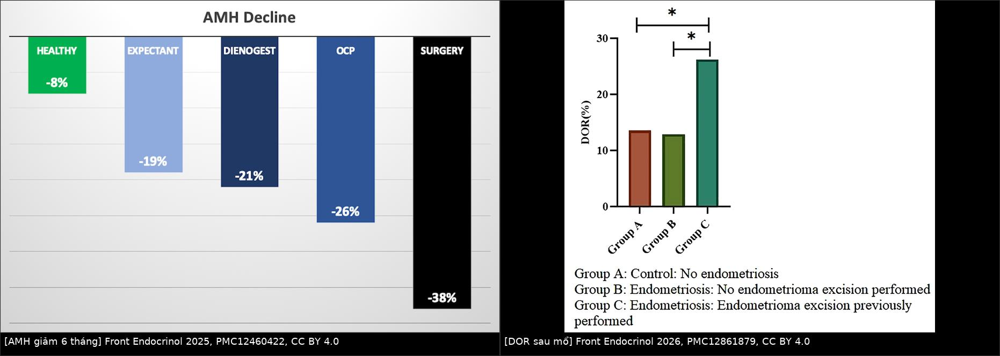
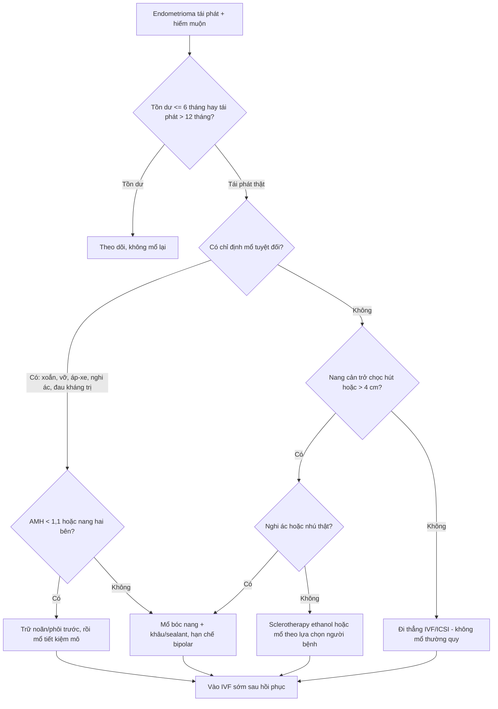
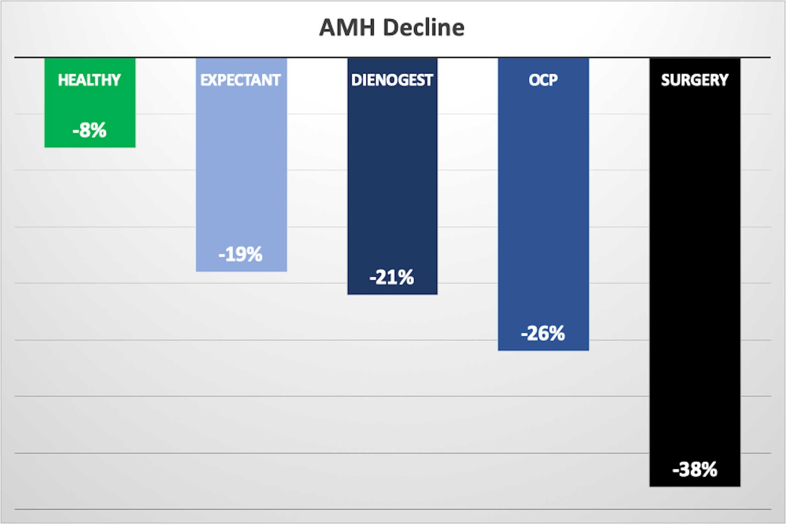
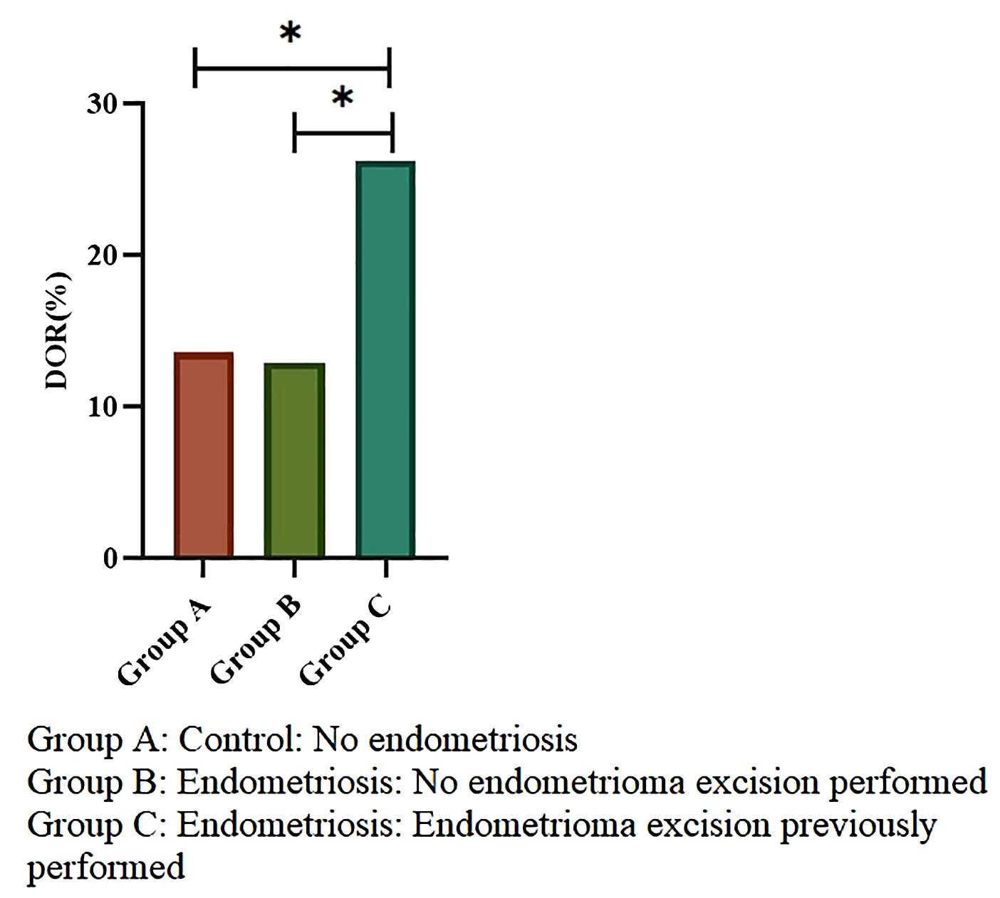

# 1606 — Endometrioma tái phát ở người hiếm muộn: mổ lại hay đi thẳng IVF/ICSI? / Recurrent endometrioma and infertility — repeat surgery or direct IVF?

**Tags:** `pattern:lac-noi-mac` `pattern:tai-phat` `vung:buong-trung` `protocol:TVUS` `protocol:MRI-chau` `incidentaloma:nang-buong-trung`
**Mức chắc chắn (certainty):** tổng hợp y văn (literature synthesis) — **không có RCT nào so sánh trực tiếp "mổ lại" với "đi thẳng IVF/ICSI"** ở endometrioma tái phát. Số liệu lấy từ: đoàn hệ IVF 394 ca, đoàn hệ 3.517 ca, meta-analysis 30 đoàn hệ, RCT sclerotherapy và guideline ESHRE 2022. Các câu suy luận từ bằng chứng gián tiếp được ghi rõ **[suy luận]**.

## 1. Tổng quan bệnh học – cơ chế hình ảnh

- **"Tái phát" hay "tồn dư"?** Đây là câu hỏi đầu tiên và hay bị bỏ qua:
  - **≤ 6 tháng sau mổ**, nang ở đúng vị trí cũ → **tồn dư (residual)**, không phải tái phát; **không mổ lại**.
  - **> 12 tháng**, nang mới → **tái phát thật (true recurrence)**.
  - Định nghĩa kích thước **không thống nhất**: **≥ 2 cm** (Lee 2020) hoặc **≥ 3 cm + đặc điểm siêu âm điển hình trên 2 chu kỳ liền** (Nie 2026). Vì vậy luôn ghi định nghĩa khi so sánh tỷ lệ (bài 584).
- **Tần suất nền:** tái phát **21,5% ở 2 năm**, **40–50% ở 5 năm**; mổ lại **8,3%** trong đoàn hệ 756 ca theo dõi trung vị 85,5 tháng (bài 584). Nghĩa là **đa số người bệnh không cần mổ lần hai** — mổ lại là ngoại lệ, phải có lý do.
- **TẠI SAO mổ lại nguy hiểm hơn mổ lần đầu (bằng chứng mô học + dự trữ):**
  - Bóc nang lấy đi **cả mô buồng trứng lành** dính vào thành nang. Ở nang tái phát, mặt phẳng bóc (cleavage plane) bị xơ hóa, thành nang dày hơn: **1,7 ± 0,3 mm** so với **1,1 ± 0,3 mm** ở mổ lần đầu (Muzii 2015, 17 ca mổ lần đầu vs 11 ca mổ lại).
  - Hệ quả: sau mổ lại, **buồng trứng đã mổ có AFC và thể tích thấp hơn có ý nghĩa so với bên đối diện**; khác biệt này **không có** ở nhóm mổ lần đầu (Muzii 2015).
  - Cơ chế thứ hai: **đốt cầm máu (bipolar)** gây tổn thương nhiệt lan vào vỏ buồng trứng; mổ lại thường phải đốt nhiều hơn vì dính, mạch máu thay đổi.
- **Định lượng mức giảm dự trữ — dùng để tư vấn:**
  - **AMH giảm sau 6 tháng** (nghiên cứu tiến cứu 80 ca + 20 chứng): **mổ 38%**, **OCP 26%**, **dienogest 21%**, **theo dõi 19%**, **người khỏe 8%** (PMC12460422). Nghĩa là **bản thân endometrioma cũng làm giảm AMH**, nhưng **mổ là mức giảm lớn nhất**.
  - **Tỷ lệ suy giảm dự trữ buồng trứng (DOR, AMH < 1,1 ng/mL)** trong 3.517 ca IVF: **26,23%** ở nhóm **đã mổ bóc nang** so với **12,90%** ở nhóm có nang chưa mổ và **13,56%** ở nhóm chứng; **RR 2,03 (1,29–3,21)** so với nang chưa mổ (PMC12861879). AMH trung vị: **1,97** (đã mổ) vs **2,70** (nang chưa mổ) vs **2,88 ng/mL** (chứng).
  - **Nang hai bên:** bóc nang hai bên làm AMH giảm **30–50%** (dẫn trong PMC13472831).
- **Kích thước nang có phải lý do mổ?** Meta-analysis 16 nghiên cứu/1.484 phụ nữ, 30 đoàn hệ: **đường kính endometrioma chưa mổ KHÔNG dự đoán AMH** khi mô hình liên tục (**β = 0,122; P = 0,35**) hoặc theo tầng (< 4, 4–5, 5–6, > 6 cm; **β = 0,245; P = 0,28**); **tuổi** mới giải thích phần lớn khác biệt (**R² = 58,2%**) (PMC13283431). **[suy luận]** Vì vậy "nang to" một mình **không** là chỉ định mổ vì dự trữ; nhưng nang lớn vẫn có thể là **vật cản tiếp cận chọc hút** hoặc làm **tăng nguy cơ biến chứng** — chỉ định lúc đó là kỹ thuật, không phải nội tiết.
- **Đi thẳng IVF có làm mất cơ hội sinh sống?** Ở nang ≥ 4 cm, mổ trước IVF **không cải thiện tỷ lệ sinh sống tích lũy**: **52,4% vs 59,6%**, **aOR 0,77 (0,38–1,56)**, trong khi **AMH thấp hơn** (1,98 vs 3,16 ng/mL) và **số noãn ít hơn** (7 vs 11) (PMC13472831; chi tiết ở bài 1605). **[suy luận]** Nghiên cứu này **thiếu lực** để kết luận tương đương — chỉ nói **không thấy lợi ích**, không nói "hai cách bằng nhau".
- **Tuổi là biến quyết định:** mỗi năm tăng thêm, **OR sinh sống tích lũy 0,92** (PMC13472831). Thời gian chờ mổ + hồi phục **là thời gian mất đi của buồng trứng**.

## 2. Mẫu hình + chẩn đoán phân biệt theo bối cảnh (Gamut)

**Năm câu hỏi theo thứ tự — trả lời xong mới quyết định:**

1. **Tồn dư hay tái phát thật?** (mốc 6 và 12 tháng).
2. **Có chỉ định mổ tuyệt đối không?** (xoắn, vỡ, áp-xe, nghi ác, đau kháng trị, nang tăng nhanh, cần mô bệnh).
3. **AMH/AFC và tuổi?** (AMH < 1,1 ng/mL = DOR; < 0,5 ng/mL = dự trữ rất thấp).
4. **Nang có cản trở chọc hút/IVF không?** (vị trí, hai bên, kích thước, tiếp cận qua thành âm đạo).
5. **Người bệnh ưu tiên gì?** (giảm đau, sinh con sớm, tránh mổ, tránh nguy cơ ác tính).

**Gamut theo bối cảnh:**

- **Tái phát không triệu chứng, nang < 4 cm, AMH bình thường:** theo dõi + đi thẳng IVF nếu đủ chỉ định hỗ trợ sinh sản. **Không mổ**.
- **Tái phát + đau kháng trị:** điều trị nội tiết trước (dienogest, OCP liên tục, LNG-IUS — bài 584); chỉ mổ nếu thất bại hoặc không dung nạp. **Mổ vì đau, không vì nang**.
- **Tái phát + AMH thấp (DOR) hoặc hai bên:** **tránh mổ**; nếu buộc phải mổ → **trữ noãn/phôi trước**.
- **Tái phát + nang lớn chắn đường chọc hút:** cân nhắc **sclerotherapy ethanol** (không lấy mô bệnh) hoặc mổ có kiểm soát; **không** chọc hút đơn thuần (tái phát **30–80%**; PMC13452471).
- **Tái phát + nhú thật có mạch, thành dày không đều, tăng nhanh:** **mổ + mô bệnh**, không sclerotherapy (bỏ sót ác tính).
- **Tái phát + DIE/ứ dịch vòi trứng:** xử trí theo bệnh nền (bài DIE, hydrosalpinx) — mổ nang đơn thuần không giải quyết nguyên nhân hiếm muộn.
- **Tái phát khi đang có thai:** decidualization giả ác, vỡ/xoắn — xử trí theo bài 583, **không** áp dụng logic mổ dự phòng.

## 3. Bảng so sánh phân biệt (ma trận đối chiếu)

| Chiến lược (entity) | Dữ liệu/hình ảnh điển hình | Chốt vào (rule-in) | Chốt loại (rule-out) | Gợi ý xác nhận |
|---|---|---|---|---|
| **Mổ lại (repeat cystectomy)** | Nang tái phát > 12 tháng, đau kháng trị, nghi ác, cản trở chọc hút | **Có chỉ định tuyệt đối** (xoắn/vỡ/áp-xe/nghi ác/đau kháng trị) **hoặc** nang chắn đường chọc hút | **AMH < 1,1 ng/mL + nang hai bên + không đau** → tránh mổ | AMH nền, MRI tiểu khung, mô bệnh; trữ noãn/phôi trước nếu AMH thấp |
| **Đi thẳng IVF/ICSI** | Nang ≥ 4 cm, hiếm muộn, không có chỉ định mổ tuyệt đối | **Không đau nhiều + không nghi ác + tiếp cận chọc hút được** | **Đau kháng trị, nang tăng nhanh, nhú có mạch, áp-xe** → phải xử lý nang trước | AMH, AFC, siêu âm theo dõi; tư vấn CLBR và tuổi |
| **Sclerotherapy ethanol** | Nang một ổ, dịch kính mờ, không nhú thật; nang tái phát | **Nang tái phát đơn thuần + muốn tránh mổ + không nghi ác** | **Nhú thật/thành dày/tăng nhanh** → không dùng (không có mô bệnh) | Siêu âm sau 3–6 tháng; AMH; theo dõi tái phát |
| **Nội tiết (dienogest/OCP/LNG-IUS)** | Đau chu kỳ, chưa muốn có thai ngay | **Đau + chưa đi IVF ngay + không có chỉ định mổ** | **Đang mong con/đi IVF** → không dùng để "bảo vệ" AMH | Hỏi huyết khối, đau nửa đầu, bệnh gan |
| **Trữ noãn/phôi trước mổ** | AMH thấp, nang hai bên, > 35 tuổi, phải mổ | **Phải mổ + dự trữ đã thấp hoặc nguy cơ mất cao** | **Không có chỉ định mổ** → không cần trữ vì mổ | AMH, AFC, tư vấn sinh sản trước mổ |

*Trái: AMH giảm sau 6 tháng theo nhóm — mổ 38%, OCP 26%, dienogest 21%, theo dõi 19%, người khỏe 8% (PMC12460422). Phải: suy giảm dự trữ buồng trứng (AMH < 1,1 ng/mL) ở nhóm đã mổ bóc nang 26,2% vs 12,9% (nang chưa mổ) và 13,6% (chứng) (PMC12861879). Cả hai đều CC BY 4.0, ghép letterbox giữ nguyên khung.*

## 4. Protocol chụp + quy trình quyết định

**A. Đánh giá một buổi khám (trước khi bàn mổ)**

- **TVUS + Doppler:** 3 chiều (mm), số nang, một/hai bên, echo "kính mờ", **có nhú thật có mạch không**, dấu dính, "kissing ovaries", **vị trí so với đường chọc hút**.
- **MRI tiểu khung** khi không điển hình hoặc nghi DIE: T1, T2, **T1 fat-sat** (máu cũ vẫn sáng, mỡ mất tín hiệu), DWI/ADC, ± gadolinium. **T2 shading** = máu cũ nhiều đợt; **nhú bờ trơn + ADC cao** ở người có thai = decidualization (bài 583).
- **AMH + AFC + FSH** — **không đo AMH trong vòng 3 tháng sau mổ** (giảm sâu nhất 1–3 tháng, hồi phục một phần đến 12 tháng). **1 ng/mL = 7,14 pmol/L**; DOR < 1,1 ng/mL.
- **Đếm số lần mổ trước** — đây là yếu tố nguy cơ độc lập với tổn thương buồng trứng; ghi vào hồ sơ.

**B. Quy tắc tư vấn (phần quan trọng nhất)**

1. **Nói rõ bằng chứng:** không có RCT so sánh mổ lại vs IVF; bằng chứng gián tiếp cho thấy **mổ làm giảm AMH/noãn** và **không cải thiện tỷ lệ sinh sống** ở nang ≥ 4 cm.
2. **Nói rõ cái giá của mổ lại:** thành nang dày hơn (1,7 vs 1,1 mm), mất mô lành nhiều hơn, AFC/thể tích buồng trứng giảm ở bên mổ — **không hồi phục hoàn toàn**.
3. **Nói rõ cái giá của chờ:** mỗi năm trôi qua, **OR sinh sống 0,92**; mổ + hồi phục thường mất **2–3 tháng** hoặc hơn nếu có biến chứng.
4. **Nói rõ nguy cơ của theo dõi:** tái phát **40–50% ở 5 năm**, nguy cơ vỡ/xoắn thấp nhưng nặng; **không loại trừ ác tính** nếu hình ảnh không điển hình.
5. **Ghi lại quyết định chung** — đây là quyết định theo giá trị người bệnh, không có "đúng tuyệt đối".

**C. Nếu vẫn chọn mổ — 4 quy tắc**

- **Trữ noãn/phôi trước** nếu AMH thấp, nang hai bên, > 35 tuổi hoặc đã mổ ≥ 2 lần.
- **Bóc nang đúng mặt phẳng**, lấy tối thiểu mô lành; **hạn chế bipolar**, ưu tiên **khâu buồng trứng** hoặc **chất cầm máu (hemostatic sealant)**.
  - Network meta-analysis 21 RCT/1.519 ca: so với bóc nang đơn thuần, **drainage + sealant** giữ AMH tốt hơn (**MD +0,96 ng/mL; 0,60–1,33**), **bóc nang + khâu** (**+0,69; 0,39–0,98**), **bóc nang + sealant** (**+0,37; 0,12–0,61**) (PMC13186601). Đây là **khác biệt AMH**, chưa chứng minh tăng tỷ lệ sinh sống.
- **Không đốt mù**; kiểm tra kỹ cầm máu bằng khâu hoặc sealant.
- **Sau mổ:** nếu chưa đi IVF ngay → nội tiết dự phòng (bài 584) **chỉ khi không mong con**; nếu mong con → **vào IVF sớm**, không chờ nội tiết.

**D. Sơ đồ quyết định**

## 5. Biến thể bình thường và cạm bẫy

- **Bẫy 1 — "nang to thì phải mổ":** đường kính **không** dự đoán AMH ở nang chưa mổ (PMC13283431); nang to chỉ là lý do **kỹ thuật** (chọc hút, nguy cơ biến chứng), không phải lý do nội tiết.
- **Bẫy 2 — gọi tồn dư là tái phát:** nang còn sau 3–6 tháng là **tồn dư**; mổ lại ngay sẽ lấy thêm mô lành mà không giải quyết gì.
- **Bẫy 3 — đo AMH sai thời điểm:** đo ngay sau mổ → đánh giá thấp dự trữ; chờ **3–6 tháng**, tốt nhất **6–12 tháng** nếu muốn giá trị ổn định.
- **Bẫy 4 — nhầm nang máu/hoàng thể với tái phát:** cả hai đều T1 sáng; **T2 shading** và **bờ đều, không nhú** gợi endometrioma; nang hoàng thể thường **thay đổi sau 2–3 chu kỳ** — theo dõi trước khi kết luận.
- **Bẫy 5 — sclerotherapy không có mô bệnh:** chỉ dùng khi hình ảnh **điển hình, không nhú thật**; nếu có thành phần đặc/tăng sinh mạch → **mổ + mô bệnh**.
- **Bẫy 6 — "mổ lại để sạch trước IVF":** không có bằng chứng mổ lại cải thiện tỷ lệ sinh sống; ngược lại, **mất thêm dự trữ**. Chỉ mổ khi có chỉ định thật.
- **Bẫy 7 — bỏ qua DIE/ứ dịch vòi trứng:** nang chỉ là một phần của bệnh; không đánh giá DIE/vòi trứng sẽ khiến IVF thất bại dù nang đã xử lý.

## 6. Tự lượng giá — Blind Quiz

**Ca 1 — Nữ 34 tuổi, endometrioma tái phát 3 cm sau mổ 2 năm, AMH 1,4 ng/mL, đau nhẹ. Nhìn biểu đồ, mức giảm AMH nào là của nhóm mổ?**

- Câu hỏi: Nhóm nào giảm AMH nhiều nhất? Vì sao? Điều này thay đổi tư vấn mổ lại thế nào?

<b>Bấm để hiện đáp án</b>

- **Nhóm mổ (surgery) giảm 38%** — cao nhất; theo dõi 19%, dienogest 21%, OCP 26%, người khỏe 8%.
- Cơ chế: lấy mô vỏ lành + tổn thương nhiệt khi cầm máu; ở nang tái phát, mặt phẳng bóc dày hơn nên mất mô nhiều hơn.
- Với AMH 1,4 ng/mL (gần ngưỡng DOR 1,1), **mổ lại sẽ đẩy AMH xuống thấp hơn nữa** → ưu tiên **đi thẳng IVF** hoặc **sclerotherapy** nếu nang cản trở chọc hút; nếu phải mổ → **trữ noãn trước**.
- Nguồn: Aslan K et al., Front Endocrinol 2025 (PMC12460422), CC BY 4.0.

**Ca 2 — Nữ 31 tuổi đã mổ bóc nang 3 năm, nay nang 4,5 cm, AMH 0,9 ng/mL. Nhìn biểu đồ DOR, nhóm nào giống bệnh nhân này?**

- Câu hỏi: Nhóm C khác nhóm B ở điểm nào? RR của DOR là bao nhiêu? Kết luận thực hành?

<b>Bấm để hiện đáp án</b>

- **Nhóm C = đã mổ bóc nang**, DOR **26,23%**; nhóm B = có nang chưa mổ **12,90%**; nhóm A = chứng **13,56%**.
- **RR 2,03 (1,29–3,21)** so với nang chưa mổ — mổ là yếu tố nguy cơ **độc lập** cho DOR, không chỉ do bệnh nền.
- Bệnh nhân đã ở **DOR (0,9 < 1,1)** → **không mổ lại** nếu không có chỉ định tuyệt đối; ưu tiên IVF, tư vấn trữ noãn nếu còn chỉ định mổ.
- Nguồn: Li Y et al., Front Endocrinol 2026 (PMC12861879), CC BY 4.0.

**Ca 3 — Nữ 38 tuổi, endometrioma tái phát hai bên 5 cm, đau vừa, AMH 0,6 ng/mL, muốn có con. Xử trí?**

- Câu hỏi: Có nên mổ lại không? Nếu mổ thì phải làm gì trước? Nếu không mổ thì phương án nào?

<b>Bấm để hiện đáp án</b>

- **Không mổ lại ngay.** AMH 0,6 ng/mL + nang hai bên + 38 tuổi = nguy cơ mất dự trữ rất cao; đau vừa có thể kiểm soát nội tiết.
- Nếu **buộc phải mổ** (đau kháng trị, nghi ác, cản trở chọc hút): **trữ noãn/phôi trước**, mổ tiết kiệm mô (khâu/sealant, hạn chế bipolar).
- Nếu không mổ: **đi thẳng IVF/ICSI**, có thể **sclerotherapy ethanol** nếu nang cản trở chọc hút; theo dõi sát.
- **Phản biện:** bằng chứng mổ lại vs IVF là **gián tiếp**, không có RCT; quyết định phải cá thể hóa và ghi lại tư vấn.
- Nguồn ảnh: PMC12460422 + PMC12861879, CC BY 4.0 (ảnh ghép).

## Bài liên quan chéo
- [1605 – Endometrioma trước khi mang thai: mổ dự phòng hay theo dõi?](../1605-endometrioma-tu-van-tien-san/lesson.md)
- [584 – Dự phòng & theo dõi tái phát sau mổ endometrioma](../584-du-phong-tai-phat-sau-mo-endometrioma/lesson.md)
- [585 – Nang lạc nội mạc & dự trữ buồng trứng](../585-nang-lac-noi-mac-va-du-tru-buong-trung/lesson.md)
- [583 – Nang lạc nội mạc trong thai kỳ](../583-nang-lac-noi-mac-trong-thai-ky/lesson.md)
- [533 – Theo dõi và bảo tồn sinh sản sau u buồng trứng](../533-theo-doi-va-bao-ton-sinh-san-sau-u-buong-trung/lesson.md)

## Ảnh
- `1606_AMH-giam-6-thang_PMC12460422.jpg`, `1606_DOR-sau-mo_PMC12861879.jpg` — CC BY 4.0.
- `composite_amh-va-mo-lai.jpg` — ảnh ghép letterbox từ hai ảnh trên (CC BY 4.0).
- Nguồn, giấy phép, tác giả: xem `images/CREDITS.md` và `sources.md`.

> Không dùng để chẩn đoán độc lập khi chưa có người hướng dẫn.
